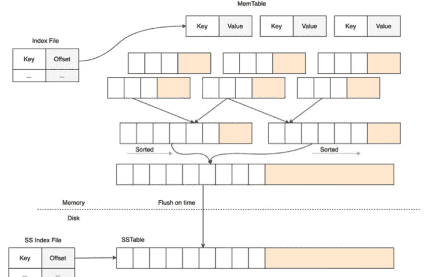
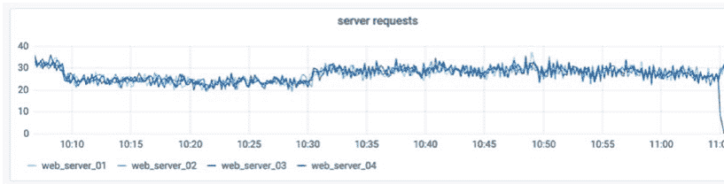
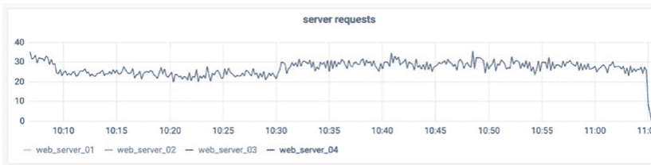
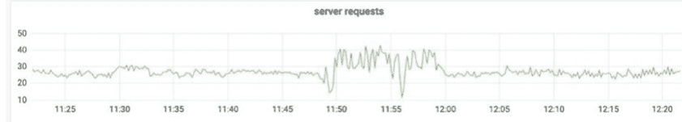
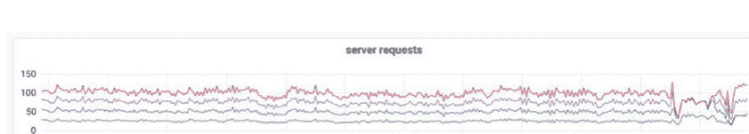
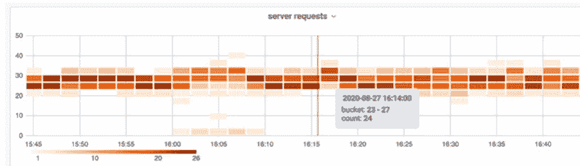
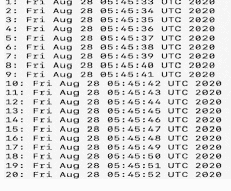

## CHAPTER 3

## 现代监控系统的架构

在本书的第一章中，我们学习了监控和云原生概念，重点关注设计监控系统所必需的基础术语和思想。在第二章中，我们讨论了可观测性以及为什么它对于理解基于微服务的现代应用程序的动态如此重要。我们审视了可观测性的支柱——指标、日志和追踪——然后通过同样的视角探索了观察 Kubernetes 环境的可能性。到目前为止，我们已经确立了端到端可观测性解决方案的必要性，我会口语化地称之为云原生应用程序的现代监控系统。

在本章中，我们将研究监控的各个组件，了解它们的功能以及它们如何融入整体现代监控系统。我们将设计一个端到端架构，能够识别影响系统最细微的问题，并在最短时间内发出警报。到本章结束，以及本书第一部分结束时，读者将对监控的一般概念、其组件和框架、监控系统应包含的设计以及相关的术语和概念有坚实的理解。

在着手设计该架构之前，我们首先需要确定构成此监控平台的各个组件。这些单独的组件是

- Data collection
- Data storage
- Data analysis/query engine
- Data visualization


### 暴露

暴露是指通过 HTTP 在 /metrics 路径上公开所收集指标的过程。对代码进行插桩只会生成指标，但这些指标必须发送到监控系统，而暴露正是负责这一过程的操作。暴露请求由客户端库处理，并包含在主函数或其他顶层函数中。

默认情况下，指标在 /metrics 路径上提供服务，但如果 /metrics 已被占用，也可以配置到其他路径。即使路径被配置为其他值，该端点通常仍被称为 /metrics。指标定义后，通常会注册到默认注册表中。如果你使用的是带有 Prometheus 插桩的客户端库，那么指标将自动出现在默认注册表中，无需显式添加任何额外的插桩。

为 Prometheus 处理而暴露的指标采用基于文本的格式，这种格式易于理解，因为它是人类可读的，因此也易于组装。其局限性在于可能比较冗长，并且附带解析成本。Prometheus 的文本格式是面向行的，使用换行符（\n）分隔各行。最后一行必须以换行符结尾。

Prometheus 的基于文本的格式如下所示：

```
metric_name [
  "{" label_name "=" "`" label_value "`" { "," label_name "=" "`" 
  label_value "`" } [ "," ] "}"
] value [ timestamp ]
```

InfluxDB 使用行协议以基于文本的格式写入数据点，该格式提供数据点的测量值、标签集、字段集和时间戳。InfluxDB 的文本格式如下所示：

```
<measurement>[,<tag_key>=<tag_value>[,<tag_key>=<tag_value>]]
<field_key>=<field_value>[,<field_key>=<field_value>] [<timestamp>]
// Example
myMeasurement,tag1=value1,tag2=value2 fieldKey="fieldValue"
1556813561098000000

// Example
myMeasurement,tag1=value1,tag2=value2 fieldKey="fieldValue"
1556813561098000000
```

### 桥接

Prometheus 的客户端库不仅仅以 Prometheus 文本格式输出指标。如果你想使用 Prometheus 进行插桩，但将指标暴露给其他输出（如 Graphite 或 Grafana 后端），则可以使用桥接。桥接从客户端库注册表中获取指标输出，并将其发送到其他监控系统。Python、Java 和 Go 的客户端库都包含一个 Graphite 桥接，可以将指标转换为 Graphite 能够理解的格式并写入其中。

### 解析器

Python 和 Go 的客户端库还具备用于 Prometheus 暴露格式的解析器。InfluxDB、DataDog 和 Sensu 等其他监控系统也能解析 Prometheus 文本格式，因此你可以为应用程序进行插桩以暴露 Prometheus 指标，并将输出直接发送到其他任何系统，甚至无需运行 Prometheus 服务器。

### 第三方导出器

在无法对你所使用的第三方应用程序或系统进行插桩的情况下，可以使用第三方导出器将现有指标导出为 Prometheus 格式。对于 InfluxDB，你可以配置 Apache、JMeter 和 FluentD 等第三方技术，将行协议直接发送到 InfluxDB。

### 代理

代理用于直接从安装它们的系统上收集指标，或从第三方 API 拉取指标，而无需或只需极少的代码插桩。在本节中，我们将介绍几个开源指标采集代理/工具：

#### collectd

这是一个流行的开源系统统计采集守护进程，可以从应用程序、操作系统、外部硬件设备和日志文件等多种来源收集指标，然后通过网络提供这些信息。collectd 使用 C 语言编写，以获得更好的性能和易于移植性。它支持超过 100 个插件，并且可以在无需任何特殊脚本的情况下运行在系统上。虽然 collectd 可以收集大量指标，但它无法生成图表，其监控功能也仅限于基本的阈值检查。

#### StatsD

这是一个开源网络守护进程，用于监听计数器和计时器等统计数据，并将聚合后的统计信息发送到一个或多个支持的后端服务，如 Graphite、DataDog、Elasticsearch、InfluxDB 等。它使用 Node.js 编写，并针对事件计数和提交聚合计数进行了优化。

StatsD 因其快速收集数据的能力而广受欢迎。StatsD 客户端使用 UDP 快速收集并发送数据，它假设数据能够到达 StatsD 守护进程，因此不会等待握手。StatsD 守护进程监听来自客户端的 UDP 流量，收集并聚合数据，然后默认每 10 秒发送到后端系统，从而使其接近实时。

#### Telegraf

它是 TICK¹ 技术栈的一部分（现为 InfluxDB OSS 2.0），也可作为独立的开源基于插件的代理，用于收集、处理、聚合和写入指标。它可以从应用程序、系统、网络设备、数据库、消息队列甚至物联网传感器收集指标。它使用 Go 编写，这意味着它可以编译成单个二进制文件，无需任何外部依赖即可在任何系统上执行。

Telegraf 开箱即用地支持 200 多个插件。Telegraf 插件支持解析器（输入数据格式）和序列化器（输出数据格式），这些可以添加到包含数据格式选项的 Telegraf 插件中。

#### fluentd

它是一个开源数据采集器，可以统一来自多个来源的日志数据收集，以便更好地关联和理解。它是继 Kubernetes、Prometheus、Envoy、CoreDNS 和 containerd 等极为成功的项目之后，第六个从 CNCF 毕业的项目。Fluentd 解决了大规模日志记录相关问题，不仅适用于常规的独立应用程序，也适用于云原生应用的分布式架构，使其成为任何云原生组织不可或缺的工具。

fluentd 从各种数据源收集日志，并尝试将其结构化为 JSON，通过结合日志数据处理的各个方面——收集、过滤、缓冲和发送日志，从而创建所谓的**统一日志层**。fluentd 使用 C 和 Ruby 的组合编写。fluentd 实例的内存占用为 30-40MB，每核每秒可以处理 13,000 个事件。

现在，我们已经了解了从不同系统和应用程序采集数据的过程，接下来让我们更仔细地审视 OpenTelemetry 项目，并考察它如何旨在解决围绕专有来源数据采集的主要问题。OpenTelemetry 旨在通过定义标准 API 和工具来彻底简化数据采集过程，这些 API 和工具可以与现有系统结合，以开源可观测性数据格式（Prometheus、Jaeger 等）生成输出。

### OpenTelemetry

分布式架构本质上更为复杂，并在性能和可用性方面引入了各种各样的运维挑战。为了解决这个问题，我们需要能够帮助更好地观察这些环境的遥测数据。目前，遥测数据大多由商业供应商为其自身解决方案提供。由于所收集的遥测数据格式缺乏标准化，后端之间无法实现数据可移植性。组织必须维护自己的插桩集以实现数据兼容。OpenTelemetry 试图通过引入一种供应商中立的解决方案来解决这一挑战，该方案得到了云提供商、供应商和企业界的广泛支持。

OpenTelemetry 是一个可观测性框架，它能够使用一组预定义的库、代理和工具从多个输入来源捕获遥测数据，从而使你能够更好地观察和管理这些数据。换句话说，OpenTelemetry 可以从你的应用程序中捕获指标、日志、资源元数据和分布式追踪，并将其发送到兼容的后端（如 Prometheus、Jaeger 或 Zipkin）进行处理。根据 OpenTelemetry 项目，其官方定义如下：

> OpenTelemetry 是一组 API、SDK、工具和集成，专为创建和管理遥测数据（如追踪、指标和日志）而设计。


OpenTelemetry 之所以重要，是因为它提供了

-   与厂商无关的 API 和 SDK，支持自动和手动埋点
-   能够并行生成、收集、处理和导出遥测数据到多个目的地，并支持管理采样和上下文传播
-   无需修改代码即可从某些应用程序中收集遥测数据的代理
-   支持多种开源和商业协议、格式及上下文传播机制，并为 OpenTracing 和 OpenCensus 项目提供适配层

OpenTelemetry 是 CNCF 的一个沙箱项目，由 OpenTracing² 和 OpenCensus³ 项目合并而成。它旨在定义和标准化从不同来源接收、处理和存储遥测数据的方式。OpenTelemetry 消除了为成功运行监控系统（无论是开源工具还是商业产品）而运行、操作和维护多个开源或专有代理及收集器的需要。

使用 OpenTelemetry 导出遥测数据有两种方式。第一种方式是直接使用 OpenTelemetry API 和 SDK 从进程中导出。配置好 API 和 SDK 后，你可以通过 provider 中的 meter 和 tracer 对象创建指标和跟踪，或者利用插件来自动创建。这种机制要求你使用一个或多个库将内存中的 span 和指标转换为适合发送到 Prometheus 或 Jaeger 等分析后端的格式。

另一种机制使用 OpenTelemetry 协议（OTLP）（一种线上协议）将数据发送到 OpenTelemetry 收集器。收集器是一个标准的二进制进程，可以作为代理或 sidecar 与实例一起运行，也可以单独运行在另一台主机上。收集器可以配置为将收集到的数据转发到任何支持的分析后端。有许多开源和商业工具支持 OpenTelemetry 数据进行进一步分析。

#### OpenTelemetry 收集器

OpenTelemetry 收集器允许你从各种来源接收遥测数据，而无需运行多个代理。它不仅能接收数据，还能够在默认配置下可选地转换数据并将其进一步发送，而无需对核心代码进行任何特定更改。它拥有一个统一的代码库，支持指标、日志和跟踪。

正如项目社区所定义的：

> OpenTelemetry 收集器提供了一种与厂商无关的实现，用于接收、处理和导出遥测数据。此外，它消除了为支持开源遥测数据格式（例如 Jaeger、Prometheus 等）并将其发送到多个开源或商业后端而运行、操作和维护多个代理/收集器的需要。

#### OpenTelemetry 收集器架构

OpenTelemetry 收集器支持多种（开源）协议，用于接收遥测数据、转换数据，然后将其进一步发送到其他后端系统。收集器是一个可执行文件，并提供可插拔架构，以便添加更多协议，如图 3-4 所示。

#### OpenTelemetry 代理

OpenTelemetry 库记录、收集、采样并聚合来自 pod 或 VM 中运行应用程序的指标和 span，并使用库导出器将收集到的数据导出到持久化存储后端。这是一个复杂的过程，因为每次导出器都必须用应用程序的语言实现，而且如果使用 Ruby 或 PHP，进行统计聚合很困难。另一种选择是将 OpenTelemetry 收集器作为代理运行，该代理可以独立于库进行部署。代理作为守护进程运行，可以从库中获取指标和 span，然后将它们发送到其他后端。如果原生语言不支持统计聚合，代理还可以对原始测量数据进行聚合。

### 数据存储

存储遥测数据是任何健壮监控系统架构的重要组成部分。在这个问题上有两种观点，大多数人倾向于使用 NoSQL 模型来存储数据，而有些人仍然坚持使用关系数据库模型。采用 NoSQL 数据库的原因是时间序列数据往往会随着时间推移而增长，变得不适合存储在关系数据库中。在关系数据库中，表以一组固定大小的页面（PostgreSQL 中为 8KB）存储，系统随后在这些页面上添加数据结构（B-Tree）来索引这些数据。使用索引，查询可以更快地找到具有特定数据的行，而无需扫描整个表。只要数据集和索引较小且可以放入内存，这种工作方式就很顺畅。然而，如果数据集大到无法存储在内存中，则必须存储在磁盘上，更新随机部分将意味着大量的磁盘 I/O，因为我们需要反复将页面从磁盘读入内存，在内存中修改，然后再写回磁盘。由于数据库一次只能访问磁盘上的一个页面，即使是很小的更新也可能导致大量交换，最终非常耗时。我们将看看如何通过 NoSQL 解决这个问题。

在本节中，我们将详细学习 NoSQL 数据模型作为 TSDB（时间序列数据库）的具体实现，该模型专为存储带时间戳的可观测性数据而设计。我们还将了解日志结构合并树（LSM-Tree）存储引擎，以及为什么许多开源系统将其用作底层存储平台。

#### LSM-Tree

广泛的 NoSQL 数据库使用 LSM-Tree 来通过执行大规模追加写到磁盘，从而降低小写入的成本。它不会进行“原地”写入，因为对现有页面进行微小更改意味着将整个页面从磁盘读入内存，然后再写回磁盘。因此，LSM-Tree 将多次更新排入页面，然后将它们作为单一批次写入磁盘。所有写入都先在内存中的排序表上执行，当该表增长到足够大时，作为单个不可变批次以排序字符串表（SSTable）的形式刷新到磁盘。

在 LSM-Tree 作为 SSTable 的实现中，数据以键/值对形式存储。索引文件将特定时间段内的更改作为批次存储。LSM-Tree 随后利用索引文件中的这些信息，对每个数据文件片段进行合并排序，并在内存中缓存。这为数据检索提供了低延迟。由于缓存是不可变的，新记录将被插入新文件中。不时地将文件合并在一起，以在任何给定时间点保持少量文件。图 3-5 显示了 LSM-Tree 的通用表示。



图 3-5. LSM-Tree

这样解决了写入问题；然而，任何需要快速响应的索引搜索都将具有较低的 I/O 效率。因此，LSM-Tree 可能更适合插入，而不是数据检索。使读取更快的方法是内存中保存页面索引。由于数据是按索引排序的，因此搜索可以直接查找目标键。这个过程会引入其他权衡，例如更高的内存需求和较差的二级索引支持，我们将在下面详细讨论：

-   **更高的内存需求：** 在 LSM-Tree 中，没有全局索引，也没有单独的排序来对所有键进行排序。因此，整个搜索值的过程变得更加困难，因为它首先检查内存表以获取键的最新版本，如果不存在，则查看许多磁盘表以找到与该键关联的最新值。这可能导致过多的磁盘 I/O；因此，为了避免这个问题，所有 SSTable 都完全保存在内存中，从而增加了内存需求。

-   **二级索引支持：** 由于 LSM-Tree 没有任何全局排序顺序，它们不支持二级索引。一些系统要么以不同顺序复制数据，要么将主键构建为多个键值的组合。这个过程在查询时需要大量扫描键。因此，LSM-Tree 支持基数⁴有限的键。

#### 时间序列数据

时间序列数据是在特定时间范围内对特定测量值的一系列观测结果。在某特定位置测量 5 天内的温度可以表示为时间序列。图 3-6 显示纳斯达克 1 天内的走势也是时间序列数据，因为构成图表的数值每 5 分钟采集一次。同样，从 IoT 传感器到应用程序性能监控的各种用例都会生成时间序列数据。

⁴基数是数据集中元素数量的一种度量。


#### TSDB（时序数据库）

时序数据需要一个专门的数据库来应对日益增长的海量带时间戳的指标和事件数据。大多数现代监控工具都将监控数据存储在专为存储带时间戳数据而优化的TSDB中。无论是服务器指标、网络流量数据、传感器数据、应用性能监控数据、点击流数据、事件，还是任何带有时间索引的数据，都可以在该数据库中轻松存储、分析并随时间进行聚合。数据一旦存入TSDB，就可以很容易地衡量其变化率。

TSDB的关键特性如下：

- **高写入吞吐量：** 在监控系统中，数据被非常频繁地采集并写入数据库。数据写入的频率远高于读取，通常90%到95%的操作是写操作。因此，后端数据库应能支持非常高的写入操作量。TSDB专为高并发写入而设计，可提供极高的写入吞吐量。
- **数据摘要：** 在监控系统中，会有针对特定时间范围（可能从几天到几个月）请求汇总数据的情况。这样做是为了建立模式并识别过去可能被忽视的故障。数据库查询实际上可能涉及大量的时序数据，数据库应能聚合所有这些数据而没有任何明显的延迟。对于TSDB，用户可以对数据编写交互式查询，并立即获得结果，而无需等待数据处理和数据汇总。使用关系数据库很难达到这种最佳效果。
- **数据下采样（Rollup）与聚合：** 在监控系统中，通常保留几天内的高精度数据，而更旧的数据则会被聚合，仅保留较少的样本。这称为下采样（downsampling）。TSDB的优点是它可以自行完成数据聚合和下采样，无需数据库管理员维护复杂的过程。
- **数据比较：** 在TSDB中，每个新条目和每次变更都只追加为一行新数据，以衡量随时间的变化。这对于计算与先前观察值的差异非常有用。
- **海量存储：** TSDB的另一个设计考虑是存储海量信息，有时甚至达到PB（拍字节）级别，同时还要支持高可用性和分布式架构，以支撑多个并发写入。

以上是TSDB的一些关键设计属性。它可以高效处理海量时间戳数据，同时开箱即用地进行数据管理和汇总。通过理解时序数据的重要特征以及TSDB背后的基本设计原理，我们可以清楚地认识到，使用基于LSM-Tree存储引擎的NoSQL数据库比基于B-Tree的关系数据库管理系统具有显著优势。

正如我们前面所见，基于LSM-Tree的TSDB旨在优化写入，在某些情况下，其写入性能比基于B-Tree的RDBMS高出十倍。相比之下，它们的读取性能较差。基于LSM-Tree的TSDB仅适用于写入远多于读取的场景。大多数著名的开源TSDB都使用基于LSM-Tree的存储引擎；例如，OpenTSDB使用HBase作为底层存储引擎，Prometheus依赖基于LSM的LevelDB存储引擎，而InfluxDB使用在LSM之上开发的时间结构化合并（TSM）存储引擎。在本书第二部分详细讨论这些特定的开源工具时，我们将进一步了解这些存储引擎。

### 时序数据模型

时序数据模型由以下部分组成：

- **时间戳（Timestamp）：** 每个测得数据点的时间索引值。
- **主体（Subject）：** 指被测量的组件；例如，在CPU使用率的情况下，主体就是主机。主体还可以有多个属性和维度。
- **度量（Measurement）：** 度量是我们要测量的指标及其值，对于CPU可以是CPU使用率百分比，对于存储磁盘可以是磁盘IOPS。

#### 按数据源建模

在这种模型中，来自单个数据源在给定时间点的所有指标都作为字段存储在同一个行中。例如，在图3-7中，主机1的CPU使用率百分比和磁盘IOPS在第一个时间戳14:00:00Z被捕获并作为一个条目输入。这有助于编写在单个度量下连接多个字段的查询。

| timestamp | datacenter | hostname | cpu | disk iops |
|---|---|---|---|---|
| 2020-08-26T 14:00:00Z | Datacenter 1 | host 1 | 30 | 500 |
| 2020-08-26T 14:00:00Z | Datacenter 1 | host 2 | 15 | 100 |
| 2020-08-26T 14:00:10Z | Datacenter 1 | host 1 | 33 | 750 |
| 2020-08-26T 14:00:10Z | Datacenter 1 | host 2 | 12 | 100 |
| 2020-08-26T 14:00:20Z | Datacenter 1 | host 1 | 35 | 800 |
| 2020-08-26T 14:00:20Z | Datacenter 1 | host 2 | 20 | 200 |
| 2020-08-26T 14:00:30Z | Datacenter 1 | host 1 | 32 | 650 |
| 2020-08-26T 14:00:30Z | Datacenter 1 | host 2 | 22 | 150 |

图3-7. 按数据源建模

#### 按指标建模

在图3-8所示的模型中，指标驱动数据点，每一行代表特定指标及其在给定时间点的测量值。例如，CPU使用率百分比和磁盘IOPS在主机1的给定时间戳分别有单独的行条目。

| metric | timestamp | datacenter | hostname | metric value |
|---|---|---|---|---|
| cpu | 2020-08-26T 14:00:00Z | Datacenter 1 | host 1 | 30 |
| cpu | 2020-08-26T 14:00:00Z | Datacenter 1 | host 2 | 15 |
| cpu | 2020-08-26T 14:00:10Z | Datacenter 1 | host 1 | 33 |
| cpu | 2020-08-26T 14:00:10Z | Datacenter 1 | host 2 | 12 |
| cpu | 2020-08-26T 14:00:20Z | Datacenter 1 | host 1 | 35 |
| cpu | 2020-08-26T 14:00:20Z | Datacenter 1 | host 2 | 20 |
| cpu | 2020-08-26T 14:00:30Z | Datacenter 1 | host 1 | 32 |
| cpu | 2020-08-26T 14:00:30Z | Datacenter 1 | host 2 | 22 |
| disk iops | 2020-08-26T 14:00:00Z | Datacenter 1 | host 1 | 500 |
| disk iops | 2020-08-26T 14:00:00Z | Datacenter 1 | host 2 | 100 |
| disk iops | 2020-08-26T 14:00:10Z | Datacenter 1 | host 1 | 750 |
| disk iops | 2020-08-26T 14:00:10Z | Datacenter 1 | host 2 | 100 |
| disk iops | 2020-08-26T 14:00:20Z | Datacenter 1 | host 1 | 800 |
| disk iops | 2020-08-26T 14:00:20Z | Datacenter 1 | host 2 | 200 |
| disk iops | 2020-08-26T 14:00:30Z | Datacenter 1 | host 1 | 650 |
| disk iops | 2020-08-26T 14:00:30Z | Datacenter 1 | host 2 | 150 |

图3-8. 按指标建模

### 数据分析与查询引擎

遥测数据被采集并存储到TSDB后，下一步就是分析数据。常见的数据分析方法包括过滤、聚合、分组和下采样。数据分析通过查询引擎完成，该引擎可以轻松操作存储的数据并提供查询结果。查询引擎通常使用在SQL类查询语言基础上修改的查询来查询数据。在本节中，我们将了解数据分析方法，并学习TSDB中用于查询遥测数据的各种机制。

#### 过滤

过滤是最常见的过程，我们对整个数据集运行查询，只返回那些满足查询条件的数据点。在时序分析中，过滤从指标值开始，然后根据查询细化到时间范围或测量值。在下面的示例中，对于示例时序数据，我们首先从包含指标“cpu”的表中选择数据点，然后根据其他条件（如“datacenter”或“hostname”）执行更详细的查询。

为了解释过滤的概念，我们使用图3-9中显示的示例数据：

| metric | timestamp | datacenter | hostname | metric value |
|---|---|---|---|---|
| cpu | 2020-08-26T 14:00:00Z | Datacenter 1 | host 1 | 30 |
| cpu | 2020-08-26T 14:00:00Z | Datacenter 1 | host 2 | 15 |
| cpu | 2020-08-26T 14:00:10Z | Datacenter 1 | host 1 | 33 |
| cpu | 2020-08-26T 14:00:10Z | Datacenter 1 | host 2 | 12 |
| cpu | 2020-08-26T 14:00:20Z | Datacenter 1 | host 1 | 35 |
| cpu | 2020-08-26T 14:00:20Z | Datacenter 1 | host 2 | 20 |
| cpu | 2020-08-26T 14:00:30Z | Datacenter 1 | host 1 | 32 |
| cpu | 2020-08-26T 14:00:30Z | Datacenter 1 | host 2 | 22 |
| disk iops | 2020-08-26T 14:00:00Z | Datacenter 1 | host 1 | 500 |
| disk iops | 2020-08-26T 14:00:00Z | Datacenter 1 | host 2 | 100 |
| disk iops | 2020-08-26T 14:00:10Z | Datacenter 1 | host 1 | 750 |
| disk iops | 2020-08-26T 14:00:10Z | Datacenter 1 | host 2 | 100 |
| disk iops | 2020-08-26T 14:00:20Z | Datacenter 1 | host 1 | 800 |
| disk iops | 2020-08-26T 14:00:20Z | Datacenter 1 | host 2 | 200 |
| disk iops | 2020-08-26T 14:00:30Z | Datacenter 1 | host 1 | 650 |
| disk iops | 2020-08-26T 14:00:30Z | Datacenter 1 | host 2 | 150 |

图3-9. 原始示例数据

查询从表中选择cpu，其中datacenter= 'Datacenter 1'且hostname= 'host 1'；在前面的表上执行时，将得到图3-10所示的表：

| metric | timestamp | datacenter | hostname | metric value |
|---|---|---|---|---|
| cpu | 2020-08-26T 14:00:00Z | Datacenter 1 | host 1 | 30 |
| cpu | 2020-08-26T 14:00:10Z | Datacenter 1 | host 1 | 33 |
| cpu | 2020-08-26T 14:00:20Z | Datacenter 1 | host 1 | 35 |
| cpu | 2020-08-26T 14:00:30Z | Datacenter 1 | host 1 | 32 |

图3-10. 过滤后的数据

结果表根据datacenter和hostname进行过滤，返回满足查询值等于'Datacenter 1'和'host 1'的结果。这是一个简单的示例，展示了从给定数据集中过滤遥测数据的机制。


#### 聚合

时序数据具有高基数，因为数据点以小至每分钟甚至每几秒的时间间隔被采集和存储。有时，这些高精度数据在特定时间范围内的变化率很小，因此我们需要一些涉及基本统计函数（如 SUM、AVG、Max 和 TopN）的聚合操作。例如，在分析服务器流量时，我们更感兴趣的是了解峰值流量、平均流量以及某个时间范围内的总和。

在应用聚合之前，让我们先重新查看一下我们在图 3-11 中使用的原始数据：

| 指标 | 时间戳 | 数据中心 | 主机名 | 指标值 |
|---|---|---|---|---|
| cpu | 2020-08-26T 14:00:00Z | 数据中心 1 | 主机 1 | 30 |
| cpu | 2020-08-26T 14:00:00Z | 数据中心 1 | 主机 2 | 16 |
| cpu | 2020-08-26T 14:00:10Z | 数据中心 1 | 主机 1 | 33 |
| cpu | 2020-08-26T 14:00:10Z | 数据中心 1 | 主机 2 | 13 |
| cpu | 2020-08-26T 14:00:20Z | 数据中心 1 | 主机 1 | 36 |
| cpu | 2020-08-26T 14:00:20Z | 数据中心 1 | 主机 2 | 20 |
| cpu | 2020-08-26T 14:00:30Z | 数据中心 1 | 主机 1 | 32 |
| cpu | 2020-08-26T 14:00:30Z | 数据中心 1 | 主机 2 | 22 |
| disk iops | 2020-08-26T 14:00:00Z | 数据中心 1 | 主机 1 | 500 |
| disk iops | 2020-08-26T 14:00:00Z | 数据中心 1 | 主机 2 | 100 |
| disk iops | 2020-08-26T 14:00:10Z | 数据中心 1 | 主机 1 | 750 |
| disk iops | 2020-08-26T 14:00:10Z | 数据中心 1 | 主机 2 | 100 |
| disk iops | 2020-08-26T 14:00:20Z | 数据中心 1 | 主机 1 | 800 |
| disk iops | 2020-08-26T 14:00:20Z | 数据中心 1 | 主机 2 | 200 |
| disk iops | 2020-08-26T 14:00:30Z | 数据中心 1 | 主机 1 | 650 |
| disk iops | 2020-08-26T 14:00:30Z | 数据中心 1 | 主机 2 | 150 |

图 3-11. 原始示例数据

查询语句 select avg(cpu) from table group by `datacenter` 将返回如图 3-12 所示的结果：

| 指标 | 时间戳 | 数据中心 | 指标值 |
|---|---|---|---|
| cpu | 2020-08-26T 14:00:00Z | 数据中心 1 | 23 |
| cpu | 2020-08-26T 14:00:10Z | 数据中心 1 | 23 |
| cpu | 2020-08-26T 14:00:20Z | 数据中心 1 | 28 |
| cpu | 2020-08-26T 14:00:30Z | 数据中心 1 | 27 |

图 3-12. 聚合数据

查询结果中“指标值”列是主机 1 和主机 2 的 CPU 使用率百分比的简单平均值。当集群中有多台主机时，查看单个主机的 CPU 利用率百分比可能没有意义，这时该功能就很有用。这个结果表更有助于理解：考虑所有主机后，整个数据中心的平均 CPU 利用率约为 25。

#### 分组

分组操作已在前文图 3-12 的示例中展示，高精度时序数据通过实时计算被聚合并分组为低精度结果。根据查询、底层数据库、时间范围和粒度，计算过程有时可能非常缓慢。一些 TSDB 通过对数据进行预聚合来优化此过程，从而生成更快的结果。这将避免查询处理期间的详细计算。

#### 降采样

降采样是将高分辨率时序数据转换为低分辨率时序数据的过程。此过程也称为汇总（rollup）。为了理解这一点，假设原始数据每秒采集一次，但几天后，每秒数据可能就不那么重要了。因此，我们可以尝试将这些秒级数据汇总为分钟级数据，从而节省存储成本。

#### 折线图

折线图是将指标转换为图形时最常用也通常是默认的选项。折线图通过连接所选时间范围内不同时间间隔采集的各种数据点来呈现趋势线。例如，如果针对到达四个不同 Web 服务器的服务器请求每 10 秒采集一次指标，则每个服务器的趋势线将连接在 1 小时时间范围内以 10 秒为固定间隔接收的数据点，看起来类似于图 3-15 所示的折线图：



图 3-15. 到达四个 Web 服务器的服务器请求折线图

仔细观察，我们可以看到其中一个 Web 服务器 web_server_04 的折线图在 11:05 显著下降，这可能意味着它当时宕机了，无法处理请求。由于如果主机数量较多，很难清楚地看清情况，我们可以只隔离出我们感兴趣的那一台 Web 服务器，在本例中为 web_server_04。web_server_04 的折线图将类似于图 3-16 所示的图表：



图 3-16. 到达 web_server_04 的服务器请求折线图

使用折线图最常见的原因是快速发现异常值。在前面的示例中，我们可以清楚地看到 web_server_04 的平均服务器请求在 11:05 明显是一个异常值，因为它从接近 30 的平均请求数急剧下降。



图 3-17. 所有四个 Web 服务器的平均服务器请求

另一种常见用法是聚合从所有四个 Web 服务器接收的指标，并查看所有 Web 服务器合并后的平均服务器请求折线图。如图 3-17 所示，在所考虑的 1 小时时间范围的大部分时间内，服务器请求平均低于 30；然而，在 11:50 左右出现了一些波动，并持续到 12:00，此时服务器请求增加到 40。这种波动可能意味着在所考虑的 10 分钟内需求激增，服务器请求显著高于平均请求数。

#### 堆叠图

折线图还可以通过相互堆叠的方式来呈现，以在堆叠图中表示总和及各部分的整体贡献。在图 3-18 中，到达四个不同 Web 服务器的相同服务器请求指标被相互堆叠。



图 3-18. 堆叠图

#### 热力图

热力图展示单个指标值在从多个来源采集时，在不同分组（称为桶）之间的分布。每个单元格的着色表示：对于给定指标，不同来源报告了与某个已定义桶相对应的特定值。热力图的主要用途是，当单个指标由多个来源报告时，一眼就能传达总体趋势。它还能表示与其他组成员可能报告的数值不一致的任何变化。热力图示例如图 3-21 所示：



图 3-21. 热力图

该热力图表示四个 Web 服务器在 1 小时时间范围内接收到的服务器请求。它显示大多数数据点位于 20-30 范围内，这意味着每个 Web 服务器平均每秒收到约 20-30 个服务器请求。如果我们聚焦于高亮显示的单元格，可以看到在 16:15 左右，Web 服务器收到了近 24 个数据点。我们还可以看到 16:05 左右有一些异常值，可以进一步调查。

#### 汇总图

汇总图是一种可视化形式，提供汇总视图，而不是对所有数据点进行详细的、基于时间序列的逐点分析。汇总图在运维控制中心非常有用，因为信息需要在监视器上显示，而复杂的图表不适合大屏幕展示。聚合是汇总图的一个很好的例子。

### 告警引擎

告警是监控系统的关键组件，用于在系统状态发生剧烈变化时通知 SRE。该通知通常通过集成的通信机制（如短信、电子邮件、电话或寻呼）发送给运维人员，或者作为工单系统中的工单发送。告警系统如果成功实施，将成为有效监控系统的重要组成部分。让我们首先了解告警中的一些基本概念：

**告警（Alarm）：** 它通过检查从系统接收的数据点波动，来描述系统状态中的任何显著变化（有时是不希望的变化）。

**监控（Monitor）：** 监控是为告警设置的阈值限制。监控器将时间序列与所设置的阈值进行比较，该阈值由特定持续时间的限制（上限或下限数据点）组成。当数据点超过阈值或低于阈值足够长的时间时，就称阈值被突破，监控器触发告警。

**警报（Alert）：** 警报是告警的通知，当系统经历波动状态、在特定持续时间内突破阈值，并被配置的监控器检测到时触发。

例如，SRE 可以配置一个告警，当系统连续 10 分钟 CPU 利用率超过 80% 的监控阈值时，提醒自己。在能够有效创建告警之前，收集正常运行条件下系统性能的相关信息非常重要。这将成为创建初始告警配置时系统的基线性能。牢记基线后，您可以为异常值设置监控器，这些异常值在生产运行中实际上应该对应异常情况。事后看来，该监控器可以扩大或缩小范围，以捕获迄今为止未被有效跟踪的情况。如果不这样做，实际问题可能会被遗漏，并存在完全停机（shutdown）的重大风险。如果确实检测到问题，作为事件解决的一部分，必须调整系统，以避免再次发生和代价高昂的停机。


在理想情况下，告警只会在实际问题发生时触发；然而，实际情况通常并非如此。以下解释的多种因素使得有效地执行告警成为一项具有挑战性的实践：

- **过于保守：** 运维团队在设置告警时往往倾向于更保守。这会导致告警泛滥，因为告警会不断被触发，从而产生告警疲劳。过多的告警可能导致运维团队对误报产生麻木并忽略关键告警。这可能导致错过真实问题，最终违背了告警的初衷。
- **最佳告警阈值：** 过于敏感的系统会产生误报，而不够敏感的系统会产生漏报，导致错过实际问题。设置最佳告警阈值需要运行这些系统在生产环境中的经验，并且需要持续地进行调优和完善。
- **覆盖范围：** 分布式系统扩展迅速，而且最常见的是它们并未被纳入有效的告警实践范围。这可能导致团队错过对新系统的覆盖。如果不定期更新，过时的告警会逐渐积累，难以长期管理，导致告警蔓延，就像过时的防火墙规则一样。

现代分布式系统要求更高，并为告警带来独特的问题：

- **生命周期短：** 当资源具有临时性且可按需随时出现和消失时，跟踪任何资源都可能很困难。像 Kubernetes 这样的容器编排工具可以根据 CPU 负载的变化自动启动资源。因此，在容器化环境中监控 CPU 利用率的重要性远不如监控 CPU 饱和模式。
- **自动发现：** 在云原生环境中，系统会快速扩缩容。为了应对异常需求，资源可能会短暂扩容，从而触发告警。然而，当操作员查看仪表板时，情况可能已经完全不同。对于只发生片刻且随后自动化将其恢复到正常行为的场景，进行故障排查极其困难。静态告警策略在不断变化的环境中毫无用处；因此，告警机制应动态调整以适应当前环境。
- **托管服务：** 由于开发人员越来越依赖云基础设施提供商提供的托管服务，运维团队的常见运维职责正日益被抽象化。运维团队现在需要在更高层设置告警，以监控和告警业务 KPI 性能。

大多数组织倾向于对各种参数设置告警；然而，大多数告警并不需要立即的人工干预。例如，如果容器 Pod 的 CPU 利用率急剧增加，你就不希望对该事件设置告警，因为 Kubernetes 会通过启动自动扩缩容来降低利用率水平。因此，确定在何处设置告警以及设置何种阈值非常重要。在分布式系统中，对资源设置告警并不明智，因为资源始终处于变动之中。你需要不同的策略来赢得告警之战。在下一节中，我们将研究现代工作负载的有效告警策略。

#### 告警策略

有效的告警策略可以为组织带来显著收益，并有助于高效运行运维。设置系统告警并根据需要对其进行修改，以有效完善告警策略是值得的。作为起点，你可以

- 确定对业务至关重要的一组系统
- 对这些系统设置告警，并不时审查其有效性
- 将事件生命周期流程作为任何活跃事件回顾的一部分进行审查
- 将告警审查和调优纳入持续的迭代和改进流程

创建有效告警策略时应始终牢记的一些最重要的因素如下：

- **重质不重量**：成功的 SRE 团队通常只有高质量、更有意义但数量很少的告警规则。那些从“捕获所有”理念开始的团队会积累低质量、频繁的告警，最终变得嘈杂且用处不大。
- **设置可操作的告警**：高质量的告警规则是可操作的，并在需要主动参与和响应的情况下生成告警；否则，它们会造成不必要的告警疲劳。无意义的告警规则可能充当持续不断的不可操作通知流，让操作员感到沮丧，他们最终会忽略所有告警。如果一切正常，告警不应产生任何噪音。
- **事件关联和 AIOps**：AIOps 可以帮助减少噪音并更快地解决问题。AIOps 可以识别有意义的上下文并帮助优先处理最需要关注的事件。当你从多个来源摄取事件事件、用有意义的上下文丰富事件数据并对相关事件进行分组关联时，这效果很好。根据上下文和生成的相关错误，AIOps 可以指示 SRE 团队中的谁应响应特定告警。
- **依赖分析**：在故障场景中，确定依赖关系是否可操作非常重要。如果上游组件出现故障导致你的组件停机，你可能无法处理告警，因为你不拥有该依赖项和上游组件。AIOps 可以在此提供帮助，通过识别失败组件的依赖关系，并通知上游所有者该特定组件的故障以及与其相关的服务。
- **告警自动化**：对于某些告警，你可以关联自动化触发器来执行脚本，使其自行解决问题，而非通知操作员进行人工干预。你可以自动化你的策略、通知渠道和事件跟踪。你在前期投入的时间将在实际中断期间为你节省时间。

- **数据聚合和处理：** 高效的日志处理基于日志的结构。定义良好的结构使搜索和分析日志数据变得更容易。定义良好的日志格式将包含应用级上下文和其他详细信息，以便使日志数据更丰富、更具信息性。

### Kubernetes 环境中的日志

现代应用程序和容器引擎都支持某种日志机制。容器化应用程序的标准方法是向标准输出（stdout）和标准错误（stderr）流写入日志。然而，这是一种非常基础的日志机制，如果容器崩溃或节点死亡，则不足以应对；在这种情况下，仍需要应用程序日志。建议为日志拥有一个与节点、Pod 或容器的生命周期无关的单独存储。

在图 3-25 所示的示例中，我们将查看 Kubernetes 中可用的基本日志功能，该功能将数据输出到标准输出流。在 Pod 规范文件 **counter-pod.yaml** 中，我们将创建一个名为 counter 的 Pod，每秒向标准输出写入一些文本（本例中为日期）。

```
1  apiVersion: v1
2  kind: Pod
3  metadata:
4    name: counter
5  spec:
6    containers:
7    - name: count
8      image: busybox
9      args: [/bin/sh, -c,
10           'i=0; while true; do echo "$i: $(date)"; i=$((i+1)); sleep 1; done']
```

*图 3-25. counter 的 Pod 规范*

要运行此 Pod，请使用 kubectl apply 命令：

```
$ kubectl apply -f counter-pod.yaml
```

命令的输出将为

pod/counter created


要获取日志，请使用 `kubectl logs` 命令：

```
$ kubectl logs counter
```

该命令的输出如图 3-26 所示：



图 3-26. counter 的日志数据

### 日志记录的最佳实践

我们已经了解了基于微服务的日志记录所面临的挑战，同时也探讨了现代日志管理解决方案。现在，让我们学习一些在记录云原生应用日志时的最佳实践，以确保我们能够全面了解这些应用。

- **集中式日志聚合**：在微服务应用中，服务运行在不同位置，并经常生成各种类型的日志数据。直接运行一个分布式日志系统，在本地收集日志，而不是将来自多个位置的日志发送到单一位置，似乎更简单。然而，管理和分析分散在不同位置、格式各异的日志数据是不可行的。相反，建议部署一个集中式日志聚合系统，由不同的输入源提供数据，这样我们可以更好地关联日志数据。
- **分析所有日志数据**：当你将所有的日志数据聚集到一个地方时，就可以对其进行分析，并获得对系统内部机制的全面了解。仅分析单个服务的启动时间或处理的请求数量意义不大；相反，这个服务与其他服务之间的关联对于理解应用性能和可用性才是有意义的。
- **自定义标识符**：任何应用生成的日志数据都应包含唯一的标识符，这些标识符可以提供生成日志的微服务的更多信息。这些信息非常有价值，因为它有助于将日志数据的相关性置于上下文中，并识别多个服务之间的交互。为了在日志数据中包含自定义标识符，我们需要对源代码进行插桩。第二种方式是将此能力下放给代理，代理可以无需修改任何代码即可向日志数据附加标识符（例如标签）。
- **自定义解析**：微服务生成的日志数据可能具有不同的结构，使用通用的正则表达式进行搜索是低效的。建议编写自定义解析规则，即使日志数据结构各异，也有助于识别日志数据中的趋势。通过使用自定义日志解析，我们可以处理任何格式的日志数据，而不会遗漏重要的见解。
- **将日志持久化到外部存储**：关于日志记录的一个有效最佳实践是确保日志数据被写入并存储在一个可持久化的位置，即使容器关闭后仍然可用。为此，我们可以通过修改源代码或运行日志代理来配置容器，将日志发送到公共的外部存储。

### 本章小结

幸运的是，有几个开源软件工具可以帮助我们处理这些数据并理解其含义。然而，挑战在于选择哪个工具最适合你的环境。在本书的第 2 部分，我们将深入探讨一些最著名的开源监控解决方案，并明确它们试图解决的问题。我们还将尝试理解它们在操作方式上的差异，以及为什么其中一些方案可能适合解决某个特定问题，而另一些方案则可能非常适合解决另一个问题。无论如何，组织可以通过将多个解决方案结合起来，并通过可视化平台关联信息，来构建有效的监控策略。在本书第 2 部分中，我们还将详细了解一个特定的可视化平台。
