## 第 4 章

## Prometheus

Prometheus 最初于 2012 年在 SoundCloud 开发。它的灵感来自谷歌使用 Borgmon 监控动态环境的方法，由曾在谷歌任 SRE 的 Matt Proud 和 Julius Volz 共同创建，当时他们就职于 SoundCloud。2016 年，它成为继 Kubernetes 之后第二个从 CNCF 毕业的项目。

在 Prometheus 诞生之前，SoundCloud 已经在运行容器，并使用一个名为 Bazooka 的内部 Heroku 风格集群调度器。他们使用 Nagios、StatsD 和 Graphite 等旧监控工具来监控该环境，但面临着严峻的挑战。Nagios 用于故障检测和告警，但缺乏指标历史记录。它只能显示一次检查失败了多少次。StatsD 和 Graphite 确实会收集指标历史记录，但就 StatsD 而言，如果您想从某个进程收集任何指标，则需要从该进程向 StatsD 发送 UDP 数据包。这意味着用户流量和监控流量会一起传输，从而相互影响。UDP 数据包不提供有保障的传送；因此，StatsD 很容易漏报某些数据点，因为它无法察觉偶发的 UDP 数据包丢失。维度是另一个值得关注的领域，因为 StatsD 和 Graphite 都有一个扁平的（flat）数据模型，其中只有单一的指标名称，由点分隔的组件构成。Graphite 的查询语言不太适合处理这种数据模型，也不适合在此基础上运行告警。因此，例如，如果出现延迟峰值，很难确定是否涉及多个实例，以及具体是哪些实例导致了延迟。

面对这些挑战，并基于他们在谷歌的经验，创始人们从头开始创建了 Prometheus，它更适合动态环境。他们的方法是收集目标系统上通过 HTTP 暴露的所有指标，并将其放入时间序列数据库中，因为聚合、下钻或分片处理时间序列数据更容易。这产生了一个简单而有效的数据模型，当与强大的查询语言结合时，能够检查应用和底层基础设施的表现。对于临时调试，你可以使用

两种方案各有利弊。在第一种独立部署方案中，您必须处理节点之间的网络连接，并配置 Prometheus 以从集群中的其他节点收集指标。这可以通过配置容器网络平台（如 Flannel 或 Calico）来完成。在第二种合并部署方案中，如果您需要升级您的 Pod，您还需要确保相关的历史记录得到维护和备份，这样 Prometheus 就不会在滚动升级期间丢失历史数据。因此，如果没有任何其他限制，将 Prometheus 与您的工作负载一起运行比单独设置更容易。在本书中，我们将采用第二种方案。

下面的安装步骤假定 Kubernetes 集群已经设置好。建议读者按照 https://kubernetes.io/docs/tasks/tools/ 上的说明，使用 Minikube 或 Kind 来设置 Kubernetes 集群。

一旦安装了 Minikube，使用以下命令启动 Kubernetes 集群（如图 4-2 所示）：

```
$ minikube start
```

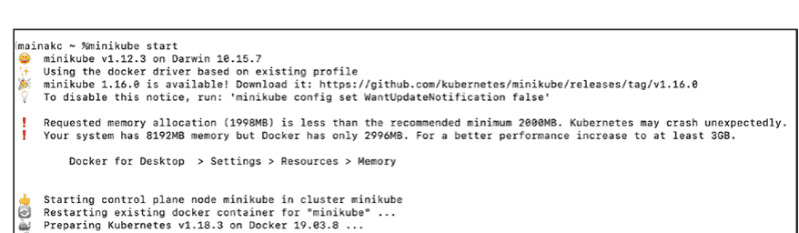

图 4-2. 启动单节点 Kubernetes 集群

当 Kubernetes 集群启动并运行，并且 kubectl 成功安装后，要做的第一件事是使用以下命令列出集群中的所有 Pod（参见图 4-3）：

```
$ kubectl get pods -all-namespaces
```

```
1 apiVersion: v1
2 kind: ConfigMap
3 metadata:
4   name: prometheus-config
5   namespace: monitoring
6 data:
7   prometheus.yml: |
8     global:
9       scrape_interval:  15s # 每 15 秒抓取一次
10
11   # 抓取配置 - 抓取 Prometheus 自身
12
13   scrape_configs:
14
15   - job_name: 'prometheus'
16
17     static_configs:
18     - targets: ['localhost:9090']
```

#### 图 4-7. prometheus-configmap.yaml

```
$ kubectl apply -f prometheus-configmap.yaml
```

```
[mainakc ~/Book/Prometheus %kubectl apply -f prometheus-configmap.yaml
configmap/prometheus-config created
```

#### 图 4-8. 创建 ConfigMap

在下一步中，我们将为 Prometheus 创建一个服务帐户，并将其绑定到集群角色，这将允许 Prometheus 从集群内的所有资源（节点、服务、端点、Pod）获取所有指标，而不仅仅是同 'monitoring'（监控）命名空间内的指标。用于创建这些配置的 YAML 文件如图 4-9 所示，创建和绑定的执行过程如图 4-10 所示：


```
$ kubectl apply -f prometheus-roles.yml
```

```
mainakc ~/Book/Prometheus % kubectl apply -f prometheus-roles.yml
clusterrole.rbac.authorization.k8s.io/prometheus created
Warning: kubectl apply should be used on resource created by either kubectl create --save-config or kubectl apply
serviceaccount/default configured
clusterrolebinding.rbac.authorization.k8s.io/prometheus created
```

#### 图4-10. 创建服务账户并与集群角色绑定

现在，我们准备使用图4-11中提到的部署YAML配置来部署Prometheus。该配置中包含两个规范（spec）部分。在第一个规范中，我们将定义要在ReplicaSet中创建的“replicas”（副本）数量，在本例中设置为1。我们还定义了更新“strategy”（策略）的类型为“RollingUpdate”（滚动更新），并定义了“selector”（选择器）以匹配Pod上的标签'Prometheus'，以便ReplicaSet知道要管理哪些Pod。

```
1 ---
2 apiVersion: apps/v1
3 kind: Deployment
4 metadata:
5   name: prometheus
6   namespace: monitoring
7   labels:
8     app: prometheus
9 spec:
10   replicas: 1
11   strategy:
12     rollingUpdate:
13       maxSurge: 1
14       maxUnavailable: 1
15     type: RollingUpdate
16   selector:
17     matchLabels:
18       app: prometheus
19   template:
20     metadata:
21       labels:
22         app: prometheus
23       annotations:
24         prometheus.io/scrape: "true"
25         prometheus.io/port: "9090"
26   spec:
```

#### 图4-11. prometheus-deployment.yaml

```
27      containers:
28        - name: prometheus
29          image: quay.io/prometheus/prometheus:v2.0.0
30          imagePullPolicy: IfNotPresent
31          args:
32            - '--storage.tsdb.retention=6h'
33            - '--storage.tsdb.path=/prometheus'
34            - '--config.file=/etc/prometheus/prometheus.yml'
35          command:
36            - /bin/prometheus
37          ports:
38            - name: web
39              containerPort: 9090
40          volumeMounts:
41            - name: config-volume
42              mountPath: /etc/prometheus
43            - name: data
44              mountPath: /prometheus
45          restartPolicy: Always
46          securityContext: {}
47          terminationGracePeriodSeconds: 30
48        volumes:
49          - name: config-volume
50            configMap:
51              name: prometheus-config
52          - name: data
53            emptyDir: {}
```

#### 图4-11.（续）

最后，我们有“template”（模板）部分，其中定义了Pod的配置。在第二个spec部分中，我们定义了Pod的名称、将要部署到Pod上的镜像以及镜像的拉取位置。还定义了一些参数，例如配置文件的位置。ports部分定义了容器端口9090，该端口对Web流量开放。volumeMounts部分指定了两个卷：一个用于配置，另一个用于数据。现在，让我们使用以下命令部署这个YAML文件（见图4-12）：

```
$ kubectl apply -f prometheus-deployment.yaml
```

```
mainakc ~/Book/Prometheus % kubectl apply -f prometheus-deployment.yaml
deployment.apps/prometheus created
```

#### 图4-12. 创建部署

为了验证Prometheus部署创建了哪些组件，我们可以使用以下命令（见图4-13）：

```
$ kubectl get all -namespace=monitoring
```

```
mainakc ~/Book/Prometheus % kubectl get all --namespace=monitoring
NAME                          READY   STATUS    RESTARTS   AGE
pod/prometheus-7f567bc485-4fjk r 1/1     Running   0          2m57s

NAME                          READY   UP-TO-DATE   AVAILABLE   AGE
deployment.apps/prometheus    1/1     1            1           2m57s

NAME                          DESIRED   CURRENT   READY   AGE
replicaset.apps/prometheus-7f567bc485 1         1         1       2m57s
```

图4-13. monitoring命名空间中的资源列表

由于我们无法访问在部署中创建的资源，我们将创建一个NodePort服务来提供对Prometheus的访问。见图4-14：

```
1 apiVersion: v1
2 kind: Service
3 metadata:
4   name: prometheus
5   namespace: monitoring
6 spec:
7   selector:
8     app: prometheus
9   type: NodePort
10  ports:
11    - name: prometheus
12      protocol: TCP
13      port: 9090
14      nodePort: 30900
```

图4-14. prometheus-nodeservice.yaml

让我们部署此文件并使用以下命令创建NodePort服务（见图4-15）：

```
$ kubectl apply -f prometheus-nodeservice.yaml
```

```
mainakc ~/Book/Prometheus % kubectl apply -f prometheus-nodeservice.yaml
service/prometheus created
```

图4-15. 创建Node服务

NodePort会在每个节点的IP上以静态端口（NodePort）暴露服务，其默认值通常在30000到32767之间。现在，我们可以在单节点的30900端口访问Prometheus，并使用以下命令在Web浏览器中打开Prometheus。

```
$ minikube service -namespace=monitoring prometheus
```

该命令的输出如图4-16所示：

```
mainakc ~/Book/Prometheus % minikube service --namespace=monitoring prometheus
| NAMESPACE | NAME | TARGET PORT | URL |
| monitoring | prometheus | prometheus/9090 | http://172.17.0.2:30900 |
Starting tunnel for service prometheus.
| NAMESPACE | NAME | TARGET PORT | URL |
| monitoring | prometheus | | http://127.0.0.1:52677 |
Opening service monitoring/prometheus in default browser...
Because you are using a Docker driver on darwin, the terminal needs to be open to run it.
```

图4-16. 获取访问Prometheus的URL

Prometheus安装成功后，你应该会看到如图4-17所示的这个屏幕：

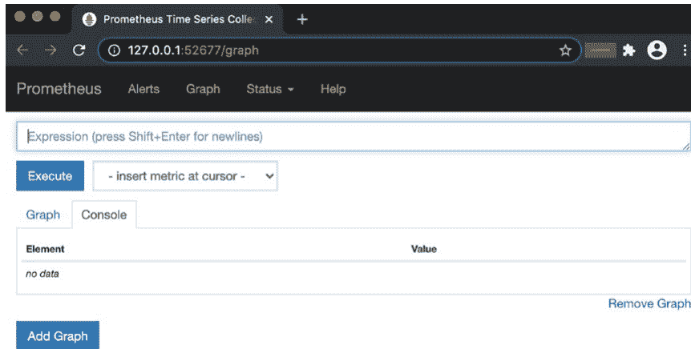

图4-17. Prometheus现已运行

第二种方式是使用第三方导出器（exporters），它们可以帮助将第三方系统的现有指标转换为Prometheus指标格式。这些导出器可用于各种各样的系统，从数据库、消息系统、硬件、存储、代理，甚至其他监控系统。其中一些导出器由官方创建和支持，并在Prometheus GitHub页面上维护，而另一些则由第三方创建并维护。例如，MySQL导出器可以使用SQL查询向MySQL守护进程发起查询，收集所有信息，然后将其转换为Prometheus指标格式。有几种流行的第三方软件系统，例如Kubernetes、Linkerd、Docker守护进程和Telegraf，它们开箱即用地以Prometheus格式暴露指标，因此这些系统不需要单独的导出器。

第三种也是最重要的方式是使用客户端库之一对代码进行插桩（instrument），从而将指标发送到Prometheus。官方支持的客户端库包括Go、Java、Python和Ruby，此外还有几个非官方的第三方客户端库可供选择。一旦定义了所需的指标，就可以通过HTTP端点暴露这些指标。当Prometheus抓取应用运行所在的实例时，客户端库会在该HTTP端点上发送当前状态指标。

插桩会带来一定的性能影响，其影响程度因客户端库和所用语言而异。使用Java客户端引入一个counter/gauge（计数器/仪表）可能会带来12-17纳秒的延迟，具体取决于争用情况，在大多数情况下这种延迟可以忽略不计。

### 暴露格式

使指标可供Prometheus使用的过程称为暴露（exposition）。从任何导出器或通过代码插桩暴露的Prometheus指标，都可以在/metrics路径下以基于文本的暴露格式找到。在v2.0之前，除了基于文本的格式外，Prometheus还支持一种基于协议缓冲区（Protobuf）的格式。自v2.0起，不再支持Protobuf格式。基于文本的格式的优点在于它是人类可读的，并且易于理解。

Prometheus指标类型，如counter、gauge、histogram、summary和untyped²，可以帮助你跟踪环境的状态。文本格式是面向行的，其中行由换行符（\n）分隔。输出通常包含以#作为第一个字符的行，该行被视为注释，除非

²指标类型已在第2章中介绍。


当 `#` 后的第一个词是 `HELP` 或 `TYPE` 时。无论指标的类型如何，`HELP` 都是对指标的描述，并且保持不变。`TYPE` 表示指标的类型，可以是以下之一：`counter`、`gauge`、`histogram`、`summary` 和 `untyped`。当指标类型未知时，使用 `untyped`。

如果 `#` 后的词是 `HELP`，则其后跟指标名称。对于给定的指标，只能有一行 `HELP`。如果 `#` 后的词是 `TYPE`，则其后依次是指标名称和预期的指标类型。与 `HELP` 行类似，对于给定的指标，只能有一行 `TYPE`。如果 `TYPE` 行中没有定义指标类型，则 `TYPE` 会自动设置为 `untyped`。文本格式语法如下：

```
metric_name [
  "{" label_name "=" "\" label_value "\"" { "," label_name "=" "\" 
  label_value "\"" } [ "," ] "}"
] value [ timestamp ]
```

**指标名称：** 这是指标的名称，通常是一个描述，提供更多关于指标本身的信息。指标名称通常保持唯一，以避免各库之间重复。它指的是特定库中某个特定文件中的特定代码行，指标就是从该处收集的。

**标签：** 可以包含多个标签，用逗号分隔；但重要的是，每次抓取之间要保持一致的顺序。例如：

```
#### HELP counter_metric Just an example of counter
#### TYPE counter_metric counter
counter_metric_total{foo="bar",baz="qux"} 2520
counter_metric_total{foo="bar",baz="qux"} 219
```

**时间戳：** 时间戳是以毫秒为单位的整数值，由 Prometheus 自动附加在值之后。

图 4-20 展示了 `HELP` 行、`TYPE` 行和仪表指标：

```
#### HELP node_scrape_collector_success node_exporter: Whether a collector succeeded.
#### TYPE node_scrape_collector_success gauge
node_scrape_collector_success{collector="arp"} 1
node_scrape_collector_success{collector="bcache"} 1
node_scrape_collector_success{collector="bonding"} 1
node_scrape_collector_success{collector="conntrack"} 1
node_scrape_collector_success{collector="cpu"} 1
node_scrape_collector_success{collector="cpufreq"} 1
node_scrape_collector_success{collector="diskstats"} 1
node_scrape_collector_success{collector="edac"} 1
node_scrape_collector_success{collector="entropy"} 1
node_scrape_collector_success{collector="filefd"} 1
node_scrape_collector_success{collector="filesystem"} 1
node_scrape_collector_success{collector="hwmon"} 1
node_scrape_collector_success{collector="infiniband"} 1
node_scrape_collector_success{collector="ipvs"} 1
node_scrape_collector_success{collector="loadavg"} 1
node_scrape_collector_success{collector="mdadm"} 1
node_scrape_collector_success{collector="meminfo"} 1
node_scrape_collector_success{collector="netclass"} 1
node_scrape_collector_success{collector="netdev"} 1
node_scrape_collector_success{collector="netstat"} 1
node_scrape_collector_success{collector="nfs"} 1
node_scrape_collector_success{collector="nfsd"} 1
node_scrape_collector_success{collector="pressure"} 1
node_scrape_collector_success{collector="sockstat"} 1
node_scrape_collector_success{collector="stat"} 1
node_scrape_collector_success{collector="textfile"} 1
node_scrape_collector_success{collector="time"} 1
node_scrape_collector_success{collector="timex"} 1
node_scrape_collector_success{collector="uname"} 1
node_scrape_collector_success{collector="vmstat"} 1
node_scrape_collector_success{collector="xfs"} 1
node_scrape_collector_success{collector="zfs"} 1
```

#### 图 4-20. 仪表指标的暴露格式

图 4-21 展示了 `HELP` 行、`TYPE` 行和摘要指标：

```
#### HELP go_gc_duration_seconds A summary of the GC invocation durations.
#### TYPE go_gc_duration_seconds summary
go_gc_duration_seconds{quantile="0"} 1.0783e-05
go_gc_duration_seconds{quantile="0.25"} 1.6019e-05
go_gc_duration_seconds{quantile="0.5"} 3.7685e-05
go_gc_duration_seconds{quantile="0.75"} 8.7524e-05
go_gc_duration_seconds{quantile="1"} 0.014988136
go_gc_duration_seconds_sum 1624.240639472
go_gc_duration_seconds_count 4.577738e+06
```

#### 图 4-21. 摘要指标的暴露格式

图 4-22 展示了 `HELP` 行、`TYPE` 行和无类型指标：

```
#### HELP node_vmstat_pgpgin /proc/vmstat information field pgpgin.
#### TYPE node_vmstat_pgpgin untyped
node_vmstat_pgpigin 4.64097761e+08
#### HELP node_vmstat_pgpgout /proc/vmstat information field pgpgout.
#### TYPE node_vmstat_pgpgout untyped
node_vmstat_pgp gout 2.135340909e+09
```

图 4-22. 无类型指标的暴露格式

### 服务发现

服务发现，顾名思义，关注的是 Prometheus 发现抓取端点的过程。

为了抓取目标，您必须先在 `prometheus.yml` 文件的 `scrape_configs` 部分配置一个已定义的 `job_name`、目标主机和端口号。例如，只需在 `scrape_configs` 部分添加相应的 `job_name`，Prometheus 就可以抓取 Prometheus 服务器本身，如图 4-23 所示：


图 4-23. 静态配置

对于您想要监控的所有目标，您可以定义相应的作业名称，然后在 YAML 文件中逐个列出它们。然而，在监控目标是临时性的动态环境中，手动添加并不实际。为了解决这一特定挑战，Prometheus 使用服务发现，并支持通过任何受支持的服务发现机制动态发现目标，例如 Consul、DNS、Openstack、Kubernetes、EC2、Azure 和 GCE。如果您偏好的选项不受支持，您还可以使用基于文件的服务发现。

服务发现可以分为两类。一类是实例通过诸如 Consul 之类的服务发现机制自行注册。这被称为

#### 图 4-30. 经典 UI 中的表达式浏览器

表达式浏览器有一个中心字段，您可以在其中输入任意表达式以进行快速调试。您还可以在下拉菜单中查看已发现的指标列表，该下拉菜单为“在光标处插入指标”，紧挨着“执行”按钮。在底部，有两个选项可以检查您之前执行过的表达式的输出。一个选项是“控制台”选项卡，它为您提供结果，以及实例和作业的标签，以及执行查询时对应的值。第二个选项是图形，它显示该值随时间变化的情况。

它还会让您了解其他三项相关信息：

- 1. 加载时间
- 2. 分辨率
- 3. 总时间序列

如果您对该表达式的图形表示感兴趣，可以轻松切换到 Graph 选项卡，如图 4-32 所示，并看到两条彩色折线图，每条代表一个特定目标。您可以将鼠标悬停在特定的折线图上，以查看该折线图对应的是哪个实例。在图 4-33 的示例中，我们可以看到红线对应于 localhost:9090（Prometheus 服务器），绿线对应于 localhost:9100（Node Exporter）。您可以看到，当节点启动并开始报告时，对应 Node Exporter 的绿线直接从 0 上升到 1。总之，Graph 帮助您分析在一段时间内从不同目标收集的时间序列数据值的变动情况。

如果有多个目标报告多条折线图，而您想分析其中某一条折线图的变化，您可以点击特定的表达式，Graph 将只显示一条折线图，供您专门分析其变化。这有助于消除杂乱，让您将精力集中在单个目标上。

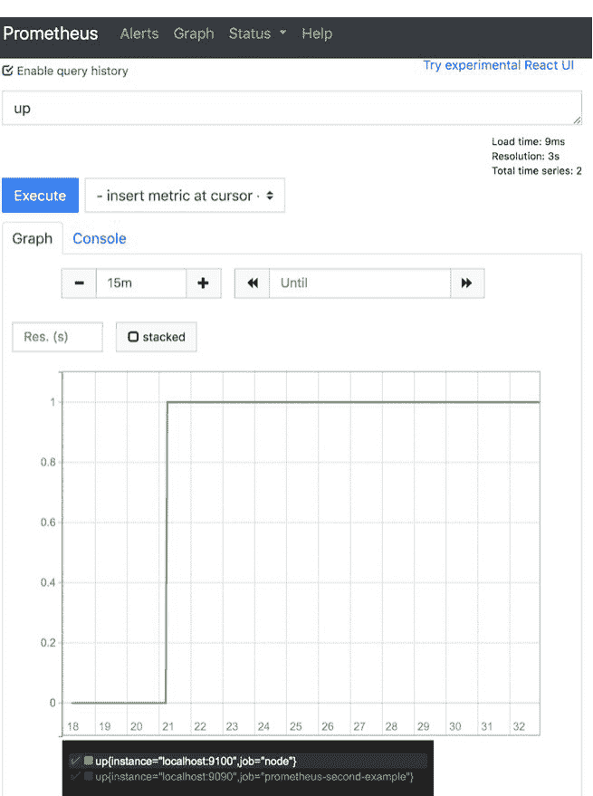

图 4-33. 聚焦于单个表达式


Prometheus还有一个基于React的实验性用户界面，并且有一个简单的链接，可以轻松地从我们之前看到的经典用户界面切换到基于React的用户界面，反之亦然。参见图4-34。

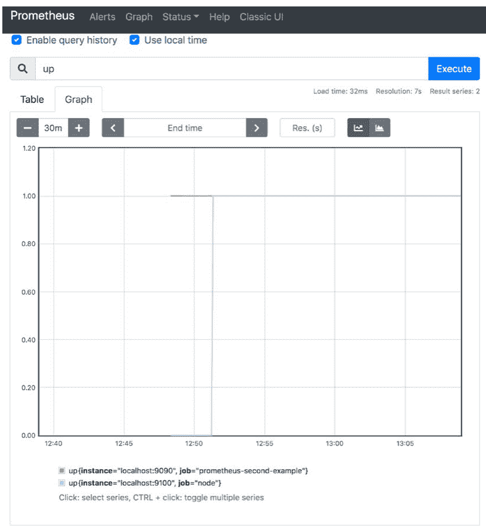

图4-34. 基于React的用户界面

### 第4章 Prometheus

这个用户界面与经典用户界面非常相似，除了外观和感觉上的差异以及一些附加功能，比如“使用本地时间”。Prometheus在存储和检索时序数据时使用UTC³，因此表达式浏览器中的所有图表也以UTC显示时间。对于基于React的用户界面，您可以将UTC时间转换为本地时间，这在分析图表时更有意义。除了折线图之外，还有一个选项可以将图表堆叠在一起，示例见图4-35。

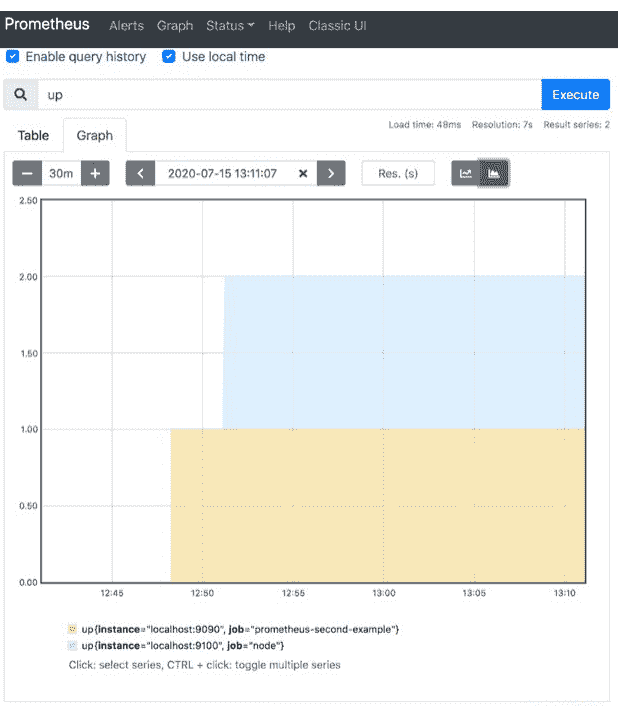

图4-35. 堆叠图表

³UTC：协调世界时

### 静默

AlertManager可以配置为在特定时间段内静默警报。可以使用AlertManager的用户界面配置静默；一旦激活，它将根据警报的标签检查传入的警报。如果标签匹配，则在静默生效期间不会发送通知。

磁盘以列式格式组织，包含连续的时间块，这些时间块按标签集、测量或字段进行组织。由于每个字段按顺序排列，因此在单个字段上计算聚合值更快。此外，可使用的标签或字段数量没有限制。

时序数据库常见的挑战是，对多个字段和标签的支持有限，并且只支持float64值。InfluxDB数据模型没有这样的挑战，因为它正是为解决这些问题而构建的。它支持多种数据格式，同时字段和标签的数量也没有任何限制。它允许开发者通过索引标签而不索引字段来选择模式。

Telegraf是InfluxDB的开源代理，支持200多个插件。它能够满足大多数常见应用程序、系统和网络设备的需求。它同时支持拉取和推送模式，因此可以通过抓取或监听方式工作，使其成为一个通用代理，不仅支持InfluxDB，还可以与其他监控后端配合使用。

### 安装

我们可以通过运行 InfluxDB 配置的 yaml¹ 文件，将 InfluxDB OSS 2.0 部署到 Kubernetes 集群上。在继续部署 InfluxDB 之前，我们先仔细看一下图5-1中的 yaml：

¹YAML（YAML Ain’t Markup Language，YAML不是标记语言）是云原生环境中最常用的声明式语言。更多详情请访问 www.yaml.org。

```
1 ---
2 apiVersion: v1
3 kind: Namespace
4 metadata:
5     name: influxdb
6 ---
7 apiVersion: apps/v1
8 kind: StatefulSet
9 metadata:
10    labels:
11        app: influxdb
12    name: influxdb
13    namespace: influxdb
14 spec:
15    replicas: 1
16    selector:
17        matchLabels:
18            app: influxdb
19    serviceName: influxdb
20    template:
21        metadata:
22            labels:
23                app: influxdb
24        spec:
25            containers:
26                - image: quay.io/influxdb/influxdb:v2.0.1
27                name: influxdb
28                ports:
29                    - containerPort: 8086
30                    name: influxdb
31                volumeMounts:
32                    - mountPath: /root/.influxdbv2
33                    name: data
34    volumeClaimTemplates:
35    - metadata:
36            name: data
37            namespace: influxdb
38        spec:
39            accessModes:
40            - ReadWriteOnce
41            resources:
```

图5-1. InfluxDB YAML配置

```
42              requests:
43                  storage: 10G
44 ---
45 apiVersion: v1
46 kind: Service
47 metadata:
48     name: influxdb
49     namespace: influxdb
50 spec:
51     ports:
52       - name: influxdb
53         port: 8086
54         targetPort: 8086
55     selector:
56         app: influxdb
57     type: ClusterIP
```

#### 图5-1.（续）

此 yaml 文件包含用于创建独立的命名空间 influxdb、独立服务 influxdb 以及有状态副本集 influxdb 的配置。因此，让我们继续使用 kubectl 命令部署此 YAML 配置。部署完成后，您可以检查 influxdb 命名空间中是否有正在运行的 Pod。如果部署成功，您应该会看到 influxdb-0 Pod 处于运行状态，如图5-2所示。

```
mchakraborti-a01:~ mchakraborty$ kubectl apply -f https://raw.githubusercontent.com/influxdata/docs-v2/master/static/downloads/influxdb-k8-minikube.yaml
namespace/influxdb created
statefulset.apps/influxdb created
service/influxdb created
mchakraborti-a01:~ mchakraborty$ kubectl get pods -n influxdb
NAME           READY   STATUS    RESTARTS   AGE
influxdb-0     1/1     Running   0          31s
```

#### 图5-2. 在Kubernetes集群上运行InfluxDB

我们将运行 kubectl describe 命令来获取 influxdb 服务的端点 IP 和关联端口，如图5-3所示。

```
mchakrabort-a01:~ mchakraborty$ kubectl describe service -n influxdb influxdb
Name:                     influxdb
Namespace:                influxdb
Labels:                   <none>
Annotations:              Selector: app=influxdb
Type:                     ClusterIP
IP:                       10.98.194.86
Port:                     influxdb 9999/TCP
TargetPort:               9999/TCP
Endpoints:                172.17.0.4:9999
Session Affinity:         None
Events:                   <none>
```

#### 图5-3. 描述InfluxDB Pod

获得这些详细信息后，我们可以运行 kubectl port-forward 命令，将集群内部的9999端口转发到本地主机，如图5-4所示。

```
mchakrabort-a01:~ mchakraborty$ kubectl port-forward -n influxdb service/influxdb 9999:9999
Forwarding from 127.0.0.1:9999 -> 9999
Forwarding from [::1]:9999 -> 9999
Handling connection for 9999
Handling connection for 9999
Handling connection for 9999
Handling connection for 9999
Handling connection for 9999
```

#### 图5-4. 在本地主机上进行端口转发

如果安装成功，应该可以通过 http://localhost:9999/ 访问 InfluxDB 用户界面（见图5-5）。

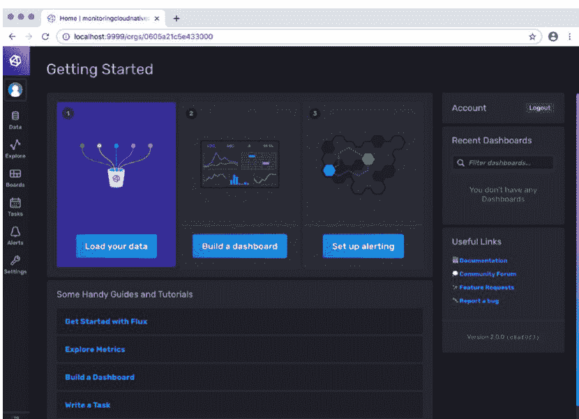

#### 图5-8. InfluxDB 登录页面

在此阶段，最好注销并使用设置屏幕中的用户名和密码重新登录，如图5-9所示。

#### 图5-10. 通过用户界面创建组织

在配置了多个组织之后，可以使用下拉菜单中的“切换组织”选项，并选择要设置为当前组织的选项，轻松地在组织之间切换。在图5-11中，当前组织设置为 monitoringcloudnativeapps，如果需要，可以通过选择 monitoringcloudnativeapps2 切换到另一个组织。

#### 图5-11. 通过用户界面切换组织

使用 Influx CLI 和 *influx org create* 命令，通过 CLI 可以轻松地完成同样的操作。该命令的语法如下：

```
$ influx org create --host <http://hostname:port> --token <INFLUX_TOKEN> --name <org name>
```

此命令的一个实现示例如图5-12所示。注意，在 <INFLUX_TOKEN> 部分传递 **管理令牌**，该令牌可从“加载数据”部分下的可用令牌中获取（稍后在“数据收集”部分说明）。成功创建后，命令的输出将包含新的组织名称及其关联的 ID。

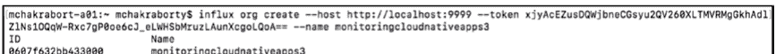

#### 图5-12. 使用CLI创建组织

要确认新组织是否已创建，请检查“切换组织”部分下的 UI。您的新组织名称应显示在列表中，如图5-13所示。

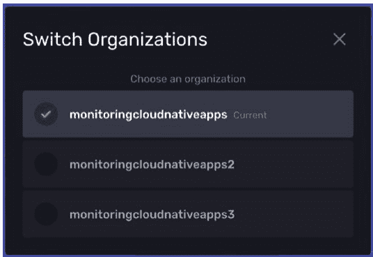

#### 图5-13. 新组织在UI中可用

您还可以使用 CLI 通过以下命令查看组织列表：

```
$ influx org list --host <http://hostname:port> --token <INFLUX_TOKEN>
```


命令输出将如图5-14所示，其中包含组织列表及其相应的ID：

```
mchakraborty-a01:~ mchakraborty$ influx org list --host http://localhost:9999 --token xjyAcEZusDQWjbneCGsyU2QV26OXLTMVRmGkHAdIZINs10Qw--Rxc7gP0oe6c1_eLWHSbMruzLunXcgpLQa==
ID                Name
0a05a21c5e433000  monitoringcloudnativeapps
0a07509b2fc33000  monitoringcloudnativeapps2
0a07f632bb433000  monitoringcloudnativeapps3
```

图 5-14. 使用 CLI 查看组织

### 重命名组织

当您需要将现有组织名称重命名为更有意义的名称时，可以通过下拉菜单中的“关于”部分进入“组织”选项卡，如图5-15所示。

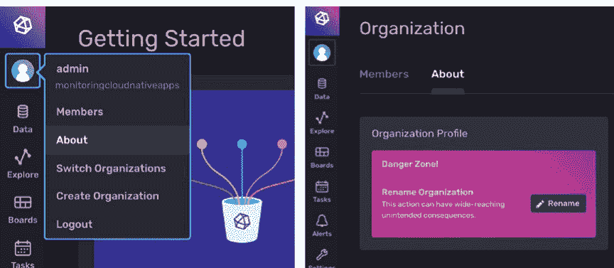

图 5-15. 使用 UI 重命名组织

点击“重命名”后，会弹出一个免责声明，指出任何名称更改都会导致关联的查询、仪表板、任务和其他配置无法按预期工作，因为它们仍会引用旧的组织名称。请确保在修改组织名称后尽快更新这些内容，以便先前的配置能够无缝运行。参见图5-16。

### 删除组织

没有使用 UI³ 删除组织的选项，因此唯一的选择是使用 CLI。实现此功能的命令语法如下：

```
$ influx org delete --host <http://hostname:port> --token <INFLUX_TOKEN> -i <org-id>
```

命令输出将类似于图5-20中突出显示的部分，并提供带有现有组织 ID 的修改后组织名称：

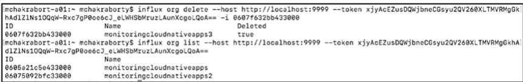

图 5-20. 通过 CLI 删除组织

### 成员

在 InfluxDB 中，有用户（user）和成员（member）的概念。用户是有权访问 InfluxDB 的个人，当这些用户属于一个或多个组织时，他们被称为该组织的成员。您可以使用 CLI 运行以下语法来获取用户列表及其用户 ID：

```
$ influx user list --host <http://hostname:port> --token <INFLUX_TOKEN>
```

运行此命令后，您将获得用户名和关联的用户 ID。在这种情况下，由于我们尚未创建任何新用户，因此只会列出管理员用户。参见图5-21。

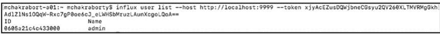

图 5-21. 通过 CLI 列出用户

您也可以在 UI 中通过组织页面上的“关于”部分查看相同信息。在图5-22中，您可以看到管理员用户在不同组织中的用户 ID 保持不变。例如，admin 的用户 ID 为 0605a21c4c433000，即使组织从 0605a21c4c433000 更改为 06075092bfc33000，该 ID 也保持不变。


图 5-22. 我的用户 ID 和组织 ID

#### 创建新用户

您可以使用 influx user create 命令创建带有用户名和密码的新用户。

```
$ influx user create -n <username> -p <password> -o <org name> --token <INFLUX_TOKEN>
```

运行此命令后，您将创建具有指定用户名和密码的新用户。您还可以运行我们之前学过的 influx user list 命令来列出 InfluxDB 中的用户总数。请注意，用户 mainak 与组织 monitoringcloudnativeapps 关联，因此 mainak 是该特定组织的成员。参见图5-23。

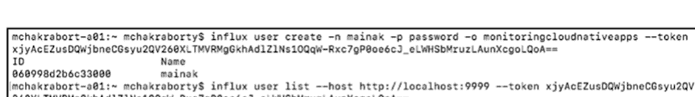

图 5-23. 通过 CLI 创建用户

#### 更新用户名

您可以通过运行 *influx user update* 命令⁴来更新现有用户的用户名：

```
$ influx user update -i <user id> -n <new user name> --token <INFLUX_TOKEN>
```

在 CLI 中运行此命令时，您可以看到用户 ID 被新用户名替换，如图5-27所示。

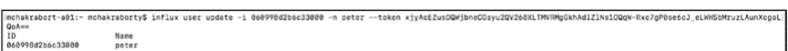

图 5-27. 通过 CLI 更新组织中的用户名

用户名的更改也会显示在 influx UI 中，如图5-28所示。

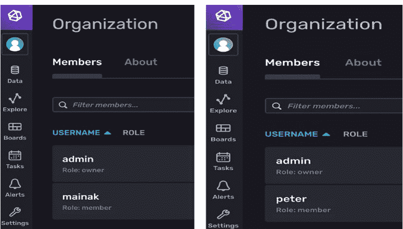

图 5-28. 在组织中更新后的用户名

*用户信息无法在 InfluxDB UI 中更新。*

#### 移除成员

您可以通过从 UI 中删除成员或使用 CLI 来移除组织中的成员。当您从组织中移除成员时，并不会从 InfluxDB 中删除该用户，只会撤销该成员与组织的关联以及其拥有的所有权限。您可以按照以下语法使用 *influx org members remove* 命令：

```
$ influx org members remove -m <member id> -i <org id> --token <INFLUX_TOKEN>
```

在 CLI 中运行此命令时，您可以看到特定用户 ID 从成员列表中移除，如图5-29所示。

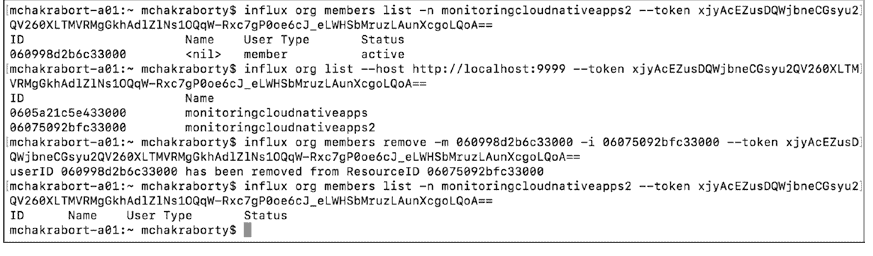

*图 5-29. 通过 CLI 从组织中移除成员*

通过 UI 也可以实现同样的操作：删除用户 peter（他是组织 monitoringcloudnativeapps2 的成员），只需点击垃圾桶图标，如图5-30所示。

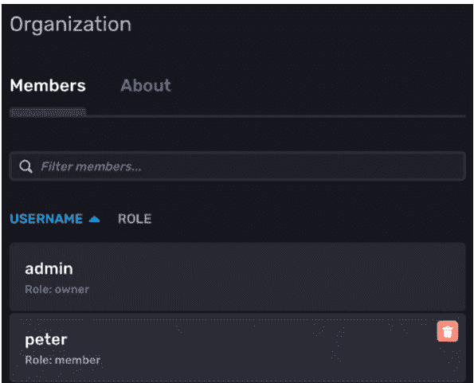

图 5-30. 通过 UI 从组织中移除成员

#### 删除用户

用户可以通过 CLI 使用 influx user delete 命令根据以下语法⁵永久删除：

```
$ influx user delete -i <User id> --token <INFLUX_TOKEN>
```

执行后，它将删除名为 peter 的用户，如图5-31所示：

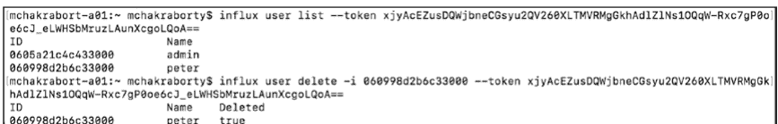

图 5-31. 通过 CLI 从 InfluxDB 中删除用户

⁵用户无法从 InfluxDB UI 中删除。

### 存储桶

存储桶（bucket）与组织关联，并存储所有时间序列数据。存储桶具有保留策略，仅存储保留策略所规定的特定时间段内的数据点。

您可以使用 UI 从两个不同的位置*创建存储桶*：一个是在**加载数据 - 存储桶**页面，如图5-32所示；另一个是在**数据浏览器 - 来源**页面。

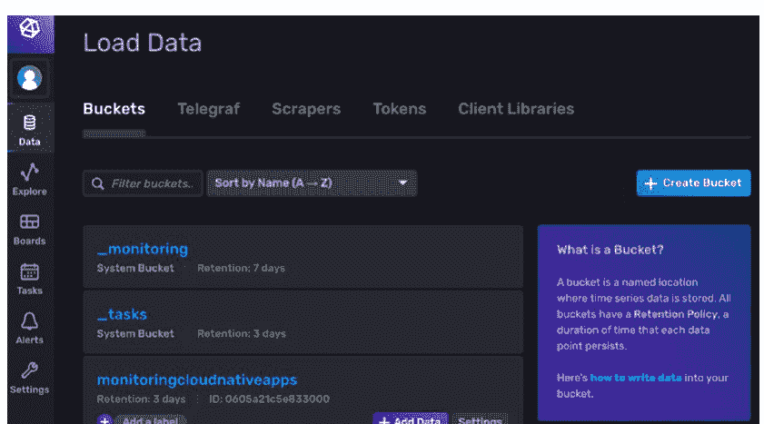

*图 5-32. 从加载数据中创建存储桶*

### 数据收集

#### Scraper

为了将数据写入 InfluxDB，您需要先配置组织，然后配置存储桶，还需配置身份验证令牌。我们已经在“安装”部分了解了如何设置这些内容，并在“InfluxDB 中的关键概念”部分了解了它们的含义。现在，为了快速入门，您可以创建一个抓取器（Scraper），它会按固定时间间隔从任何可通过 HTTP/S 访问的、以 Prometheus 数据格式提供数据的端点抓取数据，然后将数据写入存储桶以存储所有数据。我们将配置 Scraper，使用目标端点 http://localhost:9999/metrics 从 InfluxDB 自身抓取指标。这些内部指标是很好的数据集，可以帮助您了解如何在 InfluxDB 中获取数据并将其可视化。参见图5-33。

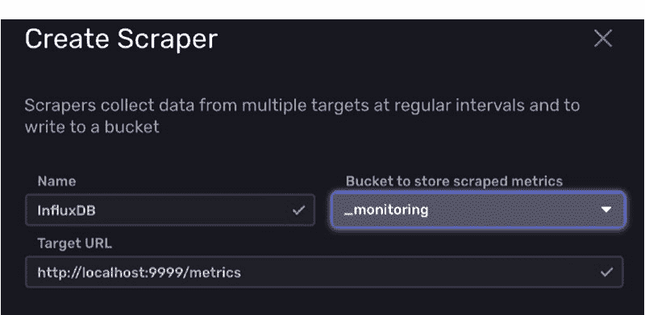

图 5-33. 通过 UI 创建 Scraper

Scraper 配置完成后，您可以在数据浏览器的 _monitoring 存储桶中看到它正在收集的指标数据，并筛选出您想关注的字段，如图5-34所示：

图 5-36. 为系统创建 Telegraf 配置

为配置提供名称和描述后，点击“创建并验证”，如图5-37所示：

**创建 Telegraf 配置**

**测试您的配置**

启动 Telegraf 并确保数据正在写入 InfluxDB

- **1. 安装最新版 Telegraf**

  您可以访问 InfluxData 下载页面安装最新版 Telegraf。如果您的系统上已安装 Telegraf，请确保其是最新版本。您需要 1.9.2 或更高版本。

- **2. 配置您的 API 令牌**

  将数据推送到 InfluxDB 需要您的 API 令牌。您可以将以下命令复制到终端窗口，使用您的令牌设置环境变量。

  ```
  export INFLUX_TOKEN=A79PXg1kyLghS3FRGkol_sNAdjavf62SOceBiliEo2L9B7U2QBV3x-lFySSsboVBKY6J1vG5BiB8R_mMiKLkeQ==
  ```

- **3. 启动 Telegraf**

  最后，您可以运行以下命令来启动 Telegraf 代理，使其在您的机器上运行。

  ```
  telegraf --config http://localhost:9999/api/v2/telegrafs/060d51559eeb3000
  ```

图 5-38. Telegraf 安装


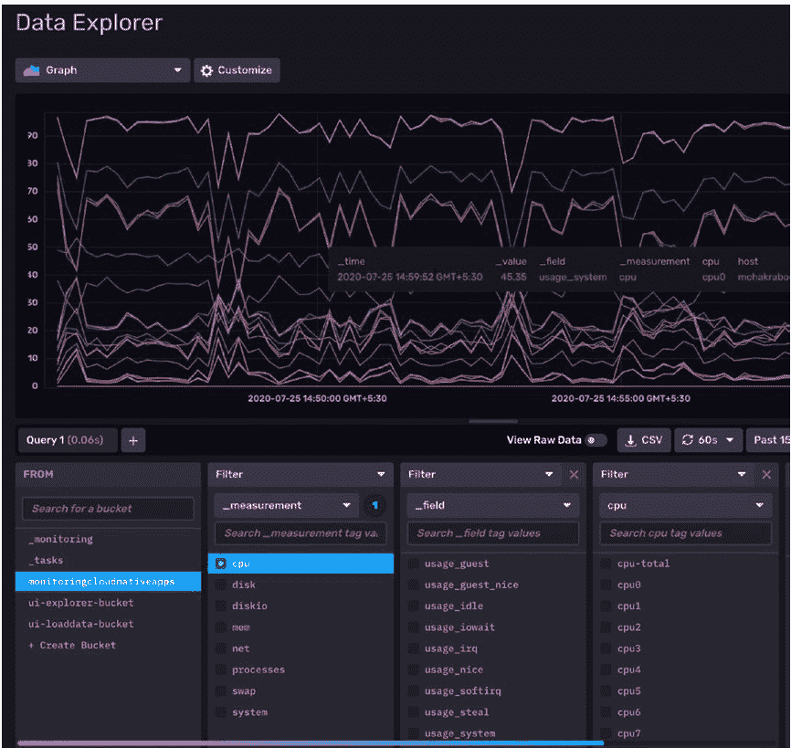

图5-41. 通过System的Telegraf插件收集的数据的图形表示

### 手动配置Telegraf

如果您希望从插件UI所示环境之外的其他环境收集输入，可以手动配置Telegraf配置文件（telegraf.conf），以从多个输入源捕获数据并将数据发送到InfluxDB。具体做法是配置telegraf.conf文件，使其包含一个输入插件，该插件与influxdb_v2输出插件协同工作，将指标写入InfluxDB bucket。让我们看一个示例来加深理解。

- 1. 首先，我们需要从Telegraf插件页面（https://v2.docs.influxdata.com/v2.0/reference/telegraf-plugins/）找到我们感兴趣的输入插件。有各种各样的插件可用于从应用程序和第三方系统收集指标并与InfluxDB一起使用。对于图5-42，我们选择了OpenWeatherMap作为我们的输入插件。

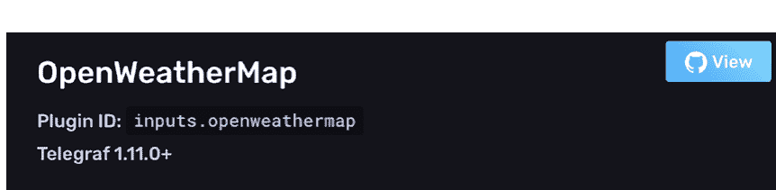

图5-42. OpenWeatherMap输入插件

- 2. 点击“查看”将打开GitHub上的Telegraf输入插件页面。您可以阅读该插件的功能说明，并将配置复制粘贴到您的telegraf.conf文件中。

- 3. InfluxDB输出配置可在“Load Data - Telegraf”页面获取。下载配置并粘贴到telegraf.conf中，以将数据发送到InfluxDB v2.0实例，如图5-43所示。

### Telegraf输出配置

可以在“Tokens”选项卡上生成$INFLUX_TOKEN。

```
[[outputs.influxdb_v2]]
#### The URLs of the InfluxDB cluster nodes.
##
#### Multiple URLs can be specified for a single cluster, only ONE of the
#### urls will be written to each interval.
#### urls exp: http://127.0.0.1:9999
urls = ["http://localhost:9999"]

#### Token for authentication.
token = "$INFLUX_TOKEN"

#### Organization is the name of the organization you wish to write to; must exist.
organization = "monitoringcloudnativeapps"

#### Destination bucket to write into.
bucket = "ui-loaddata-bucket"
```

图5-43. InfluxDB输出插件

图5-44显示了包含两个插件后telegraf.conf文件的外观：
