## 第5章 TICK STACK

使用--config标志提供telegraf.conf文件的路径并启动telegraf服务。

```
$ telegraf --config /path/to/custom/telegraf.conf
```

命令执行后，输出将如图5-45中的截图所示。

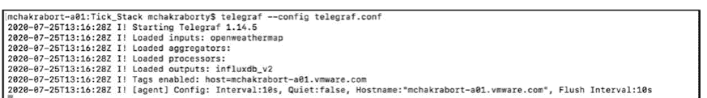

#### 图5-45. Telegraf服务已启动

现在，您应该能够在配置的bucket（此处为ui-loaddata-bucket）中的数据资源管理器中可视化此插件的输出。您需要选择bucket和相应的过滤器，选择收集的时间段，然后单击“提交”。您应该能够看到折线图，如图5-46所示：

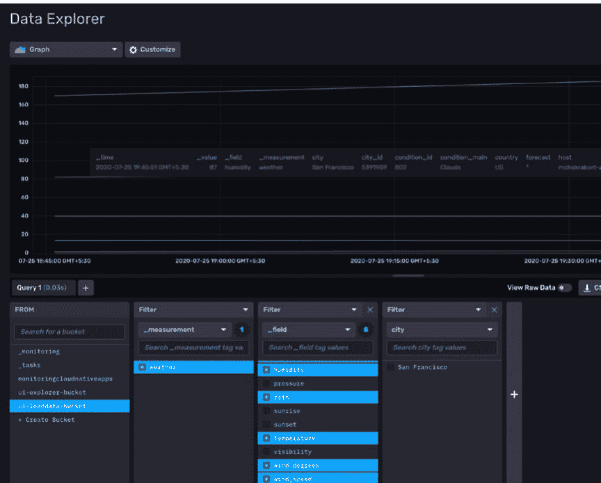

图5-46. 描述来自OpenWeatherMap Telegraf插件数据的折线图

该插件提供旧金山市的天气数据，包括湿度、降雨量、温度、风速和风向。本部分演示了配置InfluxDB接收数据是多么容易，不仅适用于IT系统，还几乎适用于任何类型的时间序列。

### 数据存储

InfluxDB基于LSM-Tree⁸概念在LevelDB中的SSTable，LevelDB实际上在InfluxDB的早期版本中用作存储引擎。InfluxDB自己的存储引擎基于时间结构化合并（TSM）树，是一个集合

⁸LSM-Tree在第3章中有详细解释。

InfluxDB具有与SQL类似的结构，两者之间的比较将显示它们的数据元素相似。让我们详细了解InfluxDB中的一些重要概念：

| SQL数据库 | InfluxDB |
|---|---|
| 表 | 测量 |
| 行 | 点 |
| 索引列 | 标签 |
| 未索引列 | 字段 |
| 存储过程 | 连续查询 |

为了更好地理解InfluxDB，我们必须更深入地研究InfluxDB模式。数据资源管理器提供了一个查看构成InfluxDB表的原始数据的选项，如图5-47所示：

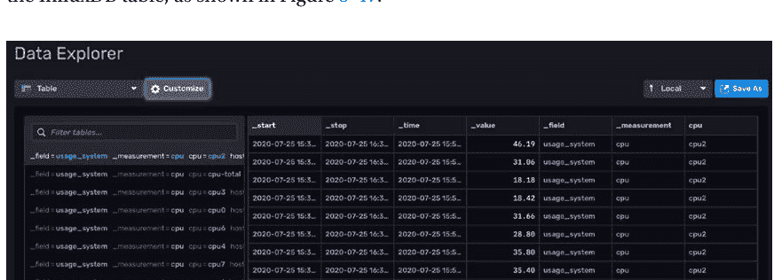

图5-47. InfluxDB数据元素

为了清晰起见，对前面的表格进行重新排列并添加更多值，得到表5-1：

#### 表5-1. InfluxDB表

| _time | _measurement | Cpu | _field | _value |
|---|---|---|---|---|
| 2020-07-25 T15:50:00Z | Cpu | cpu2 | usage_system | 46.19 |
| 2020-07-25 T15:51:00Z | Cpu | cpu2 | usage_system | 31.06 |
| 2020-07-25 T15:52:00Z | Cpu | cpu2 | usage_system | 18.18 |
| 2020-07-25 T15:53:00Z | Cpu | cpu2 | usage_user | 1.1 |
| 2020-07-25 T15:54:00Z | Cpu | cpu2 | usage_user | 1.89 |
| 2020-07-25 T15:55:00Z | Cpu | cpu2 | usage_user | 0.5 |

**测量（_measurement）**：InfluxDB表中的测量列描述了该表的内容。测量通常是一个字符串，作为标签、字段和时间戳等其他元素的容器。例如，表5-1中的测量值为**cpu**，这表明该表与cpu指标的测量有关。

**时间戳（_time）**：数据在InfluxDB中始终以对应的_time值存储，这是该数据的时间戳。由于它是一个时间序列数据库，日期和时间通常以RFC3339 UTC格式存储。

**字段（_field）**：字段通常是一个表示字段名称的字符串。在前面的示例中，_field为usage_system。

**字段值（_value）**：字段值可以是字符串、整数、浮点数或布尔值，表示字段的值。例如，在第一行中，_field usage_system在该特定时间的_value为46.19。

**字段集**：字段与其对应字段值的键/值对称为字段集。

**标签键**：在前面的示例中，字段**cpu**是标签键。

9 RFC3339是日期和时间的人类可读格式（2020-01-01T00:00:00.00Z），用作时间序列数据库中的时间戳。更多详情，请参阅https://www.ietf.org/rfc/rfc3339.txt。

一个检查由定义查询然后配置检查组成（见图5-52和图5-53）。查询定义包括选择需要查询的数据集。数据集将包括测量、字段和标签（可选）。对于有效的检查定义，使用聚合函数是必需的。包含标签将有助于缩小要查询的数据点范围。

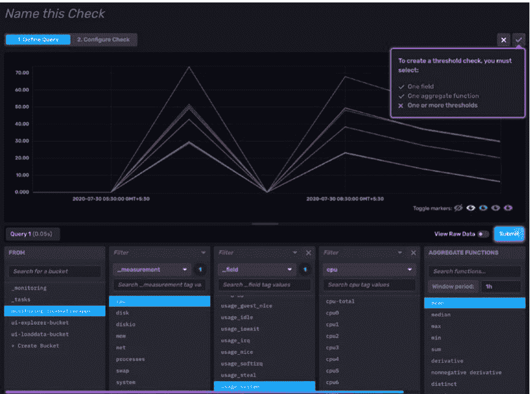

图5-52. 定义查询

第二部分包括配置检查，我们将在其中定义检查间隔和状态消息等属性。在图5-53中，检查计划每5分钟运行一次。您还可以定义要检查的特定标签；在本例中，标签为cpu2。

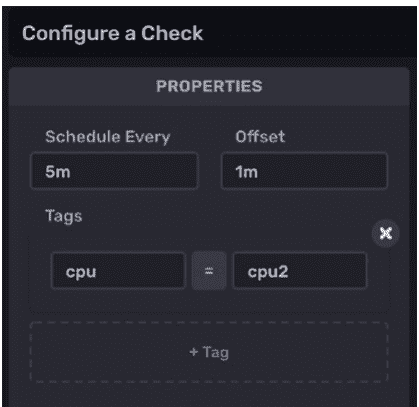

图5-53. 定义配置检查的属性

您还可以定义要在状态消息模板中显示的状态消息，如图5-54所示，该模板可以按给定格式包含检查名称和检查级别。

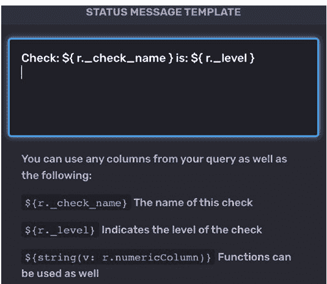

图5-54. 发生事件时显示的状态消息模板

然后，如果指定条件的计算结果为真，它将为每个数据点应用一个状态——CRIT、WARN、INFO、OK。这些数据点称为阈值。

### 设置阈值

阈值分为四个级别，从OK一直到CRIT，严重程度依次递增。见图5-55、5-56和5-57。

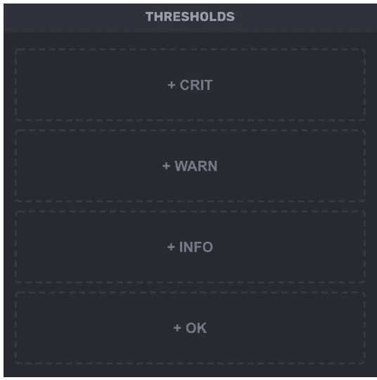

图5-55. 阈值的分类


Figure 5-57. Setting a deadman check

Once you run the check, it should look like Figure 5-58. The threshold sliders can be set as desired from here as well; then click the green button to save.

Figure 5-58. Threshold sliders

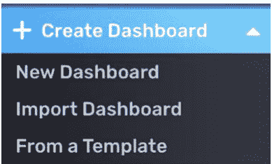

Figure 5-60. Options to create a dashboard

Let’s explore the option of creating a dashboard from a template. We have the option of creating dashboards from the existing templates for Kubernetes, system data, and many others. In Figure 5-61, we have opted for dashboarding the metrics collected from InfluxDB itself. These metrics were collected using Scraper, which was discussed in detail in the “Data Collection” section.

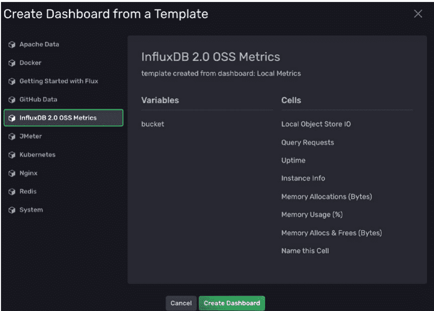

Figure 5-61. Creating InfluxDB metrics dashboard from template

```text
[mainakc ~ %]minikube start
minikube v1.12.3 on Darwin 10.15.7
minikube 1.16.0 is available! Download it: https://github.com/kubernetes/minikube/releases/tag/v1.16.0
To disable this notice, run: 'minikube config set WantUpdateNotification false'

Using the docker driver based on existing profile
Requested memory allocation (1998MB) is less than the recommended minimum 2000MB. Kubernetes may crash unexpectedly.
Your system has 8192MB memory but Docker has only 2996MB. For a better performance increase to at least 3GB.

Docker for Desktop > Settings > Resources > Memory

Starting control plane node minikube in cluster minikube
Updating the running docker "minikube" container ...
Preparing Kubernetes v1.18.3 on Docker 19.03.8 ...
Verifying Kubernetes components...
Enabled addons: dashboard, default-storageclass, storage-provisioner
Done! kubectl is now configured to use "minikube"
```

Figure 6-1. Starting the single-node Kubernetes cluster

Once the Kubernetes cluster is up and running and kubectl has been installed successfully, the first thing to do is to list all the pods in the cluster using the following command (see Figure 6-2):

```bash
$ kubectl get pods --all-namespaces
```

```text
[mainakc ~ %]kubectl get pods --all-namespaces
```

| NAMESPACE | NAME | READY | STATUS | RESTARTS | AGE |
|---|---|---|---|---|---|
| default | nginx-f89759699-5v46w | 1/1 | Running | 1 | 9d |
| kube-system | coredns-66bff467f8-n9jvm | 1/1 | Running | 1 | 9d |
| kube-system | etcd-minikube | 1/1 | Running | 1 | 9d |
| kube-system | kube-apiserver-minikube | 1/1 | Running | 3 | 9d |
| kube-system | kube-controller-manager-minikube | 1/1 | Running | 5 | 9d |
| kube-system | kube-proxy-ghsd6 | 1/1 | Running | 1 | 9d |
| kube-system | kube-scheduler-minikube | 1/1 | Running | 2 | 9d |
| kube-system | storage-provisioner | 1/1 | Running | 10 | 9d |
| kubernetes-dashboard | dashboard-metrics-scraper-dc6947fbf-g74dd | 1/1 | Running | 1 | 9d |
| kubernetes-dashboard | kubernetes-dashboard-6dbb54fd95-xcth1 | 1/1 | Running | 2 | 9d |
| monitoring | prometheus-7f567bc485-4fjkr | 1/1 | Running | 0 | 3d4h |

Figure 6-2. List of pods

Now, since the Kubernetes cluster is up and running and the monitoring namespace in which we will deploy Grafana is already created, we will deploy Grafana using a yaml file called grafana-deployment.yaml just like the one in Figure 6-3:

```yaml
apiVersion: apps/v1
kind: Deployment
metadata:
  labels:
    app: grafana
  name: grafana
  namespace: monitoring
spec:
  replicas: 1
  selector:
    matchLabels:
      app: grafana
  template:
    metadata:
      labels:
        app: grafana
    spec:
      containers:
      - env: []
        image: grafana/grafana:7.3.5
        name: grafana
        ports:
        - containerPort: 3000
          name: http
        volumeMounts:
        - mountPath: /var/lib/grafana
          name: grafana-storage
          readOnly: false
      volumes:
      - name: grafana-storage
```

Figure 6-3. grafana-deployment.yaml file

We have placed the file in the path where it can be accessed, and now we can create a deployment named “grafana” by using this file.

```bash
$ kubectl apply -f grafana-deployment.yaml
```

```text
[mainakc ~/Book/Grafana %kubectl apply -f grafana-deployment.yaml
deployment.apps/grafana created
```

Figure 6-4. Grafana deployment created

Let us look at the deployments across namespaces by using the following command (see Figure 6-5):

```bash
$ kubectl get deployments --all-namespaces
```

```text
[mainakc ~/Book/Grafana %kubectl get deployments --all-namespaces
```

| NAMESPACE | NAME | READY | UP-TO-DATE | AVAILABLE | AGE |
|---|---|---|---|---|---|
| default | nginx | 1/1 | 1 | 1 | 9d |
| kube-system | coredns | 1/1 | 1 | 1 | 9d |
| kubernetes-dashboard | dashboard-metrics-scraper | 1/1 | 1 | 1 | 9d |
| kubernetes-dashboard | kubernetes-dashboard | 1/1 | 1 | 1 | 9d |
| monitoring | grafana | 1/1 | 1 | 1 | 2m15s |
| monitoring | prometheus | 1/1 | 1 | 1 | 3d5h |

Figure 6-5. List of deployments

Also, let us have a look at the resources which are deployed in the monitoring namespace only. See Figure 6-6.

```bash
$ kubectl get all --namespace=monitoring
```

```text
[mainakc ~/Book/Grafana %kubectl get all --namespace=monitoring
```

| NAME | READY | STATUS | RESTARTS | AGE |
|---|---|---|---|---|
| pod/grafana-5bd86c74f6-hlw8t | 1/1 | Running | 0 | 2m51s |
| pod/prometheus-7f567bc485-4fjkr | 1/1 | Running | 0 | 3d5h |

| NAME | TYPE | CLUSTER-IP | EXTERNAL-IP | PORT(S) | AGE |
|---|---|---|---|---|---|
| service/prometheus | NodePort | 10.111.36.197 | `<none>` | 9090:30900/TCP | 3d5h |

| NAME | READY | UP-TO-DATE | AVAILABLE | AGE |
|---|---|---|---|---|
| deployment.apps/grafana | 1/1 | 1 | 1 | 2m51s |
| deployment.apps/prometheus | 1/1 | 1 | 1 | 3d5h |

| NAME | DESIRED | CURRENT | READY | AGE |
|---|---|---|---|---|
| replicaset.apps/grafana-5bd86c74f6 | 1 | 1 | 1 | 2m51s |
| replicaset.apps/prometheus-7f567bc485 | 1 | 1 | 1 | 3d5h |

Figure 6-6. List of resources in the monitoring namespace

Since we don’t have access to the resources that we created in the deployment, we will create a NodePort service that will provide us with the access to Grafana. See Figure 6-7.

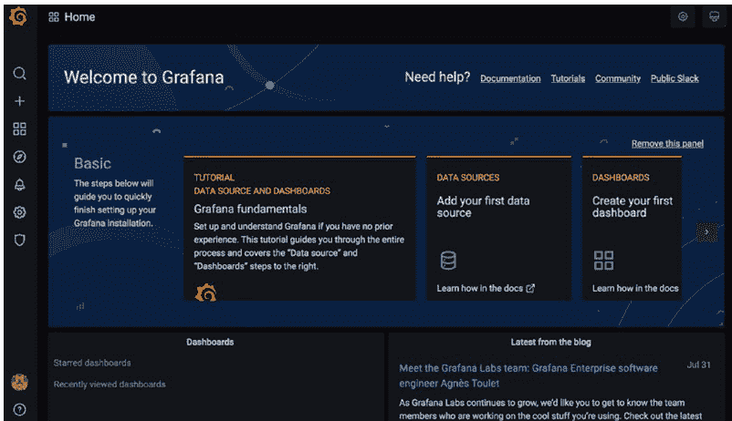

Figure 6-11. Grafana home dashboard

Now that you have a running instance, we will try and learn about the features and functionalities provided by the UI.

### Adding a Data Source

Grafana doesn’t come with its own agent and scrapers for data collection; however, it can easily integrate with several data sources, as most of the popular open source software comes as a core plug-in with Grafana: time-series databases like Prometheus, Graphite, OpenTSDB, InfluxDB; logging and document databases like Elasticsearch and Loki; distributed tracing systems like Jaeger and Zipkin; SQL databases like MySQL and PostgreSQL; and public cloud monitoring tools like AWS CloudWatch, Google Cloud Monitoring, and Azure Monitor. See Figure 6-12.


Figure 6-12. Adding a data source

You can start by adding data sources to Grafana by clicking the panel for adding your first data source in the home dashboard. You will be presented with a screen as shown in Figure 6-13:

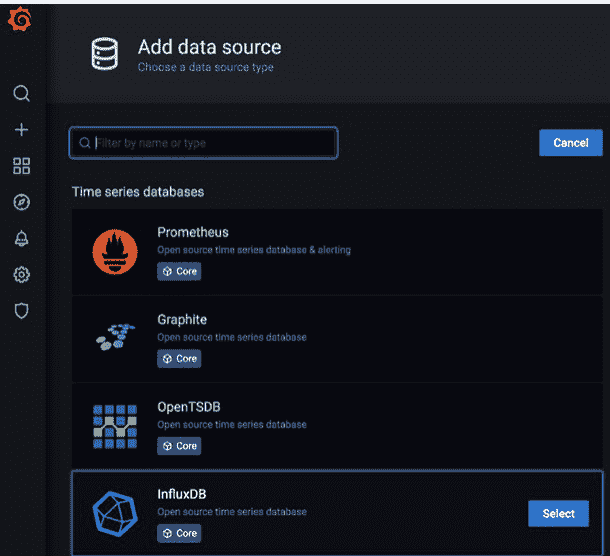

Figure 6-13. InfluxDB as a data source


从数据源列表开始，让我们尝试集成 InfluxDB。在设置页面，根据您要集成的 InfluxDB 版本，您将可以选择 InfluxQL 或 Flux 作为您的查询语言。我们将继续使用 Flux，因为我们运行的是 InfluxDB 2.0。参见图 6-14。

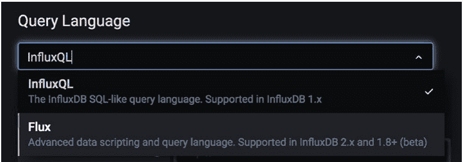

图 6-14. 选择查询语言

然后我们将传递连接信息，以便 Grafana 可以访问 InfluxDB。我们还需要提及组织、默认存储桶、连接令牌，以及 Grafana 查询 InfluxDB 的最小时间间隔。默认滑块将把 InfluxDB 标记为默认数据源。参见图 6-15。

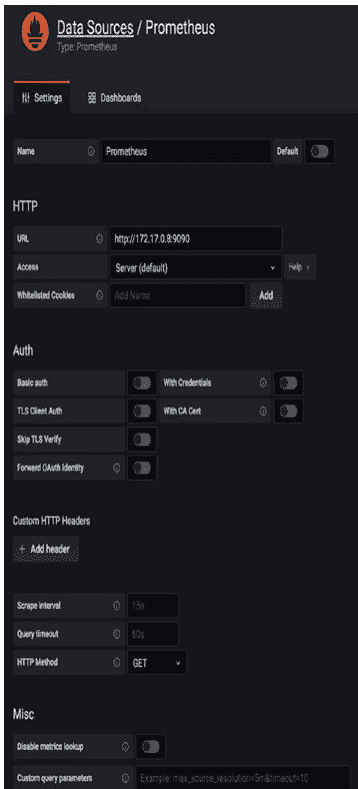

图 6-17. 向 Grafana 添加 Prometheus 作为数据源

保存并测试此连接后，我们应该会收到连接已成功建立的消息。您现在应该能够在配置部分看到已添加的数据源列表。我们还添加了一个预填充的数据源，名为 TestData DB，它随 Grafana 提供。参见图 6-18。

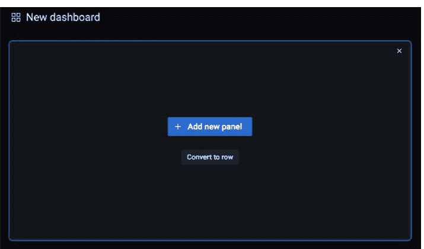

图 6-21. 添加新面板

因此，面板是来自一个或多个查询的结果的可视化表示。为了运行查询，您必须添加数据源。一旦查询执行，您可以应用各种格式化选项以根据您的需要获得完美的可视化。面板可以通过拖放和调整大小轻松地在仪表板上排列。

当您单击添加新面板（如图 6-21 所示）时，新面板将打开面板编辑器。面板编辑器也称为编辑面板屏幕或面板编辑模式。您也可以通过单击现有面板标题下拉菜单然后选择编辑来到达面板编辑器，这将以编辑模式打开面板。您也可以单击现有面板上的任意位置并按 e 来打开面板编辑器。

### 面板编辑器

一旦您添加面板，它将如下图 6-22 所示。各个部分已适当地标记，以便从 a 到 f 更清晰地理解。

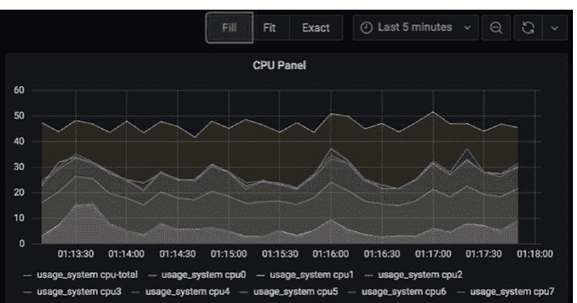

图 6-23. 填充可视化预览

- **Fit：** 此选项将使可视化预览适配可用空间，同时保持面板的宽高比。在调整大小时，它将尝试恢复可视化预览以始终保持宽高比。参见图 6-24。

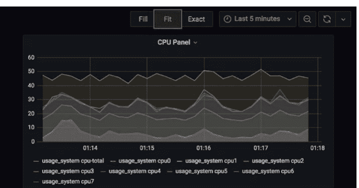

图 6-24. 适配可视化预览

- **Exact：** 此选项将把可视化预览调整为仪表板的精确大小。如果由于窗格调整大小而没有足够的空间可用，它将缩小可视化以保持宽高比。参见图 6-25。

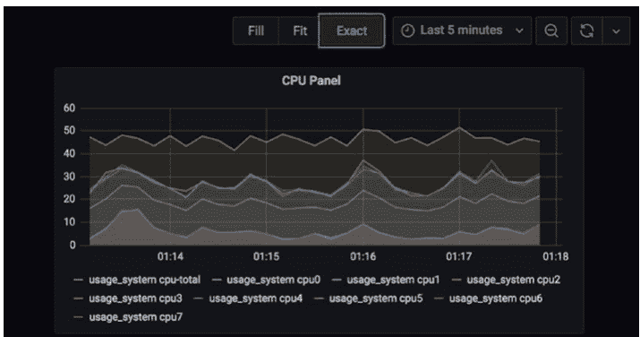

图 6-25. 精确可视化预览

- **时间范围控件：** 此选项帮助您选择对可视化预览感兴趣的合适时间范围。
- **时间范围放大：** 此形状为透镜的小按钮，位于时间范围控件旁边，有助于放大时间窗口。每次连续单击，您都可以获得更宽的时间范围供检查。
- **刷新：** 刷新按钮有助于手动刷新所选时间范围的数据。
- **刷新仪表板间隔：** 如果您希望可视化预览中的数据在从下拉菜单中选择的间隔内自动刷新（范围从 10 秒到 1 天），您可以使用此选项。它将在下拉菜单中定义的间隔获取新数据。您也可以在不希望自动刷新数据的情况下选择关闭选项。

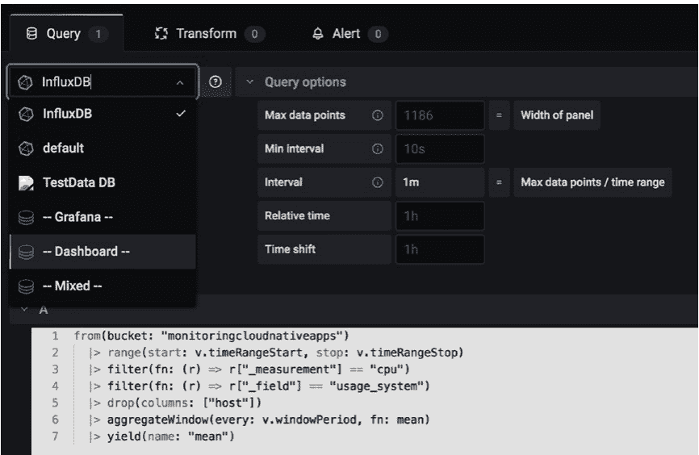

图 6-27. 查询编辑器

在数据部分 - 查询选项卡中，您可以从已集成的数据源列表中选择一个数据源，然后以该数据源支持的特定查询语言编写查询。查询语言及其功能因数据源而异。在单个仪表板中，我们可以有多个面板，所有面板都连接到不同的数据源，但每个面板只能绑定到一个特定数据源。您可能希望在转换选项卡中应用数据转换，并在警报选项卡中设置警报规则。

- d) 面板设置、字段和覆盖（参见图 6-28）

```
from(bucket: "monitoringcloudnativeapps")
|> range(start: v.timeRangeStart, stop: v.timeRangeStop)
|> filter(fn: (r) => r["_measurement"] == "cpu")
|> filter(fn: (r) => r["_field"] == "usage_system")
|> drop(columns: ["host"])
|> aggregateWindow(every: v.windowPeriod, fn: mean)
|> yield(name: "mean")
```

- **仪表板设置：** 齿轮图标用于访问仪表板设置。
- **丢弃：** 此选项将让您丢弃对面板所做的所有更改，将其恢复到上次保存的状态。它还将关闭面板编辑器并返回到仪表板。
- **保存：** 顾名思义，此选项保存仪表板，其中包含在面板编辑器中迄今为止所做的所有更改。在保存时，有一个复选框可将当前时间范围保存为整个仪表板的默认值。您可以添加注释来描述自上次保存以来的更改。
- **应用：** 此选项将让您应用对仪表板所做的更改，但要使这些更改持久化，您必须保存仪表板。它随后关闭面板编辑器，返回到仪表板。

让我们看一下过去 5 分钟内系统 CPU 使用情况的面板（图 6-30）。

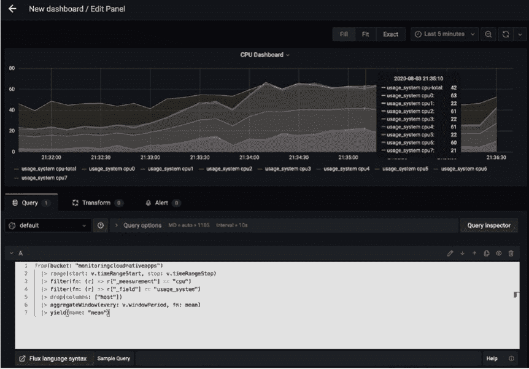

图 6-30. CPU 面板

该面板的数据源是 InfluxDB（显示为默认，因为我们在添加数据源期间将 InfluxDB 选择为默认数据源）。根据数据源，查询编辑器可以使用 Flux 作为查询语言。在查询编辑器中，我们编写了一个查询（A）从存储桶 monitoringcloudnativeapps 获取数据。时间范围来自传递的开始和停止时间变量。然后，我们包含了过滤器以根据 _measurement = cpu 和 _field = usage_system 过滤数据。我们正在删除列 host，因为此信息将是多余的，因为我是在单台主机上运行的。最后，我们正在计算一个函数（fn: mean），该函数在聚合窗口上运行，聚合窗口也是一个变量。

结果以折线图的形式可见，显示了 cpu0、cpu1 等各种 CPU 的 CPU 利用率。为了检查特定线条，您可以悬停在其上，工具提示将显示该瞬间的字段值和标签值。

### 可视化

Grafana 以其可视化实力和轻松满足任何用例的能力而闻名。在本节中，我们将尝试探索 Grafana 中所有不同的可视化。

#### Stat

Stat 面板是一个单一面板，它显示一个特定的统计值，而不是常见的折线图，尽管也可以添加图表的选项。这在单个值揭示所需信息并且 5 分钟前的值可能不那么相关时很重要。例如，服务的总请求数将作为一个很好的统计值，而不是折线图。参见图 6-31。

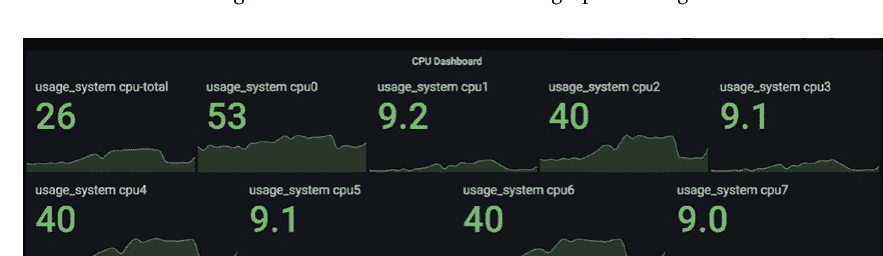

图 6-31. Stat

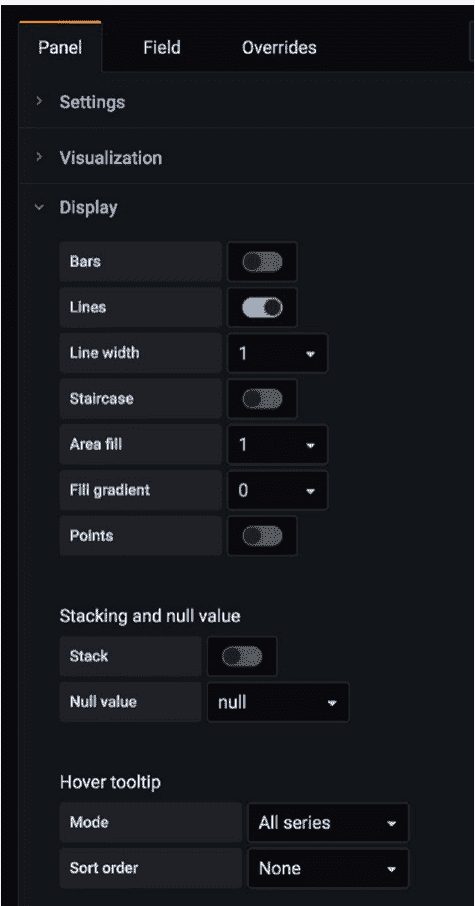

图 6-34. 显示设置

可视化部分具有选择最合适的可视化工具来解释数据的选项。这里有很多选项，但有时要显示的数据应该能够轻松传达图表和仪表板的想法。监控专家提出的最重要建议是，您的图表是否漂亮并不重要；重要的是它们传达了什么。因此，选择正确的可视化非常重要。


条形图 - 条形图表示与折线图相同的数据，但使用矩形条来表示。当条形图滑块处于激活状态时，折线图将变为条形图，如图 6-35 所示：

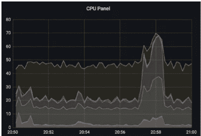

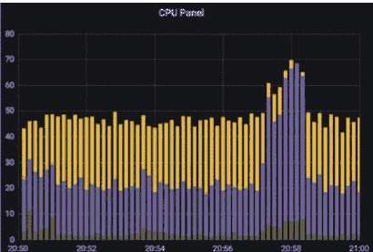

图 6-35. 条形图与折线图对比

折线图 - 折线图以趋势线的形式表示数据。如果希望改变折线图的粗细，你可以选择调整线宽。


图 6-36 展示了具有不同线宽的折线图。

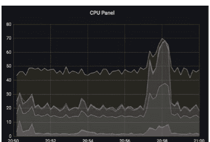

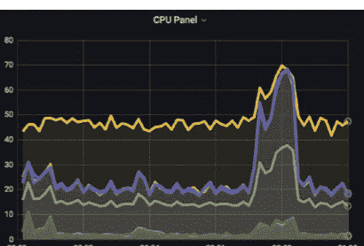

图 6-36. 折线图

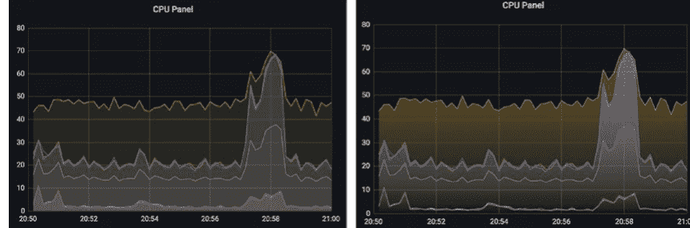

图 6-39. 为折线图添加渐变

### 仪表板

仪表板是一组面板组合在一起的集合，用于整体呈现某个系统或服务的相关信息。它们是根据管理员的需求创建的，以便实时获取应用程序或服务的运行状况和工作状态的最新信息。例如，开发人员会在仪表板上关注应用性能和相关的延迟，而运维团队则更倾向于查看底层系统的资源争用等健康参数。创建一个能够简洁呈现数据、同时不陷入过多细节而失去上下文的仪表板至关重要。在通过仪表板识别出关注区域后，你始终可以进入日志进行详细分析。

可以使用侧边菜单栏中的“Create (+)”选项，然后点击“Dashboard”来创建仪表板。这将带你进入一个新的空白仪表板；然后按照前面“创建仪表板”一节中概述的步骤操作。参见图 6-40。

#### 图 6-42. 为已创建的仪表板准备的 Kubernetes 文件夹

你也可以在文件夹内部点击“+ Create Dashboard”来创建仪表板。你还可以根据团队中每个用户的授权为文件夹添加权限。你也可以基于角色添加权限。例如，你可能希望为所有人提供对文件夹及其仪表板的只读访问权限。参见图 6-43。

#### 图 6-43. 文件夹级权限

你在文件夹级别设置的权限会应用到其仪表板。只有 Grafana 管理员和超级管理员可以创建、编辑或删除文件夹。

下拉菜单中的第三个选项是 **导入**，你可以使用它上传 JSON 格式的仪表板，或者使用 Grafana.com 上提供的各种仪表板之一，也可以直接将 JSON 粘贴到提供的文本框中。参见图 6-44。

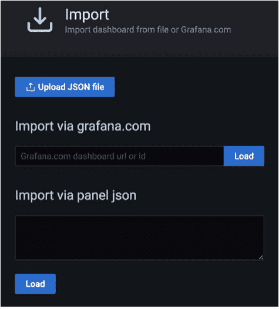

**图 6-44.** *导入仪表板*

当你选择上传 JSON 文件的选项后，选择文件后，便会进入导入过程的第二步。在该步骤中，你可以修改仪表板的名称、选择要将仪表板放入的文件夹，并为仪表板关联唯一标识符（UID）。参见图 6-45。

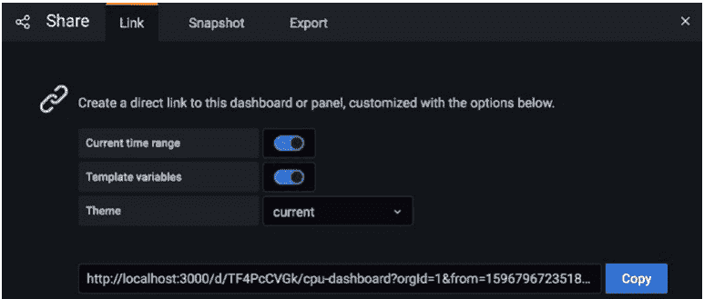

#### 图 6-47. 通过直接链接共享仪表板

你可以使用直接链接共享此仪表板，或将链接嵌入到网站中。模板变量滑块允许我们在与其他用户共享仪表板时包含这些变量。你还可以选择将仪表板的主题从深色改为浅色。

你还可以选择对仪表板进行快照，然后将其作为附件共享。参见图 6-48 和图 6-49。

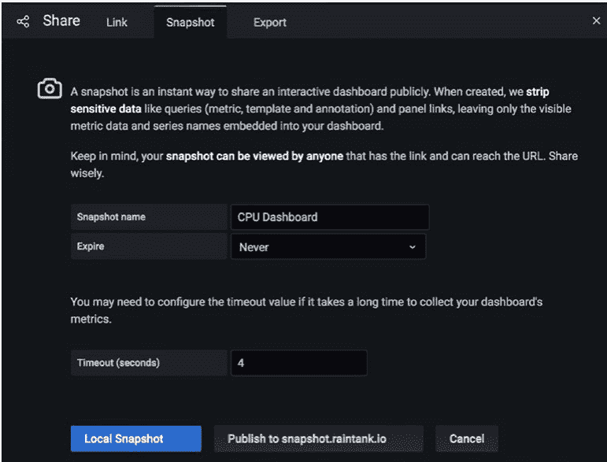

图 6-48. 仪表板快照

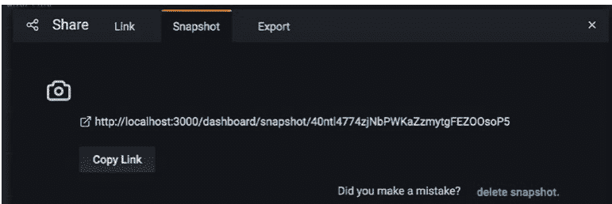

图 6-49. 本地快照链接

另一个选项是使用导出功能将仪表板导出为 JSON 文件。你可以通过“View JSON”选项查看 JSON 文件，该选项会以 JSON 格式打开仪表板，并允许你将内容复制到剪贴板。参见图 6-50。

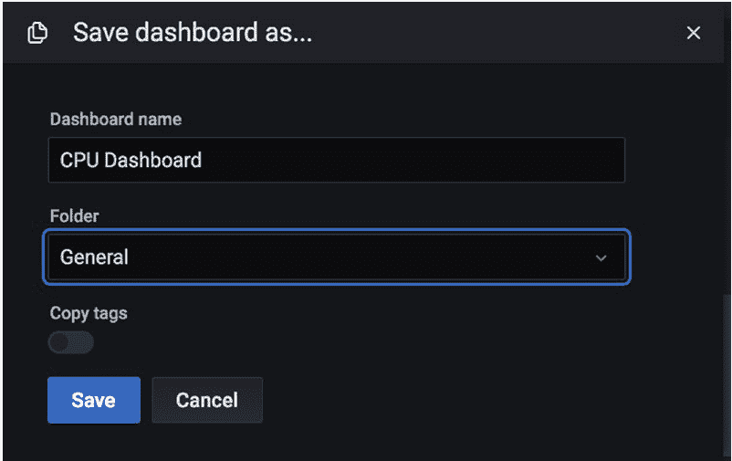

图 6-53. 输入仪表板名称和文件夹

- 5. 循环视图模式 - 此选项用于将显示从普通模式切换为自助终端模式（kiosk mode）和自助终端电视模式。如果你想在控制中心环境中投影数据，此功能非常有用。
- 6. 时间选择器下拉框 - 你可以选择更改仪表板的时间范围。你可以选择绝对时间范围（Absolute Time Range），从日历中选取开始日期和结束日期；或者选择相对时间范围（Relative Time Range），从可用的时间持续时间中进行选择。还可以选择将时区从 UTC 更改为本地时间。参见图 6-54。

### 行

图 6-54. 更改仪表板的时间范围

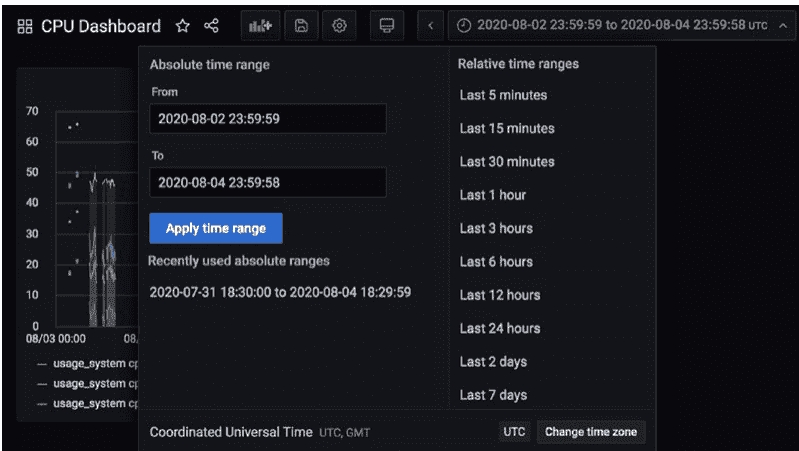

行用于将仪表板按逻辑划分为特定区域，以便将一组面板组合在一起。如果在保存仪表板时某个行处于折叠状态，那么仪表板将以该状态保存，并且在该行展开之前不会加载这些图表。使用重复行功能，可以根据所选的模板变量动态创建或移除整个行，这些行可以填充面板。创建行后，其外观将如图 6-55 和图 6-56 所示：

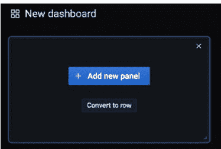

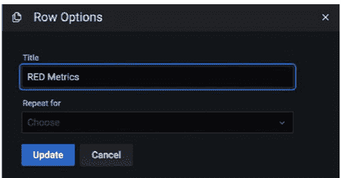

图 6-55. 创建行并为其指定标题

间隔是指每个仪表板被播放列表中的另一个仪表板刷新的时间间隔。播放列表启动后，可以使用屏幕顶部的导航栏进行控制。播放列表可以以五种不同模式运行，这些模式决定了菜单和导航栏在仪表板上的位置。这五种模式分别是普通模式、自助终端模式、带自适应面板的自助终端模式、电视模式以及带自适应面板的电视模式。参见图 6-61 和图 6-62。

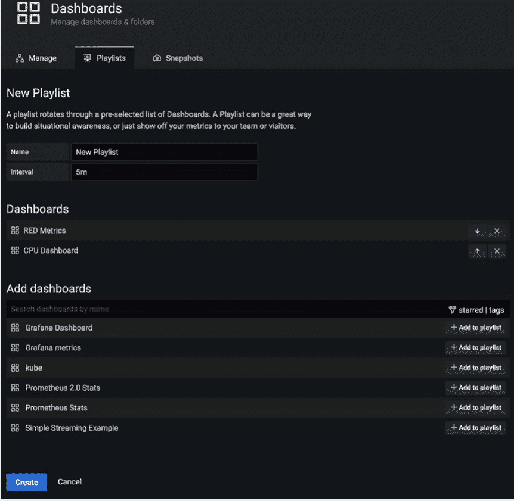

图 6-61. 播放列表中的仪表板

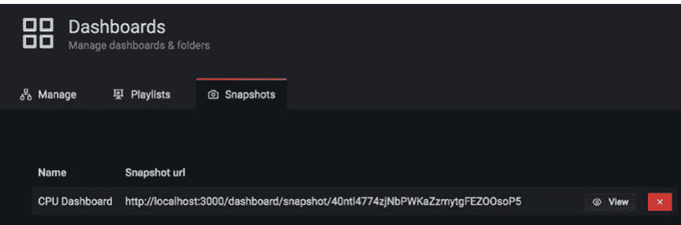

图 6-62. 快照

### 探索

探索功能是仪表板的精简版本，你可以在其中围绕指标、日志和追踪来处理查询。对查询感到满意后，你可以基于该查询构建仪表板或图表。当你想要专注处理复杂查询而不考虑如何呈现结果时，这非常有用。参见图 6-63。

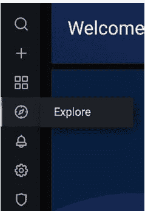

图 6-63. 探索菜单

探索功能允许你运行多个查询并关联结果。它可以处理指标、日志和追踪，并帮助你获得监控数据的端到端视图。Loki 是 Grafana 的日志数据源，它与探索功能紧密集成，允许在单个控制台中关联数据。参见图 6-64。

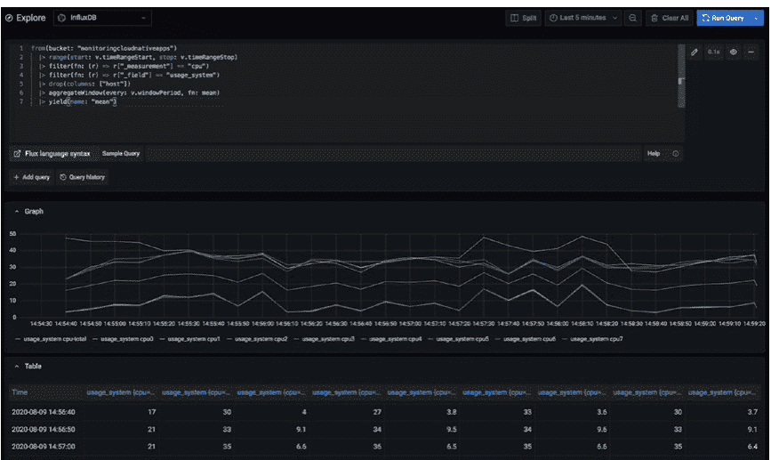

#### 图 6-64. 探索区域

### 告警

当 Grafana 定期检查的某些预定义条件导致系统状态发生变化时，告警会通知你。如果这些条件中的一个或多个被触发，你可以选择在配置为接收通知的渠道上收到通知。收到问题通知后，你可以调查问题，并使用 Grafana 来确定原因并解决问题。

你可以在告警区域中开始创建告警规则，该区域可从 Grafana 的侧边菜单栏访问（图 6-65）。


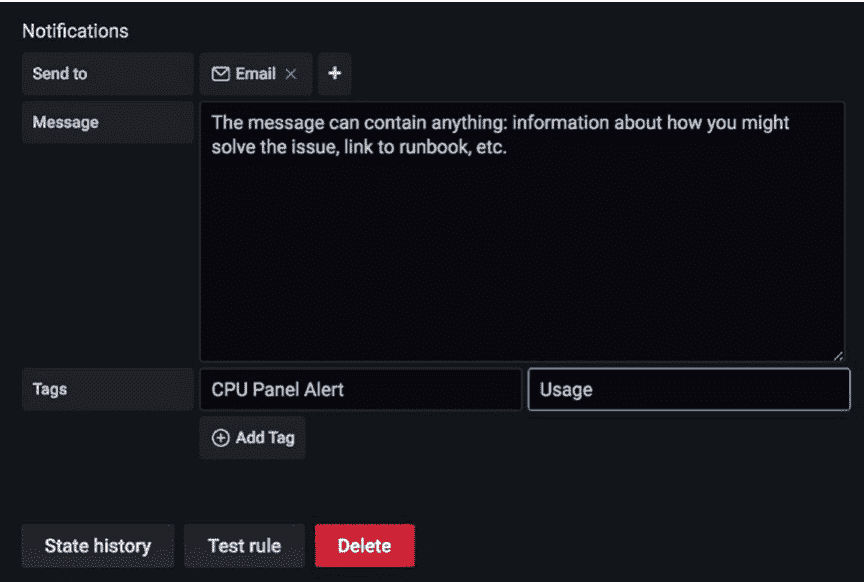

图 6-68 设置告警通知

Grafana 具有一个调度器和查询执行引擎，用于评估告警规则。它仅支持有限数量的数据源，如 Prometheus、InfluxDB、Elasticsearch 等。如果你以高可用方式部署了 Grafana，所有服务器都会执行告警，但告警通知会被去重，只发送一条通知。

### 状态历史

告警状态的变化会记录在 Grafana 数据库的内部表中。如图 6-69 所示，最近 50 次从 OK 到 ALERTING 的状态变化会连同日期和时间一起被捕获。你也可以通过点击“清除历史记录”按钮来清除状态历史。状态变化会以注释的形式在图表面板中标记出来。

如图 6-70 所示，还有两个区域可以查看正在触发的告警的更多详细信息。一个区域显示满足告警规则的对象。在图 6-70 中，它是 handler="/metrics"，其值大于配置的告警阈值 0.5。第二个区域是日志，显示对象 handler="/metrics" 的值高于 0.5 的阈值限制。

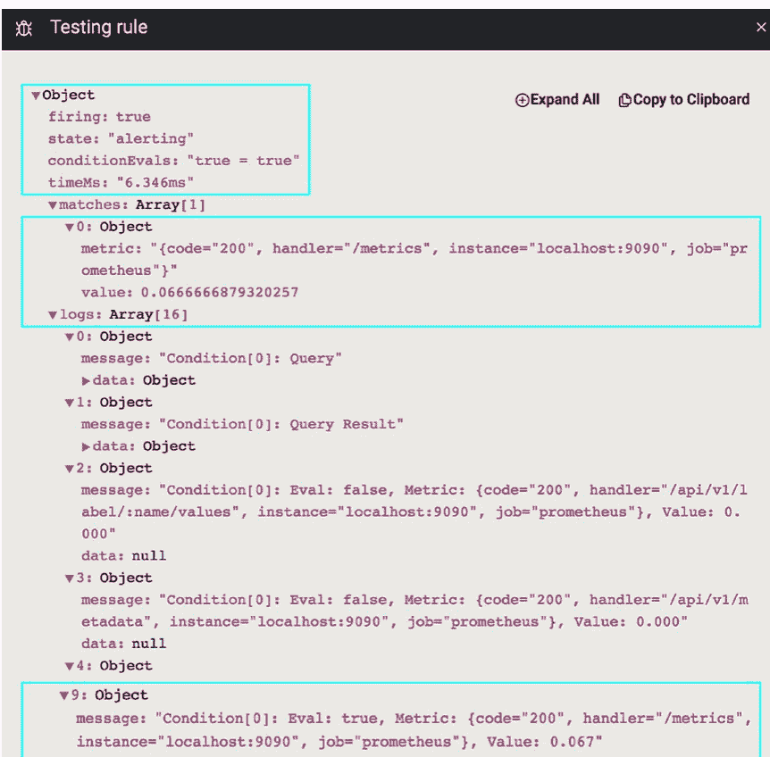

图 6-70 测试配置的告警规则

成功配置告警后，它将显示在 Alerting（告警）部分的 Alert Rules（告警规则）选项卡下，如图 6-71 所示。

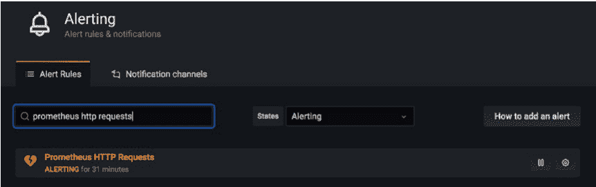

图 6-71 告警规则触发

### 添加通知渠道

通知渠道是当你的监控系统生成告警时，你希望即时收到通知的媒介。为了在你喜欢的通知渠道中接收通知，首先需要从 Notification channels（通知渠道）选项卡将其与 Grafana 集成。参见图 6-72。

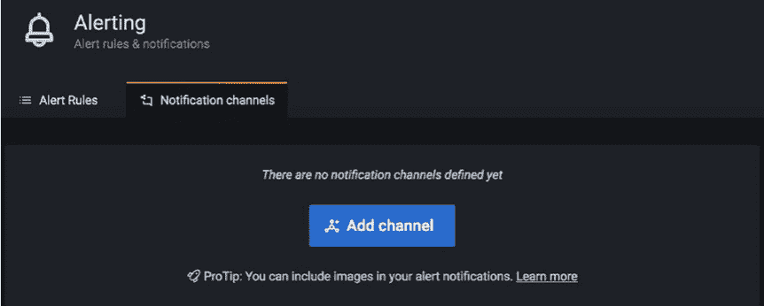

图 6-72 添加通知渠道

- Grafana（续）
  - 创建, 233
  - 定义, 232
  - 通知渠道, 238, 239
  - 设置, 234, 235
  - 状态, 235, 236
  - 测试规则, 236–238
  - 创建仪表盘
    - 面板编辑器, 203–211
    - 面板, 202, 203
  - 定义, 187
  - 特性, 187
  - 安装, 188–192, 195
  - 可视化
    - 条形仪表, 212
    - 显示设置, 212–215
    - 仪表, 212
    - Stat, 211
- **H**
  - 热力图, 83, 187
- **I, J**
  - InfluxDB
    - 告警
      - 配置, 175
      - 配置检查, 176–178
      - 通知端点, 182
      - 设置阈值, 179–181
    - 存储桶, 154
    - 数据收集
      - 抓取器, 154, 156
      - Telegraf, 156, 158, 159, 161–163, 165, 166
    - 数据存储, 168
    - 安装, 134, 136, 137, 139, 140, 142
    - 成员, 148–153
    - 组织, 142, 145
      - 创建, 143, 144
      - 删除, 148
      - 重命名, 145–147
    - 可视化, 182–185
- **K**
  - 关键性能指标（KPI）, 14
  - Kubernetes, 22
    - API 服务器, 48
    - 架构, 23
    - Borg, 22
    - cAdvisor, 49, 50
    - 集群, 47
    - CNCF 项目, 22
    - 命令, 47
    - 组件, 23, 24
    - ConfigMap, 103
    - 容器, 22
    - 内部指标
      - 命名空间, 52
      - 节点, 52
      - Pod, 53
      - 汇总使用量, 52
    - kube-state-metrics, 50
    - Pod 列表, 47
    - 主节点, 23
    - 主节点, 51
    - 指标服务器, 50
    - 基于微服务的应用, 22
    - 监控, 46
    - 命名空间, 102
    - 可观测性, 46
    - Prometheus, 45, 46
    - 用途, 22
    - 指标来源, 47
- 现代监控系统（续）
  - OpenTelemetry, 63, 64
    - 代理, 66, 67
    - 收集器, 65
    - 收集器架构, 65, 66
    - 导出, 64
    - 网关, 66
- 监控领域
  - 应用程序, 13
  - 业务 KPI, 14
  - 分类, 11, 12
  - 云基础设施, 12
  - 容器, 13
  - 服务, 13
  - 用户体验, 13
    - 点击流监控, 14
    - 合成监控, 14
- 监控
  - 容量使用, 8
  - 定义, 8
  - DevOps
    - 演进, 9, 10
    - 五大支柱, 10, 11
    - SLO, 10
    - SRE, 10
  - 性能趋势, 8
  - 被动式 vs. 主动式, 15
- 监控系统
  - AIOps, 21
  - 定义, 16
  - 特性
    - 聚合, 18
    - 自动通知, 19
    - 数据收集, 18
    - 发现, 19
  - 现代系统, 19
  - 传统监控, 19
  - 类型, 16
  - 用例
    - 检测问题, 17
    - 确保可用性, 17
    - 衡量性能, 17
- **O**
  - 可观测性
    - 定义, 25
    - 事件, 26, 27, 44, 45
    - 日志, 27
      - RPC, 28
      - 根因分析, 27
    - 指标, 26
    - 目标, 26
    - 追踪, 26
      - RPC, 28
  - OpenTelemetry 收集器, 64, 65, 67
  - OpenTelemetry
    - 协议（OTLP）, 64
- **P, Q**
  - Prometheus, 99
    - 告警, 129
      - 分组, 129
      - 抑制, 130
      - 路由, 129
      - 静默, 131
    - 架构, 110
      - Alertmanager, 129
    - Borgmon, 99
    - 数据收集, 110, 111
    - 数据存储, 121
    - 暴露格式, 111–114
    - 服务发现, 117, 118

