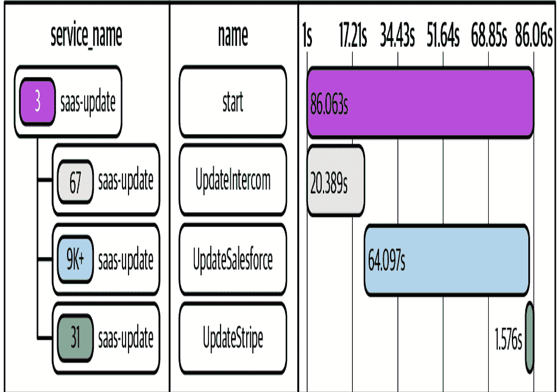
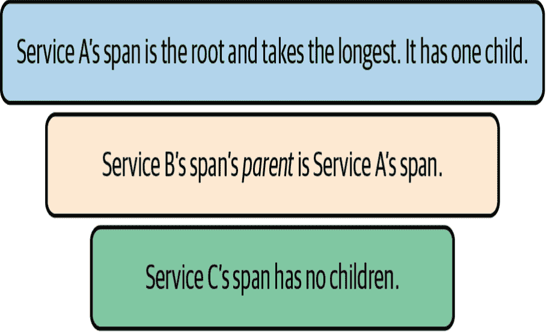
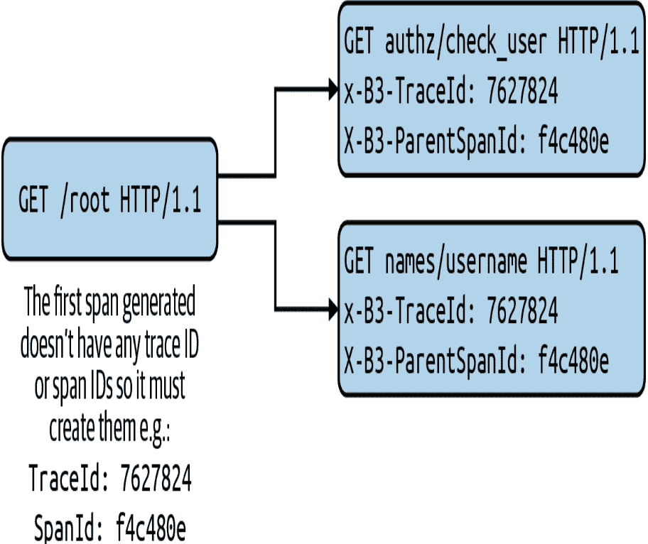

# Chapter 5. Structured Events Are the Building Blocks of Observability

### A NOTE FOR EARLY RELEASE READERS

With Early Release ebooks, you get books in their earliest form—the authors’ raw and unedited content as they write—so you can take advantage of these technologies long before the official release of these titles.

This will be the 5th chapter of the final book.

If you have comments about how we might improve the content and/or examples in this book, or if you notice missing material within this chapter, please reach out to the editor at vwilson@oreilly.com.

在本章中，我们检查可观测性的基本构建块：结构化事件。可观测性是你能够理解和解释系统可能进入的任何状态的程度，无论多么新颖或奇怪。为了做到这一点，你必须能够回答任何可以提出的问题，而无需提前预测或预测需要回答该问题的需求。为此，首先必须满足几个技术前提。

在本書中，我们解决了可观测性所需的许多技术前提。在本章中，我们从理解和解释系统可能处于的任何状态所需的遥测开始。询问*任何*问题，关于任何组合的遥测细节，需要能够沿任意数量的维度任意切片和切分数据。它还要求你的遥测以完整分辨率收集，精确到保留收集上下文的最低逻辑粒度级别。对于可观测性而言，这意味着在每个请求或每个服务级别收集遥测。

使用老式指标，你必须预先定义自定义指标，如果你想开始提出新问题并收集新遥测来回答它。在指标世界中，获得对任何可能问题的答案的方法是收集和存储每一种可能的指标——这根本不可能（即使可能，也 prohibitively expensive）。此外，指标不保留事件的上下文，只是特定时间发生情况的聚合测量。凭借这种聚合视图，你无法对现有数据集提出新问题或寻找新异常值。

使用可观测性，你可以在任何时候对现有遥测数据提出新问题，而无需先预测这些问题可能是什么。在可观测系统中，你必须能够迭代地探索系统方面，从高级别聚合性能一直到单个请求中使用的原始数据。

使这成为可能的技术要求从可观测性所需的数据格式开始：任意宽度的结构化事件。收集这些事件不是可选的。它不是实现细节。它是使在该广泛视图中进行任何级别分析成为可能的必要条件。

### Debugging with Structured Events

首先，让我们开始定义一个事件。为了理解对生产服务的影响，*事件*是记录一个特定请求与你的服务交互时发生的一切的记录。

要创建该记录，你从请求首次进入你的服务时开始初始化一个空的 blob。在该请求生命周期期间，关于发生的有趣细节——唯一 ID、变量值、标头、请求传递的每个参数、


执行时间、对远程服务的任何调用、这些远程调用的执行时间，或任何可能在后续调试中具有价值的上下文信息——都会被附加到该数据块上。然后，当请求即将退出或出错时，该整个数据块将被捕获为刚刚发生情况的丰富记录。写入该数据块的数据以键值对的形式组织和格式化，以便易于搜索：换句话说，数据应该是结构化的。这就是一个*结构化事件*。

当你在服务中调试问题时，你会将结构化事件相互比较以查找异常。当某些事件的行为与其他事件显著不同时，你将着手识别这些异常值有什么共同点。探索这些异常值需要按不同维度——以及这些维度的组合——进行过滤和分组，这些维度包含在事件中，可能与你的调查相关。

你作为结构化事件输入到可观测性系统中的数据需要捕获正确的抽象级别，以帮助观察者确定应用程序的状态，无论其多么奇怪或新颖。对调查人员有帮助的信息可能包含与任何给定请求无关的运行时信息（例如容器信息或版本信息），以及流经服务时每个请求的信息（例如购物车 ID、用户 ID 或会话令牌）。这两种类型的数据对于调试都很有用。

与请求调试相关的数据类型会有所不同，但将其与使用传统调试器时有用的数据类型进行比较有助于思考。例如，在那种情况下，你可能想要知道请求执行期间变量的值，并了解函数调用发生的时间。对于分布式服务，这些函数调用可能表现为对远程服务的多次调用。在那种情况下，请求执行期间变量值的任何数据都可以被视为请求的*上下文*。

所有这些数据都应可用于调试并存储在你的事件中。它们是*任意宽度的事件*，因为你需要的调试数据可能涵盖大量字段。附加到事件的细节不应有实际限制。我们将进一步深入探讨应捕获在结构化事件中的信息类型，但在那之前，让我们先比较使用结构化事件捕获系统状态与传统调试方法有何不同。

## 度量作为构建块的局限性

首先，让我们定义*指标*。不幸的是，该术语需要澄清，因为它经常被用作“遥测”的通用同义词（例如，“我们所有的指标都向上且向右，老板！”）。为了清晰起见，当我们提到指标时，我们指的是收集以表示系统状态的标量值，可选择附加标签用于对这些数字进行分组和搜索。指标是传统软件系统监控的基础（请参阅第 1 章，了解以此意义上指标起源的更详细说明）。

然而，指标的根本局限在于它是一个预聚合的度量。指标生成的数值反映了在预定义时间段内系统状态的聚合报告。当该数字报告给监控系统时，该预聚合度量就成为检查系统状态的最低可能粒度级别。这种聚合掩盖了许多可能的问题。此外，进入你服务的请求可能在执行过程中由数百个指标表示。这些指标都是彼此分离的、缺乏连接组织和粒度来重建哪些指标属于同一请求的独立度量。

例如，`page_load_time` 指标可能会检查在过去五秒期间所有活动页面加载的平均时间。另一个 `requests_per_second` 指标可能会检查在过去一秒期间任何给定服务打开的 HTTP 连接数。指标反映了系统状态，其表达方式是通过在给定时间段内测量任何给定属性得出的数值。在该期间内所有活动请求的行为都被聚合为一个数值。在此示例中，调查流经该系统的任何一个特定请求在其生命周期内发生的情况将提供一条面包屑线索，通向这两个指标。然而，进一步挖掘所需的可用粒度级别不可用。

> **NOTE**
> 
> 深入探讨指标在 TSDB 中的存储方式超出了本章的范围，但在第 16 章中部分涉及。有关指标和 TSDB 如何与可观测性不兼容的更深入探讨，我们推荐 Alex Vondrak 2021 年的博客文章，“How Time Series Databases Work—and Where They Don’t”。

在基于事件的方法中，Web 服务器请求可以被检测以记录随请求提交的每个参数（或维度）（例如，`userid`），目标子域（`www`、`docs`、`support`、`shop`、`cdn` 等），总持续时间，任何依赖的子请求，履行这些子请求涉及的各种服务（`web`、`database`、`auth`、`billing`），每个子请求的持续时间，等等。然后，这些事件可以根据各种维度、在任意时间窗口内进行任意切片和切分，以呈现与调查相关的任何视图。

与指标相比，事件是特定时间点发生情况的快照。在前述示例中，同一过去五秒期间内可能发生了 1000 个离散事件。如果每个事件都记录了自己的 `page_load_time`，当与同一五秒期间发生的另外 999 个事件一起聚合时，你仍然可以显示与指标所示相同的平均值。此外，通过事件提供的粒度，调查人员还可以计算同一平均值在一秒期间，或按用户 ID 或主机名等字段细分查询，以找到与 `page_load_time` 的相关性，而使用指标提供的聚合值则无法实现。

*日志文件*本质上是大量非结构化文本的大块，设计为人类可读但机器难以处理。这些文件是由应用程序和各种底层基础设施系统生成的文档，其中包含由某个配置文件中定义的所有值得注意事件的记录——这些事件已发生。几十年来，它们一直是任何环境中系统调试应用程序的重要组成部分。日志通常包含大量有用信息：发生的事件描述、相关时间戳、与该事件关联的严重级别类型，以及各种其他相关元数据（用户 ID、IP地址等）。

传统日志是*非结构化*的，因为它们设计为人类可读。不幸的是，为了便于人类阅读，日志通常将单个事件的生动细节分离到多行文本中，如下所示：

```
6:01:00 accepted connection on port 80 from 10.0.0.3:63349
6:01:03 basic authentication accepted for user foo
6:01:15 processing request for /super/slow/server
6:01:18 request succeeded, sent response code 200
6:01:19 closed connection to 10.0.0.3:63349
```

当首次学习开发中服务的复杂性时，这种叙述结构可能有所帮助，但它会产生大量嘈杂的数据，在生产环境中变得缓慢而笨拙。在生产环境中，这些叙述块通常散布在数百万行其他文本中。通常，它们在调试过程中一旦原因已被怀疑，调查人员通过日志挖掘来验证其假设时才有用。

然而，现代系统不再以易于理解的人类规模运行。在传统的单体系统中，人类操作员只需管理很少的服务。日志被写入应用程序运行的机器的本地磁盘。在现代时代，日志通常会流式传输到集中式聚合器，在那里它们被转储到非常大的存储后端。


要搜索数百万行非结构化日志，可以通过使用某种日志文件解析器来完成。*解析器*将日志数据分割成信息块，并试图以有意义的方式对其进行分组。然而，对于非结构化数据，解析会变得复杂，因为不同类型的日志文件存在不同的格式规则（或者根本没有规则）。日志记录工具包含各种不同的方法来解决这个问题，其成功程度、性能和可用性各不相同。

## 结构化日志

解决方案是创建为机器可解析性而设计的*结构化*日志数据。从前面的示例来看，结构化版本可能看起来像这样：

```
time="6:01:00" msg="accepted connection" port="80"
authority="10.0.0.3:63349"
time="6:01:03" msg="basic authentication accepted" user="foo"
time="6:01:15" msg="processing request" path="/super/slow/server"
time="6:01:18" msg="sent response code" status="200"
time="6:01:19" msg="closed connection" authority="10.0.0.3:63349"
```

许多日志只是事件的一部分，无论这些日志是否是结构化的。在将可观测性方法应用于日志记录时，将事件视为系统中的工作单元会有所帮助。一个结构化事件应包含服务执行一个工作单元所需的信息。*工作单元*可以被视为相对的概念。例如，一个工作单元可能是下载单个文件、解析它并提取特定信息片段。而在其他时候，它可能意味着从数十个文件中提取特定信息片段后处理一个答案。在服务的上下文中，一个工作单元可以是接受一个 HTTP 请求并执行返回响应所需的一切操作。而在其他时候，一个 HTTP 请求在其执行过程中可能生成许多其他事件。

理想情况下，结构化事件的范围应包含执行该工作单元所需的一切信息。它应记录执行工作所需的输入、在此过程中收集的任何属性（无论是计算的、解析的还是发现的）、服务在执行工作时的状态，以及所执行工作的结果详情。

通常可以看到几条到几十条日志行或日志条目，当它们放在一起时，代表可以被视为一个工作单元的内容。到目前为止，我们一直在使用的示例正是如此：一个工作单元（处理一个连接）由五个独立的日志条目表示。这些消息并没有被有益地分组到一个事件中，而是分散到许多消息中。有时，每个条目中可能存在一个公共字段——比如请求 ID——这样单独的条目就可以拼接在一起。但通常不会有。

我们示例中的日志行可以改为汇总为一个单一事件。汇总后看起来像这样：

```
time="2019-08-22T11:56:11-07:00" level=info msg="Served HTTP request"
authority="10.0.0.3:63349" duration_ms=123
path="/super/slow/server" port=80
service_name="slowsvc" status=200 trace.trace_id=eafdf3123
user=foo
```

这种表示可以用不同方式格式化，包括 JavaScript 对象表示法（JSON）。最常见的是，这类事件信息可能以 JSON 数据块的形式出现，如下所示：

```
{
  "authority":"10.0.0.3:63349",
  "duration_ms":123,
  "level":"info",
  "msg":"Served HTTP request",
  "path":"/super/slow/server",
  "port":80,
  "service_name":"slowsvc",
  "status":200,
  "time":"2019-08-22T11:57:03-07:00",
  "trace.trace_id":"eafdf3123",
  "user":"foo"
}
```

可观测性的目标是使你能够以任意方式查询事件数据，以理解系统的内部状态。用于此目的的任何数据都必须是机器可解析的，以促进这一目标的实现。非结构化数据根本无法用于该任务。然而，当日志数据被重新设计为类似于结构化事件（可观测性的基本构建块）时，它可以变得有用。

## 对调试有用的事件属性

在本章前面，我们将结构化事件定义为某个特定请求与你的服务交互期间发生的一切的记录。在调试现代分布式系统时，这大致是工作单元的正确范围。为了创建一个让观察者能够理解系统任何状态（无论多么新奇或复杂）的系统，事件必须包含可能与调查相关的充足信息。

可观测系统的后端数据存储必须允许事件具有任意宽度。使用结构化事件来理解服务行为时，请记住，模型是初始化一个空数据块，并记录任何可能对后续调试有用的信息。这可能意味着在请求进入你的服务时，用已知数据预填充数据块：请求参数、环境信息、运行时内部信息、主机/容器统计信息等。随着请求执行，可能会发现其他有价值的信息：用户 ID、购物车 ID、为了渲染结果而要调用的其他远程服务，或者任何有助于你将来查找和识别此请求的各类信息位。当请求退出你的服务或返回错误时，会有一些数据记录该工作单元是如何执行的：持续时间、响应代码、错误消息等。成熟插桩生成的事件通常每个事件包含 300 到 400 个维度。

调试新问题通常意味着通过搜索具有异常条件的事件并发现模式或关联它们，来发现以前未知的故障模式（未知的未知）。例如，如果错误激增，你可能需要跨各种事件维度进行切片，找出它们的共同点。为了进行这些关联，你的可观测性解决方案需要具备处理高基数字段的能力。

> **注意**
> 
> *基数*指集合中唯一元素的数量，正如你在[第 1 章](#)中记得的那样。事件中的某些维度可能具有非常低或非常高的基数。任何包含唯一标识符的维度都将具有最高可能的基数。例如，表示社会安全号码的哈希字段将具有高基数（因为每个人都有唯一的号码）。名字或姓氏字段的基数将略低于社会安全号码字段（例如，可能存在多个“Jane”和“Smith”条目），但仍然很高。像性别这样的字段，即使不是二元的，其基数也较低。而像“物种”这样的字段——假设你的用户都是人类——将只有一个值，使其成为可能的最低基数。

可观测性工具必须能够支持高基数查询，才能对调查人员有用。在现代系统中，许多对调试新问题最有用的维度都具有高基数。调查通常还需要将这些高基数维度串联起来（即高维度），以发现深藏的问题。调试问题通常就像大海捞针。高基数和高维度是让你能够在深度复杂的分布式系统大海捞针中找到非常细粒度“针”的能力。

例如，要找到问题的源头，你可能需要创建一个查询，查找“所有加拿大用户，运行 iOS 11 版本 11.0.4，使用法语语言包，上周二安装了该应用，运行固件版本 1.4.101，并且将照片存储在 us-west-1 区域的 shard3 上”。这些约束中的每一个都是高基数维度。

如前所述，要实现该功能，事件必须*任意宽*：事件中的字段不能仅限于已知或可预测的字段。将可摄取事件限制为仅包含已知字段，可能是特定分析工具所使用的后端存储系统强加的人为约束。例如，某些后端数据存储可能要求预定义数据模式。预定义模式要求工具的用户能够提前预测可能需要捕获哪些维度。使用模式或对数据类型或形状进行其他严格限制，也与可观测性的目标无关（参见第 16 章）。

## 结论

可观测性的基本构建块是任意宽度的结构化事件。可观测性要求具备沿任意数量的维度对数据进行切片和切块的能力，以便在迭代调试过程中回答任何问题。结构化事件必须具有任意宽度，因为它们需要包含足够的数据，使调查人员能够理解系统完成一个工作单元时发生的一切。对于分布式服务，这通常意味着将事件界定为单个服务请求生命周期内发生的一切的记录。

指标在预定义的时间段内聚合系统状态。它们仅充当一个系统属性的一个狭窄视图。它们的粒度太大，并且它们以其他视图呈现系统状态的能力过于僵化，无法将它们拼接在一起以表示任何特定服务请求的一个工作单元。指标过于局限，无法作为可观测性的基本构建块。

非结构化日志是人类可读的，但在计算上难以使用。结构化日志是机器可解析的，并且如果它们被重新设计为类似于结构化事件，则对于可观测性的目标可能有用。

目前，我们只需专注于遥测所需的数据类型。在接下来的几章中，我们将更深入地研究为什么分析高基数和高维度数据很重要。我们还将进一步


定义工具实现可观测性所需的必要能力。接下来，让我们先看看如何将结构化事件拼接起来以创建 trace。

手动组装 trace 所必需的以及这些组件的工作方式。我们展示了向 trace 事件（或 span）添加相关数据的示例，以及为什么你可能想要这些数据。最后，在向你展示如何手动组装 trace 之后，我们将把这些相同的技术应用于非传统 tracing 用例（例如拼接日志事件），这些用例在可观测系统中是可行的。

## 分布式追踪及其重要性

*Tracing* 是一种基本的软件调试技术，其中在程序执行过程中记录各种信息以用于诊断问题。自从第一天两台计算机被连接起来交换信息以来，软件工程师一直在发现潜伏在我们的程序和协议中的 gremlins。尽管我们尽了最大努力，这些缝隙中的问题仍然存在，在分布式系统成为常态的时代，我们使用的调试技术必须适应以满足更复杂的需求。

*分布式追踪* 是一种跟踪单个请求——称为 *trace* ——在被构成应用程序的各种服务处理时进展的方法。在这种意义上，追踪是“分布式”的，因为为了履行其功能，单个请求通常必须跨越进程、机器和网络边界。微服务架构的流行导致用于精确定位故障发生位置以及可能导致性能不佳的调试技术急剧增加。但只要请求跨越边界——例如从本地到云基础设施，或从你控制的基础设施到你不控制的 SaaS 服务，再返回——分布式追踪对于诊断问题、优化代码和构建更可靠的服务都非常有用。

分布式追踪的流行度上升也意味着出现了几种实现该任务的方法和竞争标准。分布式追踪在 Google 发布 Benjamin Sigelman 等人于 2010 年的 Dapper 论文后首次获得主流关注。随后不久出现了两个值得注意的开源追踪项目：Twitter 的 Zipkin

在 2012 年和 Uber 的 Jaeger 在 2017 年，此外还有 Honeycomb 或 Lightstep 等几种商业可用解决方案。

尽管这些追踪项目在实现上存在差异，但核心方法和它们提供的价值是相同的。如第一部分所述，现代分布式系统倾向于扩展成依赖关系的纠结结。分布式追踪的价值在于它清晰地显示了分布式系统中各种服务和组件之间的关系。

Trace 有助于你理解系统相互依赖关系。那些相互依赖关系会掩盖问题，使其在没有清楚理解它们之间的关系时尤其难以调试。例如，如果下游数据库服务出现性能瓶颈，该延迟会累积叠加。到该延迟在上游三四层被检测到时，识别系统中的哪个组件是问题的根源可能非常困难，因为现在同样的延迟在数十个其他服务中都被看到。

在一个可观测系统中，trace 只是相互连接的事件序列。为了理解 trace 如何与可观测性的基本构建块相关，让我们先看看 trace 是如何组装的。

## 追踪的组件

为了理解追踪在实践中工作的机制，我们将使用一个示例来说明收集 trace 所需数据的各种组件。首先，我们将考虑我们希望从 trace 中获得的结果：清晰地看到各种服务之间的关系。然后我们将看看如何修改现有代码以获得该结果。

为了快速了解瓶颈可能发生的位置，使用瀑布式 trace 可视化非常有用，如图 6-1 所示。请求的每个阶段都显示为与正在调试的请求开始时间和持续时间相关的单个块。

### NOTE

瀑布可视化显示初始值如何受一系列中间值的影响，从而导致最终累积值。

### Trace ad784a29-0554-460a-bfc2-defb6de57e97



图 6-1. 此瀑布式 trace 可视化显示一个请求期间的四个 trace span

这个瀑布的每个块称为 trace span，或简称为 span。在任何给定的 trace 中，span 要么是根 span——该 trace 中的顶级 span——要么嵌套在根 span 内。嵌套在根 span 内的 span 也可能有自己的嵌套 span。这种关系有时被称为父子关系。例如，在图 6-2 中，如果服务 A 调用服务 B，服务 B 调用服务 C，则对于该 trace，Span A 是 Span B 的父级，Span B 是 Span C 的父级。



> *图 6-2. 一个具有两个父 span 的 trace。Span A 是根 span，也是 Span B 的父级。Span B 是 Span A 的子级，也是 Span C 的父级。Span C 是 Span B 的子级，没有自己的子 span。*

请注意，一个服务可能在 trace 中多次出现并作为单独的 span，例如在循环依赖或同一服务跳内拆分为并行函数的密集计算的情况下。实际上，请求通常会通过分布式系统中的混乱且不可预测的路径遍历。为了为任何路径构建我们想要的视图，无论多么复杂，我们需要每个组件的五条数据：

### Trace ID

我们需要一个 trace 的唯一标识符，以便我们可以将其映射回特定请求。此 ID 由根 span 创建并在履行请求的每一步中传播。

### Span ID

我们还需要为每个创建的单个 span 创建一个唯一标识符。Span 包含在

有了这些数据，我们应该能够为任何请求构建我们想要的瀑布可视化类型，以便快速诊断任何问题。接下来，让我们看看如何为我们的代码添加 instrumentation 以生成这些数据。

## 以困难的方式为 Trace 添加 Instrumentation

为了理解 trace 的核心组件如何组合在一起，我们将创建一个过于简单的追踪系统的手动示例。在任何分布式追踪系统中，会添加更多信息到 trace 中以使数据更易于使用。例如，你可能希望在将 trace 发送到后端数据存储之前用额外的元数据丰富它（参见第 16 章）。

> 如果你想从头开始制作一个苹果派，你必须先发明宇宙。
> 
> Carl Sagan

为了说明目的，我们假设用于收集此数据的后端已经存在，并将重点放在追踪所需的客户端 instrumentation 上。我们还假设我们可以通过 HTTP 将数据发送到该系统。

假设我们有一个简单的 Web 端点。为了快速说明目的，我们将使用 Go 作为我们的语言进行此示例。当我们发出 GET 请求时，它会调用另外两个服务来检索基于请求负载的数据（例如用户是否被授权访问给定端点），然后返回结果：

```
func rootHandler(r *http.Request, w http.ResponseWriter) {
    authorized := callAuthService(r)
    name := callNameService(r)

    if authorized {
        w.Write([]byte(fmt.Sprintf(`{"message": "Waddup %s"}`,
        name)))
    }
```

```
func rootHandler(...) {
    // ... trace id setup from above ...

    startTime := time.Now()
    traceData["timestamp"] = startTime.Unix()

    // ... main work of request ...

    traceData["duration_ms"] = time.Now().Sub(startTime)
}
```

最后，我们将添加两个描述性字段：service name 指示工作发生在哪项服务中，span name 指示我们所做的 work 类型。此外，我们将设置此代码部分在完成后通过远程过程调用（RPC）将所有这些数据发送到我们的追踪后端：

```
func loginHandler(...) {
    // ... trace id and duration setup from above ...

    traceData["name"] = "/oauth2/login"
    traceData["service_name"] = "authentication_svc"

    // ... main work of request ...

    sendSpan(traceData)
}
```

我们有此单个 trace span 所需的数据部分。然而，我们还没有一种方法将任何这些 trace 数据传递给我们在请求中调用的其他服务。至少，我们需要知道这在我们的 trace 中是哪个 span，该 span 属于哪个父级，并且该数据应在请求生命周期内传播。

在分布式追踪系统中共享信息最常见的方式是在传出请求上将其设置在 HTTP 头中。在我们的示例中，我们可以扩展我们的 helper 函数 callAuthService 和 callNameService 以接受 traceData map 并使用它在它们的传出请求上设置特殊 HTTP 头。


你可以给这些头部起任何你想要的名字，只要接收端的程序理解相同的名称即可。通常，HTTP 头部遵循特定的标准，例如万维网联盟（[W3C](W3C)）或 [B3](B3)。对于我们的示例，我们将使用 B3 标准。我们需要发送以下头部（见 [图 6-3](Figure 6-3)）以确保子 span 能够正确构建并发送它们的 span：

```
X-B3-TraceId
```

包含整个 trace 的 trace ID（来自前面的示例）

```
X-B3-ParentSpanId
```

包含当前 span ID，该 ID 将被设为子 span 生成的 span 的父 ID

现在让我们确保这些头部在我们的出站 HTTP 请求中被发送：

```
func callAuthService(originalRequest *http.Request, traceData map[string]interface{}) {
    req, _ = http.NewRequest("GET", "http://authz/check_user", nil)
    req.Header.Set("X-B3-TraceId", traceData["trace.trace_id"])
    req.Header.Set("X-B3-ParentSpanId", traceData["trace.span_id"])
    // ... make the request ...
}
```

我们也会对 `callNameService` 函数做类似的修改。这样，每当调用一个服务时，它就可以从这些头部中提取信息并将其添加到其自身生成的 `traceData` 中的 `trace_id` 和 `parent_id`。这些服务中的每一个也会将它们生成的 span 发送到 tracing 后端。在后端，这些 trace 会被拼接起来以创建我们想要看到的瀑布式可视化。



*图 6-3. 我们的示例应用现在会将 `traceID` 和 `parentID` 传播到每个子 span*

现在你已经看到了为仪器化并创建有用的 trace 视图所涉及的内容，让我们看看我们还可能想为 span 添加什么内容以使其对调试更有用。

## 向 Trace Span 中添加自定义字段

理解父子关系和执行持续时间是一个好的开始。但你可能希望在必要的 trace 数据之外添加其他字段，以便更好地了解在分布式系统中深埋的每个 span 的操作中发生了什么。

例如，除了存储服务名称以便于识别之外，了解执行工作的确切主机以及是否与特定用户相关可能很有用。让我们修改我们的示例，将这些细节作为 trace span 的一部分捕获，将它们作为键值对添加：

```
hostname, _ := os.Hostname()
traceData["tags"] = make(map[string]interface{})
traceData["tags"]["hostname"] = hostname
traceData["tags"]["user_name"] = name
```

你可以进一步扩展此示例以捕获任何你认为对调试相关的其他系统信息，例如应用程序的 build_id、instance_type、有关运行时环境的信息，或第 5 章中示例中列出的任何大量细节。目前，我们保持简单。

把所有内容放在一起，我们从头开始创建 trace 的完整示例应用看起来会像这样（代码为了清晰而重复且冗长）：

```
func rootHandler(r *http.Request, w http.ResponseWriter) {

    traceData := make(map[string]interface{})
    traceData["tags"] = make(map[string]interface{})

    hostname, _ := os.Hostname()
    traceData["tags"]["hostname"] = hostname
    traceData["tags"]["user_name"] = name

    startTime := time.Now()
    traceData["timestamp"] = startTime.Unix()
    traceData["trace_id"] = uuid.String()
    traceData["span_id"] = uuid.String()
    traceData["name"] = "/oauth2/login"
    traceData["service_name"] = "authentication_svc"

    func callAuthService(originalRequest *http.Request, traceData map[string]interface{}) {
        req, _ = http.NewRequest("GET", "http://authz/check_user", nil)
        req.Header.Set("X-B3-TraceId", traceData["trace.trace_id"])
        req.Header.Set("X-B3-ParentSpanId", traceData["trace.span_id"])
```

```
// ... make the auth request ...
}

func callNameService(originalRequest *http.Request, traceData map[string]interface{}) {
    req, _ = http.NewRequest("GET", "http://authz/check_user", nil)
    req.Header.Set("X-B3-TraceId", traceData["trace.trace_id"])
    req.Header.Set("X-B3-ParentSpanId", traceData["trace.span_id"])
    // ... make the name request ...
}

authorized := callAuthService(r)
name := callNameService(r)

if authorized {
    w.Write([]byte(fmt.Sprintf(`{"message": "Waddup %s"}`, name)))
} else {
    w.Write([]byte(`{"message": "Not cool dawg"}`))
}

traceData["duration_ms"] = time.Now().Sub(startTime)
sendSpan(traceData)
}
```

本节中使用的代码示例有点牵强，目的是说明这些概念在实践中如何结合起来。好消息是，你通常不必自己生成所有这些代码。分布式 tracing 系统通常有自己的支持库来完成大部分样板设置工作。

这些共享库通常是针对你希望使用的 tracing 解决方案的特定需求而定制的。不幸的是，特定于厂商的解决方案与其他 tracing 解决方案配合得不好，这意味着如果你想尝试不同的解决方案，就必须重新对代码进行仪器化。在下一章中，我们将研究开源的 OpenTelemetry 项目以及它如何使你只需仪器化一次即可使用各种解决方案。

现在你已经对仪器化和创建有用的 trace 视图所需的内容有了完整了解，让我们将其应用到你在上一章中学到的内容上，以了解为什么 tracing 是可观测系统中的关键要素。

## 将事件拼接成 Trace

在 [第 5 章](Chapter 5) 中，我们研究了结构化事件作为可观测系统的构建块的使用。我们将 *事件* 定义为记录了单个请求与你的服务交互时发生的一切的记录。在该请求生命周期内，为返回结果而发生的所有有趣细节都应附加到事件中。

在代码示例中，我们的函数非常简单。在真实应用中，单个请求执行过程中所做的每个服务调用都会有其自身的有趣细节：变量值、传递的参数、返回的结果、相关上下文等。每个事件都会捕获这些细节以及稍后允许你查看和调试分布式系统中各种服务和组件之间关系的 `traceData`。

在我们的示例中——以及一般分布式 tracing 系统中——我们使用的仪器化是在远程服务调用级别添加的。然而，在可观测系统中，你可以使用相同的方法将来自不同来源的任意数量的相关事件联系起来。例如，你可以通过应用这些相同的 trace 概念，将当前的单行日志解决方案迁移到更连贯的视图，从而迈出实现可观测性的第一步。

为此，你可以从生成非结构化多行日志迁移到生成结构化日志（见 [第 5 章](Chapter 5)）。然后你可以将 `traceData` 的相同必需字段添加到你的结构化日志中。完成此操作后，你可以从日志数据中生成相同的瀑布式视图。我们

在本章中，我们通过手工编码每个必要步骤的方式对 trace 进行了仪器化。开始使用 tracing 的更实际方法是使用仪器化框架。在下一章中，我们将研究开源且厂商中立的 OpenTelemetry 项目，以及你如何以及为何使用它来对生产应用进行仪器化。
