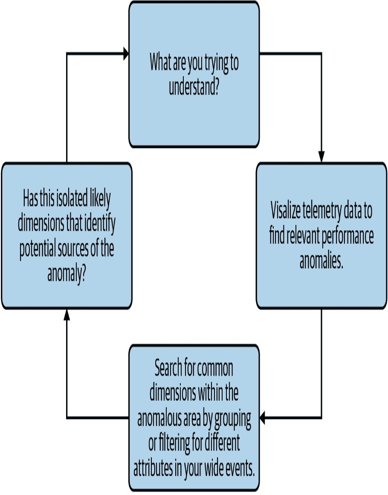

# 第 8 章 分析事件以实现可观测性

### 给早期版本读者的一点说明

通过 Early Release 电子书，您可以在书籍的最初形态——即作者写作时的原始未编辑内容——就获得它们，从而在这些技术正式发布之前就加以利用。

这将是最终图书的第 8 章。

如果您对如何改进本书的内容和/或示例有任何意见，或者您发现本章缺少某些内容，请通过 vwilson@oreilly.com 联系编辑。

在本部分的前两章中，您了解了遥测基础知识，这些知识对于创建可使用可观测性工具正确调试的数据集是必要的。虽然拥有正确的数据是基本要求，但可观测性的衡量标准是您能通过这些数据了解系统的哪些信息。本章探讨应用于可观测性数据的调试技术，以及它们与用于调试生产系统的传统技术之间的区别。

我们将首先仔细审视使用传统监控和应用性能监控工具调试问题的常见技术。如前几章所强调的，传统方法预设了对已知故障模式的大量熟悉。在本章中，我们将进一步展开这一预设，以便随后与那些识别问题时无需同等程度系统熟悉度的调试方法进行对比。

然后，我们将探讨如何将基于可观测性的调试技术自动化，并思考在创建高效调试工作流程中，人和计算机各自扮演的角色。综合这些因素，您将理解可观测性工具如何帮助您分析遥测数据，以识别传统工具无法发现的问题。

这种假设驱动的调试风格——先形成假设，再探索数据以证实或否定它们——不仅比依赖直觉和模式匹配更科学，还让调试这一行为民主化。传统调试技术偏爱那些最熟悉系统且最有经验的人，让他们能快速找到答案；与之相反，使用可观测性进行调试则偏爱那些最有好奇心、或最勤于在生产环境中检查自己代码的人。借助可观测性，即使对系统知之甚少的人，也应该能够参与进来并调试问题。

## 从已知条件进行调试

在可观测性出现之前，系统和应用程序的调试主要建立在您对系统的了解之上。这一点可以从工程团队最资深成员处理故障的方式中看到。他们似乎知道该问哪些问题，并能本能地知道该看哪里，这看起来简直不可思议。这种魔法源于他们对应用程序和系统的深入了解。

为了捕捉这种魔法，管理者们敦促资深工程师编写详细的运维手册，试图识别并解决他们在实际生产中可能遇到的每一个可能的“根因”。在[第 2 章]中，我们讨论了为创建恰好能识别新问题的视图而展开的愈演愈烈的仪表盘制作军备竞赛。但花在创建运维手册和仪表盘上的时间大多被浪费了，因为现代系统很少会以完全相同的方式故障两次。即便真的如此，配置自动化修复来纠正该故障，直到有人能妥善调查，这种做法也日益普遍。

任何编写或使用过运维手册的人都能告诉你一个故事，说明它们是多么严重地不足。也许它们能暂时解决技术债务：有一个反复出现的问题，运维手册告诉其他工程师如何缓解该问题，直到即将到来的冲刺迭代中可以最终解决。但更常见的是，尤其是在分布式系统中，大量*几乎从不发生*的长尾问题，却导致了生产环境中的级联故障。或者，五个看似不可能的条件会恰到好处地凑在一起，造成大规模服务故障，而这种情况可能几年才发生一次。

> **关于运维手册**
> 
> 说花在创建运维手册上的时间大多被浪费，乍一听可能有些刺耳。需要说明的是，文档确实有其用武之地，例如用于快速让团队了解特定服务的需求及其切入点。例如，每个服务都应该有文档，其中包含基本信息，包括哪个团队拥有并维护该服务、如何联系值班工程师、升级联系人、该服务依赖的其他服务（以及反向依赖），以及有助于了解该服务运行状况的良好查询或仪表盘链接。
> 
> 然而，维护一份试图囊括所有可能的系统错误及解决方法的活文档，是一场徒劳且危险的游戏。这类文档很快就会过时，而*错误的文档*可能比*没有文档*更危险。在快速变化的系统中，插桩本身往往就是最好的文档，因为它将意图（工程师命名并决定收集哪些维度？）与生产环境中实时、最新的状态信息结合在了一起。

然而，工程师们通常欣然接受这种状态，认为故障排查本应如此——因为几十年来调试一直是这样进行的。首先，你必须深入了解系统的所有部分——无论是通过直接接触和经验、文档，还是运维手册。然后你查看仪表盘，接着你……凭直觉得出答案？或者你也许猜测一个根因，然后开始在仪表盘中寻找证据来证实你的猜测。

即使你为应用添加了插桩以产生可观测性数据，你仍可能是在从已知条件进行调试。例如，你可以获取任意宽度的事件流，通过管道传给 `tail -f` 并用 `grep` 搜索已知字符串，就像今天使用非结构化日志进行故障排查那样。或者，你可以获取查询结果并将它们流式传输到一系列无穷无尽的仪表盘，就像今天使用指标进行故障排查那样。你看到一个仪表盘上有尖峰，然后开始翻阅几十个其他仪表盘，以视觉方式模式匹配其他类似的形状。

让你能够调试未知条件的，不仅仅是现在收集事件数据这件事，更是你处理插桩和调试的方式。

在 Honeycomb，即使在我们构建了自己的可观测性工具之后，我们也花了相当长的时间才明白这一点。作为工程师，我们本能地倾向于直接跳到我们对系统的已知认知上。在 Honeycomb 的早期，在我们学会如何摆脱从已知条件进行调试之前，可观测性帮助我们做到的只是跳到正确的高基数问题上。

如果我们刚刚发布了一个新的前端功能并担心性能，我们会问：“它改变了我们的 CSS 和 JS 资源大小多少？”由于我们刚刚自己编写了插桩，我们会知道通过计算`css_asset_size`和`js_asset_size`的最大值，然后按`build_id`细分性能，来找出答案。如果我们担心一个开始使用我们服务的新客户，我们会问：“他们的查询快吗？”然后我们就会知道按`team_id`筛选并计算 p95 响应时间。

但是，当你不知道哪里出了问题、从何处开始查找，并且对可能发生的事情毫无头绪时，会发生什么？当

debugging conditions are completely unknown to you, then you must instead debug from first principles.

## Debugging from First Principles

As laid out in the previous two chapters, gathering telemetry data as events is the first step. Achieving observability also requires that you unlock a new understanding of your system by analyzing that data in powerful and objective ways. Observability enables you to debug your applications from first principles.

A [第一性原理](first principle) is a basic assumption about a system that was not deduced from another assumption. In philosophy, a first principle is defined as the first basis from which a thing is known. To *debug from first principles* is basically a methodology to follow in order to understand a system scientifically. Proper science requires that you do not assume anything. You must start by questioning what has been proven and what you are absolutely sure is true. Then, based on those principles, you must form a hypothesis and validate or invalidate it based on observations about the system.

Debugging from first principles is a core capability of observability. While intuitively jumping straight to the answer is wonderful, it becomes increasingly impractical as complexity rises and the number of possible answers skyrockets. (And it *definitely* doesn’t scale…not everyone can or should have to be a systems wizard to debug their code.)

In Chapters [2](2) and [3](3), you saw examples of elusive issues that were incredibly difficult to diagnose. What happens when you don’t know a system’s architecture like the back of your hand? Or what happens when you don’t even know what data is being collected about this system? What if the source of an issue is multicausal: you’re wondering what went wrong, and the answer is “13 different things”?

The real power of observability is that you shouldn’t have to know so much in advance of debugging an issue. You should be able to systematically and scientifically take one step after another, to methodically follow the clues to find the answer, even when you are unfamiliar (or less familiar) with the system. The magic of instantly jumping to the right conclusion by inferring an unspoken signal, relying on past scar tissue, or making some leap of familiar brilliance is instead replaced by methodical, repeatable, verifiable process.

Putting that approach into practice is demonstrated with the core analysis loop.

## Using the Core Analysis Loop

Debugging from first principles begins when you are made aware that something is wrong (we’ll look at alerting approaches that are compatible with observability in Chapter 12). Perhaps you received an alert, but this could also be something as simple as receiving a customer complaint: you know that something is slow, but you do not know what is wrong. Figure 8-1 is a diagram representing the four stages of the core analysis loop, the process of using your telemetry to form hypotheses and to validate or invalidate them with data, and thereby systematically arrive at the answer to a complex problem.

*Figure 8-1. The core analysis loop*

The core analysis loop works like this:

- 1. Start with the overall view of what prompted your investigation: what did the customer or alert tell you?
- 2. Verify that what you know so far is true: is a notable change in performance happening somewhere in this system? Data visualizations can help you identify changes of behavior as a change in a curve somewhere in the graph.
- 3. Search for dimensions that might drive that change in performance. Approaches to accomplish that might include the following:
  a. Examining sample rows from the area that shows the change: are there any outliers in the columns that might give you a clue?
  b. Slicing those rows across various dimensions looking for patterns: do any of those views highlight distinct behavior across one or more dimensions? Try an experimental group by on commonly useful fields, like `status_code`.
  c. Filtering for particular dimensions or values within those rows to better expose potential outliers.
- 4. Do you now know enough about what might be occurring? If so, you’re done! If not, filter your view to isolate this area of performance as your next starting point. Then return to step 3.

This is the basis of debugging from first principles. You can use this loop as a brute-force method to cycle through all available dimensions to identify which ones explain or correlate with the outlier graph in question, with no prior knowledge or wisdom about the system required.

Of course, that brute-force method could take an inordinate amount of time and make such an approach impractical to leave in the hands of human operators alone. An observability tool should automate as much of that brute-force analysis for you as possible.

## Automating the Brute-Force Portion of the Core Analysis Loop

The core analysis loop is a method to objectively find a signal that matters within a sea of otherwise normal system noise. Leveraging the computational power of machines becomes necessary in order to swiftly get down to the bottom of issues.

When debugging slow system performance, the core analysis loop has you isolate a particular area of system performance that you care about. Rather than manually searching across rows and columns to coax out patterns, an automated approach would be to retrieve the values of all dimensions, both inside the isolated area (the anomaly) and outside the area (the system baseline), diff them, and then sort by the difference. Very quickly, that lets you see a list of things that are different in your investigation’s areas of concern as compared to everything else.

For example, you might isolate a spike in request latency and, when automating the core analysis loop, get back a sorted list of dimensions and how often they appear within this area. You might see the following:

- `request.endpoint` with value `batch` is in 100% of requests in the isolated area, but in only 20% of the baseline area.
- `handler_route` with value `/1/markers/` is in 100% of requests in the isolated area, but only 10% of the baseline area.
- `request.header.user_agent` is populated in 97% of requests in the isolated area, but 100% of the baseline area.

At a glance, this tells you that the events in this specific area of performance you care about are different from the rest of the system in all of these ways, whether that be one deviation or dozens. Let’s look at a more concrete example of the core analysis loop by using Honeycomb’s BubbleUp feature.

With Honeycomb, you start by visualizing a heatmap to isolate a particular area of performance you care about. Honeycomb automates the core analysis loop with the BubbleUp feature: you point and click at the spike or anomalous shape in the graph that concerns you, and draw a box around it. BubbleUp computes the values of *all* dimensions both inside the box (the anomaly you care about and want to explain) and outside the box (the baseline), and then compares the two and sorts the resulting view by percent of differences, as shown in [Figure 8-2](Figure 8-2).

## Distribution of Events failing SLI by duration_ms

Make Default

8/5 6:00am to 8/5 12:00pm

Aug 5 2021, 6:00 AM – Aug 5 2021, 12:00 PM

Interesting area

## Dimensions

Try to GROUP BY columns that look most different between the successful and failed.

## 63 interesting dimensions found (ranked)

1-15 of 63

## Measures

Try asking WHERE the successful and failed are most different.

1-5 of 9

Baseline values constructed from 10000 samples Selection values constructed from 10000 samples

Figure 8-2. A Honeycomb heatmap of event performance during a real incident. BubbleUp surfaces results for 63 interesting dimensions and ranks the results by largest percentage difference.

In this example, we’re looking at an application with high-dimensionality instrumentation that BubbleUp can compute and compare. The results of the computation are shown in histograms using two primary colors: blue for baseline dimensions and orange for dimensions in the selected anomaly area (blue appears as dark gray in the image, and orange as lighter gray). In the top left-corner (the top results in the sort operation), we see a field named `global.availability_zone` with a value of `us-east-1a` showing up in only 17% of baseline events, but in 98% of anomalous events in the selected area (Figure 8-3).

## 维度

尝试对成功和失败之间看起来差异最大的列进行 GROUP BY。

Figure 8-3. 在图 8-2 结果的此特写中，橙色条（图像中为浅灰色）显示，在所选区域中，global.availability_zone 在 98% 的事件中显示为 us-east-1a，而蓝色条（深灰色）显示在基线事件中这种情况仅占 17%

在此示例中，您可以快速看出，性能缓慢的事件大多源自我们云基础设施提供商的一个特定可用区（AZ）。自动浮现的其他信息也指出，有一种特定的虚拟机实例类型似乎比其他类型受影响更大。在此示例中还浮现了其他维度，但差异往往不那么明显，表明它们可能与我们的调查不太相关。

这些信息非常有帮助：我们现在知道了似乎会触发缓慢性能的条件。在一个特定的 AZ 中，一种特定的实例类型比我们关心的其他基础设施更容易出现非常缓慢的性能。在这种情况下，明显的差异指向了最终被发现是我们云提供商整个 AZ 的底层网络问题。

并非所有问题都像这种底层基础设施问题一样显而易见。您通常可能需要查看其他浮现的线索来对代码相关问题进行分诊。核心分析循环保持不变，您可能需要在维度之间进行切片和切分，直到出现一个清晰的信号，就像前面的示例一样。在这种情况下，我们联系了我们的云提供商，并且当我们的客户也在同一区域报告了类似问题时，我们也能够独立验证未报告的可用性问题。如果这反而是一个代码相关问题，我们可能会决定联系这些用户，或弄清他们在 UI 中遵循的路径以查看这些错误，并修复界面或底层系统。

请注意，核心分析循环只能通过使用可观测性的基线构建块来实现，也就是说任意宽度的结构化事件。您无法使用指标来实现这一点；它们缺乏让您在数据中进行切片、切分和上下深入的广泛上下文。您无法使用日志来实现这一点，除非您已正确附加所有请求 ID、跟踪 ID 和其他标头，然后进行大量后处理以将它们重建为事件——然后再添加在读取时对其进行聚合并执行复杂自定义查询的能力。

换句话说：是的，可观测性工具应该为您自动化大部分数字运算，但即使是手动的核心分析循环，如果没有可观测性的基本构建块也是无法实现的。核心分析循环可以手动完成以发现有趣的维度。但在当今计算资源廉价的时代，可观测性工具应该为您自动化该调查。因为从第一性原理进行调试不需要事先熟悉系统，这种自动化可以简单而有条不紊地完成，而无需为正在调试的应用程序“播种” “智能”。

这引出了一个关于应该对这种数字运算应用多少智能的问题。人工智能和机器学习是我们所有调试问题的不可避免的解决方案吗？

## AIOps 的这种误导性承诺

自 Gartner 于 2017 年创造该术语以来，*人工智能运维（AIOps）* 已在寻求以某种方式自动化常见运营任务的公司中引起了很大兴趣。深入探讨 [AIOps 的误导性承诺]( ) 超出了本书的范围。但 AIOps 与可观测性相交，减少警报噪音和异常检测。

在 [第 12 章]( ) 中，我们剖析了一种更简单的警报方法，使得需要算法来减少警报噪音的需求变得无关紧要。第二种交集，异常检测，是本章的重点，因此我们将在本节中对其进行剖析。

正如本章前面所见，使用算法检测异常的概念是选择“正常”事件的基线并将其与基线窗口中不包含的“异常”事件进行比较。选择进行此操作的窗口对于自动化算法来说可能极具挑战性。

类似于使用 BubbleUp 在您关心的区域周围画一个框，AI 必须决定在哪里画自己的框。如果系统在一段时间内行为一致，异常将是令人担忧的、不寻常的案例，可以很容易地检测到。在系统行为经常变化的创新环境中，更有可能 AI 会画一个大小错误的框。框要么太小——将大量完全正常的行为识别为异常，要么太大——将异常错误分类为正常行为。在实践中，这两种错误都会发生，检测会过于嘈杂或过于安静。

本书是关于管理在现代架构和现代实践上运行的生产软件所需的工程原则。今天世界上任何具有合理竞争力的公司都将拥有工程团队频繁地向生产环境部署更改。新的功能部署引入了以前不存在的性能变化：这是一个异常。修复损坏的构建：这是一个异常。引入改变性能曲线的生产服务优化：这也是一个异常。

AI 技术不是魔术。AI 只有在存在清晰可辨的模式并且 AI 可以被训练以使用不断变化的基线来建模其预测时才能提供帮助——一种训练模式，到目前为止，在 AIOps 世界中尚未出现。

与此同时，存在一种智能，可以通过将实时上下文应用于新的问题集来可靠地将其模式识别适应不断变化的基线：人类智能。人类智能和对待解决问题的问题的上下文意识可以在 AIOps 技术不足时填补空白。同样，这种适应性和上下文的人类智能缺乏通过对数十亿行数据应用算法所实现的处理速度。

正是在可观测性和自动化核心分析循环中，人类和机器智能融合以获得两全其美的效果。让计算机做它们最擅长的事情：处理海量数据集以识别可能有趣的模式。让人类做他们最擅长的事情：将认知上下文添加到这些可能有趣的模式中，可靠地筛选出重要的信号和不重要的噪音。

可以这样想：任何计算机都可以 crunch 数字并检测到峰值，但只有人类才能为该峰值赋予意义。它是好是坏？是有意还是无意？就今天的技术而言，AIOps 无法可靠地为您分配这些价值判断。

仅靠人类无法解决当今最复杂的软件性能问题。但计算机或吹嘘 AIOps 是神奇银弹的供应商也无法做到。利用人类和机器的优势，采用组合方法，是当今世界最佳、最务实的解决方案。自动化核心分析循环就是可以这样做的一个典型例子。

## 结论

收集正确的遥测数据只是迈向可观测性之旅的第一步。必须根据第一性原理分析该数据，以便在复杂环境中客观、正确地识别应用程序问题。核心分析循环是快速故障定位的有效技术。然而，随着系统变得越来越复杂，以系统的方式进行这项工作对人类来说可能非常耗时。

在寻找异常源时，您可以利用计算资源快速筛选非常大的数据集以识别有趣的模式。将这些模式呈现给人类操作员，让他们将其置于必要的上下文中，然后进一步指导调查，这在利用机器和人类的优势快速推动系统调试方面取得了有效的平衡。可观测性系统旨在将这种类型的分析模式应用于您在前几章中学到的收集的事件数据。

现在您已经了解了所需的数据类型以及如何分析该数据以使用可观测性快速获得答案，下一个章节将回到探讨可观测性实践和监控实践如何共存。

