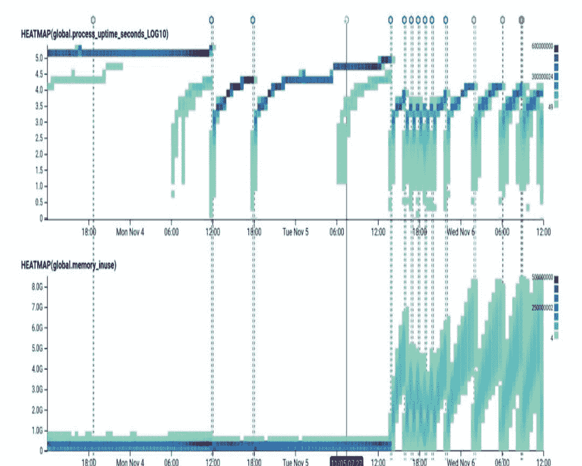
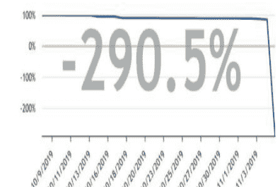
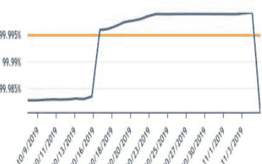
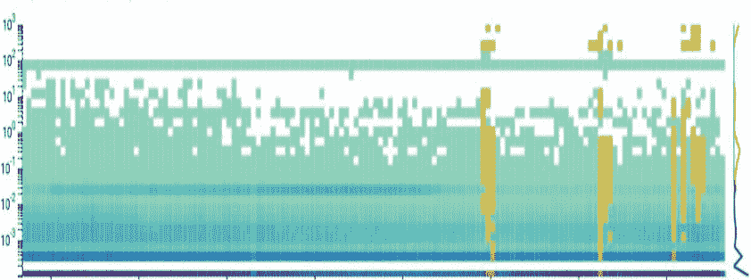

# 第12章 使用服务等级目标实现可靠性

### 早期发布读者须知

通过 Early Release 电子书，你可以在这些技术正式发布之前很久就获得书籍的最早形式——作者在撰写时的原始和未编辑内容——从而利用这些技术。

这将是最终书籍的第12章。

如果你对如何改进本书的内容和/或示例有任何评论，或者如果你注意到本章中缺少材料，请联系编辑 vwilson@oreilly.com。

虽然可观测性和传统监控可以共存，但可观测性释放了使用更复杂和互补的监控方法的潜力。接下来的两章将向你展示如何将可观测性实践与服务等级目标（SLOs）结合起来，可以提高系统的可靠性。

在本章中，你将了解传统基于阈值的监控方法为你的团队带来的常见问题，分布式系统如何加剧这些问题，以及改用基于 SLO 的监控方法如何解决这些问题。我们将以一个用 SLO 替代传统基于阈值的告警的真实案例作为结尾。而在第13章中，我们将研究可观测性如何使你的基于 SLO 的告警变得可操作且可调试。

让我们从了解监控和告警的作用以及之前的处理方法开始。

## 传统监控方法造成危险的告警疲劳

在基于监控的方法中，告警通常衡量最容易衡量的事物。指标被用来跟踪可能表明服务的底层进程运行不佳或可能是未来麻烦的先行指标的简单系统状态。这些状态例如，如果 CPU 超过 80%，或可用内存低于 10%，或磁盘空间几乎已满，或运行的线程数超过 x 多，或任何其他底层系统条件的简单度量，就会触发告警。

虽然这种简单的“潜在原因”度量很容易收集，但它们并不会产生有意义的告警供你采取行动。CPU 利用率的偏差也可能是备份进程正在运行、垃圾收集器正在执行清理工作，或系统上发生的任何其他现象的指标。换句话说，这些条件可能反映了许多系统因素，而不仅仅是我们真正关心的有问题的情况。基于底层硬件触发这些度量的告警会产生高比例的误报。

拥有其软件在生产中运行的经验丰富的工程团队通常会学会忽略，甚至抑制这类告警，因为它们不可靠。经常这样做的团队会定期采用诸如“别担心那个告警；我们知道该进程有时会耗尽内存。”之类的说法。

习惯于容易产生误报的告警是一种已知问题，也是危险的做法。在其他行业中，该问题被称为偏差正常化：该术语是在挑战者号灾难调查期间创造的。当组织中的个人定期关闭警报或在警报发生时未能采取行动时，他们最终会对偏离预期响应的做法如此脱敏，以至于它不再感觉错误。对“正常”且被忽视的故障的处理，在最好的情况下只是背景噪音。在最坏的情况下，它们会导致级联系统故障的灾难性疏忽。

在软件行业，基于监控的告警的糟糕信号与噪声比通常会导致*告警疲劳*——以及逐渐对所有告警关注度降低，因为其中许多是误报、不可操作或根本无用。不幸的是，随着事件的发生，基于监控的告警的问题往往会加剧。事件后评审通常会产生行动项，创建新的、更重要的告警，这些告警本可以及时发出以防止问题。这会导致在下一次事件期间产生更大的告警集。这种告警升级模式会造成告警数量不断增加的洪流，以及响应工程师在确定哪些告警重要、哪些不重要时不断增加的认知负担。

这种类型的失调在软件行业如此常见，以至于许多监控和事件响应工具供应商自豪地提供各种标记为“AIOps”的解决方案，以对你进行分组、抑制或以其他方式处理该告警负载。工程团队已经如此习惯于告警噪音，以至于这种模式现在被视为正常。如果运行软件在生产中的未来注定要产生如此多的噪音，以至于必须进行人工处理，可以说情况已经远远超出了偏差正常化。行业供应商现在已将这种偏差产品化，并很乐意向你出售其管理解决方案。

再次，我们认为这种失调的存在是因为使用指标和监控工具的限制，而这些工具过去是我们理解生产系统状态的最佳选择。作为一个行业，我们现在遭受了一种集体斯德哥尔摩综合征，这只是我们在今天遇到的许多问题中由于其结果而产生的失调冰山一角的尖端。现代系统架构的复杂性以及对其韧性的更高需求，已将这些失调状况从可容忍推向不再可接受。

分布式系统今天需要一种替代方法。让我们来审视为什么在规模化时监控单体应用的方法会失效，以及我们可以做些什么不同的事情。

## 阈值告警仅适用于已知未知

在自包含系统中预见故障模式比在分布式系统中容易得多。因此，添加期望每种已知故障模式都发生的监控似乎是合乎逻辑的。支持自包含生产系统的运维团队可以为每个精确状态编写特定的监控检查。

然而，随着系统变得更加复杂，它们会产生潜在故障模式的组合爆炸。习惯于处理更简单系统的运维团队将依赖于他们的直觉、最佳猜测以及对过去故障的记忆来预测他们能想象到的任何可能的系统故障。虽然这种传统监控的方法在较小规模下可能有效，但现代系统的复杂性爆炸要求团队编写和维护数百甚至数千个精确的状态检查，以寻找每一个可以设想的场景。

这种方法不可持续。检查不可维护，知识往往不可转移，过去的历史行为也不一定能预测未来可能发生的故障。传统的监控思维通常是关于防止故障。但在由数百或数千个组件为生产流量提供服务的分布式系统中，*故障是不可避免的。*

今天，工程团队经常将负载分布到多个不同的系统上。他们拆分、分片、水平分区，并在地理分布的系统之间复制数据。虽然这些架构决策优化了性能、弹性、可扩展性，但它们也可能使系统性故障无法检测或预测。涌现的故障模式可能会在传统的粗粒度合成探测作为指标发出警告之前很久就影响到你的用户。传统的服务健康度测量突然失去了价值，因为它们与整个系统的行为无关。

传统的系统指标经常在分布式系统中遗漏意外的故障模式。一个组件上异常的运行线程数可能表明垃圾回收正在进行中，也可能表明上游服务的响应时间即将变慢。检测到的条件也可能与服务变慢完全无关。尽管如此，那个在半夜收到关于异常线程数告警的系统操作员不会知道哪种情况是真实的，而需要他们去推断这种相关性。

此外，分布式系统通过松耦合的组件设计弹性。有了现代的基础设施工具，可以自动修复许多过去需要唤醒工程师的常见问题。你可能已经在使用一些当前和常见的构建系统弹性的方法：自动扩缩容、负载均衡、故障转移等等。自动化可以暂停有问题的发布或将其回滚。在主动-主动配置中运行或自动化将被动提升为主动的流程可确保 AZ 故障只会造成短暂的损害。被自动修复的故障不应触发告警。 （据说，一些团队可能会这样做，以试图建立对服务内部运作的“直觉”。相反，这种噪音只会让团队耗尽本可用于建立对没有自动修复的服务组件内部运作直觉的时间。）

这并不是说你不应该调试自动修复的故障。你绝对应该在正常工作时间内调试这些故障。告警的全部意义在于引起对紧急情况的关注，这种情况根本无法等待。触发在半夜唤醒工程师的告警来通知他们瞬态故障只会制造噪音并导致倦怠。因此，我们需要一种策略来定义问题的紧迫性。

在复杂且相互依赖的系统时代，团队很容易因告警的洪流而疲劳，这些告警可能，但很可能不会，可靠地指示客户当前使用你业务所依赖的服务的方式存在问题。与客户体验没有直接关联的条件告警很快就会变成背景噪音。这些告警不再发挥其预期目的，更为阴险的是，它们实际上起到了相反的作用：它们分散了团队对真正重要的告警的注意力。

如果你期望运行可靠的服务，你的团队必须删除任何不可靠或嘈杂的告警。然而许多团队害怕删除这些不必要的干扰。经常存在的担忧是，通过删除告警，团队将无法了解服务降级。但重要的是要认识到，这些类型的传统告警只帮助你检测 *已知未知*：你知道可能发生的问题，但不确定在任何给定时间是否正在发生。这种告警覆盖范围提供了虚假的安全感，因为它对处理新颖和新故障毫无准备，或 *未知未知*。

可观测性实践者正在寻找这些未知未知，他们已经 outgrown 那些系统中只能发生固定故障集的系统。虽然将未知减少到仅已知未知可能对具有少数组件的传统自包含软件系统更接近可实现，但对于现代系统来说肯定不是这种情况。尽管如此，组织仍犹豫不决，不愿删除与传统监控相关的许多旧告警。

在本章后面，我们将研究在删除无帮助的告警时如何充满信心地进行。现在，让我们定义告警被认为有帮助的标准。Google SRE 书籍指出，一个好的告警必须反映紧急的用户影响，必须可操作，必须是新颖的，并且必须需要调查而不是机械操作。¹

我们将把我们的告警标准定义为两部分子集。首先，它必须是用户体验处于降级状态的可靠指标。其次，告警必须是可解决的。必须有一种系统性的（但不是纯粹的机械可自动化）方法来调试并响应告警采取行动，而不需要响应者去推断正确的行动方案。如果这两个条件不成立，你配置的任何告警都不再发挥其预期目的。

## 用户体验是北极星

再次引用 Google SRE 书籍的话，潜在原因告警与真实问题的相关性较差，但用户痛苦症状告警更能让你了解用户影响以及客户体验到的系统状态。

那么，你如何专注于设置告警以检测影响用户体验的故障呢？这就是与传统监控方法脱离变得必要的地方。传统的基于指标的监控方法依赖于使用静态阈值来定义最佳系统条件。然而，现代系统的性能——即使在基础设施层面——在不同工作负载下也经常动态变化。静态阈值根本不足以监控对用户体验的影响。

设置传统的告警机制来监控用户体验意味着系统工程师必须选择预测体验不佳的任意常数。例如，这些告警可能在“10 个用户经历了缓慢的页面加载时间”或“请求的 95 分位持续高于某个毫秒数”时触发。在基于指标的方法中，系统工程师需要推断哪些精确的静态度量指示不可接受的问题正在发生。

然而，随着不同时区的不同用户以不同的方式与你的服务交互，系统性能在一天中会有显著变化。在流量缓慢时，当你可能只有数百个并发会话时，10 个用户经历缓慢的页面加载时间可能是一个重要指标。但在高峰负载时，当你可能有数万个并发会话运行时，这种重要性会急剧下降。

请记住，在分布式系统中，故障是不可避免的。小的瞬时故障总是会发生，而你可能根本没有注意到。常见的例子包括一次请求失败，但在重试后成功；一个关键进程最初失败，但其完成只是被延迟，直到它被路由到新配置的主机；或者一个服务变得无响应，直到其请求被路由到备份服务为止。这些类型的瞬时故障引入的额外延迟在高峰流量期间可能会融入正常操作中，但 p95 响应时间在低流量期间会对单个数据点更敏感。

类似地，这些例子也说明了基于时间的指标的粗糙性。假设 p95 响应时间以五分钟为间隔进行衡量。每个五分钟，过去五分钟间隔内的性能都会报告一个值，如果该值超过静态阈值就会触发警报。如果该值超过阈值，则整个五分钟间隔被视为不良（反之，任何未超过阈值的五分钟间隔被视为良好）。基于此类指标进行警报会导致高频率的误报和漏报。它还具有不足以诊断问题确切发生时间和地点的粒度级别。

静态阈值过于僵化和粗糙，无法在动态环境中可靠地指示用户体验下降。它们缺乏上下文。可靠的警报需要更精细的粒度级别和可靠性。这就是 SLO 可以帮助我们的地方。

## 什么是服务等级目标？

服务等级目标（SLO）是衡量服务健康状况的内部目标。SLO 由 [Google SRE 书籍](https://sre.google/sre-book/) 推广，是服务提供商与其客户之间设定外部服务等级协议的关键部分。这些内部衡量标准通常比面向外部的协议或可用性承诺更严格。凭借这种额外的严格性，SLO 可以提供一个安全网，帮助团队在外部用户体验达到不可接受水平之前识别和补救问题。

> **NOTE**
>
> 我们推荐 Alex Hidalgo 的书籍，*[Implementing Service Level Objectives](https://www.oreilly.com/library/view/implementing-service-level/9781492076803/)*（O’Reilly）以更深入地理解该主题。

关于 SLO 在服务可靠性方面的使用已有大量论述，并且它们并不独属于可观测性领域。然而，使用基于 SLO 的方法来监控服务健康需要将可观测性构建到你的应用程序中。SLO 可以在没有可观测性的系统中实现，有时也确实如此。但这样做的后果可能产生严重的非预期后果。

## 使用 SLO 进行可靠警报

SLO 根据关键的终端用户旅程而非系统指标，对服务可用性达成的目标进行量化。该目标使用服务等级指标（SLI）进行衡量，SLI 将系统状态分类为良好或不良。存在两种类型的 SLI：*基于时间的衡量*（例如“每个 5 分钟窗口内 99 百分位延迟小于 300 ms”），和 *基于事件的衡量*（例如“在给定滚动时间窗口期间，耗时小于 300 ms 的事件比例”）。

两者都试图表达对终端用户的影响，但区别在于是否已按时间桶对传入用户流量的数据进行预聚合。我们建议设置使用基于事件的衡量的 SLI，而不是基于时间的衡量，因为基于事件的衡量提供了一种更可靠、更细粒度的量化服务状态的方法。我们将在下一章讨论其原因。

让我们看一个如何定义基于事件的 SLI 的例子。你可能会将良好的客户体验定义为“用户应能够成功加载你的主页并快速看到结果”的状态。

用 SLI 表达这一点意味着限定事件，然后确定它们是否满足我们的条件。在此示例中，你的 SLI 将执行以下操作：

- 查找任何请求路径为 /home 的事件。
- 筛选符合事件持续时间 < 100 ms 条件的合格事件。
- 如果事件持续时间 < 100 ms 且成功提供，则视为 OK。
- 如果事件持续时间 > 100 ms，则即使返回了成功代码，也将该事件视为错误。

任何错误事件都会消耗 SLO 中允许的错误预算。我们将在下一章详细研究主动管理 SLO 错误预算和触发警报的模式。现在，我们总结一下：错误足够多时，你的系统可以提醒你可能违反 SLO。

SLO 将你的警报范围缩小到仅考虑影响我们服务用户体验的症状。如果底层状况影响到“用户加载我们的主页并快速看到它”，则应触发警报，因为有人需要调查原因。然而，服务可能退化的原因和方式之间没有相关性。我们只知道出了问题。

相比之下，传统监控依赖于基于原因的方法：检测到先前已知的根本原因（例如，线程数异常），表明用户可能会遇到不良症状（页面加载时间慢）。这种方法将情况的“是什么”和“为什么”融合在一起，试图帮助确定调查应从何处开始。但正如你所见，你的服务远不止已知的正常、异常或甚至缓慢状态。涌现的故障模式可能在粗糙的合成探测发出警报之前就已影响你的用户。将“是什么”与“为什么”解耦是编写具有最大信号和最小噪音的良好监控最重要的区别之一。

警报要有所帮助的第二个标准是它必须是 *可操作的*。系统级潜在原因警报“CPU 较高”并不能告诉你用户是否受影响以及是否应采取行动。相比之下，基于 SLO 的警报是基于症状的：它们告诉你出了问题。它们是可操作的，因为现在由响应者来确定用户为何受到影响并进行缓解。然而，如果你无法充分调试你的系统，解决问题将具有挑战性。这就是转向可观测性变得至关重要的原因：生产环境中的调试必须是安全且自然的。

在基于 SLO 的世界中，你需要可观测性：无需添加新仪器即可对系统提出新问题的能力。正如你在本书中看到的，可观测性允许你从第一性原理进行调试。借助丰富的遥测数据，你可以从宽泛开始，然后过滤以缩小搜索空间。这种方法意味着你可以响应以确定任何问题的来源，无论故障多么新颖或涌现。

在自包含、未改变且具有长期警报集的系统中，可以拥有大量对应所有已知故障的警报。考虑到资源和时间，理论上也可以缓解甚至预防所有这些已知故障（那么为什么更多团队还没有这样做呢？）。现实是，无论你自动修复多少已知故障，现代分布式系统带来的涌现故障模式都无法预测。没有办法回到过去为意外损坏的系统部分添加指标。当任何东西都可能在任何时候损坏时，你需要所有数据。请注意，这是 *数据* 而不是 *警报*。为所有事物设置警报是不可行的。正如我们所见，整个软件行业已经在噪音中溺水。

可观测性是应对新颖、涌现故障模式的必要条件。有了可观测性，你可以通过一步一步的方法系统地审问你的系统：提出一个问题并检查结果，然后再提出另一个问题，依此类推。你不再受传统

monitoring alerts and dashboards. Instead, you can improvise and adapt solutions to find any problem in your system.

Instrumentation that provides rich and meaningful telemetry is the basis for that approach. Being able to quickly analyze that telemetry data to validate or falsify hypotheses is what empowers you to feel confidence in removing noisy, unhelpful alerts. Decoupling the “what” from the “why” in your alerting is possible when using SLO-based alerts in tandem with observability.

When most alerts are not actionable, that quickly leads to alert fatigue. To eliminate that problem, it’s time to delete all of your unactionable alerts.

Still not sure you can convince your team to remove all of those unhelpful alerts? Let’s look at a real example of what it takes to drive that sort of culture change.

## Changing Culture Toward SLO-Based Alerts: A Case Study

Just having queryable telemetry with rich context, on its own, might not be enough for your team to feel confident deleting all of those existing unhelpful alerts. That was our experience at Honeycomb. We’d implemented SLOs, but our team didn’t quite fully trust them yet. SLO alerts were being routed to a low-priority inbox, while the team continued to rely on traditional monitoring alerts. That trust wasn’t established until we had a few incidents of SLO-based alerts flagging issues long before traditional alerts provided any useful signal.

To illustrate how this change occurred, let’s examine an incident from the end of 2019. Liz had developed the SLO feature and was paying attention to SLO alerts while the rest of the team was focused on traditional alerts. In this outage, the Shepherd service that ingests all of our incoming customer data had its SLO begin to burn, and sent an alert to the SLO test channel. The service recovered fairly quickly: a 1.5% brownout had occurred for 20 minutes. The SLO error budget had taken a ding because that burned most of the 30-day budget. However, the problem appeared to go away by itself.

Our on-call engineer was woken up by the SLO alert at 1:29 a.m. his time. Seeing that the service was working, he blearily decided it was probably just a blip. The SLO alert triggered, but traditional monitoring that required consecutive probes in a row to fail didn’t detect a problem. When the SLO alert triggered a fourth time, at 9:55 a.m., this was undeniably not a coincidence. At that time, the engineering team was willing to declare an incident even though traditional monitoring had still not detected a problem.

While investigating the incident, another engineer thought to check the process uptime (Figure 12-1). In doing so, they discovered a process had a memory leak. Each machine in the cluster had been running out of memory, failing in synchrony, and restarting. Once that problem was identified, it was quickly correlated with a new deployment, and we were able to roll back the error. The incident was declared resolved at 10:32 a.m.

Figure 12-1. A heatmap showing uptime of a crashing fleet, restarting together around 18:30, and the memory profile

At this point, we have to acknowledge that many engineers who are reading this story might challenge that traditional cause-based alerting would have worked well enough in this case. Why not alert on memory and therefore get alerts when the system runs out of memory (OOM)? There are two points to consider when addressing that challenge.

First, at Honeycomb, our engineers had long since been trained out of tracking OOMs. Caching, garbage collection, and backup processes all opportunistically used—and occasionally used up—system memory. “Ran out of memory” turned out to be common for our applications. Given our architecture, even having a process crash from time to time turned out not to be fatal, so long as all didn’t crash at once. For our purposes, tracking those individual failures had not been useful at all. We were more concerned with the availability of the cluster as a whole.

Given that scenario, traditional monitoring alerts did not—and would never have—noticed this gradual degradation at all. Those simple coarse synthetic probes could detect only a total outage, not one out of 50 probes failing and then recovering. In that state, machines were still available, so the service was up, and most data was making it through.

Second, even if it were somehow possible to introduce enough complicated logic to trigger alerts when only a certain notable number of specific types of OOMs were detected, we would have needed to predict this exact failure mode, well in advance of this one bespoke issue ever occurring, in order to devise the right incantation of conditions on which to trigger a useful alert. That theoretical incantation might have detected this one bespoke issue this one time, but would likely most often exist just to generate noise and propagate alert fatigue.

Although traditional monitoring never detected the gradual degradation, the SLO hadn’t lied: users were seeing a real effect. Some incoming customer data had been dropped. It burned our SLO budget almost entirely from the start (Figure 12-2).

### Remaining Budget

How much of the error budget remains after the last 30 days.

### Historical SLO Compliance

For each day of the past 30, how often this SLO has succeeded over the preceding 30 days.

### Distribution of Events failing SLI by backend_processing_time

Nov 5 2019, 5:02 PM – Nov 6 2019, 5:02 PM

### Dimensions

Try to GROUP BY columns that look most different between the successful and failed.

Figure 12-2. The SLO error budget burned −566% by the time the incident was over; compliance dropped to 99.97% (from the target of 99.995%). The yellow marks on the timeline (depicted here as dark, vertical marks) show events marked as bad—and that they occurred fairly uniformly at fairly regular intervals until corrected.

By that stage, if the team had started treating SLO-based alerts as primary alerting, we would have been less likely to look for external and transient explanations. We would have instead moved to actually fix the issue, or at least roll back the latest deploy. SLOs proved their ability to detect brownouts and prompt the appropriate response.

That incident changed our culture. Once SLO burn alerts had proven their value, our engineering team had as much respect for SLO-based alerts as they did for traditional alerts. After a bit more time relying on SLO-based alerts, our team became increasingly comfortable with the reliability of alerting purely on SLO data.

At that point, we deleted all of our traditional monitoring alerts that were based on percentages of errors for traffic in the past five minutes, the absolute number of errors, or lower-level system behavior. We now rely on SLO-based alerts for our primary line of defense.

## Conclusion

In this chapter, we provided a high-level overview of SLOs as a more effective alerting strategy than traditional threshold monitoring. Alert fatigue, prevalent in the software industry, is enabled by the potential-cause-based approach taken by traditional monitoring solutions.

Alert fatigue can be solved by focusing on creating only helpful alerts that meet two criteria. First, they must trigger as reliable indicators only that the user experience of your service is in a degraded state. Second, they must be actionable. Any alert that does not meet that criteria is no longer serving its purpose and should be deleted.

SLOs decouple the “what” and “why” behind incident alerting. Focusing on symptom-of-pain-based alerts means that SLOs can be reliable indicators of customer experience. When SLOs are driven by event-based measures, they have a far lesser degree of false positives and false negatives. Therefore, SLO-based alerts can be a productive way to make alerting less disruptive, more actionable, and more timely. They can help differentiate between systemic problems and occasional sporadic failures.

On their own, SLO-based alerts can tell you there is pain, but not why it is happening. For your SLO-based alerts to be actionable, your production

