# 第 13 章：对基于 SLO 的告警采取行动与调试

> **面向早期发布读者的说明**
> 
> 使用早期发布电子书，您获得的是书籍的最早形态——作者写作时的原始、未经编辑的内容——因此您可以在这些书正式发布之前很久就利用这些技术。
> 
> 这将是最终图书的第 13 章。
> 
> 如果您对如何改进本书中的内容和/或示例有任何评论，或者您发现本章缺少材料，请通过 [vwilson@oreilly.com](mailto:vwilson@oreilly.com) 联系编辑。

在上一章中，我们介绍了 SLO 以及基于 SLO 的监控方法，这种方法可以实现更有效的告警。本章将深入探讨如何利用可观测性数据来使这些告警既具有可操作性又易于调试。使用传统监控数据（或指标）的 SLO 所产生的告警并不具有可操作性，因为它们无法为修复根本问题提供指导。此外，将可观测性数据用于 SLO 会使其更加精确且更易于调试。

虽然与践行可观测性相互独立，但使用 SLO 来驱动告警可以是一种富有成效的方式，能够让告警更少噪音、更具可操作性。可以定义 SLI 来衡量服务的客户体验，并使之直接与业务目标对齐。错误预算在业务利益相关者与工程团队之间设定了明确的期望。错误预算消耗告警使团队能够确保高度的客户满意度、与业务目标保持一致，并启动适当的响应。

**错误预算消耗（简化）**

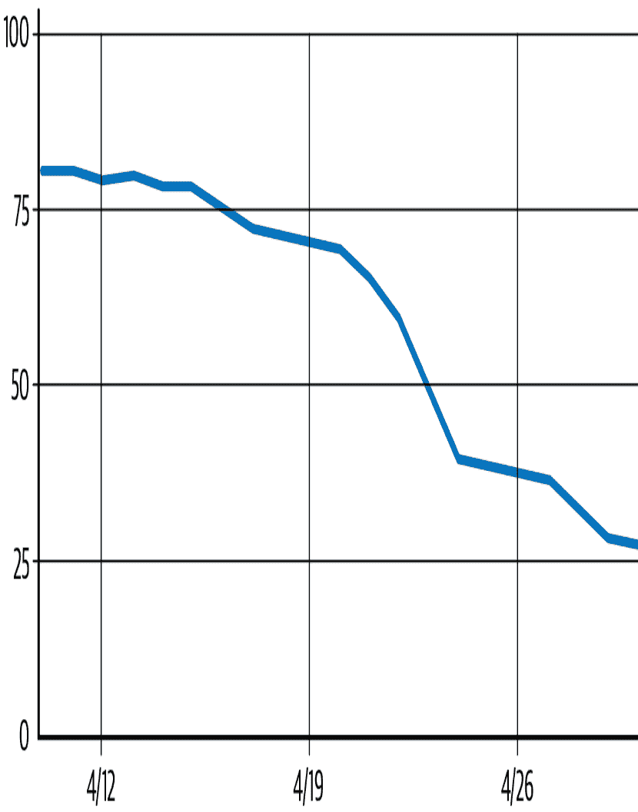

剩余错误预算

日期

图 13-1：一张简单的图表，显示大约三周内的错误预算消耗情况

第一个选择是：是使用固定时间窗口还是滑动时间窗口来分析 SLO。*固定窗口*的一个例子是遵循日历的窗口——从当月 1 日开始，到当月 30 日结束。与之相反的是*滑动窗口*，它会查看任何过去 30 天的时间段。图形化描述见图 13-2。

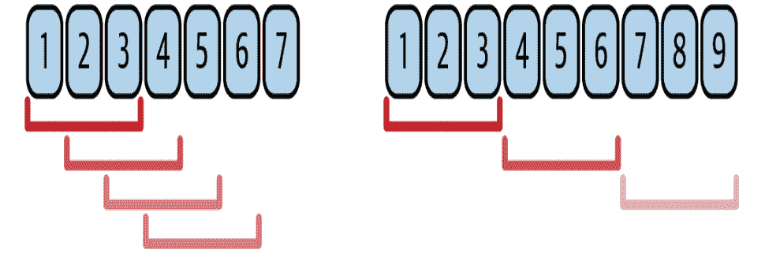

图 13-2：滚动三天窗口（左）和重置三天窗口（右）

对于大多数 SLO 来说，30 天窗口是最实用的期限。较短的窗口，例如 7 天或 14 天，既无法与客户对您可靠性的记忆对齐，也无法与产品规划周期对齐。90 天的窗口往往太长；您可以在一天内消耗掉 90% 的预算，并且从技术上讲仍然满足您的 SLO，即使您的客户并不认同。较长的期限也意味着事件不会足够快地从窗口中被滚动移除。

您可能会选择从一个固定窗口开始，但在实践中，固定窗口的可用性目标与客户的期望并不匹配。您可能会因为当月 31 日发生的一次严重宕机而向客户退款，但这并不会像挥动魔杖一样，突然让他们对下个月 2 日发生的后续宕机变得宽容——即使第二次宕机在字面上属于另一个不同的窗口。

正如第 12 章所讨论的，SLO 应被用作衡量客户体验和满意度的一种方式，而不是法律约束。更好的 SLO 是那种考虑人类情感、记忆和近因偏差的 SLO。人类的情感并不会在日历月结束时神奇地重置。

如果您使用固定窗口来设置错误预算，这些预算会以戏剧性的方式重置。每一个错误都会消耗掉预算的一小部分，而

### 当您耗尽错误预算时会发生什么

当您从拥有正错误预算转变为负错误预算时，一个必要的做法是：将工作重心从优先开发新功能转移到服务稳定性上。详细描述错误预算耗尽后会发生什么，超出了本章的范围。但您的团队的目标应该是防止错误预算被完全耗尽。

错误预算超支会转化为严厉的措施，例如在生产环境中长时间冻结新功能。SLO 模型会激励团队，在预算耗尽后最大限度地减少危害服务稳定性的行为。关于这些情况下工程实践应如何改变以及如何制定适当策略的深入分析，我们推荐阅读 Alex Hidalgo 所著的*《实现服务级别目标》*（O’Reilly 出版）。

一种更难以配置的告警是先发制人的告警。如果您能预见到错误预算将被耗尽，您就有机会采取行动并引入修复措施来防止这种情况发生。通过尽早修复最严重的错误来源，您可以避免做出为了可靠性改进而放弃任何新功能开发的决定。在可持续地保障团队士气和稳定性方面，规划和预测是比英雄主义更好的方法。

因此，一种解决方案是跟踪您的错误预算消耗速率，并警惕可能威胁到整个预算的剧烈变化。至少有两种模型可用于在零水位线之上触发消耗告警。第一种是选择一个非零阈值来触发告警。例如，您可以在剩余错误预算降至 30% 以下时发出告警，如图 13-3 所示。

**错误预算消耗（简化）在 30% 处告警**

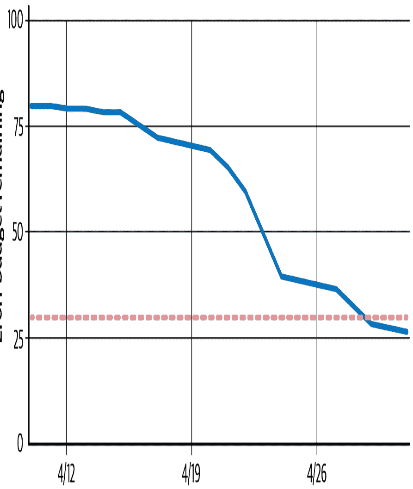

图 13-3：在此模型中，当剩余错误预算（实线）低于所选阈值（虚线）时触发告警

这种模型的一个挑战是，它实际上只是通过设置一个不同的“清空”阈值来移动球门柱。这种“早期预警”系统可能有一定效果，但比较粗糙。在实践中，一旦越过阈值，您的团队就会表现得好像整个错误预算都已耗尽。这种模型的优化目标是确保留有一点余量，以便您的团队实现其目标。但这是以牺牲本可用于交付新功能的额外时间为代价的。相反，您的团队会处于功能冻结状态，等待剩余错误预算回升到任意的阈值之上。

第二种在零水位线之上触发告警的模型是创建*预测性*消耗告警（[图 13-4](Figure 13-4)）。这些告警会预测当前状况是否会导致整个错误预算被消耗殆尽。

**错误预算消耗（简化）与基线窗口和前瞻窗口**

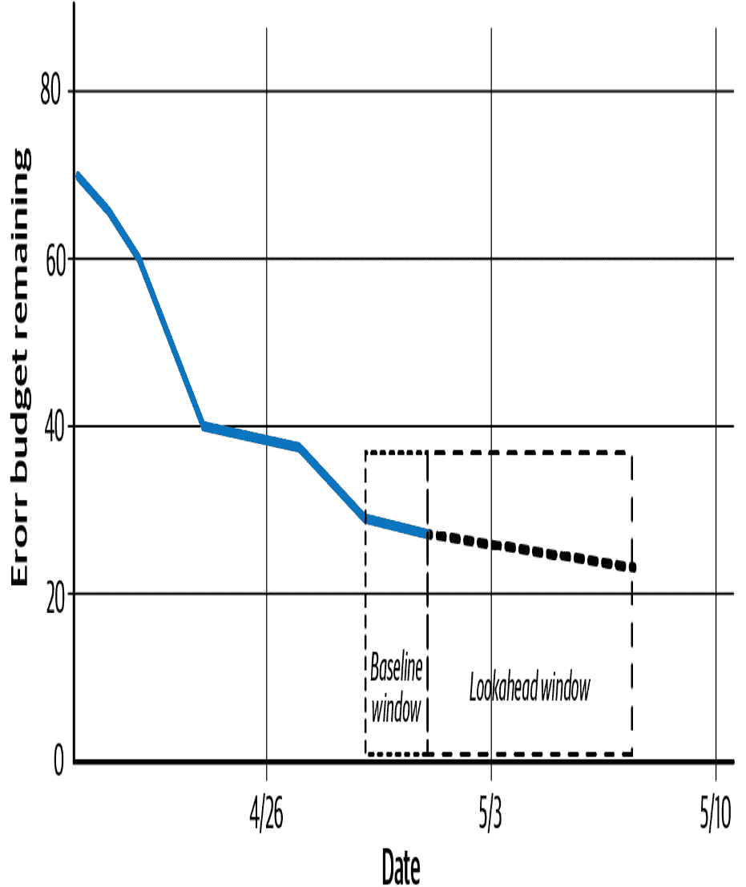

*图 13-4：对于预测性消耗告警，您需要一个最近过去数据的基线窗口用于模型，以及一个前瞻窗口，用于确定您的预测延伸到未来的多远*

使用预测性消耗告警时，您需要考虑*前瞻窗口*和*基线*（或*回顾*）*窗口*：您要将预测模型延伸到多远，以及您应该使用多少近期数据来做出该预测？让我们先考虑前瞻窗口，因为它更容易考虑。

### 前瞻窗口

在预测模型中，我们可以看到，并非每一个影响错误预算的错误都需要唤醒某人。例如，假设您引入了一个性能回退，导致您的服务在 99.9% SLO 目标下，现在预计一个月后只能达到 99.88% 的可靠性。这不是需要立即处理的紧急情况。您可以等到下一个工作日，再让人调查并修正轨迹，使其在整个月内恢复到 99.9% 以上的总体可靠性。

相反，如果您的服务有相当大比例的请求失败，以至于在一小时内预计会达到 98%，那就应该呼叫值班工程师。如果不加以纠正，这样的宕机可能会在数小时内让您整个月、整个季度或整年的错误预算损失殆尽。

这两个例子都说明了，重要的是要了解：根据当前趋势，您的错误预算是否会在未来的某个时间点被耗尽。在第一个例子中，这会发生在数天内；在第二个例子中，则会发生在几分钟或几小时内。但在这个上下文中，“根据当前趋势”到底意味着什么？

当前趋势的范围取决于我们想要预测多远的未来。在宏观尺度上，大多数生产流量模式在其利用率曲线上既表现出周期性行为，也表现出平滑的变化。模式可以以分钟或小时为周期出现。例如，一个周期性的 cron 任务，在没有抖动的情况下通过您的应用程序运行固定数量的事务，可能会以每几分钟重复一次的可预测方式影响流量。周期性模式也可能以天、周或


year. For example, the retail industry experiences seasonal shopping patterns with notable spikes around major holidays.

In practice, that cyclical behavior means that some baseline windows are more appropriate to use than others. The past 30 minutes or hour are somewhat representative of the next few hours. But small minute-by-minute variations can be smoothed out when zooming out to consider daily views. Attempting to use the micro scale of past performance for the last 30 minutes or hour to extrapolate what could happen in the macro scale of performance for the next few days runs the risk of becoming flappy and bouncing in and out of alert conditions.

Similarly, the inverse situation is also dangerous. When a new error condition occurs, it would be impractical to wait for a full day of past performance data to become available before predicting what might happen in the next several minutes. Your error budget for the entire year could be blown by the time you make a prediction. Therefore, your baseline window should be about the same order of magnitude as your lookahead window.

In practice, we’ve found that a given baseline window can linearly predict forward by a factor of four at most without needing to add compensation for seasonality (e.g., peak/off-peak hours of day, weekday versus weekend, or end/beginning of month). Therefore, you can get an accurate enough prediction of whether you’ll exhaust your error budget in four hours by extrapolating the past one hour of observed performance four times over. That extrapolation mechanism is discussed in more detail later in “Context-aware burn alerts” on page xx.

## Extrapolating the future from current burn rate

Calculating what may happen in the lookahead window is a straightforward computation, at least for your first guess at burn rate. As you saw in the preceding section, the approach is to extrapolate future results based on the current burn rate: how long will it take before we exhaust our error budget?

Now that you know the approximate order of magnitude to use as a baseline, you can extrapolate results to predict the future. [Figure 13-5](#figure-13-5)

illustrates how a trajectory can be calculated from your selected baseline to determine when your entire error budget would be completely exhausted.

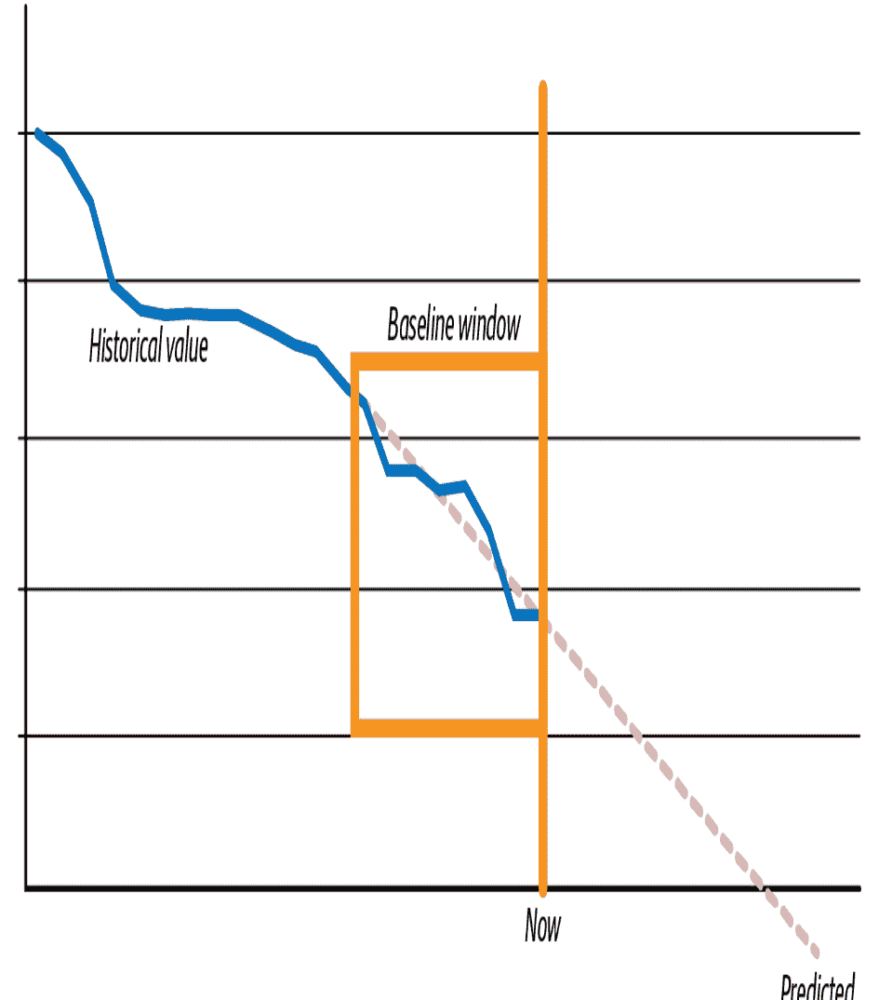

Figure 13-5. This graph shows the level of error budget (y-axis) remaining over time (x-axis). By extrapolating a baseline window, you can predict the moment when the error budget will empty.

This same technique of linear extrapolation often surfaces in areas such as capacity planning or project management. For example, if you use a weighted system to estimate task length in your ticketing system, you will have likely used this same approach to extrapolate when a feature might be delivered during your future sprint planning. With SLOs and error budget burn alerts, a similar logic is being applied to help prioritize production issues that require immediate attention.

Calculating a first guess is relatively straightforward. However, you must weigh additional nuances when forecasting predictive burn alerts that determine the quality and accuracy of those future predictions.

In practice, we can use two approaches to calculate the trajectory of predictive burn alerts. *Short-term burn alerts* extrapolate trajectories using only baseline data from the most recent time period and nothing else. *Context-aware burn alerts* take historical performance into account and use the total number of successful and failed events for the SLO’s entire trailing window to make calculations.

The decision to use one method or the other typically hinges on two factors. The first is a trade-off between computational cost and sensitivity or specificity. Context-aware burn alerts are computationally more expensive than short-term burn alerts. However, the second factor is a philosophical stance on whether the total amount of error budget remaining should influence how responsive you are to service degradation. If resolving a significant error when only 10% of your burn budget remains carries more urgency than resolving a significant error when 90% of your burn budget remains, you may favor context-aware burn alerts.

## NOTE

In the next two sections, unit refers to the granular building block on which SLO burn alert calculations are made. These units can be composed of time-series data like metrics. Coarse measures like metrics have an aggregated granularity that marks a unit of time (like a minute or a second) as being either good or bad. These units can also be composed of event data, with each individual event corresponding to a user transaction that can be marked as either good or bad. In “Using Observability Data for SLOs Versus Time-Series Data” on page xx, we’ll examine the ramifications of which type of data is used. For now, the examples will be agnostic to data types by using arbitrarily specific units that correspond to one data point per minute.

Let’s look at examples of how decisions are made when using each of those approaches.

## Short-term burn alerts

When using short-term, or ahistorical, burn alerts, you record the actual number of failed SLI units along with the total number of SLI-eligible units observed over the baseline window. You then use that data to extrapolate forward, and compute the number of minutes, hours, or weeks it would take to exhaust the error budget. For this calculation, you assume that no errors occurred prior to the events observed in the baseline window as well as the typical number of measurement units that the SLO typically sees.

Let’s work an example. Say you have a service with an SLO target indicating 99% of units will succeed over a moving 30-day window. In a typical month, the service sees 43,800 units. In the past 24 hours, the service has seen 1,440 units, 50 of which failed. In the past 6 hours, the service has seen 360 units, 5 of which failed. To achieve the 99% target, only 1% of units are allowed to fail per month. Based on typical traffic volume (43,800 units), only 438 units are allowed to fail (your error budget). You want to know if, at this rate, you will burn your error budget in the next 24 hours.

A simple short-term burn alert calculates that in the past 6 hours, you burned only 5 units. Therefore, in the next 24 hours, you will burn another 20 units, totalling 25 units. You can reasonably project that you will not

exhaust your error budget in 24 hours because 25 units is far less than your budget of 438 units.

A simple short-term burn alert calculation would also consider that in the past 1 day, you’ve burned 50 units. Therefore, in the next 8 days, you will burn another 400 units, totalling 450 units. You can reasonably project that you will exhaust your error budget in 8 days, because 450 units is more than your error budget of 438 units.

This simple math is used to illustrate projection mechanics. In practice, the situation is almost certainly more nuanced since your total amount of eligible traffic would typically fluctuate throughout the day, week, or month. In other words, you can’t reliably estimate that 1 error over the past 6 hours forecasts 4 errors over the next 24 hours if that error happens overnight, over a weekend, or whenever your service is receiving one-tenth of its median traffic levels. If this error happened while you saw a tenth of the traffic, you might instead expect to see something closer to 30 errors over the next 24 hours, since that curve would smooth with rising traffic levels.

So far, in this example, we’ve been using linear extrapolation for simplicity. But proportional extrapolation is far more useful in production. Consider this next change to the preceding example.

Let’s say you have a service with an SLO target indicating 99% of units will succeed over a moving 30-day window. In a typical month, the service sees 43,800 units. In the past 24 hours, the service has seen 1,440 units, 50 of which failed. In the past 6 hours, the service has seen 50 units, 25 of which failed. To achieve the 99% target, only 1% of units are allowed to fail per month. Based on typical traffic volume (43,800 units), only 438 units are allowed to fail (your error budget). You want to know if, at this rate, you will burn your error budget in the next 24 hours.

Extrapolating linearly, you would calculate that 25 failures in the past 6 hours mean 100 failures in the next 24 hours, totalling 105 failures, which is far less than 438.


使用*比例外推*时，你会计算出，在任意一个 24 小时周期内，预期会看到 43,800 个单位 / 30 天，即 1,460 个单位。在过去 6 个小时内，50 个单位中有 25 个（50%）失败。如果这一比例失败率在接下来的 24 小时内继续保持 50%，那么你将消耗 1,460 个单位中的 50%，即 730 个单位——远超 438 个单位的预算。通过这种比例计算，你可以合理地预测，错误预算将在大约半天内耗尽。此时应触发警报，通知值班工程师立即进行调查。

## 上下文感知型消耗警报

使用*上下文感知型*或*历史型*消耗警报时，你会在整个 SLO 时间窗口内持续统计已经发生的正常事件和异常事件总数，而不只是统计基线窗口内的数据。本节将详细介绍有效消耗警报所需的各种计算方法。不过，在实践这些技术时应谨慎行事。在每个评估间隔计算这些值所产生的计算开销，也可能很快变得十分昂贵。在 Honeycomb，我们就曾深受其害：规模较小的 SLO 数据集突然开始每天累积超过 5,000 美元的 AWS Lambda 成本。:-)

为了了解上下文感知型消耗警报的不同之处，我们来看一个示例。假设你有一项服务，其 SLO 目标表示：在滚动 30 天的窗口内，99% 的单位应当成功。在一个典型月份中，该服务会处理 43,800 个单位。*在前 26 天内，37,960 个单位中已经有 285 个失败。在过去 24 小时内，该服务处理了 1,460 个单位，其中 130 个失败。*为了达到 99% 的目标，每月只允许 1% 的单位失败。按照典型的流量规模（43,800 个单位）计算，最多允许 438 个单位失败（这就是你的错误预算）。你想知道，按照当前的速率，错误预算是否会在接下来的四天内耗尽。

在此示例中，你希望按天的尺度向前预测。根据前文所述的最大实用外推系数 4，你设置一个基线窗口，检查最近一天的数据，并据此向前外推四天。

你还必须考虑所选时间尺度对滑动窗口的影响。如果你的 SLO 使用 30 天滑动窗口，那么调整后的回看窗口应为 26 天：26 天的回看期 + 4 天的外推期 = 30 天的滑动窗口，如图 13-6 所示。

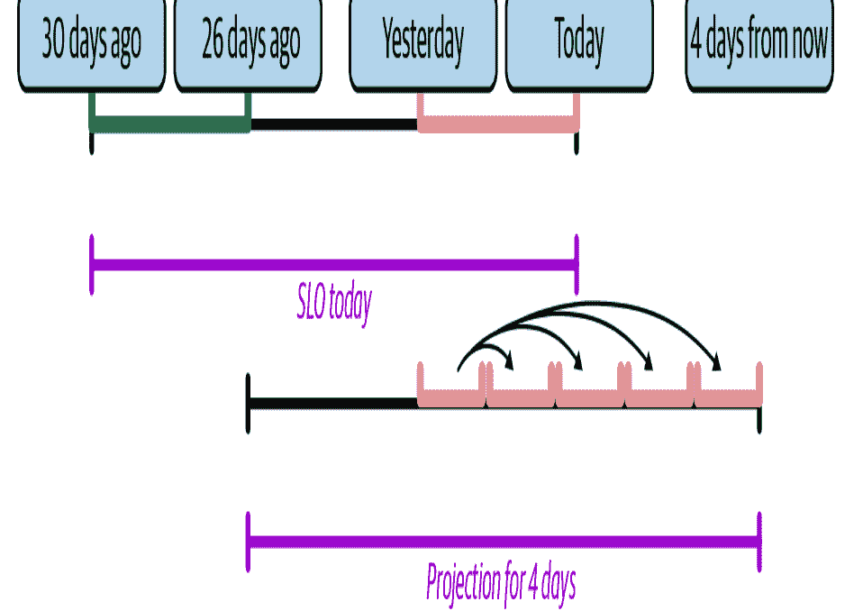

*图 13-6。调整后的 SLO 30 天滑动窗口。向前预测 4 天时，所考虑的回看期必须缩短为今天之前的 26 天。具体做法是，将基线窗口中的结果复制到接下来的 4 天，并将这些结果加入调整后的滑动窗口。*

定义好这些调整后的时间范围后，你现在就可以计算四天后的未来情况。具体计算步骤如下：

1. 检查过去 26 天内发生的 SLO 事件映射中的每一条记录。
2. 记录过去 26 天内的事件总数和错误总数。
3. 重新检查最近 1 天内发生的映射记录，以确定基线窗口的失败率。
4. 假设接下来的 4 天表现与 1 天基线窗口相似，据此外推这 4 天的表现。
5. 计算四天后调整后的 SLO 30 天滑动窗口。
6. 如果届时错误预算将耗尽，则触发警报。

使用基于 Go 的代码示例，如果你有一个给定的时间序列映射，其中包含每个窗口内的失败数和成功数，就可以完成此任务：

```go
func isBurnViolation(now time.Time, ba *BurnAlertConfig, slo *SLO, tm *timeseriesMap) bool {
	// For each entry in the map, if it's in our adjusted
	// window, add its totals.
	// If it's in our projection window, store the rate.
	// Then project forward and do the SLO calculation.
	// Then fire off alerts as appropriate.

	// Compute the window we will use to do the projection,
	// with the projection offset as the earliest bound.
	pOffset :=
		time.Duration(ba.ExhaustionMinutes/lookbackRatio) * time.Minute
	pWindow := now.Add(-pOffset)

	// Set the end of the total window to the beginning of the
	// SLO time period, plus ExhaustionMinutes.
	tWindow := now.AddDate(0, 0, -slo.TimePeriodDays).Add(
		time.Duration(ba.ExhaustionMinutes) * time.Minute)

	var runningTotal, runningFails int64
	var projectedTotal, projectedFails int64
	for i := len(tm.Timestamps) - 1; i >= 0; i-- {
		t := tm.Timestamps[i]

		// We can stop scanning backwards if we've run off the end.
		if t.Before(tWindow) {
			break
		}

		runningTotal += tm.Total[t]
		runningFails += tm.Fails[t]

		// If we're within the projection window, use this value to project forward,
		// counting it an extra lookbackRatio times.
		if t.After(pWindow) {
			projectedTotal += lookbackRatio * tm.Total[t]
			projectedFails += lookbackRatio * tm.Fails[t]
		}
	}

	projectedTotal = projectedTotal + runningTotal
	projectedFails = projectedFails + runningFails

	allowedFails := projectedTotal * int64(slo.BudgetPPM) / int64(1e6)
	return projectedFails != 0 && projectedFails >= allowedFails
}
```

要计算示例问题的答案，你可以注意到，在过去 26 天内，已经有 37,960 个单位，其中 285 个失败。将使用 1 天的基线窗口向前预测 4 天。在基线窗口开始时，也就是数据集的第 25 天（1 天前），你所处的位置如下。

将结果可视化为图表（如图 13-7 所示）后可以看到：当 1 天的基线窗口开始时，你仍剩余 65% 的错误预算。而现在，你只剩余 35% 的错误预算。在一天之内，你已经消耗了 30% 的错误预算。如果继续以当前速率消耗错误预算，那么错误预算将在远少于四天的时间内耗尽。因此，你应当触发警报。

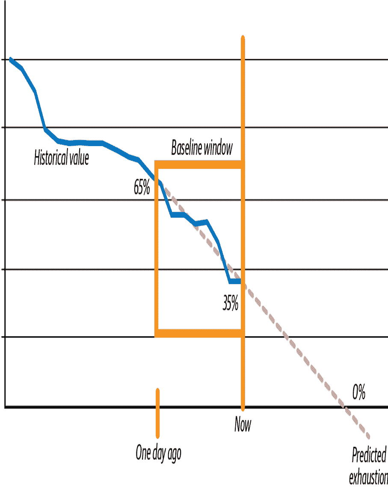

*图 13-7。一天前，还剩余 65% 的错误预算。现在只剩余 35%。按照当前速率，错误预算将在不到两天内耗尽。*

### 基线窗口

在讨论了前瞻窗口及其使用方式之后，现在让我们把注意力转回基线窗口。

向前外推时，一个值得思考的问题是，应当使用*多长*的基线窗口。如果生产服务的性能突然恶化，你希望能够相当快地察觉。同时，你也不希望将窗口设置得过小，以至于产生嘈杂的警报。如果使用 15 分钟的基线来外推三天的性能，那么错误中的一个小幅波动就可能触发误报。反过来，如果使用三天的基线来向前外推一小时，那么很可能要到为时已晚时，才会注意到严重故障。

我们之前将一种实用选择描述为：基线时间范围使用所考虑时间线的四分之一。你可能会发现，也可以使用其他更复杂的算法，但根据我们的经验，系数 4 通常是可靠的。基线乘数 4 还提供了一个方便的经验法则：24 小时警报基于最近 6 小时的数据，4 小时警报基于最近 1 小时的数据，依此类推。在首次处理 SLO 消耗警报时，这是一个很好的起点。

按比例设置基线窗口时，还有一个值得一提的奇怪含义。在 SLO 上使用不同的前瞻窗口大小设置多个消耗警报是一种常见做法。因此，警报可能会以看似不合逻辑的顺序触发。例如，系统问题可能触发一条消耗警报，表示你的预算将在两小时内耗尽，但不会触发另一条表示预算将在一天内耗尽的消耗警报。这是因为这两个警报的外推分别来自不同的基线。换句话说，如果你继续以过去 30 分钟的速率消耗预算，那么预算将在两小时内耗尽；但如果你继续以过去一天的速率消耗预算，那么接下来的四天都不会有问题。

出于这些原因，你应当同时进行两种测量，并在任一预测触发警报时采取行动。否则，你可能会冒着等待数小时才发现问题的风险，而该问题所处的消耗时间尺度是一整天——此时，具有小时级粒度的消耗警报本可以让你更早发现问题。在这个节点启动纠正措施，也可能避免触发这一项-


51.4%

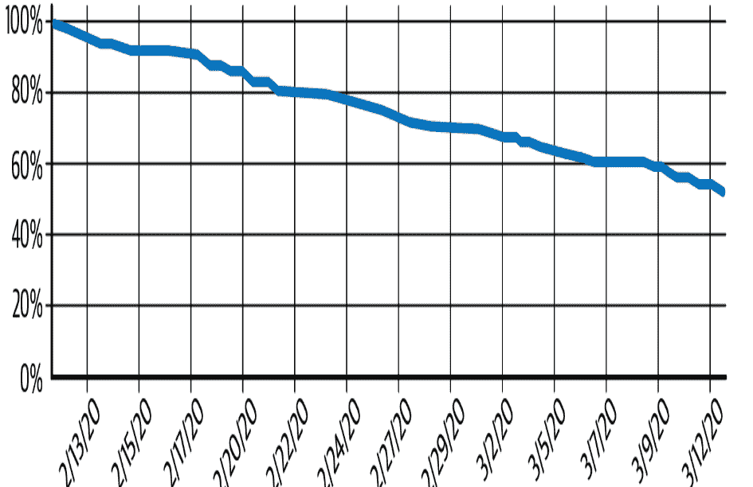

图 13-8. 错误预算以渐进速率消耗，剩余 51.4%

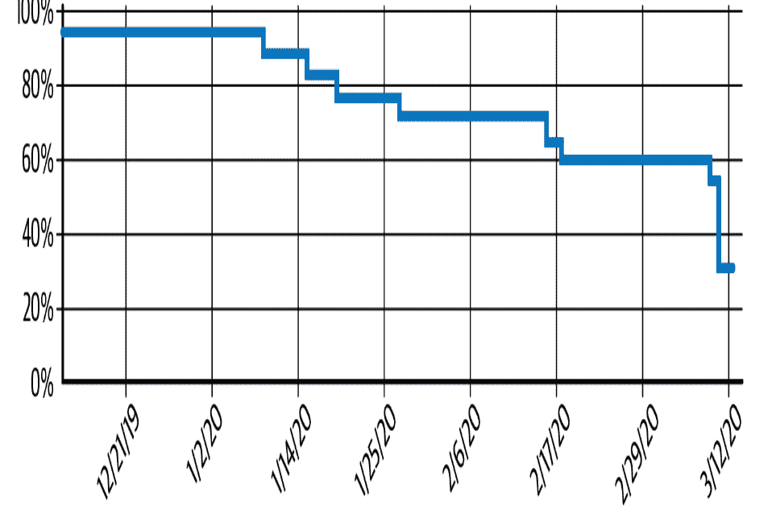

图 13-9. 剩余 31.4% 的错误预算，以突发方式消耗

1.3%

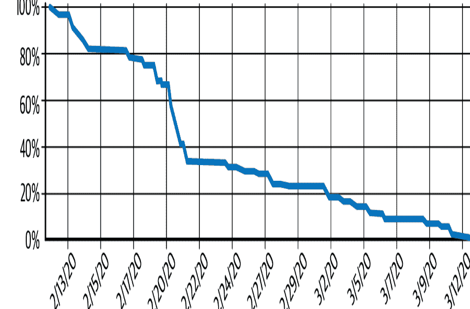

*图 13-10. 一个通常缓慢消耗错误预算的系统，但发生了一次事件，一次性烧掉了很大一部分错误预算，仅剩 1.3%*

当燃烧告警被触发时，你应该评估它是突发状况的一部分，还是可能一次性烧掉大部分错误预算的事件。将当前情况与历史速率进行比较，可以为确定其重要性时提供有用的背景信息。

与图 13-9 中展示瞬时剩余 31.4% 以及过去 30 天如何到达这一状态不同，图 13-11 放大了视角，检查过去 90 天中每一天的 SLO 的 30 天累计状态。大约在二月初，这个 SLO 开始恢复并高于目标阈值。这在一定程度上可能是因为一次大幅性能下降已从 90 天窗口中移出。

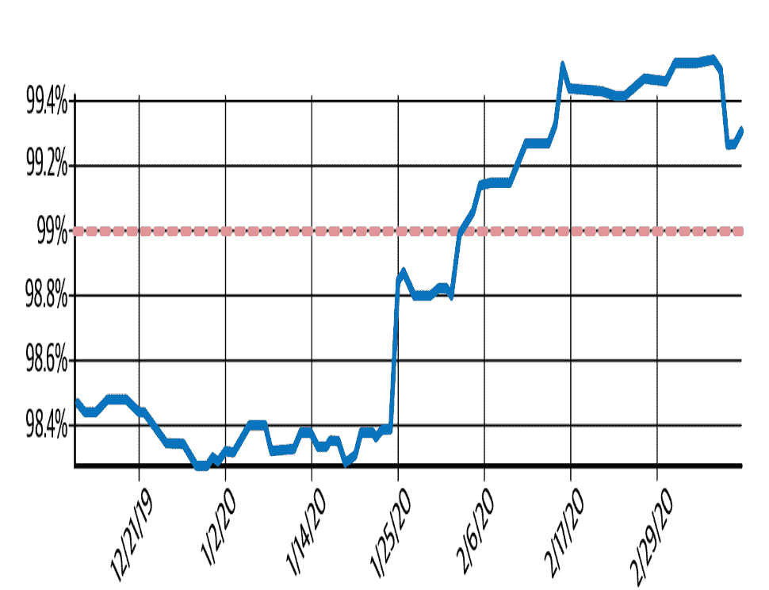

图 13-11. 某个 SLO 的 90 天滑动窗口在二月初开始恢复之前一直低于 99% 的目标

了解 SLO 的总体趋势还可以回答事件紧迫程度的问题，并为解决它提供线索。一次性烧掉预算与随时间缓慢烧掉预算所暗示的故障类型不同。

## 可观测性数据与时间序列数据在 SLO 中的使用对比

使用时间序列数据来计算 SLO 会引入一些复杂性。在前面几节的示例中，我们使用一个通用单位来判定成功或失败。在基于事件的世界中，该单位是单个用户请求：这个请求成功还是失败？在基于时间序列的世界中，该单位是一个特定的时间段：在这段时间内，整个系统是成功还是失败？使用时间序列数据时，度量的是系统性能的聚合视图。

时间序列数据的问题在*严格的 SLO* 情况下变得尤为突出，即可用性目标为 99.99% 及以上的 SLO。对于这些 SLO，错误预算可能在几分钟或几秒内耗尽。在这种场景下，每一秒都至关重要，并且必须采取多种缓解措施（例如自动修复）才能实现该目标。如果响应人员需要三分钟来确认告警、解锁笔记本电脑、登录并手动执行他们想到的第一个修复措施（如果问题复杂且需要进一步调试，时间甚至更长），那么在 1 秒还是 1 分钟后发现严重错误预算消耗之间的差异就无关紧要了。

另一种缓解方式是为 SLO 使用事件数据，而不是时间序列数据。试想一下时间序列评估在严格 SLO 场景下的工作方式。例如，假设你有一个 SLI，规定请求的第 95 百分位延迟必须小于 300 毫秒。错误预算计算随后需要将短时间段分类为好或坏。当按分钟进行评估时，计算必须等到该分钟结束后才能将其判定为好或坏。如果该分钟被判定为坏，你已经丢失了那一分钟对应的响应时间。当错误预算可能在几秒或几分钟内耗尽时，这种做法根本无法支撑快速的告警工作流。

“好分钟”或“坏分钟”的粒度根本不足以衡量 4 个 9 的 SLO。在前面的例子中，如果只有 94% 的请求小于 300 毫秒，那么整个分钟就被判定为坏。这一轮评估就足以一次性消耗掉你每月 4.32 分钟错误预算的 25%。并且如果你的监控数据仅以 5 分钟窗口收集（就像 Amazon CloudWatch 的免费默认设置那样），使用这种 5 分钟窗口进行好/坏评估时，只要一个评估窗口失败，你就会违反 SLO 目标。

在那些使用时间序列数据计算 SLO 的系统中，一种缓解方法类似于建立一个系统：一旦三个合成探针失败，就自动部署修复，然后由人工在事后复核结果。另一种方法是在流量足够高的情况下，使用指标度量较短时间窗口内瞬时失败的请求百分比。

与在“好分钟/坏分钟”场景中做出聚合判断不同，使用事件数据计算 SLO 可以让你以请求级别的粒度来评估系统健康状况。沿用之前示例中的 SLI 场景，任何持续时间低于 300 毫秒的请求都被视为好请求，任何持续时间高于 300 毫秒的请求都被视为坏请求。在 94% 的请求小于 300 毫秒的场景中，只有 6% 的请求会从你的 SLO 错误预算中扣除，而不是像使用 p95 这样的聚合时间序列指标那样扣除 100%。

在现代分布式系统中，100% 完全失败的断电式故障（blackout）比部分失败的降级式故障（brownout）更少见，因此基于事件的计算要有用得多。考虑一下，99.99% 可靠性系统的 1% 降级故障，类似于度量 99% 可靠性系统的 100% 中断。允许部分中断发生，为你赢得了更多响应时间，就如同一个 SLO 宽松得多的系统发生完全中断一样。在两种情况下，你都有超过七个小时的时间进行修复，然后月度错误预算才会耗尽。

追踪服务真实用户体验的可观测性数据，比粗粒度聚合的时间序列数据更能准确地表征系统状态。在决定使用哪些数据来触发可操作的告警时，使用可观测性数据能让团队关注更接近业务真正关心之事实的状况：当前正在发生的整体客户体验。

将你的可靠性目标与团队的可行性对齐非常重要。对于非常严格的 SLO（例如 5 个 9 的系统），你必须部署所有可用的缓解策略，例如基于极其细粒度且准确的测量进行自动修复，绕开需要几分钟或几小时的传统人工修复。然而，即使是 SLO 不太严格的团队，使用细粒度的事件度量也能比通常基于时间序列的度量创造出更多的响应时间缓冲。无论你团队的 SLO 目标如何，这种额外缓冲都能确保可靠性目标更可行。

## 结论

我们已经探讨了错误预算所扮演的角色，以及在使用 SLO 时可用于触发告警的机制。有多种预测方法可用于预测错误预算何时将被消耗殆尽。每种方法都有自己的考量因素和取舍，希望本章能告诉你哪种方法最适合满足你自己组织的需求。

SLO 并非可观测性所独有。可观测性所独有的是事件数据为 SLO 模型增加的额外能力。在计算错误预算消耗速率时，事件数据能够更准确地评估生产服务的实际状态。此外，仅仅知道某个 SLO 面临违反风险，并不一定能让你洞察到哪些用户受到影响、哪些依赖服务受到牵连，或者哪些用户行为组合正在触发服务错误。将可观测性数据与 SLO 关联起来，可以帮助你在燃烧预算告警触发后，看到故障发生在何处以及何时发生。

将 SLO 与可观测性数据结合使用，是 SRE 方法和可观测性驱动开发方法的重要组成部分。如前面章节所述，分析失败事件可以提供关于发生了什么错误以及原因的丰富而详细的信息。它有助于区分系统性问题和偶发的零散故障。在下一章中，我们将探讨如何使用可观测性来监控生产应用的另一个关键组件：软件供应链。


