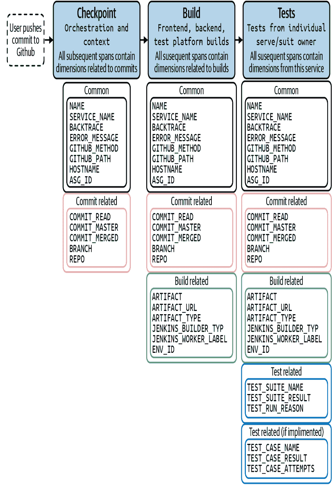
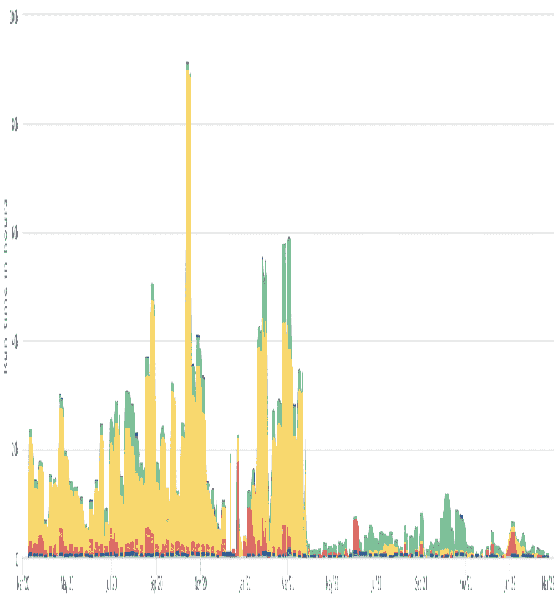

# 第14章 可观测性与软件供应链

## 给早期发布读者的说明

使用 Early Release 电子书，您可以在这些书籍正式发布之前很久就利用这些技术——作者在撰写过程中提供的原始未编辑内容。

这将是最终书籍的第14章。

如果您对如何改进本书的内容和/或示例有任何建议，或者如果您注意到本章中缺少材料，请联系编辑 vwilson@oreilly.com。

*本章由 Slack 高级员工软件工程师 Frank Chen 撰写*

## 来自 Charity、Liz 和 George 的说明

到目前为止，本书中我们研究了可观测性与您编写的代码以及该代码在生产环境中的运行方式之间的关系。但在生产环境中运行只是您代码生命周期中的一个阶段。在投入生产之前，使用构建管道自动测试和部署代码是常见做法。深入探讨特定的持续集成（CI）/持续部署（CD）架构和实践超出了本书的范围，除了可观测性如何用于调试管道问题之外。

生产环境并不是您的代码所遇到的唯一不断变化的环境。您用于运行构建管道的系统也可能以不可预测且常常难以预料的方式发生变化。与本书中讨论的应用程序一样，构建系统架构可能差异很大——从单体单节点到大规模并行运行的大型构建集群。架构更简单的系统可能更容易通过推理潜在故障来调试。但一旦系统达到一定复杂程度，可观测性就可以成为理解 CI/CD 管道中发生情况的不可或缺的——有时是必需的——调试工具。正如在生产环境中一样，集成不佳、不可见的瓶颈以及无法检测问题或调试其原因等问题也可能困扰您的构建系统。

本章由 Frank Chen 撰写，详细介绍了 Slack 如何使用可观测性来管理其软件供应链。我们非常高兴能将 Chen 的工作纳入本书，因为它是一个在规模化运行系统中使用可观测性的绝佳范例。您将了解如何在构建管道中调试问题时使用跟踪和可观测性，以及在此上下文中特别有用的仪器类型。

Slack 的故事是从拥有大规模软件供应链的组织的角度来阐述的，尽管我们相信它在任何规模上都有借鉴意义。在 [第四部分](Part IV) 中，我们将专门研究在规模化实施可观测性时出现的问题。

我很高兴分享本章关于将可观测性集成到软件供应链中的实践和用例。*软件供应链* 包括“从开发到 CI/CD 管道再到部署到生产环境过程中进入或影响您软件的任何事物”。¹

在过去三年里，我花时间构建和学习系统和人类流程，以提供频繁、可靠且高质量的发布，为 Slack 客户提供更简单、更愉快、更高效的体验。对于从事软件供应链工作的团队而言，我们更广泛组织使用的支持 CI/CD 的管道和工具就是我们的生产工作负载。

Slack 很早就投资了用于协作的 CI 开发和用于向客户发布软件的 CD。CI 是一种开发方法，要求工程师尽可能频繁地构建、测试并将新代码集成到共享代码库中。在共享代码库中集成和验证新代码可提高新代码不会向客户引入预期故障的信心。CI 系统使开发人员能够在提交新代码时自动触发构建、测试并接收反馈。

注意

有关连续集成如何适用于本章的更深入介绍，请参阅 ScienceDirect 网站上 Murat Erder 和 Pierre Pureur 的 “[Continuous Architecture and Continuous Delivery](Continuous Architecture and Continuous Delivery)”。此外，Atlassian 网站上 Sten Pittet 的 “[How to Get Started with Continuous Integration](How to Get Started with Continuous Integration)” 是一份特别好的指南。

Slack 从一个单一的 Web 应用 PHP 单体仓库（现在主要使用 [Hack](Hack)）发展而来，演变成服务于各种需求的多种语言、服务和客户端的拓扑结构。Slack 的核心业务逻辑仍存在于 Web 应用中并路由到下游服务，如 [Flannel](Flannel)。Slack 的 CI 工作流包括针对各种代码库的单元测试、集成测试和端到端功能测试。

就本章而言，我重点关注我们 CI/CD 系统和 Web 应用 CI 的可观测性，因为这是 Slack 许多工程师花费大部分时间的地方。Web 应用 CI 生态系统涵盖 Checkpoint、Jenkins 构建器/测试执行器和 QA 环境（每个环境都能够运行路由到支持依赖服务的 Slack Web 应用代码库）。Checkpoint 是一个内部开发的服务，用于编排 CI/CD 工作流。它提供 API 和前端来编排测试执行和部署等复杂工作流的阶段。它还会在 Slack 中与用户共享更新，例如测试失败和拉取请求（PR）评审事件。

[Figure 14-1](Figure 14-1) 显示了端到端 Web 应用测试的示例工作流。用户将提交推送到 GitHub，Checkpoint 从 GitHub 接收代码库相关事件的 Webhook，例如新提交。然后 Checkpoint 向 Jenkins 发送请求，要求 Jenkins 执行器执行构建和测试工作流。在 Jenkins 构建器和测试执行器内部，我们使用一个名为 CIBot 的代码库来执行与主分支合并的构建和测试脚本（然后与 Checkpoint 通信以进行编排和测试结果发布）。

团队。在这种规模下，有必要通过自适应容量和超额订阅等策略来控制成本和计算资源。

> **注意**
> 
> 有关 Slack CI 系统和成本控制策略的更多详细信息，可在 Slack Engineering 的博客文章“Infrastructure Observability for Changing the Spend Curve”中找到。

因此，我们在开发环境中测试和部署代码的工作流通常可能比某些生产服务更复杂。基础设施类型或运行时版本中的底层依赖关系可能会意外更改并引入非预期故障。例如，Slack 依赖 Git 进行版本控制。不同版本的 Git 在合并代码时可能具有截然不同的性能特征。对 CI 表面进行异常检测可能涉及调试可能存在于您的代码、测试逻辑、依赖服务、底层基础设施或其中任何组合的问题。当出现问题时，问题可能隐藏在任何数量的不可预测位置。Slack 很快意识到我们需要在软件供应链中实现可观测性。

为软件供应链提供仪器化是 Slack 也是您自身业务的竞争优势。更快的开发 + 更快的发布周期 = 为客户提供更好的服务。可观测性在 Slack 理解问题和为 CI/CD 制定投资框架方面发挥了重要作用。在以下部分中，您将阅读 Slack 于 2019 年使用改进的分布式跟踪对 Checkpoint 进行仪器化的内容，以及 2020 年和 2021 年针对特定问题解决方案的案例研究。

内部工具通常会经过与生产系统相同的多个关键系统，但由于需要针对开发系统执行以及构建和测试的代码合并而增加了额外的复杂性。内部工具与生产服务相比提供了不同的视角：基数明显更低，但任何单个事件和跨度的关键性明显更高。任何依赖系统的故障都代表开发人员速度的放缓和团队的挫败感，最终导致


减慢向客户交付软件的速度。换句话说，如果你的软件供应链的第一部分缓慢或容易出错，那么依赖于这一关键部分的其余软件供应链就会出现瓶颈。

“它很慢”是分布式系统中最难调试的问题。“它不稳定”是支持内部工具的团队听到的最常见问题。两者共同的挑战是如何关联交互的高复杂度系统中的问题。例如，当基础设施或测试不稳定时，开发人员编写代码的能力会下降，他们对工具的信任也会被侵蚀，导致挫败感。这种类型的复杂性促使 Slack 投资构建共享可观测性管道。你将在第 18 章中看到有关可观测性管道的更多细节，该章由 Slack 的 Suman Karumuri 和 Ryan Katkov 撰写。在下一节中，你将了解维度如何帮助解决这个问题。

## Instrumentation: Shared Client Libraries and Dimensions

Slack CI 的主要挑战是复杂性。端到端测试中的一次失败可能是多个相互作用的代码库的结果，这些代码库需要在代码库更改、基础设施更改和平台运行时之间进行查看。对于 2020 年一名 Web 应用开发者的单次提交，我们的 CI 管道会执行 30 多个测试套件，这些套件依赖于 GitHub、三个平台团队（性能、后端和前端）构建的管道，跨越 20 个团队/服务，各自有不同的需求和专业领域。到 2020 年中期，我们的 CI 基础设施开始达到极限，因为测试执行量每月增长 10%，导致多个下游服务在满足测试执行带来的额外需求方面遇到扩展挑战。

Slack 试图通过分布式追踪来解决这一系列瓶颈。Slack 的 CI 基础设施在 2019 年大部分由 CTO 和早期员工编写，并且多年以来一直基本可用。但该

基础设施显示出成长的烦恼，并且对许多工作流程缺乏可观测性。

通过将追踪应用于多跳构建系统，我们的团队在添加 instrumentation 后数小时内就解决了 CI 工作流程中的多个挑战：

- 在 2019 年第二季度，我们用一个下午的原型对我们的 CI 运行器进行了 instrumentation。类似于其他追踪用例，在获得追踪数据几分钟后，我们发现了 Git checkout 的异常运行时间。通过查看底层主机，我们发现它们没有像其他主机一样在自动扩展组（ASG）中更新，并迅速将其停用。这解锁了一个简单的解决方案，用于那些没有导致错误或失败但仍呈现缓慢——因此是糟糕——用户体验的工作流程。
- 在 2019 年第三季度，我们的团队正处于一次多日/多团队的事故中。我们在 CI 运行器和测试环境之间实现了第一个跨服务追踪，并发现了一个减慢系统吞吐量的 Git 大文件存储（LFS）问题。最初，团队忙于将多个超载的系统控制在可控范围内，因为系统的一个部分将故障级联到其他系统。我们借用了 CI 运行器的简单 instrumentation，并通过发现一组无法从 Git LFS 检索工件的主机，在不到两个小时内解决了事故。

在图 14-2 中，你可以看到用户将提交推送到 GitHub 后一次测试运行的简化视图。此测试运行由 Checkpoint 编排，随后传递给构建步骤然后是测试步骤，每个步骤均由 Jenkins 执行器执行。在每个阶段，你都会看到额外的维度，这些维度为 CI 中的执行提供了上下文。Slack 工程师随后使用单个或组合的维度作为面包屑，在生产环境中出现性能或可靠性问题时探索执行情况。每个额外的维度都是问题调查过程中的一个方向和线索。你可以组合线索以迭代地深入挖掘已部署代码中的特定问题。



*Figure 14-2. A simplified view of a single end-to-end test run orchestrated by our CI orchestration layer, highlighting the common dimensions shared across our workflow*

客户端维度在每个追踪中配置。图 14-3 显示了示例维度。Slack 使用一个 TraceContext 单例来设置这些维度。每个 TraceContext 构建一个具有通用维度和新追踪的初始追踪。每个追踪包含多个 spans 和每个 span 的一组特定维度。单个 span 例如在图 14-4 中来自 `runner.test_execution` 可以包含原始请求的上下文并向根 span 添加感兴趣的维度。随着你添加更多维度，你为问题调查提供了更多上下文和丰富性。

NOTE
You can learn more about wide spans at “CircleCI: The Unreasonable Effectiveness of a Single Wide Event,” by Glen Mailer, a video posted on the Honeycomb website.

```
enum ServiceName: string as string (
CHECKPOINT_BG = 'ci_checkpoint_bg';
CHECKPOINT_APP = 'ci_checkpoint_aa';
CHECKPOINT_ENV_CONTROL = 'ci_checkpoint_env';
CIBOT_RUNNER = 'ci_cibot_runner';
CIBOT_BUILDER = 'ci_cibot_builder';
DB_CLIENT = 'ci_db';
DEFAULT = 'ci_defaut';
ROOT = 'ci_root';
)
```

```
// Build
ARTIFACT = 'artifact_id';
ARTIFACT_URL = 'artifact_url';
ARTIFACT_TYPE = 'artifact_type';
JENKINS_BUILDER_TYPE = 'jenkins_builder_type';
JENKINS_WORKER_LABEL = 'jenkins_worker_label';
```

```
// Test run
TEST_SUITE_NAME = 'test_suite';
TEST_SUITE_RESULT = 'test_suite_result';
TEST_RUN_REASON = 'run_reason';
```

```
enum ServiceName: string as string (
// Global
NAME = 'name';
SERVICE_NAME = 'service_name';
BACKTRACE = 'backtrace';
ERROR_MESSAGE = 'error';
IS_SYNTHETIC_SPAN = 'is_Synthetic_span';
METHOD = 'method';
STATUS_CODE = 'status';
)
```

```
// Test case
TEST_CASE_NAME = 'test_case_name';
TEST_CASE_RESULT = 'test_case_result';
TEST_CASE_ATTEMPTS = 'test_case_attempts';
```

```
// Orchestration
ENTRYPOINT = 'entrypoint';
REQUEST_ID = 'request_id';
PATH = 'path';
AUTH_METHOD = 'auth_method';
```

```
// Commit related
COMMIT_HEAD = 'commit_head';
COMMIT_MASTER = 'commit_master';
COMMIT_MERGED = 'commit_merged';
BRANCH = 'branch';
REPO = 'repo';
)
```

```
// Clients
DB_QUERY = 'query';
DB_TABLE = 'query_table';
GITHUB_METHOD = 'github_method';
GITHUB_PATH = 'github_path';
/* [... Other dimensions ...] */
)
```

```
// Host related
EVN_ID = 'env_id';
HOSTNAME = 'hostname';
ASG_ID = 'asg_id';
)
```

Figure 14-3. Common dimensions in our Hack codebase. You can use these as examples for structuring dimensions across spans and services in CI.

例如，Slack 工程师可能希望沿着常见维度识别并发问题（如主机名或 Jenkins 工作组）。TraceContext 已经提供了一个主机名标签。CI 运行器客户端随后附加一个 Jenkins 工作器标签的标签。使用这两种维度的组合，Slack 工程师可以对具有运行时问题的主机或 Jenkins 工作器组进行分组。

同样，Slack 工程师可能希望识别常见的构建失败。CI 运行器客户端附加一个提交头或提交主分支的标签。这种组合可以识别损坏的构建可能来自哪些提交。

图 14-3 中的维度随后在各种脚本和服务调用中使用，因为它们相互通信以完成一次测试运行图 14-4。

Figure 14-4. A trace for the CI execution of a backend test suite called backend-php-unit

在以下部分中，我将分享 Slack 如何使用追踪工具和查询来理解供应链，以及出处如何导致可操作的告警以解决问题的过程。

## Case Studies: Operationalizing the Supply Chain

通过分析由指标、事件、日志和追踪组成的遥测数据进行可观测性，是建模内部客户体验的关键组成部分。对 Slack 基础设施工具和人员而言，关键是持续学习并将可观测性嵌入到我们的工具中。本节介绍的案例研究将可观测性带入 Slack 开发人员


workflows。我希望通过分享 Slack 对这些问题的处理方法，你可以为自己的内部开发复用这些模式。

## 通过工具理解上下文

CI 运行在复杂且分布式的系统中；多个小的变更对其对 CI 用户体验的影响可能是累加的。多个团队传统上各自为政地调试性能和弹性问题，以更好地服务客户（例如，后端、前端和中间件）。然而，对于正在进行开发然后运行测试的 CI 客户而言，用户体验最好由性能最差或最不稳定的测试来体现。当运行相同代码结果不同时，测试被认为是 flaky 的。理解上下文对于识别瓶颈至关重要。

在本节的剩余部分，我将通过一个案例研究来介绍 Slack 团队如何共同协作，从 flaky 测试的问题中理解上下文。通过关注几个关键原则，Slack 团队能够显著减少其内部客户的这一问题：

- 使用 traces 对测试平台进行 instrumentation，以捕获之前未充分探索的运行时变量
- 交付小型的、可观测性驱动的反馈循环来探索有趣的维度
- 对与 flaky 测试配置相关的维度运行可逆实验

2020 年，由于 flaky 的端到端测试运行，Slack 工程团队的开发人员挫败感不断增加。测试周转时间（p95）对于单个提交 consistently 超过 30 分钟（工程师将提交推送到 GitHub 到所有测试执行返回之间的时间）。在此期间，Slack 大部分的代码测试都是在工程师将代码合并到主线之前由端到端测试驱动的。许多端到端测试套件的平均套件执行 flake 率接近 15%。

累计起来，这些 flaky 测试执行在被丢弃的测试执行上达到每周 100,000 小时的计算时间峰值。

到 2020 年中期，这些指标的组合促使 Slack 各地的自动化团队分享每日 30 分钟的 triage 会议，以深入研究特定的测试问题。自动化团队负责人不愿对 Slack 使用 Cypress 的方式引入任何额外变异，这是一个端到端测试平台。认为 flakiness 来自测试代码本身。然而，在验证或排除这一信念方面并没有取得很大进展。

2020 年底，可观测性通过 tracing 在识别其他内部工具的基础设施瓶颈方面显示出巨大前景和影响。内部工具和自动化团队努力为 Cypress 中的一些运行时参数和 spans 添加 tracing。

在 instrumentation 后的几天内，多个维度与 flake 率更高的测试套件高度相关。这些团队的工程师查看了此 instrumentation 并发现，测试平台的用户和测试套件所有者具有截然不同的配置。在此发现过程中，额外的遥测被添加到 Docker 运行时，以为某些 flakes 增加更多信息。凭借数据支持，这些工程师尝试为平台设置更好的默认值，并为 flaky 配置设置 guardrails。在这些初始调整之后，许多用户的测试套件 flake 率显著下降（套件从 15% 降至低于 0.5% 的 flake 率）。

由于端到端测试套件之间运行时存在差异，且没有中央团队对其有可见性，因此在套件之间收集上下文成为识别导致 flakiness 的特定维度的关键部分。

## NOTE

> 有关 Slack 如何发展其测试策略和安全文化，更多内容请参阅 Slack 博客文章 [“Balancing Safety and Velocity in CI/CD at Slack”](https://slack.engineering/balancing-safety-and-velocity-in-ci-cd-at-slack/)。Slack 描述了工程师如何启动一个项目来转变测试管道并淡化端到端测试对代码安全性的强调。这在 2021 年大幅减少了用户可见的 flakiness 并提高了开发人员速度。

## Test Execution Flaky Runtime with Attribution（季度视图）



图 14-5。Web 应用中主要测试运行类别之间 flaking 测试运行所花费的时间。黄色条显示来自 Cypress 平台测试的 flaky 测试执行。

通过工具获得这种共享的上下文理解，Slack 的下一步是通过 alerting 嵌入可操作的 workflows。

## 嵌入可操作的 Alerting

Slack 将 Slack 集成到工程师处理其开发和基础设施中 triage 问题的方式中。可观测性通过 tracing 在帮助工程师完成工作方面发挥关键作用，通过 Slack 消息和配置的仪表板引导人员。

让我们研究一个关于测试执行的案例研究。单个测试套件执行可能以不同的方式被理解，具体取决于代码、基础设施或产品中的功能。每个团队或平台可能对测试执行的各个部分有多个 SLO。以下是一些示例：

- 测试套件所有者或平台团队可能关心 flakiness、可靠性或内存使用。
- 测试基础设施团队可能关心特定操作的性能和可靠性（如 Docker 操作或每次测试的成本）。
- 部署所有者可能关心测试了什么或即将通过 CI 进行的热修复。
- 内部工具团队可能关心测试结果处理通过 CI 的吞吐量。

识别问题的提示可能是针对高层业务指标的异常检测警报，或特定于套件的特定问题（例如，图 14-6）。链接到我们的可观测性工具可能会将用户引导至基于 test_suite 维度的视图集合。

## CI Service Traces

这描述了我们 CI 中当前的 traces。每个都可以使用我们的规范维度集进行查询 https://paper.dropbox.com/doc/4AsZ6B3C6E1H9T7Ss

Frank Chen 最后编辑于 Jan 10, 2022

最近 28 天

设置

单列

多列

### Checkpoint Traces

Jan 27 2022, 5:07:43 PM - Feb 24 2022, 5:07:42 PM (Granularity: 2 hr)

### Cibot Traces

Jan 27 2022, 5:07:43 PM - Feb 24 2022, 5:07:42 PM (Granularity: 1 hr)

### Cypress Traces

Jan 27 2022, 5:07:43 PM - Feb 24 2022, 5:07:42 PM (Granularity: 1 hr)

描述此查询

工具

图 14-7。Slack 的 CI Service Traces 仪表板显示可用于查看 CI 交互不同部分的查询

在图 14-8 中，你可以看到一个查询示例，从高层查看速率、错误和持续时间查询，响应团队可能会使用。

### Checkpoint Traces

| VISUALIZE | WHERE | GROUP BY |
|---|---|---|
| HEATMAP(duration_ms) | hostname starts-with checkpoint | method |
| P50(duration_ms) |  | service_name |
| P95(duration_ms) |  |  |
| P99(duration_ms) |  |  |
| COUNT_DISTINCT(error) |  |  |
| COUNT |  |  |

图 14-8。此示例钻取查询近似于按服务在 Checkpoint 中对单个方法进行分组的速率、错误和持续时间（RED）仪表板的可视化

随着可操作的 alerting 被嵌入，现在我们可以理解发生了什么变化。

## 理解发生了什么变化

让我们探索另一个案例研究，即 2021 年 8 月的一起事件，结合了前面几个想法。在 Slack，我们使用事件指挥系统来处理检测到中断或服务降级时的事件。事件响应始于一个新的公共 Slack 频道，事件指挥官添加来自多个团队的响应者以协调中断的响应和补救。

在这种情况下，多名用户注意到在后端单元和集成测试套件的测试套件执行中出现因内存不足错误（OOMs）导致的高失败率而被阻塞。每个这些后端单元测试套件可能运行数万个测试，并且单独来看，测试套件执行偶尔会通过。

事件早期，一名响应者发现前一天的异常，指出 flake 率更高（见图 14-9 的异常类型），可能指向当时发生的变化。在事件期间，响应者查看了后端测试的测试用例 traces，以查看测试用例的内存占用跃升。我们能够看到过去几个月中 p50、p95 和 p99 的内存使用量多次跃升，精确到小时，显示发生了什么变化。


## 条件

- 后端（Hack）单元/集成测试因主机上的 OOM 条件而以相当高的频率失败。
- 理论是测试中的内存使用量已增加到无法在同一主机上并行运行如此多测试的程度。
- 在过去的一个月里，我们已确定了内存使用量显著上升的几个拐点。

图 14-9. 来自该事件的 Conditions/Actions/Needs（CAN）流程中的 Conditions 部分。停机的一种症状是多个测试套件因 OOM 而失败，并且正在调查的一个持续理论。

使用这些数据，专家能够识别出前一天以及之前几个月的潜在 PR，这些 PR 与内存使用量的跃升相关联。在大型代码库或测试套件中，降级的原因通常具有挑战性，因为变更速度快，且代码库和基础设施中存在许多可能导致变化的变量。

一些潜在的罪魁祸首提交已被回滚。由于在事件调查期间潜在变量数量众多，在变更后通常会出现一种等待模式，在此期间遥测数据才能报告健康状况。图 14-10 显示了主题专家之间的一条长线程，他们能够快速测试假设并使用分布式追踪以接近实时的方式查看系统健康状况。

“我们如何最好地测试假设？”

我不确定如何最好地测试这两个分支的假设，因为它们是在一个月多以前合并的。我最感兴趣的那个没有干净的回滚。

https://slack-github.com/slack/webapp/pull/99331/files 是否可能与 tests/unit/api_integration/integration_test__conversations_acceptSharedInvite.php 中的测试内存使用量增加有关？（它在我们开始看到内存使用量升高几分钟前合并）

已合并 · ... 的 10 个提交 查看 GitHub 上的 PR | Checkpoint

是的，确实可能

“我在回滚后测试刚刚通过了”

我在 https://checkpoint.tinyspeck.com/ghe/slack/webapp/branches/...ts 上回滚 https://checkpoint.tinyspeck.com/ghe/slack/webapp/pulls/104224 后测试刚刚通过了

已合并 · ... 的 5 个提交 查看 GitHub 上的 PR | Checkpoint

可能是一次性情况，但看起来信号相当好

我们应该能在 Honeycomb 中看到你这次运行的内存使用情况 👀

“我们应该能在 Honeycomb 中看到你这次运行的内存使用情况”

这些数据使 Slack 能够在随时间推移的上下文中查看遥测数据。这是 Slack 日常运营中使用可观测性的众多示例之一。你可以采用类似的方法，通过将可观测性嵌入到自己的调查中来识别变更和故障。

## 结论

本章说明了可观测性在软件供应链中如何有用。我分享了 Slack 如何为 CI 流水线进行 instrumentation 以及调试分布式系统的最新示例。调试分布式系统的复杂性通常是应用程序开发人员试图了解其代码在生产环境中行为时首要考虑的问题。但在生产之前，其他分布式系统也可能同样具有挑战性，难以正确理解和调试。

有了合适的工具和软件供应链中的维度，Slack 工程师能够解决 CI 工作流中以前不可见或未被检测到的复杂问题。无论是调试应用程序缓慢的投诉还是 CI 测试不稳定的问题，可观测性都可以帮助开发人员将高复杂性系统中相互作用的问题关联起来。

> 1 Maya Kaczorowski. “Secure at Every Step: What is Software Supply Chain Security and Why Does It Matter?,” GitHub Blog, September 2, 2020.
