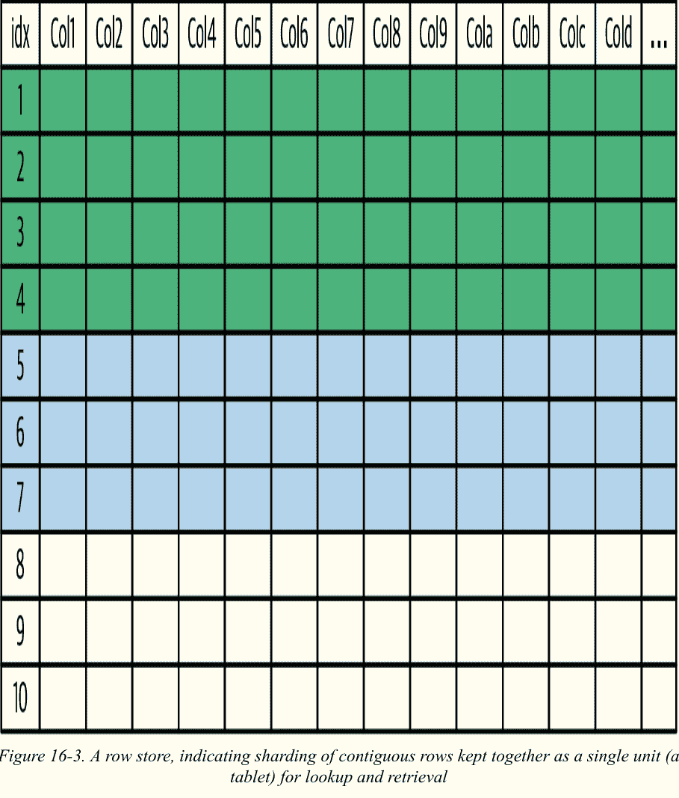
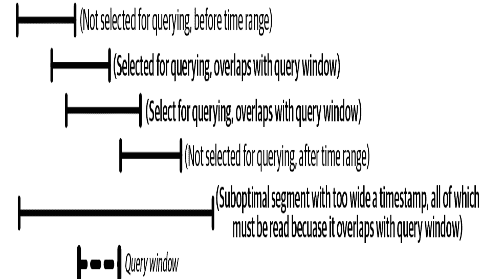

# 第16章 高效数据存储

## 早期发布读者须知

通过早期发布电子书，你可以在书籍的最早形态——作者写作时的原始未编辑内容——中读到它们，从而在这些技术正式发布之前就加以利用。

这将是最终版本的第16章。

如果你对如何改进本书内容和/或示例有任何评论，或者你发现本章缺少某些内容，请通过 vwilson@oreilly.com 联系编辑。

在本章中，我们将探讨在关键时刻有效存储和检索可观测性数据所必须应对的挑战。速度是数据存储和检索中常见的关注点，但其他功能约束也带来了必须在数据层解决的关键挑战。在大规模场景下，可观测性固有的挑战会变得尤为突出。我们将列出实现可观测性工作流所需的功能需求，然后以 Honeycomb 专有的 Retriever 数据存储实现为灵感，审视现实中的权衡取舍和可能的解决方案。

你将了解存储和检索层面所需的各种考量，以确保可观测性数据的速度、可扩展性和持久性。你将了解列式数据存储及其为何特别适合可观测性数据、查询工作负载必须如何处理，以及使数据存储既持久又高性能的考量。本章介绍的解决方案并不是应对你可能遇到的各种权衡的唯一可能方案。但它们作为构建可观测性解决方案时实现必要成果的真实示例而呈现。

### 可观测性的功能需求

当你在生产环境中遭遇中断时，每一秒都至关重要。针对可观测性数据的查询必须尽可能快地返回结果。如果你提交一个查询，然后在等待结果返回期间还能去倒杯咖啡，那你就是在与一种不适合生产环境的工具进行一场必败之战。在几秒内获得结果，正是让可观测性成为一种有用的调查实践、使你能够快速迭代直到找到有意义结果的原因。

正如[第二部分](#)所述，事件是可观测性的构建块，而追踪是相互关联的事件（或追踪跨度）的集合。在这些事件中找到有意义的模式，需要具备分析高基数和高维度数据的能力。任何事件（或任何追踪跨度）中的任何字段都必须可查询。这些事件不能预先聚合，因为在任何特定调查中，你无法提前知道哪些字段可能是相关的。所有遥测数据都必须以预聚合的粒度可供查询，无论其复杂性如何，否则你就有可能在调查中走入死胡同。

此外，由于你不知道事件中的哪些维度可能相关，你不能让任何特定维度的数据检索性能优于其他维度（它们必须同样快）。因此，要么必须对所有可能需要的数据建立索引（这通常成本高得令人望而却步），要么在没有索引的情况下数据检索也必须始终快速。

通常，在可观测性工作流中，用户希望检索特定时间范围内的数据。这意味着特权数据的唯一例外是时间维度。查询必须返回特定时间间隔内记录的所有数据，这一点至关重要，因此你必须确保对其进行适当的索引。TSDB 在这里似乎是显而易见的选择，但正如你将在本章后面看到的，将其用于可观测性会带来一系列不兼容的约束。

由于你的可观测性数据用于调试生产问题，因此必须了解你所采取的具体操作是否已解决问题。陈旧的数据可能导致工程师浪费时间在无关线索上，或对系统当前状态做出错误结论。因此，一个高效的可观测性系统不仅应包含历史数据，还应包含接近实时反映当前状态的新鲜数据。从系统接收到数据到该数据可被查询之间，间隔不应超过几秒。

最后，该数据存储还必须持久且可靠。你不能丢失在关键调查期间所需的可观测性数据。你也不能因为数据存储中的任何组件发生故障而推迟关键调查。你用于检索数据的任何机制都必须具备容错能力，并且设计为即使底层工作组件发生故障也能快速返回查询结果。数据存储的持久性还必须能够承受你自己基础设施内部发生的故障。否则，当你试图调试其所跟踪的生产服务为何无法运行时，你的可观测性解决方案可能也无法运行。

鉴于这些实现实时调试工作流所需的功能需求，传统数据存储解决方案往往无法满足可观测性的要求。在足够小的规模下，这些参数范围内的数据性能更容易实现。在本章中，我们将考察当你超越单节点存储解决方案时，这些问题会如何显现。

### 时间序列数据库不足以满足可观测性需求

从核心来看，可观测性数据由代表程序执行信息的结构化事件组成。如第5章所述，这些结构化事件本质上是键值对的集合。在追踪场景中，结构化事件可以相互关联，以便可视化追踪跨度之间的父子关系。考虑到第7章中看到的自动埋点用例，其中一些字段可能是“已知”（或可预测）的。然而，最有价值的数据将是你的特定应用所特有的。这类自定义数据通常是临时生成的，这意味着用于存储它的模式往往是动态或灵活的。

如第9章所讨论的，时间序列数据（指标）将系统性能聚合为简单的度量。指标会将特定时间窗口内的所有底层事件聚合为一个简单且可分解的数字，并附带一组标签。这可以减少发送到遥测后端数据存储的数据量并提高查询性能，但也会限制以后能从该数据中推导出的答案数量。虽然某些指标数据结构（例如用于生成直方图的结构）可能稍微复杂一些，但它们本质上仍然是将相似的值范围分桶，并记录具有相似值的事件计数（参见图16-1）。


```
POST 201 at 2:37am

2:00 :10 :20 :30 :40 :50

http.get.200.count
http.get.302.count
http.get.404.count
http.post.201.count
+1
http.post.403.count
http.post.500.count
```

图 16-1. 一个典型的 TSDB，展示了有限的基数和维度：按时间戳分桶的 HTTP 方法和状态码标签

传统上，时间序列数据库（TSDB）用于存储聚合指标。时间序列数据存储机制旨在通过确保聚合和标签的新组合很少出现，从而摊销额外流量的成本；为每个唯一时间序列创建记录（或数据库行）会带来较高的开销，但将数值测量附加到已存在的时间序列上的成本很低。在查询方面，TSDB 中占主导地位的资源成本是找到与特定表达式匹配的时间序列；扫描结果集的成本很低，因为数百万个事件可以减少为少量按时间窗口计数的计数。

在理想世界中，你可以直接切换到使用相同的 TSDB 记录结构化事件。然而，功能可观测性要求在高基数和高维度数据中呈现有意义的模式，这使得使用 TSDB 变得不可行。虽然你可以将每个维度转换为标签名，并将每个值转换为标签的值，但这将为每个唯一的标签值组合创建一个新的时间序列（参见[图 16-2](#)）。创建新时间序列的成本仅在测量中摊销为 0，前提是相同的标签被频繁重用并递增。但每个结构化事件通常是*唯一的*，并且会导致行创建的开销与接收到的事件数量成线性关系。因此，*基数爆炸*这一问题使得 TSDB 不适合存储结构化事件。我们需要不同的解决方案。

```
http.get.200.count [2 1 4 5 6]
http.get.302.count [1 3 1 1]
http.get.404.count [1 1 2 1 2]
http.post.201.count [9 7 8 6 9]
http.post.403.count [1 1 3 1 1]
http.post.500.count [1 1 9 1 1]
http.get.200.user8996.count [2 1 1 1 1]
http.get.200.user9b93.count [1 1 3 2 3]
http.get.200.userca49.count [1 1 1 1 1]
http.get.200.user2b85.count [1 1 1 3 3]
http.get.302.user8996.count [1 1 1 1 1]
http.get.302.user9b93.count [1 1 1 1 1]
http.get.302.userca49.count [1 1 1 1 1]
http.get.302.user2b85.count [1 1 1 1 1]
http.get.404.user8996.count [1 1 1 1 1]
http.get.404.user9b93.count [1 1 2 1 1]
http.get.404.userca49.count [1 1 1 1 1]
http.get.404.user2b85.count [1 1 1 1 1]
http.get.201.user8996.count [1 2 1 1 3]
http.get.201.user9b93.count [1 2 1 2 4]
http.get.201.userca49.count [4 1 5 1 1]
http.get.201.user2b85.count [3 2 2 3 1]
http.get.403.user8996.count [1 1 1 1 1]
http.get.403.user9b93.count [1 1 1 1 1]
http.get.403.userca49.count [1 1 1 1 1]
http.get.403.user2b85.count [1 1 1 1 1]
http.get.500.user8996.count [1 1 1 1 1]
http.get.500.user9b93.count [1 1 1 1 1]
http.get.500.userca49.count [1 1 7 1 1]
http.get.500.user2b85.count [1 1 1 1 1]
```

大约 $100。如果尝试将 Scuba 用作数据存储，组织将被限制为只能查询 RAM 中可用的数据量。对于大多数拥有合理规模基础设施的大型组织而言，该限制会将可查询遥测数据的时窗限制在几分钟而不是几小时或几天。

也许我们可以查看用于存储类似事件数据的其他数据存储——即跟踪解决方案的遥测后端。截至本文撰写时，已存在几种大规模存储引擎的开源实现，大多与 Jaeger 跟踪前端互操作：Apache Cassandra、Elasticsearch/OpenSearch、ScyllaDB 和 InfluxDB。这些允许使用模式进行跟踪数据的摄取和持久化存储，但不一定专门为跟踪而构建。Grafana Tempo 是专为跟踪而构建的新实现示例，但它不一定为可观测性的功能查询需求而构建，正如我们在本章中将看到的那样。长期来看，最好的开源方法可能是采用 ClickHouse 或 Apache Druid 等列式存储，并扩展以优化跟踪，如 SigNoz 所做的那样。

在下一节中，我们将检查技术要求，以存储和查询跟踪数据，使其满足可观测性的功能要求。虽然在技术上任何事情都是可能的，但本章将查看在规模上财务上可行的实现，以便您可以存储事件数据并获得超出仅检查单个跟踪所能实现的洞察。

## 数据存储策略

从概念上讲，宽事件及其表示的跟踪跨度可以被视为具有行和列的表。存储表可以使用两种策略：基于行的存储和基于列的存储。对于可观测性领域，*行*指的是单个遥测事件，*列*指的是这些事件的字段或属性。

在*基于行的存储*中，每行数据都保持在一起（如[图 16-3](Figure 16-3)所示），假设整个行将一次性获取。在*基于列的存储*中，列数据保持在一起，与其行分离。每种方法都有权衡。为了说明这些权衡，我们将使用经时间考验的 Google 的 [Bigtable](Bigtable) 和 [Dremel](Dremel)/ColumnIO 作为更广泛的计算和存储模型的代表，而不是关注当今实践中使用的特定开源遥测存储。事实上，[Dapper 跟踪系统](Dapper tracing system) 最初是构建在 Bigtable 数据存储之上的。

| idx | Col1 | Col2 | Col3 | Col4 | Col5 | Col6 | Col7 | Col8 | Col9 | ColA | ColB | ColC | ColD | ... |
|---|---|---|---|---|---|---|---|---|---|---|---|---|---|---|
| 1 |   |   |   |   |   |   |   |   |   |   |   |   |   |   |
| 2 |   |   |   |   |   |   |   |   |   |   |   |   |   |   |
| 3 |   |   |   |   |   |   |   |   |   |   |   |   |   |   |
| 4 |   |   |   |   |   |   |   |   |   |   |   |   |   |   |
| 5 |   |   |   |   |   |   |   |   |   |   |   |   |   |   |
| 6 |   |   |   |   |   |   |   |   |   |   |   |   |   |   |
| 7 |   |   |   |   |   |   |   |   |   |   |   |   |   |   |
| 8 |   |   |   |   |   |   |   |   |   |   |   |   |   |   |
| 9 |   |   |   |   |   |   |   |   |   |   |   |   |   |   |
| 10 |   |   |   |   |   |   |   |   |   |   |   |   |   |   |



Bigtable 使用基于行的方案，这意味着检索单个跟踪和跨度很快，因为数据是序列化的并且主键已编入索引（例如按时间）。要获取一行（或扫描几行连续行），Bigtable 服务器只需检索一组文件及其元数据（一块 tablet）。为了有效地用于跟踪，该方法要求 Bigtable 维护按主键（如跟踪 ID 或时间）排序的行列表。按严格顺序以外到达的行键要求服务器在适当位置插入它们，导致写入时产生额外的排序工作，而非顺序读取工作负载不需要此操作。

作为可变数据存储，Bigtable 支持更新和删除语义以及动态重新分区。换句话说，Bigtable 中的数据在数据处理方面具有灵活性，但以复杂性和性能为代价。Bigtable 将对数据的更新暂时管理为内存中的变更日志加上覆盖文件堆栈，其中包含覆盖较低层级设置值的键值对。定期，一旦这些更新足够多，覆盖文件必须“压缩”回基不可变层，该过程根据其优先级顺序重写记录。该压缩过程在磁盘 I/O 操作方面代价高昂。

对于可观测性工作负载，其本质上是一次写入多次读取，压缩过程带来了性能难题。因为新摄取的可观测性数据必须在几秒内即可查询，使用 Bigtable 时压缩过程要么需要不断运行，要么每次提交查询时都需要读取堆叠的不可变键值对。没有读取行 tablet 的所有列来重现相关字段和值，就无法对任意字段进行分析，这是不切实际的。同样，让压缩不断运行也是不切实际的。

Bigtable 可选地允许你为列族中的一组列配置*局部性组*，可与其它列族分开存储。但即使从局部性组内读取单个列，也仍会读取整个局部性组，同时丢弃大部分数据，从而减慢查询并浪费 CPU 和 I/O 资源。你可以在选定列上添加索引或根据预测的访问模式拆分局部性组，但这种变通方法与可观测性对任意访问的要求相矛盾。局部性组列中的稀疏数据在 Bigtable 中成本低廉，因为列仅存在于局部性组内，但局部性组整体不应为空，因为其开销。


将这种做法推向极致——为每一列添加索引或将每一列存储在单独的局部性组中——成本会累积起来。² 值得注意的是，Google Dapper 后端论文指出，尝试在 Bigtable 上仅为 Dapper Depots 的三个字段（service、host 和 timestamp）生成索引，所产生的数据量达到了追踪数据本身的 76%。³ 因此，如果你能完全消除索引的需求，就能获得一种更实用的分布式追踪存储方法。

独立于 Bigtable 等策略，使用基于列的方法时，可以快速检查所需的数据子集。传入的数据被划分为列（如图 16-4 所示），其中一个合成的 id 列为每一行提供主键。每个列文件包含从主键到该列值的映射，并单独存储。因此，你可以独立查询和访问每个列的数据。

| id | Col1 | Col2 | Col3 | Col4 | Col5 | Col6 | Col7 | Col8 | Col9 | ColA | ColB | ColC | ColD | ... |
| --- | --- | --- | --- | --- | --- | --- | --- | --- | --- | --- | --- | --- | --- | --- |
| 1 |  |  |  |  |  |  |  |  |  |  |  |  |  |  |
| 2 |  |  |  |  |  |  |  |  |  |  |  |  |  |  |
| 3 |  |  |  |  |  |  |  |  |  |  |  |  |  |  |
| 4 |  |  |  |  |  |  |  |  |  |  |  |  |  |  |
| 5 |  |  |  |  |  |  |  |  |  |  |  |  |  |  |
| 6 |  |  |  |  |  |  |  |  |  |  |  |  |  |  |
| 7 |  |  |  |  |  |  |  |  |  |  |  |  |  |  |
| 8 |  |  |  |  |  |  |  |  |  |  |  |  |  |  |
| 9 |  |  |  |  |  |  |  |  |  |  |  |  |  |  |
| 10 |  |  |  |  |  |  |  |  |  |  |  |  |  |  |

*Figure 16-4 Column store showing data broken down by column rather than by row, with each set of columns able to be independently accessed, but with a full row scan necessitating pulling each column file*

然而，基于列的方法并不能保证任何给定行的数据以特定顺序存储。要访问某一行的数据，你可能需要扫描任意数量的数据，最多达到整个表。Dremel 和 ColumnIO 存储模型通过手动、粗粒度的分片（例如为 `tablename.20200820`、`tablename.20200821` 等分别创建表）来尝试解决此问题，并在查询时将表的识别和连接留给用户。这在大规模数据量下管理起来极其痛苦；分片要么变得太大而无法高效查询，要么被拆分为如此众多的微小分片（`tablename.20200820-000123`），以至于人类难以构造出包含正确分片的查询。

无论是基于行还是基于列的方法，都不能完全满足可观测性的功能需求。为解决行存储和列式存储的权衡，采用一种混合方法——利用两者的优点——可以满足可观测性所需的追踪工作负载类型。混合方法允许你高效地对行和列进行部分扫描。记住，对于可观测性工作负载，查询结果返回速度比其是否完美更重要。

为了说明如何实际实现这种平衡，我们将研究 Honeycomb 存储引擎的架构，它代表了一种实现这些功能需求的方法。

## 案例研究：Honeycomb Retriever 的实现

在本节中，我们解释了 Honeycomb 列式数据存储（又名 Retriever）的实现方式，以展示如何通过类似的设计满足可观测性的功能需求。此参考架构并非实现这些功能需求的唯一方式；如前所述，你也可以以 ClickHouse 或 Druid 为基础构建可观测性后端。然而，我们希望说明在对理论模型进行抽象讨论时不会看到的具体实现和运营权衡。

### 按时间分区数据

之前，当我们讨论基于行与基于列存储的挑战时，我们建议了一种通过时间戳对搜索空间进行分区的混合方法，以减少搜索空间。然而，分布式系统中的时间永远不会完全一致，且追踪跨度的时间戳可能是跨度的*开始*时间而非结束时间，这意味着数据可能在当前时间之后数秒或数分钟才到达。回溯到磁盘上已保存的字节中插入中间记录是没有意义的，因为这会产生重写数据的成本。面对乱序数据到达时，你究竟应如何进行这种分区才能使其高效且可行？

你可以做的一个优化是假设事件很可能在接近实际生成的时间戳附近到达，并且可以在读取时纠正乱序到达。通过这样做，你可以继续将存储传入数据的<|message|> 文件视为仅追加，从而显著简化写入时的开销。

在 Retriever 中，特定租户的新到达追踪跨度会被插入到该租户当前活动存储文件集（*segment*）的末尾。为了能够在读取时查询正确的 segment，Retriever 会跟踪当前 segment 的最旧和最新事件时间戳（创建一个可能与其他 segment 窗口重叠的窗口）。Segment 最终需要结束并被定稿，因此应选择合适的阈值。例如，当已过去一小时、已写入超过 250,000 条记录，或已写入超过 1 GB 时，Retriever 会将当前 segment 定稿为只读，并在元数据中记录该 segment 最终的最旧和最新时间戳。

如果你采用了这种窗口化 segment 模式，在读取时可以利用每个 segment 的时间戳窗口元数据，仅获取包含查询相关时间戳和租户数据集的 segment（如下图 [Figure 16-5](#) 所示）。通常，可观测性工作负载在执行查询时会在特定时间范围内查找数据（例如，“现在到两小时前”，或“2021-08-20 00:01 UTC 至 2021-09-20 23:59 UTC”）。任何其他时间范围对于查询都是多余的，并且通过此实现，你无需检查与查询时间没有重叠的无关 segment 的数据。



Figure 16-5. Segments selected for querying are those that overlap at least in part with the query window; segments that start and end before or after the query window are excluded from analysis.

这种按时间分区的 segment 方法具有两方面的优势：

- 只要每个 segment 的开始和结束时间戳作为元数据存储，并且事件到达具有一致的延迟，就无需对单个事件按事件时间戳进行排序和严格排序。
- 每个 segment 的内容都是仅追加的工件，一旦完成即可冻结，而无需作为可变覆盖层/层构建并定期压缩。

segment 分区方法存在一个潜在弱点：当回填数据与当前数据混杂在一起时（例如，如果批处理作业完成并报告数小时或数天前的<|message|> 时间戳），每个写入的 segment 的元数据都会表明其跨越了一个宽泛的时间窗口，涵盖的不仅是数分钟，而是可能数小时或数天的时间。在这种情况下，任何该宽窗口内的查询都需要扫描这些 segment，而非仅扫描当前时间和回填事件发生时间周围的两个较窄时间窗口的时间数据。虽然 Retriever 工作负载迄今尚未需要此功能，但如果你认为这会成为一个重要问题，可以在此基础上增加更复杂的 segment 分区机制。

### 在 Segment 内按列存储数据

与前面概述的纯 Dremel 式基于列的方法类似，去除时间因素后，下一个合乎逻辑的分解数据的方式是按事件的各个字段进行分解，并将每个字段的内容与多个事件中的同一字段一起存储。这导致磁盘上的布局为每个 segment 每个字段一个仅追加文件，外加一个特殊的 timestamp 索引字段（因为每个事件必须有时间戳）。随着事件的到达，你可以向当前 segment 中引用的列的每个对应文件中追加条目。

一旦你执行了前一节所述的按 segment 时间戳过滤，就可以通过访问查询中指定的相关列自己的文件来将查询访问的数据量限制为仅相关列。为了能够重建源行，每行都会被分配一个时间戳和 segment 内的相对序列。每个列文件在磁盘上以数组形式存在，交替保存每行的序列号和该列的每行值（按序列）。

例如，这组源行（我们假设按到达时间排序）可能会被如下转换：

```
Row 0: { "timestamp": "2020-08-20 01:31:20.123456", "trace.trace_id": "efb8d934-c099-426e-b160-1145a87147e2", "example": null, ... }
Row 1: { "timestamp": "2020-08-20 01:30:32.123456", "trace.trace_id": "562eb967-9171-424f-9d89-046f019b4324", "example": "foo", ... }
Row 2: { "timestamp": "2020-08-20 01:31:21.456789", "trace.trace_id": "178cdf06-dbc5-4c0d-b6b7-5383218e1f6d",
```


```
"example": "foo", ... }
第 3 行：{ "timestamp": "2020-08-20 01:31:21.901234",
  "trace.trace_id": 178cdf06-dbc5-4c0d-b6b7-5383218e1f6d,
  "example": "bar", ... }
```

| 索引 | 值 |
| --- | --- |
| 0 | "2020-08-20 01:31:20.123456" |
| 1 | "2020-08-20 01:30:32.123456" |
| 2 | "2020-08-20 01:31:21.456789" |
| 3 | "2020-08-20 01:31:21.901234" |
| [...] | |

*请注意，时间戳不必按时间顺序排列。*

**`example` 列的原始分段列文件**

*注意：对于列中缺失或为 null 的值，既没有行索引，也没有对应的值。*

| 索引 | 值 |
| --- | --- |
| 1 | "foo" |
| 2 | "foo" |
| 3 | "bar" |
| [...] | |

鉴于列中的值往往要么为 null，要么包含之前可能已经出现过的重复值，因此可以使用基于字典的压缩、稀疏编码和/或游程编码，在序列化整列时减少每个值所占用的空间。⁴ 这既能减少需要在我们的后端存储之间分层传输的数据量，也能减少检索和扫描这些数据所需的时间，从而使后端受益：

```text
压缩后的时间戳索引文件：
["2020-08-20 01:31:20.123456",
  "2020-08-20 01:30:32.123456",
  "2020-08-20 01:31:21.456789",
  "2020-08-20 01:31:21.901234",
  ...]

使用字典的压缩分段列文件，列名为 `example`
字典：{
  1: "foo",
  2: "bar",
  ...
}

存在性：
[指示哪些行具有非 null 值的位掩码]

非 null 行索引中的数据：
[1, 1, 2, ...]
```

列完成压缩后，它（或由一组列文件组成的整个分段）还会使用 LZ4 等标准算法进行压缩，以进一步减少归档时所占用的空间。

在列存储中，创建和跟踪一列的成本会分摊到写入该列的所有值上；在指标领域，与之对应的是标签的行/集合，其成本会分摊到所有值上。因此，只要某些列偶尔可能存在非 null 值，创建新列就是高效的；但创建只使用一次、且仅有一行包含非 null 值的列则效率不高。

在实践中，这意味着你在编写代码时不必担心手动为 spans/events 添加新的属性/键名，但也不应以编程方式创建名为 `timestamp_2021061712345` 的列，该列只被使用一次来写入 `true`，之后再也不会写入；相反，应使用 `timestamp` 作为列值，并使用 `2021061712345` 作为键。

## 执行查询工作负载

使用以类似 Retriever 的方式设计的列存储执行查询，包含六个步骤：

- 使用查询的开始/结束时间以及每个符合条件分段的开始/结束时间，识别所有可能与查询时间范围重叠的分段。
- 对每个匹配的分段分别执行以下操作：针对查询过滤器（例如 WHERE）所使用的列，或用于输出的列（例如用于 SELECT 或 GROUP 的列），扫描相关列文件。执行扫描时，跟踪当前处理位置的偏移量。首先评估当前偏移量处行的时间戳，以确认该行是否落在查询时间范围内。如果不在范围内，则前进到下一个偏移量并重试。
- 对于落在时间范围内的行，扫描每个作为输入或输出的列在该偏移量处的值；当输入过滤器匹配时，将输出值写入重构后的行中。处理完该行后，将所有打开的列文件的偏移量都递增到下一行。可以逐行处理并丢弃单独的行，将 RAM 中保存的数据量限制为单个值，而不是该分段中整列值的完整文件。

请注意，当原始时间范围内需要划分子窗口时（例如，报告过去两小时数据中的 24 个五分钟窗口），系统会隐式地对时间戳执行 GROUP。

- 在分段内聚合。对于每个 GROUP，合并第 3 步中 SELECT 的值。例如，COUNT 只需收集每个 GROUP 值对应的匹配行数，而 SUM(example) 则可以为每个 GROUP 值累加 example 列中识别出的所有值。分析完每个分段后，可以卸载其文件句柄。
- 跨分段聚合：为每个 GROUP 将结果发送给一个工作线程。合并每个分段中各 GROUP 的聚合值，并将它们聚合成该时间范围内的单个值（或每个时间粒度桶对应的一组值）。
- 对各组进行排序，并选出排名前 K 的组纳入图表。应使用 K 的默认值，以避免将数千个匹配组作为完整结果集传输，除非用户明确要求这样做。

我们可以通过伪代码演示这一过程：通过维护累计总和或截至目前所见的最大值，计算 SUM、COUNT、AVG、MAX 等聚合值——例如，对字段 a 和 b 进行分组，计算字段 x 的值，其中 y 大于零：

```go
groups := make(map[Key]Aggregation)
for _, s := range segments {
    for _, row := range fieldSubset(s, []string{"a", "b", "x", "y"}) {
        if row["y"] > 0 {
            continue
        }
        Key := Key{A: row["a"], B: row["b"]}
        aggr := groups[Key]
        aggr.Count++
        aggr.Sum += row["x"]
        if aggr.Max < row["x"] {
            aggr.Max = row["x"]
        }
        groups[Key] = aggr
    }
}
for k := range groups {
    groups[k].Avg = groups[k].Sum / groups[k].Count
}
```

在生产环境中使用时，这段代码需要进行泛化，以支持对任意数量的组进行编码、支持任意过滤器，并计算跨多个值的聚合结果；但它已经展示了如何以高效且易于并行化的方式计算聚合。对于 p99（某组数值的第 99 百分位数）和 COUNT DISTINCT（某列中唯一值的数量）等更复杂的聚合，需要使用 *t-digest* 和 HyperLogLog 等分位数估算算法。你还可以参考学术文献，进一步了解这些高级算法。

通过这种方式，可以高效解决高基数和高维度问题。除时间戳外，没有任何维度比其他维度更特殊。由于过滤器会在读取时对所有相关数据进行临时处理，因此可以根据一个或多个字段的任意复杂组合进行过滤。过滤和处理步骤只读取相关列，并且只从每列的数据流中提取与匹配行 ID 对应的相关值，以输出结果。

无需进行预聚合，也无需对数据复杂度设置人为限制。任何 trace span 上的任何字段都可以进行查询。在写入时，将每条记录摄取并拆分为组成列需要固定成本，而读取所需的计算成本仍保持在合理范围内。

## 查询追踪数据

检索追踪数据是针对这一列式存储执行的一种特定且退化的查询。要查找根 span，可以查询 `trace.parent_id` 为 null 的 spans，即 WHERE trace.parent_id is null。要查找具有给定 trace_id 的所有 spans 以组装追踪瀑布图，则可以执行查询：SELECT timestamp, duration, name, trace.parent_id, trace.span_id WHERE trace.trace_id = "guid"。

借助列存储设计，可以获取追踪数据的洞察，并将追踪拆分为可跨多个追踪进行查询的独立 spans。这种设计使 Retriever 能够查询一个 span 相对于其他追踪中类似 spans 的持续时间。

在其他基数限制更严格的解决方案中，trace.trace_id 可能会被特殊处理并用作索引/查找键，具有给定追踪的所有 spans 都存储在一起。虽然这确实能提升单个追踪的可视化性能，并创建一条特殊路径来避免每个 trace_id 都唯一所导致的基数爆炸，但它在将追踪拆分为组成 spans 进行分析方面缺乏灵活性。

## 实时查询数据

正如可观测性的功能需求中所确定的，数据必须能够实时访问。陈旧的数据可能导致运维人员在无关线索上浪费时间，或对系统当前状态得出错误结论。由于良好的可观测性系统不仅应包含历史数据，还应融合刚刚产生的新鲜数据，因此不能等到分段完成、刷新并压缩后，才让这些分段具备可查询资格。


在 Retriever 的实现中，我们确保所有打开的列文件始终可查询，并且查询过程可以强制刷新部分文件以供读取，即使这些文件尚未完成并被压缩。在另一种实现中，另一种可能的解决方案是允许对尚未完成并被压缩的段文件在 RAM 中的数据结构进行查询。另一种可能具有显著更高开销的解决方案是每隔几秒强制刷新数据，而不管到达的数据量如何。这种最后的解决方案在大规模情况下可能最成问题。

第一个解决方案允许在摄取和查询过程之间分离关注点。查询处理器可以通过磁盘上的文件完全运行。摄取过程只需专注于在磁盘上创建文件，而无需维护共享状态。我们发现这种方法优雅且适合 Retriever 的需求。

## 通过分层使其负担得起

根据管理的数据量，使用不同层级的数据存储可以带来相当可观的成本节约。并非所有数据都被查询的频率相同。通常，可观测性工作流倾向于查询更新的数据，尤其是在事件调查的情况下。正如你所见，数据必须在摄取后几秒内即可用于查询。

最近几分钟的数据可能需要在序列化期间驻留在查询节点的本地 SSD 上。但旧数据可以并且应该卸载到更经济且更具弹性的数据存储中。在 Retriever 的实现中，超过特定年龄的已关闭段目录会被压缩，例如通过重写具有存在/缺失条目的位掩码和/或被压缩并上传到长期耐用的网络文件存储。Retriever 使用 Amazon S3，但你也可以使用 Google Cloud Storage 等不同的解决方案。稍后，当再次需要这些旧数据进行查询时，可以从 S3 取回数据到执行计算的进程的内存中，如果它是稀疏文件集合，则在内存中解包，并对每个匹配的列和段执行列扫描。

## 通过并行化使其更快

速度是可观测性工作流的另一个功能需求：查询结果必须在几秒内返回，以支持迭代调查。无论查询检索的是 30 分钟的数据还是整整一周的数据，都应如此。用户通常需要将当前状态与历史基线进行比较，才能准确判断行为是否异常。

当以 map-reduce 风格模式对云文件存储系统中的数据执行查询并使用无服务器计算时，我们发现性能可能比对本地 SSD 中的串行数据使用单个查询引擎工作器执行相同查询更快。对最终用户而言重要的是查询结果返回的速度，而不是数据存储的位置。

幸运的是，使用前面各节中看到的方法，你可以独立计算每个段的查询结果。只要归约步骤将每个段的查询输出合并在一起，就无需串行处理段。

如果你已经将数据分层到耐用的网络文件存储——在我们的例子中是 S3——就不会出现单个查询工作器持有磁盘字节的竞争。你的云提供商已经承担了以分布式方式存储文件、不太可能出现单点拥塞的负担。

因此，mapper-reducer 风格的方法与无服务器技术的结合使我们能够为 Retriever 获得分布式、并行化且快速的查询结果，而无需编写自己的作业管理系统。我们的云提供商管理着一个无服务器工作器池，我们只需提供要映射的输入列表即可。每个 Lambda 或无服务器函数都是一个 mapper，独立处理一个或多个段目录，并通过一系列中间合并将结果馈送到中央 reduce 工作器以计算最终结果。

但无服务器函数和云对象存储并非 100% 可靠。实际上，调用时间分布尾部的延迟可能比中位数时间高出几个数量级。那最后 5% 到 10% 的结果可能需要几十秒才能返回，或者可能永远无法完成。在 Retriever 实现中，我们使用不耐烦来及时返回结果。一旦处理段的 90% 请求已完成，其余 10% 将被重新请求，而不会取消仍在挂起的请求。并行尝试相互竞争，以先返回的结果填充查询结果。即使总是重试最慢的 10% 的子查询成本高出 10%，对云提供商后端进行的另一次读取尝试也可能比被困在 S3 或可能永远无法在超时前完成网络 I/O 的“卡住”查询执行得更快。

对于 Retriever，我们已经找到了一种缓解分布式性能阻塞的方法，以便我们始终在几秒内返回查询结果。对于你自己的实现，你需要尝试替代方法以满足可观测性工作负载的需求。

## 处理高基数

如果有人尝试按高基数字段对结果进行分组会怎样？你如何在不耗尽内存的情况下仍然返回准确的值？最简单的解决方案是通过为 reduce 步骤分配 reduce 工作器来处理可能的组中按比例的子集来进行扇出。例如，你可以遵循 Chord 所做的模式，通过对组进行哈希并在覆盖键空间的环中查找哈希对应关系。

但在最坏情况下，数十万个不同组，你可能需要通过所有 reducer 可用的总内存量来限制返回组的数量，估计哪些组最有可能在用户提供的 ORDER BY/LIMIT 标准下存活，或者简单地中止返回太多组的查询。毕竟，一个高 2,000 像素的图表如果有一万个唯一线条模糊成一片，将不会很有用！

可以随意添加或删除工作器或存储工作器而不会丢失或损坏数据。Kafka 集群只需保留数据，直到可能在灾难恢复场景中重放所需的最长时间——数小时到数天，而不是数周。

为了确保可扩展性，你应为写入工作负载创建尽可能多的 Kafka 分区。每个分区为每组数据生成自己的段集。查询时，无论哪个分区生成了它们，都必须查询基于时间和数据集匹配的所有段，因为给定的传入跟踪跨度可能经过任何合格的分区。维护每个租户数据集的合格目标分区的列表将使你能够仅查询相关工作器；然而，你将需要通过在每个查询的领导节点上执行最终结果合并步骤，将在不同分区上执行查询的工作器的结果合并起来。

为了确保冗余，多个摄取工作器可以从任何给定的 Kafka 分区消费。由于 Kafka 确保一致的顺序并且摄取过程是确定性的，因此并行摄取工作器消费单个分区必须以序列化段文件和目录的形式产生相同的输出。因此，你可以从每个消费者集中选择一个摄取工作器来将最终段上传到 S3，并抽查输出是否与其对等方相同。

如果给定的摄取工作器进程需要重新启动，它可以检查点其当前的 Kafka 分区索引，并在重新启动后从该点继续序列化段文件。如果摄取节点需要完全替换，可以从更早的健康节点启动数据快照和 Kafka 偏移量，并从该点向前重放。

在 Retriever 中，我们将摄取和序列化数据的关注点与查询数据的关注点分开。如果你将可观测性数据工作负载拆分为仅共享文件系统的独立进程，它们就不再需要在 RAM 中维护共享数据结构，并且可以具有更高的容错能力。这意味着每当你遇到序列化过程中的问题时，它只能延迟摄取，而不是阻止


查询旧数据。这还有额外的好处，即查询引擎的查询激增不会阻碍数据的摄取和序列化。

以这种方式，你可以创建一个可水平扩展的列存储系统版本，该系统允许在任意基数和维度下进行快速且持久的查询。截至 2021 年 11 月，Retriever 作为一个多租户集群运行，由大约 1,000 个 vCPU 的接收器工作节点、100 个 vCPU 的 Kafka Broker 以及 1,000 个 vCPU 的 Retriever 摄取 + 查询引擎工作节点组成，外加 30,000 个峰值并发 Lambda 执行。该集群对大约 700 TB 的列式数据进行查询，该数据分布在 5 亿个压缩段归档中，跨越两个月的历史数据。它以每秒超过 150 万个 trace span 的速度摄取数据，且在可查询之前的最大延迟为毫秒级。它在提供每秒数十次读取查询的同时实现了这一目标，中位延迟为 50 ms，p99 为 5 秒。

## 构建高效数据存储的注意事项

可观测性工作负载需要在整个调查特定问题的过程中，以可用的方式摄取遥测数据并使其可查询，这需要独特的一组性能特征。任何寻求构建自己的可观测性解决方案的组织所面临的挑战都将是设置适当的数据抽象，以实现开放式探索的迭代式调查工作，从而识别任何可能的问题。你必须解决可观测性所需的职能需求，才能使用你的遥测数据解决难题。

如果你的问题太难解决，你可能使用了错误的数据抽象。基于正确的数据抽象构建，可以为解决给定的数据域做出最佳权衡。对于可观测性和追踪问题，按时间分段的分布式混合列存储是一种满足速度、成本和可靠性所有关键需求的方法。虽然上一代数据存储难以满足任意基数和维度以及追踪的需求，但 Honeycomb 中的 Retriever 数据存储展示了一种可以解决该问题的方法。

我们希望我们学到的经验能帮助你更好地理解现代可观测性后端的底层架构，或在你需要内部解决方案时解决自己的可观测性问题。我们也敦促你不要忍受维护 Elasticsearch 或 Cassandra 集群的头痛，这些集群并不像专用列存储那样适合此目的。

## 结论

在以支持实时调试工作流的方式有效存储和高效检索可观测性数据时存在诸多挑战。可观测性的职能需求要求查询尽可能快速地返回结果，这绝非易事，尤其是在你拥有数十亿行超宽事件时，每个事件包含数千个维度，所有这些都必须可搜索，其中许多可能是高基数数据，而且这些字段中没有任何一个被索引或具有特权的数据检索。必须能够在几秒内获得结果，而传统存储系统根本无法胜任此任务。除了性能之外，你的数据存储还必须具有容错性和生产就绪性。

我们希望 Honeycomb 的 Retriever 实施案例研究能帮助你更好地理解数据层必须做出的各种权衡以及管理这些权衡的可能解决方案。Retriever 并不是解决这些挑战的唯一方法，但它确实提供了一个彻底的示例，说明它们如何得到解决。我们所知可正确处理可观测性工作负载的其他公开可用数据存储包括 Google Cloud BigQuery、ClickHouse 和 Druid。然而，这些数据存储在可观测性特定工作负载方面的运营测试较少，并且可能需要定制工作来支持所需的自动分片。在规模上，可观测性管理固有的挑战变得尤为突出。对于较小的单节点存储解决方案，你可能不太可能遇到所概述的一些权衡。

现在我们已经了解了如何存储和检索非常大的遥测数据量，下一章将探讨如何通过遥测管道管理非常大的遥测数据量的网络传输。

- 1. Lior Abraham et al., “Scuba: Diving into Data at Facebook”, Proceedings of the VLDB Endowment 6.11 (2013): 1057–1067.
- 2. Google, “Schema Design Best Practices”, Google Cloud Bigtable website.
- 3. Benjamin H. Sigelman et al., “Dapper, a Large-Scale Distributed Systems Tracing Infrastructure,” Google Technical Report (April 2010).
- 4. Terry Welch et. al., “A Technique for High-Performance Data Compression,” *Computer* 17, no. 6 (1984): 8–19.
