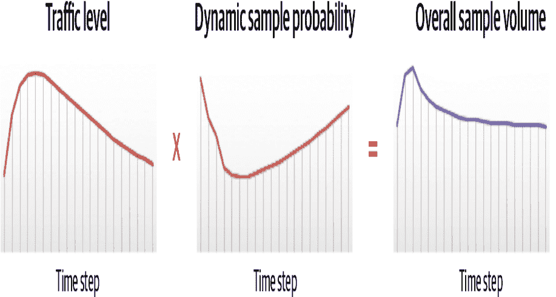

# 第 17 章。便宜且足够准确：采样

### 早期发布读者的说明

使用 Early Release 电子书，你可以在这些技术正式发布之前很久就获得书籍的最早形式——作者在写作时的原始未编辑内容。

这是最终书籍的第 17 章。

如果你对如何改进本书的内容和/或示例有任何评论，或者如果你注意到本章中缺少材料，请联系编辑 vwilson@oreilly.com。

在前一章中，我们介绍了数据存储必须如何配置才能高效存储和检索大量可观测性数据。在本章中，我们将研究减少你可能需要存储的可观测性数据量的技术。在足够大的规模下，保留和处理每一个事件所需的资源可能变得 prohibitive 且不切实际。采样事件可以缓解资源消耗与数据保真度之间的权衡。

本章探讨了采样为何有用（即使在较小规模下），通常用于采样数据的各种策略，以及这些策略之间的权衡。我们使用基于代码的示例来说明这些策略是如何实现的，并逐步引入在前例基础上构建的概念。本章从应用于单个事件的更简单的采样方案开始，作为使用数据统计表示进行采样的概念介绍。然后我们构建更复杂的采样策略，因为它们被应用于一系列相关事件（trace 事件）并传播重建采样后数据的所需信息。

### 采样以优化你的数据收集

超过一定规模后，收集、处理和保存系统生成的所有日志条目、每个事件和每个 trace 的成本远远超过了收益。在足够大的规模下，运行与生产基础设施规模相同的可观测性基础设施是不可行的。当可观测性事件迅速变成数据洪流时，挑战就转向在减少保留的数据量和可能丢失工程团队进行故障排除和理解系统生产行为所需的关键信息之间进行权衡。

大多数应用程序的现实是，它们的许多事件几乎相同且成功。调试的核心功能是搜索新兴模式或在中断期间检查失败事件。从这个角度来看，将 100% 的所有事件传输到你的可观测性数据后端就没那么有用。可以选择某些事件作为发生情况的代表性示例，并将这些采样事件连同可观测性后端重建未采样事件中实际发生情况所需的元数据一起传输。

为了有效调试，需要的是成功或“良好”事件的代表性样本，以便与“不良”事件进行比较。使用代表性事件重建你的可观测性数据使你能够减少传输每个事件的开销，同时忠实地恢复该数据的原始形状。采样事件可以帮助你以一小部分资源成本实现可观测性目标。这是在规模上优化可观测性流程的一种方式。

历史上，在软件行业中，面对报告高容量系统状态时的资源限制，浮现信号的标准方法是通过包含有限数量标签的聚合指标生成的。正如第 2 章所述，数据的聚合视图提供了对系统行为的高层次视角，但它掩盖了深度调试所需的细节。采样是一种替代方法，它在减少数据量的同时保留了更多原始数据的丰富性。


由于其易于理解和实现的方式，*恒定概率采样*是大多数人在想到采样时首先想到的方法：保留固定百分比的数据而不是丢弃（例如，每十个请求保留一个）。

在对采样数据进行分析时，你需要对数据进行变换，以重建原始的请求分布。假设你的服务同时埋点了事件和指标，并接收到 100,000 个请求。如果每个接收到的事件大约代表 1,000 个相似事件，那么你的遥测系统报告只收到 100 个事件就会产生误导。其他遥测系统（如指标）会为你的服务收到的每一个请求记录递增计数器。这些请求中只有一小部分会被采样，因此你的系统需要调整事件的聚合方式，以返回大致正确的数据。对于固定采样率的系统，你可以将每个事件乘以生效的采样率，从而得到总请求数的估计值和延迟总和。对于恒定概率采样，p99 和中位数等标量分布属性无需调整，因为它们不会因采样过程而产生失真。

恒定采样的基本思想是：如果数据量足够大，任何出现的错误都会再次发生。如果该错误发生的频率足够高、足以产生影响，你就会看到它。然而，如果数据量适中，恒定采样无法保证你仍然有足够的统计概率看到你需要看到的内容。恒定采样在以下情况下效果不佳：

-   你非常关心错误情况，而不太关心成功情况。
-   某些客户发送的流量比其他客户高出几个数量级，而你希望所有客户都能获得良好的体验。
-   你希望确保服务器流量的急剧增长不会压垮你的分析后端。

对于可观测系统，更精细的方法可以确保捕获并保留足够的遥测数据，从而使你能够在任何给定时间洞察任何给定服务的真实状态。

## 基于近期流量规模的采样

你可以不采用固定概率，而是动态调整系统对事件进行采样的速率。如果近期收到的总流量较少，可以提高采样概率；如果流量激增可能压垮可观测性工具的后端，则可以降低采样概率。然而，这种方法增加了一层新的复杂性：在没有恒定采样率的情况下，重建数据分布时无法再将每个事件乘以一个常数因子。

相反，你的遥测系统需要使用加权算法，该算法需要考虑事件采集时生效的采样概率。如果一个事件代表 1,000 个相似事件，那么它不应与另一个代表 100 个相似事件的事件直接进行平均。因此，在计算计数时，你的系统必须将*所代表的*事件数量相加，而不仅仅是采集到的事件数量。在聚合分布属性（如中位数或 p99）时，你的系统必须在计算事件总数和百分位值所在位置时将每个事件扩展为多个事件。

例如，假设你有以下值和采样率的配对：[{1,5}, {3, 2}, {7, 9}]。如果忽略采样率直接计算这些值的中位数，你可能会天真地得到结果 3——因为它在 [1,3,7] 的中心。然而，你必须考虑采样率。使用采样率重建完整值集合的过程可以通过将整个值集合展开成完整形式来说明，如下所示：[1,1,1,1,1,3,3,7,7,7,7,7,7,7,7,7]。从这个视角可以清楚地看到，在考虑采样后，值的中位数为 7。

## 基于事件内容（键）的采样

这种动态采样方法涉及根据事件负载来调整采样率。从高层来看，这意味着在事件集合中选择一个或多个字段，并在看到特定值组合时指定采样率。例如，你可以根据 HTTP 响应码对事件进行分区，然后为每个响应码分配采样率。这样做可以让你指定如下采样条件：

-   带有*错误*的事件比*成功*事件更重要。
-   *新下单*事件比查看*订单状态*的事件更重要。
-   影响*付费客户*的事件比*免费层*客户的事件更需要保留。

通过这种方法，你可以根据需要将键设计得尽可能简单（例如，HTTP 方法）或复杂（例如，将 HTTP 方法、请求大小和 user-agent 拼接在一起），以便选择的样本能够尽可能提供最有价值的服务流量视图。

仅基于事件内容以恒定百分比速率进行采样，在键空间较小（例如，HTTP 方法的数量是有限的：GET、POST、HEAD 等）*并且*给定键的相对速率保持一致（例如，当你可以假设错误比成功少见时）的情况下效果良好。值得注意的是，有时这种假设可能是错误的，或者在糟糕的情况下可能完全颠倒。对于这些情况，你应该验证你的假设，并为假设条件反转时的事件流量激增制定应对计划。

## 结合按键采样与历史方法

当流量内容更难预测时，你可以继续为每个传入事件识别一个键（或键的组合），然后*同时*根据该键近期看到的流量规模动态调整每个键的采样率。例如，根据给定的键组合（如 [customer ID, dataset ID, error code]）在过去 30 秒内被看到的次数来确定采样率。如果某个特定组合是

该事件。在*基于头部的采样*（或*前置采样*）中，采样决策在追踪事件发起时做出。该决策随后会向下游传播（例如，通过插入一个“需要采样”的头部位），以确保完成追踪所需的每个跨度都被采样。

有些字段（如返回状态或延迟）只有在事件执行完成后才能回顾得知。如果采样决策依赖于动态字段，那么在这些字段确定之前，每个底层服务已经独立决定是否采样其他跨度事件。充其量，你可能最终只保留了被视为有意义异常值的下游跨度，却丢失了所有其他上下文。要针对仅在请求结束时才知道的值正确做出决策，需要*基于尾部的采样*。

要在基于尾部的方法中收集完整的追踪，必须先将所有跨度收集到缓冲区中，然后回顾性地做出采样决策。这种缓冲采样技术在计算上代价高昂，并且在实践中完全在埋点代码内部实现并不可行。缓冲采样技术通常需要外部的采集器端逻辑。

在确定采样决策的*内容*和*时机*方面还存在更多细微差别。但在这一点上，最好通过基于代码的示例来解释。

## 将采样策略转化为代码

到目前为止，我们已经从概念层面介绍了采样策略。接下来让我们看看这些策略如何在代码中实现。这个教学示例使用 Go 来说明实现细节，但这些示例可以轻松移植到任何支持哈希/字典/映射、伪随机数生成以及并发/定时器的语言中。

## 基础案例

假设你想要为一个高流量的处理器埋点，该处理器会调用下游服务、执行一些内部工作，然后返回一个


结果是无条件地将事件记录到你的仪表化接收端：

```go
func handler(resp http.ResponseWriter, req *http.Request) {
    start := time.Now()
    i, err := callAnotherService()
    resp.Write(i)
    RecordEvent(req, start, err)
}
```

在大规模场景下，这种仪表化方法会产生不必要的噪音，并导致极高的资源消耗。让我们看看对这个处理函数发送的事件进行采样的替代方法。

## 固定速率采样

一种天真的方法可能是使用固定速率进行概率采样，即随机选择发送 1/1000 的事件：

```go
var sampleRate = flag.Int("sampleRate", 1000, "Static sample rate")

func handler(resp http.ResponseWriter, req *http.Request) {
    start := time.Now()
    i, err := callAnotherService()
    resp.Write(i)

    r := rand.Float64()
    if r < 1.0 / *sampleRate {
        RecordEvent(req, start, err)
    }
}
```

每第 1000 个事件都会被保留下来，无论其相关性如何，作为被丢弃的其他 999 个事件的代表。要在后端重构数据，你需要记住每个事件代表 `sampleRate` 个事件，并在仪表化收集器的接收端将所有计数器值相应地相乘。否则，你的工具会错误报告该时间段内实际遇到的事件总数。

## 记录采样率

在前面那个笨拙的例子中，你需要在接收端手动记住并设置采样率。如果你在将来某个时候需要更改采样率值，该怎么办？仪表化收集器不会确切知道值何时发生了变化。更好的做法是，在发送采样事件时显式传递当前的 `sampleRate` —— 表明该事件在统计上代表 `sampleRate` 个相似事件。请注意，采样率不仅可以在服务之间有所不同，也可以在单个服务内部有所不同。

| 状态码 | 时间 | 采样率 |
|---|---|---|
| ok | 1:00 | 100 |
| ok | 1:00 | 100 |
| err | 1:00 | 1 |
| ok | 1:01 | 80 |
| err | 1:01 | 1 |
| ok | 1:01 | 80 |
| ok | 1:01 | 80 |

*图 17-1. 不同事件可能以不同速率进行采样*

在事件中记录采样率的方式可能如下所示：

| 状态码 | 时间 | 计数（加权后） |
|---|---|---|
| ok | 1:00 | 200 |
| err | 1:00 | 1 |
| ok | 1:01 | 240 |
| err | 1:01 | 1 |

*图 17-2. 可以使用加权数量计算事件总数*

这个例子过于简单且有点刻意。你可能已经看到这种方法在处理追踪事件时的缺陷。在下一节中，我们将探讨使动态采样率和追踪良好协作的其他考虑因素。

## 一致性采样

到目前为止，在我们的代码中，我们已经了解了采样决策是如何做出的。但我们还没有考虑在采样追踪事件时，采样决策是在什么时候做出的。在考虑采样与追踪如何交互时，使用基于头部、基于尾部还是缓冲采样的策略很重要。我们将在本章末尾介绍这些决策是如何实现的。现在，让我们研究如何将上下文传播到下游处理器，以便（稍后）做出该决策。

为了正确管理追踪事件，你应该使用一个集中生成的采样/追踪 ID，并将其传播到所有下游处理器，而不是在每个处理器内部独立生成采样决策。这样做可以让你对同一最终用户请求的不同表现形式做出一致的采样决策（见图 17-3）。换句话说，这可以确保你为任何给定的采样请求捕获完整的端到端追踪。如果你发现采样到了很下游的一个错误，而其上游上下文因采样策略的实现方式而被丢弃，那将是很不幸的。

| 哈希（追踪ID） | 已采样？ |
|---|---|
| 8464143 |  |
| 9976727 |  |
| 2046000 | YES |
| 8697994 |  |
| 1983000 | YES |
| 3427217 |  |
| 6152331 |  |
| 4919000 | YES |
| 6122453 |  |

*图 17-3. 包含 TraceId 的采样事件*

一致性采样确保当采样率保持不变时，追踪要么被完整保留，要么被整体采样丢弃。如果子追踪以更高的采样率被采样——例如，嘈杂的 Redis 调用以 1/1000 的比率被采样，而其父追踪以 1/10 的比率被保留——绝不会出现这样的情况：Redis 子追踪被保留而父追踪被丢弃，从而产生不完整的追踪。

让我们修改前面的代码示例，从 TraceID/Sampling-ID 中读取采样概率值，而不是在每一步生成随机值：

```
var sampleRate = flag.Int("sampleRate", 1000, "Service's sample rate")

func handler(resp http.ResponseWriter, req *http.Request) {
    // Use an upstream-generated random sampling ID if it exists.
    // otherwise we're a root span. generate & pass down a random ID.
    var r float64
    if r, err := floatFromHexBytes(req.Header.Get("Sampling-ID")); err != nil {
        r = rand.Float64()
    }

    start := time.Now()
    // Propagate the Sampling-ID when creating a child span
    i, err := callAnotherService(r)
    resp.Write(i)

    if r < 1.0 / *sampleRate {
        RecordEvent(req, *sampleRate, start, err)
    }
}
```

现在，通过更改 `sampleRate` 功能标志来使不同比例的追踪被采样，你就可以在不重新编译的情况下调整采样率，包括在运行时进行调整。然而，如果你采用我们接下来要讨论的技术——目标速率采样，你将无需再手动调整该速率。

## 目标速率采样

随着流量涨落，你无需手动通过标志为每个服务调整采样率。相反，你可以通过跟踪正在接收的传入请求速率来自动化这一过程（见图 17-4）。



*图 17-4. 你可以自动计算整体采样量*

让我们看看在我们的代码示例中是如何实现的：

```go
var targetEventsPerSec = flag.Int("targetEventsPerSec", 5,
	"The target number of requests per second to sample from this
service.")

// Note: sampleRate can be a float! doesn't have to be an
integer.
var sampleRate float64 = 1.0
// Track requests from previous minute to decide sampling rate
for the next minute.
var requestsInPastMinute *int

func main() {
	// Initialize counters.
	rc := 0
	requestsInPastMinute = &rc

	go func() {
		for {
```

百分位离群事件被随机采样选中的可能性很小。同样，你可能希望为每个不同的数据源至少保留一些数据，而不是让高容量的数据源淹没低容量的数据源。

针对这种情况的一种补救措施是设置多个采样率。让我们首先按键值变化采样率。这里，示例代码以 1/1000 的速率对任何基线（非离群）事件进行采样，并分别以 1/1 和 1/5 的速率对任何错误或慢查询进行尾部采样：

```go
var sampleRate = flag.Int("sampleRate", 1000, "Service's sample rate")
var outlierSampleRate = flag.Int("outlierSampleRate", 5, "Outlier sample rate")

func handler(resp http.ResponseWriter, req *http.Request) {
    start := time.Now()
    i, err := callAnotherService(r)
    resp.Write(i)

    r := rand.Float64()
    if err != nil || time.Since(start) > 500*time.Millisecond {
        if r < 1.0 / *outlierSampleRate {
            RecordEvent(req, *outlierSampleRate, start, err)
        }
    } else {
        if r < 1.0 / *sampleRate {
            RecordEvent(req, *sampleRate, start, err)
        }
    }
}
```

尽管这是使用多个静态采样率的一个好例子，但这种方法仍然容易受到仪表化流量峰值的影响。如果应用程序遇到错误率突增，那么每个错误都会被采样。接下来，我们将通过目标速率采样来解决这个缺点。

## 按键和目标速率采样

将前面两种技术结合起来，让我们扩展已有的工作，以针对特定的仪表化速率进行采样。如果请求是异常的


（例如，延迟超过 500 ms 或出错），可以将其指定为以自身保证的速率进行尾部采样，同时对其他请求进行限速，以使其符合每秒采样请求的预算：

```
var targetEventsPerSec = flag.Int("targetEventsPerSec", 4,
    "The target number of ordinary requests per second to sample
from this service.")
var outlierEventsPerSec = flag.Int("outlierEventsPerSec", 1,
    "The target number of outlier requests per second to sample
from this service.")

var sampleRate float64 = 1.0
var requestsInPastMinute *int

var outlierSampleRate float64 = 1.0
var outliersInPastMinute *int

func main() {
    // Initialize counters.
    rc := 0
    requestsInPastMinute = &rc
    oc := 0
    outliersInPastMinute = &oc

    go func() {
        for {
            time.Sleep(time.Minute)
            newSampleRate = *requestsInPastMinute / (60 * *targetEventsPerSec)
            if newSampleRate < 1 {
                sampleRate = 1.0
            } else {
                sampleRate = newSampleRate
            }
            newRequestCounter := 0
            requestsInPastMinute = &newRequestCounter

            newOutlierRate = outliersInPastMinute / (60 * *outlierEventsPerSec)
            if newOutlierRate < 1 {
                outlierSampleRate = 1.0
            } else {
                outlierSampleRate = newOutlierRate
            }
            newOutlierCounter := 0
            outliersInPastMinute = &newOutlierCounter
```

根据每个键做出采样决策。这样做会将我们的示例代码修改如下：

```
var counts map[SampleKey]int
var sampleRates map[SampleKey]float64
var targetRates map[SampleKey]int

func neverSample(k SampleKey) bool {
    // Left to your imagination. Could be a situation where we
know request is a keepalive we never want to record, etc.
    return false
}

// Boilerplate main() and goroutine init to overwrite maps and
roll them over every interval goes here.

type SampleKey struct {
    ErrMsg        string
    BackendShard  int
    LatencyBucket int
}

// This might compute for each k: newRate[k] = counts[k] /
(interval * targetRates[k]), for instance.

func checkSampleRate(resp http.ResponseWriter, start time.Time, err error,
    sampleRates map[interface{}]float64, counts map[interface{}]int) float64 {
    msg := ""
    if err != nil {
        msg = err.Error()
    }
    roundedLatency := 100 * (time.Since(start) / (100*time.Millisecond))
    k := SampleKey {
        ErrMsg:        msg,
        BackendShard:  resp.Header().Get("Backend-Shard"),
        LatencyBucket: roundedLatency,
    }
    if neverSample(k) {
        return -1.0
    }

    counts[k]++
    if r, ok := sampleRates[k]; ok {
        return r
    } else {
        return 1.0
    }
}

func handler(resp http.ResponseWriter, req *http.Request) {
    var r float64
    if r, err := FloatFromHexBytes(req.Header.Get("Sampling-ID")); err != nil {
        r = rand.Float64()
    }

    start := time.Now()
    i, err := callAnotherService(r)
    resp.Write(i)

    sampleRate := checkSampleRate(resp, start, err, sampleRates, counts)
    if sampleRate > 0 && r < 1.0 / sampleRate {
        RecordEvent(req, sampleRate, start, err)
    }
}
```

到目前为止，我们的代码示例已经变得相当庞大，但仍然缺少更复杂的技术。我们的示例用于说明采样概念是如何实现的。

幸运的是，现有的代码库可以处理这类复杂的采样逻辑。对于 Go，*dynsample-go* 库维护了任意数量采样键的映射，只要键是新的，就为其分配公平的采样份额。该库还包含更高级的计算采样率的技术，可以基于目标速率，也可以完全没有明确的目标速率。

在本章中，我们已经基本完成了对应用采样概念的完整入门介绍。在结束之前，让我们做最后一个改进：将你目前所做的尾部采样与头部采样相结合，头部采样可以请求所有下游服务对追踪进行采样。

### 整合：按键目标速率进行头部和尾部采样

在本章前面，我们指出头部采样需要设置一个头部（header）来向下游传播采样决策。对于我们一直在迭代的代码示例，这意味着父 span 必须将头部采样决策及其对应的速率传递给所有子 span。这样做会强制对所有子 span 进行采样，即使该层的动态采样率本来不会选择对该请求进行采样：

```
var headCounts, tailCounts map[interface{}]int
var headSampleRates, tailSampleRates map[interface{}]float64

// Boilerplate main() and goroutine init to overwrite maps and
roll them over every interval goes here. checkSampleRate() etc.
from above as well

func handler(resp http.ResponseWriter, req *http.Request) {
    var r, upstreamSampleRate, headSampleRate float64
    if r, err := floatFromHexBytes(req.Header.Get("Sampling-ID")); err != nil {
        r = rand.Float64()
    }

    // Check if we have a non-negative upstream sample rate; if so, use it.
    if upstreamSampleRate, err := floatFromHexBytes(
        req.Header.Get("Upstream-Sample-Rate")); err == nil && upstreamSampleRate > 1.0 {
        headSampleRate = upstreamSampleRate
    } else {
        headSampleRate := checkHeadSampleRate(req, headSampleRates, headCounts)
        if headSampleRate > 0 && r < 1.0 / headSampleRate {
            // We'll sample this when recording event below; propagate the decision downstream though.
        } else {
            // Clear out headSampleRate as this event didn't qualify for sampling. This is a sentinel value.
            headSampleRate = -1.0
        }
    }

    start := time.Now()
```

你就不太可能需要在代码中重新实现这些采样策略。

然而，即使你依赖第三方库来为你管理该策略，理解采样实现的机制仍然至关重要，这样才能明白哪种方法适合你的具体场景。理解这些策略（静态与动态、头部与尾部，或两者的组合）在实践中如何运作，能让你明智地运用它们，在实现数据保真度的同时优化资源约束。

与决定对代码进行什么检测以及如何检测类似，决定采样*什么*、*何时*以及*如何*，最好由你所在组织的独特需求来定义。事件中影响其采样价值的字段，在很大程度上取决于它们对理解环境状态的有用程度，以及它们对实现业务目标的影响。

在下一章，我们将探讨一种路由大量遥测数据的方法：使用管道进行遥测管理。
