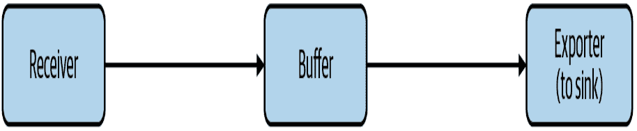
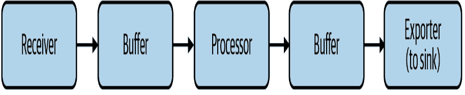
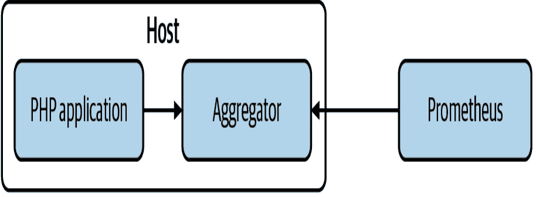
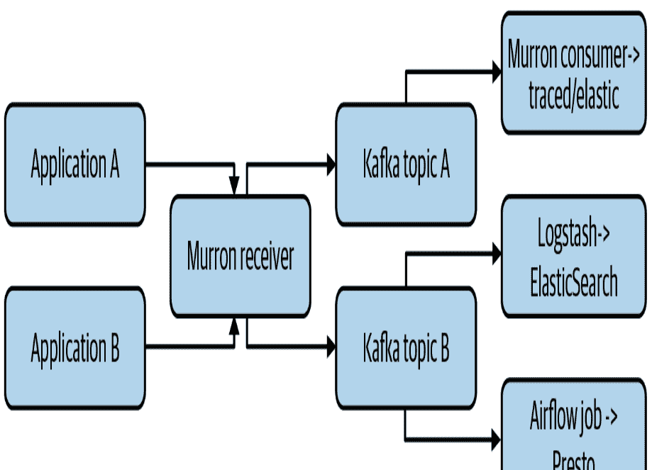
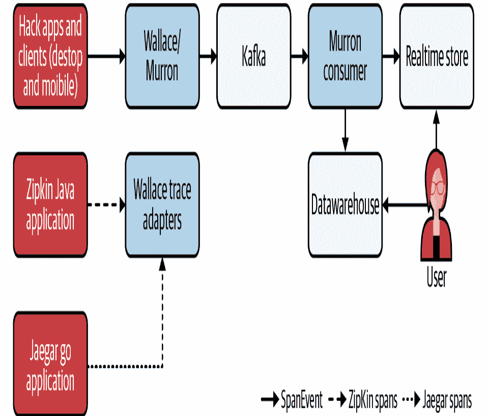

# 第 18 章 使用管道进行遥测管理

> **面向早期版本读者的说明**
> 
> 通过早期版本电子书，你可以获得书籍最早期的形式——作者写作时的原始未编辑内容——因此你可以在这些技术正式发布之前就加以利用。
> 
> 这将是最终图书的第 18 章。
> 
> 如果你对如何改进本书内容和/或示例有任何评论，或者你发现本章缺少内容，请联系编辑 [vwillson@oreilly.com](mailto:vwillson@oreilly.com)。

*本章由 Slack 资深软件工程师 Suman Karumuri 和 Slack 工程总监 Ryan Katkov 撰写。*

### 来自 Charity、Liz 和 George 的说明

在本书的这一部分，我们深入探讨了可观测性概念，这些概念在大规模场景下感受最为强烈，但出于各种原因，在任何规模下都会有所帮助。在上一章中，我们讨论了当典型的可观测性数据涓流变成洪流时会发生什么，以及如何通过采样来减少数据量。在本章中，我们将了解管理大量遥测数据的另一种方法：使用管道。

除了数据量之外，*遥测管道*还可以帮助管理应用程序的复杂性。在较简单的系统中，应用程序的遥测数据可以直接发送到相应的数据后端。在更复杂的系统中，你可能需要将遥测数据路由到许多后端系统，以便隔离工作负载、满足安全和合规性需求、满足不同的保留要求，或者出于各种其他原因。当你在数据量之上再加上这些需求时，管理遥测生产者与该数据消费者之间的多对多关系就会变得异常复杂。遥测管道可以帮助你抽象掉这种复杂性。

本章由 Suman Karumuri 和 Ryan Katkov 撰写，详细介绍了 Slack 使用遥测管道来管理其可观测性数据的情况。与本书中另一章特邀撰稿章节（第 14 章）类似，Slack 的应用程序基础设施是一个很好的例子，它优雅地解决了复杂性和规模问题，并以某种方式向使用可观测性的工程师（无论规模大小）呈现了有用的概念。我们很高兴能在本书中与您分享这些经验。

本章其余部分从 Suman 和 Ryan 的视角讲述。

我们很高兴分享本章，内容涉及使用管道设置和管理你的遥测流。在本章中，我们将介绍遥测管道如何改善组织的可观测性能力，描述遥测管道的基本结构和组件，并展示 Slack 如何使用遥测管道的具体示例。

该管道主要使用开源软件组件构建。Slack 在过去三年中一直在生产环境中使用这种模式，规模已扩展到每秒数百万个事件。

对于希望专注于可观测性采纳并减少开发者使其服务具备足够可观测性所需工作量的组织而言，建立遥测管理实践是关键。强大的遥测管理实践为统一的 instrumentation（插桩）框架奠定基础，并创造一致的开发者体验，从而减少复杂性和频繁变更，尤其是在需要从新软件引入新遥测数据时。

在 Slack，当设想理想的遥测系统时，我们通常会寻找以下特征：我们希望管道能够收集、路由和丰富来自应用程序和服务的数据流。同时，我们对作为数据流一部分运行的组件有明确的偏好，并提供一组一致的端点或库。最后，我们使用一种规定的通用事件格式，应用程序可以快速利用该格式来实现价值。

随着组织的发展，可观测性系统往往会从一种简单系统（应用程序和服务直接将事件生成到相应后端）演变为更复杂的用例。如果您发现自己需要更强的安全性、工作负载隔离、保留期限强制或对数据质量有更高程度的控制，那么通过管道进行遥测管理可以帮助您满足这些需求。从高层次来看，管道由应用程序和后端之间的组件组成，用于处理和路由您的可观测性数据。

读完本章后，您将了解如何以及何时设计遥测管道，以及管理不断增长的可观测性数据需求所需的基本构建模块。

## 遥测管道的属性

构建遥测管道可以在多个方面为您提供帮助。在本节中，您将了解遥测管道中常见的属性以及它们如何为您提供帮助。

### 路由

从最简单的层面来看，遥测管道的主要用途是*路由*数据，将其从生成位置发送到不同的后端，同时集中控制哪些遥测数据流向何处的配置。在源头静态配置这些路由以直接将数据发送到数据存储通常并不可取，因为您通常希望将数据路由到不同的后端而无需更改应用程序，而在较大规模的系统中，此类更改往往非常繁琐。

例如，在遥测管道中，您可能希望将跟踪数据流路由到跟踪后端，将日志数据流路由到日志后端。此外，您可能还希望将同一跟踪数据流的一部分分叉（tee）到 Elasticsearch 集群，以便对其进行实时分析。通过路由和转换获得的灵活性有助于提高数据流的价值，因为不同的工具可能对同一数据集提供不同的洞察。

### 安全性与合规性

您可能还希望出于*安全*原因将遥测数据路由到不同的后端。您可能只希望特定团队访问遥测数据。某些应用程序可能会记录包含敏感个人身份信息（PII）的数据，允许广泛访问这些数据可能导致合规性违规。

您的遥测管道可能需要具备一些功能，以帮助强制执行针对《通用数据保护条例》（GDPR）和《联邦风险和授权管理计划》（FedRAMP）等法规的法律合规性。此类功能可能会限制遥测数据的存储位置和访问权限，并强制执行保留或删除生命周期。

Slack 对合规性要求并不陌生，我们通过模式匹配和脱敏，以及一项检测敏感信息或 PII 并发出警报的服务来强制实施这些要求。除了这些组件之外，我们还提供相关工具，允许用户自助删除不合规的数据。

### 工作负载隔离

*工作负载隔离*允许您在关键场景中保护数据集的安全性和可用性。将您的遥测数据分区到多个集群中，可以将工作负载彼此隔离。例如，您可能希望将产生大量日志的应用程序与产生极少量日志数据的应用程序分开。如果将这些应用程序的日志放入同一集群，针对高容量日志的昂贵查询可能会频繁降低集群性能，从而对同一集群上其他用户的体验产生负面影响。对于主机日志等低容量日志，可能希望对这些数据采用较长的保留期，因为它可以提供历史背景。通过隔离工作负载，您可以获得灵活性和可靠性。

### 数据缓冲

可观测性后端并非完全可靠，可能会发生中断。这种中断通常不会计入依赖该可观测性后端的服务的 SLO（服务级别目标）中。完全有可能出现服务可用但您的可观测性后端因无关原因不可用的情况，从而影响对该服务本身的可见性。在这些情况下，为了防止遥测数据出现缺口，您可能希望将数据暂时*缓冲*到节点上的本地磁盘，或者利用 Kafka 或 RabbitMQ 等消息队列系统，以便消息得到缓冲和重放。

遥测数据的量可能会出现大幅峰值。自然模式（例如用户更多地使用服务，或关键数据库组件故障导致的中断）通常会导致所有基础设施组件出错，从而产生更高数量的事件并引发级联故障。添加缓冲区可以平滑后端的数据摄取。这还提高了数据摄取到后端的可靠性，因为后端不会被这些流量峰值所饱和。

缓冲区还充当一个临时的数据保存步骤，尤其是在将数据发送到后端之前需要进一步处理时。可以使用多个缓冲区——例如，将应用程序上的本地磁盘缓冲区与死信队列结合使用，以在流量峰值期间保护数据的及时性。

我们在 Slack 广泛使用 Kafka 来实现这一数据缓冲目标，我们的集群会保留长达三天的数据事件，以确保在后端从中断中恢复后数据的一致性。除了 Kafka 之外，我们还在生产者组件中使用了有限的磁盘上缓冲区，以便在 Kafka 集群不可用或饱和时，我们的摄取代理能够缓冲事件。端到端来看，该管道旨在服务中断期间保持弹性，从而最大限度地减少数据丢失。

### 容量管理

出于容量规划或成本控制的原因，您可能希望为各类遥测数据分配配额，并通过速率限制、采样或排队来强制执行。

#### 速率限制

由于遥测数据通常与自然用户请求相关地产生，来自应用程序的遥测数据往往遵循不可预测的模式。遥测管道可以通过仅以恒定速率将遥测数据发送到后端来平滑这些数据峰值。如果数据量超过此速率，管道通常可以将数据保存在内存中，直到后端可以消费它。

如果您的系统持续以高于后端可消费的速率产生数据，您的遥测管道可以使用*速率限制*来减轻影响。例如，您可以采用硬速率限制并丢弃超出速率限制的数据，或者采用软速率限制摄取数据，但积极对数据进行采样，直到达到硬速率限制，从而保护可用性。在事件数据是冗余的情况下，这种权衡被认为是可以接受的，因此虽然您丢弃了一些事件，但不会丢失信号。

#### 采样

如第 17 章所述，您的摄取组件可以利用移动平均*采样*，随着数据量增加逐步提高采样率，以保留信号并避免使管道下游的后端饱和。

#### 排队

您可以优先摄取较新的数据而不是较旧的数据，从而最大限度地提高对开发者的效用。此功能在日志系统的日志风暴期间尤其有用。*日志风暴*是指系统收到的日志量超过其设计容量的情况。

例如，大规模事件（如关键服务宕机）会导致客户端报告更大量的错误，并使后端不堪重负。在这种情况下，优先处理新日志比追赶旧日志更为重要，因为新日志反映了系统的当前状态，而旧日志告诉您的是系统过去某时的状态，距离事件发生越远，这些信息的关联性就越低。当系统有空闲容量时，可以随后进行回填操作来整理历史数据。

### 数据过滤与增强

对于指标（例如 Prometheus），工程师可能会意外添加高基数（high-cardinality）字段，例如用户 ID 或 IP 地址，从而导致*基数爆炸*。通常，指标系统并非为处理高基数字段而设计，管道可以提供一种机制来处理它们。这可能简单到丢弃包含高基数字段的时间序列。为了减少基数爆炸的影响，

高级方法包括对高基数（high-cardinality）字段中的数据进行预聚合，或者丢弃带有无效数据（如不正确或格式错误的时间戳）的数据。

对于日志，你可能希望过滤 PII 数据、过滤安全令牌等安全数据，或对 URL 进行清理，因为日志系统通常不用于存储敏感数据。对于追踪数据，你可能还想对高价值追踪进行采样，或丢弃低价值跨度，使其不进入后端系统。

除了过滤数据之外，遥测管道还可用于丰富遥测数据，以提高其可用性。这通常包括添加进程外部可用的附加元数据，如区域信息或 Kubernetes 容器信息；将 IP 解析为主机名以增强可用性；或利用公开可用的 MaxMind 地理位置数据库中的 GeoIP 信息来扩充日志和追踪数据。

## 数据转换

一个健壮的遥测管道可能需要接收多种多样的数据类型，例如非结构化日志、各种格式的结构化日志、指标时间序列点，或以追踪跨度形式存在的事件。除了能识别类型之外，管道还可以以多种线路格式（wire format）对外或对内提供 API。转换这些数据类型的功能成为管道的关键组成部分。

虽然将每个数据点转换为统一事件格式的计算成本可能很高，但其带来的好处超过了处理数据所需计算的相关成本。这些好处包括在技术选型上拥有最大的灵活性，最大限度地减少同一事件以不同格式重复存储，以及能够进一步丰富数据。

遥测后端通常具有独立且唯一的 API，不存在标准模式。能够支持外部团队对特定后端的需求可能非常有价值，而且实现起来也很简单，只需在预处理组件中编写一个插件，将统一格式转换为后端可接收的格式。

Slack 有几个这种转换的实际案例。我们将各种追踪格式（如 Zipkin 和 Jaeger）转换为我们的统一 SpanEvent 格式。这种统一格式还有一个好处：可以直接写入数据仓库，并且可以被 Presto 等常见大数据工具轻松查询，还支持连接（join）或聚合操作。我们数据仓库中的这些追踪数据集支持长尾分析，并能产生强大的洞察。

## 确保数据质量和一致性

从应用程序收集的遥测数据可能存在数据质量问题。确保数据质量的一种常见方法是丢弃时间戳字段过于久远或过于超前的数据。

例如，配置错误的设备以错误的时间戳报告数据，会污染系统的整体数据质量。此类数据应通过将畸形时间戳替换为摄取（ingestion）时的时间戳来纠正，或者直接丢弃。在一个实际案例中，安装了 Candy Crush 的移动设备经常会报告远期未来的时间戳，因为用户为了获得游戏内奖励而手动篡改了设备的系统时间。如果无法丢弃数据，管道应提供另一个位置来存储这些数据，以便日后处理。

以日志为例，管道可以执行以下有用操作：

- 通过提取特定字段，将非结构化日志转换为结构化数据
- 检测并脱敏或过滤日志数据中的任何 PII 或敏感数据
- 通过使用 MaxMind 等地理位置数据库，将 IP 地址转换为地理纬度/经度字段
- 确保日志数据的 schema，确保存在预期数据且特定字段属于特定类型
- 过滤低价值日志，防止其发送到后端

特别是在 Slack 的追踪数据方面，我们确保数据一致性的一种方式是使用简单的数据过滤操作，例如过滤低价值跨度，使其不进入后端，从而提高数据集的整体价值。其他确保质量的示例包括尾采样（tail sampling）等技术，即仅根据所需属性（如较高的报告延迟）选择一小部分上报的追踪存入后端系统。

## 管理遥测管道：剖析

在本节中，我们将介绍一个功能完备的遥测管道的基本组件和架构。简单来说，*遥测管道* 是接收器（receiver）、缓冲区（buffer）、处理器（processor）和导出器（exporter）组件的链式结构，所有组件串联在一起。

以下是遥测管道关键组件的详细信息：

- *接收器（receiver）* 从数据源收集数据。接收器可以直接从应用程序（如 Prometheus 抓取器）收集数据。或者，接收器也可以从缓冲区接收数据。接收器可以暴露 HTTP API，应用程序可以将数据推送到该 API。接收器也可以将数据写入缓冲区，以确保中断期间的数据完整性。
- *缓冲区（buffer）* 是数据的存储，通常是短期存储。缓冲区临时保存数据，直到后端或下游应用程序消费它。缓冲区通常是一个发布-订阅（pub-sub）系统，如 Kafka 或 Amazon Kinesis。应用程序也可以直接将数据推送到缓冲区。在这种情况下，缓冲区也充当接收器的数据源。
- *处理器（processor）* 通常从缓冲区获取数据，对其应用转换，然后将数据持久化回缓冲区。
- *导出器（exporter）* 是充当遥测数据接收端（sink）的组件。导出器通常从缓冲区获取数据，并将数据写入遥测后端。

在简单设置中，遥测管道由接收器 → 缓冲区 → 导出器的模式组成，通常针对每种类型的遥测后端，如 [图18-1](#) 所示。

*图18-1. 简单遥测管道中常用的接收器、缓冲区和导出器*

然而，复杂设置可能具有接收器 → 缓冲区 → 接收器 → 缓冲区 → 导出器的链式结构，如 [图18-2](#) 所示。

*图18-2. 带处理器的遥测管道高级示例*

管道中的接收器或导出器通常只负责可能的操作之一，例如容量规划、路由或数据转换。[表18-1](#) 展示了可对各种类型遥测数据执行的操作示例。

**表18-1. 接收器、处理器和导出器在管道中的角色**

| 遥测数据类型 | 接收器 | 导出器或处理器 |
|---|---|---|
| 追踪数据 | - 以不同格式收集追踪数据（例如 Zipkin/Jaeger/AWS X-Ray、OTEL） - 从不同服务收集数据（例如来自所有 Slack 移动客户端） | - 将数据摄取到各种追踪后端 - 对数据执行尾采样 - 丢弃低价值追踪 - 从追踪中提取日志 - 根据合规需求将追踪数据路由到各种后端 - 过滤数据 |
| 指标数据 | 识别并抓取目标 | - 重新标记指标 - 降采样指标 - 聚合指标 - 将数据推送到多个后端 - 检测高基数标签或时间序列 - 过滤高基数标签或指标 |
| 日志数据 | - 从不同服务收集数据 - 作为收集不同服务推送日志的端点 | - 将日志数据解析为半结构化或结构化日志 - 从日志中过滤 PII 和敏感数据 - 出于 GDPR 原因将数据推送到多个后端 - 将不常查询的日志或审计日志路由到平面文件，将高价值日志或频繁查询路由到索引系统 |

在开源系统中，接收器也可以称为 *源（source）*，导出器通常称为 *接收端（sink）*。然而，这种命名约定掩盖了这些组件可以串联在一起的事实。

数据转换和过滤规则通常因遥测数据类型而异，因此需要隔离的管道。

## 管理遥测管道时的挑战

大规模运行管道会带来一系列挑战，这些挑战在 Slack 是众所周知的，我们在本节中对其进行了概述。在较小规模下，遥测管道的设置和运行相当简单。它们通常涉及将 OpenTelemetry Collector 等进程配置为接收器和导出器。

在更大规模下，这些管道将处理数百个数据流。保持它们持续运行可能是一项运维挑战，因为这需要确保管道的性能、正确性、可靠性和可用性。虽然涉及少量的软件工程工作，但可靠运行管道的大部分工作涉及控制理论。

### 性能

由于应用程序可以生成任何格式的数据，并且它们生成的数据的性质可能会发生变化，因此保持管道高性能可能是一项挑战。例如，如果应用程序生成大量日志，这些日志是

良好的监控，用于识别管道中各组件之间流量速率的变化程度。

重新处理数据和回填通常是管理数据管道中最复杂、最耗时的部分之一。例如，如果你未能过滤掉管道日志中的某些 PII 数据，则需要从日志搜索系统中删除这些数据并回填。虽然大多数解决方案在正常情况下表现良好，但它们并不太擅长处理大量历史数据的回填。在这种情况下，你需要确保缓冲区中有足够的历史数据来重新处理这些数据。

## 隔离

如果你将高流量系统客户和低流量客户的日志或指标放在同一个集群中，那么高流量日志可能会导致集群饱和，从而引发可用性问题。因此，遥测管道的设置应使这些数据流能够相互隔离，并可能写入不同的后端。

## 数据新鲜度

除了高性能、正确性和可靠性之外，遥测管道还应该以接近实时的方式运行。通常，从数据产生到可供消费的端到端延迟在秒级，最坏情况下为几十秒。然而，监控管道的数据新鲜度可能是一个挑战，因为你需要有一个已知的数据源，以一致的节奏产生数据。

主机指标（如 Prometheus）可以使用，因为它们通常以一致的间隔被抓取。你可以利用这些间隔来衡量日志的数据新鲜度。对于日志或追踪，通常没有良好且一致的数据源。在这种情况下，添加一个合成数据源可能很有价值。

在 Slack，我们以每分钟 N 条消息的固定速率向日志流中添加合成日志。这些数据被摄入到我们的 sink（接收端）中，我们会定期查询这些已知日志，以了解管道的健康状况和数据新鲜度。例如，我们从一个数据源以每分钟 100 条合成日志消息的速度向最大的日志集群（每小时 100 GB 日志数据）发送消息。一旦这些数据被摄入，我们每 10 秒监控和查询一次这些日志，以检查我们的管道是否在实时摄入数据。我们将新鲜度 SLO 设定为在过去五分钟内，某一分钟内收到全部消息的次数。

需要注意确保合成数据具有唯一值或被过滤掉，以免干扰用户查询正常日志。我们还确保合成日志从基础设施的多个区域发出，以保证整个遥测管道的监控覆盖。

## 使用案例：Slack 的遥测管理

Slack 的遥测管理项目是随着 Slack 内部各种可观测性使用案例的出现而有机发展起来的。为了处理这些使用案例，该系统由开源组件和 Murron（Slack 内部使用 Go 编写的软件）组成。在本节中，我们将描述管道的各个独立组件，以及它们如何服务于 Slack 内的不同部门。

### 指标聚合

Prometheus 是 Slack 的主要指标系统。我们的后端最初用 PHP 编写，后来改用 Hack。由于 PHP/Hack 采用每个请求一个进程（process per request）的模型，Prometheus 的拉取（pull）模型无法工作，因为它没有进程上下文，只有主机上下文。因此，Slack 使用自定义的 Prometheus 库，将每个请求的指标发送到用 Go 编写的本地守护进程。

这些每请求指标由该守护进程收集，并在一个时间窗口内进行本地聚合。该守护进程还暴露一个指标端点，由我们的 Prometheus 服务器抓取，如图 [图 18-3](#figure-18-3) 所示。这样我们就能从 PHP/Hack 应用服务器收集指标。

在 PHP/Hack 之外，Slack 还运行用 Go 或 Java 编写的应用程序，这些程序暴露指标端点，其指标可以直接被 Prometheus 抓取。

### 日志与追踪事件

Murron 是 Slack 内部用 Go 编写的应用程序，是 Slack 日志和追踪事件管道的中坚力量。Murron 由三种类型的组件组成：接收器（receiver）、处理器（processor）和导出器（exporter）。*接收器*从数据源接收数据（通过 HTTP、gRPC API，并支持 JSON、Protobuf 或自定义二进制格式等多种格式），并将其发送到缓冲区（如 Kafka）或其他摄取器。处理器将包含日志或追踪数据的消息从一种格式转换为另一种格式。消费者从 Kafka 消费消息，并将其发送到各种 sink（接收端），如 Prometheus、Elasticsearch 或外部供应商（见图 [图 18-5](#)）。

Murron 的核心原语是*流（stream）*，用于定义遥测管道。一个流由以下部分组成：一个*接收器*，用于接收来自应用程序的包含日志或追踪数据的消息；一个*处理器*，用于处理这些消息；以及一个*缓冲区*（如 Kafka 主题），用于存放这些消息。此外，对于每个流，我们还可以定义*导出器*，它从缓冲区中消费消息，并在处理后路由到适当的后端（如果需要的话）（见图 [图 18-4](#)）。

为了便于路由和自定义处理，Murron 将所有接收到的消息包装在一个自定义的信封消息（envelope message）中。该信封消息包含诸如该消息所属流的名称等信息，用于在多个 Murron 组件之间路由消息。此外，信封消息还包含有关消息的额外元数据，如主机名、Kubernetes 容器信息和进程名称。这些元数据稍后会在管道中用于增强消息数据。

*图 18-4. Slack 的遥测管道，包含用于追踪数据的接收器、缓冲区和导出器*

在 OpenTelemetry 规范中，追踪数据结构是一个由相互关联的事件（称为*跨度（span）*）组成的有向无环图。这些数据结构通常被包装在更高级别的追踪 API 中以生成追踪，数据通过消费端的 Trace UI 进行访问。这种隐藏的结构使我们无法以适合各种使用案例的方式查询原始追踪数据。

为了通过易用性实现自然采用，我们实现了一种新的简化跨度格式，称为*SpanEvent*，它更容易生产和消费。典型的 SpanEvent 包含以下字段：ID、时间戳、持续时间、父 ID、追踪 ID、名称、类型、标签以及一个特殊的跨度类型字段。与追踪类似，因果图（causal graph）是 SpanEvent 的有向无环图。让工程师能够在传统插桩之外轻松生成和分析追踪，开辟了许多新的途径，例如对 CI/CD 系统进行插桩，如第 11 章所述。

为了支持因果图模型，我们为 PHP/Hack、JavaScript、Swift 和 Kotlin 等语言构建了自定义追踪库。除了这些库之外，我们还利用 Java 和 Go 的开源追踪库。

图 18-5. Slack 的追踪基础设施，其中应用程序为粉色，接收器和导出器为蓝色

我们的 Hack 应用程序使用与 OpenTracing 兼容的追踪器进行插桩。我们的移动端和桌面端客户端对其代码进行追踪，并使用高级追踪器或低层跨度创建 API 发出 SpanEvent。这些生成的 SpanEvent 以 JSON 或 Protobuf 编码的事件形式通过 HTTP 发送到 Wallace。

Wallace 基于 Murron，是一个独立于我们核心云基础设施运行的接收器和处理器，因此即使在 Slack 核心基础设施遭遇全面站点故障时，我们也能捕获客户端和服务错误。Wallace 会验证其接收到的跨度数据，并将这些事件转发给另一个 Murron 接收器，后者将数据写入我们的缓冲区 Kafka。

我们内部的 Java 和 Go 应用程序分别使用 Zipkin 和 Jaeger 的开源插桩库。为了捕获这些应用程序的跨度，Wallace 为这两种跨度数据都暴露了接收器。这些接收器被称为*追踪适配器（trace adapter）*，它们将上报的跨度转换为我们的 SpanEvent 格式并写入 Wallace，Wallace 再将它们转发给一个 Murron 接收器，由后者将数据写入 Kafka。

写入 Kafka 的追踪数据主要由三个导出器消费，它们基于 Murron 和 Secor（Pinterest 维护的一个开源项目）：

-   *Elasticsearch 导出器*：一个 Murron 导出器从 Kafka 读取我们的 SpanEvent，并将其发送到 Elasticsearch。Elasticsearch 是一个事件存储，使我们能够在仪表盘上显示事件（在我们的场景中，主要使用 Grafana）并为这些事件设置自定义告警。
-   *数据仓库导出器*：我们使用 Pinterest 的开源项目 Secor，将 Kafka 中的数据转换并上传到 Amazon S3，以便将其摄入到我们的 Presto 数据仓库中。
-   *Honeycomb 导出器*

最后，一个 Murron 导出器消费 Kafka 中的事件，过滤掉低价值跨度（span），将数据转换为 Honeycomb 特有的自定义事件格式，并将其路由到不同的数据集，以便在 Honeycomb 中进行查询。

通过使用这些导出器，我们几乎可以即时访问追踪数据，端到端延迟在秒级。我们使用 Honeycomb 和 Grafana（通过 Elasticsearch）来可视化这些数据并进行简单分析，这在让我们的追踪数据可用于故障分类方面发挥了重要作用。

相比之下，我们的数据仓库通常需要两小时的落地时间。我们使用 Presto，它支持通过 SQL 对更长时间范围进行复杂的分析查询。我们通常在 Elasticsearch 中存储 7 天的事件，Honeycomb 最多支持 60 天的事件，但我们的 Presto 后端 Hive 可以将数据存储长达两年。这使我们的工程师能够可视化长期趋势，超越了 Honeycomb 和 Elasticsearch 的能力。

Murron 管理着超过 120 个数据流，每秒处理数百万条消息。所有这些数据都通过分布在 20 个集群中的 200 多个 Kafka 主题进行缓冲。

## 管理遥测管道的开源替代方案

我们的遥测管道在几年间有机地演进，由开源组件和内部软件混合组成。从前面的章节中，敏锐的读者会注意到我们的一些软件功能重叠，我们可以从整合系统中受益。可观测性遥测管道领域已经相当成熟，与三年前相比，现在有多个更新的可行选择。在本节中，我们将介绍其他开源替代方案。

在可观测性的早期，还没有专门用于设置遥测管道的工具。大多数工程师使用 rsyslog 等工具，并编写自定义工具或使用第三方供应商工具将数据发送到后端。随着时间的推移，团队认识到这一差距，开发了 Facebook 的 Scribe 等工具，它引入了通过流将日志路由到各种后端的基本理念。为了在下游系统宕机时可靠地交付日志，Scribe 引入了本地磁盘持久化等理念，当下游系统无法跟上日志量或没有响应时，将日志持久化到本地磁盘。Facebook 的 Scribe 还确立了将多个实例链接在一起并形成大规模遥测管理管道的理念。

在后来的几年里，遥测管道演变为更成熟的系统，支持高级日志解析和字段操作，以及高级速率限制或动态采样功能。随着 Kinesis/Kafka 等现代发布/订阅系统的兴起，大多数遥测管道都支持将它们作为数据源，并在管道中缓冲中间数据。在日志领域，timber、Logstash/Filebeat、Fluentd 和 rsyslog 等流行服务可用于将日志传输到接收器。对于指标用例，Prometheus Pushgateway 和 M3 Aggregator 等项目被构建用于聚合指标。对于追踪数据，Refinery 等工具被构建用于进一步过滤、采样和处理追踪数据。这些工具被设计为模块化，允许开发插件，以增加对接收器和导出器的支持，从而在众多系统之间发送和接收数据。

随着越来越多的数据通过这些遥测管道传输，其效率和可靠性变得越来越重要。因此，现代系统正在用更高效的语言编写，如 C（Fluent Bit）、Go（Cribl）和 Rust（Vector）。如果我们要每秒处理数 TB 的数据，遥测管道的基础设施效率就变得非常重要。

## 管理遥测管道：自主构建与购买之争

出于历史原因，Slack 在其遥测管道管理中混合使用开源和内部软件。如今，这些原因已不那么重要，因为存在大量开源替代方案，可以轻松地构成遥测管道的基础。这些开源工具本质上是模块化的，可以轻松扩展以添加针对自定义用例的额外功能。鉴于工具的广泛可用性，花费工程资源开发内部软件来构成遥测管理管道的基础在经济上并不划算。

开源软件自然是免费的，但维护和运营遥测管道的成本也应考虑在内。在构建与购买的天平另一端，供应商承诺简化运营负担并提供出色的用户体验。简化和易用性是一个有吸引力的提议，可能在经济上合理，具体取决于您组织的成熟度。随着组织的发展，这种平衡会随着时间的推移而变化，因此在选择方案时请牢记这一点。有关决定构建还是购买的更多考虑因素，请参见第 15 章。

## 结论

您可以立即开始使用多个现成服务相互配合。您可能会想从头编写一个新系统，但我们建议改造开源服务。较小的管道可以自动驾驶，但随着组织的发展，管理遥测管道变得复杂，并带来若干挑战。

在构建遥测管理系统时，请为当前业务需求而构建，并预见——但不要实现——新需求。例如，您可能希望在将来某个时候添加合规功能，或者引入高级富化或过滤功能。保持管道模块化并遵循生产者、缓冲器、处理器和导出器模型，将使您的可观测性功能顺畅运行，同时为您的业务提供价值。
