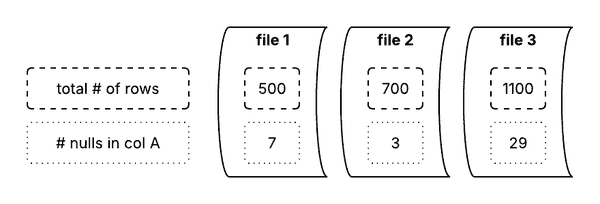
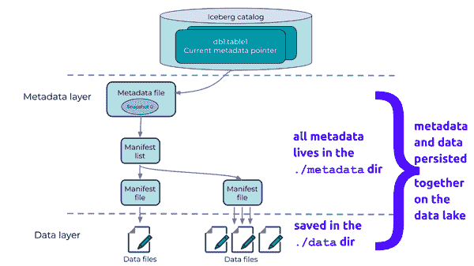
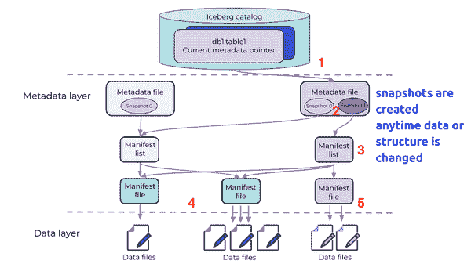
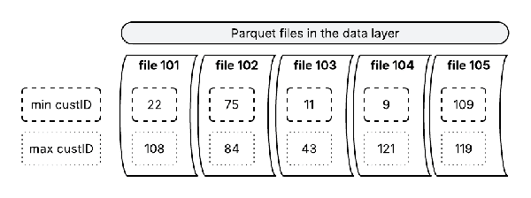
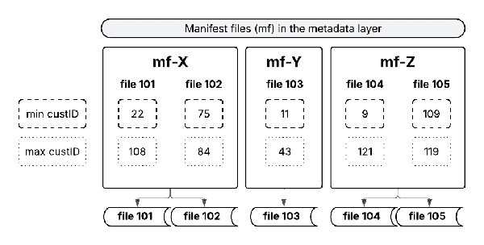
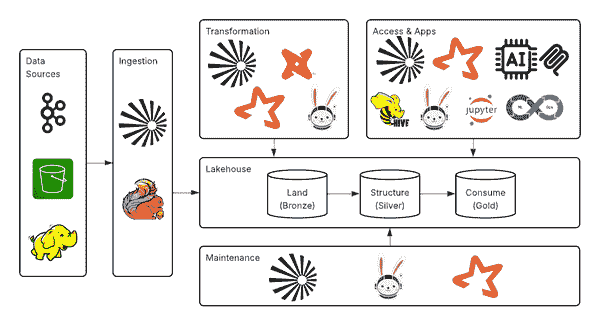

## Chapter 1. Exploring the Apache Iceberg Architecture

是时候深入挖掘 Apache Iceberg 背后的架构了。与所有数据湖仓表格式一样，Iceberg 建立在将许多大型文件以相同的文件格式和逻辑结构协同放置在存储库中，并像传统 RDBMS 表一样访问的模型上。与 RDBMS 技术不同，数据湖仓明确将存储与计算分离。仅有一个装满数据文件和可扩展处理能力的存储库不足以满足湖仓需求；我们需要元数据来完善全貌。

该元数据作为文件持久化在数据湖存储库中，与数据文件并列，在查询 Iceberg 表时使用。本章将探讨该元数据如何表示、为何有价值、为何需要定期维护，以及它如何实现多个计算引擎之间的互操作性。

### Metadata and Iceberg

丰富的元数据是 Iceberg 高效使用对象存储、实现可提交事务以及利用数据修改所采用的版本控制方法带来的时间旅行和回滚等优势的关键。这种元数据与数据文件本身一起存储；在 Iceberg 表的根位置下，如 Example 1-1 所概念化。

#### Example 1-1. Data and metadata directory locations.

```
///my_schema/my_table   
                    /metadata  
                             /md_file_A
                             /md_file_B
                    /data  
                             /file_1
                             /file_2
                             /file_3
```


: 

数据湖存储库上 Iceberg 表的基础位置。


: 

存储元数据层文件的文件夹。


: 

包含构成表内容的数据文件的文件夹。

本节将详细介绍 Iceberg 使用的各种类型元数据文件，介绍目录，并展示通过在检索任何数据文件之前利用元数据来提升性能的能力。

### Why Metadata is Key

像 `Trino` 这样的计算引擎必须收集一定量的元数据才能开始理解表的设计和内容。其中一些元数据信息只是构成表的数据文件的位置以及使用何种文件格式。这回答了“在哪里”和“是什么”问题，是所称 *结构化元数据* 的一部分。额外的结构化元数据包括表本身的模式、列名及其数据类型。这提供了“它是什么样子”的信息。掌握了这三个重要问题的答案后，计算引擎就可以开始对 Iceberg 表执行 SQL 操作。

结构化元数据对核心功能至关重要，但还有超出此范围的额外元数据信息。*统计* *元数据* 提供了改进性能和可扩展性的机会。在最低层级，大部分这种统计或汇总信息作为元数据存储在数据文件本身中。当使用 Apache Parquet 等面向分析的列式文件格式时尤其如此。

例如，Figure 1-1 简化了一个由三个 Parquet 数据文件组成的表。Parquet 文件包含元数据，其中包括特定文件中行数以及每个列的空值数量等信息。



此文件级元数据作为数据文件中的页脚信息存储，在查询时可用于了解整个表中存在多少行。

```
SELECT COUNT(*) FROM my_table
-- returns 2300
```

确定有多少行对特定列具有空值时也是如此。

```
SELECT COUNT(*) FROM my_table WHERE my_col IS null;
-- returns 39
```

计算引擎可以快速访问每个文件中的此元数据，内部计算最终答案，然后将结果提供给查询提交者。这些是简单的示例，并非所有查询结果都可以通过仅查看元数据来确定，但此信息是：

* 对简单查询至关重要（结构化元数据）
* 对性能有影响（统计元数据）

#### Note

Reference [Apache Parquet Metadata](https://parquet.apache.org/docs/file-format/metadata/) for more information on the metadata stored in this file type.


The metadata stored in the data files is useful to compute engines once they have determined they need to actually read records from a particular file. The Iceberg metadata files themselves are leveraged to help compute engines decide which files should be read at all. We will revisit the importance of this and functionally how it occurs once we understand the various types of metadata files.

### The Relationship Between Catalogs and Metadata

The top of Figure 1-2 introduces an additional component within the architecture called a *catalog*. The catalog is a process that executes outside of the data lake. Its primary function is to link a logical table name to the metadata information existing on the data lake. With awareness of the metadata layer’s files, compute engines can then determine which data files need to be retrieved and which to ignore. The metadata layer’s files are stored in the `./metadata` folder as also explained in Example 1-1. The various types of files that exist in the metadata layer are detailed in this section.



In addition to the specific location of metadata files, Iceberg catalogs maintain the organizational details of how tables are logically grouped together. This includes maintaining a list of schemas, or databases, each of which have their own list of tables. Operations such as creating & dropping schemas and tables are persisted in the catalog.

In comparison, classical RDBMSs also have their own catalogs. For example, an Oracle server maintains a list of schemas, which then have tables. PostgreSQL does the same thing, but calls that collection of tables a schema. The catalogs in these systems can only list the schemas physically present in each instance of the RDBMS services. Oracle instance A might show 10 schemas, while Oracle instance B could show 20. Schemas in instance A are unique from instance B; even if they share the same name.

Conversely, an Iceberg catalog could support many more schemas as it is not tied to a specific type, or physical instance, of a compute engine. As mentioned before, each table within a unique schema could be physically stored in a completely different data lake location, too. This allows the catalog to be more universal across the tables being represented and the compute engines needing access to the tables.

There are multiple implementations of Iceberg catalogs, including open-source and proprietary options. Some well-known and widely-used catalogs include [Apache Hive Metastore](https://hive.apache.org/development/desingdocs/design/#metastore) (HMS), [AWS Glue](https://aws.amazon.com/glue/), and implementations of the Iceberg [REST Catalog API Specification](https://iceberg.apache.org/rest-catalog-spec/), such as [Apache Polaris](https://polaris.apache.org/).

#### Warning

An Iceberg table should never be registered to more than one catalog. The smallest problem will be that compute engines will not always be getting hold of the most current metadata references. The worst problem is a condition where multiple, independent, versions of metadata are created and maintained.

The compute engine you use to access Iceberg tables will support a list of integrated catalogs that you can leverage. For example, Starburst Galaxy supports HMS, AWS Glue, Iceberg REST, Apache Polaris, a proprietary catalog, and several others. In fact, the Trino engine that Starburst Galaxy is built upon allows multiple catalog types to be selected and multiple instances of each type.

### Snapshots & Manifests

Figure 1-2 reminds us that for each table, metadata exists as physical files collocated on the data lake alongside the actual data files that contain the contents of the table. This metadata layer allows tables to be versioned whenever content or structure is changed. A version is referred to as a *snapshot* which itself has a *snapshot identifier* that is unique to the table it is aligned to. Figure 1-2 also shows there are multiple types of files in the metadata layer.

#### Metadata file

An Iceberg catalog maintains the file name of the top-level table *metadata file* stored on the data lake. Table metadata files are stored in JSON format and the one referenced in the catalog is for the current version of the table. This is visualized by the arrow leaving the catalog in Figure 1-2. Example 1-2 shows one key bit of information stored in this table metadata file; a list of all known schema definitions that exist across all the snapshots.

#### Example 1-2. List of schemas.

```
 "schemas": [  
   {
     "type": "struct", "schema-id": 0,  
     "fields": [
       { "id": 1, "name": "cust_id", "type": "int" },
       { "id": 2, "name": "last_name", "type": "string" } ] },
   {
     "type": "struct", "schema-id": 1,
     "fields": [
       { "id": 1, "name": "cust_id", "type": "int" },
       { "id": 2, "name": "last_name", "type": "string" },
       { "id": 3, "name": "first_name", "type": "string" } ] }  
 ]
```


: 

The collection of schema definitions.


: 

The first schema definition consists of two fields; `cust_id` and `last_name`.


: 

The second schema definition includes a third field; `first_name`.

Example 1-3 shows another key element in the table metadata file; the list of existing snapshots. Each snapshot indicates the schema it is aligned with.

#### Example 1-3. List of snapshots.

```
   "snapshots": [ {  
       "sequence-number": 1,
       "snapshot-id": 7579480327941283080,
       ... additional details removed ...
       },
       "manifest-list": "s3://b/s/t/metadata/snap-123.avro",
       "schema-id": 0
   }, {
       "sequence-number": 2,
       "snapshot-id": 1959040240880497390,  
       "parent-snapshot-id": 7579480327941283080,  
       ... additional details removed ...
       },
       "manifest-list": "s3://b/s/t/metadata/snap-456.avro",
       "schema-id": 1  
   }, {
       "sequence-number": 3,
       "snapshot-id": 894657535204501593,
       "parent-snapshot-id": 1959040240880497390,
       ... additional details removed ...
       },
       "manifest-list": "s3://b/s/t/metadata/snap-789.avro",  
       "schema-id": 1
   } ]
```


: 

The collection of snapshots.


: 

The unique snapshot identifier.


: 

The parent snapshot identifier; if exists.


: 

The schema identifier for each snapshot.


: 

The file name of the *manifest list* associated with the snapshot. This file type is explained in the next subsection.

The table metadata file is stored in JSON format. It uses the naming convention of `*.metadata.json` (often referred to as simply `metadata.json`) and is stored in the `/metadata` folder shown in Example 1-1. As detailed in Example 1-4, it indicates the current snapshot identifier as well as any references to it across all of the table’s metadata. These references are aligned with the *branching* and *tagging* features that are explained in Chapter 3.

#### Example 1-4. Identification of current snapshot.

```
   "current-snapshot-id": 894657535204501593,  
   "refs": {  
       "main": {
           "snapshot-id": 894657535204501593,
           "type": "branch"  
       }
   }
```


当前快照的标识符。更多细节可参见 示例 1-3 中展示的快照信息。


分支和/或标签引用的列表。


此单一引用表示快照存在于名为 `branch` 的 `main` 上。

#### Note

存在额外的元数据；请参考 [Table Metadata and Snapshots](https://iceberg.apache.org/spec/#table-metadata-and-snapshots) 以获取此 JSON 文件完整模式定义。

#### Manifest list

如 示例 1-3 所示，表元数据文件还标识了每个列出快照的 *manifest list* 文件名。每个快照指向单个 manifest list。此文件有时被称为 *snapshot manifest*，以 [Apache Avro](https://avro.apache.org/) 格式存储。它存储在 `/metadata` 文件夹中，命名约定为 `snap-*.avro`。manifest list 包含的就是——构成当前快照内容的 *manifest files* 列表。manifest list 还跟踪哪些 manifest files 属于每个 *partition*。

#### Note

数据湖表 *partitioning* 是根据特定列值（如日期、区域或类别）将大型数据集物理组织成更小、更易管理的目录。分区表的优点在第 3 章中介绍，第 4 章确定了旨在优化性能的最佳实践。

manifest 文件的列表不仅仅是简单的文件指针列表。每个条目都显示摘要信息，例如引用的实际数据文件数量、数据大小、关键字段的上下界，以及其他可以帮助计算引擎尽可能高效地处理查询的元数据。

#### Manifest file

*manifest file* 指向一个或多个数据文件以及每个文件的汇总统计信息。就像 manifest list 为其相关的 manifest files 维护摘要信息一样，manifest file 为其相关的数据文件维护摘要信息。这些 AVRO 文件可通过其 `*-m<N>.avro` 命名约定识别。遍历 图 1-2 中快照 0 的树结构，你可以看到此 Iceberg 表当前版本的 content 由四个数据文件组成。

元数据层和数据层中的所有文件都是不可变的，一旦创建就无法修改。图 1-3 显示了在创建新快照时创建了额外的元数据层内容。请注意以下几点：

1. 目录指针已更改为新的表元数据文件。
2. 新的表元数据文件包含快照列表并将当前标识为快照 1。
3. 快照 1 指向新的 manifest list。
4. 新的 manifest list 包含之前的 2 个 manifest files 及其代表的 4 个数据文件。
5. 新的 manifest list 还包含一个新的 manifest file，该文件指向 2 个新的数据文件。



### Metadata Pruning

数据湖表最终由许多数据文件组成。无论使用的是 Apache Hive 还是 Apache Iceberg 等哪种表格式，最坏的情况是计算引擎需要读取所有底层数据文件。一般策略是寻找跳过或 *prune* 要访问文件的机会。

如 图 1-4 所示，Parquet 等文件格式包含元数据，其中包括所包含记录的摘要信息。它可视化了 5 个数据文件，并显示了每个文件中所有客户标识符列值的上下界。



由于此信息存储在数据文件的页脚中，计算引擎可以快速检查每个数据文件，以确定查询条件是否值得进行更彻底的检查。表 1-1 标识了查询谓词以及从 图 1-4 中需要更详尽读取以尝试为查询找到相关信息的数据文件。

表 1-1. 基于谓词的相关数据文件

| Query predicate || Relevant data files |
| --- | --- |
| `WHERE custID = 22` || Files 101, 103, 104 |
| --- | --- |
| `WHERE custID BETWEEN 82 AND 84` || Files 101, 102, 104, 105 |
| `WHERE custID = 12` || Files 103, 104 |
| `WHERE custID IN (2, 122, 132)` || No files |

如 表 1-1 中的第三个条目所示，如果查询搜索客户 ID 12，则只有五个数据文件中的两个值得比仅读取文件页脚中的摘要信息进行更详尽的查看。仅有五个数据文件时，在任何集群计算引擎上都不会看到太多好处，但如果这五个条目中的每一个代表 10,000 个文件，则在这种情况下，必须详尽读取 20,000 个文件而不是 50,000 个文件将带来显著的性能提升。

表 1-1 中的最后一个条目显示，对于此查询谓词，不需要考虑任何文件来获得其所属的总体查询的结果。这比其他 3 个示例提供的性能提升更显著。对于原始表格式 Apache Hive，计算引擎必须为每个查询访问全部 5 个文件。必须读取页脚信息以确定是否需要更详尽的读取。如前所述，对于只有 5 个数据文件来说不是问题，但在有 50,000 个数据文件时就是大量工作。

Apache Iceberg 通过改进这一点，因为数据文件的汇总统计元数据存储在引用数据文件的 manifest file 中，如 图 1-5 所示。这允许计算引擎完全剔除与查询无关的任何数据文件。



通过基于元数据的 *pruning*，表 1-1 中确定的相同数据文件在范围内。好处是消除了访问所有数据文件的页脚信息的初始传递。在每个数据文件代表 10,000 个文件的夸张示例中，这将消除访问 50,000 个数据文件以读取其页脚以确定哪些文件可以 *pruned* 的需求。

#### Note

文件修剪是一种 *predicate pushdown*，定义为一种查询优化技术，将过滤条件下推到数据存储层，从而减少 I/O 并提高性能。它消除了 *table scan* 的需求——读取表中所有记录的需求。

### Inspecting Metadata

如 示例 1-1 所可视化，如果你有权访问 Iceberg 表存储的存储库位置，你可以在 `./metadata` 子目录中找到这些文件。检索和读取这些 JSON 和 Avro 文件可能会令人困惑，因为为表创建了新的快照。幸运的是，大多数与 Iceberg 集成的计算引擎都提供了更简单的方式来查看表的元数据。

官方 Iceberg 文档详细介绍了如何使用 Apache Spark 在 [Inspecting tables](https://iceberg.apache.org/docs/nightly/spark-queries/#inspecting-tables) 部分执行此操作。对于本节提供的动手示例，你将利用 Trino Iceberg 连接器文档中关于 [Metadata tables](https://trino.io/docs/current/connector/iceberg.html#metadata-tables) 的部分中介绍的功能，该功能提供对表元数据的 SQL 接口。

#### Tip


本节中使用的 SQL 可在第 1 章中标识的 GitHub 仓库的 [`./Chapter2`](https://github.com/starburstdata/optimizing-iceberg-book/blob/main/Chapter2/README.md) 文件夹中找到。本章中呈现的所有输出都已讨论，因此即使您不执行动手练习，也能获得相同的学习成果。

在第 1 章中描述的探索环境中，创建一个模式和一个空的 Iceberg 表。

```
CREATE SCHEMA optimize_ice.ch2;
USE optimize_ice.ch2;

CREATE TABLE my_iceberg_tbl (
  id integer,
  name varchar(55),
  description varchar(255)
) WITH (type='iceberg', format='parquet');
```

使用 示例 1-5 中的查询来查看与新创建的 `my_iceberg_tbl` 表对应的 [`$snapshots`](https://trino.io/docs/current/connector/iceberg.html#snapshots-table) 元数据表的内容。

#### 示例 1-5. 查询 `$snapshots` 元数据表。

```
SELECT
 snapshot_id, parent_id,
 substring(manifest_list,
           position('/metadata/' IN manifest_list) + 10)
  AS manifest_list
FROM
 "my_iceberg_tbl$snapshots";
```

示例 1-5 查询的结果显示在 表 1-2 中，并确定存在一个快照，与表创建操作一致。

表 1-2. 第一个快照。

| `snapshot_id` || `parent_id` || `mainifest_list` |

| --- | --- | --- |

| `9195...4485` || `NULL` || `snap-9195...4485-1...bc1b.avro` |

| --- | --- | --- |

#### 注意

您在探索环境中看到的快照标识符以及数据和元数据层文件的名称与本节中显示的不同。它们在不同环境中以及在同一环境中这些步骤的每次迭代中都是独立的。

向表中插入几条记录。

```
INSERT INTO my_iceberg_tbl (id, name, description)
VALUES
  (101, 'Leto', 'Ruler of House Atreides'),
  (102, 'Jessica', 'Consort of the Duke'),
  (103, 'Paul', 'Son of Leto (aka Dale Cooper)');
```

验证执行以下查询后存在 3 行，如 表 1-3 所示。

```
SELECT * FROM my_iceberg_tbl;
```

表 1-3. 最初的 3 条记录。

| `id` || `name` || `descriptions` |

| --- | --- | --- |

| `101` || `Leto` || `Ruler of House Atreides` |

| --- | --- | --- |

| `102` || `Jessica` || `Consort of the Duke` |

| `103` || `Paul` || `Son of Leto (aka Dale Cooper)` |

再次运行 示例 1-5 中的查询，查看现在存在两个快照，如 表 1-4 所见。

表 1-4. 第二个快照。

| `snapshot_id` || `parent_id` || `mainifest_list` |

| --- | --- | --- |

| `9195...4485` || `NULL` || `snap-9195...4485-1...bc1b.avro` |

| --- | --- | --- |

| `1621...6722` || `9195...4485` || `snap-1621...6722-1...5e27.avro` |

表 1-4 中的第二行显示，为最初添加的三行创建了一个新的 `snapshot_id`。该行的 `parent_id` 值表明其父级是原始快照。`manifest_list` 列标识每个快照的清单列表文件名。

[`$manifests`](https://trino.io/docs/current/connector/iceberg.html#manifests-and-all-manifests-tables) 元数据表提供了当前快照中使用的清单的详细概述。此元数据表有多个列，但让我们关注有助于我们了解每个清单引用的数据文件的特征的列。

运行 示例 1-6 中的查询，查看链接到最新清单列表的清单文件详情。结果显示在 表 1-5 中。

#### 示例 1-6. 查询 `$manifests` 元数据表。

```
SELECT
 substring(path,
           position('/metadata/' IN path) + 10)
  AS path,
 added_snapshot_id AS add_snap,
 added_data_files_count AS add_file_cnt,
 added_rows_count AS add_row_cnt
FROM
 "my_iceberg_tbl$manifests";
```

表 1-5. 初始清单文件列表。

| `path` || `add_snap` || `add_file_cnt` || `add_row_cnt` |

| --- | --- | --- | --- |

| `76849afc...5e27-m0.avro` || `1621...6722` || `1` || `3` |

| --- | --- | --- | --- |

表 1-5 按列表示的以下详细信息。

*   `path` - 创建的清单文件的名称。
*   `add_snap` - 创建此特定清单文件时创建的快照标识符。请注意，它与 表 1-4 中的第二行中的标识符相同。
*   `add_file_cnt` - 此清单文件仅与一个数据文件相关联。
*   `add_row_cnt` - 与为给定快照插入到此表中的 3 行一致。

运行 示例 1-7 中的查询，查看当前快照的所有引用文件的详情。结果显示在 表 1-6 中。

#### 示例 1-7. 查询 [`$files`](https://trino.io/docs/current/connector/iceberg.html#files-table) 元数据表。

```
SELECT
  substring(file_path,
            position('/data/' IN file_path) + 6)
    AS file_path,
  record_count as recs, 
  value_counts AS value_cnts, 
  null_value_cnts AS null_value_cnts, 
  lower_bounds, upper_bounds
FROM
  "my_iceberg_tbl$files";
```

表 1-6. 初始数据文件列表。

| `file_path` || `recs` || `value_cnts` || `null...cnts` || `lower_bounds` || `upper_bounds` |

| --- | --- | --- | --- | --- | --- |

| `20...aa.parquet` || `3` || `{ `  

` 1 = 3, `  

` 2 = 3, `  

` 3 = 3 `  

`}` || `{ `  

` 1 = 0, `  

` 2 = 0, `  

` 3 = 0 `  

`}` || `{ `  

` 1 = 101, `  

` 2 = Jessica, `  

` 3 = Consor... `  

`}` || `{ `  

` 1 = 103, `  

` 2 = Paul, `  

` 3 = Son of... `  

`}` |

| --- | --- | --- | --- | --- | --- |

表 1-6 按列表示的以下详细信息。

*   `file_path` - 与 表 1-5 中的清单文件链接的单个数据文件的名称。其余列与此特定文件相关。
*   `recs` - 标识此数据文件有三条记录，这也显示为 表 1-5 中的 `add_row_cnt`。
*   `value_cnts` - 每列中的值数量。每列都有三个值。
*   `null_value_cnts` - 每列中 `null` 值的数量。每列的计数均为零。
*   `lower_bounds` - 每列中的最低值。例如，第一列 `id` 的下界为 `101`。
*   `upper_bounds` - 每列中的最高值。仍以同一示例为例，`id` 列的上界为 `103`。

向表中添加更多记录。

```
INSERT INTO my_iceberg_tbl (id, name, description)
VALUES
  (104, 'Thufir', 'Mentat'),
  (201, 'Vladimir', 'Ruler of House Harkonnen'),
  (202, 'Rabban', 'Ruthless nephew of Vladimir'),
  (203, 'Feyd-Rautha', 'Savvy nephew of Vladimir'),
  (301, 'Reverend Mother Gaius Helen Mohiam', null);
```

在验证表中存在另外 5 行，总共 8 行后，运行 示例 1-5 中的查询，查看第三个快照列为 表 1-7 中的最后一行。

表 1-7. 第三个快照。

| `snapshot_id` || `parent_id` || `mainifest_list` |

| --- | --- | --- |

| `9195...4485` || `NULL` || `snap-9195...4485-1...bc1b.avro` |

| --- | --- | --- |

| `1621...6722` || `9195...4485` || `snap-1621...6722-1...5e27.avro` |


| `4498...8325` || `1621...6722` || `snap-4498...8325-1...bbe8.avro` |

再次运行 Example 1-6 的查询，其结果列出了 2 个清单，如 Table 1-8 所示。

#### Table 1-8. Second manifest file listing.

| `path` || `add_snap` || `add_file_cnt` || `add_row_cnt` |

| --- | --- | --- | --- |

| `7887ee42...bbe8-m0.avro` || `4498...8325` || `1` || `5` |

| --- | --- | --- | --- |

| `76849afc...5e27-m0.avro` || `1621...6722` || `1` || `3` |

列出 `add_snap` 值为 `4498...8325` 的行显示了与 Table 1-7 中的第三个快照的关联。将 `add_file_cnt` 和 `add_row_cnt` 列的值相加可知，现在存在两个数据文件，共计八行。

再次执行 Example 1-7 中的查询，以查看这 2 个文件的统计详情，如 Table 1-9 所示。

#### Table 1-9. Second data files listing.

| `file_path` || `recs` || `value_cnts` || `null...cnts` || `lower_bounds` || `upper_bounds` |

| --- | --- | --- | --- | --- | --- |

| `20...aa.parquet` || `3` || `{ `  
` 1 = 3, `  
` 2 = 3, `  
` 3 = 3 `  
`}` || `{ `  
` 1 = 0, `  
` 2 = 0, `  
` 3 = 0 `  
`}` || `{ `  
` 1 = 101, `  
` 2 = Jessica, `  
` 3 = Consor... `  
`}` || `{ `  
` 1 = 103, `  
` 2 = Paul, `  
` 3 = Son of... `  
`}` |

| --- | --- | --- | --- | --- | --- |

| `20...1e.parquet` || `5` || `{ `  
` 1 = 5, `  
` 2 = 5, `  
` 3 = 5 `  
`}` || `{ `  
` 1 = 0, `  
` 2 = 0, `  
` 3 = 1 `  
`}` || `{ `  
` 1 = 104, `  
` 2 = Feyd-..., `  
` 3 = Mentat `  
`}` || `{ `  
` 1 = 301, `  
` 2 = Vladimir,`  
` 3 = Savvy…`  
`}` |

以下按列表示的详情对应于 Table 1-9 中的最后一行。

* `recs` - 新数据文件有 5 条记录，这一点也在 Table 1-8 中显示。
* `null_value_cnts` - 其中一列具有 `null` 值。
* `lower_bounds` - id 列显示 `104` 为该新文件的下界。
* `upper_bounds` - id 列显示 `301` 为该新文件的上界。

正如本小节开头所述，逻辑元数据表为物理元数据层的内容提供了一个 SQL 接口。来自 Table 1-9 的上/下界详情代表了 Figure 1-5 中可视化的元数据类型。正如前面所述，此类值使计算引擎能够在不读取数据文件实际页脚的开销下执行基于元数据的剪枝。

## Key Strengths and Weaknesses

没有架构是完美无缺的。这一丰富的元数据驱动架构允许多个计算引擎在同一张表上协同工作。同样，这些元数据在创建大量快照后也可能成为后果。

### Table Maintenance

Apache Iceberg 中增强的元数据层带来的好处，加上数据湖上表的数据层和元数据层的不可变性，随着时间的推移会产生次优情况。元数据层文件需要定期进行合并和重建。

数据摄取和内容修改的速度与数据量差异往往导致包含行数差异很大的数据文件。第 4 章描述了经常困扰性能的“小文件问题”。从概念上讲，合并和重写可以解决这些问题。通过适当的 `table maintenance` 可以很好地控制这些问题。

表维护是多个以优化为导向的操作的统称，可以手动触发或安排定期执行。与 Iceberg 集成的每个计算引擎可能都有不同的机制或语法来启动表维护活动，但更新后的结果可供其他计算引擎使用。

大多数表维护活动，或 `jobs`，会创建一个新的快照。这意味着维护作业可能与插入、删除和/或更新记录等其他活动并发运行。

Iceberg 支持并发，但在此方面并不具备传统 RDBMS 如 Oracle 和 PostgreSQL 那样的功能丰富性。它依赖乐观锁定策略，并在发生竞争时要求计算引擎实现重试模型。更多详情请参阅 [concurrent write operations](https://iceberg.apache.org/docs/1.6.0/reliability/#concurrent-write-operations) Iceberg 文档。

为表定义的分区策略也可能使表维护变得困难。第 4 章将确定可以减轻或消除此问题的分区准则。虽然并非总是可行，但分区定义的其中一个目标是使给定分区内的数据最终不再需要维护。

最后，数据维护并不总是省钱。你会因这些作业而产生计算和存储成本。使表维护的成本和收益达到最佳的情况往往高度依赖于多个因素，并且可能对每个最大的表都是独一无二的。

幸运的是，如第 7 章所述，大多数数据平台提供商都提供自动化的表维护功能，以减轻定义、调优和安排这些作业的责任。大多数数据湖仓包含大量跨越大小、修改和访问范围的表。我建议对大多数表使用自动化的表维护服务。

对于非常大的表以及任何大小但查询和修改并发活动最高的表，建议将自动化解决方案与您自己的特定场景配置和调度进行比较。幸运的是，这些自动化服务将继续成熟。它们记录的细节将成为上下文，很可能使它们更好地理解模式，并最终为所有表提供最佳的表维护。

第 6 章将更详尽地介绍表维护的解释和建议。作为介绍，Table 1-10 列出了最广为人知和最常用的表维护活动。

#### Table 1-10. Table maintenance types.

| Operation || Description || Trino function || Spark function |

| --- | --- | --- | --- |

| Compaction || 读取许多小文件并将内容重写为更少、更大的文件，以便计算引擎更高效地读取表。 || `optimize` || `rewriteDataFiles` |

| --- | --- | --- | --- |

| Snapshot expiration || 删除旧的表快照及其关联的数据和元数据层文件以释放存储空间。 || `expire_snapshots` || `expireSnapshots` |

| Orphan file deletion || 删除不再被任何快照引用的任何数据文件。 || `remove_orphan_files` || `deleteOrphanFiles` |

| Rewriting manifests || 优化清单文件以加快表规划和查询性能。 || `optimize_manifests` || `rewriteManifests` |

这些基本问题在 Iceberg 和其他现代表格式出现之前就已以某种形式存在。Iceberg 幸运地为我们提供了结构化的方法来解决这些问题。以标准方式解决它们导致了 Iceberg 最重要的好处之一——允许多个计算引擎与其他引擎一起在同一张表上工作。

### Compute Engine Interoperability


Apache Iceberg 网站的首页，[*https://iceberg.apache.org/*](https://iceberg.apache.org/)，将该技术标识为“面向数据分析的开放表格式”。它进一步声明其主要目标之一是“使 Spark、Trino、Flink、Presto、Hive 和 Impala 等引擎能够安全地同时使用相同的表”。这些是 Iceberg 架构的核心原则，也是其在数据湖技术领域被广泛采用的关键原因。

项目网站上列出了不少于 30 个 Iceberg 引擎集成。其中最受欢迎的集成包括以下内容。

#### 基于编程的解决方案

* [Apache Spark](https://iceberg.apache.org/docs/latest/spark-getting-started/)
* [Apache Flink](https://iceberg.apache.org/docs/latest/flink/)
* [PyIceberg](https://py.iceberg.apache.org/)
* [Iceberg Java API](https://iceberg.apache.org/docs/latest/api/)
* [Iceberg Rust](https://rust.iceberg.apache.org/)

#### 以 SQL 为中心的引擎

* [Trino](https://trino.io/docs/current/connector/iceberg.html)
* [Starburst](https://docs.starburst.io/latest/connector/iceberg.html)
* [Snowflake](https://docs.snowflake.com/en/user-guide/tables-iceberg)
* [Dremio](https://docs.dremio.com/current/developer/data-formats/apache-iceberg/)
* [Hive](https://iceberg.apache.org/docs/latest/hive/)

互操作性目标考虑了完整集成。理想情况下，所有支持 Iceberg 的计算引擎都应能够根据适用访问策略允许的操作，完成以下所有功能。

* 创建和删除表
* 查询现有表
* 修改内容
* 执行维护活动
* 修改现有表的结构

不幸的是，有多个挑战可能阻碍完全互操作性。目录和策略管理服务可能会带来阻力。此外，不同功能和/或 Iceberg 规范的不同版本也可能带来额外问题。

如本章前面所述，所有目录都力求允许多个计算引擎查询 Iceberg 表，但某些目录可能会阻止对表的修改或创建。这些限制可能在特定目录的开发路线图中得到解决。相反，一些目录设计为限制除读取能力之外的数据平台之外的引擎的任何操作。

核心 Iceberg 规范本身并不固有地包含访问策略管理或安全治理。某些目录实现，例如 Apache Polaris，添加了策略管理功能。或者，如 Trino 为基础的解决方案如 Starburst 经常所做的那样，安全性可以在引擎级别实现。这一障碍通常可以通过集成配置或复制访问控制策略来解决。

某些高级功能，例如所有可能的数据文件重写选项，可能并非所有计算引擎都支持。第 5 章将详细说明 Trino 和 Spark 之间文件排序选项的示例。幸运的是，这不会影响维护任务完成后读/写兼容性。然而，这可能意味着你可能被迫使用多个计算引擎来实现所需的结果。一个例子是使用 Spark 进行数据维护作业，同时通过 Trino 运行查询。

最后，Iceberg 规范仍在不断增强。在任何给定表上使用规范的新版本时需要特别注意。为防止出现问题，你应仅在所有将访问该表的计算引擎都支持该版本时才使用特定版本。例如，你可以将版本 2 表升级到版本 3，但一旦这样做，不支持版本 3 的引擎将完全无法访问该表。

许多大型企业已在其环境中部署了多个计算引擎。他们还拥有各种数据源和摄取框架。Figure 1-6 是现代企业中可能部署的各种技术的示例。这包括转换处理工具、数据访问框架和数据应用程序。



这种技术选择性可以支持多种用例。一个示例，即互联汽车场景，可以使用这些系统规范中定义的这些技术来实现。

* 汽车传感器信息由第三方服务提供商发布到 Apache Kafka 主题。
* Apache Flink 消费传感器数据用于两个目的。
  * 执行流数据分析以检测碰撞和盗窃。
  * 将传感器信息写入 Land 区域的 Iceberg 表中。
* 使用 Trino 执行转换处理以创建 Structure 区域中的额外表，表示经过验证和标准化的信息。
* Trino 还用于在 Consume 区域创建多个聚合表以帮助数据访问客户端。
* 分析师使用 Jupyter notebook 中的 Trino Python 客户端进行分析。
* 使用 Spark 作业执行数据维护活动。

第二个以航空飞行数据的数据科学分析为中心的示例场景所需的环境，其规范如下，也可以用 Figure 1-6 中显示的技术子集实现。

* 航空公司将每日飞行信息发布到公共 AWS S3 存储桶中。
* Starburst 的 [文件摄取服务](https://docs.starburst.io/starburst-galaxy/working-with-data/data-ingest/file-ingestion.html) 读取文件并将原始数据存储在 Land 区域表中，并执行填充 Structure 区域表所需的转换。该摄取服务在第 7 章中介绍，还会自动执行表维护。
* [Spark MLlib](https://spark.apache.org/mllib/) 作业针对 Structure 区域表运行各种机器学习操作。
* 在 Starburst 中创建数据产品并存储在 Consume 区域中，以提高数据访问用户的性能。捕获丰富的元数据，从而确保数据产品的数据集为 AI 就绪。
* 数据产品的元数据为 Starburst 自身的对话式 AI 代理以及与 Starburst 的 MCP 服务器交互的第三方 AI 代理提供额外上下文。

Apache Iceberg 从一开始就被设计为允许这种灵活性，并允许技术人员在正确的时间使用正确的计算引擎。元数据本身管理的开放方法允许本章讨论的选择性。元数据架构的后果是需要定期执行表维护任务。

下一章将重点介绍这种开放元数据架构的功能和优势，包括对表结构和内容的更改，以及利用快照查询或回滚到表的先前版本。
