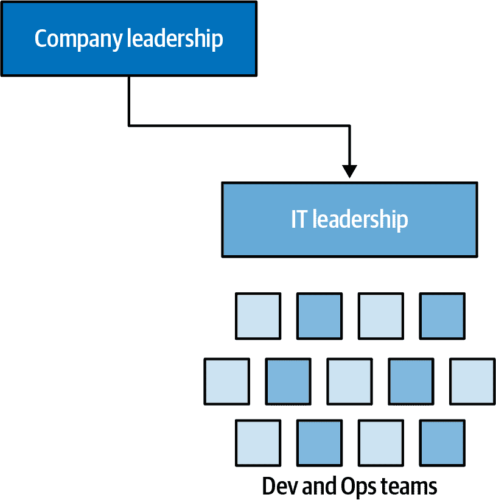
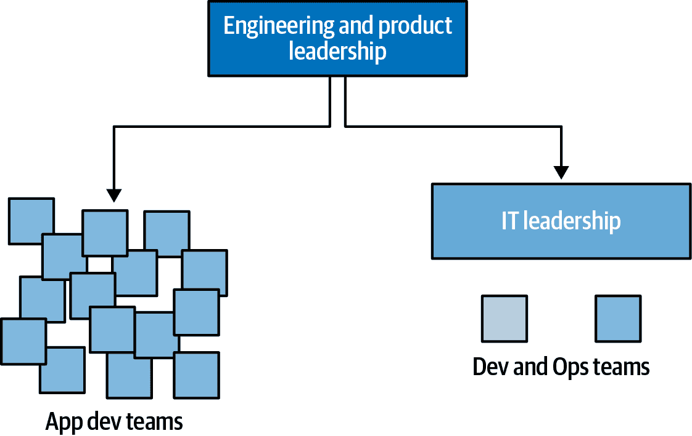
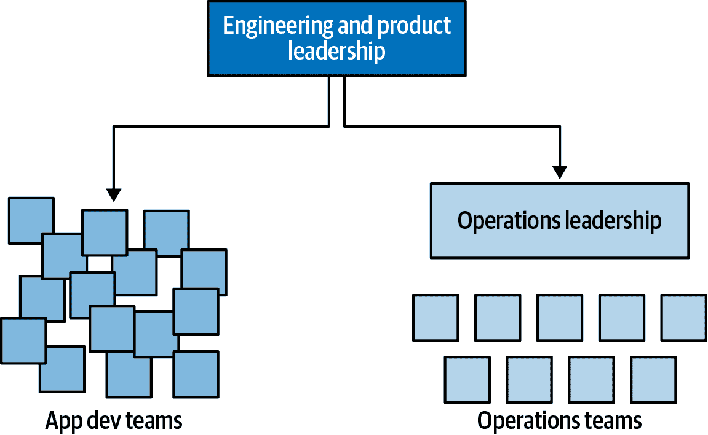
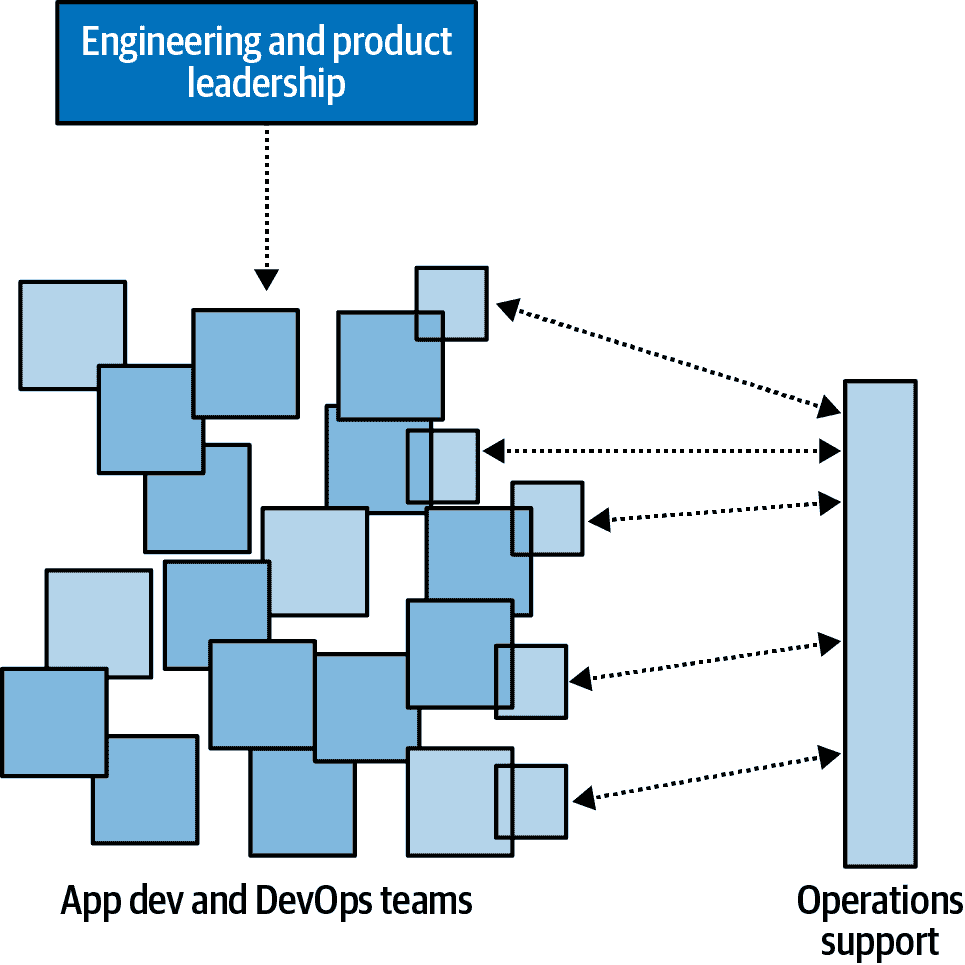
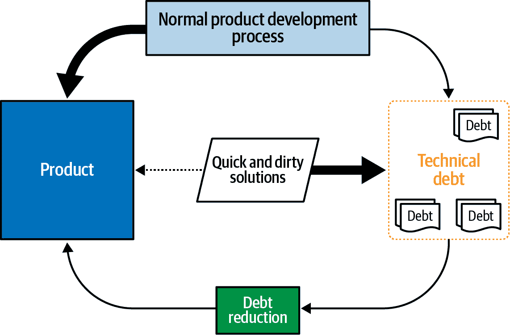
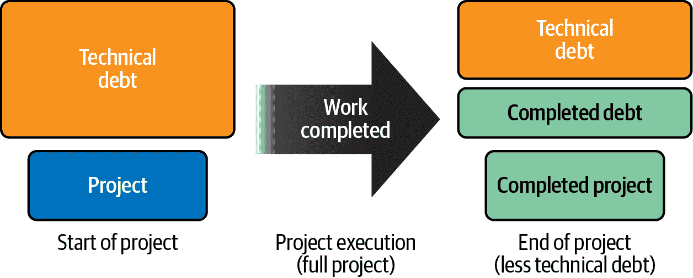
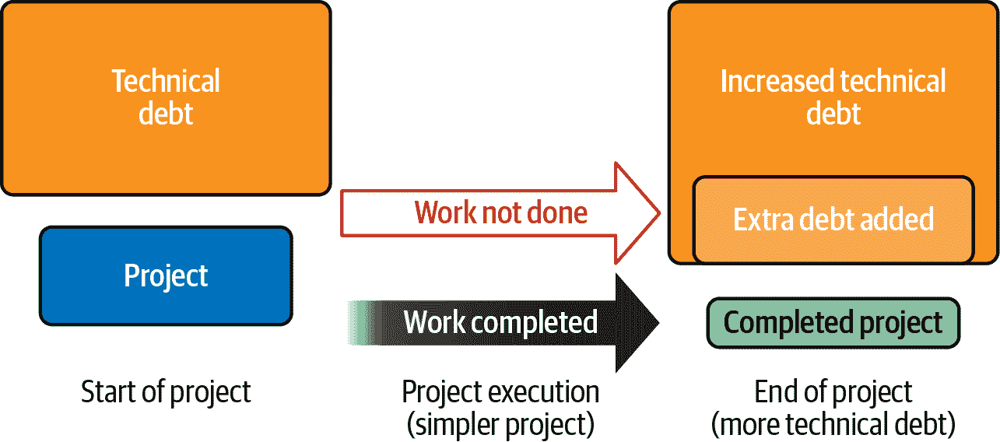
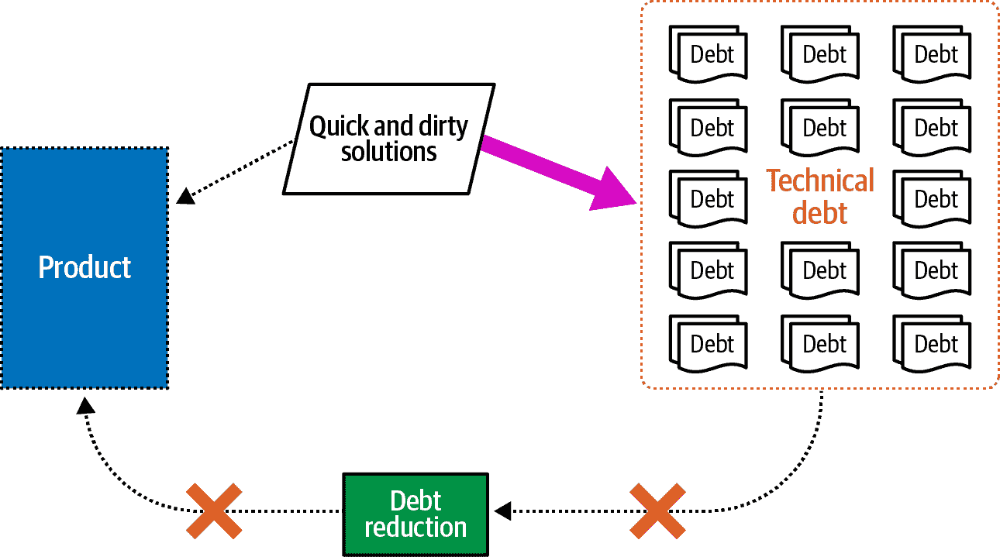
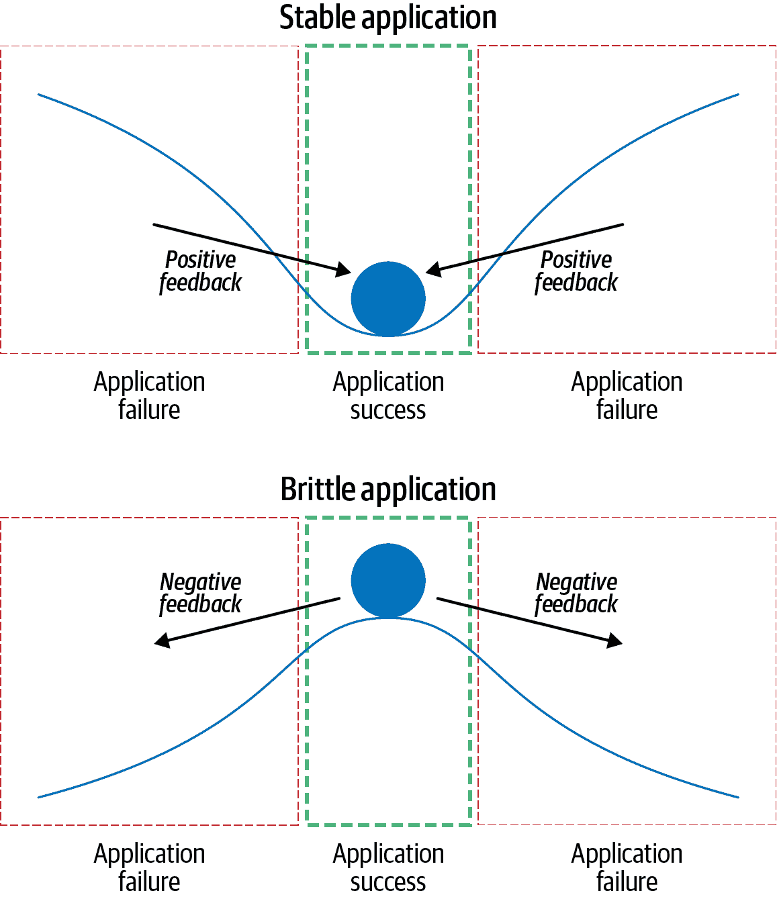
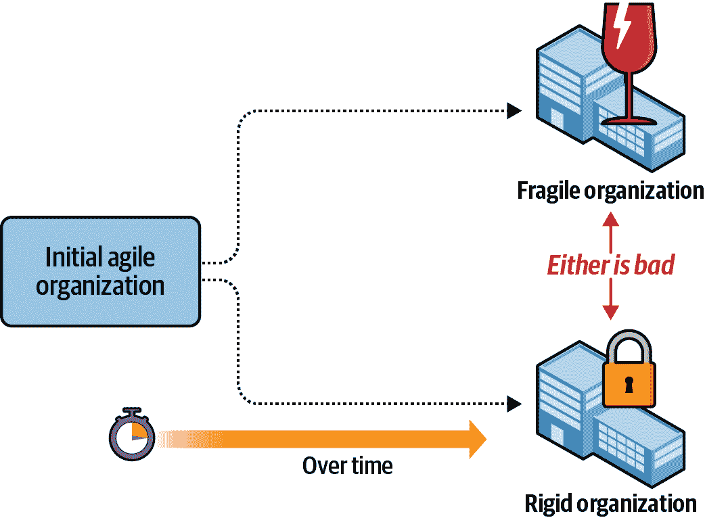

# 克服 IT 复杂性：简化运营、推动创新并培养成功的云成果

# Dedication

*To Beth*

*My love, my life, my everything*

# Foreword

I have spent my career developing and operating software and modernizing product and engineering teams, from startups to large enterprises. I founded Interland (now Web.com) in my 20s and went on to drive transformation at scale while leading development and operations at Cox Automotive, Unqork, and New Relic. I have been a CEO, CTO, and CPO and have worked to help other enterprises around the globe transform. I have also been an author and speaker on topics including DevOps, digital transformation, Agile, Scrum, and Lean Startup. My experience has given me a unique perspective on how the internet has narrowed competitive moats and forced every company to learn how to operate like a digital business—not just say they are one.

It is my pleasure to write this foreword for Lee’s new book, *Overcoming IT Complexity*. Like his previous book, [*Architecting for Scale*](https://oreil.ly/architecting-for-scale-2e) (O’Reilly), I believe this will become the reference guide for overcoming the diverse difficulties companies face—whether they are SaaS, non-SaaS, or non-technology-focused IT firms. As Lee explains in this book, one of the many challenges companies face while trying to deliver new features and functionality in order to stay competitive is quickly accumulating technical debt. With a cutting-edge approach, including enterprise risk management and strategies for measuring results, Lee lays out a comprehensive framework for dealing with that technical debt.

# The Growing Complexity of IT Environments

Technology has grown increasingly complex over the years, but the rate of its evolution has increased dramatically in the last decade. Many factors are driving this fast evolution:

* The rising number of devices connecting to the internet, from laptops and smartphones to smart home products
* The increase in cloud services
* The expansion in the number of devices that can be connected to create a single application
* The development of artificial intelligence and machine learning, which has led to innovative new products that help automate traditional business processes
* The evolution of open source software, which has made it easier for developers to create innovative new products

The numerous applications and devices employees use across an organization’s environment generate fragmentation. This fragmentation is a big challenge for the IT department, and it can be hard to detect because it may be distributed across various systems your organization uses (sometimes without employees knowing about it):

* Applications can be fragmented across numerous databases, including cloud databases.
* Virtual machines (`VMs`) are often fragmented across multiple servers.
* Physical servers are often fragmented across multiple physical locations.
* Network infrastructure and cloud services can also become fragmented.

Complexity can increase the time it takes to deliver new IT solutions or roll out new services. It can also slow down processes such as equipment procurement and software upgrades. Complexity can be particularly problematic for business users, who may have limited knowledge of the technologies used by their organization’s IT department. This can make it difficult for these users to collaborate with the IT department on projects or get the kind of support they need when issues arise. It can also make it difficult for the IT department to keep track of everything being used across the organization and ensure that it’s all secure.

The complexity of building API-first and embedded SaaS solutions is rising as new applications are based on open source platforms. Every day, delivering new value while satisfying customers becomes more difficult. Even if your IT organization is still struggling to eradicate the Node.js monolith or is striving to scale to billions of transactions, Lee provides ideas based on Adaptive Architecture principles and the crucial elements of flexible infrastructure as code to help you reduce technical debt and IT complexity.

Ken Gavranovic

CEO of AGS LLC;

Former CEO of Web.com (Interland), GM of Product and

Engineering at New Relic,

and VP of Digital Systems at COX Automotive

# Preface

The complexity of modern IT systems can impact your application’s quality and security.

It’s that simple.

Business pressures have caused IT organizations to focus on creating new applications and adding new features and capabilities to existing applications to meet increasing competitive demands. The result is insufficient time to work on managing, operating, and maintaining existing applications and capabilities. Ignoring ongoing issues increases technical debt, which in turn increases the complexity of modern systems. Increased system complexity makes adding new features and capabilities harder, and the vicious circle continues.

Addressing the IT complexity dilemma is essential, but it is not easy. In this book, we begin by examining this dilemma and how it impacts you, your applications, and your organization. Then we talk about identifying and measuring complexity in your organization today. How can you measure complexity without introducing complex measurement systems? Since you can’t improve a system until you can measure it, this ability is critical to managing IT complexity.

接下来，我们将探讨降低 IT 复杂性及其带来的认知负担的解决方案。我们讨论自适应架构在现代化应用中的作用，考虑它们如何降低复杂性，以及可能带来的增加复杂性的风险。

随后，我们将探讨知识管理技术如何帮助降低认知负担和 IT 复杂性，以及您对基础设施投资的策略如何影响复杂性。

最后，我将提供一些建议，说明如何在组织内部开始讨论 IT 复杂性对公司、产品和应用的影响。

本书的目标是为您提供所需的工具，帮助您理解 IT 复杂性如何对公司和应用产生负面影响，以及如何打破循环，有效管理其对组织的影响。

# 更多信息

本书只是您管理 IT 系统和体验之旅的起点。如果您想了解更多，欢迎查看作者在 [*leeatchison.com*](https://leeatchison.com) 上的其他书籍、文章、课程和访谈。另请查看 O’Reilly Media 提供的其他优秀书籍和在线课程。

## 使用代码示例

PROD: 请联系作者确认他们是否会将代码示例上传到 oreilly.com 或其自己的网站（例如 GitHub）。如果没有代码下载，请删除整个章节。如果有，在向 digidist 发送电子邮件并附上链接时，请告知您填写的 `title_title`（应尽可能接近书名，即 `learning_python_2e`）。此信息将决定 digidist 将文件加载到何处。

补充材料（代码示例、练习等）可从 <a href="https://github.com/oreillymedia/title_title">https://github.com/oreillymedia/title_title</a> 下载。

如果您对代码示例有技术问题或使用问题，请发送电子邮件至 <a class="email" href="mailto:bookquestions@oreilly.com"><em>bookquestions@oreilly.com</em></a>。

本书旨在帮助您完成工作。一般来说，如果本书提供了示例代码，您可以在程序和文档中使用它。除非您复制代码的很大一部分，否则无需联系我们征求许可。例如，编写一个使用本书中多个代码片段的程序不需要许可。出售或分发 O’Reilly 书籍中的示例需要许可。引用本书并引用示例代码来回答问题不需要许可。将大量示例代码纳入产品文档中需要许可。

我们感谢，但通常不要求署名。署名通常包括标题、作者、出版商和 ISBN。例如：“*Book Title* by Some Author (O’Reilly). Copyright 2012 Some Copyright Holder, 978-0-596-xxxx-x。”

如果您认为代码示例的使用超出了合理使用范围或上述许可，请随时联系我们 <a class="email" href="mailto:permissions@oreilly.com"><em>permissions@oreilly.com</em></a>。

# O’Reilly 在线学习

###### Note

40 多年来，[*O’Reilly Media*](https://oreilly.com) 一直为公司提供技术和商业培训、知识和见解，帮助公司取得成功。

我们独特的专家和创新者网络通过书籍、文章和我们的在线学习平台分享他们的知识和专业知识。O’Reilly 的在线学习平台为您提供按需访问现场培训课程、深入学习路径、交互式编码环境，以及来自 O’Reilly 和 200 多家其他出版商的庞大文本和视频集合。欲了解更多信息，请访问 [*https://oreilly.com*](https://oreilly.com)。

# 如何联系我们

请将有关本书的评论和问题发送给出版商：

*   O’Reilly Media, Inc.
*   1005 Gravenstein Highway North
*   Sebastopol, CA 95472
*   800-998-9938（美国或加拿大境内）
*   707-829-0515（国际或本地）
*   707-829-0104（传真）

我们为本书设立了网页，在此列出勘误、示例和任何额外信息。您可以通过 [*https://oreil.ly/overcoming-it-complexity*](https://oreil.ly/overcoming-it-complexity) 访问此页面。

不要忘记更新上面的链接。

发送电子邮件至 *bookquestions@oreilly.com* 对本书发表评论或提出技术问题。

访问 [*https://oreilly.com*](https://oreilly.com) 了解有关我们的书籍和课程的更多信息和新闻。

在 LinkedIn 上找到我们：[*https://linkedin.com/company/oreilly-media*](https://linkedin.com/company/oreilly-media)

在 Twitter 上关注我们：[*https://twitter.com/oreillymedia*](https://twitter.com/oreillymedia)

在 YouTube 上观看我们：[*https://youtube.com/oreillymedia*](https://youtube.com/oreillymedia)

# 致谢

虽然帮助本书成行的[content]

接下来，我们将探讨降低 IT 复杂性及其带来的认知负担的解决方案。我们讨论自适应架构在现代化应用中的作用，考虑它们如何降低复杂性，以及可能带来的增加复杂性的风险。

随后，我们将探讨知识管理技术如何帮助降低认知负担和 IT 复杂性，以及您对基础设施投资的策略如何影响复杂性。

最后，我将提供一些建议，说明如何在组织内部开始讨论 IT 复杂性对公司、产品和应用的影响。

本书的目标是为您提供所需的工具，帮助您理解 IT 复杂性如何对公司和应用产生负面影响，以及如何打破循环，有效管理其对组织的影响。

# 更多信息

本书只是您管理 IT 系统和体验之旅的起点。如果您想了解更多，欢迎查看作者在 [*leeatchison.com*](https://leeatchison.com) 上的其他书籍、文章、课程和访谈。另请查看 O’Reilly Media 提供的其他优秀书籍和在线课程。

## 使用代码示例

PROD: 请联系作者确认他们是否会将代码示例上传到 oreilly.com 或其自己的网站（例如 GitHub）。如果没有代码下载，请删除整个章节。如果有，在向 digidist 发送电子邮件并附上链接时，请告知您填写的 `title_title`（应尽可能接近书名，即 `learning_python_2e`）。此信息将决定 digidist 将文件加载到何处。

补充材料（代码示例、练习等）可从 <a href="https://github.com/oreillymedia/title_title">https://github.com/oreillymedia/title_title</a> 下载。

如果您对代码示例有技术问题或使用问题，请发送电子邮件至 <a class="email" href="mailto:bookquestions@oreilly.com"><em>bookquestions@oreilly.com</em></a>。

本书旨在帮助您完成工作。一般来说，如果本书提供了示例代码，您可以在程序和文档中使用它。除非您复制代码的很大一部分，否则无需联系我们征求许可。例如，编写一个使用本书中多个代码片段的程序不需要许可。出售或分发 O’Reilly 书籍中的示例需要许可。引用本书并引用示例代码来回答问题不需要许可。将大量示例代码纳入产品文档中需要许可。

我们感谢，但通常不要求署名。署名通常包括标题、作者、出版商和 ISBN。例如：“*Book Title* by Some Author (O’Reilly). Copyright 2012 Some Copyright Holder, 978-0-596-xxxx-x。”

如果您认为代码示例的使用超出了合理使用范围或上述许可，请随时联系我们 <a class="email" href="mailto:permissions@oreilly.com"><em>permissions@oreilly.com</em></a>。

# O’Reilly 在线学习

###### Note

40 多年来，[*O’Reilly Media*](https://oreilly.com) 一直为公司提供技术和商业培训、知识和见解，帮助公司取得成功。

我们独特的专家和创新者网络通过书籍、文章和我们的在线学习平台分享他们的知识和专业知识。O’Reilly 的在线学习平台为您提供按需访问现场培训课程、深入学习路径、交互式编码环境，以及来自 O’Reilly 和 200 多家其他出版商的庞大文本和视频集合。欲了解更多信息，请访问 [*https://oreilly.com*](https://oreilly.com)。

# 如何联系我们

请将有关本书的评论和问题发送给出版商：

*   O’Reilly Media, Inc.
*   1005 Gravenstein Highway North
*   Sebastopol, CA 95472
*   800-998-9938（美国或加拿大境内）
*   707-829-0515（国际或本地）
*   707-829-0104（传真）

我们为本书设立了网页，在此列出勘误、示例和任何额外信息。您可以通过 [*https://oreil.ly/overcoming-it-complexity*](https://oreil.ly/overcoming-it-complexity) 访问此页面。

不要忘记更新上面的链接。

发送电子邮件至 *bookquestions@oreilly.com* 对本书发表评论或提出技术问题。

访问 [*https://oreilly.com*](https://oreilly.com) 了解有关我们的书籍和课程的更多信息和新闻。

在 LinkedIn 上找到我们：[*https://linkedin.com/company/oreilly-media*](https://linkedin.com/company/oreilly-media)

在 Twitter 上关注我们：[*https://twitter.com/oreillymedia*](https://twitter.com/oreillymedia)

在 YouTube 上观看我们：[*https://youtube.com/oreillymedia*](https://youtube.com/oreillymedia)

# 致谢

虽然帮助本书成行的

企业可以采取多种措施来缓解 IT 复杂性困境的影响，包括投资自动化技术、建立标准操作流程以及聘请熟练的 IT 专业人员。通过采取这些步骤，企业可以提高管理并优化其 IT 运营的能力，最大限度地降低复杂性的负面影响。

然而，即使采取了这些措施，企业仍将面临管理其 IT 运营的挑战，这是由于现代 IT 系统复杂性不断增长所致。通过试图缓解这种复杂性的影响，企业可以提高其在当今 IT 环境中的效率、安全性和竞争力。

正如我们将在本章后面讨论的那样，技术债务是复杂性困境的核心：事实上，技术债务和复杂性是相辅相成的。而且正如你将看到的那样，有效地处理技术债务涉及的远不止重构代码。

技术债务是一个指标，描述了干扰应用程序顺畅运行和客户体验的一切。换句话说，它就是使应用程序变得复杂或脆弱的一切，从而导致运营复杂性增加，客户体验复杂化，或仅仅使应用程序更难增强、扩展和改进。

但在我们讨论减少复杂性的方法之前，了解现代企业中 IT 组织的架构以及 IT 组织内部的运营和开发团队如何相互作用以创建工作系统是很重要的。

# 现代 IT 组织的架构

IT 组织在规模和形态上差异很大。现代 IT 组织采用 DevOps 方法论。该组织通常是一个相对扁平的矩阵型结构，其中开发和运营团队紧密合作。为了跟上客户需求和技术变化的快速步伐，两个团队都需要快速适应。开发团队需要能够快速构建新系统和应用程序，并快速修复和升级现有系统。运营团队不仅必须能够快速部署和管理这些系统，还必须能够在问题发生时检测并解决它们。开发与运营之间密切的工作关系对于保持这种速度至关重要。

然而，随着应用程序复杂性的增长和组织规模的扩大，自然的分离开始形成。开发与运营之间的传统分工开始正式化，两组之间的空间也在扩大。

过去，扁平的管理结构能够帮助组织保持沟通渠道畅通，鼓励开发、运营、安全和产品领导团队之间的对话。但随着组织的增长，保持管理结构扁平和响应迅速变得越来越困难。

管理组织结构对于保持不断增长的组织正常运行是必需的。正式化的流程有助于产生一致的结果和计划。然而，这些相同的结构和流程会造成沟通流的自然阻塞。这种阻塞使组织更难运作。团队分裂，组织距离限制了合作和沟通。这限制了增长。

具有讽刺意味的是，增长的最大抑制因素，事实上就是增长。组织结构变得更加复杂，应用程序也变得更加复杂。

由于 IT 组织的好坏取决于推动它的管理，因此拥有一个强大而有效的管理团队至关重要。该团队负责将组织引向正确的方向，设定目标和[content]

企业可以采取多种措施来缓解 IT 复杂性困境的影响，包括投资自动化技术、建立标准操作流程以及聘请熟练的 IT 专业人员。通过采取这些步骤，企业可以提高管理并优化其 IT 运营的能力，最大限度地降低复杂性的负面影响。

然而，即使采取了这些措施，企业仍将面临管理其 IT 运营的挑战，这是由于现代 IT 系统复杂性不断增长所致。通过试图缓解这种复杂性的影响，企业可以提高其在当今 IT 环境中的效率、安全性和竞争力。

正如我们将在本章后面讨论的那样，技术债务是复杂性困境的核心：事实上，技术债务和复杂性是相辅相成的。而且正如你将看到的那样，有效地处理技术债务涉及的远不止重构代码。

技术债务是一个指标，描述了干扰应用程序顺畅运行和客户体验的一切。换句话说，它就是使应用程序变得复杂或脆弱的一切，从而导致运营复杂性增加，客户体验复杂化，或仅仅使应用程序更难增强、扩展和改进。

但在我们讨论减少复杂性的方法之前，了解现代企业中 IT 组织的架构以及 IT 组织内部的运营和开发团队如何相互作用以创建工作系统是很重要的。

# 现代 IT 组织的架构

IT 组织在规模和形态上差异很大。现代 IT 组织采用 DevOps 方法论。该组织通常是一个相对扁平的矩阵型结构，其中开发和运营团队紧密合作。为了跟上客户需求和技术变化的快速步伐，两个团队都需要快速适应。开发团队需要能够快速构建新系统和应用程序，并快速修复和升级现有系统。运营团队不仅必须能够快速部署和管理这些系统，还必须能够在问题发生时检测并解决它们。开发与运营之间密切的工作关系对于保持这种速度至关重要。

然而，随着应用程序复杂性的增长和组织规模的扩大，自然的分离开始形成。开发与运营之间的传统分工开始正式化，两组之间的空间也在扩大。

过去，扁平的管理结构能够帮助组织保持沟通渠道畅通，鼓励开发、运营、安全和产品领导团队之间的对话。但随着组织的增长，保持管理结构扁平和响应迅速变得越来越困难。

管理组织结构对于保持不断增长的组织正常运行是必需的。正式化的流程有助于产生一致的结果和计划。然而，这些相同的结构和流程会造成沟通流的自然阻塞。这种阻塞使组织更难运作。团队分裂，组织距离限制了合作和沟通。这限制了增长。

具有讽刺意味的是，增长的最大抑制因素，事实上就是增长。组织结构变得更加复杂，应用程序也变得更加复杂。

由于 IT 组织的好坏取决于推动它的管理，因此拥有一个强大而有效的管理团队至关重要。该团队负责将组织引向正确的方向，设定目标和目标，并确保所有方面顺利运行。

管理团队还必须能够快速适应变化并有效应对新的市场需求。他们必须跨越组织边界运作，并与所有产品、开发、运营和支持团队协同运作。

IT 组织的架构在很大程度上取决于业务的性质。公司类型（以软件为重点、以 SaaS 为重点、非软件为重点等）是 IT 组织架构的最大指标。

## IT 组织中软件开发的作用

在 IT 组织内部，开发团队的结构和职责与业务性质和公司其余部分的结构相关。开发团队可能在管理内部流程和系统方面发挥有限的作用，也可能成为公司核心业务模式不可或缺的一部分。这意味着没有一种通用的组织结构可以定义现代 IT 组织。

但我们可以概括。对于本次讨论，我们将定义三种类型的企业：

1. 非软件为重点的 IT 组织
2. 非软件即服务（SaaS）软件为重点的 IT 组织
3. SaaS 为重点的 IT 组织

在以下各节中，我们将探讨每种类型公司的特征以及在每种类型中通常出现的 IT 组织结构。

在实践中，你可能会发现你的情况导致了这两种或三种类型的混合。

### 业务类型 1：非软件为重点的 IT 组织

类型 1 是一家主要目的不是生产、销售或运营软件的企业。这包括几乎所有非技术为重点的公司，例如银行、餐馆、商店、出租车服务、航空公司、铁路公司、媒体公司等。非软件公司的使命并非以技术为重点。它可能在内部使用软件作为管理销售、营销、制造或其他业务流程的工具，但软件对其主要业务而言是次要的。

因此，没有大型应用程序开发团队。存在一个 IT 组织，其中有相对较小的（与公司整体规模相比）开发和运营团队，但公司资源中只有一小部分投资于 IT 系统和人员。

Figure 1-1 说明了这一点。公司领导层有更重要的事情需要关注，留下 IT 领导层管理这些小型开发和运营团队。

对于这些更传统的非软件型企业公司，IT 组织仅发挥支持作用。它主要以运营为重点，尽管也可能具有一些开发能力。工具和运营流程是关注的中心领域。

### 业务类型 2：非 SaaS 软件 IT 组织

第二种业务的主要目的是创建出售给其他人或公司的软件。它通常不为客户运营软件；相反，软件（不需要显著的后端 SaaS 类应用程序即可运行）由客户直接运营。

此类软件的示例包括流行的办公应用程序，如 Microsoft Word 和 Adobe Illustrator，以及游戏（如 *Angry Birds*）、音乐应用程序和电子书阅读器。它还可能包括防病毒软件、防火墙和新闻聚合器等工具。

非 SaaS 软件组织具有以软件或工程为重点的使命。这些组织拥有高水平的应用程序开发团队，但通常没有强大的运营团队。因为他们生产的软件是由客户而不是公司本身运营的，所以不需要很大的运营重点。

通用的 IT 组织提供支持整个公司的工具和流程。其部分职责是为产品开发团队（以及销售/营销等）提供支持，但它不直接参与产品开发或运营。Figure 1-2 显示了这种结构。

非 SaaS 软件公司非常重视应用开发团队，但这些并不是 DevOps 团队；它们是独立的软件开发团队，生产并交付销售给客户的软件。IT 组织规模很小，支持整个公司，包括内部使用的工具的开发和运营；它与产品开发团队分离且隔离。

### 业务类型 3：以 SaaS 为重点的 IT 组织

第三种业务类型是主要目的是创建 SaaS 应用或运营客户软件的公司。这包括提供库存管理、财务规划、通信和销售基础设施等服务的企业对企业（B2B）公司。SaaS 产品和公司的例子包括 Intuit QuickBooks、Slack、Shopify、Mailchimp 和 Salesforce。

还有提供娱乐、零售购物和社交媒体服务的企业对消费者（B2C）SaaS 公司。B2C SaaS 公司的例子包括 Amazon（零售）、Netflix、Facebook 和 Twitter。

一个功能强大的 SaaS 组织需要高水平的应用程序开发团队 *和* 高水平的操作团队。两个团队必须合作才能成功。Figure 1-3 显示了典型的组织结构。

SaaS 公司中的应用程序开发团队通常是比例上较大的团队，需要在工程和产品管理方面进行大量投资。每个团队拥有整体 SaaS 应用的一部分，并且只构建、测试、部署、运营和维护其负责的服务。运营团队提供支持开发团队的顺畅运营基础设施。企业的重点通常主要集中在软件开发团队上。这些公司可能有单独的 IT 组织来支持业务流程，但应用程序开发团队不属于该组织。

在这些高科技、以软件为驱动的公司中，应用程序开发团队是企业核心组成部分。鉴于其重要性，该团队在公司的组织层级中处于较高位置。

请注意，一些公司符合多个类别。例如，Microsoft 提供 SaaS 服务（Office 365）和非 SaaS 软件（Microsoft Word 和 Halo）。Amazon 提供 B2C 服务（Amazon 零售）和 B2B 服务（AWS），以及非 SaaS 服务（Kindle 阅读器）。此外，像 Charles Schwab 这样的公司可能将投资软件作为服务提供，同时也专注于一般的金融服务和投资。这些企业可能拥有不同的部门，看起来像是各自独立的公司，各自结构不同，或者它们可能具有混合结构。请记住，这里讨论的类别是概括性的。

## IT 组织中的开发与运营

在 IT 组织内部，开发和运营团队专注于推动运营公司所需的工具和资源，包括构建公司运行所需的应用程序。这些团队的职责和遵循的流程取决于公司在我们刚才讨论的三种组织类型中的位置，吸引的人才类型也是如此。

### 开发

*公司对软件开发的关注程度* 与 *组织可获得的高质量技术人才和软件领导力* 之间存在直接相关性。最好的软件开发人员、架构师和软件领导者往往会 gravitate 向 SaaS 应用开发和其他以软件为中心的公司中更有利可图的机遇。

这意味着软件在使命中的作用仅是次要的组织很难吸引和留住软件人才。经常这意味着整个组织都会受损。是的，这些组织中存在高质量、有才华的开发人员，但他们更难找到和雇用。这往往导致这类组织创新较少，创造性解决方案也较少。与其说是领先的，不如说在这些组织中创建的软件应用程序往往是相当平凡的、支持性的应用。

你的 IT 开发团队的水平对于决定你的组织能够支持的应用程序的复杂程度以及你的组织应对随时间推移不可避免的复杂性增加的能力至关重要。

结果是，软件是业务的次要部分而非主要重点的组织往往对 IT 复杂性困境更敏感。

### 运营

另一方面，运营团队吸引高质量人才的能力取决于组织的运营方面对业务重点的中心程度。这意味着 SaaS 公司高度依赖高质量的运营团队，往往比运营对业务目标而言是次要的组织吸引更高质量的运营人才。

对运营人才吸引力较小的是非软件公司，它们需要大量的内部软件基础设施来保持组织平稳运行。这包括银行和其他金融公司等组织，其中软件基础设施至关重要且必须保持运行。

对运营人才吸引力更小的则是生产“盒装”软件的公司，该软件在客户计算机和系统上运行，而不是在内部运营环境中。

这说得通。SaaS 公司严重依赖高性能的运营环境，并在这些领域大量投资。这种投资以及由此产生的机遇吸引顶尖的运营工程人才加入这些组织。运营重点较少的组织在该领域需要较少的投资，因此吸引力也不大。

然而，传统的运营格局正在发生变化。许多传统的运营能力现在由外包基础设施处理，例如 SaaS 应用和云服务提供商。此外，新工具和能力自动化了大量基础运营需求。

*基础设施即代码* (`IaC`) 和 *运营即代码* (`OaC`) 工具有助于这项工作，并努力使运营设置和基础运营职责自动化且可重复。这提高了整体运营可靠性。此外，由于脚本和类似脚本的描述驱动 `IaC` 和 `OaC`，这些能力鼓励将代码作为文档并促进运营环境相关的知识共享。最后，由于 `IaC` 和 `OaC` 将应用程序的运营方面概括为类似代码的能力，它们允许使用标准化和成熟的开发流程，例如版本管理。版本管理允许跟踪和关联故障与变更，减少错误，增加安全性和可追溯性，并提高整体问责制和性能。

### DevOps 在企业现代化中的作用

`DevOps` 是现代组织中广泛使用的术语。它部分描述了组织内部开发团队与运营团队之间的协作。`DevOps` 的意图是打破这两个群体之间存在的传统壁垒，鼓励协作与合作，使他们能够更有效地、高效地共同工作。这导致问题解决更快、效率和响应性提高，以及整体更高的应用质量和可用性。`DevOps` 正在成为现代 IT 组织的常态。

在 DevOps 组织中，每个团队都拥有应用程序的一部分。在现代应用程序中，这些组件通常是服务。各个团队负责其负责服务的开发、测试、部署、运营和持续支持。

图 1-4 显示了一家使用 DevOps 原则的软件公司的组织结构。正如它所描述的那样，这描述的是与 图 1-3 中描述的同类 SaaS 公司。主要区别在于，开发方面和大部分运营方面的所有权都分配给工程和产品领导组织下的同一团队。仍然存在一个非常精简的运营支持组织，但该组织的工作不是管理应用程序的运营；相反，其角色是为拥有和运营各个服务的产品团队提供工具和帮助。

以这种方式将单个服务的开发和运营责任合并到一个组织中，降低了过去开发团队和运营团队之间通常存在的沟通障碍，提高了组织的整体性能和可靠性。

现在我们对现代 IT 组织的架构有了更深入的了解，我们可以谈谈复杂性在这些组织中带来的问题，以及复杂性如何影响组织的长期可行性和成功。

# 复杂性的出现

很难准确指出复杂性何时开始在年轻的 IT 组织中悄然滋生，但它通常与某个旨在减少上市时间或上市成本的决策有关，而代价是以后需要做更多的工作或花费更多的成本。这启动了复杂性缓慢而不可阻挡的增长。对于更大、更成熟的企业来说，引入复杂性通常与将技术纳入既定流程有关。在任何一种情况下，复杂性的增加都与技术债务的增加有关。

## 技术债务：复杂性的关键

在软件开发中，技术债务是由于现在选择了简单、有限或次优的解决方案，而不是使用需要更长时间或前期花费更多资金实施的更好方法而导致的额外返工成本。

Ward Cunningham 最初创造了这个术语。据 Ward 说，“技术债务包括那些你现在选择不做的事情，但如果不做就会阻碍未来的开发。”

技术债务的代码开发方面只捕捉到它的一小部分。技术债务适用于现代应用程序设计、开发和长期运营的所有方面。

对于 SaaS 和其他以云为中心的应用程序而言，长期运营影响是技术债务的重要驱动因素。应用程序运行的时间越长，技术债务就越大，应用程序的技术债务越大，对服务长期运营的负面影响就越大。

当 SaaS 公司的开发团队决定为应用程序添加新功能，但为了更快地推出该功能而在架构上采取捷径时，它就在增加应用程序和整个公司的技术债务。除非做出 concerted 努力通过完成适当的 设计和架构来解决技术债务，否则它会不断积累，直到阻碍开发和运营流程。

技术债务类似于财务债务。适度时，可以处理，成本可以应对。但如果不偿还技术债务，它会以额外的技术债务形式“累积利息”——就像财务债务一样，如果你累积了太多利息，你就再也无力偿还债务。过多的技术债务会使解决技术债务所需的更改变得更难、更昂贵地实施。

让你的财务债务增长过大，你就会破产。让你的技术债务增长过大，你的应用程序将变得无法支持、不可持续且无法维护。

### 技术债务是如何增长的？

技术债务可以在正常的产品开发过程中自然而悄悄地增长。每个为产品做出贡献的项目也会为其技术债务做出贡献——即使是添加一个简单的功能增强。这在 图 1-5 顶部有所说明：在正常的产品开发过程中，工作和输出被添加到产品中，同时也会在技术债务堆栈中增加一定量的债务。

有时，项目是以“快速而粗糙”的方式完成的，例如在没有适当设计的情况下添加新功能以便快速推出。在这些情况下，项目会增加更多的债务。有时，项目甚至会为应用程序增加的技术债务超过其提供的实际价值。这就是 图 1-5 中间所示示例项目的情况。

为了防止技术债务无限制增长，每个项目都需要投入一些精力来减少技术债务。保持技术债务在可持续水平需要不断投入以随着时间推移减少技术债务。

这种不断增加和减少技术债务的流动是它可能悄悄出现的原因之一。如果定期添加的债务多于从积压工作中减少的债务，债务将会增长，但增长可能并不明显。直到债务增长到开始对产品产生负面影响时，你才会注意到积累了多少。在这一点上，它可能变得太大而无法有效、轻松地处理。

每个项目都可以增加或减少系统内的技术债务。在一个完整的高质量项目中，计划的工作通常包括完成所有必要的工作，以及处理减少一定相关技术债务的工作。工作完成后，应用程序的技术债务比之前更低。这在 图 1-6 中有所说明：项目的 *已完成工作* 大于项目本身，而额外的精力用于减少技术债务的规模。这是一个以健康方式处理技术债务的项目。

不幸的是，许多项目都更加快速而粗糙。它们旨在仅完成绝对必要的工作，将其余工作留待以后完成。事实上，一个常见的项目管理理念涉及构建 *最小可行产品*，或 MVP——一种本质上规定你尽可能少做产品工作以将功能产品推出的方法。

结果是工作未完成。更常见的是，这会增加应用程序的整体技术债务。这种现象在 图 1-7 中有所说明。这里， *已完成工作* 只是项目所需的一部分，并且伴随着相等数量的 *未完成工作*。这项未完成的重要额外工作最终会增加项目的整体技术债务。

根据所进行的项目类型，产品相关的技术债务量会随时间变化，有时减少，有时增加。完成的完整、高质量项目越多，整体技术债务就越低。使用快速而粗糙的项目来实现功能越多， resulting 技术债务就越高。

### 技术债务的负面影响

有时，现在构建一个更简单的解决方案并推迟长期实现（如下图 Figure 1-7 所示）是有利的。它能让你更早地将解决方案交付给客户，这样公司就可以开始变现该变更并获得客户对他们喜欢和不喜欢的反馈，这些反馈可以用于后续更有雄心的解决方案。这类似于借钱的想法是有利的，如果你用这笔钱来促进更大的事业，例如购买房屋；支付借钱的利息是可以的，只要借来的钱得到良好利用。同样，只要产生该债务的项目为你的产品和公司增加了价值，管理一些技术债务是有用且合适的。技术债务与财务债务一样，如果得不到解决就会成为问题：成本会增加，处理起来也会越来越困难。

继续沿用财务比喻，技术债务在积累到管理债务和偿还债务的成本变得过大并阻碍你投资未来项目时就会成为问题。当太多快速而粗糙的项目主导你的项目计划，而旨在减少债务的项目在公司中得不到人员配备时，你的技术债务开始变得难以管理。如果这种情况持续太久，技术债务就会压倒项目，如 Figure 1-8 所示。

在这种情况下，偿还债务成为团队的主要角色，你几乎没有时间或根本没有时间去改进产品。你的债务太大而无法有效管理，产品因此受损。

## 复杂性带来的组织痛苦

技术债务和复杂性是相伴而生的。复杂性和组织痛苦也是如此。虽然技术债务并不是应用复杂性的完整图景，但技术债务的增长与应用复杂性的增长密切相关。

随着你的应用变得越来越复杂，会发生很多事情：

它变得脆弱。

复杂的应用很容易让小问题迅速升级为大问题。虽然大多数应用运行在一个正反馈循环的深井中，但复杂应用的运行深井会变成负反馈循环，即使是小问题也难以处理。如 Figure 1-9 所示，稳定的应用倾向于停留在代表应用失败的两个山丘之间的山谷中，不断积累成功，而脆弱的应用在最小的推动下就可能从山顶滚落到失败。

越来越少的工程师对应用有完整的了解。

只有最资深的工程师，即在该应用上工作时间最长的人，才对整个应用的工作方式有全面的了解。随着时间的推移，他们的知识变得稀释：可能不够准确、层次更高或更专业。随着应用复杂性的增长，单个个体不再可能对整个应用保持详细的了解。

工程师对应用所拥有的知识变得过时得更快。

复杂的应用经常发生变化，工程师对应用工作原理的了解很快就会过时。

让新工程师上手变得更困难。

复杂的应用有很长的学习路径。这不仅是因为要学的内容更多，而且因为新工程师需要成为生产力的知识更加分散，而且经常是轶事性的且过时。

这些问题的净结果是组织痛苦加剧。这种痛苦转化为质量较差的变更、士气较低的员工，最终导致员工流失。更高的流失率意味着需要额外招聘和培训新工程师，而随着痛苦的增加，这变得更困难。脆弱性导致可用性降低，以及客户可见的问题和故障。

### 凌乱的桌面综合征

想象你有一个非常干净的桌面。现在，拿一张纸放在角落里。你的桌面凌乱吗？不，还没有。现在再拿 50 张相关的纸放在那张角落的纸上。你的桌面凌乱吗？不，还没有。现在想象你有更多的纸，但这些纸与角落里的那堆无关；它们是不同项目的。所以你把它们放在桌子的不同位置，看起来合理，只是单张纸放在单个位置。然后，随着时间的推移，你一次放一张纸、文件、书籍、文件夹和图片在桌上。如果你不知道某样东西放在哪里，你就把它放在一个新位置。你以后会弄明白的。现在你的桌面很凌乱。事实上，它极其凌乱。

这是因为你一开始没有计划，决定一路“临时应付”。你仅仅通过使用和在上面工作就让桌面变得凌乱。故事的寓意？除非你在*开始时*就为整理桌面上的文件制定了坚实的计划，并且坚持下去，否则迟早你的桌面会变得凌乱，一张纸一张纸地积累。

组织痛苦也是如此：当你一开始没有架构计划并且见招拆招时，它会迅速增长。你在比喻意义上“临时应付”。结果是，你仅仅通过工作和构建应用就增加了技术债务，从而增加了组织痛苦。

你采取的每一个行动都会一点一点地增加这种组织痛苦。你的技术债务一点一点地增长，直到变得难以承受。

*让我们更改登录流程，允许在用户浏览器中保存登录凭证。*

*让我们把这个新功能添加到那个菜单中。*

*用户更希望此功能以三步而不是当前四步运行。让我们合并其中两个步骤。*

*我们需要移除此资源上的每会话限制。*

*我们现在没有时间构建这个完整功能，但我们可以构建这个更小的功能，这将使许多客户更满意。我们可以稍后再做其余部分。*

*让我们先以这种方式发布此功能，然后我们可以收集客户的反馈并根据获得的更多反馈对其进行修改，使其更易于用户使用。*

其中任何一条陈述都可能对应于当时完全合理的一组简单更改。它可能对整体技术债务没有任何明显影响。

但小的更改……以及小的债务……以及小的冲击……它们会累积，就像桌面上那些小纸片和其他物品一样。与从干净开始最终变得凌乱的桌面一样，你采取的每一个行动单独来看似乎都完全无害。那些行动看起来完全可以接受。但随着时间的推移，整体来看，它们会变得难以承受。

## IT 组织中的复杂性

复杂性也会在 IT 组织中增长。首先，它渗入你的应用。随着应用变得更复杂，运行应用所需的基础设施也变得更复杂。因此，你的 IT 运营变得更复杂。你的工程组织也变得更复杂。因此，*管理*你的 IT 变得更复杂。

最初对应用需求的一个简单更改，最终会演变成一个复杂 IT 组织的增长。

随着复杂性的增加，组织快速改变方向并响应新需求的能力会减弱。一个曾经敏捷的组织变得不那么敏捷。

随着时间的推移，敏捷型组织最终会演变为两种形态之一：僵化的组织——害怕并拒绝变化，试图保持系统稳定和受支持；或脆弱的组织，其中任何微小的变更都可能破坏更大的系统或流程，从而限制调整和成长的能力。这在 Figure 1-10 中有所说明。

几乎与具体公司无关，复杂性和技术债务对应着对市场和竞争需求做出响应的能力下降。

为什么会这样？通常有两种原因会导致应用复杂性使公司敏捷性降低。

首先，当组织拥有过于复杂的应用时，对这些应用的变更越来越可能导致问题。小的变更和小的调整会导致大规模故障和中断发生。这会使组织犹豫不决。变更会经过额外的评审周期，变更会被合并，无法显示出明确价值的变更会被视为过于危险而被丢弃。组织不再抱有“是的，我们可以试试！”的态度，而是采取了更为保守的观点。“不，除非绝对必要”成为更可能的主张。

这种反应旨在防止应用失败。这是公司为保持应用稳健而做出的回应——你做的变更越少，应用就越安全。

结果是，应用开发流程显著放缓。这使得应用——以及公司——比竞争对手显著缺乏敏捷性。

其次，如果组织没有自然地放慢脚步并继续进行变更，那么这些变更的风险会越来越大。由于应用复杂性，组织可能在未完全了解其涉及内容的情况下进行变更。这会导致危险的变更，并破坏事物。组织不会放慢速度变得保守，而是鲁莽地向前推进。结果是什么？应用可用性受损，客户问题增加。技术债务也在增加，加剧复杂性并形成恶性循环。复杂性导致脆弱性，脆弱性导致故障，故障导致技术债务，技术债务又导致复杂性。

## IT 死亡

因此，技术债务导致复杂性，复杂性导致组织痛苦。这最终都会导致 *IT 死亡*。

但 IT 死亡看起来是什么样的？

IT 死亡是指当复杂性带来的痛苦使组织陷入无效状态时发生的情况。它无法改进，无法成长，因此停滞不前。由于竞争对手会继续成长，组织的停滞最终会导致其死亡。

有许多例子说明了这种情况的发生。

施乐公司长期以来一直是为大型组织生产复印机的领导者，但它因无法从复印机转向个人电脑而受苦。尽管现代 PC 用户界面最初是在施乐的帕洛阿尔托研究中心 PARC 构想的，但该公司无法与微软和苹果竞争开发 PC 操作系统。可以说，如果没有施乐 PARC，就不会有苹果 Macintosh 电脑，但施乐无法转型使其无法利用这一创新。

而且这不仅仅是科技公司才会遭受这种命运。轮胎公司菲尔斯通面临着在竞争对手米其林创造的斜交轮胎技术面前现代化其轮胎制造工艺的艰难任务。菲尔斯通陷入困境，无法更新其流程以处理新技术。无论如何努力，它仍在制造客户不想要的轮胎，其业务受损。最终，菲尔斯通被普利司通收购。这是 *Harvard Business Review* 所称的 [*active inertia*](https://oreil.ly/HUbjr) 的一个例子。

许多其他高度创新的公司也因失去创新能力而陷入 IT 死亡的陷阱。惠普公司是硅谷的创始公司之一——全球技术创新的核心——也经历了这个问题，陷入缓慢的死亡螺旋。

宝丽来在未能创新新型相机技术时也遭受了类似的命运，就像未能认识到视频流媒体技术重要性的百视达，以及被新兴的亚马逊.com 创新所压倒的书店 Borders 一样。

技术债务和复杂性会减缓创新。它们使公司无法保持竞争力，这最终会导致其衰落，甚至死亡。

## 什么造就成熟的 IT 组织

成熟的 IT 组织是敏捷的。它可以快速轻松地做出决策，在组织需求要求变更之前坚持这些决策，并能快速有效地实施。

为什么成熟的 IT 组织保持敏捷很重要？当敏捷性受阻时，公司会陷入两个可能将其拖垮的陷阱：

* 缺乏竞争性产品
* 不安全的漏洞

让我们更仔细地看看这两个方面。

### 竞争性产品

保持竞争力对现代应用至关重要。这是因为变化的步伐正在加速。技术正在迅速发展，新的竞争对手不断涌现。你的竞争对手比以往任何时候都移动得更快，如果你无法跟上他们的步伐，你很快就会落后并很快变得无关紧要。跟上步伐意味着越来越快地移动，这意味着能够根据情况要求进行适应和改变。

客户不断要求更多功能、更低价格和更好的质量。你需要能够响应这些需求以保持竞争力。

新思想是竞争性公司的生命线。当新想法出现时，你需要能够快速调整和适应以实现新想法。这需要敏捷性。

客户在做出购买决定时寻找创新。看起来具有创新性的公司更有可能获得客户的业务。这意味着你需要快速响应客户请求和客户需求。未能做到这一点不仅会让你失去客户，还会让你在行业中失去信誉。

敏捷性对于维持蓬勃发展的业务至关重要。

### 安全漏洞

你的竞争对手并不是唯一在创新的人。恶意行为者也在创新。

从未有过我们宝贵应用的 IT 基础设施像今天这样面临如此巨大的安全漏洞和恶意行为者行动的风险。恶意行为者不仅数量在增长；他们的 sophistication 也在增长。恶意行为者在想出攻击你应用的新方法方面与你的竞争对手想出攻击你业务成功的新方法一样富有创造力。

恶意行为者不断创新，改进其攻击向量，并暴露我们应用的漏洞。

作为公司和应用的所有者，你也必须不断创新，以保持应用安全可靠。你必须不断努力领先恶意行为者一步，这同样需要敏捷性。

# Summary

因此，IT 复杂性困境。IT 敏捷性对于建立成功的公司至关重要，然而这种成功本身会增加技术债务和复杂性，而这种复杂性会导致僵化或脆弱。陷入这两种情况之一的组织将在创新方面被竞争对手超越，最终它会死亡。为了长期成功，公司必须管理 IT 复杂性困境。
