# Chapter 2. Auditing and Assessing Your IT Ecosystem


如何避免 IT 复杂性困境？首先要先把事情理清：要处理应用程序或 IT 组织中的复杂性，你需要了解复杂性来自何处。

理解复杂性的第一步是对你的应用程序、你的团队、你的交付和运营流程、你的 IT 组织以及你的公司整体进行审计，以确定系统中的哪些部分导致了过度的复杂性。

# 审计与评估

审计和评估是两个不同的术语，通常可以互换使用来描述理解复杂系统（如企业应用程序）构成组件的过程。但两者有什么区别呢？

*审计*通常被定义为创建*受控清单*的过程。在此上下文中，*受控*一词意味着治理。例如：

* 银行可以清点自己的资金，但在接受*审计*时，会由独立机构对其记录进行正式审查以确保准确性。
* 公司保留自己的财务记录，但如果即将被收购或进行合并，其记录会被*独立审计*以确保其准确性。
* 如果你住在美国，你会跟踪个人财务，每年向美国国税局提交记录以说明应缴纳多少所得税。偶尔，国税局会*审计*个人以验证他们提供的信息是否正确准确。其他国家也有类似流程。

在 IT 审计中，我们谈论的是正式或非正式地确定我们的应用程序的组件、它们运行的基础设施以及它们使用的系统和流程。

大型企业可能在这样的审计上投入数十万美元，通常会聘请外部审计公司，而该过程可能需要六个月或更长时间。或者，一名架构师可能会在 Visio 中快速绘制一张图表，打印出来并放入日志簿。两者本质上都是审计，但前者比后者正式得多。

*评估*是下一步发生的事情。一旦你知道系统的组件和应用程序构成，你就会进行评估以了解它们如何协同工作，每个组件用于什么，为什么存在，它有多重要，以及它对整个系统产生的整体影响。通常，这属于审计的一部分，但不必如此。评估通常意味着分级、评分或评估。例如：

* 教师创建一次*评估*测试，以查看学生是否理解所教授的材料。
* 教练评估运动员的表现以*评估*他们如何在团队环境中利用该运动员。
* 选民在投票前会*评估*每个议题各方的利弊。

审计和评估是互补的过程，可以一起使用来确定和评估大型复杂企业应用程序基础设施的构成。

当应用于 IT 应用程序时，审计和评估更类似于一次*调查*。调查是一种测量工具，提供对系统结构和架构的视图，并且在系统外部构建和维护。它让我们了解我们的应用程序、基础设施、业务或系统如何运行以及如何构建。

# 你测量什么？

在业务中，包括应用程序开发和 IT 基础设施，我们的测量围绕人员、流程和技术展开：

People

: 

我们是否在正确的位置拥有正确的技能组合以使我们的业务成功运作？我们的员工是否投入且满意？我们是否最有效地利用了我们的人力？

Processes

: 

我们是否使用正确的数据做出良好且及时的决策？我们的业务流程是否高效有效？我们是否不恰当地使用时间或资源？

Technology

: 

我们是否拥有使我们的业务最优运作的正确技术？这些技术是否运行在正确的基础设施上？我们是否正确利用了基础设施的各个方面？我们是否因未有效使用而浪费了已购买的技术？我们是否因未获取可能帮助我们的技术而效率低下？

确定要评估什么很重要，但高度依赖具体情况。关注像这里所示这样的问题是头脑风暴要测量什么的好方法。这让你在进行调查时知道该关注什么，从而获得很好的视角。

# 为什么要测量？

如果你不了解组织的现状以及其当前如何运作，就无法跟踪组织在成长中的进展。要确定可以改进的地方，你必须衡量你目前的位置。

## 测量-尝试-测量-改进

在对系统的运行方式做出任何更改之前，你需要确定该更改可能如何影响系统。为了做到这一点，你需要衡量系统的当前状态。然后，在做出更改后，你可以再次测量并评估影响。这使你能够改进尝试并再次测量。结果是一个循环，称为*测量-尝试-测量-改进*循环，如 Figure 2-1 所示。

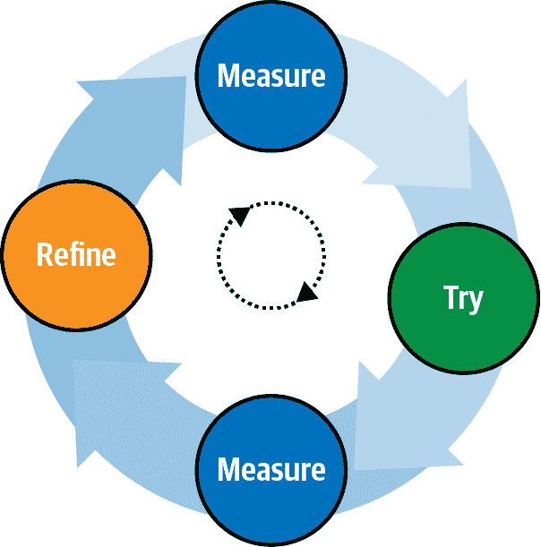

这是一个基本的循环改进过程，有许多其他名称。它与计划-执行-检查-行动（PDCA）或计划-执行-研究-行动（PDSA）周期非常相似，也称为 [戴明循环](https://oreil.ly/L6Z3h)。

在此版本中，我们从顶部的*测量*步骤开始。我们在做出任何更改之前测量系统以了解其当前状态。

然后我们进入*尝试*步骤。在这里，我们尝试进行更改以查看它是否会对系统产生积极或消极影响。它帮助我们还是伤害我们？

为了回答这个问题，我们再进行一轮*测量*。我们再次测量系统并将当前状态与原始状态进行比较，以查看其如何变化。这使我们能够确定我们尝试的事情是否改善了我们的状况还是使其恶化。

然后我们*改进*我们的尝试以解决出现的问题或扩大收益。净结果应该是我们处于改善的状况。

这使我们回到顶部，循环再次开始：测量-尝试-测量-改进，然后重复。这是持续改进的过程。

关键点是我们必须在做出任何更改之前和之后进行测量，并确定两次测量之间的差异，以便评估我们尝试的影响。除非你知道每次更改前后你的状况，否则你无法判断是否有所改善。

## 测量的好处

每次更改都伴随着成本。那些成本可能是有形的（工程成本、测试成本、更改的运营影响等）或无形的（例如，机会成本）。有时我们做出的更改改善了我们的状况，但成本超过了改善的价值。我们可能做出了*局部改进*，但总体上我们并未变得更好，因为成本太高。只有通过测量，我们才能了解我们所做更改的真实价值以及相关的成本。

测量的另一个好处是它让你知道何时完成。该循环可以永远持续下去，但迟早你能够做出的改进将不再值得其成本。正如 Figure 2-2 所示，测量会告诉你何时停止：当你达到目标时，或当你在不产生不合理成本或负担的情况下做出了尽可能多的改进时。

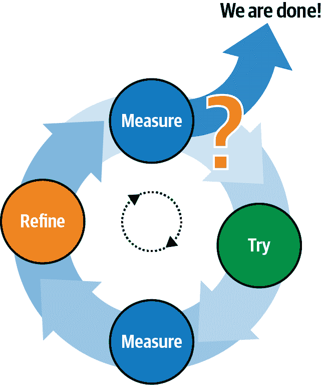

总之，测量帮助我们：

* 确定我们当前系统的状态以及我们在流程中的位置，以便我们知道将精力集中在何处以进行改进。


*   分析我们的变更，看看它们是让情况变得更好还是更差，或是否改进得足以证明变更成本的合理性。
*   判断何时该停止尝试改进。

# 你要测量多深？

前面我举了大型企业花费六个月进行大型正式系统审计的例子。这是一种测量方式。它会给出系统状态的完整视图，准确且细节丰富——但如 Figure 2-3 所示，它显示的是审计开始时，即六个月前的系统状态。

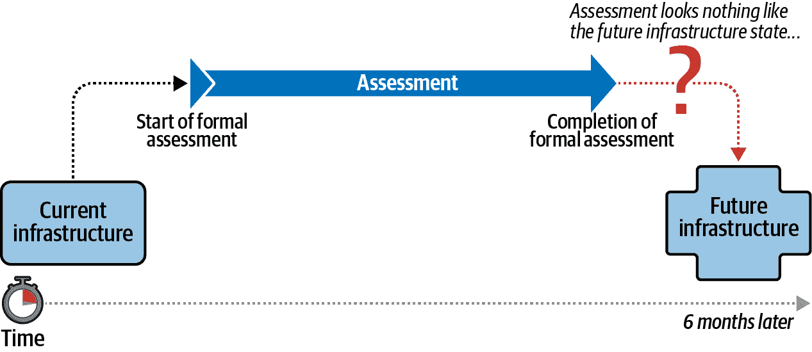

在我们试图在每次测量周期之间逐步改进时，这种审计对我们管理系统性改进毫无用处。如果我们只能在为期六个月的正式审计/测量周期结束时每六个月做一次小改动，那么我们就无法快速做出改变，我们整个 Measure-Try-Measure-Refine 流程就会失败。为了应对 IT 复杂性困境，我们需要摆脱这些漫长、笨重且昂贵的评估周期。我们的 Measure-Try-Measure-Refine 循环的持续时间应以天或小时计，而不是以月或年计。

那么，当你盘点你的系统、审查你的应用程序、*measure* 你的应用程序及其基础设施的当前状态时，你应该对系统测量多深？

一种观点认为，你需要对应用程序及其基础设施有深入详细的了解。你需要知道每一台 CPU、数据内存芯片、网络段、电缆、应用程序流程、服务、节点等。如果不知道一切，就等于一无所知。这种观点正是导致我们之前谈到的为期六个月的正式外部审计的原因。要求对一切进行精确测量意味着你不可能在及时的情况下知道你需要知道的一切。它也可能导致没有理解的知识：等你测量完一切时，你已经没有上下文来应用你所获得的理解了。

数据太多并不总是有所帮助，尤其是当获取数据的成本使数据本身变得不那么有用的时候。如果收集数据需要六个月，你就无法使用这些数据来确定*今天*需要做出什么改变以便*明天*让情况变得更好。

相反，你需要做出妥协。你需要收集数据的一个子集，并期望你收集的子集能为你提供推断其余数据的洞察力。Figure 2-4 说明了这一点。

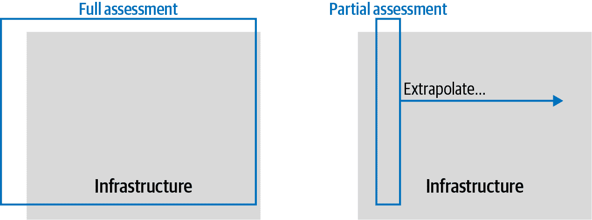

但你需要什么数据呢？假设你有一个大型系统，运行着许多大型应用程序，你想做一个盘点，以便知道每个应用程序需要多少基础设施组件。你这样做是为了将这些数字与你实际拥有的库存量进行比较，了解你是否有过剩容量或服务运行得过于精简。进行完整盘点成本太高、耗时太长——但在不进行整个系统的完整盘点的情况下，你如何确定你拥有什么呢？让我们看看一些可能性。

*Option 1: Look at only some attributes of the inventory (such as compute) and ignore others (such as networking or storage)*。

一个选择是只查看基础设施的一个子集。例如，你可能只查看 CPU。你有多少 CPU？它们有多强大？这代表多少原始计算能力？你可以据此确定为每个应用程序的每个部分分配了多少计算能力。

在只关注原始计算能力时，你忽略了应用程序所需基础设施的其他重要方面，例如内存、存储和网络资源。你做出的推断是，如果一个应用程序的计算资源是另一个的两倍，你就可以假设它也有两倍的网络、内存和存储资源。

然而，这种假设很少准确。仅仅因为一个应用程序分配的 CPU 数量是另一个的两倍，或其 CPU 的性能是两倍，并不意味着这些 CPU 的内存、数据库存储或网络容量也是两倍。

使用一种资源作为整个系统库存的代理会导致数据不准确和错误的预期。

*Option 2: Look at a single application or service in its entirety, and ignore all other applications/services*。

创建库存时可以采取的另一种方法是查看应用程序或服务的一个子集。例如，你可能决定彻底调查单个应用程序。你确定它需要多少计算，以及多少内存、存储、网络容量等。你弄清楚构成该应用程序的服务，以及该应用程序运行所需的外部服务。你对运行这一个特定应用程序所需的一切进行完整盘点。

然后你做出假设，即系统中所有其他应用程序或服务将具有相似的一组需求，基于某个比较点。例如，如果你分析的应用程序需要 25 台服务器，而另一个应用程序需要 50 台服务器，你就可以假设另一个应用程序使用的*一切*都是你分析的应用程序的两倍。

这可能比选项 1 更准确一些，但正如你所想象的，它仍然不准确。给定应用程序或服务所需的<|message|> 基础设施量与另一个应用程序或服务所需的量关系不大。任何两个应用程序在内部看起来都可能非常不同，并且可能使用非常不同的支持服务组合。你仍然无法更接近地了解整个系统的完整基础设施需求。

那么，如果这两种选项都不是获取系统库存需求完整图景的有用模型，除了进行为期数月的整个基础设施的全面审计之外，你还能怎么做呢？

这里考虑的选项试图通过从数据集中提取重要数据的一个子集并从中推断来加快盘点过程。但正如我们所见，这导致了不准确。相反，为什么不一开始就花更少的时间创建库存清单呢？与其试图准确、完整地创建基础设施一小部分的库存，你可以创建一个总体概览库存，可能不是很准确，但会代表你的整个系统。我称之为*adaptive assessment*。

# Adaptive Assessment

让我们接受这样一个事实，即这最初可能不是一个非常准确的库存。相反，随着时间的推移，当你调整系统时，你会向现有的（不完整且不准确的）库存中添加更多数据，一点一点地改进它。也就是说，随着每次变更，你会*adapt* 你的库存，向其中添加更多数据，使其成为对系统整体评估的略微更准确的版本。

采用自适应评估方法，我们不是追求对完整库存的完美（这会花费太长时间）或部分库存的完美（这会不具代表性），我们*estimate* 整个系统的库存。然后，随着时间的推移，我们完善估计，使其越来越准确。

这是一种迭代的库存评估方法。Figure 2-5 说明了这一过程。在自适应评估中，你用一定的不准确性换取速度。换句话说，你用*granularity of assessment* 换取开发速度。

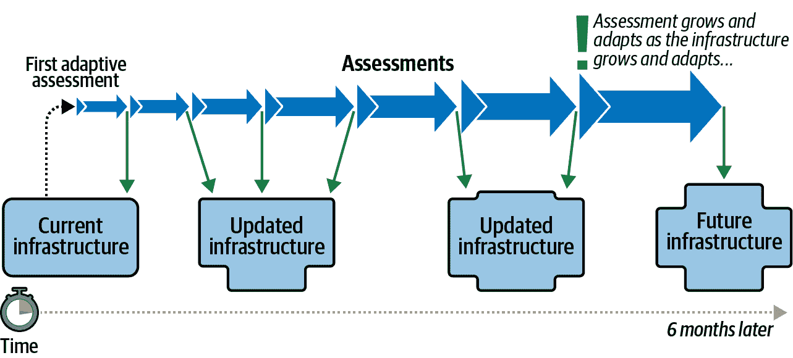


意识到如果完成需要六个月，你的清单将毫无价值（因为六个月后你拥有的库存将不是现在拥有的库存），因此你改为对库存进行浅层评估，并随着时间的推移不断完善它。结果是，你将拥有一个在更长时间内更相关、更有用的库存。你会非常迅速地做出最初的、尽管不准确的库存评估，然后随着系统的变化对其进行完善并添加更多细节。慢慢地，它会变得更准确。因为库存起初并不需要花费太多时间来创建，所以它将比过时的*历史状态*更能准确地代表你的*当前状态*。

## 自适应评估的价值

自适应评估的真正价值在于时间。我们将在下一章开始讨论自适应组织，但简而言之，具有自适应架构的组织所需的决策周期最多以天或周为单位计算。在许多情况下，行动执行周期以分钟或天为单位计算。由于正式审计可能需要数周或数月才能完成，因此对自适应组织来说毫无用处，而且是浪费的。等待六个月等待正式审计结果是不切实际的，即使你能等那么久，结果也只是对系统六个月前的视图，毫无用处。如果你每天做出决策和更改，评估在你看到它之前几个月就会严重过时。

自适应评估能让你*立即*获得一些可操作的信息。即使你无法完全访问正式审计中可用的所有内容，你现在所拥有的信息也是在正确的时间可用的。在你真正需要时拥有一部分数据，远比在为时已晚时才获得完整数据要好得多。

关键是要始终牢记最终目标。最终你确实希望获得尽可能准确的评估，无论是在信息质量方面，还是在当前时间点的信息准确性方面（即一份代表系统当前状态的清单，而不是对过去某个时间点的系统快照）。

那么问题是：你如何决定在评估中愿意牺牲多少粒度，以便及时获得所需的数据？换句话说，数据必须有多精细才有用，你又何时需要它？

## 创建自适应评估

我们从这个乐观的目标开始：我们想要一切。

但我们需要用现实检验来缓和这个目标：我们愿意接受我们收集的数据中的错误。我们可能在评估的大部分内容中使用猜测和估计，以便更快地获得结果。

我们将使用误差条方法来创建我们的自适应评估。这种方法会产生一份完整的评估——对我们系统的完整清单——但该评估基于猜测和估计，可能是不正确的。因此，它们具有“误差条”。我们的长期目标是随着获得更多信息而修订我们的估计，以缩小误差条的范围，最终创建更准确的评估，如 Figure 2-5 右侧所示。我们的短期目标是快速创建一份带错误的完整清单。这与外推方法相反，外推方法力求快速获得部分清单，或正式审计，正式审计力求在长时间后获得一份完整且无错误的清单。

经典的误差条方法从对系统的口语化知识开始。“我相信我们在主要服务机架中有 48 个网络接入端口。”足够接近了；我们现在就用这个数字作为我们的清单。将来某个时候我们可以验证这个数字：如果我们发现是 50 而不是 48，我们可以调整我们的评估，使其更准确。但在此期间，我们有一个可用的数字可以处理。知道机架中大约有 48 个端口，比完全不知道有多少个端口并且需要等待几个月才能获得准确计数要有用得多。

自适应评估说：“我更看重尽早受教育，而不是晚受教育，并且我明白随着时间的推移我会变得更有知识。”

## 基于自适应评估的决策

我们将使用评估来做出决策，但重要的是要理解这些评估并不是绝对的。它们是估计，会随着时间的推移而调整和完善。我们的数据——我们的评估——是*敏捷的*。

因此，我们使用这些数据做出的决策也需要是敏捷的。我们需要愿意在获得更准确、更完善的数据时重新思考和重新实施过去的决策。然而，这并不意味着我们可以常规地反复无常。

决策灵活性对许多 IT 组织来说是一个难题。一些组织即使面对明确且令人信服的证据表明他们走错了方向，也很难改变方向。与此同时，其他组织无法专注于任何事情，并不断在非决策之间来回摇摆。两者都不是好地方。

要有效地使用自适应评估，你需要愿意并能够做出经得起考验的决策，但也要愿意在精炼的数据表明需要更改时重新思考这些决策。

你的数据有误差条，所以你的决策也必须有误差条。灵活性很重要，同时还要做出可操作的决策。

作为一个组织，你最需要的技能是适应性。你的架构需要是自适应的，而不是过度健壮。一个僵硬且抗拒变化的架构，并不适合自适应评估。

## 松耦合

许多架构模式支持自适应评估，但你应该在所有架构决策中拥抱的最有价值的模式之一——应用、基础设施、业务——是松耦合模式。

在松耦合架构中，架构内任意两个模块之间的连接尽可能松散和灵活。这一概念适用于应用架构（如面向服务的架构）、基础设施架构（如云中心架构）以及业务和组织架构：

* 在*应用架构*的情况下，松耦合意味着你必须在软件服务之间创建坚实的 API 和合同协议，以定义服务之间预期的交互。API 定义并管理服务间的期望，但它们不对服务本身内部实现中使用的方法、系统和架构提出任何要求。
* 在*基础设施架构*的情况下，松耦合意味着你应该依赖使用具有关于其工作原理的预定义期望的基础设施服务，例如基于云的服务。然而，这些服务的使用者不需要了解基础设施服务本身是如何构建或如何运行的。
* 在*组织架构*的情况下，松耦合意味着独立于其他团队或整个组织的拥有权和职责来定义各个团队的拥有权和职责。团队拥有明确定义的、可独立实现的目标，而无需邻近或接口团队的过度干预。


进入`/path/to/xxx`目录，找到`xxx.json`。

在表达式`cvar = avar + bvar`中，加法运算符（`+`）将`avar`与`bvar`相加，得到它们的和`cvar`

在`List.of(arg0, arg1, arg2)`中，`List`接口的工厂方法`of()`接受一系列的元素，返回包含它们的只读列表。

之后我们这样调用`cmd`命令：`cmd arg0 arg1 arg2`。

```
if (condVar > someVal) {console.log("xxx")}
```


左侧的 图 3-1 显示了传统架构。人工操作员手动与各个基础设施组件——服务器、交换机、网络电缆等——交互，并做出必要的更改以适应组织不断变化的需求。如果需要额外的服务器资源，就有人 physically 进入机架添加一台新服务器，布线并使其运行起来。这个过程在某些情况下可能需要几天、几周甚至几个月的时间。相比之下，在自适应架构中，例如云计算服务提供商提供的架构 图 3-1 右侧所示，软件程序确定应用程序的需求并动态地、实时地更改分配给该应用程序的 IT 基础设施并调整其配置。所有这些都是自动完成的，无需人工干预。如果需要一台新服务器，云服务提供商会分配一台并自动将其附加到基础设施中的正确位置。使用传统架构需要数小时或数天才能实现的修改，使用自适应架构只需几分钟或几秒钟。这使得应用程序的架构能够不断地、创造性地实时修改以满足其不断变化的需求。

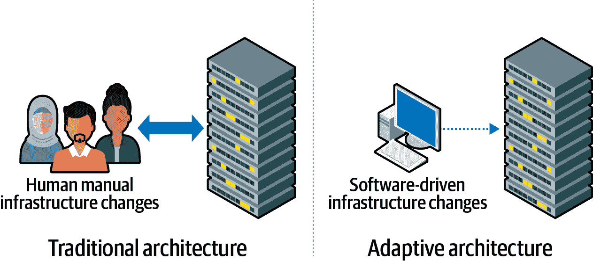

如果一项服务流量增加并且需要额外的资源来处理该流量，则可以根据需要自动动态添加这些资源，并在流量下降时释放。需要执行长时间的复杂操作，例如计算月度报告或处理新数据集？使用自适应架构，您可以临时分配额外的资源，根据需要进行配置，执行工作，然后释放它们。

想在正在运行的应用程序中尝试一个新想法吗？分配所需的资源并进行测试：如果可行，您可以将资源纳入 IT 基础设施集合中；如果不可行，您可以删除它们，它们就会消失。

想在生产环境中发布新功能之前看看它在重负载下的表现吗？启动一些服务器运行该功能，再启动一些服务器生成虚假流量，然后试试看。完成后，只需删除不需要的资源即可。

需要将流量从受损系统绕开吗？启动一个替换补丁并将受损组件从基础设施中移除。试着用传统架构快速做到这一点。

# 自适应架构的实际应用

自适应架构赋予我们灵活性和适应性。它们使我们能够轻松尝试新想法，为意外负载添加新资源，并快速替换损坏、失败或易受攻击的组件。

自适应架构如何融入现代应用程序架构？它们可以在多个地方提供帮助。

## 自动扩缩容

大多数现代在线应用程序的资源需求并不是恒定的。通常，它们会根据使用情况而变化，无论是同时用户数量、每个用户的处理量，还是每个用户处理的数据量来衡量。一般来说，应用程序使用得越多，运行该应用程序所需的资源就越多。这在 图 3-2 中以通用方式说明。

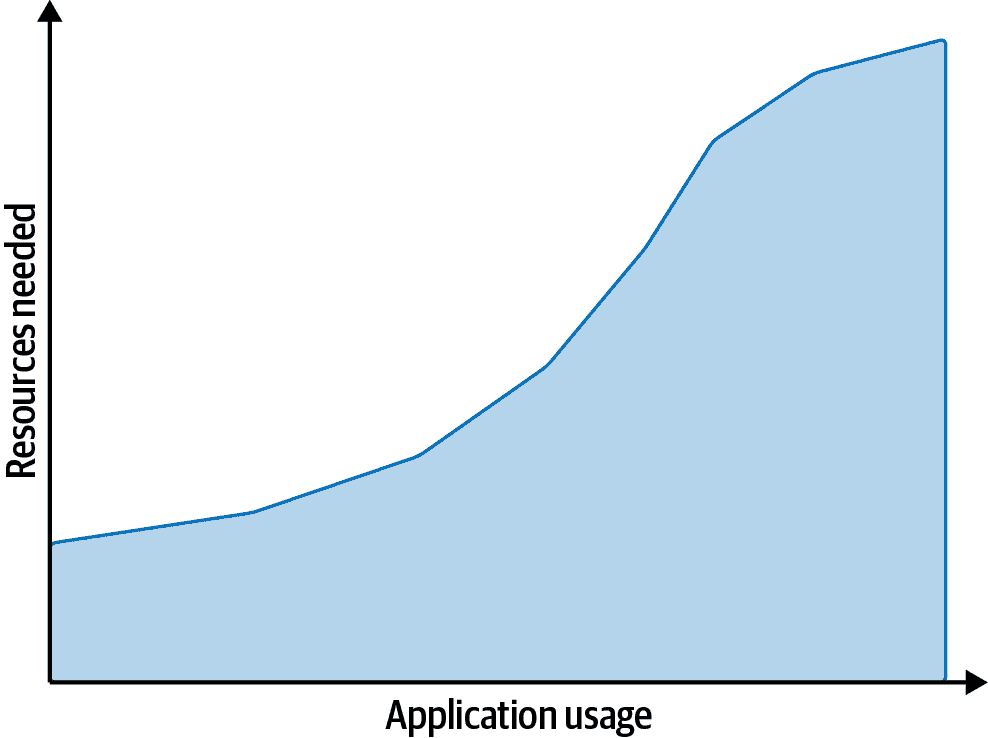

在传统应用程序架构中，这造成了两难境地。需要为应用程序分配资源，但分配多少资源呢？鉴于历史上 [云出现之前] 资源分配昂贵且耗时，资源分配往往是静态的。由于资源使用是动态的，这导致了要么大量资源闲置很长时间，要么由于容量不足而导致应用程序资源耗尽的情况。 图 3-3 说明了这一点。

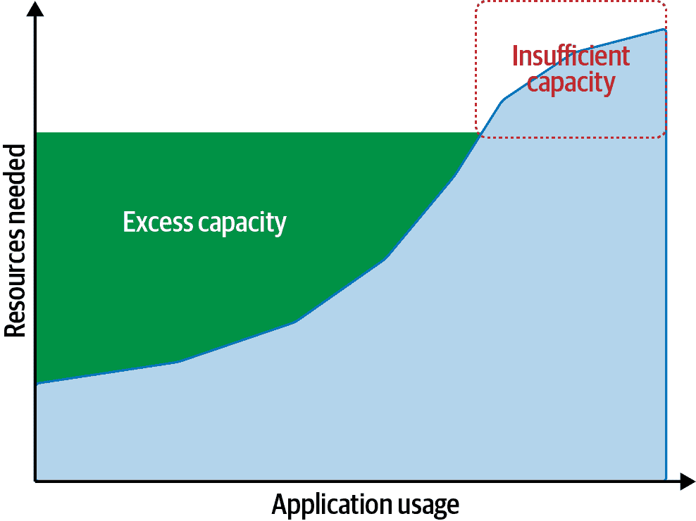

如果资源是静态分配的，它们不会随着应用程序使用量的变化而变化。这意味着要么您拥有闲置的过剩容量，要么容量不足，应用程序处于饥饿状态。然而，使用自适应架构，分配给应用程序的资源水平不必是静态的。它可以是动态的——自适应的——并根据应用程序的需求而变化。随着应用程序使用量的增加，可以添加额外的容量以满足这些需求，并在使用量下降时缩减资源。

这在 图 3-4 中有所说明。理想情况下，您始终拥有比应用程序需求略多一点的资源可用，这样就不会有显著的过剩容量或容量不足。

迄今为止最著名的自适应架构示例是 *自动扩缩容* 架构。自动扩缩容是一种云机制，它监控应用程序的资源需求并自动添加或删除资源以满足这些需求。例如，AWS 具有 Auto Scaling 服务，可以动态更改服务器池中的服务器数量：它监控各种指标以确定是否需要更多或更少的容量，并添加或删除服务器以满足现有需求。

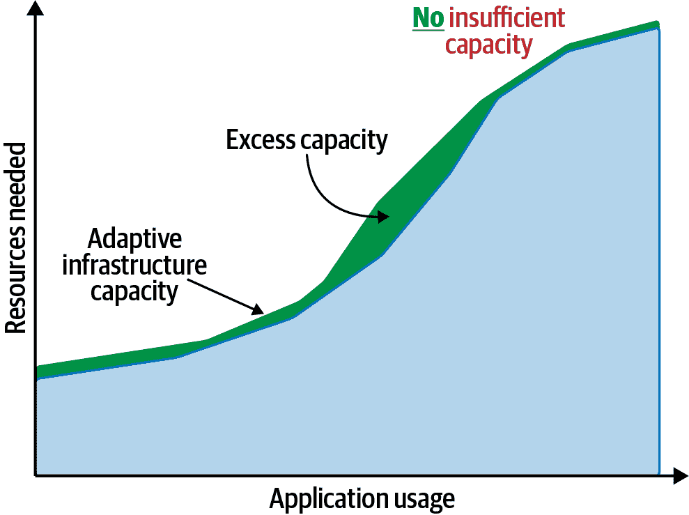

一些基于云的服务会在幕后自动处理分配。例如，AWS Elastic Load Balancer 会动态更改分配给给定应用程序的服务器的大小和数量，以处理传入请求的速度。随着请求数量的增加，会自动添加额外的容量。当请求数量减少时，该容量会被移除。所有这些对消费者来说都是完全透明的；由 AWS 的控制系统内部处理。

## 自愈

想象一个运行在服务器池上的应用程序。如果服务器池中的一台服务器开始故障或损坏会怎样？此场景在 图 3-5 中有所说明。

在传统的非云环境中，应用程序将开始运行缓慢或可能开始间歇性失败。需要人工介入，登录到故障服务器，并修复其出现的问题。如果进程已终止，则需要重新启动它们。如果文件已损坏，则必须修复它。这些修复可能很快完成，也可能耗时。如果耗时，服务器可能在维修期间暂时从池中移除，导致应用程序以降低的容量运行。

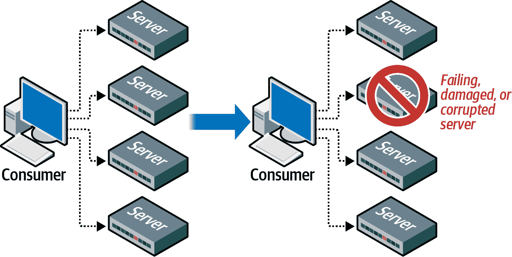

在以云为中心的应用程序中，可以使用自适应架构技术来协助修复过程。如果一台服务器开始出现问题，而不是召唤人工尝试修复它，故障服务器可以自动终止并从池中移除。自适应架构技术会意识到池中需要额外的资源，并会自动启动一台新服务器并将其添加到池中。 图 3-6 说明了这一点。

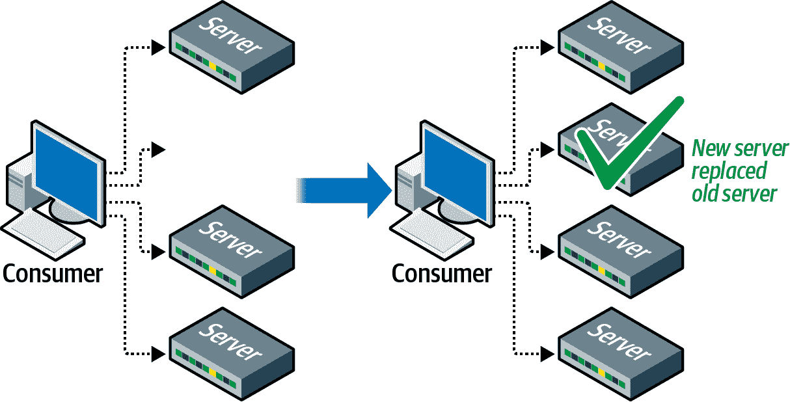

与其让人工尝试修复病态服务器，服务器会被算法简单地放弃，并自动放置一台替换服务器。

这种方法有两个主要优势：

*   无需人工响应事件。问题已自动动态修复。
*   由于无需人工响应和解决问题，因此问题得到解决的速度更快，并且可能对应用程序用户造成的干扰更小。


自适应架构能够有效应对许多高知名度、高影响力的故障模式，能够在无需人工干预的情况下快速高效地替换失效的基础设施。

## 基础设施即代码

本地基础设施传统上是通过将服务器和其他硬件设备上架、连接电缆并布线通信组件来构建的。

这是一个费时费力的手工过程，不仅容易出错，而且不可重复且无法追溯。它不可重复是因为涉及人工操作。无法保证一个人连接计算机的方式与另一个人完全相同，其必然结果是形成一套不一致的系统。此外，如果出现错误并引入问题，通常很难追踪该问题是在何处引入的，因而难以解决。

自适应架构为这些问题提供了解决方案。由于在自适应架构中，基础设施是通过编程方式而非手工方式构建的，因此可以创建标准化的流程和系统，以一致且重复地执行相同的连接。

这种能力催生了一种基础设施创建的最佳实践，称为 `Infrastructure as Code` (`IaC`)。`IaC` 是一种自动化方法，允许使用标准的基础设施描述语言在简单的文本文档中创建所需基础设施设置的描述。然后将该文档输入到 `IaC` 系统中，该系统会向云和组件 `API` 发出适当的调用，以构建与文档化基础设施相匹配的真实云基础设施。这在 Figure 3-7 中有所说明。

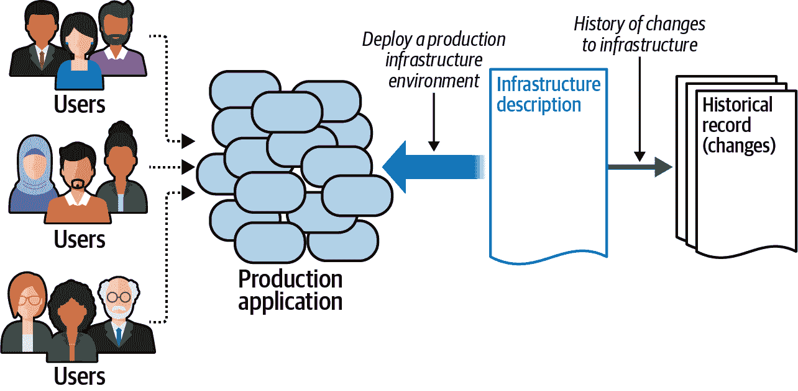

然后，如果需要对基础设施进行更改，只需对文档进行调整并再次输入到 `IaC` 系统中，系统将发出必要的 `API` 调用以使基础设施与更新后的文档保持一致。

这种基础设施管理模式具有许多优势。首先，它简化了复杂基础设施的设计，使过程对普通软件开发人员更易于接近。这使得开发团队能够更深度地参与其软件所运行的基础设施的构建和管理，从而实现硬件资源的更一致、更高效使用，并能够利用 `DevOps` 原则更好地协调运维与开发。

其次，基础设施文档可以像软件代码一样进行管理，将文档放入 `Git` 等版本控制系统中。这样，基础设施文档就可以像软件应用程序本身一样经过评审和审批流程。事实上，软件质量控制的完全相同流程可用于基础设施质量控制。

最后，如果基础设施变更导致运行中的应用程序出现问题，审查修订历史记录对于了解问题起源和确定如何解决至关重要。这消除了“服务器上到底改了什么？！”这种令人困扰的问题。所有更改都得到明确跟踪和管理，并在需要时可以稍后进行审查。

## 在生产类似环境中开发

基础设施即代码也为你带来额外好处。由于基础设施文档描述了构建生产基础设施所需的精确硬件设置的准确视图，因此可以使用同一文档轻松设置辅助的非生产版本的基础设施。这包括设置 staging 和 QA 环境，并确保它们在设计上与生产基础设施完全相同。

其一个好处是，生产环境与 staging/测试环境之间经常出现的分歧和基础设施漂移的常见问题被消除，因为所有环境都是从同一源创建的。此外，想要尝试新设计的开发人员可以轻松地为自己启动一个生产类似环境，以便在与生产环境和其他开发人员和测试人员完全隔离的情况下安全地测试其更改。这在 Figure 3-8 中有所说明。

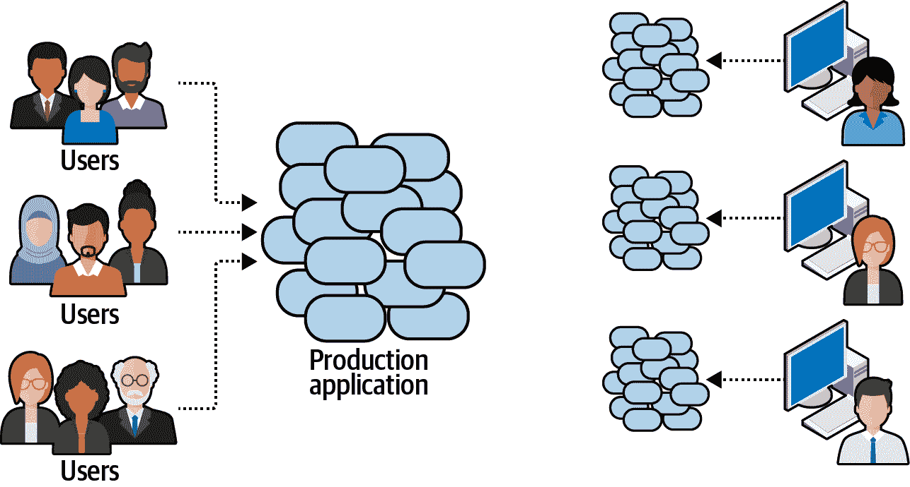

使用自适应架构和 `IaC` 技术，可以轻松创建和管理许多与生产环境完全相同的副本（也许完全相同，或规模缩小但在其他方面相同）。

## 负载测试

相同的 `IaC` 技术可与自适应架构结合使用，以创建用于负载测试的模拟环境。请看 Figure 3-9。

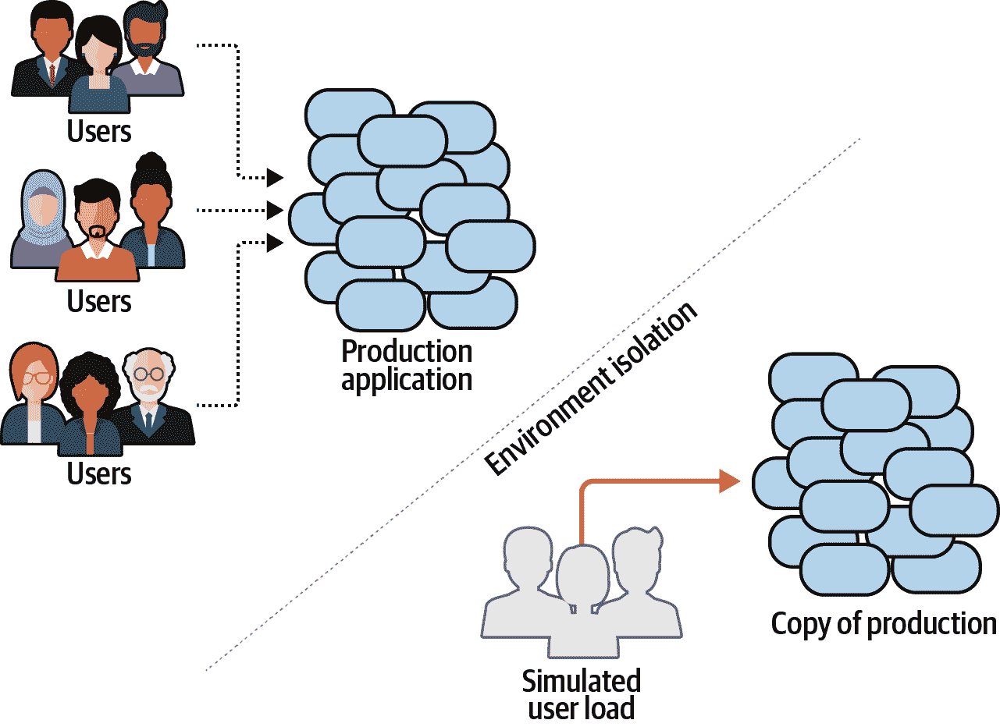

左上方显示了具有真实用户的生产应用程序，右下方是生产设置的精确副本，用于与模拟用户负载一起工作。该环境允许你在与生产环境等价的环境上测试各种用户负载场景。测试是独立的，并在与现有生产环境完全隔离的情况下进行，但由于两个环境几乎完全相同，因此提供了非常准确的结果。

自适应架构允许在不影响现有生产环境的情况下设置许多不同的测试场景。

# 自适应架构成本的复杂性增加

自适应架构在表面上比非自适应架构更复杂。增加的灵活性和敏捷性使你能够更灵活、更敏捷。能够以编程方式修改基础设施意味着你可以让其变得任意复杂。除非得到适当管理，否则灵活性会滋生复杂性。

正如我们在 Chapter 1 中所看到的，复杂性增加会增加技术债务并降低应用程序的可靠性和可用性。更多的复杂性会导致脆弱性（应用程序不稳定）或僵化（对应用程序更改的抵制）。因此，除非妥善管理，否则自适应架构可能导致脆弱性增加或僵化增加；两者都不好。

自适应架构为你提供了前面讨论的所有巨大优势，但重要的是要意识到这种潜在的陷阱。你如何在利用自适应架构优势的同时避免复杂性？

有趣的是，你使用与在大型软件应用程序中减少通用软件复杂性相同的技术来减少自适应架构中的复杂性。

这意味着利用有助于在处理大型应用系统时降低认知负荷的通用最佳实践。示例包括：

### 模块化

将软件分解为更小的模块，如服务和微服务，是 compartmentalize 复杂性并因此减少在任何给定时间点需要记住的复杂性数量的绝佳方法。类似的技术在自适应架构中也适用：模块化你的基础设施并单独管理模块，可以减少应用程序基础设施中的复杂性影响。

例如，在为应用程序设计前端负载均衡器时，你可以将应用程序架构本身视为黑盒。同样，在使用多个服务创建应用程序的动态基础设施时，你可以将所需的数据库高可用性策略视为黑盒，在稍后之前忽略其细节。

### 松耦合


减少软件服务之间的紧密依赖会在大规模应用开发中创造出降低摩擦的分离。同样，在自适应架构中，降低架构模块之间的耦合度可以降低复杂性。通过减少基础设施组件之间所需交互，你可以降低这些组件的复杂性。

例如，前端请求缓存与应用服务之间的交互应限制在基本的 HTTP 缓存协议上。缓存与应用之间不应有更深层次的集成。虽然似乎明智的做法是构建一个后门缓存失效系统，将应用连接到缓存，但应避免这样做，而使用标准 HTTP 协议中包含的基本缓存失效命令。

### 重用

重用软件组件是减少软件系统复杂性的经典模式，同样的技术也适用于自适应架构。通过在架构的不同位置重复使用通用、可重用的基础设施模块，你可以通过提高模块化并促进松耦合来降低复杂性。

例如，如果你部署的每个服务器都有相同的结构和组件，你需要担心的变化就会更少。如果每个服务都结构相同（或使用其中几种不同的基础设施结构之一），你可以在多个服务中重用相同的模式。同样，使用一两种标准的服务间通信模型可以减少由每个服务自行选择通信协议所带来的复杂性。允许单个服务控制安装的软件和底层服务器的目录结构可能会使这些服务的某些任务变得更容易，但它会增加整个架构的活动部件数量。重用可以降低复杂性。

### 标准化

通过标准化特定组件来限制选择也能降低复杂性，通常还能提高敏捷性和价值实现速度。例如，AWS 在创建自适应架构时有数百种不同尺寸和形状的服务器可供选择。任何这数百种变体都可以在同一应用中使用。然而，将允许的选择列表限制为少数几种即可满足应用需求的选择，可以大幅降低复杂性。

除了利用这些最佳实践之外，还有其他策略可以采用：鼓励并强制执行一致性、可重复性和规律性将有助于降低架构复杂性。

# 示例：通过分层安全降低复杂性

让我们看一个在自适应架构中管理和降低复杂性的示例。在这个示例中，我们将研究一个基于云的安全模型，并看看如何使用刚才描述的一些技术来降低安全设置的复杂性。

图 3-10 显示了企业的简化安全模型。该企业有四个应用分布在四个不同的地理站点。站点 1 和 2 托管应用 1、2 和 3。站点 3 托管应用 2、3 和 4。站点 4 托管应用 1、2 和 4。

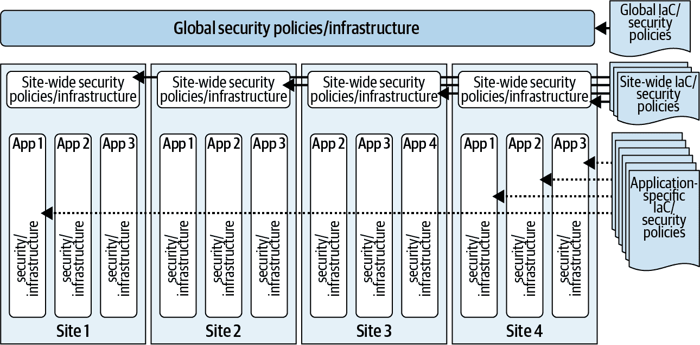

每个站点上每个应用段都有安全策略和安全基础设施要求，加上每个站点都有自己的安全要求。这意味着必须管理 16 个不同且动态变化的安全要求。如果它们各自独立管理，随着服务器、站点和应用数量的增长，跟踪所有这些要求将几乎不可能。在一个规模合理的企业中，系统中每个组件可能有数万个不同的安全和基础设施要求。

显然，如果所有策略和基础设施都相同，那就最好了，这样只需跟踪单一策略。现实中 however，这不太可能发生；不同地区有不同的安全要求，不同应用也有不同的要求。随着站点和应用数量的增长，复杂性呈指数级增长。

解决方案是实施 *分层* 或 *分级* 安全模型，使用前面描述的模块化、松耦合和重用最佳实践。在此模型中，你有一套适用于所有应用、所有地区的一致的全局安全策略和基础设施要求。接下来，在站点/地区级别建立一套站点范围的安全策略和基础设施要求。最后，在第三层定义一套应用特定的策略。

通用策略和标准化基础设施要求包含在顶层（全局）策略级别。这些适用于所有内容，在所有站点。站点范围/地区特定策略仅包含策略例外，说明它们与全局策略的偏差。然后，在应用特定级别，定义适用于特定应用的策略例外。

你首先定义全局安全策略。目标是将尽可能多的要求放入其中。所有适用于全公司的内容都应在此顶层指定一次——这包括诸如用户密码要求、阻止机器人的安全规则、边缘防火墙要求等。这些策略和要求在所有站点和所有应用中普遍适用。

接下来，你定义站点范围策略。这些应仅包含适用于给定地区对全局策略的例外。例如，必须遵守欧盟《通用数据保护条例》（GDPR）要求的欧盟站点会在其地区策略中描述这些例外，或者你可能需要为位于 Azure 区域与 AWS 区域的站点定义不同的策略。最终结果是你有一套策略，大部分是全局描述和实现的，但可以根据需要针对特定地区进行调整和修改。这些站点范围策略可以依赖于并因此忽略全局策略中指定的某些规则；例如，它们不必处理机器人问题，因为全局层已处理它们。

最后，在应用特定策略级别描述应用特定的例外。这些策略可能包括诸如应用需要的网络端口、预期流量类型和扩展要求等要求。此层中的策略可以忽略站点范围和全局策略中适用于它们的任何内容，而仅专注于指定此应用独有的例外。

应尽可能在全局级别指定尽可能多的策略和基础设施要求，随着向下到更细粒度的应用级策略，要求的数量应越来越少。这些应指定尽可能少的必要要求。

净结果是，与数万个不同的安全策略相比，你只有三个层级，底层仅包含所需详细的例外。大多数要求仅在全局级别指定一次。

这里描述的方法通过实施定义的流程和程序，大大降低了管理完全敏捷安全模型的复杂性。它使用 *模块化* 的三层控制；*松耦合*，因为各层在尽可能的情况下相互独立；*重用* 高层策略以减少变化；以及整体上一个 *标准化* 的 *模型*，影响更改可以如何以及在何处进行。

这个分层模型并没有什么神奇之处，但此类模型可以显著简化采用自适应架构技术的应用的开发和运营。


通常，像这样的模型中的策略是在一个带外管理层中实现的，该层以通用方式处理代码、配置管理、基础设施和策略规则以及分析，保持这些要求全局化，同时又能安全地与三个生产层隔离。该层独立于其他三层，并为所有其他层提供管理和控制。

# 摘要

自适应架构是促进大型现代应用程序创建和运营的绝佳工具。然而，不当使用时，自适应架构会增加应用程序的复杂性，导致组织在思维、流程和设计方面的脆弱性和僵化。使用在构建大规模软件应用程序时可靠使用的相同既定最佳实践，我们可以利用自适应架构，同时管理增加的复杂性，让我们在获得其优势的同时避免风险。

所有这些意味着更高的敏捷性，这意味着你可以在实现竞争性业务创新的同时构建更安全的应用程序。
