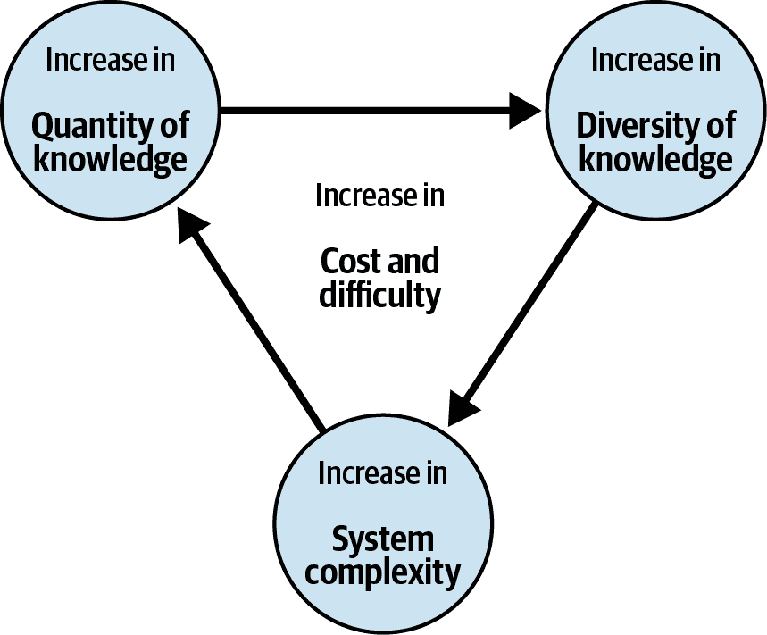
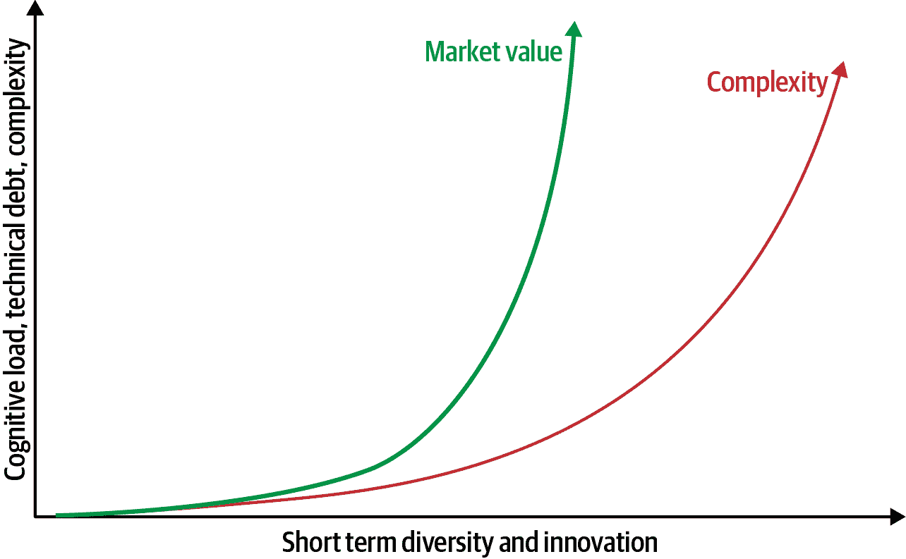
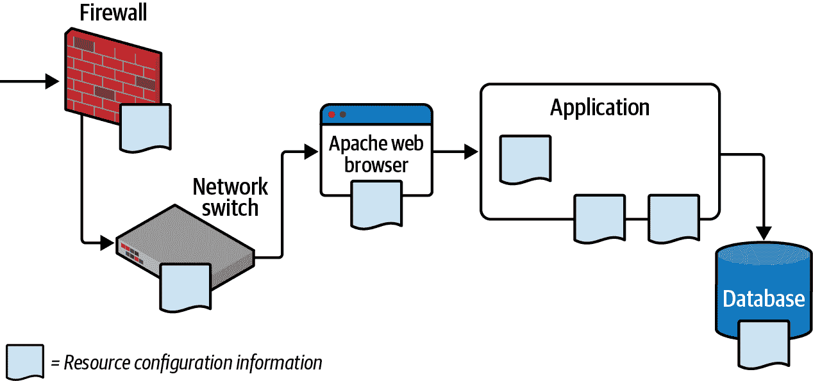
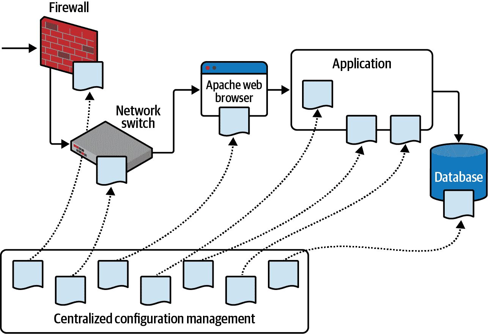
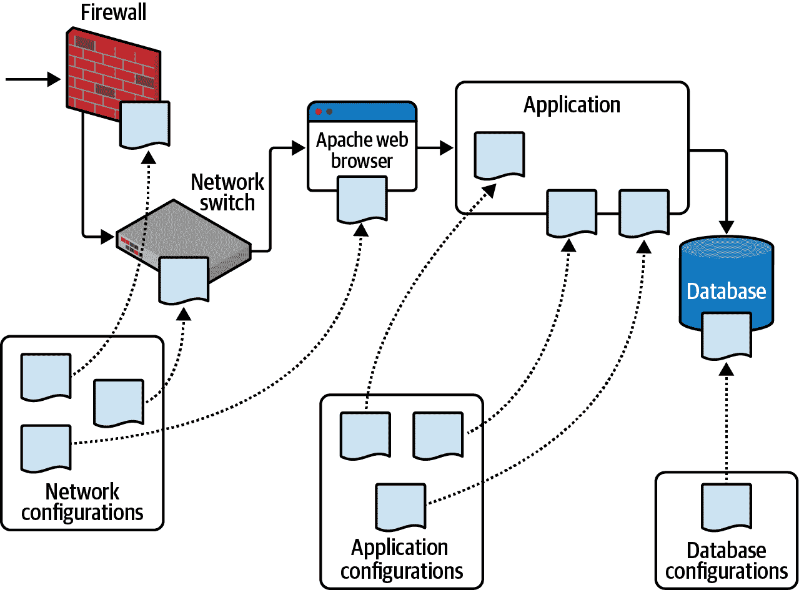
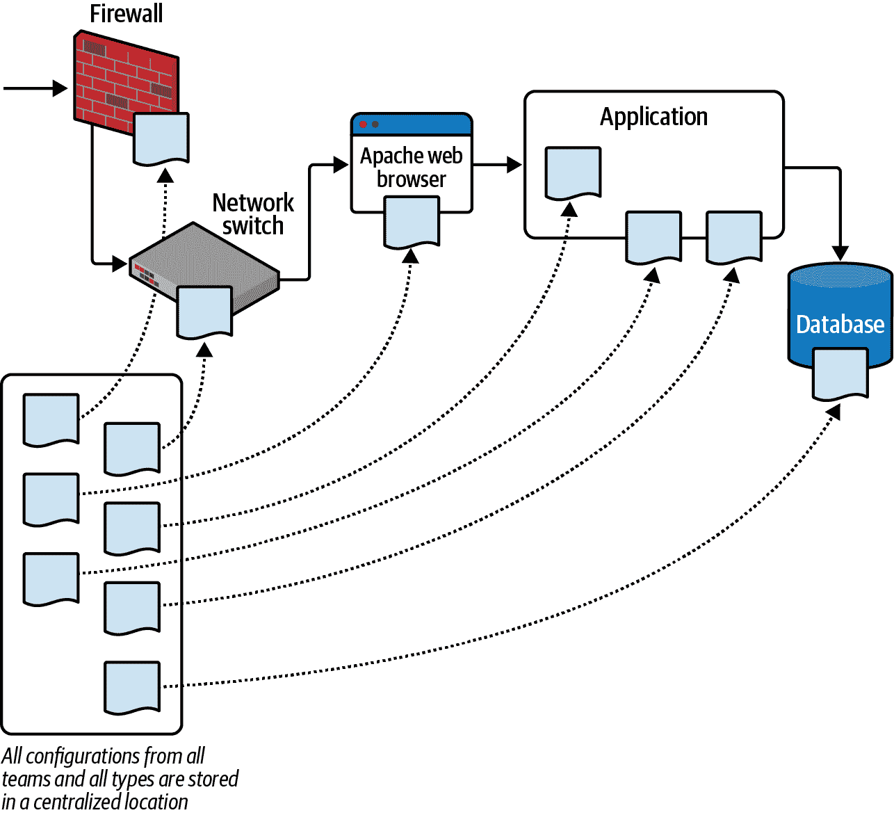
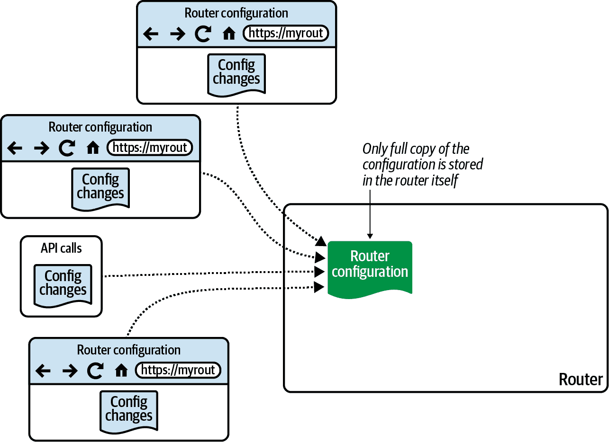
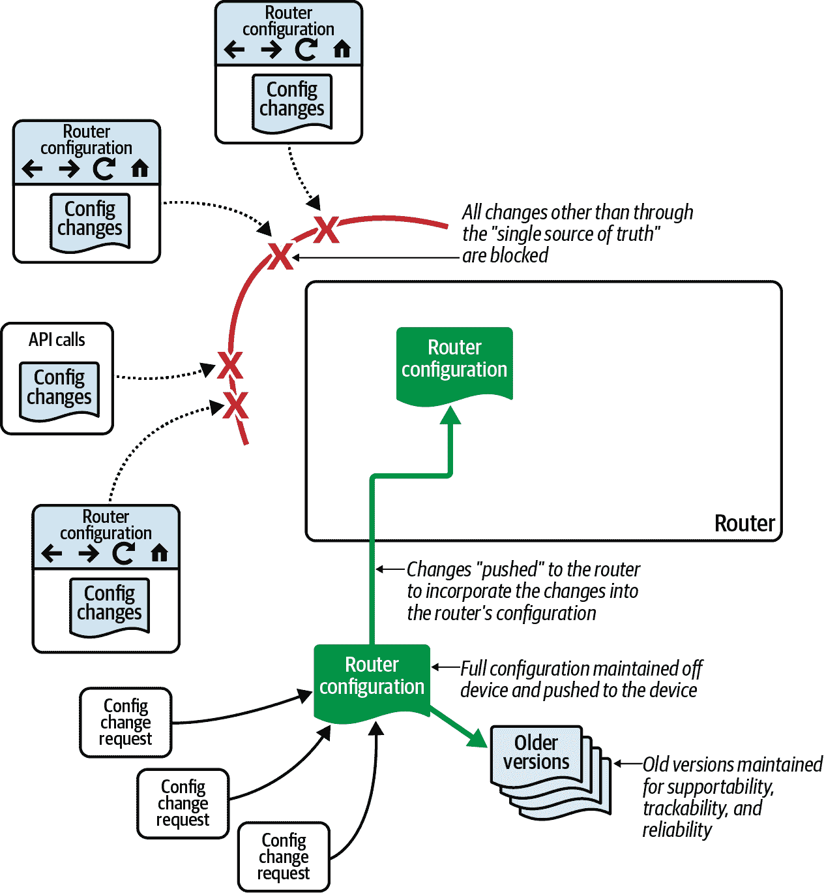

# 第 4 章 管理知识

*知识管理*是协调和管理维护和运营应用程序所需信息的过程，包括配置、密钥和文档。有效的知识管理涉及确保这些信息以尽可能统一和一致的格式存在，并在需要时对所有负责人员可用。知识管理还在于减少个人为操作和维护系统所需的知识量。它有助于确保组织中的每个人——从新员工到经验丰富的从业者——都能尽可能高效地工作。

理解和维护复杂系统往往需要大量的知识和专业技能多样性。系统越复杂，维护它所需的知识就越多。此外，构建和维护系统的成本和难度与构建和维护它所需的知识成正比。Figure 4-1 显示了这种关系。

一般来说，系统所需的知识越多，维护这些知识就越困难，系统也越复杂。

理解需要多样化专业知识来操作和维护的系统也涉及很高的认知负荷。认知负荷是指某人一次能在工作记忆中保持的信息量的衡量标准。知识要求越独特，你就必须在头脑中保留越多的上下文才能理解它们，因此负荷就越大。知识管理有助于降低认知负荷，使构建和运营系统更高效。

## 知识变异性：选择与复杂性

存在一种二分法。你给团队提供构建、开发和维护应用程序的方式选择越多，他们就越具创新性。这通常会导致上市时间更快、产品更具竞争力，最终员工更满意。

但这种多样性的增加引入了复杂性，这意味着理解系统如何运行所需的知识量更大。

因此，短期内为你带来市场价值和成功的特性——具体来说，创新和灵活性——从长期来看会导致认知负荷、技术债务和复杂性的增加。Figure 4-2 说明了这一点。

在早期应用程序开发过程中允许的创新和多样性越多，市场成功的可能性就越大，你为市场带来的价值就越多。但同样的品质也会增加长期的认知负荷和应用程序复杂性，不利地影响性能和盈利能力。

你是否曾经决定实现一个临时又粗糙的功能，因为你需要快速将其推向市场，尽管它会在长期内为你的应用程序带来额外的复杂性和技术债务？这就是创新的作用，以长期复杂性的代价换取短期价值。

有效地管理知识是减少系统复杂性的基础，而减少复杂性是降低认知负荷并最终提高可维护性的必要条件。长期的知识管理往往与创新和选择相矛盾，必须平衡管理以创造短期和长期的价值。

这里的意图并不是说创新是坏的。相反，思想和流程的多样性和创新对于应用程序（以及业务）的成功至关重要。然而，重要的是要意识到这种心态有时隐藏的长期成本和风险。

也就是说，在创新和做出短期决策时，你必须将这些选择对长期认知的影响纳入你的考量。无所不用其极的创新是长期灾难的配方，但受管理的创新可以帮助创造持久的产品。

## 管理知识需求

知识管理的目标是将关于系统工具、系统、流程、程序和要求的所有可用信息集中起来，这些信息使系统高效运行，同时不过度纠正和过于限制，以免扼杀创新。

你如何控制系统所需的知识？有趣的是，通过使用你用来管理系统中整体技术复杂性的相同工具、技术和流程：

**理解（衡量）**

在你了解操作系统所需的知识的广度和范围之前，你无法管理系统的知识需求。

**松耦合**

保持系统彼此独立——减少它们之间的依赖——会降低知识需求。依赖管理、副作用和意外结果都是高度依赖系统相关的问题。独立系统避免了这些复杂性，其操作所需的知识比高度相互依赖的系统少。

**标准化**

使用标准化的方法、程序和流程提供了一个结构来创建可重用的组件，这些组件可以以通用方式利用。标准化是保持系统简单和认知负荷低的关键。

**重用**

在标准化系统中，重用知识、配置和信息（以及组件和基础设施）更容易实现。利用系统中的共同点并保持系统一致和规范，可以降低理解应用程序如何运行的认知负荷。你让你的服务和系统与其他服务和系统操作方式越相似，可变性就越少——也就是说，使用它们所需的额外知识就越少。这降低了处理复杂性所涉及的认知负荷。

在管理复杂系统时，减少操作它们所需的知识量以及该知识的变异性具有各种优势。这些包括：

**更高的生产力**

更简单的系统更容易理解，因此可以让新员工更快地高效使用它们。这种价值实现时间的减少提高了生产力。

**提高可支持性和一致性**

依赖标准化和重用的更简单系统具有更易于支持的组件和最佳实践的更一致采用。重用提高了弹性和可靠性，从而提高了可支持性。一致性降低了复杂性。

## 集中配置

生产应用程序常见的难题是配置、设置以及运行应用程序所需的其他数据应存储和管理在何处。这包括诸如数据库访问凭证、第三方服务激活令牌、网络路由器和交换机配置文件、防火墙配置、缓存设置参数、数据库配置信息以及服务器配置文件等内容。

这些信息通常存储在需要使用它的地方。例如，如 Figure 4-3 所示，网络设备（防火墙、交换机、路由器）将其配置信息存储在设备本身中，Web 服务器配置与 Web 服务器一起存储，数据库配置与数据库一起存储。 使用这些功能所需的凭证存储在正在使用各种设备和服务的应用程序中。

将设置和管理服务所需的信息直接与该信息的使用者一起存储似乎是一个不错的模式。然而，这种方法存在几个问题：

Security/vulnerability

: 

当你将凭证与使用这些凭证的用户一起存储时，如果应用程序遭到入侵，则你存储的凭证所对应的引用服务也会遭到入侵。从安全角度来看，这是不良做法。

Consistency/reusability

: 

当你将各个配置文件存储在设备本身中时，就没有关于系统如何设置和配置的集中知识。这意味着你无法比较例如一个网络路由器与另一个网络路由器的配置以查看它们有何不同，或将一个更新以匹配另一个。反过来，这意味着你无法轻松地将一个配置中使用的最佳实践应用到另一个配置中。

Availability/safety

: 

将配置文件存储在设备本身中也意味着这些信息没有冗余或备份。例如，如果一台网络交换机出现故障并需要更换，新交换机应如何配置？当配置文件存储在设备本身中时，如果设备出现故障（或遭到入侵）并需要移除，配置就会丢失。如果没有在设备外部维护备份，更换它就需要额外的工作来重建配置的要求。

Traceability

: 

如果有人更改了所需资源配置，并且该更改最终导致应用程序中断，在没有集中知识的情况下，很难发现最近发生了什么变化，这意味着很难找到并修复损坏并减轻停机时间。可追溯性长期以来被认为在软件代码中很有价值，但在基础设施配置和设置中同样重要。可追溯性并不是关于指责导致问题的人；而是关于识别发生了什么以便更快地解决问题，并在长期内创建流程和系统以确保相同的问题不再发生。

当配置信息与资源本身一起存储时，安全性、可靠性、一致性和可追溯性都会受到阻碍——正如我们在 Chapter 1 中看到的那样，这可能产生严重后果。

创建、更新、管理和验证或重用基础设施配置越困难，你的应用程序中的技术债务就越大，整体运营复杂性也越大。为了解决这个问题，需要一个集中管理和控制配置的系统。

## 维护集中化的单一事实来源

控制和减少与配置相关的复杂性的最佳方法是集中维护配置信息，放在应用程序和基础设施资源本身之外。这种依赖于*single* *source of* *truth*的模型保护了你的应用程序配置，并简化了问题诊断和解决流程。信息的集中化允许重用和可重复性；正如我们所见，这降低了复杂性并提高了一致性，从而增强了可靠性。

Figure 4-4 说明了这种方法。在集中式配置管理系统中，所有组件的配置都存储在单个、公共的位置。然后，当对其中任何配置进行更改时，新版本会被推送到每个对应的设备，更新其内部副本。系统相关的所有配置的权威版本都一起存储在设备之外，可以作为一个集合进行操作。这种集中存储模型使得跟踪配置及其所做的任何更改变得容易。此外，所有更改都在一个众所周知的位置进行，该位置比远程设备本身更容易访问。

### 集中式事实来源与单一事实来源

维护单一事实来源并不一定意味着维护集中式事实来源。这两个概念不同，各有不同的优缺点：

*   *centralized source of truth* 是指所有配置和管理信息都维护在单个、集中的位置。
*   *single source of truth* 是指特定信息或信息类型仅维护在一个位置。它可以复制到许多备用位置（备份、不同位置等）并推送到消耗它的位置（需要配置的资源），但只有一个副本在单个位置维护和管理，并且该版本是权威版本。

为了更好地理解这种区别，请查看 Figure 4-5。在单一事实来源中，特定资源的 information 使用单一管理工具在单个位置管理。任何需要对配置进行更改的人都必须在此唯一位置进行更改。更改完成后并经过任何必要的审批流程后，它们将被推送到需要配置的资源。

单一事实来源的优势在于一致性和可靠性。所有进行更改的人都使用一致的流程进行更改，并且所有更改都跟踪在单个位置。然而，不同资源可以使用不同的位置来管理其“单一来源”。正如 Figure 4-5 所示，不同团队（网络团队、应用团队、数据库团队）可以独立地以不同方式管理其配置，同时仍受益于配置来自单个外部来源的优势。也就是说，各个团队可以将应用程序的配置文件存储在与其它团队不同的位置。每个配置都有一个“单一来源”，但配置之间没有集中管理。

集中式事实来源是单一事实来源的进一步发展。在集中式事实模型中，整个系统的所有配置都使用单一配置工具维护在单个位置。这在 Figure 4-6 中有所说明。

在这里，所有资源配置都在一个位置管理，所有团队都使用相同的工具对系统所有部分进行所有配置更改。

除了单一事实来源的所有优势外，集中式事实来源还使得比较配置以查看它们有何不同变得容易：“路由器 123 的安全设置与路由器 382 的不同吗？为什么？”

集中化的真相有助于以更一致的方式使用标准化的最佳实践、重用模式和分层配置，从而实现应用复杂度的显著降低。虽然从应用的各个部分访问单一配置源可能并不总是最高效的解决方案，但使用这种模型比简单的单一事实来源模型更能强烈地鼓励一致性和重用。

### 修订管理

一旦配置集中化，你就可以使用版本控制来管理它。`Git`，软件工程师在全球范围内用于管理软件源代码的工具，同样可以轻松用于维护配置和系统文件。这样做可以让你获得适用于源代码的所有版本管理优势：
* 配置可以备份并在多个冗余位置保持一致维护。
* 可以将更新后的配置与之前的配置进行比较，以确保只有期望的更改被做出，并且没有不必要的、非期望的或错误的更改被意外包含。
* 配置更改可以在部署前进行同行评审。
* 可以实施完整的版本控制和审批流程，以确保只有正确且期望的更改发生。
* 如果观察到性能或可靠性下降，修订历史允许你回溯查看问题发生时发生了什么变化，以帮助诊断如何解决问题。
* 在适当的流程到位的情况下，恶意行为者很难进行配置更改，并且当更改发生时，更改很容易被识别和解决。

## 你在掌控中吗？

你可能会想，这一切听起来显而易见。当然你不会将配置信息完全存储在设备本身。你会保留备份并确保冗余，并且你会使用网络资源供应商提供的软件来管理你的网络资源。这是最好的实践，对吧？

好吧，你可能仍然比你想象的更脆弱。例如，你是否维护了以下配置文件的异地副本和单一事实来源版本：
* Apache 配置文件
* Linux 服务器上的 `/etc/hosts` 文件
* Linux 服务器上的 `/etc/sysconfig/network-scripts/*` 网络脚本
* 用于你使用的数千个 AWS 组件的 AWS IAM 策略
* 你云托管的 MySQL 数据库的调优变量

你可能会对复杂应用所需的配置信息的广度、范围和相互依赖性感到惊讶。了解所有配置需求存在于何处以及如何最好地集中化它们将需要对你的应用进行完整审计和评估——这种审计和评估我们在 第 2 章 中讨论过。一旦你完成了此评估，你将了解你的基于配置的知识存储在哪里，并且你可以制定策略以在集中化的单一事实来源中管理它。

# 重用

集中化的知识管理促进了重用。如何做到？假设你所有应用、设备、服务和组件的配置文件都在一个位置。在这种情况下，你可以轻松地从一个配置中利用信息到另一个配置中，也许是用于类似的设备。重用减少了重复发明，使采用多种不同的解决方案来解决同一问题变得不太可能。这限制了设计中的变异性，因此减少了理解整个系统如何运行所需的信息量，降低了复杂性和认知负担。

实现重用有多种模式，每种模式都有其独特的一组优缺点。我将在此重点介绍其中两种。

## 模式 1：复制/粘贴重用

在复制/粘贴重用模型中，寻找配置或设计模式以完成特定任务的系统、基础设施或安全工程师或架构师会在现有系统的池中搜索似乎符合其需求的设计模式实现。他们将设计模式复制到自己的系统中，根据需要进行任何调整，就完成了！他们利用了现有配置来创建新配置，依靠重用确保新组件的配置尽可能与现有组件相似。

**优点：** 复制/粘贴重用通过利用已知且可用的配置，减少了创建新配置所需的时间。除了减少完成时间外，这种方法通过重用可用的实现，减少了初始实现中的错误。

**缺点：** 一旦配置被复制，它就不再跟踪原始配置中的更改。新配置和旧配置可能会随着时间的推移而逐渐分歧，最终可能不再相似。这往往导致复杂性随着时间的推移一点一点地增加。

## 模式 2：分层/模板重用

在分层重用模型中，而不是将配置从一个组件复制到另一个组件，你创建一个在两者之间共享的配置层。该 *配置模板* 由两个组件共享。如果后来对该模板进行了更改，它会向下传播并自动包含在所有基于共享层的配置中，保持它们的一致性。

**优点：** 这具有复制/粘贴重用模型的所有优点，但消除了缓慢分歧和复杂性随时间增加的风险，保持不同配置之间的同步。

**缺点：** 创建共享层/模板以及设置必要的自动化以在任何给定配置中使用它们，包括自动同步更改，需要更多的工作。此外，分层重用引入了一种危险：由于共享模板被用于许多地方，为特定目的对其进行的更改可能会在其他地方产生未知且不期望的副作用。变更管理、变更版本控制、版本锁定、持续集成/持续交付（`CI/CD`）工具以及变更评审可以帮助缓解此问题，并最终创造一个环境，其中复杂性显著减少，因为相似配置之间存在显著更多的共性和重用。

# 示例：路由器配置文件

集中管理配置和重用的强大之处的一个良好示例是网络路由器配置的管理。

网络路由器用于将流量从网络中的一个位置路由到另一个位置。它允许通过的流量可能因内置防火墙、安全配置文件、网络整形以及路由和重定向规则而有所不同。此外，流量的路由位置可能根据流量类型和期望目的地而变化。这些路由器中的每一个都有一个配置，规定设备在路由流量时必须遵循的规则。管理这些规则可能极其复杂，尤其是在大型企业中，可能拥有数百、数千甚至数万台路由器、交换机和其他网络基础设施组件，所有这些协同工作，为应用在其中运行创造一个安全、功能、安全的环境。

当网络只有少数几个路由器时，它们可以通过直接在路由器上更新配置来管理。大多数低端路由器甚至具有基于 Web 的设置页面，允许工程师即时更新路由器的配置；你的家庭网络可能至少有一台网络设备（也许是 WiFi 路由器）提供此类配置选项。

Figure 4-7 显示了一个具有内部配置的路由器的示例。此路由器通过 Web 浏览器或 API 调用进行配置，正如你所见，位于不同地点的网络工程师可以根据需要更新配置。

当多人独立操作同一配置时，变更经常会发生冲突或相互矛盾。一人可能做出变更导致另一人的变更失败。结果是路由器不稳定，进而导致网络不稳定。此外，如果该路由器损坏需要更换，替换设备将不具有相同的配置，因此最初创建配置时所投入的所有知识和专业经验都将丢失。此外，在企业环境中，该路由器不会单独存在于网络中，它需要与数百甚至数千台其他路由器协同工作。按照这种方法，每台路由器都将拥有由许多不同人员手工定制的不同且独立的配置。随着时间的推移，所有这些设备的配置变得越来越定制化，越来越专业化。由于它们各不相同，整个系统的复杂性变得非常高——这一切都源于这些路由器配置文件管理方式。

现在来看 Figure 4-8。在这里，用于配置路由器的网页和 API 调用已被禁用，通过这些方式进行配置不被允许。相反，配置的副本存储在设备之外，位于某个集中位置。每个需要对路由器配置进行变更的工程师都对其离设备副本进行变更。一旦这些变更获得批准，离设备副本就会被推送或部署到路由器以使其生效。对路由器配置进行变更的唯一允许方式是修改离设备副本，然后将其部署到设备，并且可以保留这些变更的历史记录。

该模型具有许多优势：

* 所有人员所做的变更都集中化，可以在部署到路由器之前由所有相关方进行审查。这降低了由一名工程师所做的变更对另一名工程师所做的变更产生负面或不可预见影响的可能性。
* 每次变更都可以记录在版本控制系统中，以便跟踪变更。如果发生网络问题，可以轻松审查修改历史记录以尝试确定哪个变更可能导致了问题。甚至可以在必要时回滚变更并将路由器恢复到之前良好的状态，直到问题得到充分调查。
* 变更可以在部署到生产路由器之前经过测试和审查周期。这甚至可能包括推送到暂存路由器以验证更新后的配置按预期工作，然后再将其部署到生产网络。
* 由于所有配置都位于中央位置，因此可供检查和审查。这鼓励复用，降低整体复杂性。
* 将变更推送到生产环境需要某种形式的 CI/CD 流水线。这意味着使用共享层和模板的过程可以轻松自动化。
* 如果路由器出现故障，可以用新设备替换，并立即将最新的配置文件推送到替换路由器，使其立即进入与旧路由器相同的状态。这简化了硬件维护操作。

使用集中管理的配置可降低系统整体复杂性，提高可靠性、问责制、网络可用性，并最终提高应用程序和公司的成功率。

# Summary

简化知识需求和知识管理是降低系统复杂性和认知负担的重要部分。维护集中化配置是改善知识管理的一种策略；除了上面描述的所有好处外，它还能在进行变更时增强信心，并限制管理应用程序所涉及的业务风险。

但知识管理远不止于集中化配置文件。它是关于提供方法以减少为维护和操作系统所需知识的数量和多样性，并促进复用、简化和标准化，同时不危及快速推进的价值和鼓励创新。

有效管理知识需要在敏捷性和统一性、速度和完整性、复杂性和可理解性之间找到正确的平衡。最终，知识管理是在复杂系统中平衡短期敏捷性和长期可靠性。
