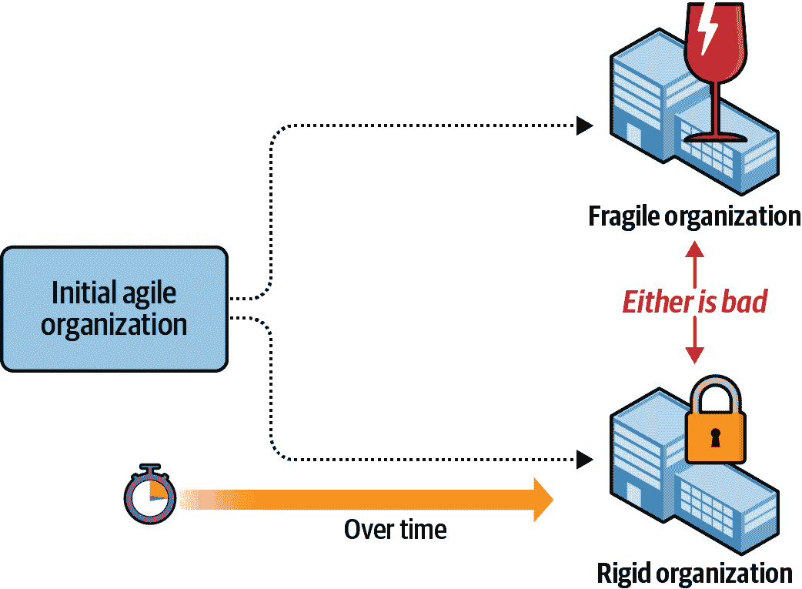

# Chapter 6. Starting the Conversation

我们已在本书中涵盖了许多主题。我们首先探讨了 IT 复杂性困境，描述了 IT 团队做出的决策如何影响应用程序的复杂性，而这反过来又会影响成本以及组织保持敏捷并利用行业发展的能力。

然后我们讨论了如何评估你的组织和产品，以了解它们由什么组成以及这些部分如何协同工作。

然后我们研究了自适应架构如何在适当使用时为决策提供敏捷性，同时注意它们不会无意中增加复杂性和脆弱性。

接下来，我们讨论了知识管理。如何组织保持现代应用程序正常运行所需的信息，而不会增加系统复杂性或提高系统脆弱性？

最后，我们谈到了创新，并展示了你在组织中的投资如何以及在何处影响它。投资会积极颠覆你的业务吗？它只是使业务保持前进？它会产生积极或消极的总体影响吗？

所有这些讨论都围绕着一个核心概念展开：如何创造和推动组织变革，以改善你的应用和你的组织？这些是你需要问的问题：你能否调整产品或公司的方向，以实现更大的创新？你能否在前进的过程中推动行业变革？你现在需要做什么，才能防止你的组织陷入第 1 章中所描述的陷阱，即随着时间的推移变得脆弱或僵化？图 6-1 回顾了这种危险。

要推动组织和产品所需的变革，你必须开始关于必要转型的对话。

这对于公司的首席执行官、首席财务官、首席运营官或其他 CxO 来说似乎更容易，但对于你来说可能并非如此。但变革不必从上而下开始。它可以从底部或中间开始。事实上，像本书中许多概念可能需要的这种有意义的变革，从上而下或从下而上推动可能更困难。从中间向外推动可能更容易。

为什么会这样？因为要推动你需要实现产品成果的那种变革，需要以下几点：

* 关于产品及其在行业中的定位的知识和专业知识。这需要理解产品的代码和技术，以及产品为你的客户和整个行业所做的事情。
* 关于使用产品的客户和/或公司希望使用产品的潜在客户的知识和专业知识。
* 关于业务当前如何运营以及组织上可能需要什么变化的知识和专业知识。

这是一个非常广泛的知识，通常是有效中层经理或高管所需要的知识。组织中再低一点，你可能就没有业务运营知识；再高一点，你可能会失去与产品和技术细节的必要联系。

因此，作为中层经理或高管，你实际上正处于影响本书中描述的那种变革的完美位置。

但你如何开始对话？从对产品和组织的非常高层次的审计开始——即第 2 章中描述的那种高层次的适应性评估类型。然后评估你的组织在第 1 章中讨论的结构和问题方面的运营情况。你可能面临多严重的复杂性困境？你是深陷复杂性还是只是触及表面？你已经是一个脆弱或僵化的组织，还是如果你不小心的话未来可能会如此？你目前面临 IT 死亡，还是你可以想象有一天这可能会成为一个问题？

在进行过程中记录你的发现。然后，利用这些文档，在组织上下开始对话。向下传递时，关注复杂性和缺乏创新的影响。谈论自适应架构和知识管理的价值。向上传递时，关注 IT 死亡的业务成本，以及复杂性和敏捷的对立力量如何影响你扩展组织的能力。关注这些概念如何影响整个组织。

根据组织的大小和复杂性，这些对话可能很简单也可能很困难，可能被很好地接受也可能无人理会。但迟早，它们会开始深入人心，无论是因为它们对组织中的合适个人有意义，还是因为某些事件或情况发生了，迫使人们认识到它们。无论哪种方式，这都是你可以推动你认为必要的变革以帮助组织前进的时刻。

最后，继续成长和学习。本书只是你旅程的起点。查看作者在 [leeatchison.com](https://leeatchison.com) 上的其他书籍、文章、课程和访谈。另请查看 O’Reilly Media 在线提供的许多其他优秀书籍和课程，以及 David Komlos 和 David Benjamin 所著的 *Cracking Complexity Now*（Nicholas Brealey）和 Rick Nason 所著的 *It’s Not Complicated*（Rotman-UTP）。

这是一个挑战。它可能看起来是一个无法克服的挑战，但请记住第 2 章中讨论的进行审计的技术。你不必完美才能做好。而要做好，你只需要开始。
