## 第 1 部分：
了解 Azure 平台和
架构

本部分将介绍 Azure 生态系统的基础知识，并解释从匿名、面向互联网的角度可用的攻击。

本书的这一部分包含以下章节：

- 第 1 章，Azure 平台和架构概述
- 第 2 章，构建自己的环境
- 第 3 章，查找 Azure 服务和漏洞

### 1
Azure 平台
和架构
概述

Azure 云是微软的公共云计算平台。该平台由客户可用于开发、托管和增强其应用程序和服务的多个服务组成。与许多其他云平台（**Amazon Web Services (AWS)**、**Google Cloud Platform (GCP)** 等）一样，它不断发展壮大，并通过频繁向生态系统添加新服务和功能而不断演进。鉴于所有这些云服务的可用性，以及 Microsoft 365 许可的灵活性，许多组织正在将运营迁移到 Azure 云。

在我们第一章中，我们将重点介绍 Azure 平台的概述、其架构、核心服务以及这些服务如何被管理。

在本章中，我们将介绍以下主题：

- 微软 Azure 基础设施的基础知识
- Azure 服务概述
- 了解 Azure **基于角色的访问控制 (RBAC)** 结构
- 访问 Azure 云

到本章结束时，我们将很好地了解组织如何使用 Azure，以及渗透测试人员如何对待 Azure 环境。

#### 技术要求

对于本第一章的大部分内容，您不需要任何额外软件，因为我们将专注于获得对 Azure 基础设施的高层次理解。拥有对现有订阅的 Azure 门户访问权限对于跟随学习 certainly 很方便，但对于理解概念并非必需。

在本章结束时，我们将回顾访问 Azure 管理界面的多种方法。因此，如果您确实可以访问现有的 Azure 环境，以下工具将有助于准备就绪：

- Azure **命令行界面 (CLI)**
- Az PowerShell 模块
- **Azure Active Directory (Azure AD)** PowerShell 模块

如果您无法访问现有的 Azure 环境，不用担心。我们将在 *第 2 章，构建自己的环境* 中介绍创建自己的测试环境的步骤。

#### 微软 Azure 基础设施的基础知识

截至撰写时（2020 年底至 2021 年初），Azure 平台由 200 多项服务组成，似乎一直在不断扩展。这里可能感觉有很多内容需要覆盖，但在渗透测试期间，您通常只需要关注范围内可用的服务子集。

总体而言，了解环境在 Azure 平台层面的结构方式（订阅、RBAC、资源）非常重要，以及可用的服务如何被滥用以在环境中获得额外权限。

本节的课程将是您理解 Azure 作为平台如何运作的基础，因此请密切关注。对于拥有扎实 Azure 背景的人，可以快速浏览本章以复习核心原则。

在本节中，我们将了解 Azure 云平台及其区域，Azure 租户通常如何构建，以及租户下资源如何被管理。

#### Azure 云和区域

为了能够为受不同法律和法规管辖的多个不同市场提供服务，微软构建了针对不同市场不同的 Azure 云。这些云都运行在相同的技术上并提供相同的服务，但它们运行在物理和逻辑上都隔离的不同数据中心环境中。这很重要，因为每个平台及其服务的 **应用程序编程接口 (API)** 端点会根据我们交互的云平台而有所不同。

下表突出了四个 Azure 云平台及其主要端点：

| 云平台 | 端点 |
|---|---|
| Azure Commercial | 门户：https://portal.azure.com<br>AD 端点：https://login.microsoftonline.com |
| Azure 美国政府 | 门户：https://portal.azure.us<br>AD 端点：https://login.microsoftonline.us |
| Azure 中国 | 门户：https://portal.azure.cn<br>AD 端点：https://login.chinacloudapi.cn |
| Azure 德国 | 门户：https://portal.microsoftazure.de<br>AD 端点：https://login.microsoftonline.de |

由于这些云在访问 Azure 服务的端点上各不相同，而我们希望避免跨区域的混淆，我们将为本书中的所有示例标准化为 Azure Commercial 云。需要注意的是，示例适用于其他 Azure 云，但您可能需要修改目标端点。

#### Azure 资源管理层次结构

在我们深入了解可在 Azure 环境渗透测试中使用的战术、技术和流程之前，我们需要对 Azure 云中资源的结构有一个工作性的理解。这项知识也将使我们能够在获得初始访问权限后，通过环境跟踪攻击链。


Azure 中的组织结构包含以下层级：**Azure AD 租户**、**根管理组**、**子管理组**、**订阅**、**资源组**，以及单个 **资源**。这些不同层级在下图中显示：

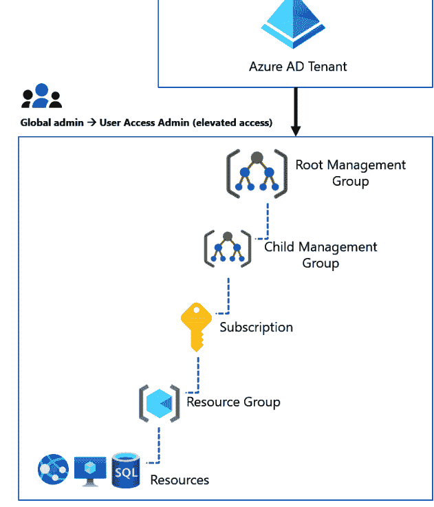

图 1.1 – Azure 资源层次结构

以下是从上到下各层级的描述：

- **Azure AD 租户**：为了管理 Azure 订阅和资源，管理员需要一个身份目录来管理将有权访问资源的<|message|>用户。Azure AD 是用于在 Azure 租户的订阅中为所有用户提供身份验证和授权的身份存储。

每个 Azure 订阅都与一个 Azure AD 租户存在信任关系，以管理对该订阅的访问。组织通常会使用名为 Azure AD Connect 的工具将本地 AD 连接到 Azure AD，如下图所示：

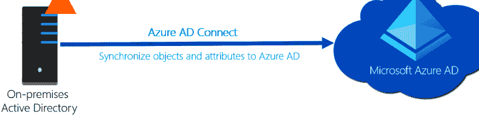

图 1.2 – 使用 Azure AD Connect 将对象同步到 Azure AD

作为身份验证和授权的核心，Azure AD 是信息收集以及各种基于身份攻击的主要目标。我们将在本章的 *Understanding the Azure RBAC structure* 部分中进一步介绍 Azure 订阅的授权模型。

- **Root Management Group**：这是 Azure 资源组织层次结构的顶层，*如果启用*。默认情况下，刚开始使用 Azure 的组织不会启用根管理组，这意味着每个订阅都是作为独立实体进行管理的。然而，单独管理订阅会形成一种扩展性不佳的治理模型。对于拥有多个订阅需要管理的 中型到大型组织而言，这尤其困难。

许多生产环境 Azure 中都会启用根管理组。这部分是因为微软在他们的 Cloud Adoption Framework 文档（https://docs.microsoft.com/en-us/azure/cloud-adoption-framework/decision-guides/subscriptions/）中建议启用它。该文档描述了采用 Azure 云的一些最佳实践，对于希望在 Azure 中构建环境的人来说是一个很好的信息来源。

- **Child Management Group**：如果组织启用了根管理组，他们可以在根下创建子管理组以简化订阅的管理。子管理组允许组织以灵活的结构将订阅分组在一起，主要用于集中管理访问和治理。子管理组可以嵌套，并且最多支持六层深度。

- **Subscription**：要在 Azure 中配置资源，我们需要一个 Azure 订阅。Azure 订阅是资源配置的逻辑容器。当我们创建资源（例如 **Structured Query Language (SQL)** 数据库）时，我们通常首先指定资源将被配置的订阅。该资源的用量也会计费到所选的订阅。

如 **Child Management Group** 描述中所述，组织通常会有多个 Azure 订阅。组织为不同环境设置多个订阅的情况很常见，例如开发和生产，或用于分离应用程序环境。

- **Resource Group**：在订阅内部，有资源组。资源组是可用于对 Azure 资源（如 **virtual machines (VMs)**、存储帐户和数据库）进行分组和管理的逻辑容器。

资源组最适合用于收集和分组需要一起管理或共享相同生命周期的资源。根据订阅架构，这可能导致单个订阅中存在大量资源组。

从访问角度来看，资源组还允许我们在同一订阅中对不同组进行访问隔离，但我们将在 *Understanding the Azure RBAC structure* 部分中更详细地介绍这一点。

- **Resources**：资源是部署在 Azure 订阅中的 Azure 服务的单个实例。资源层级是组织层次结构的底部。除了具有特定访问策略的服务（参见关于 *key vaults* 的信息）之外，我们无法再进一步细分资源层次结构。

我们将在本章后面详细介绍 RBAC 如何管理访问，但总体而言，Azure AD 帐户可以对前面列出的任何资源组织层级拥有指定的访问权限。从渗透测试的角度来看，在更高层级授予的访问权限会为攻击者提供更广的范围来发现云服务配置中的漏洞，并在环境中横向移动。当我们讨论权限提升时，这一概念会变得更加重要。

在下一节中，我们将介绍一些常用 Azure 服务的概述。这些服务的单个实例属于前面列出的 **Resources** 类别。

#### An overview of Azure services

正如本章前面所述，Azure 中有超过 200 项服务。尽管听起来服务很多，但它们通常可以归为以下五类，如下所述：

- **Services that are used to host applications**：这些服务提供可用于执行应用程序代码或运行容器镜像的运行时环境。**Azure App Service**、**Azure Virtual Machine (Azure VM)** 和 **Azure Kubernetes Service (AKS)** 等服务属于此类。组织使用它们来托管外部和内部应用程序。
- **Services that are used to store data for applications**：这些服务用于存储不同类型的应用程序数据。Storage accounts、Azure SQL 和 Cosmos DB 等服务属于此类。
- **Services that are used to create applications**：这些服务用于创建在云中运行的工作流。Logic Apps 和 Functions apps 等服务属于此类。
- **Services that are used to enhance applications**：这些通常是 Azure 中的 **Software-as-a-Service (SaaS)** 类型服务，用于为其他应用程序提供额外功能。Azure Cognitive Services 等服务属于此类。开发人员使用它通过预构建和预训练的机器学习算法为其自定义应用程序添加智能。
- **Services that are used to monitor or manage applications**：这些是用于管理或监控其他服务或应用程序的服务。Azure Automation、API Management、Application Insights 和 Azure Monitor 等服务属于此类。额外的安全重点服务，如 Azure Sentinel 和 Azure Security Center，也会归入此类。这些服务也可以从渗透测试角度提供有用的见解。

随着我们阅读本书的进展，我们将涉及许多服务，但这里概述的核心资源是需要理解的重要内容。

下表概述了本书中将被攻击的最常见的 Azure 服务：

| Service | Description |
|---|---|
| App Services | 此服务包括 Azure 中的 App Service 和 Function apps。这些服务可用于“无服务器”Web 应用程序和 API 托管。 |
| Storage Accounts | 存储帐户用于 Azure 中大多数数据存储操作。文件可以公开或私有托管，并且文件可以通过多种协议访问（**HyperText Transfer Protocol (HTTP)**、**Server Message Block (SMB)**、**Network File System (NFS)**）。此服务还可用于静态 Web 内容托管。 |
| Automation Accounts | 另一项“无服务器”代码服务，Automation accounts 允许您从“runbooks”运行脚本代码（PowerShell 和 Python）以自动化订阅中的流程。此服务有很多攻击面，因此我们将在整本书中经常回到它。 |
| Virtual Machines | 云服务最初的支柱之一，这些是云中托管的 VM。在云中部署 VM 有多个方面，因此此服务也将成为主要关注点。 |
| Key Vaults | Azure key vaults 是 Azure 内的主要凭据存储。这包括密钥、机密和证书的存储。除了使用标准的 **Identity and Access Management (IAM)** 权限分配外，还可以应用访问策略以对 Key Vault 数据提供额外的限制。 |
| Azure SQL | 此服务用于在云中托管 SQL 数据库。SQL 数据库的所有内容都由 Microsoft 管理，这有助于简化 Azure 项目中使用数据库的情况。 |
| Azure Container Registry/Azure Container Instances | 随着许多环境开始迁移到容器化，云容器注册表和云容器实例的使用变得越来越流行。Azure Container Registry 存放用作容器化基础镜像的容器镜像。虽然它在容器化环境中相对较小的一部分，但此服务是常见的攻击目标，因为镜像经常包含敏感信息。 |


从前面的信息可以看出，微软在为 Azure 服务命名时非常务实。大多数情况下，服务名称都基于服务的功能。例如，用于托管虚拟机的 Azure 服务就叫做 **Virtual Machines**。相比之下，AWS 中对应的服务则叫做 **Elastic Compute Cloud (EC2)**。

> **重要说明**
> 对于任何正在从 AWS 过渡到 Azure 的术语使用者，以下微软文档可能有助于匹配那些令人困惑的服务名称：https://docs.microsoft.com/en-us/azure/architecture/aws-professional/services。
> 对于更熟悉 GCP 的用户，微软也在 https://docs.microsoft.com/en-us/azure/architecture/gcp-professional/services 上提供了一些有用的文档。

在 *第 3 章，查找 Azure 服务和漏洞* 中，我们将讨论如何利用 Azure **域名系统 (DNS)** 命名结构匿名发现其中一些服务。在下一节中，我们将回顾 Azure 服务的访问是如何通过 RBAC 进行结构化和管理的。

#### 理解 Azure RBAC 结构

**RBAC** 是一种授权系统，用于控制谁有权访问 Azure 资源，以及用户可以对这些资源执行哪些操作。从高层次来看，你可以将其理解为 *通过向安全主体分配角色，来授予安全主体（用户、组和应用程序）对 Azure 资源访问权限。*

例如，RBAC 可用于授予某用户管理订阅中所有虚拟机的权限，而另一用户则被授予管理同一订阅中所有存储账户的权限。这对于订阅中的职责分离来说可能是一个奇怪的选择，但云环境往往会催生出 *创造性* 的解决方案来使事情运转。

当我们开始引入角色分配的不同作用域（管理组、订阅等）时，RBAC 概念会变得更加复杂，但在我们继续推进时，请记住前面的描述。

Azure RBAC 由以下组件构成——**安全主体、角色定义和角色分配**。让我们详细了解这些组件。

##### 安全主体

**安全主体** 是一个花哨的术语，用来描述 *我们想要分配权限的 Azure AD 对象*。这可以是用户账户、组、服务主体或托管标识。这些都是存在于 Azure AD 中的不同类型的标识，如以下屏幕截图所示：

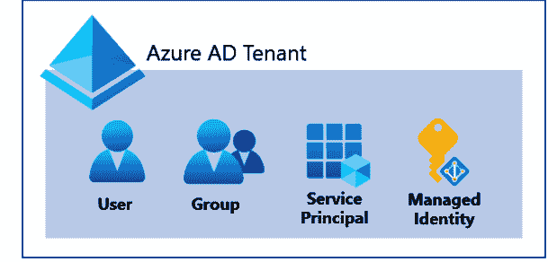

图 1.3 – Azure RBAC 安全主体

> **重要说明**
> 不要将“安全主体”与“服务主体”混淆。*安全主体* 是用于描述 Azure AD 中对象（包括用户、组和服务主体）的总体术语。*服务主体* 是一种特定的安全主体类型。

虽然安全主体有很多方面，但请记住每个安全主体都有一个 **对象 ID**，它在 Azure AD 中唯一标识该主体。该对象 ID 通常用作向安全主体分配角色时的引用。接下来，我们将介绍不同类型的安全主体。

##### 用户账户

*用户账户是 Azure AD 中的标准用户标识。* 这些账户可以是 Azure AD 租户内部的，也可以是外部的“访客”账户。在任何情况下，用户管理的一般操作都会在 Azure AD 租户级别进行。

内部用户账户是由管理员在 Azure AD 租户中创建的用户标识。此外，这些也可能是从本地 AD 环境同步到 Azure AD 的用户标识（参见图 1.2）。

账户通常通过其 **用户主体名称 (UPN)** 来寻址，这通常是一个电子邮件地址。例如，Azure AD 租户中名为 `karl` 的用户，域名为 `azurepentesting.com`，其 UPN 将为 `karl@azurepentesting.com`。

以下屏幕截图显示了 Azure 门户中的一个内部用户账户。你交互的大多数 Azure AD 账户都将属于此类：

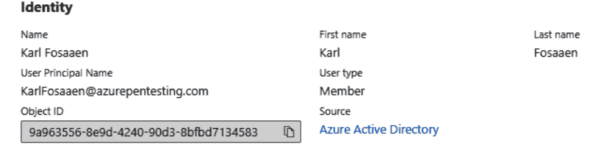

图 1.4 – 内部用户账户的屏幕截图

外部用户账户是来自其他 Azure AD 租户或 Microsoft 账户（`outlook.com`、`hotmail.com` 等）并被邀请作为访客用户加入 Azure AD 租户的用户标识。外部用户账户的 UPN 格式如下所示：

```
<alias>_<HomeTenant>#EXT#@domain.suffix
```

例如，如果来自 `cloudsecnews.com` AD 租户的名为 `david` 的用户被邀请为 `globaladministratorazurepen.onmicrosoft.com` Azure AD 租户的访客用户，则其 UPN 将为 `david_cloudsecnews.com#EXT#@globaladministratorazurepen.onmicrosoft.com`（参见图 1.5）。

外部账户通常用于向可能在订阅上工作的供应商或第三方用户授予访问权限。用户账户不由 Azure AD 租户直接管理，因此账户策略（密码长度、**多因素身份验证 (MFA)** 等）将超出 Azure AD 租户的控制范围。

以下是外部用户账户的屏幕截图：

| 字段 | 值 | 备注 |
|---|---|---|
| 名称 | David Okeyode | |
| 用户主体名称 | `david_cloudsecnews.com#EXT#@globaladministratorazurepen.onmicrosoft.com` | 外部用户账户的示例 UPN |
| 姓名首字母/头像 | DO | |
| 用户登录 | 图表 | Dec 13 Dec 20 Dec 27 Jan 3 |
| 组成员身份 | 0 | |
| 身份 | | |
| 名称 | David Okeyode | |
| 用户主体名称 | `david_cloudsecnews.com#EXT#@globaladministrat...` | |
| 对象 ID | `5e91ce9c-8201-4956-ad66-1285828683bd` | 在 Azure AD 租户中唯一标识安全主体的对象 ID |
| 名 | David | |
| 姓 | Okeyode | |
| 用户类型 | Guest | 用户类型指定为“Guest”，表示外部用户账户 |
| 已接受邀请 | Yes | |
| 来源 | External Azure Active Directory | |

图 1.5 – 外部用户账户的屏幕截图

对于内部和外部账户，在 Azure 渗透测试中我们将针对账户的凭据进行攻击以获取 Azure AD 租户中资源的访问权限。正如我们在后续章节中将看到的，这些账户是获得环境初始立足点的绝佳位置。

##### 服务主体

服务主体是 Azure AD 中的应用程序标识。你可以将其视为代表需要访问 Azure 资源的应用程序的 Azure AD 对象。这是授予应用程序访问权限的首选方式，而不是创建虚拟用户账户。

服务主体在我们进行自动化账户攻击时将非常重要，但现在只需知道应用程序可以在 Azure AD 中注册，并且也可以被授予租户中的权限。例如，你可能有一个运行订阅中维护脚本的自动化账户，因此你希望向运行脚本的账户授予特定权限。这些权限将应用于在创建自动化账户时在 Azure AD 租户中创建的服务主体。

服务主体还可以分配证书和密钥用于身份验证。当我们想要使用应用注册进行权限提升和/或在 Azure AD 租户中保持持久性时，这些凭据将非常重要。创建服务主体的过程称为应用注册。

在以下屏幕截图中，我们可以看到示例租户中应用注册的一些基本信息。作为攻击者，我们可能会遇到创建新的服务主体以便在环境中保持持久性的情况。如果我们为创建后门服务主体选择一个通用的显示名称（Backup Service），我们可能有更好的机会在租户中更长时间不被发现：

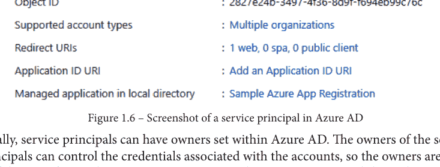

图 1.6 – Azure AD 中的服务主体屏幕截图

最后，服务主体可以在 Azure AD 中设置所有者。服务主体的所有者可以控制账户关联的凭据，因此在服务主体具有提升权限的环境中，所有者是权限提升的有用目标。

##### 托管标识

有时 Azure 服务（虚拟机、AKS、应用程序等）可能需要访问其他 Azure 资源。授予此访问权限最简单的方法是为 Azure 服务启用托管标识。托管标识是自动创建和管理的服务主体，分配给受支持的 Azure 服务。截至撰写本文时，Azure 中有 27 项服务支持托管标识。


> **重要说明**
> 如果您有兴趣了解更多关于支持 Azure 中托管标识的所有服务的详细信息，Microsoft 已在此处进行了文档记录：
> https://docs.microsoft.com/en-us/azure/active-directory/managed-identities-azure-resources/services-support-managed-identities.

托管标识可以是 **系统分配** 或 **用户分配**。系统分配的标识直接绑定到为其创建标识的资源。用户分配的标识首先在订阅中创建，然后应用于资源。用户管理的标识可以被许多服务共享，而系统分配的标识则不能。

在后面的章节中，我们将看到这些标识可用于在租户中提升权限。现在需要重点注意的是，任何对具有分配托管标识的资源拥有修改权限的人都可能承担该托管标识的权限。这取决于服务，但有若干服务（我们稍后会回顾）可以 readily 用于为托管标识生成令牌。

#### 组

**组** 在 Azure AD 中用于组织用户并使管理对 Azure 资源的访问变得更容易。例如，将权限分配给一个组中的 200 个用户，比分配给 200 个单独用户更有效。一旦向组授予了 Azure 资源访问权限，后续的访问权限就可以通过组成员身份进行授予或撤销。

与用户账户类似，组可以由管理员在 Azure AD 中创建，也可以从本地 AD 环境同步。还有第三种情况，即允许用户自行创建组，或加入现有的公共组，但这些组通常与 Microsoft 365 服务相关联。

与应用注册类似，组可以拥有所有者（用户账户或服务主体），并且所有者不必是该组的成员。组所有者可以管理组及其成员。

Azure AD 支持两种主要类型的组：主要用于管理对共享资源访问的安全组，以及 Microsoft 365 组，其功能类似于您可能在 AD 中熟悉的电子邮件分发组。这些也可以用于分配对 Azure 资源的访问权限。

Azure AD 组的成员资格可以是 **分配** 的或 **动态** 的。分配的成员资格是由管理员或组所有者直接分配给用户。动态组成员资格使用规则，根据用户或设备属性自动评估以确定组成员资格。动态组成员资格的规则可以允许软匹配，这可能被滥用以提升权限。有关此攻击的更多信息，请参阅 *第 4 章《利用 Reader 权限》* 中的 *动态组成员资格* 部分。

在与本地 AD 域同步的 Azure 环境中，组织用户的复杂性可能会呈指数级增长，因为可能有大量从本地域导入的组。虽然在 Azure 租户中实际使用的组可能数量有限，但您可能需要处理数百个（或数千个）在 Azure AD 租户中的组。这在评估 Azure 环境时不应造成任何问题，但在您开始转向本地环境时可能会使事情复杂化。我们将在 *第 7 章《利用所有者和特权 Azure AD 角色权限》* 中介绍有助于简化评估 AD 组的工具。

#### 角色定义

在安全主体之后，Azure RBAC 的第二个组件是角色定义。此术语描述 *一组权限*。权限描述了 *可能* 或 *可能不* 对资源执行的操作，例如读取、写入和删除。我们可以检查默认 Azure 角色下的权限，以了解它允许我们执行的操作。

以下是 Azure 中 **参与者** 角色的权限：

```json
{
  "assignableScopes": [
    "/"
  ],
  "description": "Grants full access to manage all resources, but does not allow you to assign roles in Azure RBAC, manage assignments in Azure Blueprints, or share image galleries.",
  "id": "/subscriptions/{subscriptionId}/providers/Microsoft.Authorization/roleDefinitions/b24988ac-6180-42a0-ab88-20f7382dd24c",
  "name": "b24988ac-6180-42a0-ab88-20f7382dd24c",
  "permissions": [
    {
      "actions": [
        "*"
      ],
      "notActions": [
        "Microsoft.Authorization/*/Delete",
        "Microsoft.Authorization/*/Write",
        "Microsoft.Authorization/elevateAccess/Action",
        "Microsoft.Blueprint/blueprintAssignments/write",
        "Microsoft.Blueprint/blueprintAssignments/delete",
        "Microsoft.Compute/galleries/share/action"
      ],
      "dataActions": [],
      "notDataActions": []
    }
  ],
  "roleName": "Contributor",
  "roleType": "BuiltInRole",
  "type": "Microsoft.Authorization/roleDefinitions"
}
```

我们可以在前面的权限中看到，角色定义支持两种类型的操作，如下所示：

- 控制平面操作，描述角色可以执行的管理操作。这些在 `actions`: [ ] 部分中定义。管理操作的一个例子是创建存储账户的权限。
- 数据平面操作，描述角色可以在资源内执行的数据操作。这些在 `dataActions`: [ ] 部分中定义。数据操作的一个例子是读取存储在存储账户中的数据的权限。

我们也可以在前面的权限中看到，某些操作可以被角色排除。`notActions`: [ ] 部分定义了角色被限制执行的管控操作。`notDataActions`: [ ] 部分定义了角色被限制执行的数据操作。

在前面的 **参与者** 角色示例中，该角色具有执行所有管理 (*) 操作的权限，但它被限制（通过 notActions 定义）执行与授权相关的管理操作，这意味着该角色不能用于向他人分配权限。此外，该角色不具有执行任何数据操作的权限。

还应注意，该角色定义还包含 `assignableScopes`: `[ '/' ]` 部分，表示该角色如何在租户中应用。`/` 表示它可以应用于管理组结构的根，但也可以应用于根下的任何范围（子管理组、订阅等）。

#### 默认 RBAC 角色

在最基本层面上，Azure 中通常应用的三个主要角色是 **读取者**、**参与者** 和 **所有者**。除这三个主要角色之外，您还会找到服务特定的角色，它们充当这些基础角色的受限版本。这些受限角色对于减少用户在特定订阅中的权限很有用，但它们仍可能允许在环境中提升权限。

例如，**虚拟机参与者** 角色（在订阅级别应用）不允许 Azure AD 用户成为订阅中所有服务的参与者。然而，该角色确实允许 `Microsoft.Compute/virtualMachines/*` 操作，这意味着它允许用户在订阅中的任何 VM 上运行命令。

如果此 VM 配置了特权托管标识，则该 VM 参与者用户可以在 VM 上运行命令以承担托管标识的权限并提升其权限。我们将在 *第 5 章《在 IaaS 服务上利用参与者权限》* 中更深入地探讨这一概念，在那里我们学习如何使用 VM 上的参与者权限。

需要重点注意的一点是，Azure 资源和 Azure AD 租户具有独立的权限系统。这意味着用于授予对 Azure AD 的访问权限的角色与用于授予对 Azure 资源的访问权限的角色不同，如以下屏幕截图所示：

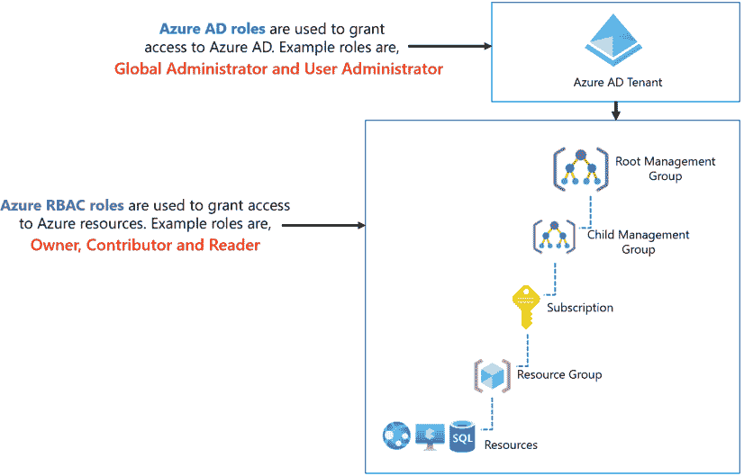

图 1.7 – Azure AD 角色与 Azure RBAC 角色

Azure AD 角色用于管理对 Azure AD 资源和操作的访问，例如用户账户和密码重置，而 Azure RBAC 角色用于管理对 Azure 资源（如存储账户、SQL 数据库等）的访问。

Azure AD 和 Azure 资源都具有多个内置角色，具有预定义的权限，组织可用于向用户和应用程序授予访问权限。两者都支持由管理员创建的自定义角色。截至撰写本文时，目前有 60 个内置 Azure AD 角色和超过 220 个 Azure RBAC 内置角色。


> **重要说明**
>
> Microsoft 对这些角色有最佳文档，并且提供了可用的 Azure AD 角色 (`https://docs.microsoft.com/en-us/azure/active-directory/roles/permissions-reference`) 和 Azure RBAC 角色 (`https://docs.microsoft.com/en-us/azure/role-based-access-control/built-in-roles`) 的全面列表。

#### 角色分配

接下来，我们需要了解角色在 Azure AD 租户中是如何应用的。回到 *图 1.1*，我们注意到 Azure 资源组织层次结构。Azure 云中一个有趣的设计选择是 RBAC 角色应用于此层次结构的方式。如前所述，RBAC 角色可以应用于根管理组、子管理组、订阅、资源组和单个资源级别。

在根管理组级别分配的任何基于角色的访问权限都会在整个组织中传播，并且无法在较低级别覆盖。如果攻击者设法窃取了在根管理组级别提供访问权限的凭据，他们可以利用此访问权限在组织的不同订阅之间横向移动。

现在我们对 RBAC 结构有了更好的理解，让我们看看如何与 Azure 环境进行交互。

#### 访问 Azure 云

有多种方式可以与 Azure 租户交互，每种方法在渗透测试中都有特定的优势。以下列表概述了可以访问 Azure 云的方式：

- Azure 门户
- Azure CLI
- Az PowerShell cmdlet
- Azure REST API

在 *第 2 章，构建您自己的环境* 中，我们将讨论设置您自己的环境，但如果您已经可以访问 Azure 环境，请随意按照这些访问方法进行操作。

##### Azure 门户

Azure 门户是用于访问和管理 Azure 资源的基于 Web 的控制台。Azure 公共云平台的 URL 为 https://portal.azure.com。如本章开头所述，其他 Azure 云（如美国政府、中国和德国）的地址是不同的。

用户必须首先使用 Azure AD 用户帐户进行身份验证才能访问门户。对于视觉型学习者来说，Azure 门户将是了解 Azure 租户中资源的最佳起点。

在门户中，网站左侧有每个 Azure 服务的刀片，如以下屏幕截图所示：

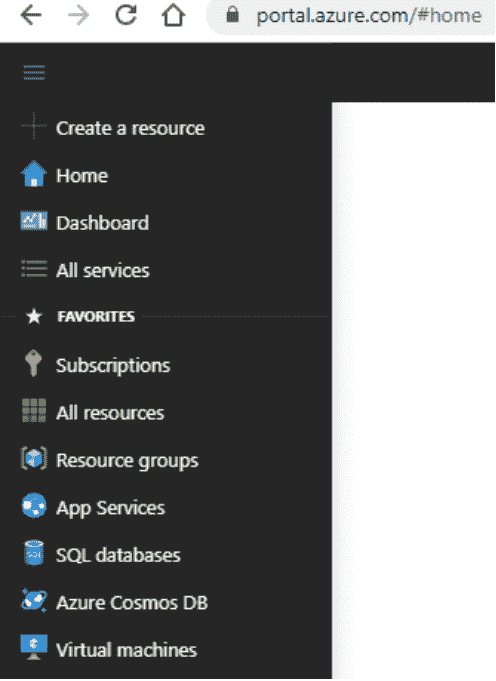

图 1.8 – Azure 门户导航

如果您要查找的服务不在其中一个刀片中，您可以使用网站顶部的搜索栏来查找您要查找的服务，如以下屏幕截图所示：

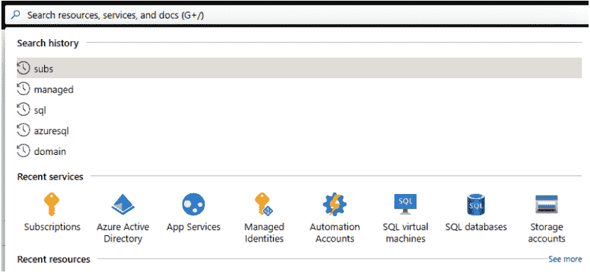

图 1.9 – Azure 服务搜索

我们将在本书后面重点关注一些特定的刀片/服务，但现在，熟悉通过服务以及可供您使用的订阅/租户进行导航将很重要。

在门户的右上角，您可以选择已登录的用户并选择切换目录，以查看用户可用的所有 Azure AD 目录，如以下屏幕截图所示：

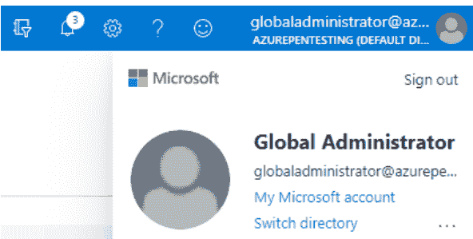

图 1.10 – Azure 用户菜单

根据您的帐户有权访问的租户，您可能会在此处看到多个目录。这些是您拥有（直接成员或访客）访问权限的不同 Azure AD 租户。选择目录后，您可以导航到订阅刀片以查看您有权访问的订阅，如以下屏幕截图所示：

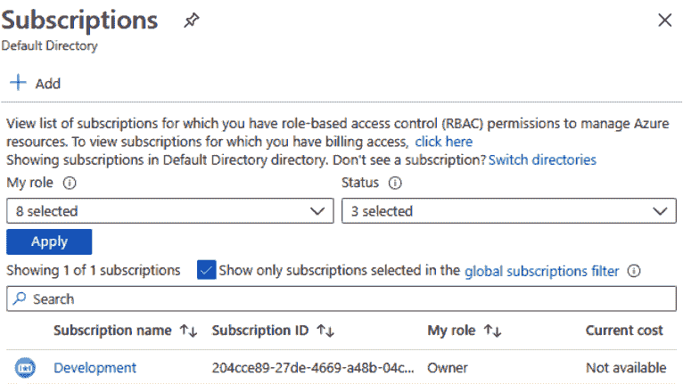

图 1.11 – Azure 订阅列表

在订阅部分，请注意我的角色列，因为这将让您知道您当前用户在订阅中的 RBAC 角色。在各个订阅中，您还可以使用 IAM 刀片查看订阅中其他用户的权限。

##### Cloud Shell

在门户中，搜索栏右侧有一个小的 PowerShell 提示符 >_ 图标。此图标会在门户中激活 Azure Cloud Shell。这也可以通过 https://shell.azure.com 访问，并在以下屏幕截图所示：

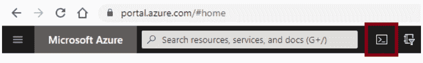

图 1.12 – Azure Cloud Shell 门户链接

如果尚未为您的帐户设置 Cloud Shell，这将要求您选择一个用于 Cloud Shell 存储的存储帐户。进入 Cloud Shell 后，您的提示应如下所示：

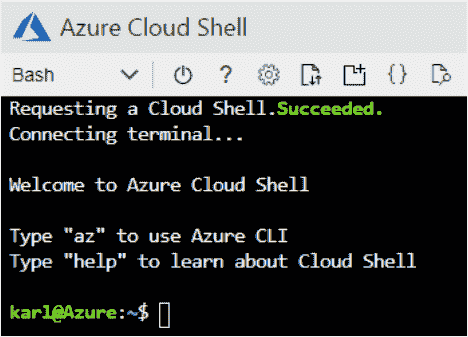

图 1.13 – Azure Cloud Shell

设置 Cloud Shell 时，您可以选择 Bash 或 PowerShell 环境。两个环境都有其优点，并且 shell 中都已准备好使用 Az CLI。

虽然 Azure Cloud Shell 预装了管理 Azure 环境所需的所有工具，但它也带来了一些风险。我们将在后面的章节中看到此服务如何用于特权升级攻击。

##### Azure CLI

管理 Azure 环境的另一个流行选项是 Azure CLI。CLI 在 Windows 系统上的安装很简单。请记住，我们将在下一章的练习中安装 CLI，但如果您想在其他系统上安装 CLI，您可以在此处下载 Microsoft 安装程序以获取最新版本： `https://aka.ms/installazurecliwindows`。

> **重要说明**
>
> 由于前面的链接是可执行文件，如果您不立即急于打开它是可以理解的。作为一般说明，我们将在整本书中使用更多这些链接，将您连接到 Microsoft 资源。
>
> 书中 aka.ms 链接应该安全可循，因为它们都由 Microsoft 内部短链接服务管理。

对于那些想要了解有关 CLI 的更多信息以及在其他操作系统上安装选项的人，这里是 Microsoft 的 Azure CLI 文档页面：https://docs.microsoft.com/en-us/cli/azure/install-azure-cli。

安装后，打开一个 PowerShell 会话（powershell.exe）并运行以下命令：

```
PS C:\> az login
The default web browser has been opened at https://login.microsoftonline.com/common/oauth2/authorize. Please continue the login in the web browser. If no web browser is available or if the web browser fails to open, use device code flow with `az login --use-device-code`.
You have logged in. Now let us find all the subscriptions to which you have access...
[ {
  'cloudName': 'AzureCloud',
  'homeTenantId': '40d5707e-b434-XXXX-YYYY-ZZZZZZZZZZZZ',
  'id': '204cce89-27de-4669-a48b-04c27255e05e',
  'isDefault': true,
  'managedByTenants': [],
  'name': 'Development',
  'state': 'Enabled',
  'tenantId': '40d5707e-b434-XXXX-YYYY-ZZZZZZZZZZZZ',
  'user': {
    'name': 'globaladministrator@azurepentesting.com',
    'type': 'user'
  }
}
]
PS C:\>
```

这将打开一个浏览器窗口提示您对 Azure 进行身份验证。如果您已在浏览器中通过门户身份验证，您的用户名应已在登录屏幕中填充。使用您的帐户登录，CLI 应该已通过身份验证。此过程还将列出您所有可用的订阅。

首先，使用 `az` 命令列出可用选项，如下所示：

```text
PS C:\> az

    /\
   /  \     ______    __  ______
  / /\ \   |__  / |  | | |  ___/___
 / _____ \ / / /| |  | | | / __/ __ \
/_/     \_/_/  |__|  |_| |_|\___/___/

Welcome to the cool new Azure CLI!
Use `az --version` to display the current version.
Here are the base commands:
    account : Manage Azure subscription information.
    acr : Manage private registries with Azure Container Registries.
    ad : Manage Azure Active Directory Graph entities needed for Role Based Access Control.
    advisor : Manage Azure Advisor.
    [Truncated]
```

通常，您将在 CLI 中运行的命令与服务名称（acr、appservice、vm）相关，然后是您想要执行的操作。

例如，以下是列出默认订阅中资源的方法：

```powershell
PS C:\> az resource list
```

如果您需要有关可能运行的命令选项的想法，请使用 `--help` 标志列出可用选项。

这是一个用于管理 Azure 的强大工具，我们将在未来章节的书籍示例中使用它。也就是说，我们的大多数示例将集中在 Azure PowerShell 模块以及使用它们的工具上。在深入研究特定模块之前，我们希望确保我们对 Microsoft 的 PowerShell 编程语言有基本的了解。


#### PowerShell

对于大大小小的订阅，能够访问 PowerShell 的灵活性来解析数据非常方便。Azure 订阅可能包含大量资源，这些资源在门户中手动解析起来会相当困难。

以下是一些针对不太熟悉 PowerShell 的用户的快速说明：

- PowerShell 是一种命令 shell，类似于 `cmd.exe`。
- 当你正在运行 PowerShell 或 PowerShell **集成脚本环境 (ISE)** 时，我们称之为一个会话。
- PowerShell 也是一个脚本语言，与 .NET 运行时和 Windows API 有着深厚的联系。
- PowerShell 模块是一组可以导入到 PowerShell 会话中的函数。
- PowerShell 模块可以直接从文件导入或从外部来源安装，例如 **PowerShell 库 (PSGallery—https://www.powershellgallery.com/)**。它们也可以被配置为对所有新会话永久导入。
- PowerShell 函数，或 Cmdlet，是可以在会话中使用的命令。
- 带参数的函数允许使用 Tab 补全——输入一个连字符并按 *Tab*（或 *Ctrl + space*）即可查看该函数的可用参数。
- PowerShell 可以具有可通过管道传输的对象，允许你将一个函数输出用作其他函数的输入。
- PowerShell 管道非常强大，我们将在示例中大量使用它。

我们将在全书中使用多种基于 PowerShell 的工具，虽然我们会尽量使命令尽可能简单，但了解如何使用 PowerShell 的基本知识会是不错的主意。

> **重要说明**
> 如果你正在寻找非书籍的 PowerShell 资源，微软确实为学习 PowerShell 的人提供了一些免费学习资源。这些资源是很好的入门课程，并将为本書中涵盖的概念提供先行准备：https://docs.microsoft.com/en-us/powershell/scripting/learn/more-powershell-learning。

首先，你需要能够在系统上启用 PowerShell 脚本执行。很可能你的测试系统上会有一些 PowerShell 执行策略限制。正如本书技术审阅者之一 Scott Sutherland 在这篇博客文章中所指出的，这些执行限制很容易被绕过（参见 https://blog.netspi.com/15-ways-to-bypass-the-powershell-execution-policy/）。

对于 PowerShell 模块的安装，我们将主要使用 PowerShell Gallery 包。PSGallery（https://www.powershellgallery.com/）是一个受信任的、由微软管理的包管理资源。这是安装模块最简单的方法之一，并且工具包所需的 Microsoft 包都将列在库中。

由于我们将在本书第二章中逐步介绍 Azure PowerShell 模块的安装，因此目前在你的当前系统上安装这些模块并非立即需要。

#### The Az module

Az PowerShell Cmdlet 是与 Azure 交互以允许管理 Azure 服务的函数。这些函数允许列出、创建、销毁和修改 Azure 资源。虽然某些 Azure 服务不受函数支持，但你交互的大多数服务都将得到支持。

1. 在一个提升权限的（以管理员身份运行）PowerShell 会话中，运行 Az 模块安装命令，如下所示：

```
PS C:\> Install-Module -Name Az
```

2. 安装后，你需要对你的 Azure 租户进行身份验证。你可以通过运行以下代码来完成此操作：

```
PS C:\> Connect-AzAccount
```

3. 与 Azure CLI 类似，这将提示你登录，但这次会弹出一个 Azure AD 身份验证库（ADAL）身份验证窗口，而不是网络浏览器，如下图所示：

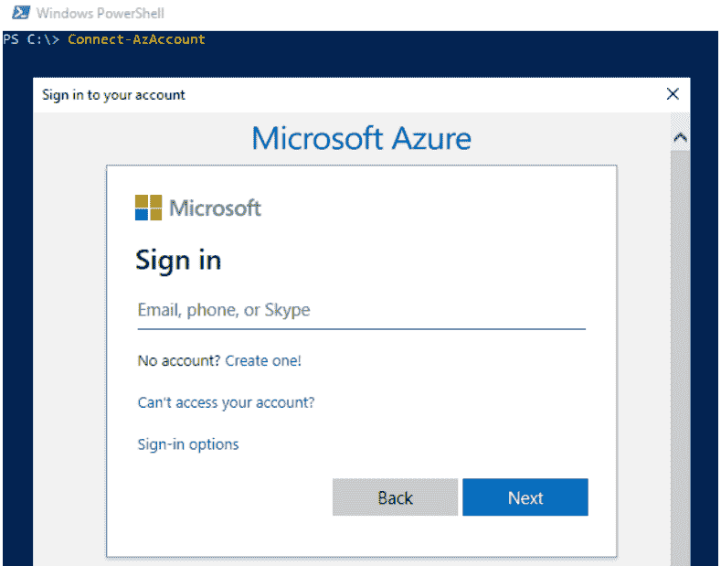

图 1.14 – Az PowerShell 身份验证提示

从这里开始，你将使用的任何命令都将基于 Microsoft 对 PowerShell 函数批准动词的指导（https://docs.microsoft.com/en-us/powershell/scripting/developer/cmdlet/approved-verbs-for-windows-powershell-commands）。

我们将使用的大多数动词是 Get 或 Invoke，但这将是一个尝试 PowerShell Tab 补全的好机会。

1. 如果模块尚未导入到你的 PowerShell 会话中，请按如下方式导入 Az 模块：

```
PS C:\> Import-Module Az
```

2. 然后，输入 Get-Az，如下所示，并暂停：

```
PS C:\> Get-Az
```

3. 从这里，你可以使用 Ctrl + space 快捷键来扩展你的选项，如下所示：

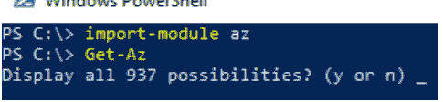

图 1.15 – Az PowerShell 模块命令选项

4. 如果我们对 PowerShell 函数参数做同样的操作，你将获得该函数的所有可用参数，如下所示：

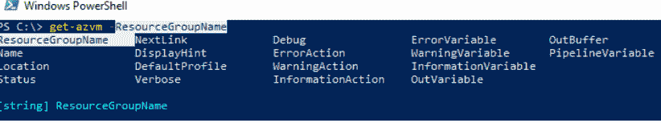

图 1.16 – Az PowerShell 模块参数选项

5. 要查看 Az 模块中的子模块，我们可以使用以下命令：

```
PS C:\> Get-Module -Name az*
```

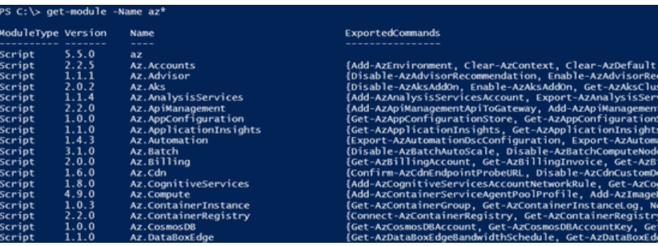

图 1.17 – 列出 Az PowerShell 子模块

6. 要获取模块中所有可用的命令，可以使用以下命令：

```
PS C:\> Get-Module -Name az*
```

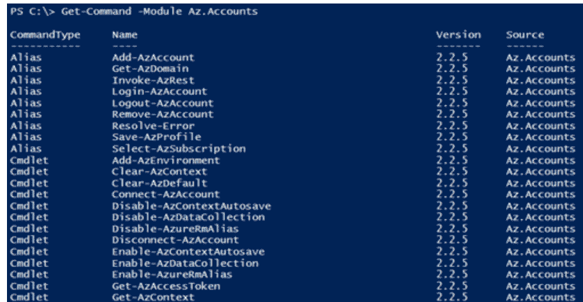

图 1.18 - 列出 Az.Accounts 模块命令

我们尝试在 PowerShell cmdlet 中完成的许多操作都可以通过 Tab 补全轻松找到。遇到疑问时，开始输入你认为命令可能是的内容，你可能会惊讶于找到真正命令是多么容易。

#### Modules – Az versus AzureRM

如果你在互联网上搜索特定的 Az PowerShell 函数来使用，你可能会遇到以 Azure Resource Manager（AzureRM）为前缀的函数，与 Az 相比。这些函数用于现在已弃用的 AzureRM 模块。这是用于 Azure 管理的原始 PowerShell 模块之一，因此你可能会遇到对其的引用。

对于大多数 AzureRM 函数，你应该可以用 Az 替换 AzureRM 来获得等效的 Az 模块命令（Get-AzureRmVM 与 Get-AzVM）。

#### The AzureAD module

AzureAD 模块涵盖了用于管理 Azure AD 租户的特定函数。从渗透测试的角度来看，我们将主要使用它来枚举有关 Azure AD 租户的信息，但也有一些特权命令可用于添加或修改用户。与 Az 模块一样，此模块对于书中提到的一些工具是必需的。我们也将在以下部分在测试 VM 中安装此模块，但在此处介绍模块的基本用法：

1. 在一个提升权限的（**以管理员身份运行**）PowerShell 会话中，运行 AzureAD 模块安装命令，如下所示：

```
PS C:\> Install-Module -Name AzureAD
```

2. 安装后，你需要对你的 Azure 租户进行身份验证。你可以通过运行以下代码来完成此操作：

```
PS C:\> Connect-AzureAD
```

与 Az 模块一样，这将提示你通过身份验证窗口登录，并且你可以使用与 Az 模块相同的 PowerShell 命令来帮助导航可用函数。

#### Azure REST APIs

访问 Azure 的最后一种方法是使用 REST API。API 是我们能够利用被盗访问令牌的为数不多的途径之一，我们将在后面章节中涵盖的攻击场景中看到此示例的例子。如果提供了有效的授权令牌，REST 客户端如 Postman 或 cURL 可用于与 API 交互。在后面的示例中，我们还将使用 HTTPie 命令行工具与 API 交互。

我们完全可以写一整章关于使用 REST API 管理 Azure 的内容，但现在，只需知道这些是非常强大的 API，可以用来执行我们通常使用 CLI 或 PowerShell 模块所采取的许多相同操作。

如果你想尝试 REST API 的基础知识，请查看 Microsoft Azure REST API 参考页面的教程，网址为 https://docs.microsoft.com/en-us/rest/api/azure/。


#### Azure 资源管理器

无论我们使用什么工具或方法与 Azure 平台和 Azure 资源交互，通信都是通过一个名为 Azure 资源管理器（ARM）的单一中心终结点进行的。你可以将其视为 Azure 中用于资源管理的集中层（参见图 1.19）。这种方法的好处是，无论使用哪种工具，交互方式都是一致的。身份验证和访问都以相同的方式处理。

当我们使用前面描述的任何工具发出执行某个操作的请求时，资源管理器会与执行我们所请求操作的“资源提供程序”进行通信，如下图所示：

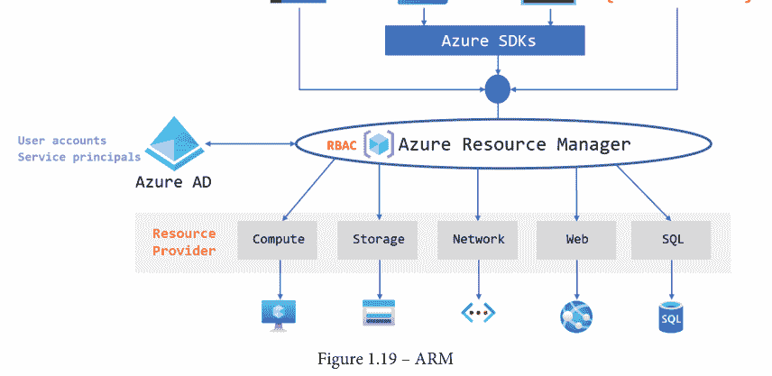

图 1.19 – ARM

资源提供程序是提供不同类型资源的服务。例如，网络资源提供程序负责网络资源（虚拟网络、网络接口等），而计算资源提供程序负责计算资源（VM）。

#### 总结

虽然这可能是本书中最不激动人心的章节，但 Azure 平台基础知识将为我们接下来要学习的各种攻击奠定基础。当我们继续阅读后续章节时，请从资源和 RBAC 两个角度牢记 Azure 的底层结构。

在下一章中，我们将引导你完成 Azure 环境和渗透测试 VM 的设置，你可以用它来模拟本书其余部分将要介绍的攻击场景。

#### 延伸阅读

这是一本很好的读物，可以帮助你了解如何为 Azure 环境和服务实现安全性：

- *Microsoft Azure Security Technologies Certification and Beyond*，作者：David Okeyode
