### 2 构建自己的环境

要完全跟上本书的内容，你需要访问一个 Azure 环境，并拥有一台可用于模拟使用工具、技术和流程来利用 Azure 环境的渗透测试**虚拟机（VM）**。通过跟着书中的动手示例进行操作，你将获得关于在实际环境中实际利用漏洞的宝贵见解。好的一面是，微软非常希望人们试用 Azure，因此很容易设置 Azure 免费试用来帮助你降低成本。

本章将指导你设置自己的 Azure 租户，并部署一台安装了必要工具的渗透测试 VM。

在本章中，我们将介绍以下主要主题：

- 创建新的 Azure 租户
- 在 Azure 中部署渗透测试 VM
- Azure 渗透测试工具

让我们开始吧！

#### 技术要求

虽然拥有 Azure 账户是免费的，但在账户中运行资源则不是免费的。请注意，在你的订阅中运行这些测试资源可能会产生任何潜在费用。目前，微软确实为新账户提供免费试用额度，并提供免费层服务，但这可能无法覆盖运行示例所涉及的所有资源成本。有关 Azure 免费层产品的更多信息，请访问微软网站：https://azure.microsoft.com/en-us/free/free-account-faq/。

> **重要说明**
> 作为设置完成后的额外预防措施，请务必为你的订阅设置警报，以确保你不会在 Azure 中超支。这可以通过 **订阅** 边栏选项卡下的 **成本警报** 部分，或通过搜索栏中的 **成本管理 + 计费** 边栏选项卡完成。当试用期结束而你可能仍有服务在运行时，这一点尤其有用。

在撰写本文时，本章提供的 VM 模板运行成本约为每天 5 美元（**美元/USD**）。如果你想最大化试用额度或减少总体支出，请确保在不使用任何运行中的资源时将其暂停或关闭。但在我们开始担心 VM 和订阅成本之前，我们需要先设置一个 Azure 租户来存管我们的订阅。

#### 创建新的 Azure 租户

本章将指导你在自己的 Azure 订阅中完成示例环境和渗透测试 VM 的设置。为了创建 VM 以完成本章的动手练习，你需要有一个 Azure 租户。如果你没有 Azure 租户，请按照本节中的步骤设置自己的租户。如果你已有 Azure 租户，你可能需要创建一个新订阅来用于这些示例。

> **重要说明**
> 
> 如果你打算使用现有订阅来运行书中的示例，请确保该订阅与任何生产工作负载、系统和服务分开。这些设置脚本中创建的示例服务会产生漏洞，可能使你的环境面临风险。风险自负！

在理想情况下，整个环境只需一键部署即可，但自己动手构建环境会让你受益匪浅。攻击一个预先构建好的**夺旗（CTF）**环境可能非常有趣，但白手起家构建自己的环境将使你对自己所使用的环境有更深入的理解。

#### 动手练习：创建 Azure 租户

每个 Azure 环境的核心都是租户。正如我们在前一章中介绍的，所有订阅和 **Active Directory（AD）** 用户都将存储在此处。

让我们看看需要完成的任务，如下所示：

- **任务 1：** 向 Microsoft 进行身份验证。
- **任务 2：** 选择免费试用选项。
- **任务 3：** 输入计费信息。
- **任务 4：** 访问新的 Azure 租户。

让我们从创建 Azure 租户开始。为此，请按以下步骤操作：

1. 导航到 https://portal.azure.com/ 并创建一个新账户，如下面的截图所示。如果你已有 Microsoft 账户，也可以使用该账户：
2. 身份验证完成后，选择“开始”以开始 Azure 免费试用，如下面的截图所示：

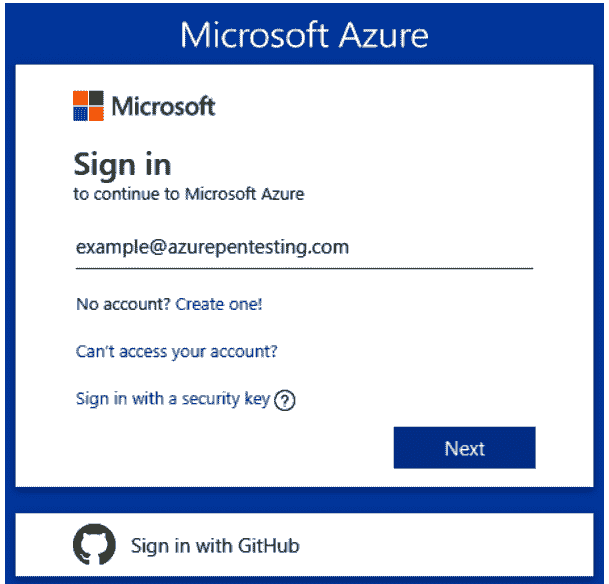

图 2.1 – 登录 Azure

欢迎使用 Azure！

没有订阅？看看以下选项。


开始 Azure 免费试用

获得 200 美元的 Azure 产品和服务免费额度，外加 12 个月的常用免费服务。

开始  
了解更多

图 2.2 – 开始免费试用

3. 填写个人资料信息。请确保使用你正确的信息，因为这将用于计费账户。你可以在下面的截图中看到示例：

你的个人资料

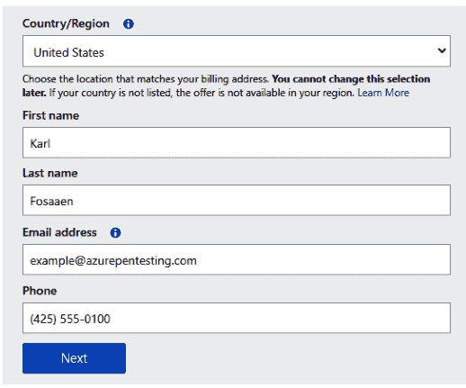

图 2.3 – 输入计费信息

4. 完成设置 Azure 计费信息的步骤后，你将进入“快速入门中心”，如下面的截图所示：

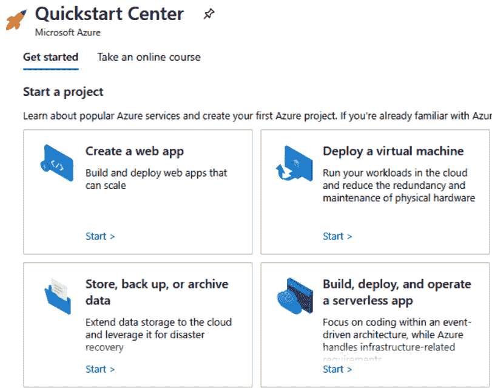

图 2.4 – 访问新的 Azure 租户

恭喜！你刚刚创建了你的 Azure 租户。这是跟随这些示例进行操作的第一步，现在你离配置租户以承载示例实验室漏洞和你的测试 VM 又近了一步。

#### 动手练习：创建 Azure 管理员账户

要完成本书中的许多动手练习，你需要在你的 Azure 租户和订阅中设置“设计上易受攻击（vulnerable by design）”的用户和服务。为方便起见，我们将提供需要你在 Azure Cloud Shell 中运行的脚本和模板。

虽然用于设置租户的用户已经拥有租户的全局管理员权限，但我们仍将创建一个单独的管理员用户（azureadmin），使其能够访问 Azure AD 和 Azure 租户。该用户将是一个全局管理员账户，因此请务必设置一个强密码！在本书后面的示例中，我们也会保持一致地使用这个用户名，以便统一使用一个用户名。

作为一般规则，我们不建议在 Azure 中为日常使用的账户分配特权角色，但出于练习的目的，这将帮助我们利用未来的一些场景。

以下是你在本练习中要完成的任务：

- **任务 1：** 注册 Azure AD Premium P2 试用版。
- **任务 2：** 在 Azure AD 中创建一个新用户。
- **任务 3：** 在你的 Azure 订阅中授予该用户 **所有者（Owner）** 角色分配。

让我们按如下方式创建 Azure 管理员账户：

1. 使用上一个练习中已通过身份验证的 Web 浏览器会话，单击左上角的门户菜单图标，然后选择 **Azure Active Directory**，如下面的截图所示：

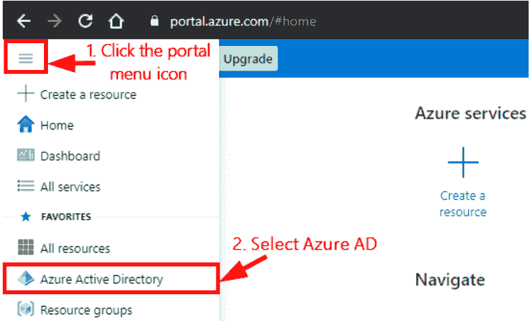

图 2.5 – 选择 Azure AD


2. 在 **Default Directory | Overview** 刀片中，查看 **Tenant information** 部分包含的信息。查看您 Azure AD 许可证的当前版本。

如果您的当前许可证为 **Premium**，您可以跳过本练习中的剩余任务。如果您的当前版本为 **Free**，如以下屏幕截图所示，请继续执行后续步骤以激活试用版高级许可证：

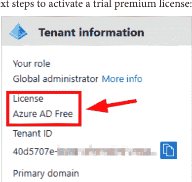

图 2.6 – 查看当前的 Azure AD 许可证

3. 在左侧菜单中，点击 **Licenses**，如以下屏幕截图所示：

#### azurepentesting (Default Directory) | Overview

Azure Active Directory

图 2.7 – Azure AD 许可证

4. 在 Licenses | Overview 刀片中，点击 All products，然后点击 + Try/Buy 选项，如以下屏幕截图所示：

#### Licenses | All products

Default Directory - Azure Active Directory

图 2.8 – 试用 Azure AD Premium P2 许可证

5. 在 Activate 刀片中，点击展开 Free trial（在 Azure AD PREMIUM P2 下），然后点击 Activate，如以下屏幕截图所示：

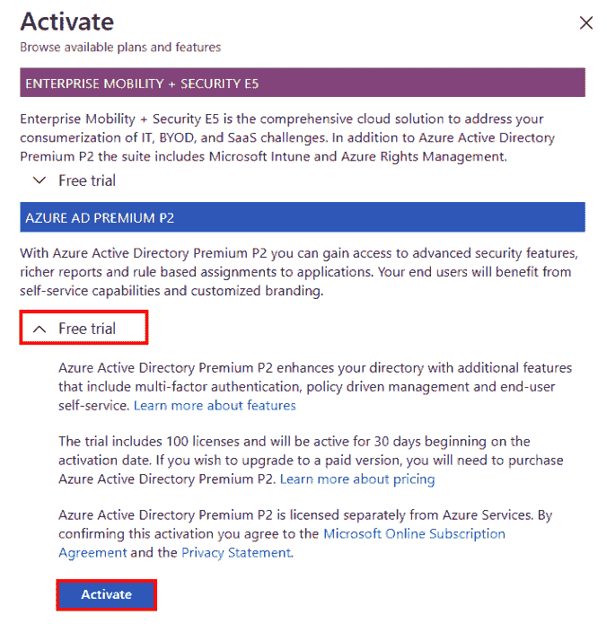

图 2.9 – 激活 Azure AD Premium P2 试用许可证

6. 即使您已收到成功消息，许可证激活也可能需要几分钟时间。您可能还需要刷新浏览器才能看到已激活的试用版。完成后，您现在应该拥有 100 个 Azure AD Premium P2 许可证，我们将把这些许可证分配给稍后创建的用户，如以下屏幕截图所示：

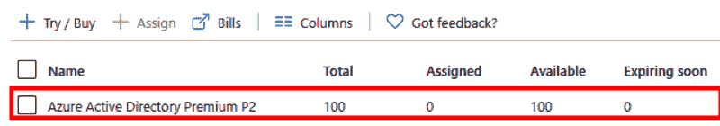

图 2.10 – Azure AD Premium P2 许可证

7. 在 Azure 门户中，仍使用顶部搜索栏导航回主 Azure Active Directory 部分。在 Manage 部分下，点击 Users，然后点击 + New user 创建新用户，如以下屏幕截图所示：

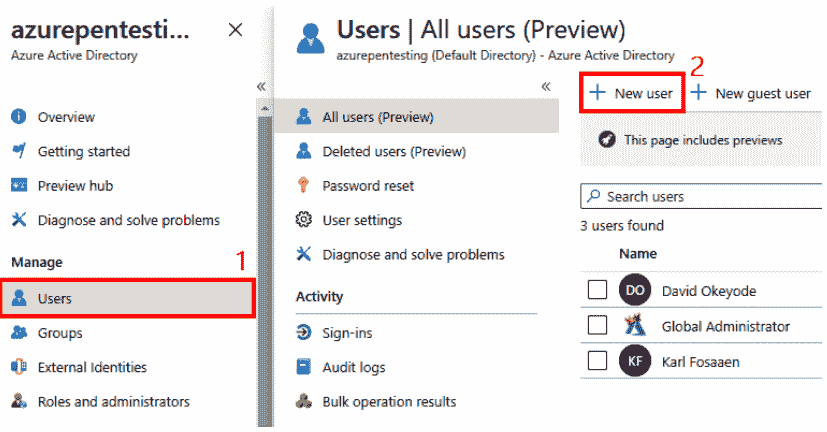

图 2.11 – 创建新的 Azure AD 用户

8. 在 New User 窗口中，配置以下内容：

Create User: Selected

在 Identity 下，配置以下内容：

User name: azureadmin

Name: azureadmin

在 Password 下，配置以下内容：

Select Auto-generate password.

Select Show Password 以显示初始临时密码。请记下该密码，因为您将在下一步中使用它。

在 Groups and roles 下，配置以下内容：

Groups: 保持默认设置。

Roles: 点击 User → 选择 Global administrator → 点击 Select。

在 Settings 下，配置以下内容：

Block sign in: No

Usage location: 选择最接近您的位置

9. 保持其他设置在默认状态并点击 Create。

该过程在以下屏幕截图中突出显示：

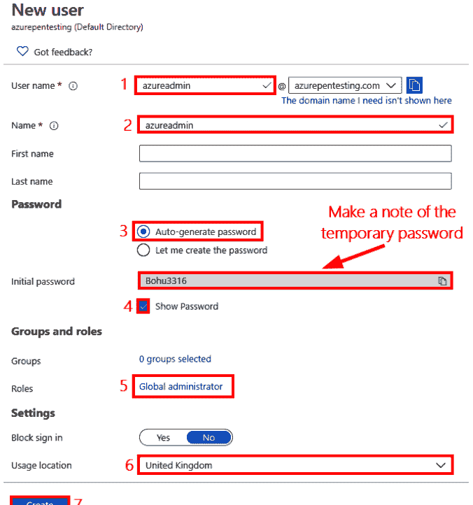

图 2.12 – 配置新的 Azure AD 用户

10. 在 Users | All users 刀片中，点击您刚刚创建的新用户—azureadmin，如以下屏幕截图所示：

#### Figure 2.13 – New Azure AD users

11. 在 azureadmin | Profile 刀片中，请记下 User Principal Name，因为您将在后面的步骤中需要它，然后点击 Licenses。该过程在以下屏幕截图中突出显示：

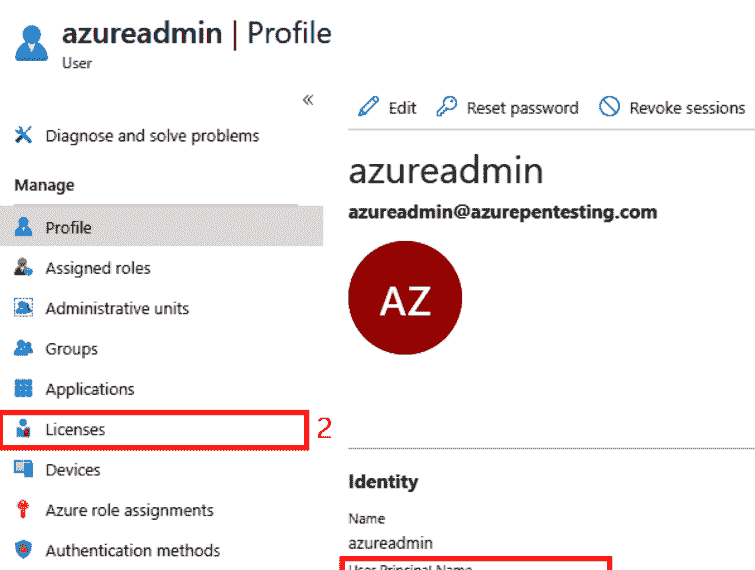

#### Figure 2.14 – azureadmin user profile

12. 在 **Licenses** 刀片中，点击 **+ Assignments**。
13. 在 **Update license assignments** 屏幕中，选择 **Azure Active Directory Premium P2**，然后点击 **Save**。该过程在以下屏幕截图中突出显示：

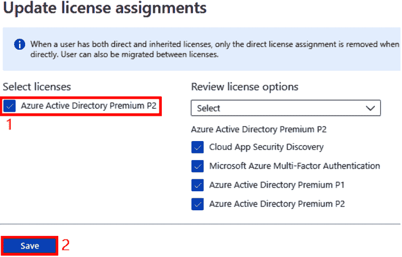

图 2.15 – 分配 Azure AD Premium P2 许可证

14. 在 Azure 门户中，点击左上角的 **Microsoft Azure** 返回主页，如以下屏幕截图所示：

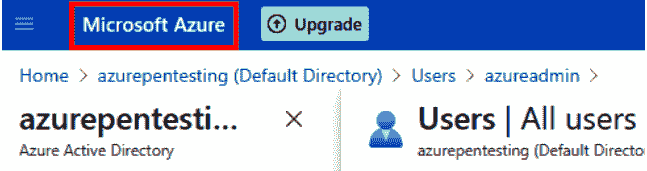

图 2.16 – 返回主页

15. 在主页上，在 Navigate 部分，点击 Subscriptions，如以下屏幕截图所示：

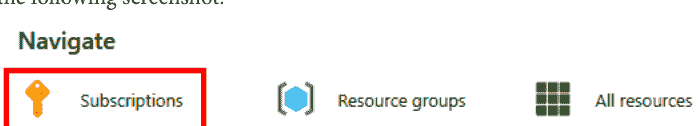

图 2.17 – 导航到 Subscriptions

16. 在 Subscriptions 刀片中，点击您的订阅（“Free Trial”），然后点击 Access control (IAM) 后点击 Add role assignments，如以下屏幕截图所示：

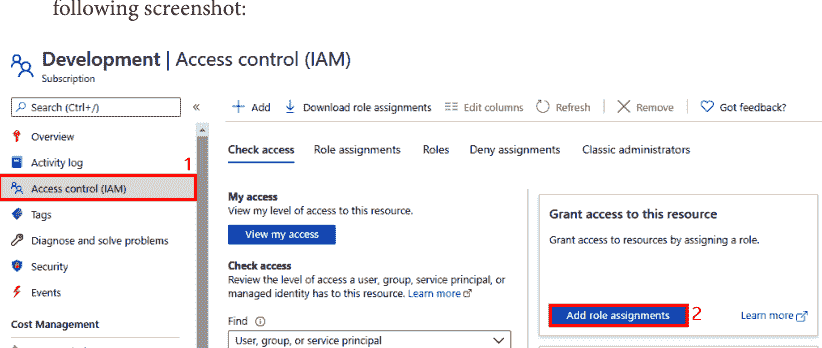

图 2.18 – 添加订阅级角色分配

17. 在 Add role assignment 刀片中，配置以下内容：

Role: Owner

Assign access to: 保持为 User, group, or service principal

Select: azureadmin

18. 点击 Save。

该过程在以下屏幕截图中说明：

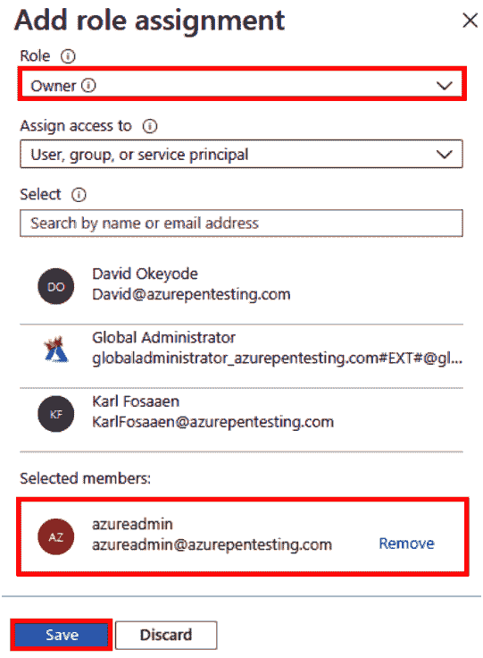

图 2.19 – 将 Owner 角色分配给 azureadmin

19. 注销 Azure 门户并关闭浏览器窗口。

20. 打开一个 Web 浏览器并浏览到 Azure 门户统一资源定位符（URL）https://portal.azure.com。

21. 使用您之前记下的 azureadmin 用户主体名称（UPN）和临时密码登录到门户。

22. 在提示更新密码时，配置以下内容：

**Current password:** 输入您之前记下的临时密码。

**New password:** 输入一个复杂的密码。请记下它，因为您将在本书的其余部分中使用它。

**Confirm password:** 重新输入该复杂密码。

23. 点击 **Sign in**，如以下屏幕截图所示：

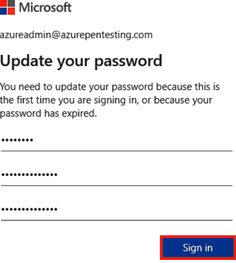

图 2.20 – 更新 azureadmin 用户帐户的密码

我们现在拥有一个 Azure 租户、一个已授权的管理员用户，以及渴望了解更多 Azure 渗透测试的积极态度。让我们利用这种热情继续设置我们的测试环境。

#### Important note

虽然我们在此未涉及，但我们强烈建议为所有特权 Azure 帐户添加 **多因素身份验证（MFA）** 要求。这可以从用户图标（门户右上角）下的 **My Microsoft account** 部分完成。虽然我们将创建一个有意易受攻击的环境，但我们不希望您因未保护管理员帐户而进一步使自己处于风险之中。有关为帐户使用 MFA 的更多信息，请参阅 Microsoft 的文档：https://docs.microsoft.com/en-us/azure/active-directory/roles/security-planning#turn-on-multi-factor-authentication-and-register-all-other-highly-privileged-single-user-non-federated-admin-accounts。

我们现在已在 Azure AD 中配置了适当的管理员帐户，因此我们可以继续设置我们将用于示例的 VM。

#### Deploying a pentest VM in Azure

现在我们有了可部署资源的 Azure 租户，我们需要设置一台用于测试的 VM。此 VM 将使我们能够跟随本书中的练习，并应为安装工具提供一个干净的基础，而不必尝试在现有系统上安装工具。对于任何希望为自动化内部团队工具实现 Azure 基础镜像的人来说，这也应该很有用。

#### Hands-on exercise: Deploying your pentest VM

我们已在本書的 GitHub 仓库中准备了一个 **Azure Resource Manager (ARM)** 模板。该模板将部署一台安装了以下应用程序的 Windows Server 2019 VM：Git for Windows、**Visual Studio Code (VS Code)** 和 Docker Desktop。

#### Important note

ARM 模板可以是部署 Azure 环境中资源的绝佳工具。由于本书侧重于攻击（而非构建）Azure 环境，我们不会深入介绍 ARM 模板。有关 ARM 模板的更多信息，请参阅 Microsoft 的文档：https://docs.microsoft.com/en-us/azure/azure-resource-manager/templates/。

在本练习中，我们将完成的任务如下：

- **Task 1:** 在 GitHub 中初始化模板部署。
- **Task 2:** 配置参数并将模板部署到 Azure。

让我们开始部署 VM 的过程，如下所示：

1. 打开一个 Web 浏览器，并浏览到 https://bit.ly/azurepentestervm。该链接将打开具有用于部署渗透测试 VM 的 ARM 模板的 GitHub 仓库。
2. 在打开的 GitHub 仓库中，点击 **Deploy to Azure**，如以下屏幕截图所示：

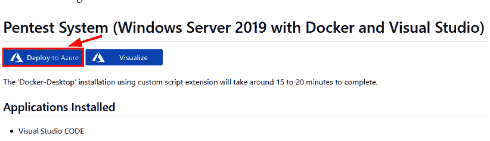

图 2.21 – 点击开始部署过程


3. 在“登录”窗口中，输入之前配置的 azureadmin 用户名和密码以验证到您的 Azure 订阅，如以下屏幕截图所示：

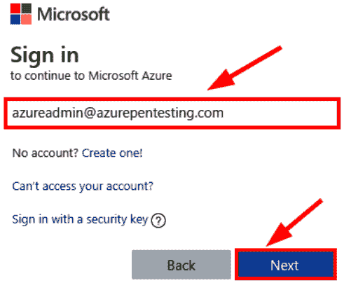

图 2.22 – 验证到 Azure

4. 在“自定义部署”窗口中，配置以下参数：

Subscription: 选择要部署渗透测试 VM 的订阅。

Resource group: 创建新 → pentester-vm-rg → 确定。

Region: 选择靠近您所在位置的 Azure 区域。

Storagename: 保留默认设置。

Vm-dns: 保留默认设置。

Admin User: pentestadmin。

Admin Password: 输入一个复杂的密码。记下您使用的密码。我们建议您在本书的各个场景中选择一个复杂的密码以保持简单。

Vmsize: 保留默认设置。

Location: 保留默认设置。

_artifacts Location: 保留默认设置。

_artifacts Location Sas Token: 保留默认设置。

5. 单击“查看 + 创建”。

该过程在以下屏幕截图中突出显示：

```text
#### Custom deployment
Deploy from a custom template
Basics Review + create
Template
Customized template
7 resources
Edit template
Edit parameters
Deployment scope
Select the subscription to manage deployed resources and costs. Use resource groups like folders to organize and manage all your resources.
Subscription *
Resource group *
Create new
Parameters
Region *
Storagename
Vm-dns
Admin User *
Admin Password *
Vmsize
Location
_artifacts Location
_artifacts Location Sas Token

(New) pentester-vm-rg

UK South

[concat('ptvmstrg', uniqueString(resourceGroup().id))]

[concat('pentestvm-', uniqueString(resourceGroup().id))]

pentestadmin

************

Standard_D4s_v3

[resourceGroup().location]

[deployment().properties.templateLink.uri]

Review + create
< Previous
Next : Review + create >
```

图 2.23 – 配置模板参数

8. 在您的客户端系统上，打开远程桌面协议（RDP）客户端并输入您之前记下的 pentest-vm-dns 值。单击“连接”。这里的说明描述了使用 Windows RDP 客户端。如果您使用的是不同的 RDP 客户端，说明可能与您不同。

要打开 Windows RDP 客户端，请从 Windows 运行对话框执行 mstsc，或在 Windows 开始菜单中键入 mstsc。

以下屏幕截图显示了使用 RDP 连接到渗透测试 VM 的过程：

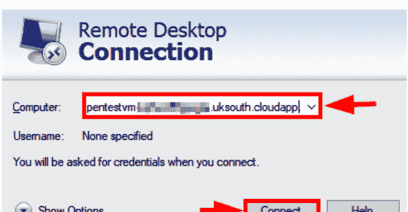

图 2.26 – 使用 RDP 连接到渗透测试 VM

9. 提示登录时，单击“更多选项” → “使用其他帐户”。输入以下内容：

**Username:** `pentestadmin`。

**Password:** 输入您在模板部署期间配置的密码。

这在以下屏幕截图中进行了说明：

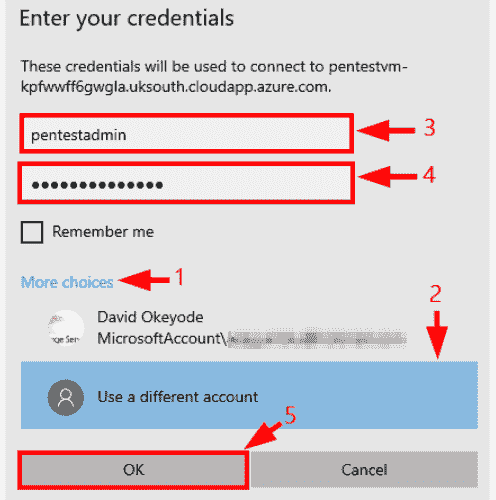

图 2.27 – 使用 RDP 客户端进行身份验证

10. 提示证书警告时，选中“不再为此计算机的连接询问我”选项，然后单击“是”，如以下屏幕截图所示：

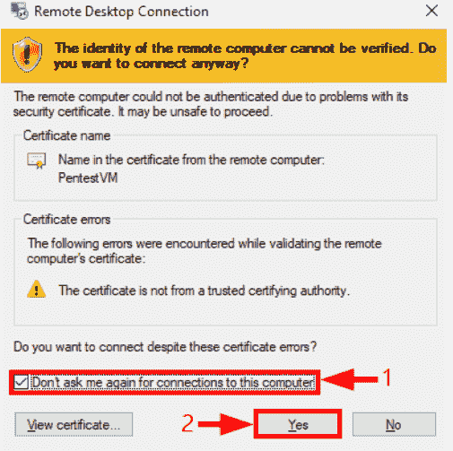

图 2.28 – 跳过证书警告

11. 您现在应该拥有渗透测试 VM 的 RDP 会话！我们可以在以下屏幕截图中看到其概览。保持此会话打开，因为您将在下一个练习中需要它：

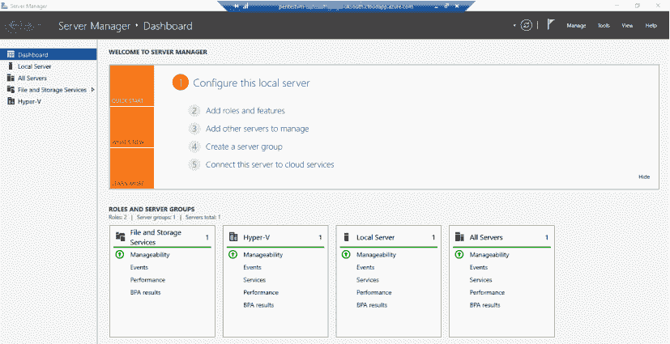

图 2.29 – 到渗透测试 VM 的 RDP 会话

在本练习中，您在 Azure 中部署了一个渗透测试 VM。这是我们将在本书中用于发起攻击场景的 VM。

> **重要说明**
> 如果您想采取额外的步骤来锁定对该 VM 的访问，您可以将 RDP 访问限制为您的外部**Internet 协议（IP）**地址。这被认为是一种最佳实践，可以在门户中在 VM 的**网络**部分下的**入站安全规则**中完成。这也可以通过**网络安全组**菜单访问。

在下一个练习中，我们将介绍在渗透测试 VM 上安装**Windows Subsystem for Linux**（**WSL**）。

#### 实践练习：在您的渗透测试 VM 上安装 WSL

我们将用于攻击场景的一些工具是基于 Linux 的。为了避免为不同的工具集设置两个渗透测试系统，我们将在刚刚部署的渗透测试 VM 上安装**WSL**。WSL 将允许我们在 Windows 上直接运行 Linux 环境，而无需部署传统的 VM。以下是我们将在本练习中完成的任务：

- **任务 1**：验证 Windows 版本是否支持 WSL。
- **任务 2**：启用 WSL（并重新启动 VM）。
- **任务 3**：下载 Ubuntu 20.04 Linux 发行版。
- **任务 4**：安装 Ubuntu 20.04 Linux 发行版。
- **任务 5**：启动 Linux 发行版。

让我们通过以下任务安装 WSL：

1. 在到您的渗透测试 VM 的 RDP 会话中，右键单击**开始**按钮并单击**Windows PowerShell（管理员）**，如以下屏幕截图所示：

图 2.30 – 以管理员身份打开 Windows PowerShell

2. 要启用 WSL，您的 Windows 操作系统（OS）需要为 Build 16215 或更高版本。您可以使用以下命令检查您的构建版本：

```powershell
systeminfo | Select-String "^OS Name","^OS Version"
```

这就是输出的样子：

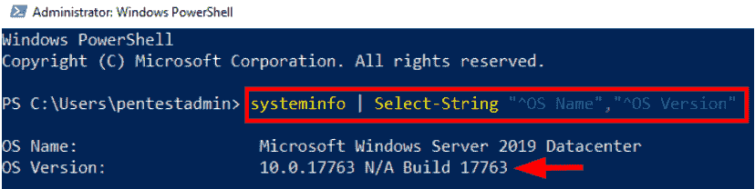

图 2.31 – 验证 Windows 构建版本

3. 使用以下命令启用 WSL。提示重新启动 VM 时，键入 Y 并按 Enter。等待几分钟让 VM 重新启动，使用 RDP 重新连接到它并以管理员身份打开 PowerShell 控制台：

```powershell
Enable-WindowsOptionalFeature -Online -FeatureName Microsoft-Windows-Subsystem-Linux
```

这就是输出的样子：

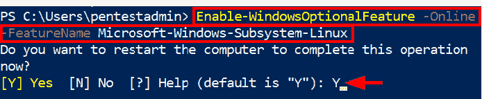

图 2.32 – 使用 PowerShell 启用 WSL

4. 更改目录到您的用户目录（C:\Users\$env:USERNAME\ 或 ~ 都可以工作）并使用以下命令下载 Ubuntu 20.04 发行版：

```powershell
cd C:\Users\$env:USERNAME\
```

```powershell
Invoke-WebRequest -Uri https://aka.ms/wslubuntu2004 -OutFile Ubuntu.appx -UseBasicParsing
```

5. 使用以下命令验证下载：

```powershell
Get-ChildItem
```

这就是输出的样子：

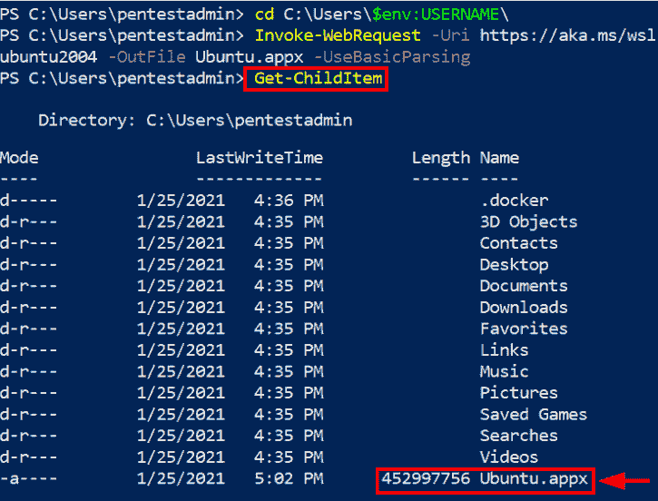

图 2.33 – 验证下载的 Linux 发行版

6. 使用以下命令提取下载的发行版：

```powershell
Rename-Item .\Ubuntu.appx .\Ubuntu.zip
Expand-Archive .\Ubuntu.zip .\Ubuntu
```

7. 使用以下命令安装提取的 Linux 发行版。安装需要几分钟才能完成：

```powershell
Set-Location .\Ubuntu\
.\ubuntu2004.exe
```

8. 提示输入 Linux 安装的凭据时，完成以下操作：

   - **Enter new UNIX username:** pentestadmin。
   - **New password:** 为保持简单，输入与渗透测试 VM 相同的密码。
   - **Retype new password:** 重新输入相同的密码。

这在以下屏幕截图中进行了说明：

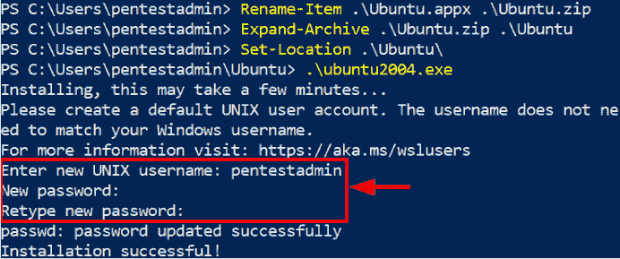

图 2.34 – 为 WSL 配置凭据

9. 使用以下命令将 Linux 安装应用更新。提示时输入您刚刚配置的密码：

```bash
sudo apt update -y
```

10. 您可以关闭 PowerShell 控制台。从现在开始使用 WSL，您只需在渗透测试 VM 的 PowerShell 控制台或命令行控制台中键入 bash 并按 *Enter* 即可。

在本练习中，您在渗透测试 VM 上启用了 WSL。在以下练习中，我们将介绍安装 Azure PowerShell 模块和 Azure **命令行界面（CLI）**，这些是本书中我们将使用的其他渗透测试工具所需的。

#### 实践练习：在您的渗透测试 VM 上安装 Azure 和 Azure AD PowerShell 模块

如第一章所述，**Azure PowerShell** 是管理员和开发人员可以添加到 PowerShell 以连接到 Azure 订阅并管理 Azure 资源的模块。**Azure AD PowerShell** 是 IT 专业人员用于管理 Azure AD 的模块。两个模块都包含渗透测试人员可以用来执行目标环境枚举的有用命令。Azure 特定的渗透测试工具如 **MicroBurst** 和 **PowerZure** 也需要安装这些模块。

在本练习中，我们将在渗透测试 VM 上安装这两个模块。以下是我们将完成的任务：

- **任务 1：** 验证是否安装了 PowerShellGet
- **任务 2：** 将 PowerShell 库配置为受信任的存储库


- **任务 3：** 安装并验证 Azure PowerShell 模块
- **任务 4：** 安装并验证 Azure AD PowerShell 模块

让我们按如下方式安装 Azure PowerShell 和 Azure AD PowerShell：

- 1. 在你的渗透测试 VM 上以管理员身份打开 PowerShell。
- 2. 使用以下命令验证是否已安装 PowerShellGet：

```
Get-Module -ListAvailable PowerShellGet
```

它看起来会像这样：

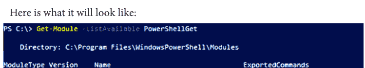

图 2.35 – 将 PowerShell gallery 配置为受信任的存储库

- 3. 我们将要安装的两个模块都将从 PowerShell gallery 存储库下载。为了避免收到有关存储库信任级别的消息，我们可以使用以下命令将其配置为受信任的存储库。系统提示安装 NuGet 提供程序时，输入 Y 表示 yes，然后按 Enter：

```
Set-PSRepository -Name PSGallery -InstallationPolicy Trusted
```

它看起来会像这样：

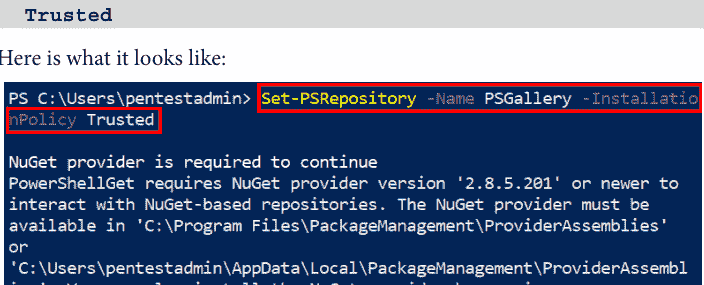

图 2.36 – 将 PowerShell gallery 配置为受信任的存储库

- 4. 使用以下命令安装 Azure PowerShell 模块：

```
Install-Module -Name Az -AllowClobber
```

- 5. 使用以下命令验证安装：

```
Get-Module -ListAvailable Az.*
```

它看起来会像这样：

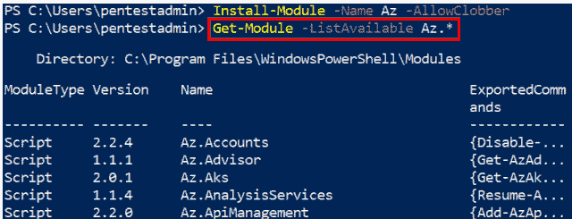

图 2.37 – 验证 Azure PowerShell 模块安装

- 6. 使用以下命令安装 Azure AD PowerShell 模块：

```
Install-Module AzureAD -AllowClobber
```

- 7. 使用以下命令验证安装：

```
Get-Module -ListAvailable AzureAD
```

它看起来会像这样：

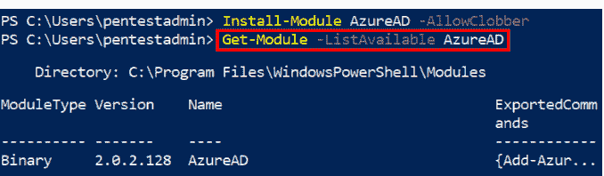

图 2.38 – 验证 Azure AD PowerShell 模块安装

- 8. 将 PowerShell 控制台保持打开以进行下一个练习。

我们现在已在 VM 上设置了大部分基础工具。为了为我们在 Linux 中使用的工具提供一些额外支持，我们接下来将在 Linux 子系统上安装 Azure CLI。

#### 实践练习：在你的渗透测试 VM（WSL）上安装 Azure CLI

Azure CLI 是管理员和开发人员用来连接 Azure 并在 Azure 资源上执行管理命令的另一个命令行工具。诸如 Lava 之类的 Azure 特定利用框架需要安装 Azure CLI。在本练习中，我们将在 WSL 中安装 Azure CLI。按如下方式进行：

- 1. 在你的渗透测试 VM 上之前打开的 PowerShell 控制台中，输入 bash 然后按 Enter 切换到 Windows Subsystem for Linux。
- 2. 在 bash shell 中，使用以下命令切换到 root 用户。系统提示时输入管理员密码：
- 3. 使用以下命令安装 Azure CLI：
- 4. 使用以下命令验证安装：
- 5. 在继续进行下一个练习之前关闭打开的 PowerShell 控制台。

```
sudo su -
```

它看起来会像这样：

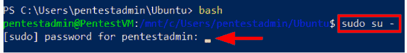

图 2.39 – 切换到 root 用户

```
curl -sL https://aka.ms/InstallAzureCLIDeb | sudo bash
```

```
az version
```

它看起来会像这样：

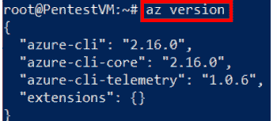

图 2.40 – 验证 Azure CLI 安装

我们的 VM 现在已按我们需要的方式配置完毕，我们现在准备开始讨论工具。这些将是管理工具和安全工具的混合，将在 Azure 渗透测试的多个不同层级中使用。

注意
强烈建议在不使用渗透测试 VM 时将其关闭以节省一些成本。你可以通过 Azure 门户停止 VM 来实现。

#### Azure 渗透测试工具

在本書的整个过程中，我们将使用不同的工具来模拟对手的战术和技术。我们可以根据其典型用途将这些工具分为不同的类别。

首先，我们有 **Windows 或 Linux 管理工具**，概述如下：

- 管理员通常用于一般系统管理的工具
- **示例：** `JQ`、`httpie`、`wget`、`curl`、`unzip` 和 `PowerShell`

接下来是 **通用渗透测试工具**，概述如下：

- 通用服务和漏洞识别工具
- **示例：** `gobuster`、`nmap`、`dns scan` 和 `hydra`

最后，我们有 **Azure 特定渗透测试工具**，概述如下：

- 针对 Azure 平台相关漏洞进行优化的渗透测试工具
- **示例：** MicroBurst、Lava、Koboko、PowerZure、Stormspotter 和 BloodHound

目前这类 Azure 特定工具非常少，而且大多数都是开源的。这通常意味着创建者和贡献者会在自己的时间里发布和更新这些工具，因此经常有机会让其他人为这些工具做出贡献。本书的作者（以及我们的技术审阅者）都为开源工具做出了贡献，包括上述一些工具，我们的工作证明了如果需要的工具或功能不存在，你完全可以自己编写。

需要注意的一个重要区别是通用渗透测试工具和 Azure 特定工具之间的区别。虽然许多通用渗透测试工具可以用于攻击 Azure，但它们通常需要配置为专注于 Azure 域和服务。本书中提到的 Azure 特定工具要么是专门构建为针对 Azure 域进行范围限定，要么是围绕现有的 Microsoft **应用程序编程接口（APIs）**、PowerShell 模块和库构建，以直接集成到 Azure 中。

当我们进入其他章节中的动手练习和场景时，我们将确保 *描述我们将使用的工具*（以便你了解该工具及其用例）、*如何在你的渗透测试系统上安装该工具*，以及——当然——*如何使用该工具来实现所述目标*。

在我们阅读本书时请记住一点：如果你在渗透测试中反复做某件事，可能值得为其创建一个工具。本书中介绍的许多工具都是为取代在 Azure 渗透测试中反复手动执行的过程而开发的。

如果没有工具可以实现你想要自动化的功能，请查看现有项目并找到一个项目进行贡献，或创建新项目。请记住，本书中概述的大多数工具和技术都是由慷慨付出时间的人为安全社区的改善而创建的。如果你有机会，请花点时间感谢为这些工具集做出贡献的任何人，尤其是本书中使用的那些。

#### 总结

你可能会问自己：*我们真的需要花费 30 多页来学习如何在 Azure 中部署资源吗？* 这是一个公平的问题，对于那些已经知道本章所涵盖所有内容的人来说，恭喜你带着现有的扎实知识基础来阅读本书。

对于那些需要更多指导才能完成本章的人，不要感到气馁，如果这有点让人不知所措。学习如何在 Azure 中部署和管理资源可能有点棘手，但一旦进入实际测试，这将给你带来优势。

本章涵盖了我们访问和测试 Azure 环境所需的许多工具和技术基础。这些工具在这些练习之外进行自己的测试时将至关重要，因此请将本章加入书签，以便在未来需要构建另一个 Azure 测试环境时使用。

现在我们已经了解了 Azure 的基础知识，并且有一个准备好进行测试的环境，在下一章中，我们可以开始测试 Azure 中的漏洞。


