### 3 查找 Azure 服务和漏洞

作为渗透测试人员，您可能会在评估过程中被要求匿名攻击 Azure 租户。从范围的角度来看，这可能很棘手。任何人都可以随意命名 Azure 服务，并且可能很难找到真正在范围内的资源。无论您是在追踪漏洞赏金，还是在渗透测试期间追踪影子 IT 资产，匿名 Azure 服务发现都可以成为识别环境中漏洞的有用工具。

在本章中，我们将介绍不需要对 Azure 租户进行任何身份验证的 Azure 攻击。此外，这些攻击可用于获取对 Azure 租户的初始访问权限。我们还将介绍当前可用于评估 Azure 服务漏洞的多个开源工具包。

具体来说，本章将涵盖以下部分：

- Azure 渗透测试指南
- 匿名服务识别
- 识别面向公共服务中的漏洞
- 查找 Azure 凭据

#### 技术要求

在本章中，我们将使用在*第 2 章，构建您自己的环境*中设置的虚拟机。如果您没有设置自己的环境，请确保您具有带 PowerShell 的 Windows 系统的本地管理员访问权限。虽然您并非绝对需要 Windows 桌面来理解本章内容，但作者建议启动一台 Azure 虚拟机（如上一章所述）来测试我们将介绍的工具和技术。

#### Azure 渗透测试指南

自 2017 年 6 月起，*Microsoft 不再要求组织获得对其 Azure 资源进行渗透测试的预先批准*（https://docs.microsoft.com/en-us/azure/security/fundamentals/pen-testing）。需要注意的是，此豁免不适用于其他 Microsoft 云服务，例如 Office 365。即使您无需在执行渗透测试前通知 Microsoft，仍有必须始终遵守的明确*交战规则*，您绝对不应跨越这些界限。不遵守规定可能导致您的 Azure 帐户被暂停或终止、Microsoft 对您提起法律诉讼，以及向您提出财务责任索赔！

> **重要说明**
> 由于这些指南会不时更新，我们建议您访问 https://www.microsoft.com/en-us/msrc/pentest-rules-of-engagement 查看最新信息。

以下活动是被禁止的：

- 扫描属于其他 Azure 客户的资产。
- 访问任何*不属于您的数据*。

#### 匿名服务识别

既然我们已经对 Azure 基础设施和 Azure 渗透测试的可用范围有了基本了解，让我们开始一些实际攻击。在本节中，我们将介绍如何匿名识别托管在 Azure 中的面向互联网的服务。鉴于许多组织都在使用 Azure 服务，这对于任何外部测试都适用，无论使用哪种云。

#### 自行承担测试风险

为了本书的目的，我们将在示例中提供一些真实资源（由作者托管），您可以使用这些资源来测试这些工具。除非另有说明，本书中的所有示例都将指向您有权跟随示例操作的资源。

> **重要说明**
> 请勿对未经授权测试的系统或服务运行本书中的工具或示例。希望到目前为止我们已经把这一点说得非常清楚了。

我们将尝试为每次攻击指出具体的危险范围示例。如有疑问，请咨询您所测试资源的所有者，以确认您匿名枚举的资源是否归该组织所有。

#### Azure 公共 IP 地址范围

与其他公共云提供商一样，Microsoft Azure 允许组织为 Azure 资源分配可通过互联网访问的 IP 地址。公共 IP 地址可以分配给以下 Azure 资源：虚拟机网络接口、面向互联网的负载均衡器、VPN 网关、应用程序网关或 Azure 防火墙实例（图 3.1）。

分配公共 IP 地址时，它们可以是静态的或动态的。动态公共 IP 地址可以在 Azure 资源的整个生命周期内发生变化，而静态公共 IP 地址在 Azure 资源的整个生命周期内不会改变：

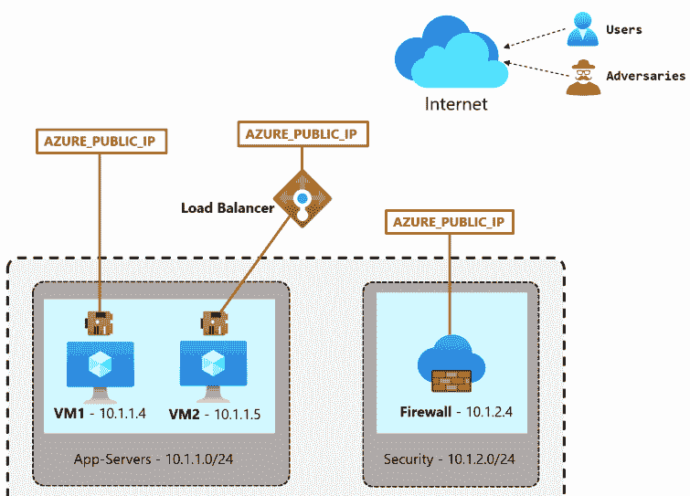

图 3.1 – Azure 中分配的公共 IP 地址

作为 Azure 渗透测试人员，您应该尝试通过从互联网扫描环境分配的公共 IP 地址，来发现组织 Azure 基础架构即服务（IaaS）环境中可用的资源及其攻击面。对于已批准的参与，组织很可能会向您提供其 Azure 订阅中已分配公共 IP 地址的当前列表，以确保您不会影响其他 Azure 客户。

您可以要求他们使用 Azure CLI 或 Az PowerShell 模块为他们的每个订阅运行以下命令来获取此列表。

对于 Azure CLI，请运行以下命令：

```
az network public-ip list --query '[]. [name, ipAddress, publicIpAllocationMethod]' -o table
```

对于 Az PowerShell 模块，请运行以下命令：

```
Get-AzPublicIpAddress | Select
Name,IpAddress,PublicIpAllocationMethod
```

> **注意**
> 请注意，前面的命令不是我们稍后将逐步进行的动手练习的一部分，但如果您有一个 Azure 环境想要尝试这些命令，可以在 Azure Cloud Shell 中运行它们。

需要注意的是，动态分配的地址可能会发生变化，如果稍后测试，可能不再分配给您所参与的组织。对于这些情况，针对 DNS 主机名可能是值得的，因为当 IP 地址变化时，它们会自动更新。这将帮助我们避免扫描其他 Azure 客户的 IP 地址。此外，我们建议在收集 IP 后立即运行任何公共 IP 扫描。

出于学习目的，我们将向您展示外部对手如何利用公开可用的信息匿名发现 Azure 目标。Microsoft Azure 网络团队发布了一个 JSON 文件，其中包含所有 Azure 区域和公共服务的公共 IP 地址范围。

该文件还会每周更新，添加新的范围。对手获取此列表并使用 **JQ** 等 JSON 工具解析它的情况并不少见。然后可以使用 **Nmap** 等其他工具扫描 IP 范围以确定攻击面。我们将在下一组练习中模拟此过程。

> **重要说明**
> Microsoft 强烈反对扫描未分配给您的 Azure 订阅，或未经所有者授权扫描的公共 IP 范围。下一个练习仅供教育目的。**未经指定所有者的书面法律许可，请勿扫描这些地址！**

#### 动手练习 – 使用 PowerShell 解析 Azure 公共 IP 地址

本练习将向您展示外部对手如何使用已发布的 Azure 公共 IP 范围来识别他们可以扫描漏洞的潜在目标。

以下是我们将在本练习中完成的任务：

- **任务 1**：在我们的 pentest VM 上下载已发布的 Azure 公共 IP 范围 JSON 文件。
- **任务 2**：使用 PowerShell 解析下载的文件以识别潜在目标。

让我们开始：

1. 在您的 pentest VM 中，打开 Web 浏览器并浏览到 https://www.microsoft.com/en-us/download/details.aspx?id=56519 （您也可以使用这个缩短的 URL：http://bit.ly/azureipranges）。
2. 单击“下载”按钮获取当前 Azure 公共 IP 地址范围列表。这将下载一个 JSON 文件，其中包含按区域和服务划分的公共 IP 地址范围列表。
3. 为了演示，我们不会使用这个下载的 JSON 文件。相反，我们将使用命令行会话中提供的链接来下载文件：

   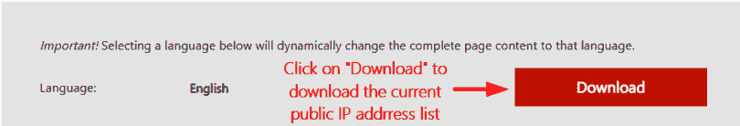

   图 3.2 – 下载 JSON 文件

4. 在显示的窗口中，右键单击“单击此处手动下载”，然后点击“复制链接地址”以获取 JSON 文件的 URL：

   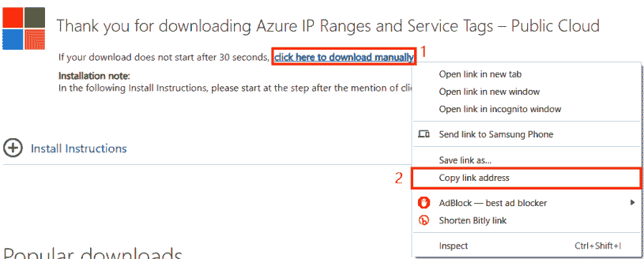

   图 3.3 – 获取 JSON 文件的 URL


> 注意
> 我们在这里下载的 JSON 文件适用于 Azure 公有云。Azure 美国政府云有一个单独的文件。该文件可以从 https://www.microsoft.com/en-us/download/details.aspx?id=57063 下载。

5. 在渗透测试虚拟机的 PowerShell 控制台中，使用以下命令下载 JSON 文件。将 `<json_url>` 替换为你在步骤 3 中获取的 URL：

```
cd C:\Users\$env:USERNAME\
Invoke-WebRequest <json_url> -O azure_ip_range.json
```

6. 在我们的示例中，我们将使用 PowerShell 筛选 Azure 英国南部区域中所有服务的公共 IP 地址范围。这将返回攻击者可以扫描的 IP 范围列表，以确定开放端口以及这些端口上正在侦听的服务：

```
$jsonData = gc .\azure_ip_range.json | ConvertFrom-Json
($jsonData | select -ExpandProperty values | where name -EQ AzureCloud.uksouth).properties.addressPrefixes
```

7. 接下来，尝试筛选英国南部区域中特定服务（Azure 应用服务实例）使用的公共 IP 地址范围。攻击者可以获取这些 IP 范围并扫描它们以查找 Web 应用程序漏洞，因为 Azure 应用服务资源通常用于托管 Web 应用程序和 API：

```
($jsonData | select -ExpandProperty values | where name -EQ AppService.UKSouth).properties.addressPrefixes
```

8. 攻击者可以获取 IP 范围并扫描它们以查找开放端口和侦听服务，从而了解攻击面。使用步骤 6 和步骤 7 中的示例，尝试其他查询，以识别其他 Azure 服务和区域的公共 IP 范围。

> 重要说明
> 为了“让事情正常工作”，一些 Azure 管理员/工程师可能会开放分配给不同 Azure 区域的广泛 IP 范围，以允许虚拟机进行通信。这也可能允许你从正确区域中的虚拟机访问这些相同的系统。如果你拥有对 Azure 环境的经过身份验证的访问权限，请留意网络安全组规则中你可能可以利用的 Azure IP 范围。

或者，此列表也可用于验证你已定位的主机是否为 Azure 资源。只需将你正在定位的 IP 地址与此列表中的范围进行比较，即可识别任何 Azure 托管的资源。我们将在本章稍后部分演示如何使用 Cloud IP Checker 工具执行此操作。

#### Azure 平台 DNS 后缀

如*第 1 章，Azure 平台和架构概述*中所述，许多 Azure 平台服务使用由 Microsoft 拥有和管理的公共 DNS 后缀。当 Azure 客户创建资源实例时，Azure 会以 `<资源实例名称>.<服务 DNS 后缀名称>` 的格式为其分配相关 DNS 后缀的子域。

例如，Azure Blob 存储服务的公共 DNS 后缀是 `blob.core.windows.net`。如果 Azure 客户创建了一个名为 `azurepentesting` 的存储帐户实例，则该服务实例的**完全限定域名（FQDN）**将是 `azurepentesting.blob.core.windows.net`。

同样重要的是，某些 DNS 后缀是区域性的，而其他后缀是全局性的。例如，如果客户在 Azure 英国南部区域创建了一个带有相关 DNS 标签的公共 IP 资源，则该资源的 FQDN 将是 `<DNS 标签>.<区域>.cloudapp.azure.com`。

> **重要说明**
> 
> Microsoft 确实维护了一份*非全面*的 Azure 域列表。它包含本章中提到的域之外的一些其他域。请查看 `https://docs.microsoft.com/en-us/azure/security/fundamentals/azure-domains` 以获取更多信息。

虽然该列表一直在更新，并且并不全面，但以下是一些常见的 DNS 域及其相关服务的列表：

| DNS 后缀 | 相关 Azure 服务 |
|---|---|
| `file.core.windows.net` | 存储帐户 – 文件 |
| `blob.core.windows.net` | 存储帐户 – Blob |
| `azurewebsites.net` | 应用服务和 Functions 应用 |
| `scm.azurewebsites.net` | 应用服务 – 管理 |
| `database.windows.net` | 数据库 – MSSQL |
| `documents.azure.com` | 数据库 – Cosmos DB |

| DNS 后缀 | 相关 Azure 服务 |
|---|---|
| cloudapp.azure.com | 客户分配的公共 IP DNS |
| vault.azure.net | Key Vault |
| azurecontainer.io | 容器实例 |
| azurecr.io | 容器注册表 |

那么，这些信息与匿名枚举 Azure 服务有什么关系呢？作为渗透测试人员，你可以使用 DNS 解析或暴力破解技术来枚举这些子域上的主机，以发现 Azure 客户已部署的资源的活动实例。

> **重要说明**
> 请务必记住，在进行匿名测试时，*名称并不一定保证资源的所有权*。例如，你可能会看到一个 Azure Blob 存储 URL，例如 `https://aws.blob.core.windows.net`，并假设它归**亚马逊网络服务（AWS）**所有。在撰写本文时，它实际上是一个在作者 Azure 租户中注册的存储帐户。我们将其用于 Azure 写作示例，因此它与亚马逊无关。除了一些与 Microsoft 相关的关键字外，Azure 平台不会执行资源名称完整性验证。只要当前没有其他人使用某个名称，任何拥有有效 Azure 订阅的人都可以创建名为 `departmentofdefense.azurecr.io` 的容器注册表。

要在 Azure 中匿名枚举平台服务，渗透测试人员可以使用以下方法：

- 1. 确定要使用的基本词搜索词。这通常与你要合作的 Azure 客户的名称或与该组织相关的已知术语相关联；例如，`packt`、`azurepentesting`、`azurept` 等。
- 2. 在基本词上创建排列组合，以识别潜在的子域名称；例如，`packt-prod`、`packt-dev`、`azurepentesting-stage`、`azurept-qa` 等。

> **重要说明**
> 这里有一个关于如何在你的工作中决定使用哪些排列组合的有用提示。Microsoft Azure 资源命名最佳实践已在 https://docs.microsoft.com/en-us/azure/cloud-adoption-framework/ready/azure-best-practices/resource-naming 发布（你也可以使用这个缩短的 URL：http://bit.ly/azurenamingbestpractices）。由于许多 Azure 客户可能会遵循推荐的命名方案，我们作为渗透测试人员也可以利用这些信息来辅助我们的枚举活动。

3. 使用诸如 MicroBurst、Gobuster 或 DNSscan 之类的工具枚举与这些排列组合匹配的子域。在下一个动手练习中，我们将使用 MicroBurst 来完成这项工作。

MicroBurst 相对于 Gobuster 和 DNSscan 等其他工具的优势在于它是专门针对 Azure 的，这意味着我们不必手动找出我们想要枚举的每个 DNS 后缀！

#### 动手练习 – 使用 MicroBurst 枚举 PaaS 服务

MicroBurst（https://github.com/NetSPI/MicroBurst）工具集是一组 PowerShell 脚本，可用于 Azure 中的多种不同攻击。它由本书的作者之一 Karl Fosaaen 创建。我们将在本书中一直使用 MicroBurst 工具，但在此练习中，你将在你的渗透测试虚拟机上安装 MicroBurst，并使用其 Invoke-EnumerateAzureSubDomains.ps1 脚本匿名枚举作者先前在 Azure 云中设置的 Azure 服务。

按照此处概述的方法，该脚本将根据一个基本词创建排列列表，并尝试根据这些排列解析 DNS 主机名。以下是我们将在本练习中完成的任务：

- - **任务 1：** 下载并安装 MicroBurst。
- - **任务 2：** 使用 MicroBurst 枚举活动的 Azure 平台服务实例。

让我们开始：

- 1. 在渗透测试虚拟机的 RDP 会话中，右键单击“开始”按钮，然后单击“Windows PowerShell（管理员）”：

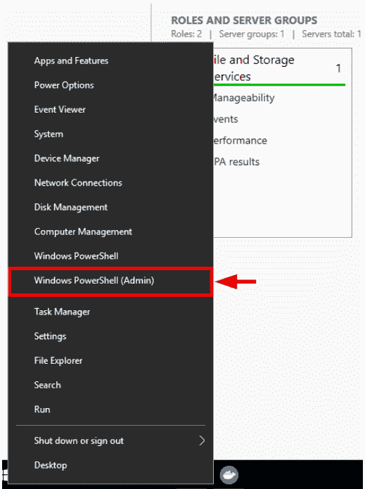

图 3.4 – 以管理员身份打开 Windows PowerShell

- 2. 使用以下命令下载 MicroBurst：

```
git clone https://github.com/NetSPI/MicroBurst.git
```


6. 如本示例所示，结果输出表表明存在具有 azurepentesting 资源名称的 Azure 平台服务实例：

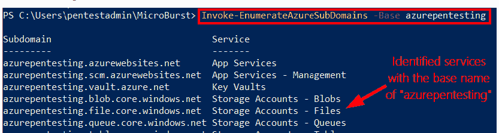

图 3.7 – MicroBurst 匿名枚举服务

作者已为本次练习的目的设置了前述屏幕截图中列出的资源。本书中未列出的任何额外资源可能不属于作者所有。请在使用示例时谨慎操作，避免攻击或访问本书示例中未明确定义的资源。

在本章下一节中，我们将了解如何识别和利用这些服务中的一些常见漏洞。

##### 重要说明

请务必在练习中再次核对您正在使用的资源名称，以避免尝试访问您无权访问的 Azure 客户资源。

#### 自定义域名和 IP 所有权

某些 Azure 服务允许客户使用自定义域名。此外，一些主机可能设置了重定向或透明代理，以掩盖服务托管在 Azure 中的事实。作为渗透测试流程的一部分，您需要充分了解目标位于何处，因为这可能会对您的范围产生重大影响。例如，您的外部渗透测试范围可能包括您有权攻击的环境中的特定 IP 和主机名。如果这些主机最终位于 Azure 中，这将影响我们攻击这些特定资源的方式。

#### 介绍 Cloud IP Checker

Cloud IP Checker 是一款基于 Go 的工具，用于检查 IP 地址是否与发布的 Azure IP 范围和服务标签匹配。如果 IP 与发布的范围匹配，它会显示该 IP 所属的服务及其区域。该工具可以是已发布的 API，也可以自行托管。

还有其他工具，例如 Leron Gray（Twitter：@mcohmi）开发的 AzureIPCheck 工具（https://github.com/daddycocoaman/azureipcheck），它提供类似的功能，但由于是基于 Python 的工具，其工作方式略有不同。

**Cloud IP Checker 信息**
**创建者：** Dean Bryen（Twitter：@deanbryen）
**开源或商业：** 开源项目
**GitHub 仓库：** https://github.com/deanobalino/cloudipchecker
**语言：** Go

#### 实践练习 – 确定自定义域名服务是否托管在 Azure

在本练习中，我们将使用测试订阅中的 book.azurepentesting.com 主机作为示例。要查看此主机是否为 Azure 托管系统，让我们进行一些基本的域名和 IP 侦察：

- 1. 在 pentest VM 中，打开 PowerShell 控制台。使用 nslookup 命令识别与我们主机关联的 IP 地址：

```
nslookup book.azurepentesting.com
```

- 2. 记录返回的 IPv4 地址。另请注意，在以下屏幕截图中，主机会解析为 azurepentesting.z13.web.core.windows.net，这表明该站点托管在 Azure 中：

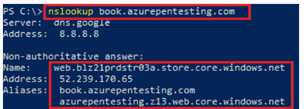

图 3.8 – 获取 IPv4 地址

3. 在 PowerShell 控制台中，运行以下命令以确定 IP 地址是否属于 Azure 已发布的 IP 范围。将 <IP_ADDRESS> 替换为您在上一步中记录的 IP 地址值：

```
Invoke-WebRequest https://cloudipchecker.azurewebsites.net/api/servicetags/manual?ip=<IP_ADDRESS> -UseBasicParsing | Select-Object -ExpandProperty Content
```

4. 如前面的输出所示，IP 属于 Azure IP 范围（美国东部地区的 Azure Storage 服务），因此我们可以推断服务访问点托管在 Azure 中：

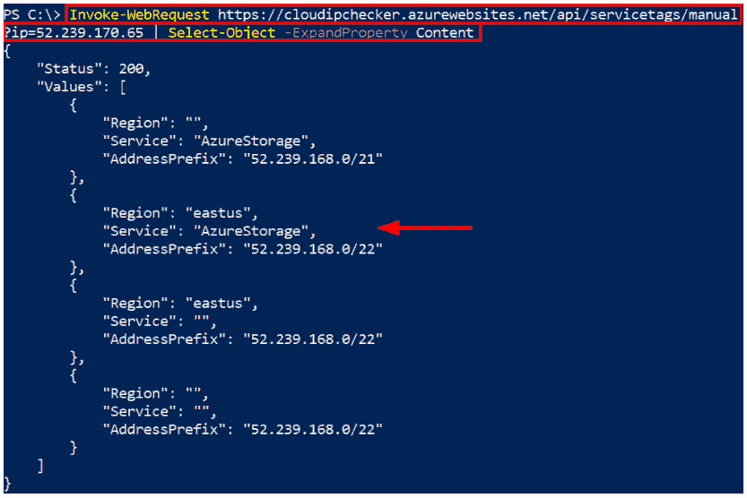

图 3.9 – 查看 Cloud IP Checker 结果

现在我们了解了域名和子域名在 Azure 中的运作方式，让我们看看它们如何通过子域名接管来攻击。

#### 子域名接管

在讨论 Azure 平台 DNS 枚举时，不提及子域名接管问题是不完整的。在调查托管在 Azure 中的应用程序时，您可能会注意到发往不存在的 Azure 子域名的资源请求。

这种情况有时发生在应用程序最初配置为从 Azure 端点提取内容，但随后内容更改为不同来源，并且初始端点资源从客户的 Azure 订阅中删除。在某些情况下，指向这些端点的客户管理的 DNS 记录也未被清理。

在实践中，这些通常是 JavaScript 文件或其他类似的 Web 资源，因为它们通常对页面显示影响较小且不易被注意到。在这些情况下，攻击者可能能够在 Azure 中重新创建受影响的资源，并通过受影响的网站提供缺失的内容。

这就像在新的 Azure 账户中重新创建端点资源并为缺失资源声明子域名一样简单：

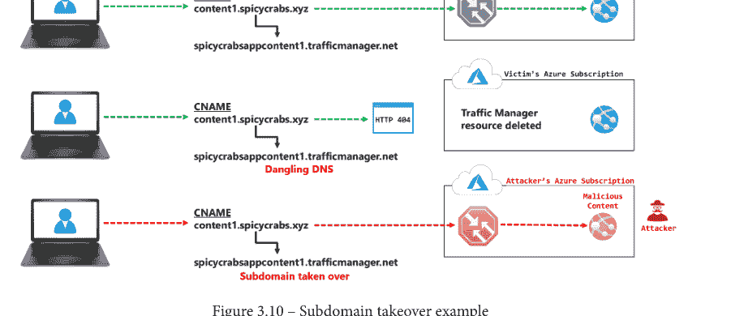

图 3.10 – 子域名接管示例

其影响可能像站点篡改一样简单，也可能像存储型跨站脚本或站点重定向到恶意内容一样严重。这是漏洞赏金中常见的常见问题，也是需要留意的事项。最常见的容易受到子域名接管攻击的服务是 Azure Blob、CDN、Traffic Manager 和 App Services，但这也可能适用于具有公共 DNS 后缀的其他服务。

现在我们了解了自定义域名在 Azure 中的使用方式，让我们来看一下在这些面向公众的系统中可能发现的不同类型的漏洞。

#### 识别面向公众服务的漏洞

一旦您的匿名攻击面被识别并由资源所有者确认，您就可以开始寻找漏洞。作为一个非常笼统的经验法则，Azure 中的漏洞可以分为三大类：配置、修补和代码相关。

#### 配置相关漏洞

此类漏洞可以分为多个子类别，但我们将重点关注的是基础设施即服务（IaaS）和平台即服务（PaaS）配置错误。这些配置错误通常由人为错误导致，导致敏感信息泄露或服务未授权访问。

##### IaaS 配置相关漏洞

Azure IaaS 服务可以概括为取代传统基础设施的服务。最常见的资源是虚拟机、虚拟机规模集和 Windows 虚拟桌面（WVD）。这些服务可以部署在虚拟网络内私有部署、连接到本地网络，或使用公共 IP 地址暴露给互联网，如本章前面所述。

使用客户从本章 Azure 公共 IP 地址范围部分命令结果中提供给我们的公共 IP 地址列表，我们可以使用常见的漏洞扫描工具扫描这些 IP 地址。请记住，始终检查您提供的 IP 的所有权和授权。

对于虚拟机和 WVD，我们通常会寻找可用管理端口的弱密码或默认凭据。还应注意，任何具有面向互联网服务的 IaaS 主机也可能存在额外的服务配置错误。这些漏洞不限于在 Azure 中管理的参数。管理员可能会在 VM 上错误配置服务，将其暴露给互联网并造成漏洞。

##### PaaS 配置相关漏洞

使用上一节中枚举的 Azure 服务列表，我们可以开始匿名查找这些服务中的漏洞。例如，我们在之前的练习中识别出一个基名为 azurepentesting 的存储账户。现在，我们可以深入挖掘该资源以查找该存储账户中配置错误的容器。


#### 存储账户

存储账户是 Azure 在云中处理数据存储的方式。这些账户由以下子服务组成：

- **Blob 服务：** 通用 HTTP/HTTPS 文件托管
- **Files 服务：** 附加数据存储（SMB/NFS）
- **Table 服务：** NoSQL 半结构化数据集
- **Queue 服务：** HTTP/HTTPS 消息存储

根据之前的子域枚举任务输出，我们知道 azurepentesting 基础词产生了一个名为 azurepentesting 的存储账户。

我们还可以看到以下子域的 DNS 记录：

- **Blob 服务：** azurepentesting.blob.core.windows.net
- **Files 服务：** azurepentesting.file.core.windows.net
- **Table 服务：** azurepentesting.table.core.windows.net
- **Queue 服务：** azurepentesting.queue.core.windows.net

默认情况下，在创建存储账户时会分配这四个子域。这并不一定意味着 Azure 客户将这四项服务全部用于数据存储，因此我们需要确定它们是否包含任何匿名可用的数据。

Files、Table 和 Queue 服务访问时始终需要一定程度的身份验证（本章中我们不会关注它们）。相反，我们将关注 Blob 服务，该服务允许管理员/开发人员配置文件的匿名访问。

#### Blob 存储账户权限概述

存储账户中的 Blob 服务由 **容器** 组成。这些容器本质上是可用于存储对象/数据的目录。您可以通过 HTTP/HTTPS 端点访问这些对象。URL 地址是存储账户名称、容器和对象名称的组合。

如以下图所示，如果存储账户名称为 azurepentesting，容器名称为 public，容器内的文件为 README.txt，则对象的 URL 将如下所示：

```
https://azurepentesting.blob.core.windows.net/public/README.txt.
```

对于更注重视觉的学习者，这里是该结构的示意图：

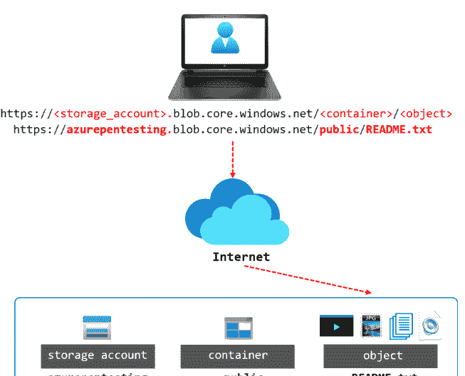

图 3.11 – Azure Blob 服务端点 URL

一个存储账户可以有多个容器，每个容器的公共访问级别配置可能不同。公共访问配置选项如下：

- **Private**：不允许匿名访问。需要经过身份验证才能访问。
- **Blob**：允许匿名访问已知的对象 URL。
- **Container**：允许匿名列出并访问容器文件。

虽然 **Blob** 容器权限可能会泄露敏感数据，但攻击者需要知道受影响文件的完整文件名才能访问它们。在应用程序以可预测的命名格式（如 Report-123.pdf、Report-124.pdf 等）以编程方式创建文件的情况下，攻击者在最初识别出预期用户文件后，可能能够推断出存储账户中其他文件的名称。这种类型的文件名枚举通常被称为 **不安全直接对象引用**，简称为 **IDOR**。PortSwigger 在其网站上对此问题有很好的概述：https://portswigger.net/web-security/access-control/idor。

攻击者还可以使用 Gobuster 等工具执行容器和对象名称猜测攻击，以查看是否返回对象。成功率很低，但仍有可能。

最令人担忧的公共访问级别是 **container**，因为它允许任何人列出所有可用文件并访问它们。这意味着知道存储账户和容器的攻击者将能够枚举所有可用文件。

利用我们之前的示例存储账户 URL，我们知道存储账户名称为 azurepentesting，容器为 public。通过将 ?restype=container&comp=list 参数附加到容器 URL（https://azurepentesting.blob.core.windows.net/public/?restype=container&comp=list），我们可以列出该容器中存储的所有对象。这将返回有关可用文件的 XML 数据，我们随后可以使用它来访问对象！

```
<EnumerationResults ContainerName="https://azurepentesting.blob.core.windows.net/public/">
  <Blobs>
    <Blob>
      <Name>README.txt</Name>
      <Url>https://azurepentesting.blob.core.windows.net/public/README.txt</Url>
      <Properties>
        <Last-Modified>Mon, 21 Dec 2020 00:47:51 GMT</Last-Modified>
        <Etag>0x8DBA54A0BCC7C5C</Etag>
        <Content-Length>123</Content-Length>
        <Content-Type>text/plain</Content-Type>
        <Content-Encoding/>
        <Content-Language/>
        <Content-MD5>P4Xiwn/SRng174UNmV1J2A==</Content-MD5>
        <Cache-Control/>
        <BlobType>BlockBlob</BlobType>
        <LeaseStatus>unlocked</LeaseStatus>
      </Properties>
    </Blob>
  </Blobs>
  <NextMarker/>
</EnumerationResults>
```

图 3.12 – Azure Blob 服务端点 URL

从未经过身份验证的角度来看，如果我们立即不知道存储账户中的任何容器，我们可以做什么？我们可以使用自动化工具来猜测容器名称，检查它们是否允许容器权限，然后从那里列出可用文件。

#### 实践练习 – 使用 MicroBurst 识别配置错误的 blob 容器

在本练习中，我们将使用 MicroBurst 中的 Invoke-EnumerateAzureBlobs 脚本来访问配置错误的 Azure Blob 存储服务中的数据。以下是本练习中我们将完成的任务：

- **任务 1：** 使用 azurepentesting 基础名称和内置排列列表，使用 Invoke-EnumerateAzureBlobs MicroBurst 模块匿名枚举存储账户容器。
- **任务 2：** 定义自定义容器列表并使用它来枚举更多容器。

让我们开始：

1. 在你的渗透测试 VM 中，以管理员身份打开 PowerShell 控制台。
2. 将目录路径更改为 MicroBurst 目录并使用以下命令导入 PowerShell 函数：

```
cd .\MicroBurst\
```

```
Import-Module .\MicroBurst.psml
```

以下是输出示例：

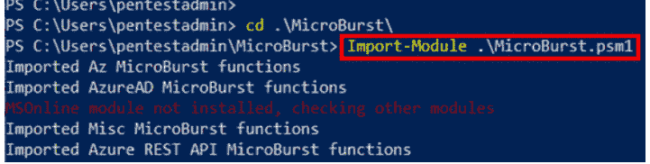

图 3.13 – 导入 MicroBurst PowerShell 模块

3. 使用 azurepentesting 作为基础词，使用 Invoke-EnumerateAzureBlobs 函数来识别具有容器访问级别配置的公共存储账户容器：

```
Invoke-EnumerateAzureBlobs -Base azurepentesting
```

4. 你可以看到 MicroBurst 已识别出两个容器（public 和 private）以及这些容器中的对象。

以下是输出示例：

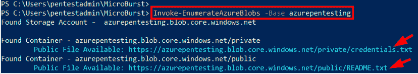

图 3.14 – 使用 MicroBurst 查找公共 blob 容器

5. 我们随后可以直接使用以下命令下载对象的內容：

```
Invoke-WebRequest -Uri "https://azurepentesting.blob.core.windows.net/public/README.txt" -OutFile "README.txt"
Invoke-WebRequest -Uri "https://azurepentesting.blob.core.windows.net/private/credentials.txt" -OutFile "credentials.txt"
```

以下是输出示例：

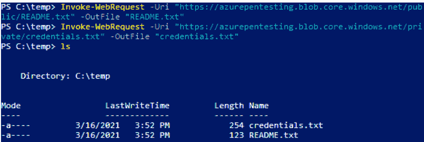

图 3.15 – 使用 PowerShell 下载对象

6. 使用以下命令读取其中一个下载文件的内容。这将在记事本中打开文件：

```
notepad .\credentials.txt
```

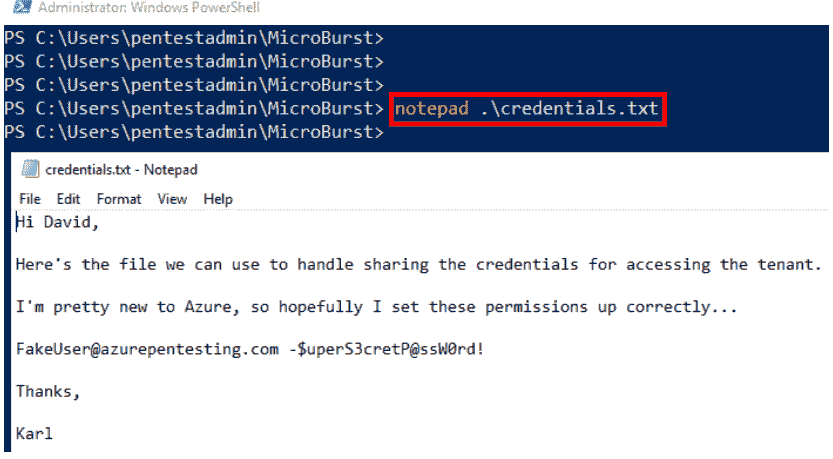

图 3.16 – 访问下载的文件

7. 在步骤 3 中使用的命令中，MicroBurst 使用 private 和 public 等常见容器名称枚举存储账户。除非在命令中另有指定，否则用于容器名称猜测的名称将来自 MicroBurst 仓库中的 permutations.txt 文件。MicroBurst 用于猜测的完整名称列表可通过以下命令查看：

```
Get-Content .\Misc\permutations.txt
```

8. MicroBurst 还允许我们使用 Folders 参数指定自定义容器名称。使用以下命令创建自定义容器名称列表。提示创建新文件时单击 Yes：

```
notepad customcontainer.txt
```


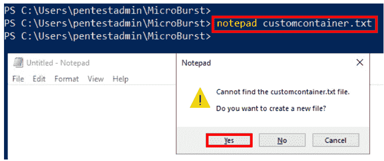

图3.17 – 创建自定义容器名称列表

9. 将以下名称添加到记事本文件中。保存文件并关闭：

- scripts
- templates
- archive
- 2020
- 2019
- 2018

10. 回到PowerShell控制台，使用以下命令，利用自定义名称列表中的任意名称来枚举潜在公共容器：

```
Invoke-EnumerateAzureBlobs -Base azurepentesting -Folders .\customcontainer.txt
```

11. 在这里，你可以看到，与之前运行命令时相比，我们发现了更多的公共容器和对象：

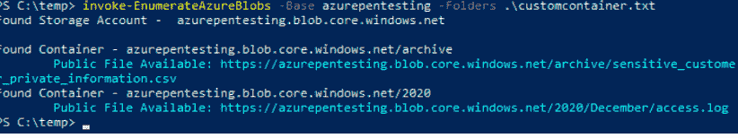

图3.18 – 创建自定义容器名称列表

正如你所看到的，与配置相关的漏洞可能会给Azure环境带来严重问题。在本书中，我们将会看到这些问题的多个示例，它们位于面向公众和“内部”平台配置层面。

虽然这只是一个示例，但还有更多特定于服务的配置漏洞，我们将在本书中加以强调。接下来，我们将看看一些可能适用于我们面向外部的服务的其他漏洞类别。

#### 补丁相关漏洞

虽然这些问题不太常见，但每周仍然会发布大量新的安全补丁。因此，有许多被遗忘或弃用的服务、应用程序和虚拟机错过了这些补丁。在本书中，我们将重点放在利用Azure配置相关漏洞上，但了解利用补丁相关问题的基础知识也是好的。

从外部角度来看，我们通常会扫描具有公共IP的Azure虚拟机，以寻找面向互联网的服务。这些服务通常可以通过网络扫描工具进行指纹识别，以确定承载该服务的软件的特定版本。

一旦确定了软件的版本，我们可以使用漏洞扫描器（Nessus、Nexpose等）或一些基本的Google搜索技巧来查找这些服务中的潜在漏洞。

由于这不是一本网络渗透测试书籍，我们建议你查看Packt出版的多本渗透测试书籍之一：https://www.packtpub.com/catalogsearch/result/?q=penetration%20testing。

#### 代码相关漏洞

现有应用的“云化”以及向云原生开发迈进，是促使组织进入Azure云的部分驱动力。通过将现有或遗留应用程序移植到云环境中，许多组织只是把原本应用程序中存在的许多旧漏洞一并带了过来。

虽然迁移到云端有很多好处，但它并不是修复应用程序漏洞的万能药。一些现有的常见应用程序问题在云环境中实际上可能产生更大的影响，因为这些问题可能会被滥用来提升访问权限。

虽然这不是学习Web应用程序渗透测试的书籍，但我们建议你查看Packt Publishing的其他书籍，以更深入地了解应用程序测试：https://www.packtpub.com/catalogsearch/result/?q=Web%20application%20Penetration%20Testing。

总体而言，以下漏洞在Azure环境中可能产生非常重大的影响，因此在测试时可能值得优先考虑这些漏洞。

##### SQL注入（SQLI）

通过向应用程序注入SQL查询，攻击者可能能够访问数据库中的敏感信息，迫使数据库向攻击者进行身份验证，甚至实现在数据库服务器上执行命令。在Azure环境中，攻击者有可能在SQL数据库虚拟机上执行命令，然后利用该虚拟机横向移动至内部虚拟网络。

##### 本地文件包含与目录遍历

通过从Web服务器访问本地文件，攻击者可能能够访问主机上的配置文件。对于Azure中的应用程序，许多此类配置文件包含Azure服务（如存储帐户）的访问密钥，因此可能存在从这些服务进行横向移动的机会。

##### 命令注入

命令进入应用程序服务器的方式有很多种，但在云环境中，这些方式可能被滥用以访问订阅中的其他资源。此外，如果应用程序服务器使用了托管标识，攻击者可能能够执行命令，为托管标识生成授权令牌。然后，该令牌可被用来模拟该托管标识的身份。

##### 值得一提的 – 服务器端请求伪造（SSRF）

SSRF是一种应用程序问题，允许攻击者强制应用程序服务器发出出站请求。这个问题在AWS环境中已经出现了一些非常重大的利用，可被用来查询EC2元数据服务以返回IAM凭据。由于Azure元数据服务的运作方式，在Azure中发出类似请求需要一个必需的标头。在Azure中，元数据服务凭据攻击可以通过命令注入执行，但不能通过SSRF攻击执行。

#### 查找Azure凭据

除了在Azure应用程序或服务中发现漏洞之外，获取Azure订阅访问权限的最常见方式是通过猜测、窃取或“找到”的凭据。

##### 猜测Azure AD凭据

从实际测试经验来看，进入Azure租户的最常见方式是通过弱密码或默认凭据。尽管多年来我们在技术上取得了巨大进步，但用户仍然喜欢使用简单的密码，而管理员有时也会忘记实施身份安全最佳实践。

成功的密码猜测攻击有三个步骤：

1. 获取用户名列表。
2. 获取密码列表。
3. 决定并执行猜测策略。

让我们来看一看。

##### 获取用户名列表

许多组织对用户名/电子邮件地址有正式的命名约定。一些示例包括 `<firstname>.<lastname>@company.com` 和 `<firstname>.<lastname_initial>@company.com`。你可以通过公开领域中的用户电子邮件地址（公司网站、支持渠道、在线员工资料、GitHub等）来确定公司的用户名格式。

然后，你可以将对此命名约定的了解与在LinkedIn等网站上找到的公司用户信息相结合，为员工列表构建用户名。你还可以查看与该组织相关的过往数据泄露事件来获取这些信息。

##### 获取密码列表

一旦你有了用户名列表，就需要仔细选择一个密码或密码列表来尝试登录这些帐户。最简单的方法是使用从以往数据泄露中识别出的公共常见密码列表。这里有一个来自流行的“Have I Been Pwned”数据集的前100,000个密码列表：http://bit.ly/PwnedPasswordsTop100k。该列表由英国国家网络安全中心（NCSC）发布——这不是原始数据集。网上还有其他常见密码列表，你也可以参考。

你也可以自行制定一个更有针对性的列表来尝试这些帐户。在制定列表时，请记住，大多数组织会实施某种密码策略，以确保用户只选择中等强度的密码。即使有策略存在，用户也常常会创建刚刚好能通过策略的密码。这些密码可能对用户来说易于记忆和输入，但它们容易受到密码猜测攻击。

一个很好的例子是密码winter2020。它的长度足以满足大多数密码长度要求（10个字符），并且满足大多数密码复杂度要求（使用大写字母、小写字母和数字字符）。它也非常符合许多密码期限要求。如果密码设置为每90天过期一次，那么这个密码正好可以与下一个季节对应。

##### 决定猜测策略

在渗透测试中，我们可以使用多种策略来猜测密码。你可以执行暴力破解攻击、单一密码喷洒攻击，或者使用你拥有的用户名和密码列表进行定向用户攻击。

暴力破解攻击更侧重于较少的用户，目的是尽可能多地尝试密码。这可能是在常见密码列表、字典词汇或随机生成的密码中循环尝试（图3.19）。

在执行暴力破解攻击时，要注意可能已有锁定策略，如果输入多个错误密码，会临时禁用帐户。一个好的经验法则是，从锁定策略中获取失败尝试次数（如果已知），然后减去2。这样可以让受害用户有几次输错密码的机会，而不会触发锁定。


例如，如果账户在五次尝试失败后锁定，我们通常只会在等待锁定计时器重置前尝试猜三个密码。如有疑问，请务必与负责渗透测试范围的人员合作，以确定合适的密码猜测策略：

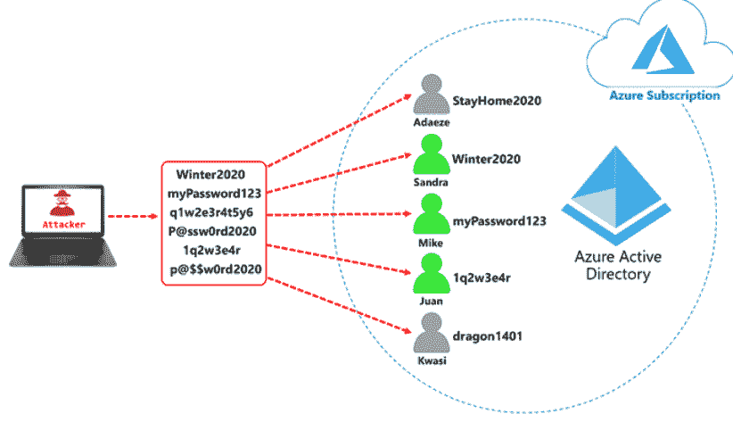

*图 3.19 – 暴力破解攻击*

**密码喷洒攻击（password spray attack）** 对多个用户名使用同一密码（见图 3.20）。这里需要考虑的一点是，将密码猜测尝试分散到多个 IP 地址，以避免被某些安全工具检测到（包括微软的 AD 密码保护和身份保护。这些工具的链接可以在本章末尾的*扩展阅读*部分找到）。

可以使用 FireProx 之类的工具，通过 AWS API Gateway 服务发起攻击来轮换源 IP 地址。请记住，FireProx 很可能违反 AWS 可接受使用政策，这可能会给你的 AWS 账户带来问题：

| FireProx 信息 | |
|---|---|
| **创建者** | Mike Felch（推特：@ustayready） |
| **开源或商业** | 开源项目 |
| **GitHub 仓库** | https://github.com/ustayready/fireprox |
| **语言** | Python |

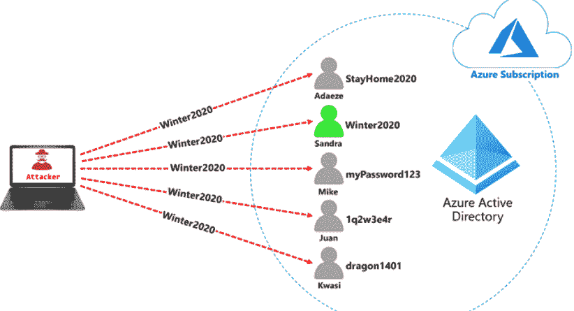

*图 3.20 – 密码喷洒攻击*

既然我们有了猜测密码的方法，接下来让我们了解一些工具，可以用它们来尝试针对我们自己的测试环境猜测密码。

#### 介绍 MSOLSpray

MSOLSpray 是一款面向 Microsoft 在线账户（Azure/Office365）的 PowerShell 密码喷洒工具。该工具的优势在于，除了检测有效密码外，它还能提供与账户的多因素认证（MFA）状态相关的有用侦察信息，例如账户是否存在、账户是否被锁定或禁用，或者密码是否已过期。

| MSOLSpray 信息 | |
|---|---|
| **创建者** | Beau Bullock（推特：@dafthack） |
| **开源或商业** | 开源项目 |
| **GitHub 仓库** | https://github.com/dafthack/MSOLSpray |
| **语言** | PowerShell |

虽然还有其他变体已被编写出来（例如 MSOLSpray Python、TREVORspray 等），但在下一个动手练习中，我们将使用最初用 PowerShell 编写的 MSOLSpray 工具。

#### 动手练习 – 使用 MSOLSpray 猜测 Azure Active Directory 凭据

在此动手练习中，我们将使用 MSOLSpray 工具执行密码喷洒攻击。以下是我们要完成的任务：

- **任务 1**：从 Azure Cloud Shell 在你的 Azure Active Directory 租户中创建测试用户。
- **任务 2**：使用 Azure 门户为测试用户启用 MFA。
- **任务 3**：在你的渗透测试虚拟机上下载并导入 MSOLSpray。
- **任务 4**：在你的渗透测试虚拟机上创建用户列表。
- **任务 5**：从你的渗透测试虚拟机使用 MSOLSpray 运行密码喷洒攻击。

让我们开始：

1. 打开 Web 浏览器，浏览到 Azure 门户 https://portal.azure.com。使用你的 azureadmin 凭据登录。

2. 在 Azure 门户中，点击右上角的 Cloud Shell 图标：

    

    *图 3.21 – 打开 Azure Cloud Shell*

3. 如果出现提示，请选择 PowerShell：

    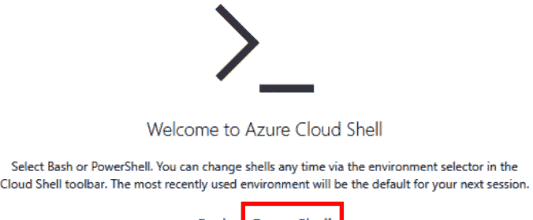

    *图 3.22 – 选择“PowerShell”*

    然后，点击“创建存储”：

    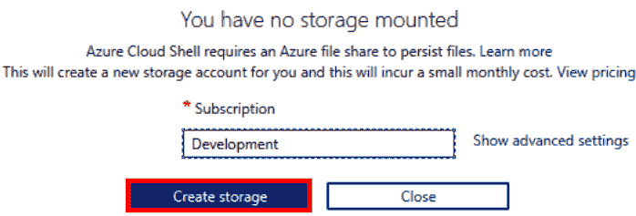

    *图 3.23 – 为 Cloud Shell 创建云驱动器*

4. 在 Cloud Shell 窗格中的 PowerShell 会话中，运行以下命令下载一个脚本，用于在 Azure AD 中配置测试用户：

    ```powershell
    Invoke-WebRequest -Uri http://bit.ly/az-pentest-create-test-users -OutFile create-test-users.ps1
    ```

    如下所示：

    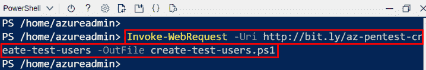

    *图 3.24 – 从我们的 GitHub 仓库下载 PowerShell 脚本*

5. 使用以下命令验证脚本是否成功下载。你应该会看到一个名为 create-test-users.ps1 的脚本：

    ```powershell
    Get-ChildItem
    ```

    输出如下所示：

    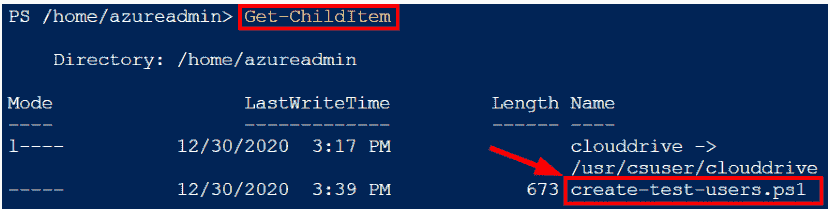

    *图 3.25 – 验证 PowerShell 脚本已下载*

6. 使用以下命令执行下载的脚本。当提示输入密码时，输入 myPassword123 并按 Enter。脚本将使用你输入的密码在你的 Azure AD 租户中配置五个新用户：

    ```powershell
    ./create-test-users.ps1
    ```

    如下所示：

    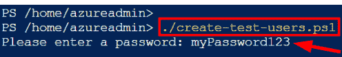

    *图 3.26 – 为测试用户输入密码*

7. 在脚本输出的末尾，记下用户主体名称和密码。你将在密码喷洒攻击中用到它们：

    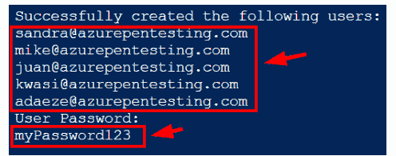

    *图 3.27 – 记下用户主体名称和密码*

8. 关闭 Cloud Shell 窗口：

    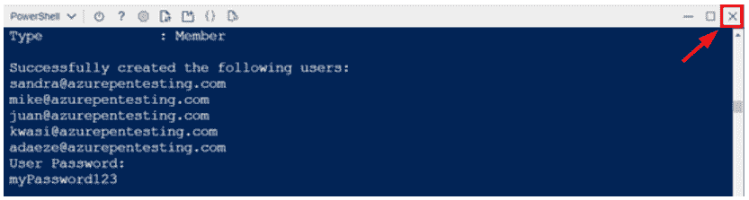

    *图 3.28 – 关闭 Cloud Shell*

9. 在 Azure 门户中，点击左上角的 Hub 菜单图标，然后选择 Azure Active Directory：

    *图 3.29 – 点击“Azure Active Directory”*

10. 在 Azure AD 控制台的“管理”部分，选择“用户”，然后点击“多因素认证”：

    *图 3.30 – 点击“多因素认证”*

11. 这将打开一个新的“多因素认证设置”窗口。选择用户 adaeze 和 juan，然后点击“启用”以启用 MFA：

    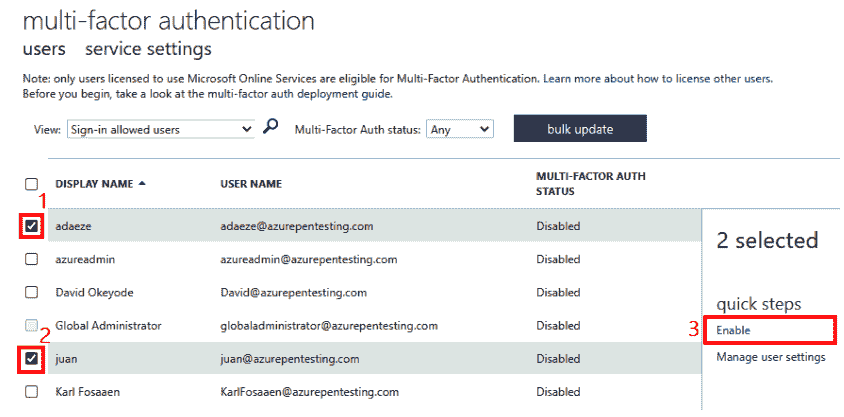

    *图 3.31 – 为“adaeze”和“juan”启用 MFA*

12. 出现提示时，点击“启用多因素认证”，然后点击“关闭”：

    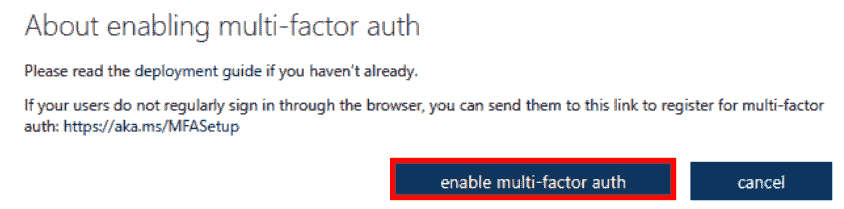

    *图 3.32 – 启用 MFA*

13. 在你的渗透测试虚拟机上，打开 PowerShell 控制台，切换目录到你的用户目录，并使用以下命令克隆 MSOLSpray GitHub 仓库：

    ```powershell
    cd C:\Users\$env:USERNAME\
    git clone https://github.com/dafthack/MSOLSpray.git
    ```

    如下所示：

    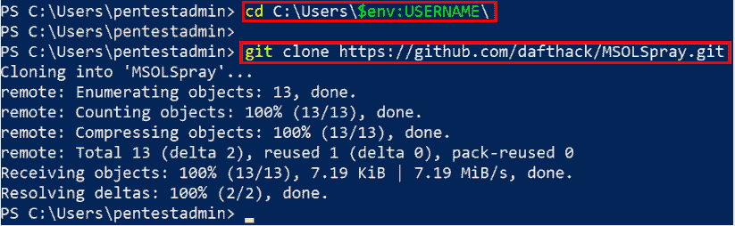

    *图 3.33 – 克隆 MSOLSpray GitHub 仓库*

14. 使用以下命令导入 MSOLSpray PowerShell 模块：

    ```powershell
    cd .\MSOLSpray\
    Import-Module .\MSOLSpray.ps1
    ```

15. 使用以下命令创建用户名列表：

    ```powershell
    notepad userlist.txt
    ```

    当提示创建新文件时，点击“是”：

    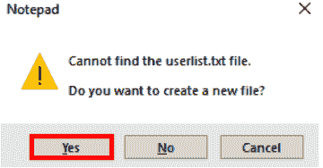

    *图 3.34 – 创建新的用户列表*

16. 将你之前记下的用户名输出粘贴到记事本中。保存并关闭记事本文档：

    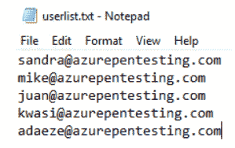

    *图 3.35 – 粘贴之前脚本创建的用户名*

17. 使用以下命令对用户账户运行 MSOLSpray。指定你之前记下的密码输出。你应该会看到所有账户的成功消息，同时也会看到你启用了 MFA 的账户的输出：

    ```powershell
    Invoke-MSOLSpray -UserList ./userlist.txt -Password myPassword123
    ```

    输出如下所示：

    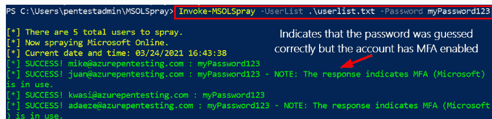

    *图 3.36 – 对用户列表执行密码喷洒攻击*

18. 在 InPrivate 或隐身窗口中打开 Azure AD 门户 https://aad.portal.azure.com。使用 Sandra 的凭据登录：

    用户名：sandra@<域名后缀>
    密码：myPassword123

19. 你现在应该能够以 Sandra 的身份访问 Azure AD 门户。此外，你还应该能够以 Sandra 的身份查看 Azure AD 租户中其他用户的信息！（这是默认行为。）

    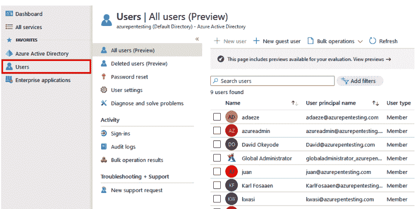

    *图 3.37 – 使用 Sandra 被攻破的账户访问 Azure AD 门户*

20. 返回到 Azure Cloud Shell，以 azureadmin 用户身份登录。下载清理脚本以移除之前创建的测试用户，并使用以下命令验证下载：

    ```powershell
    Invoke-WebRequest -Uri http://bit.ly/az-pentest-cleanup-test-users -OutFile cleanup-test-users.ps1
    Get-ChildItem
    ```

    输出如下所示：

    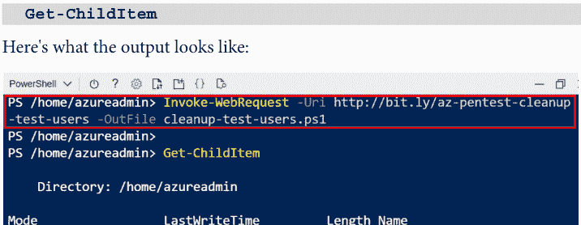

    *图 3.38 – 下载清理脚本*


21. 使用以下命令执行脚本：

```
./cleanup-test-users.ps1
```

输出如下所示：

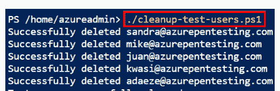

图 3.39 – 执行清理脚本

现在我们了解了如何猜测用户的凭据，让我们来看一下可能限制我们在 Azure 环境中使用这些凭据的额外情况。

#### 条件访问策略

Azure AD 安全性的进步引入了条件访问策略的概念。这些策略可以根据管理员设定的某些条件限制对 Azure 门户的访问。方便的是，攻击者已经想出了绕过这些策略的方法，从而让我们能够访问 Azure 和 Microsoft 365 服务。

#### 介绍 MFASweep

MFASweep 是一个方便的工具，我们可以用它来识别绕过条件访问策略的机会。

MFASweep 信息
创建者：Beau Bullock（Twitter：@dafthack）
开源或商业：开源项目
GitHub 仓库：https://github.com/dafthack/MFASweep
语言：PowerShell

虽然该工具在一定程度上超出了 Azure 的范围，但它可以作为外部渗透测试的一部分使用，以帮助利用可能受条件访问策略限制的凭据获得立足点。

该工具将遍历以下 Microsoft 服务，以识别任何允许在无需 MFA 或条件访问要求的情况下访问的服务：

- Microsoft Graph API
- Azure Service Management API
- Microsoft 365 Exchange Web Services
- Microsoft 365 Web 门户
- Microsoft 365 Web 门户，带移动用户代理（Android）
- Microsoft 365 ActiveSync

在一个真实场景中，我们可能会发现使用移动操作系统的用户对标准条件访问规则有例外。为什么会这样？一些移动用户会从不同的 IP 地址频繁登录，很难预测这些 IP。通过使用移动设备用户代理，我们可以假装成移动操作系统，从而绕过条件访问要求。

虽然我们不会在实验室中使用它，但将 MFASweep 工具用于测试是有益的：

1. 在你的渗透测试 VM 中，打开 PowerShell 控制台，切换目录到你的用户目录，并使用以下命令克隆 MFASweep GitHub 仓库：

```
cd C:\Users\$env:USERNAME\
git clone https://github.com/dafthack/MFASweep.git
```

2. 使用以下命令导入 MFASweep PowerShell 模块：

```
cd .\MFASweep\
Import-Module .\MFASweep.ps1
```

3. 使用以下命令对你已攻破的任何用户账户运行 MFASweep。对于允许绕过条件访问策略的账户，你应该会看到成功消息：

```
Invoke-MFASweep -Username sandra@azurepentesting.com -Password myPassword123
```

虽然条件访问策略绕过可能并非无处不在，但还有额外的 *非传统* 选项可用于绕过 MFA 要求。

#### 额外的 MFA 绕过

每个测试人员凭据猜测的噩梦就是猜到一个需要 MFA 令牌的凭据。虽然这看起来像是巨大的挫折，但有一些方法可以绕过 MFA。

社会工程学是绕过 MFA 要求的一种选择。社会工程学是通过与目标进行沟通（通过电话、电子邮件、面对面交谈等）来获取信息或资源访问权限的行为。

通过发送精心设计的钓鱼邮件或电话，我们可能能够让用户在令牌仍然有效时与我们分享其 MFA 代码。或者，我们可以联系 IT 部门，假装成受害者账户，友好的 IT 人员可能会好心地为我们签发新的 MFA 令牌。如果你对社会工程学概念不太熟悉，我们已在 *Further reading* 部分末尾添加了更多信息的链接。

我们并不鼓励在所有渗透测试中都使用此方法，但通过反复使用猜测的凭据进行身份验证，你可能能够在正确的时间抓住用户并从其设备获得意外的批准。同样，如果你不断用多因素批准骚扰用户，他们可能会因反复拒绝而放弃并批准你的请求。

作为渗透测试人员，作者可以证明这些策略在真实评估中是有效的。我们曾遇到一起案例，用户认为其 MFA 令牌出了问题，因为反复提示批准登录。受影响的用户联系了其 IT 部门，后者迅速在尝试排查问题时禁用了 MFA。没有人似乎在意登录尝试的 IP 地理位置位于全国另一边的城市，但这为报告增添了精彩内容。

虽然这些不应该被期望在每次测试中都成为轻松的胜利，但这些例子来自作者在测试中观察到的真实案例。因此，即使你遇到 MFA，仍然有希望！

正如你将在本书后面看到的那样，在 Azure 环境中通常有大量提升权限的选项，但经常，你需要从一个权限较低的账户开始——也许是一个密码选择不当且未注册 MFA 的账户。

#### 总结

在本章中，我们从外部人员几乎没有目标云资产信息的角度，探讨了如何应对 Azure 渗透测试场景。我们还学习了如何查找暴露资源的配置错误漏洞，这可能导致对租户的初始访问。

除此之外，我们还介绍了用于进一步利用的各种工具和技术，以攻破 Azure AD 用户账户。本章讨论的信息有望使你能够匿名发现和攻击公共 Azure 资源和易受攻击的云身份。

在下一章中，我们将介绍在你猜测到凭据或获得对订阅的 Reader 级别访问后可以进行的攻击。

#### 进一步阅读

要了解本章所涵盖内容的更多信息，请查看以下资源：

- Azure AD Identity Protection: https://docs.microsoft.com/en-us/azure/active-directory/identity-protection/overview-identity-protection
- Azure AD Password Protection: https://docs.microsoft.com/en-us/azure/active-directory/authentication/concept-password-ban-bad
- Social engineering: https://www.csoonline.com/article/2124681/what-is-social-engineering.html
- *Implementing Microsoft Azure Security Technologies by David Okeyode, Packt Publishing*
