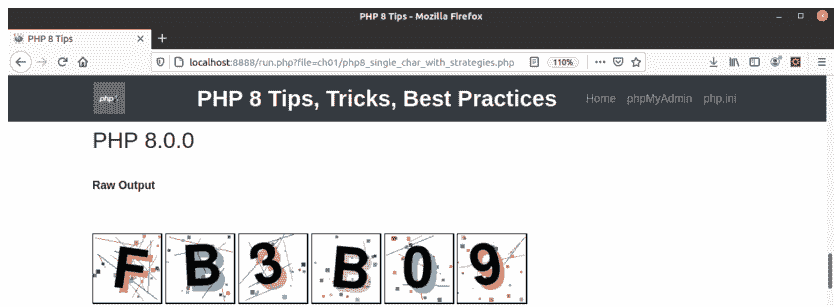

## 1 介绍新的 PHP 8 OOP 功能

### 介绍新的 PHP 8 OOP 功能

在本章中，您将了解特定于 **面向对象编程 (OOP)** 的新的 **PHP: Hypertext Preprocessor 8 (PHP 8)** 功能。本章包含一组可用于生成 CAPTCHA 图像的类（**CAPTCHA** 是 **Completely Automated Public Turing test to tell Computers and Humans Apart** 的缩写），清晰地展示了新的 PHP 8 功能和概念。本章对于帮助您快速将新的 PHP 8 功能融入自己的实践至关重要。这样一来，您的代码将运行得更快、更高效，bug 更少。

本章涵盖以下主题：

- 使用构造函数属性提升
- 使用属性
- 将 match 表达式纳入您的程序代码
- 理解命名参数
- 探索新的数据类型
- 使用类型化属性改进代码

## 技术要求

要检查并运行本章提供的代码示例，推荐的最低硬件配置如下：

- 基于 x86_64 的台式电脑或笔记本电脑
- 1 千兆字节 (**GB**) 可用磁盘空间
- 4 GB 的 **随机存取存储器** (**RAM**)
- 500 **每秒千比特** (**Kbps**) 或更快的互联网连接

此外，您需要安装以下软件：

- Docker
- Docker Compose

本书使用预构建的 Docker 镜像，其中包含创建和运行本书中涵盖的 PHP 8 代码示例所需的所有软件。您无需在计算机上安装 PHP、Apache 或 MySQL：只需使用 Docker 和提供的镜像即可。

要设置运行代码示例的测试环境，请按以下步骤操作：

1. 安装 Docker。
   如果您使用的是 Windows，请从此处开始：
   `https://docs.docker.com/docker-for-windows/install/`
   如果您使用的是 Mac，请从此处开始：
   `https://docs.docker.com/docker-for-mac/install/`
   如果您使用的是 Linux，请查看此处：
   `https://docs.docker.com/engine/install/`
2. 安装 Docker Compose。所有操作系统均从此处开始：
   `https://docs.docker.com/compose/install/`
3. 将与本书关联的源代码安装到您的本地计算机。
   如果您已安装 Git，请使用以下命令：

```
git clone https://github.com/PacktPublishing/PHP-8-Programming-Tips-Tricks-and-Best-Practices.git ~/repo
```

否则，您可以从此统一资源定位符 (URL) 下载源代码：https://github.com/PacktPublishing/PHP-8-Programming-Tips-Tricks-and-Best-Practices/archive/main.zip。然后您可以解压到您创建的文件夹中，我们在本书中将其称为 /repo。

4. 现在您可以启动 Docker 守护进程。对于 Windows 或 Mac，您只需激活 Docker Desktop 应用即可。

如果您使用的是 Ubuntu 或 Debian Linux，请执行以下命令：

```
sudo service docker start
```

对于 Red Hat、Fedora 或 CentOS，请使用以下命令：

```
sudo systemctl start docker
```

5. 构建与本书关联的 Docker 容器并使其上线。操作如下。

从您的本地计算机打开命令提示符（终端窗口）。将目录更改为 /repo。仅首次执行时，发出 docker-compose build 命令以构建环境。请注意，您可能需要 root（管理员）权限来运行 Docker 命令。如果是这种情况，请以管理员身份运行（适用于 Windows）或在命令前加上 sudo。根据您的连接速度，初始构建可能需要相当长的时间才能完成！

6. 要启动容器，请按以下步骤操作

7. 从您的本地计算机打开命令提示符（终端窗口）。将目录更改为 /repo。通过运行以下命令将 Docker 容器在后台模式下上线：

```
docker-compose up -d
```

请注意，您实际上不需要单独构建容器。如果在发出 docker-compose up 命令时容器尚未构建，它将被自动构建。另一方面，单独构建容器可能更方便，在这种情况下 docker build 就足够了。

这是一个有用的命令，可确保所有容器都在运行：

```
docker-compose ps
```

8. 要访问正在运行的 Docker 容器 Web 服务器，请按以下步骤操作。

在本地计算机上打开浏览器。输入此 URL 以访问 PHP 8 代码：

```
http://localhost:8888
```

输入此 URL 以访问 PHP 7 代码：

```
http://localhost:7777
```

9. 要打开到正在运行的 Docker 容器的命令 shell，请按以下步骤操作。

从您的本地计算机打开命令提示符（终端窗口）。执行此命令以访问 PHP 8 容器：

```
docker exec -it php8_tips_php8 /bin/bash
```

执行此命令以访问 PHP 7 容器：

```
docker exec -it php8_tips_php7 /bin/bash
```

10. 当您完成与容器的操作后，要将其下线，请从本地计算机打开命令提示符（终端窗口）并执行以下命令：

```
docker-compose down
```

本章的源代码位于此处：

```
https://github.com/PacktPublishing/PHP-8-Programming-Tips-Tricks-and-Best-Practices
```

> **重要说明**
> 如果您的主机计算机使用 **Advanced RISC Machines (ARM)** 架构（例如 Raspberry Pi），您将需要使用修改后的 Dockerfile。

> **提示**
> 通过阅读本文快速了解 Docker 技术和术语将是一个绝佳的主意：https://docs.docker.com/get-started/。

我们现在可以开始讨论，首先了解一下构造函数属性提升。


## 使用构造函数属性提升

除了 Just-In-Time (JIT) 编译器之外，PHP 8 中引入的最伟大的新功能之一是构造函数属性提升。此新功能将属性声明和 __construct() 方法签名中的参数列表结合起来，并进行默认值赋值。在本节中，您将学习如何大幅减少属性声明以及 __construct() 方法签名和主体所需的编码量。

## 属性提升语法

调用构造函数属性提升所需的语法与 PHP 7 及更早版本中使用的语法相同，但存在以下差异：

- 需要定义可见性级别
- 无需提前显式声明属性
- 无需在 __construct() 方法的主体中进行赋值

以下是使用构造函数属性提升的简易代码示例：

```php
// /repo/ch01/php8_prop_promo.php
declare(strict_types=1);
class Test {
    public function __construct(
        public int $id,
        public int $token = 0,
        public string $name = '')
    { }
}
$test = new Test(999);
var_dump($test);
```

执行前述代码块时，输出如下：

```
object(Test)#1 (3) {
  ["id"]=> int(999)
  ["token"]=> int(0)
  ["name"]=> string(0) ""
}
```

这表明已使用默认值创建了 Test 类型的实例。现在，让我们看看此功能如何能节省大量编码。

## 使用属性提升减少代码

在传统的面向对象 PHP 类中，需要完成以下三件事：

1. 声明属性，如下所示：
2. 在 __construct() 方法签名中标识属性及其数据类型，如下所示：

```
/repo/src/Php8/Image/SingleChar.php
namespace Php7\Image;
class SingleChar {
    public $text      = '';
    public $fontFile = '';
    public $width     = 100;
    public $height    = 100;
    public $size      = 0;
    public $angle     = 0.00;
    public $textX     = 0;
    public $textY     = 0;
```

```
const DEFAULT_TX_X = 25;
const DEFAULT_TX_Y = 75;
const DEFAULT_TX_SIZE  = 60;
const DEFAULT_TX_ANGLE = 0;
public function __construct(
    string $text,
    string $fontFile,
    int $width  = 100,
    int $height = 100,
    int $size   = self::DEFAULT_TX_SIZE,
    float $angle = self::DEFAULT_TX_ANGLE,
    int $textX  = self::DEFAULT_TX_X,
    int $textY  = self::DEFAULT_TX_Y)
```

3. 在 __construct() 方法的主体中，为属性赋值，如下所示：

```
{
    $this->text     = $text;
    $this->fontFile = $fontFile;
    $this->width    = $width;
    $this->height   = $height;
    $this->size     = $size;
    $this->angle    = $angle;
    $this->textX    = $textX;
    $this->textY    = $textY;
    // other code not shown
}
```

随着构造函数参数数量的增加，您需要完成的工作量也会显著增加。当应用构造函数属性提升时，完成与之前所示相同功能所需的代码量减少到原来的三分之一。

现在让我们看一下之前所示的同一段代码，但使用这个强大的新 PHP 8 功能重写：

// /repo/src/Php8/Image/SingleChar.php
// not all code shown
public function __construct(
    public string $text,
    public string $fontFile,
    public int    $width  = 100,
    public int    $height = 100,
    public int    $size   = self::DEFAULT_TX_SIZE,
    public float  $angle  = self::DEFAULT_TX_ANGLE,
    public int    $textX  = self::DEFAULT_TX_X,
    public int    $textY  = self::DEFAULT_TX_Y)
{ // other code not shown }

令人惊讶的是，PHP 7 及更早版本中需要 24 行代码的内容，使用这个新 PHP 8 功能可以压缩到 8 行代码！

您完全可以自由地在构造函数中包含其他代码。然而，在许多情况下，构造函数属性提升会处理 __construct() 方法中通常完成的所有工作，这意味着您可以直接将其留空 ({ })。

现在，在下一节中，您将了解一个名为 attributes 的新功能。

> **提示**
> 在此处查看 PHP 7 的完整 SingleChar 类：
> https://github.com/PacktPublishing/PHP-8-Programming-Tips-Tricks-and-Best-Practices/tree/main/src/Php7/Image
> 并且等效的 PHP 8 类可在以下位置找到：
> https://github.com/PacktPublishing/PHP-8-Programming-Tips-Tricks-and-Best-Practices/tree/main/src/Php8/Image
> 有关此新功能的更多信息，请参阅以下内容：
> https://wiki.php.net/rfc/constructor_promotion

## 使用属性

PHP 8 的另一个重要新增功能是添加了一个全新的类和语言结构，即 **属性**。简单来说，属性是遵循规定语法的传统 PHP 注释块的替代品。

当 PHP 代码被编译时，这些属性在内部会被转换为 Attribute 类实例。

此新功能今天不会对您的代码产生立竿见影的影响。然而，随着各种 PHP 开源厂商开始将其代码中加入属性，其影响力将日益增强。

Attribute 类解决了本节中讨论的一个潜在的重大性能问题，该问题涉及滥用传统的 PHP 注释块来提供元指令。在深入探讨该问题以及 Attribute 类实例如何解决该问题之前，我们首先必须回顾 PHP 注释。

## PHP 注释概述

这种语言结构的需求源于对普通主力 PHP 注释的不断使用（和滥用！）。正如您所知，注释有多种形式，包括以下所有形式：

```
### This is a "bash" shell script style comment
// this can either be inline or on its own line
/* This is the traditional "C" language style */
```

```
/**
 * This is a PHP "DocBlock"
 */
```

最后这一项，即著名的 PHP DocBlock，如今已被广泛使用，已成为事实上的标准。使用 DocBlocks 并不是一件坏事。相反——它通常是开发人员能够传达有关属性、类和方法的信息的唯一方式。问题仅在于 PHP 解释过程如何处理它。

## PHP DocBlock 考虑事项

PHP DocBlock 的原始意图已被许多极其重要的 PHP 开源项目所扩展。一个典型的例子是 Doctrine 对象关系映射器（ORM）项目。虽然不是强制性的，但许多开发人员选择使用嵌套在 PHP DocBlocks 中的注释来定义 ORM 属性。

请看以下部分代码示例，它定义了一个与名为 events 的数据库表交互的类：

```
namespace Php7\Entity;
use Doctrine\ORM\Mapping as ORM;
/**
 * @ORM\Table(name="events")
 * @ORM\Entity("Application\Entity\Events")
 */
class Events {
    /**
     * @ORM\Column(name="id",type="integer",nullable=false)
     * @ORM\Id
     * @ORM\GeneratedValue(strategy="IDENTITY")
     */
    private $id;
    /**
     * @ORM\Column(name="event_key", type="string",
         length=16, nullable=true, options={"fixed"=true})
     */
    private $eventKey;
    // other code not shown
```

如果您将此类的作为 Doctrine ORM 实现的一部分使用，Doctrine 将打开文件并解析 DocBlocks，搜索 @ORM 注释。尽管人们对解析 DocBlocks 所需的时间和资源存在一些担忧，但这是在对象属性和数据库表列之间定义关系的一种极其方便的方式，深受使用 Doctrine 的开发人员的欢迎。

> **提示**
> Doctrine 提供了多种此种形式的 ORM 的替代方案，包括 **可扩展标记语言（XML）** 和原生 PHP 数组。有关更多信息，请参阅 https://www.doctrine-project.org/projects/doctrine-orm/en/latest/reference/annotations-reference.html#annotations-reference。

## 滥用 DocBlocks 相关的隐藏危险

与 DocBlock 原始用途的这种滥用相关的还有另一种危险。在 php.ini 文件中，有一个名为 opcache.save_comments 的设置。如果禁用此设置，则 OpCode 缓存引擎（OPcache）将忽略所有注释，包括 DocBlocks。如果此设置生效，使用 DocBlocks 中 @ORM 注释的基于 Doctrine 的应用程序将出现故障。

另一个问题与注释的解析方式有关——更确切地说，与注释未被解析的方式有关。为了使用注释的内容，PHP 应用程序需要打开文件并逐行解析它。就时间和资源利用而言，这是一个代价高昂的过程。

## Attribute 类

为了应对这些隐藏的危险，PHP 8 提供了一个新的 Attribute 类。不是使用带有注释的 DocBlocks，开发人员可以以属性的形式定义等效内容。使用属性而非 DocBlocks 的一个优点是它们是语言的正式组成部分，因此会与您的其余代码一起进行标记化和编译。


> **重要说明**
> 在本章中，以及在 PHP 文档中，对 *属性* 的引用指的是 `Attribute` 类的实例。
> 
> 尚未有实际的性能指标可用于比较包含 DocBlocks 的 PHP 代码的加载与包含属性的代码的加载。

虽然这种方法的好处尚未显现，但随着各种开源项目供应商开始将其产品中加入属性，你将开始看到速度和性能的提升。

以下是 Attribute 类的定义：

```
class Attribute {
    public const int TARGET_CLASS = 1;
    public const int TARGET_FUNCTION = (1 << 1);
    public const int TARGET_METHOD = (1 << 2);
    public const int TARGET_PROPERTY = (1 << 3);
    public const int TARGET_CLASS_CONSTANT = (1 << 4);
    public const int TARGET_PARAMETER = (1 << 5);
    public const int TARGET_ALL = ((1 << 6) - 1);
    public function __construct(
        int $flags = self::TARGET_ALL) {}
}
```

正如从类定义中可以看到的那样，该类的主要贡献，用于 PHP 8 内部，是一个类常量集合。常量代表可以使用按位运算符组合的位标志。

## Attribute syntax

属性使用借自 Rust 编程语言的特殊语法括起来。方括号内的内容基本上留给开发者决定。以下片段中可以看到一个示例：

```
#[attribute("some text")]
// class, property, method or function (or whatever!)
```

回到我们 SingleChar 类的示例，使用传统的 DocBlocks 它可能看起来像这样：

```
```php
// /repo/src/Php7/Image/SingleChar.php
namespace Php7\Image;
/**
 * Creates a single image, by default black on white
 */
class SingleChar {
    /**
     * Allocates a color resource
     *
     * @param array|int $r
     * @param int $g
     * @param int $b
     * @return int $color
     */
    public function colorAlloc()
    { /* code not shown */ }
}
```
```

现在，看看使用属性的相同内容：

```
```php
// /repo/src/Php8/Image/SingleChar.php
namespace Php8\Image;
#[description("Creates a single image")]
class SingleChar {
    #[SingleChar\colorAlloc\description("Allocates color")]
    #[SingleChar\colorAlloc\param("r","int|array")]
    #[SingleChar\colorAlloc\param("g","int")]
    #[SingleChar\colorAlloc\param("b","int")]
    #[SingleChar\colorAlloc\returns("int")]
    public function colorAlloc() { /* code not shown */ }
}
```
```

正如你所看到的，除了提供更强大的编译并避免提到的隐藏危险之外，在空间使用方面也更高效。

> Tip
> 
> 方括号内的内容确实有一些限制；例如，虽然 #[returns("int")] 是允许的，但以下是不允许的：
> #[return("int")]. 其原因在于 return 是一个关键字。
> 
> 另一个例子与联合类型有关（在《Exploring new data types》一节中进行了说明）。你可以在属性中使用 #[param("int|array test")]，但以下是不允许的：#[int|array("test")]. 另一个特殊之处在于，类级属性必须放置在 class 关键字之前，并且在任何 use 语句之后。

## Viewing attributes using Reflection

如果需要从 PHP 8 类获取属性信息，Reflection 扩展已更新以包含属性支持。新增了一个 getAttributes() 方法，该方法返回 ReflectionAttribute 实例的数组。

在以下代码块中，Php8\Image\SingleChar::colorAlloc() 方法的所有属性都被揭示：

```
<?php
// /repo/ch01/php8_attrib_reflect.php
define('FONT_FILE', __DIR__ . '../../fonts/FreeSansBold.ttf');
require_once __DIR__ . '../../src/Server/Autoload/Loader.php';
$loader = new \Server\Autoload\Loader();
use Php8\Image\SingleChar;
$char    = new SingleChar('A', FONT_FILE);
$reflect = new ReflectionObject($char);
$attribs = $reflect->getAttributes();
echo "Class Attributes\n";
foreach ($attribs as $obj) {
    echo "\n" . $obj->getName() . "\n";
    echo implode("\t", $obj->getArguments());
}
echo "Method Attributes for colorAlloc()\n";
$reflect = new ReflectionMethod($char, 'colorAlloc');
$attribs = $reflect->getAttributes();
foreach ($attribs as $obj) {
    echo "\n" . $obj->getName() . "\n";
    echo implode("\t", $obj->getArguments());
}
```

以下是前述片段代码的输出：

```
<pre>Class Attributes

Php8\Image\SingleChar
Php8\Image\description
Creates a single image, by default black on white
Method Attributes for colorAlloc()
Php8\Image\SingleChar\colorAlloc\description
Allocates a color resource
Php8\Image\SingleChar\colorAlloc\param
r      int|array
Php8\Image\SingleChar\colorAlloc\param
g      int
Php8\Image\SingleChar\colorAlloc\param
b      int
Php8\Image\SingleChar\colorAlloc\returns
int
```

前面的输出显示属性可以使用 Reflection 扩展类检测到。最后，实际方法在以下代码示例中显示：

```
namespace Php8\Image;
use Attribute;
use Php8\Image\Strategy\ {PlainText,PlainFill};
#[SingleChar]
#[description("Creates black on white image")]
class SingleChar {
    // not all code is shown
    #[SingleChar\colorAlloc\description("Allocates color")]
    #[SingleChar\colorAlloc\param("r","int|array")]
    #[SingleChar\colorAlloc\param("g","int")]
    #[SingleChar\colorAlloc\param("b","int")]
    #[SingleChar\colorAlloc\returns("int")]
public function colorAlloc(
    int|array $r, int $g = 0, int $b = 0) {
    if (is_array($r))
        [$r, $g, $b] = $r;
    return \imagecolorallocate(
        $this->image, $r, $g, $b);
}
}
```

现在你已经对属性如何使用有了一些概念，让我们继续介绍新功能，讨论 match 表达式，然后是命名参数。

> **Tip**
> 
> 有关此新功能的更多信息，请查看以下网页：
> https://wiki.php.net/rfc/attributes_v2
> 
> 另请参阅此更新：
> https://wiki.php.net/rfc/shorter_attribute_syntax_change
> 
> 有关 PHP DocBlocks 的信息可在以下位置找到：
> https://phpdoc.org/
> 
> 有关 Doctrine ORM 的更多信息，请查看此处：
> https://www.doctrine-project.org/projects/orm.html
> 
> 有关 php.ini 文件设置的文档可在以下位置找到：
> https://www.php.net/manual/en/ini.list.php
> 
> 在此处阅读有关 PHP Reflection 的内容：
> https://www.php.net/manual/en/language.attributes.reflection.php
> 
> 有关 Rust 编程语言的信息可在以下书籍中找到：
> https://www.packtpub.com/product/mastering-rust-second-edition/9781789346572

## Incorporating match expressions into your program code

在 PHP 8 中引入的众多极其有用的功能中，**match 表达式** 绝对脱颖而出。match 表达式是一种更准确的简写语法，有可能取代直接来自 C 语言的老旧 switch 语句。在本节中，你将学习如何通过用 match 表达式替换 switch 语句来生成更简洁、更准确的程序代码。

## Match expression general syntax

match 表达式语法与数组类似，其中键是要匹配的项，值是表达式。以下是 match 的通用语法：

```
$result = match(<EXPRESSION>) {
    <ITEM> => <EXPRESSION>,
    [<ITEM> => <EXPRESSION>,]
    default => <DEFAULT EXPRESSION>
};
```

表达式必须是有效的 PHP 表达式。表达式的示例可能包括以下任何一种：

- 一个特定值（例如，"some text"）
- 一个操作（例如，$a + $b）
- 一个匿名函数或类

唯一的限制是表达式必须在一行代码中定义。主要区别 match 与 switch 总结如下：

| Switch | Match |
|---|---|
| 松散类型比较（例如 $a == $b） | 严格类型比较（例如 $a === $b） |
| 不返回值 | 返回值 |
| 需要 break | 不需要 break |
| 每个 case 可有多条命令 | 每个 match 仅一条命令 |

表 1.1 – match 与 switch 之间的差异


除已提及的差异外，match 和 switch 都允许 case 聚合，并且都提供对默认情况的支持。

## switch 和 match 示例

这里有一个简单的示例，使用 switch 渲染货币符号：

```php
// /repo/ch01/php7_switch.php
function get_symbol($iso) {
    switch ($iso) {
        case 'CNY' :
            $sym = '¥';
            break;
        case 'EUR' :
            $sym = '€';
            break;
        case 'EGP' :
            case 'GBP' :
            $sym = '£';
            break;
        case 'THB' :
            $sym = '฿';
            break;
        default :
            $sym = '$';
    }
    return $sym;
}
$test = ['CNY', 'EGP', 'EUR', 'GBP', 'THB', 'MXD'];
foreach ($test as $iso)
    echo 'The currency symbol for ' . $iso
        . ' is ' . get_symbol($iso) . "\n";
```

当执行此代码时，你会看到 $test 数组中每个 **国际标准化组织 (ISO)** 货币代码的货币符号。使用以下代码，在 PHP 8 中也可以获得与前述代码片段所示相同的结果：

```php
// /repo/ch01/php8_switch.php
function get_symbol($iso) {
    return match ($iso) {
        'EGP', 'GBP' => '£',
        'CNY'        => '¥',
        'EUR'        => '€',
        'THB'        => '฿',
        default      => '$'
    };
}
$test = ['CNY', 'EGP', 'EUR', 'GBP', 'THB', 'MXD'];
foreach ($test as $iso)
    echo 'The currency symbol for ' . $iso
        . ' is ' . get_symbol($iso) . "\n";
```

两个示例产生相同的输出，如下所示：

```
The currency symbol for CNY is ¥
The currency symbol for EGP is £
The currency symbol for EUR is €
The currency symbol for GBP is £
The currency symbol for THB is ฿
The currency symbol for MXD is $
```

如前所述，两个代码示例都为存储在 $test 数组中的 ISO 货币代码列表生成货币符号列表。

## 复杂 match 示例

回到我们的 CAPTCHA 项目，假设我们希望引入失真，使 CAPTCHA 字符更难阅读。为实现此目标，我们引入了多个 **策略** 类，每个类产生不同的失真，如下表所述：

| Php8\Image\Strategy\* | 描述 |
|---|---|
| DotFill ($num) | 用 $num 个点填充背景 |
| LineFill ($num) | 用 $num 条线填充背景 |
| RotateText ($angle) | 将文本按 $angle 旋转 |
| Shadow ($offset, $r, $g, $b) | 添加一个相隔 $offset 像素的阴影，其颜色由 $r、$g 和 $b（红、绿、蓝）决定 |

表 1.2 – CAPTCHA 失真策略类

在随机化要使用的策略列表后，我们使用 match 表达式来执行结果，如下所示：

- 1. 首先我们定义一个 **自动加载器**，导入要使用的类，并列出潜在的策略，如以下代码片段所示：
- 2. 接下来，我们生成 CAPTCHA 短语，如下所示：

```php
// /repo/ch01/php8_single_strategies.php
// not all code is shown
require_once __DIR__ . '/../src/Server/Autoload/Loader.php';
$loader = new \Server\Autoload\Loader();
use Php8\Image\SingleChar;
use Php8\Image\Strategy\{LineFill,DotFill,Shadow,RotateText};
$strategies = ['rotate', 'line', 'line',
    'dot', 'dot', 'shadow'];
```

```php
$phrase = strtoupper(bin2hex(random_bytes(NUM_BYTES)));
$length = strlen($phrase);
```

- 3. 然后我们遍历 CAPTCHA 短语中的每个字符并创建 SingleChar 实例。初始调用 writeFill() 创建白色背景画布。我们还需要调用 shuffle() 来随机化失真策略列表。该过程如下代码片段所示：

```php
$images = [];
for ($x = 0; $x < $length; $x++) {
    $char = new SingleChar($phrase[$x], FONT_FILE);
    $char->writeFill();
    shuffle($strategies);
}
```

- 4. 然后我们遍历策略并在原始图像上分层失真。这就是 match 表达式发挥作用的地方。请注意，其中一个策略需要额外的代码行。由于 match 只能支持单个表达式，我们只需将多行代码包装到匿名函数中，如下所示：

```php
foreach ($strategies as $item) {
    $func = match ($item) {
        'rotate' => RotateText::writeText($char),
        'line' => LineFill::writeFill(
            $char, rand(1, 10)),
        'dot' => DotFill::writeFill($char, rand(10, 20)),
        'shadow' => function ($char) {
            $num = rand(1, 8);
            $r   = rand(0x70, 0xEF);
            $g   = rand(0x70, 0xEF);
            $b   = rand(0x70, 0xEF);
            return Shadow::writeText(
                $char, $num, $r, $g, $b);},
        'default' => TRUE
    };
    if (is_callable($func)) $func($char);
}
```

- 5. 剩下的就是通过调用 writeText() 且不带参数来将图像与实际 CAPTCHA 短语叠加。之后，我们将失真图像保存为 **便携式网络图形 (PNG)** 文件以供显示，如以下代码片段所示：

```php
$char->writeText();
$fn = $x . '_'
    . substr(basename(__FILE__), 0, -4)
    . '.png';
$char->save(IMG_DIR . '/' . $fn);
$images[] = $fn;
}
include __DIR__ . '/captcha_simple.phtml';
```

以下是结果，从指向本书相关 Docker 容器的浏览器运行前述示例：



图 1.1 – 使用 match 表达式的失真 CAPTCHA

接下来，我们将看一下另一个非常棒的功能：命名参数。

> **提示**
> 你可以在此处查看 match 表达式的原始提案：
> https://wiki.php.net/rfc/match_expression_v2

## 理解命名参数

命名参数代表了一种在调用具有大量参数的函数或方法时避免混淆的方式。这不仅有助于避免参数按错误顺序提供的问题，还可帮助你跳过具有默认值的参数。在本节中，你将学习如何应用命名参数来提高代码的准确性，减少未来维护周期中的混淆，并使方法和函数调用更简洁。我们首先通过检查使用命名参数所需的通用语法开始。

## 命名参数通用语法

要使用命名参数，你需要知道函数或方法签名中使用的变量名称。然后你指定该名称，不带美元符号，后跟冒号和要提供的值，如下所示：

```
$result = function_name( arg1 : <VALUE>, arg2 : <value> );
```

当调用 function_name() 函数时，值将传递给对应于 arg1、arg2 等的参数。

## 使用命名参数调用核心函数

使用命名参数的最常见原因之一是在调用具有大量参数的核心 PHP 函数时。例如，以下是 setcookie() 的函数签名：

```
setcookie ( string $name [, string $value = ""
    [, int $expires = 0 [, string $path = ""
    [, string $domain = "" [, bool $secure = FALSE
    [, bool $httponly = FALSE ]]]]] ) : bool
```

假设你真正想要设置的参数只有 name、value 和 httponly。在 PHP 8 之前，你必须查找默认值并按顺序提供它们，直到到达你想要覆盖的参数。在以下情况下，我们希望将 httponly 设置为 TRUE：

```
setcookie('test',1,0,0,'','',FALSE,TRUE);
```

使用命名参数，PHP 8 中的等效写法如下：

```
setcookie('test',1,httponly: TRUE);
```

请注意，我们不需要命名前两个参数，因为它们是按顺序提供的。

> **提示**
> 在 PHP 扩展中，命名参数并不总是与你在 PHP 文档中函数或方法签名中看到的变量名称匹配。例如，函数 `imagefttext()` 在其函数签名中显示变量 `$font_filename`。不过，如果你向下滚动一点，你会在 *参数* 部分看到，命名参数是 `fontfile`。
> 
> 如果你遇到致命错误：Unknown named parameter `$NAMED_PARAM`。始终使用文档 *参数* 部分中列出的名称，而不是函数或方法签名中变量的名称。

## 顺序独立性和文档

命名参数的另一个用途是提供 **顺序独立性**。此外，对于某些核心 PHP 函数，参数数量之多导致文档噩梦。

例如，请在此查看 `imagefttext()` 的函数签名（请注意，此函数是生成安全 CAPTCHA 图像的章节项目核心）：

```php
imagefttext ( object $image , float $size , float $angle ,
    int $x , int $y , int $color , string $fontfile ,
    string $text [, array $extrainfo ] ) : array
```

正如你所想象的，6 个月后在审阅你的工作时，试图记住这些参数的名称和顺序可能会有问题。

> **重要说明**
> 在 PHP 8 中，图像创建函数（例如 `imagecreate()`）现在返回 `GdImage` 对象实例而不是资源。GD 扩展中的所有图像函数都已重写以适应此更改。无需重写你的代码！


因此，使用命名参数，以下函数调用在 PHP 8 中是可以接受的：

```php
// /repo/ch01/php8_named_args.php
// not all code is shown
$rotation = range(40, -40, 10);
foreach ($rotation as $key => $offset) {
    $char->writeFill();
    [$x, $y] = RotateText::calcXYadjust($char, $offset);
    $angle = ($offset > 0) ? $offset : 360 + $offset;
    imagettftext(
        angle         : $angle,
        color         : $char->fgColor,
        font_filename : FONT_FILE,
        image         : $char->image,
        size          : 60,
        x             : $x,
        y             : $y,
        text          : $char->text);
    $fn = IMG_DIR . '/' . $baseFn . '_' . $key . '.png';
    imagepng($char->image, $fn);
    $images[] = basename($fn);
}
```

上面展示的代码示例将一串失真的字符写入一组 PNG 图像文件。每个字符相对于其相邻图像顺时针旋转 10 度。请注意如何应用命名参数使 imagettftext() 函数的参数更易于理解。

命名参数也可以应用于你自己创建的函数和方法。在下一节中，我们将介绍新的数据类型。

> 提示
> 命名参数的详细分析可以在这里找到：
> https://wiki.php.net/rfc/named_params

## 探索新的数据类型

任何初级 PHP 开发者都会学习 PHP 可用的 **数据类型** 有哪些以及如何使用它们。基本数据类型包括 `int`（整数）、`float`、`bool`（布尔）和 `string`。复杂数据类型包括 `array` 和 `object`。此外，还有其他数据类型，例如 `NULL` 和 `resource`。在本节中，我们讨论 PHP 8 中引入的几种新的数据类型，包括联合类型和 mixed 类型。

> **重要说明**
> 极其重要的是不要将 **数据类型** 与 **数据格式** 混淆。本节描述数据类型。而数据格式则是一种用于 *表示* 数据的方式。数据格式的示例包括 XML、**JavaScript 对象表示法 (JSON)** 和 **YAML 不是标记语言 (YAML)**。

### 联合类型

与 `int` 或 `string` 等其他数据类型不同，需要注意的是，并没有明确称为 `union` 的数据类型。相反，当你看到对 **联合类型** 的引用时，其含义是 PHP 8 引入了一种新的语法，允许你指定类型的联合，而不仅仅是一个。现在让我们来看一下联合类型的通用语法。

### 联合类型语法

联合类型的通用语法如下：

```
function ( type|type|type $var) {}
```

用 type 代替，你可以提供任何现有的数据类型（例如 float 或 string）。不过有一些限制，大多是完全合理的。下表总结了更重要的限制：

| 不允许 | 不允许的示例 |
|---|---|
| void 不能包含在联合类型中 | void|int |
| mixed 不能包含在联合类型中（下面会详细介绍） | mixed|int |
| 可空类型不能包含在联合类型中 | string|?array |
| 不能同时包含 TRUE 和 FALSE 在联合类型中。 | TRUE|FALSE |
| 不允许冗余类型 | int|float|int array|iterable|Traversable |

表 1.3 – 不允许的联合类型

从这个例外列表可以看出，定义联合类型主要是一个常识问题。

> 提示
> **最佳实践：** 使用联合类型时，**类型强制转换**（PHP 在内部将数据类型转换为满足函数要求的过程）如果未强制严格类型检查可能会成为问题。因此，最佳实践是在使用联合类型的任何文件顶部添加以下内容：`declare(strict_types=1);`
> 
> 有关更多信息，请参阅此处的文档参考：
> https://www.php.net/manual/en/language.types.declarations.php#language.types.declarations.strict

### 联合类型示例

为了简单说明，让我们回到本章中用作示例的 SingleChar 类。其中一个方法是 colorAlloc()。此方法从图像分配颜色，利用 imagecolorallocate() 函数。它接受代表红、绿、蓝的整数值作为参数。

假设第一个参数实际上可以是一个数组，表示三个值——每个分别代表红、绿、蓝。在这种情况下，第一个值的参数类型不能是 int，否则如果提供了数组，在开启严格类型检查时将抛出错误。

在 PHP 的早期版本中，唯一的解决方案是移除第一个参数的任何类型检查，并在关联的 DocBlock 中说明接受多种类型。以下是该方法在 PHP 7 中可能出现的样子：

```php
/**
 * Allocates a color resource
 *
 * @param array|int $r
 * @param int $g
 * @param int $b
 * @return int $color
 */
public function colorAlloc($r, $g = 0, $b = 0) {
    if (is_array($r)) {
        [$r, $g, $b] = $r;
    }
    return \imagecolorallocate($this->image, $r, $g, $b);
}
```

第一个参数 $r 的数据类型的唯一指示是 @param array|int $r DocBlock 注释以及该参数没有关联的数据类型提示这一事实。在 PHP 8 中，利用联合类型，请注意这里的区别：

```
#[description("Allocates a color resource")]
#[param("int|array r")]
#[int("g")]
#[int("b")]
```

```php
#[returns("int")]
public function colorAlloc(
    int|array $r, int $g = 0, int $b = 0) {
    if (is_array($r)) {
        [$r, $g, $b] = $r;
    }
    return \imagecolorallocate($this->image, $r, $g, $b);
}
```

在前面的示例中，除了存在指示第一个参数可以接受 array 或 int 类型 的属性外，在方法签名本身中，int|array 联合类型也明确了这一选择。

### mixed 类型

mixed 是 PHP 8 中引入的另一种新类型。与联合类型不同，mixed 是一个实际的数据类型，表示类型的终极联合。它用于表示接受任何和所有数据类型。在某种意义上，PHP 已经具备此功能：只需完全省略数据类型，即为隐含的 mixed 类型！

> 提示
> 你将在 PHP 文档中看到对 mixed 类型的引用。PHP 8 通过将其作为实际数据类型来正式化这种表示。

### 为什么使用 mixed 类型？

稍等一下——你可能在此时会想：为什么还要使用 mixed 类型呢？为了让你安心，这是一个很好的问题，而且没有令人信服的理由使用此类型。

然而，通过在函数或方法签名中使用 mixed，你清楚地表明了对该参数使用的意图。如果你只是将数据类型留空，后来使用或审查你代码的其他开发者可能会认为你忘记添加类型。至少，他们会对未类型化参数的性质感到不确定。

### mixed 类型对继承的影响

由于 mixed 类型代表了放宽的终极示例，它可用于在一个类扩展另一个类时放宽数据类型定义。以下是使用 mixed 类型的示例，说明了这一原则：

- 首先，我们按如下方式定义具有更严格的 object 数据类型的父类：

// /repo/ch01/php8_mixed_type.php
declare(strict_types=1);
class High {
    const LOG_FILE = __DIR__ . '../data/test.log';
    protected static function logVar(object $var) {
        $item = date('Y-m-d') . ':'
            . var_export($var, TRUE);
        return error_log($item, 3, self::LOG_FILE);
    }
}
- 接下来，我们按如下方式定义扩展 High 的 Low 类：

```
class Low extends High {
    public static function logVar(mixed $var) {
        $item = date('Y-m-d') . ':'
            . var_export($var, TRUE);
        return error_log($item, 3, self::LOG_FILE);
    }
}
```

请注意在 Low 类中，logVar() 方法的数据类型已被放宽为 mixed。

- 最后，我们创建 Low 的一个实例并使用测试数据执行它。如以下代码片段所示的结果，你可以看到一切正常：

```
if (file_exists(High::LOG_FILE)) unlink(High::LOG_FILE)
$test = [
    'array' => range('A', 'F'),
    'func' => function () { return __CLASS__; },
    'anon' => new class () {
```


```
public function __invoke() {
    return __CLASS__; } },
];
foreach ($test as $item) Low::logVar($item);
readfile(High::LOG_FILE);
```

以下是前述示例的输出：

```
2020-10-15:array (
  0 => 'A',
  1 => 'B',
  2 => 'C',
  3 => 'D',
  4 => 'E',
  5 => 'F',
)2020-10-15:Closure::__set_state(array(
))2020-10-15:class@anonymous/repo/ch01/php8_mixed_type.php:28$1::__set_state(array())
```

前述代码块记录了多种不同的数据类型，然后显示日志文件的内容。在此过程中，这向我们展示了在 PHP 8 中，当子类重写父类方法并用 mixed 数据类型替代更严格的数据类型（如 object）时，不存在继承问题。

接下来，我们来看一下使用类型化属性。

> 提示
> **最佳实践：** 在定义函数或方法时，为所有参数分配特定的数据类型。如果接受几种不同的数据类型，则定义联合类型。否则，如果以上情况均不适用，则回退到 mixed 类型。
> 
> 有关联合类型的详细信息，请参阅此文档页面：
> https://wiki.php.net/rfc/union_types_v2
> 
> 有关 mixed 类型的更多信息，请在此查看： https://wiki.php.net/rfc/mixed_type_v2.

## 使用类型化属性改进代码

本章的第一部分 *使用构造函数属性提升* 中，我们讨论了如何使用数据类型来控制作为函数或类方法参数提供的数据的类型。然而，这种方法无法保证数据类型永远不会改变。在本节中，您将学习如何在属性级别分配数据类型，从而在 PHP 8 中对变量的使用提供更严格的控制。

### 什么是类型化属性？

此功能极其重要，于 PHP 7.4 中引入并延续至 PHP 8。简单来说，**typed property** 是具有预先分配数据类型的类属性。以下是一个简单示例：

// /repo/ch01/php8_prop_type_1.php
declare(strict_types=1)
class Test {
    public int $id = 0;
    public int $token = 0;
    public string $name = '';
}
$test = new Test();
$test->id = 'ABC';
```

在此示例中，如果我们尝试将代表除 int 类型以外的数据类型的值分配给 $test->id，将抛出 Fatal error。以下是输出：

```
Fatal error: Uncaught TypeError: Cannot assign string to property Test::$id of type int in /repo/ch01/php8_prop_type_1.php:11 Stack trace: #0 {main} thrown in /repo/ch01/php8_prop_type_1.php on line 11
```

正如前述输出所示，当为类型化属性分配错误的数据类型时，会抛出 Fatal error。

您已经接触过一种属性类型化的形式：**constructor property promotion**。使用构造函数属性提升定义的所有属性都会自动进行属性类型化！

### 为什么属性类型化很重要？

类型化属性是 PHP 7 中首次出现的 PHP 整体趋势的一部分。该趋势旨在对代码的使用进行限制和收紧的语言改进。这会带来更好的代码，意味着更少的错误。

以下示例说明了仅依赖于属性类型提示来控制属性数据类型的危险：

```php
// /repo/ch01/php7_prop_danger.php
declare(strict_types=1);
class Test {
    protected $id = 0;
    protected $token = 0;
    protected $name = '';
    public function __construct(
        int $id, int $token, string $name) {
        $this->id = $id;
        $this->token = md5((string) $token);
        $this->name = $name;
    }
}
$test = new Test(111, 123456, 'Fred');
var_dump($test);
```

在前述示例中，请注意在 __construct() 方法中，$token 属性被意外转换为字符串。以下是输出：

```
object(Test)#1 (3) {
  ["id":protected]=>  int(111)
  ["token":protected]=>
  string(32) "e10adc3949ba59abbe56e057f20f883e"
  ["name":protected]=>  string(4) "Fred"
}
```

任何随后期望 $token 为整数的代码都可能失败或产生意外结果。现在，让我们看一下在 PHP 8 中使用类型化属性的相同情况：

// /repo/ch01/php8_prop_danger.php
declare(strict_types=1);
class Test {
    protected int $id = 0;
    protected int $token = 0;
    protected string $name = '';
    public function __construct(
        int $id, int $token, string $name) {
        $this->id = $id;
        $this->token = md5((string) $token);
        $this->name = $name;
    }
}
$test = new Test(111, 123456, 'Fred');
var_dump($test);
```

属性类型化可防止预先分配的数据类型发生任何更改，如此处所示的输出所示：

```
Fatal error: Uncaught TypeError: Cannot assign string to property Test::$token of type int in /repo/ch01/php8_prop_danger.php:12
```

正如前述输出所示，当为类型化属性分配错误的数据类型时，会抛出 Fatal error。此示例表明，不仅为属性分配数据类型可以防止直接赋值时发生误用，而且还可以防止在类方法内部对属性的误用！

### 属性类型化可以减少代码量

将属性类型化引入代码的另一个有益副作用是可能减少所需的代码量。作为示例，请考虑当前的做法，即将属性标记为 private 或 protected 的可见性，然后创建一系列 get 和 set 方法来控制访问（也称为 getters 和 setters）。

它可能如下所示：

- 首先，我们按如下方式定义一个具有受保护属性的 Test 类：

```php
// /repo/ch01/php7_prop_reduce.php
declare(strict_types=1);
class Test {
    protected $id = 0;
    protected $token = 0;
    protected $name = '';
```

- 接下来，我们按如下方式定义一系列 get 和 set 方法来控制对受保护属性的访问：

```php
    public function getId() { return $this->id; }
    public function setId(int $id) { $this->id = $id; }
    public function getToken() { return $this->token; }
    public function setToken(int $token) {
        $this->token = $token;
    }
    public function getName() {
        return $this->name;
    }
    public function setName(string $name) {
        $this->name = $name;
    }
}
```

- 然后我们按如下方式使用 set 方法分配值：

```php
$test = new Test();
$test->setId(111);
$test->setToken(999999);
$test->setName('Fred');
```

- 最后，我们按如下方式使用 get 方法检索属性值，将结果显示在表格中：

```
$pattern = '<tr><th>%s</th><td>%s</td></tr>';
echo '<table width="50%" border=1>';
printf ($pattern, 'ID', $test->getId());
printf ($pattern, 'Token', $test->getToken());
printf ($pattern, 'Name', $test->getName());
echo '</table>';
```

它可能如下所示：

|  |  |
|---|---|
| ID | 111 |
| Token | 999999 |
| Name | Fred |

表 1.4 – 使用 Get 方法的输出

将属性标记为 protected（或 private）并定义 getters 和 setters 的主要目的是控制访问。通常，这转化为希望防止属性数据类型发生变化的愿望。如果是这种情况，整个基础设施可以通过分配属性类型来替换。

简单地将可见性更改为 public 可以消除对 get 和 set 方法的需求；然而，它并不能防止属性数据被更改！使用 PHP 8 属性类型可以实现这两个目标：它消除了对 get 和 set 方法的需求，同时还防止数据类型被意外更改。

请注意，使用 PHP 8 属性类型来实现相同结果所需的代码量少了多少：

// /repo/ch01/php8_prop_reduce.php
declare(strict_types=1);
class Test {
    public int $id = 0;
    public int $token = 0;
    public string $name = '';
}
// assign values
$test = new Test();
$test->id = 111;
$test->token = 999999;
$test->name = 'Fred';
// display results
$pattern = '<tr><th>%s</th><td>%s</td></tr>';
echo '<table width="50%" border=1>';
printf($pattern, 'ID', $test->id);
printf($pattern, 'Token', $test->token);
printf($pattern, 'Name', $test->name);
echo '</table>';
```

前述所示的代码示例产生与前一个示例完全相同的输出，并且对属性数据类型的控制也更好。在此示例中使用类型化属性，我们实现了生产相同结果所需代码量减少 50%！

> 提示
> **最佳实践：** 尽可能使用类型化属性，除非您明确希望允许数据类型更改的情况。

## 摘要

在本章中，您学习了如何使用新的 PHP 8 数据类型：mixed 和 union types 来编写更好的代码。您还了解了使用命名参数不仅可以提高代码的可读性，还可以帮助防止类方法和 PHP 函数的意外误用，并提供了一种跳过默认参数的绝佳方式。

本章还向您介绍了如何使用新的 Attribute 类作为 PHP DocBlocks 的最终替代品，从而提高代码的整体性能，同时提供记录类、方法和函数的可靠手段。

此外，我们还研究了 PHP 8 如何通过利用构造函数参数提升和类型化属性，大大减少早期 PHP 版本所需的代码量。

在下一章中，您将了解函数式和过程式层面的新 PHP 8 功能。


