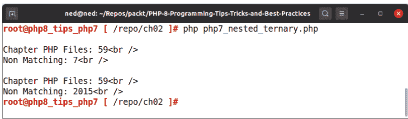
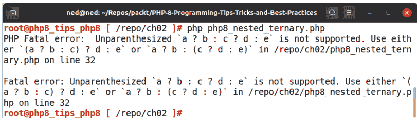
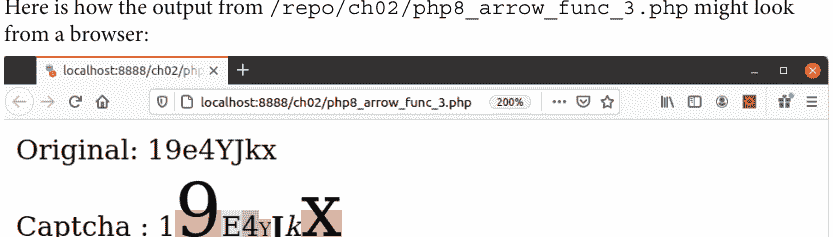
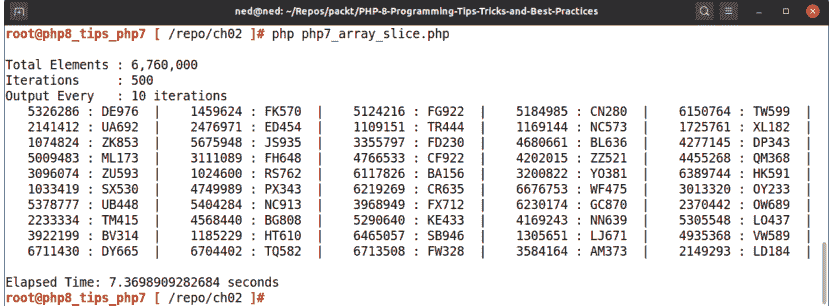
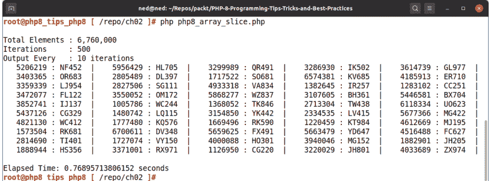
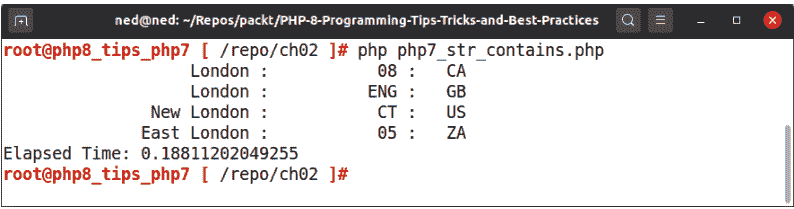
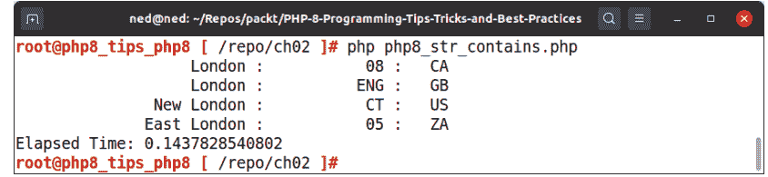
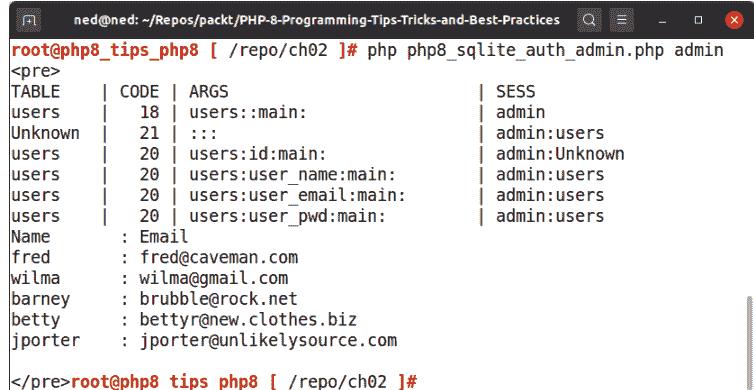
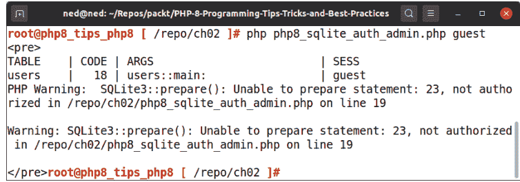
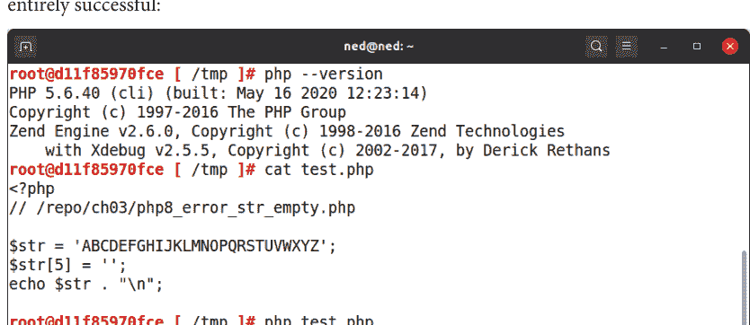

## 2 学习 PHP 8 的功能增强

本章将带你了解在过程层面引入到 **PHP 8** 的重要新增功能和改进。所使用的代码示例展示了新的 PHP 8 特性和技术，以促进过程式编程。

精通本章中新的函数和技术的使用，将帮助你编写更快、更干净的应用程序。尽管本章重点关注命令和函数，但所有技术在开发类方法时也很有用。

本章涵盖以下主题：

- 使用新的 PHP 8 运算符
- 使用箭头函数
- 理解统一变量语法
- 学习新的数组和字符串处理技术
- 使用授权器保护 SQLite 数据库

### 技术要求

若要检查并运行本章提供的代码示例，推荐的最低硬件配置如下：

- 基于 x86_64 的台式电脑或笔记本电脑
- 1 千兆字节（GB）可用磁盘空间
- 4 GB 随机存取存储器（RAM）
- 500 千比特每秒（Kbps）或更快的互联网连接
- 此外，你需要安装以下软件：
- Docker
- Docker Compose

请参阅 *第 1 章，介绍新的 PHP 8 面向对象编程特性* 中的 *技术要求* 部分，了解有关 Docker 和 Docker Compose 安装的更多信息，以及如何构建本书中用于演示所解释代码的 Docker 容器。在整个过程中，我们将本书示例代码恢复的目录称为 `/repo`。

本章的源代码位于此处：`https://github.com/PacktPublishing/PHP-8-Programming-Tips-Tricks-and-Best-Practices.`

我们现在可以开始讨论，通过检查新的 PHP 8 运算符来展开。

### 使用新的 PHP 8 运算符

PHP 8 引入了许多新的 **运算符**。此外，PHP 8 通常以统一且一致的方式引入这些运算符的使用方法。在本节中，我们将检查以下运算符：

- 可变参数运算符
- 空安全运算符
- 拼接运算符
- 三元运算符

让我们从对可变参数运算符的讨论开始。

### 使用可变参数运算符

**可变参数** 运算符由三个前导点（ . . . ）组成，位于普通的 PHP 变量（或对象属性）之前。该运算符实际上自 PHP 5.6 起就已存在于语言中。它也被称为以下名称：

- Splat 运算符
- Scatter 运算符
- Spread 运算符

在深入了解 PHP 8 对该运算符的改进之前，让我们先快速了解一下该运算符的常规用法。

### 未知数量的参数

可变参数运算符最常见的用途之一是在定义具有未知数量参数的函数时。

在下面的代码示例中，multiVardump() 函数能够接受任意数量的变量。然后它连接 var_export() 的输出并返回一个字符串：

```php
// /repo/ch02/php7_variadic_params.php
function multiVardump(...$args) {
    $output = '';
    foreach ($args as $var)
        $output .= var_export($var, TRUE);
    return $output;
}
$a = new ArrayIterator(range('A','F'));
$b = function (string $val) { return str_rot13($val); };
$c = [1,2,3];
$d = 'TEST';
echo multiVardump($a, $b, $c);
echo multiVardump($d);
```

第一次调用函数时，我们提供了三个参数。第二次调用时，我们只提供了一个参数。由于我们使用了可变参数运算符，因此无需重写函数以适应更多或更少的参数。

> Tip
>
> PHP 中有一个 `func_get_args()` 函数可以将所有函数参数收集到一个数组中。然而，可变参数运算符更受青睐，因为它必须在函数签名中声明，因此使程序开发者的意图更加清晰。有关更多信息，请参阅 https://php.net/func_get_args.

### 吸取剩余参数

可变参数运算符的另一个用途是 **吸取** 任何剩余参数。这种技术允许你将强制参数与未知数量的可选参数混合使用。

在此示例中，where() 函数生成一个 WHERE 子句，用于添加到 **结构化查询语言（SQL）** SELECT 语句中。前两个参数是强制性的：没有参数就生成 WHERE 子句是不合理的！请查看这里的代码：

```php
// ch02/includes/php7_sql_lib.php
// other functions not shown
function where(stdClass $obj, $a, $b = '', $c = '',
    $d = '') {
    $obj->where[] = $a;
    $obj->where[] = $b;
    $obj->where[] = $c;
    $obj->where[] = $d;
}
```

使用此函数的调用代码可能如下所示：

```php
// /repo/ch02/php7_variadics_sql.php
require_once __DIR__ . '/includes/php7_sql_lib.php';
$start = '2021-01-01';
$end   = '2021-04-01';
$select = new stdClass();
from($select, 'events');
cols($select, ['id', 'event_key',
    'event_name', 'event_date']);
limit($select, 10);
where($select, 'event_date', '>=', "'$start'");
```

```php
where($select, 'AND');
where($select, 'event_date', '<', "'$end'");
$sql = render($select);
// remaining code not shown
```

你可能已经注意到，由于参数数量有限，where() 必须多次调用。这正是可变参数运算符的完美候选！以下是重写的 where() 函数可能的样子：

```php
// ch02/includes/php8_sql_lib.php
// other functions not shown
function where(stdClass $obj, ...$args) {
    $obj->where = (empty($obj->where))
        ? $args
        : array_merge($obj->where, $args);
}
```

因为 ...$args 总是以数组形式返回，为了确保对函数的任何额外调用不会丢失子句，我们需要执行 array_merge() 操作。以下是重写的调用程序：

```php
// /repo/ch02/php8_variadics_sql.php
require_once __DIR__ . '/includes/sql_lib2.php';
$start = '2021-01-01';
$end   = '2021-04-01';
$select = new stdClass();
from($select, 'events');
cols($select, ['id', 'event_key',
    'event_name', 'event_date']);
limit($select, 10);
where($select, 'event_date', '>=', "'$start'",
    'AND', 'event_date', '<', "'$end'");
$sql = render($select);
// remaining code not shown
```

生成的 SQL 语句如下所示：

```
SELECT id,event_key,event_name,event_date
FROM events
WHERE event_date >= '2021-01-01'
    AND event_date <= '2021-04-01'
LIMIT 10
```

前面的输出显示，我们的 SQL 生成逻辑生成了一个有效的语句。

### 将可变参数运算符用作替代

到目前为止，对于经验丰富的 PHP 开发者来说，这些都并不陌生。PHP 8 中不同的是，可变参数运算符现在可以在可能涉及放宽的情况中使用。

为了正确描述可变参数运算符使用方式的差异，我们需要简要回到面向对象编程（OOP）。如果我们将刚才描述的 where () 函数重写为类方法，它可能如下所示：

```
// src/Php7/Sql/Where.php
namespace Php7\Sql;
class Where {
    public $where = [];
    public function where($a, $b = '', $c = '', $d = '') {
        $this->where[] = $a;
        $this->where[] = $b;
        $this->where[] = $c;
        $this->where[] = $d;
        return $this;
    }
    // other code not shown
}
```

现在，假设我们有一个 Select 类，它扩展了 Where，但使用可变参数运算符重新定义了方法签名。它可能如下所示：

```php
// src/Php7/Sql/Select.php
namespace Php7\Sql;
class Select extends Where {
    public function where(...$args) {
        $this->where = (empty($obj->where))
            ? $args
            : array_merge($obj->where, $args);
    }
    // other code not shown
}
```

使用可变参数运算符是合理的，因为用于制定 WHERE 子句的参数数量未知。以下是使用 OOP 重写的调用程序：

```php
// /repo/ch02/php7_variadics_problem.php
require_once __DIR__ . '/../src/Server/Autoload/Loader.php';
$loader = new \Server\Autoload\Loader();
use Php7\Sql\Select;
$start = "'2021-01-01'";
$end   = "'2021-04-01'";
$select = new Select();
$select->from($select, 'events')
    ->cols($select, ['id', 'event_key',
        'event_name', 'event_date'])
    ->limit($select, 10)
    ->where($select, 'event_date', '>=', "'$start'",
        'AND', 'event_date', '<=', "'$end'");
$sql = $select->render();
// other code not shown
```

然而，当你在 PHP 7 下运行此示例时，会出现以下警告：

```
Warning: Declaration of Php7\Sql\Select::where(...$args) should be compatible with Php7\Sql\Where::where($a, $b = '', $c = '', $d = '') in /repo/src/Php7/Sql/Select.php on line 5
```


请注意代码仍然可以工作；然而，可变参数运算符在 PHP 7 中不被视为可行的替代方案。以下是该代码在 PHP 8 下的运行情况（使用 /repo/ch02/php8_variadics_no_problem.php）：

## PHP 8.0.0

原始输出

```
SELECT id,event_key,event_name,event_date FROM events WHERE event_date >= '2021-01-01' AND event_date <= '2021-04-01' LIMIT 10
ID | Key | Title | Date
---|-----|-------|-----
153 | CON-PRO-WQ-145 | Conservation Promotion Symposium | 2021-02-15 00:00:00
155 | TRE-PRO-DF-540 | Tree Promotion Meeting | 2021-02-28 00:00:00
157 | SOL-LOV-KV-312 | Solar Energy Lovers Summit | 2021-03-22 00:00:00
158 | TRE-BEN-UC-744 | Tree Benefit Summit | 2021-03-19 00:00:00
160 | HOR-IND-QM-995 | Horticulture Industry Showcase | 2021-02-27 00:00:00
166 | WIN-BEN-AE-715 | Wind Power Benefit Meeting | 2021-03-12 00:00:00
178 | HOR-PRO-QT-891 | Horticulture Promotion Seminar | 2021-03-06 00:00:00
182 | DOG-BEN-YQ-576 | Dog Benefit Summit | 2021-03-16 00:00:00
188 | CAT-PRO-BM-255 | Cat Promotion Show | 2021-02-25 00:00:00
211 | DOG-BEN-GZ-755 | Dog Benefit Conference | 2021-03-28 00:00:00
```

图 2.1 – 在扩展类中可接受的可变参数运算符

> **提示**
> 以下是两个 PHP 文档参考，解释了 PHP 可变参数运算符背后的原因：
> 
> https://wiki.php.net/rfc/variadics
> 
> https://wiki.php.net/rfc/argument_unpacking

现在让我们来看一下空安全运算符。

## 使用空安全运算符

**nullsafe** 运算符用于对象属性引用的链中。如果链中的某个属性不存在（换句话说，被视为 NULL），则该运算符会安全地返回 NULL 值，而不会发出警告。

例如，假设我们有以下 **可扩展标记语言 (XML)** 文件：

```
<?xml version='1.0' standalone='yes'?>
<produce>
    <file>/repo/ch02/includes/produce.xml</file>
    <dept>
        <fruit>
<apple>11</apple>
<banana>22</banana>
<cherry>33</cherry>
</fruit>
<vegetable>
<artichoke>11</artichoke>
<beans>22</beans>
<cabbage>33</cabbage>
</vegetable>
</dept>
</produce>
```

下面是一个扫描 XML 文档并显示数量的代码片段：

```
// /repo/ch02/php7_nullsafe_xml.php
$xml = simplexml_load_file(__DIR__ .
    '/includes/produce.xml');
$produce = [
    'fruit' => ['apple','banana','cherry','pear'],
    'vegetable' => ['artichoke','beans','cabbage','squash']
];
$pattern = "%10s : %d\n";
foreach ($produce as $type => $items) {
    echo ucfirst($type) . ":\n";
    foreach ($items as $item) {
        $qty = getQuantity($xml, $type, $item);
        printf($pattern, $item, $qty);
    }
}
```

我们还需要定义一个 getQuantity() 函数，该函数首先检查该属性是否不为空，然后再继续到下一级，如下所示：

```
function getQuantity(SimpleXMLElement $xml,
    string $type, string $item) {
    $qty = 0;
    if (!empty($xml->dept)) {
        if (!empty($xml->dept->$type)) {
            if (!empty($xml->dept->$type->$item)) {
                $qty = $xml->dept->$type->$item;
            }
        }
    }
    return $qty;
}
```

随着你开始处理更深的嵌套级别，检查属性是否存在所需的函数变得越来越复杂。这正是可以采用空安全运算符的地方。

请看相同的程序代码，但无需 getQuantity() 函数，如下所示：

```php
// /repo/ch02/php8_nullsafe_xml.php
$xml = simplexml_load_file(__DIR__ .
    '/includes/produce.xml');
$produce = [
    'fruit' => ['apple','banana','cherry','pear'],
    'vegetable' => ['artichoke','beans','cabbage','squash']
];
$pattern = "%10s : %d\n";
foreach ($produce as $type => $items) {
    echo ucfirst($type) . ":\n";
    foreach ($items as $item) {
        printf($pattern, $item,
            $xml?->dept?->$type?->$item);
    }
}
```

现在让我们来看一下空安全运算符的另一个用途。

## 使用空安全运算符来短路链

空安全运算符在用于包含对象属性引用、数组元素方法调用和静态引用的连接操作链中也很实用。

作为说明，这里有一个返回匿名类的配置文件。它根据文件类型定义了不同的数据提取方法：

```php
// ch02/includes/nullsafe_config.php
return new class() {
    const HEADERS = ['Name','Amt','Age','ISO','Company'];
    const PATTERN = "%20s | %16s | %3s | %3s | %s\n";
    public function json($fn) {
        $json = file_get_contents($fn);
        return json_decode($json, TRUE);
    }
    public function csv($fn) {
        $arr = [];
        $fh = new SplFileObject($fn, 'r');
        while ($node = $fh->fgetcsv()) $arr[] = $node;
        return $arr;
    }
    public function txt($fn) {
        $arr = [];
        $fh = new SplFileObject($fn, 'r');
        while ($node = $fh->fgets())
            $arr[] = explode("\t", $node);
        return $arr;
    }
    // all code not shown
};
```

该类还包括一个用于显示数据的方法，如以下代码片段所示：

```php
public function display(array $data) {
    $total = 0;
    vprintf(self::PATTERN, self::HEADERS);
    foreach ($data as $row) {
        $total += $row[1];
        $row[1] = number_format($row[1], 0);
        $row[2] = (string) $row[2];
        vprintf(self::PATTERN, $row);
    }
}
echo 'Combined Wealth: '
    . number_format($total, 0) . "\n";
}
```

在调用程序中，为了安全地执行 display() 方法，我们需要在执行回调之前添加 is_object() 额外安全检查以及 method_exists()，如下代码片段所示：

```
// /repo/ch02/php7_nullsafe_short.php
$config = include __DIR__ .
    '/includes/nullsafe_config.php';
$allowed = ['csv' => 'csv','json' => 'json','txt'
    => 'txt'];
$format  = $_GET['format'] ?? 'txt';
$ext     = $allowed[$format] ?? 'txt';
$fn      = __DIR__ . '/includes/nullsafe_data.' . $ext;
if (file_exists($fn)) {
    if (is_object($config)) {
        if (method_exists($config, 'display')) {
            if (method_exists($config, $ext)) {
                $config->display($config->$ext($fn));
            }
        }
    }
}
```

与前一个示例一样，可以使用空安全运算符来确认 $config 是否为对象。只需在第一个对象引用中使用空安全运算符，如果对象或方法不存在，运算符就会短路整个链并返回 NULL。

以下是使用 PHP 8 空安全运算符重写的代码：

```
// /repo/ch02/php8_nullsafe_short.php
$config = include __DIR__ .
    '/includes/nullsafe_config.php';
$allowed = ['csv' => 'csv','json' => 'json',
    'txt' => 'txt'];
$format = $_GET['format'] ?? $argv[1] ?? 'txt';
$ext = $allowed[$format] ?? 'txt';
$fn = __DIR__ . '/includes/nullsafe_data.' . $ext;
if (file_exists($fn)) {
    $config?->display($config->$ext($fn));
}
```

如果 $config 返回为 NULL，整个操作链将被取消，不会生成任何警告或通知，并且返回值（如果有）为 NULL。净结果是我们节省了编写三个额外的 if () 语句！

**提示**
有关使用此运算符时的其他注意事项的更多信息，请在此查看：https://wiki.php.net/rfc/nullsafe_operator.

**重要说明**
为了将格式参数传递给示例代码文件，您需要按如下方式从浏览器运行代码：http://localhost:8888/ch02/php7_nullsafe_short.php?format=json.

接下来，我们来看一下连接运算符的更改。

## 连接运算符已被降级

尽管 **连接** 运算符的确切用法（例如，句点 (.)）在 PHP 8 中没有改变，但在其在 **运算符优先级** 中的相对位置上做出了一个极其重要的更改。在 PHP 的早期版本中，连接运算符在优先级方面被认为与较低阶的算术运算符加号 (+) 和减号 (-) 相等。接下来，让我们来看一下传统运算符优先级的一个潜在问题：违反直觉的结果。


## 处理违反直觉的结果

不幸的是，这种安排会产生意外的结果。以下代码片段在使用 PHP 7 执行时呈现出违反直觉的输出：

```
// /repo/ch02/php7_ops_concat_1.php
$a = 11;
$b = 22;
echo "Sum: " . $a + $b;
```

仅从代码来看，你会期望输出类似 "Sum:33" 的内容。事实并非如此！请查看在 PHP 7.1 上运行时的以下输出：

```
root@php8_tips_php7 [ /repo/ch02 ]# php php7_ops_concat_1.php
PHP Warning:  A non-numeric value encountered in /repo/ch02/php7_ops_concat_1.php on line 5
PHP Stack trace:
PHP  1. {main}() /repo/ch02/php7_ops_concat_1.php:0
Warning: A non-numeric value encountered in /repo/ch02/php7_ops_concat_1.php on line 5
Call Stack:
  0.0001    345896    1. {main}()
22
```

此时，你可能在想，代码从不说谎，11 + 22 的和怎么会变成 22，就像我们在前面的输出（最后一行）中看到的那样？

答案涉及运算符优先级：从 PHP 7 开始，它始终是从左到右。因此，如果我们使用括号使运算顺序更清晰，实际发生的情况如下：

```
echo ("Sum: " . $a) + $b;
```

11 被连接到 "Sum: "，结果得到字符串 "Sum: 11"。该字符串随后被类型转换为空整数，导致 0 + 22 的表达式，从而得到我们的结果。

如果你在 PHP 8 中运行相同的代码，请注意这里的差异：

```
root@php8_tips_php8 [ /repo/ch02 ]# php php8_ops_concat_1.php
Sum: 33
```

如你所见，算术运算符优先于连接运算符。使用括号，这就是 PHP 8 中代码的有效处理方式：

```
echo "Sum: " . ($a + $b);
```

> Tip
> **最佳实践：** 使用括号以避免依赖运算符优先级而产生的复杂问题。有关降低连接运算符优先级的理由的更多信息，请查看此处：
> https://wiki.php.net/rfc/concatenation_precedence.

我们现在将注意力转向三元运算符。

## 使用嵌套三元运算符

**三元运算符** 对 PHP 语言来说并不新鲜。

然而，它们在 PHP 8 中的解释方式存在一个主要差异。

这一变化与该运算符传统的 **左结合行为** 有关。

为了说明，让我们看一个简单的例子，如下所示：

- 1. 在此示例中，假设我们使用 RecursiveDirectoryIterator 类结合 RecursiveIteratorIterator 类来扫描目录结构。起始代码可能如下所示：
- 2. 然后我们定义一个函数，该函数匹配包含 $searchPath 搜索路径并以 $searchExt 扩展名结尾的文件，如下所示：

```
// /repo/ch02/php7_nested_ternary.php
$path = realpath(__DIR__ . '../');
$searchPath = '/ch';
$searchExt = 'php';
$dirIter = new RecursiveDirectoryIterator($path);
$itIter = new RecursiveIteratorIterator($dirIter);
```

```
function find_using_if($iter, $searchPath, $searchExt) {
    $matching = [];
    $non_match = [];
    $discard = [];
    foreach ($iter as $name => $obj) {
        if (!$obj->isFile()) {
            $discard[] = $name;
        } elseif (!strpos($name, $searchPath)) {
            $discard[] = $name;
        } elseif ($obj->getExtension() != $searchExt) {
            $non_match[] = $name;
        } else {
            $matching[] = $name;
        }
    }
    show($matching, $non_match);
}
```

- 3. 然而，与其使用 if / elseif / else，一些开发者可能会倾向于使用嵌套三元运算符重构此函数。以下是前一步中使用的相同代码可能的样子：

```php
function find_using_tern($iter, $searchPath,
    $searchExt) {
    $matching = [];
    $non_match = [];
    $discard = [];
    foreach ($iter as $name => $obj) {
        $match = !$obj->isFile()
            ? $discard[] = $name
            : !strpos($name, $searchPath)
                ? $discard[] = $name
                : $obj->getExtension() != $searchExt
                    ? $non_match[] = $name
                    : $matching[] = $name;
    }
    show($matching, $non_match);
}
```

两个函数的输出在 PHP 7 中产生相同的结果，如以下屏幕截图所示：



图 2.2 – 使用 PHP 7 的嵌套三元输出

在 PHP 8 中，不使用括号的嵌套三元运算不再被允许。以下是运行相同代码块时的输出：



图 2.3 – 使用 PHP 8 的嵌套三元输出

> Tip
> 
> **最佳实践：** 使用括号以避免嵌套三元运算出现问题。
> 有关三元运算符嵌套差异的更多信息，请查看本文： https://wiki.php.net/rfc/ternary_associativity.

你现在已经对新的空安全运算符有了概念。你还了解了三个现有运算符——可变参数、连接和三元运算符——其功能已略有修改。你现在处于一个良好的位置，可以在升级到 PHP 8 时避免潜在的危害。让我们现在来看另一个新特性，箭头函数。

## 使用箭头函数

箭头函数实际上最早是在 PHP 7.4 中引入的。然而，由于许多开发者并不关注每一个发布更新，在本书中包含对这一优秀新特性的介绍是很重要的。

在本节中，你将了解箭头函数的语法，以及与匿名函数相比的优缺点。

### 通用语法

简单来说，箭头函数是传统匿名函数的简写语法，就像三元运算符是 if () {} else {} 的简写语法一样。箭头函数的通用语法如下所示：

```
fn(<ARGS>) => <EXPRESSION>
```

<ARGS> 是可选的，并且包含在任何其他用户定义 PHP 函数中看到的任何内容。<EXPRESSION> 可以包含任何标准 PHP 表达式，例如函数调用、算术运算等。

现在让我们看看箭头函数和匿名函数之间的差异。

### 箭头函数与匿名函数

在本小节中，你将了解箭头函数和匿名函数之间的差异。为了成为一名高效的 PHP 8 开发者，了解箭头函数何时以及在何处可以替代匿名函数并提高代码性能是很重要的。

在深入了解箭头函数之前，让我们先看一个简单的匿名函数。在以下示例中，分配给 $addOld 的匿名函数产生两个参数的和：

```php
// /repo/ch02/php8_arrow_func_1.php
$addOld = function ($a, $b) { return $a + $b; };
```

在 PHP 8 中，你可以产生完全相同的结果，如下所示：

```
$addNew = fn($a, $b) => $a + $b;
```

尽管代码更易读，但这一新特性有优缺点，总结如下表所示：

|  | 匿名函数 | 箭头函数 |
|---|---|---|
| 代码更少 | 否 | 是 |
| 继承变量 | 需要 use() | 是 |
| 可以嵌套 | 是 | 是 |
| $this 自动绑定 | 是 | 是 |
| $$ 间接支持 | 是 | 否 |
| 多行代码 | 是 | 否 |

表 2.1 – 匿名函数与箭头函数

从上表可以看出，箭头函数比匿名函数更高效。然而，由于缺乏间接支持和多行代码支持，有时你仍需要使用匿名函数。

### 变量继承

匿名函数与任何标准 PHP 函数类似，只有在将值作为参数传递、使用 global 关键字或添加 use() 修饰符时，才会识别其作用域外的变量。

以下是 DateTime 实例通过 use() 继承到匿名函数中的示例：

```php
// /repo/ch02/php8_arrow_func_2.php
// not all code shown

$old = function ($today) use ($format) {
    return $today->format($format);
};
```

以下是使用箭头函数实现完全相同功能的方式：

```php
$new = fn($today) => $today->format($format);
```

如你所见，语法极其简洁易读。现在让我们检查一个包含箭头函数的实际示例。


## 实践示例：使用箭头函数

回到生成难以阅读的 CAPTCHA 的想法（首次在第 1 章《介绍新的 PHP 8 OOP 特性》中提出），让我们看看如何通过引入箭头函数来提高效率并减少所需的代码量。我们现在将检查一个生成基于文本的 CAPTCHA 的脚本，如下所示：

- 1. 首先，我们定义一个函数，该函数生成一个由随机选择的字母、数字和特殊字符组成的字符串。请注意在以下代码片段中新的 PHP 8 match 表达式与箭头函数（已突出显示）的使用：

```php
// /repo/ch02/php8_arrow_func_3.php
function genKey(int $size) {
    $alpha1  = range('A','Z');
    $alpha2  = range('a','z');
    $special = '!@#$%^&*()_+./[]{}|=-';
    $len     = strlen($special) - 1;
    $numeric = range(0, 9);
    $text    = '';
    for ($x = 0; $x < $size; $x++) {
        $algo = rand(1,4);
        $func = match ($algo) {
            1 => fn() => $alpha1[array_rand($alpha1)],
            2 => fn() => $alpha2[array_rand($alpha2)],
            3 => fn() => $special[rand(0,$len)],
            4 => fn() =>
                $numeric[array_rand($numeric)],
            default => fn() => ''
        };
        $text .= $func();
    }
    return $text;
}
```

- 2. 然后我们定义一个 textCaptcha() 函数来生成文本 CAPTCHA。我们首先定义两个表示算法和颜色的数组。然后将它们 *打乱* 以进一步随机化。我们还定义 **超文本标记语言 (HTML)** <span> 元素以生成大字符和小字符，如以下代码片段所示：

```php
function textCaptcha(string $text) {
    $algos = ['upper','lower','bold',
        'italics','large','small'];
    $color = ['#EAA8A8','#B0F6B0','#F5F596',
        '#E5E5E5','white','white'];
    $lgSpan = '<span style="font-size:32pt;">';
    $smSpan = '<span style="font-size:8pt;">';
    shuffle($algos);
    shuffle($color);
```

- 3. 接下来，我们定义一系列 InfiniteIterator 实例。这是一个有用的 **标准 PHP 库 (SPL)** 类，它允许你在迭代结束时无需检查即可继续调用 next()。这个迭代器类所做的是自动将指针移回数组顶部，从而允许你无限迭代。代码可在以下片段中看到：

```php
$bkgTmp = new ArrayIterator($color);
$bkgIter = new InfiniteIterator($bkgTmp);
$algoTmp = new ArrayIterator($algos);
$algoIter = new InfiniteIterator($algoTmp);
$len = strlen($text);
```

- 4. 然后我们一次构建一个字符的文本 CAPTCHA，应用适当的算法和背景颜色，如下所示：

```php
$captcha = '';
for ($x = 0; $x < $len; $x++) {
    $char = $text[$x];
    $bkg = $bkgIter->current();
    $algo = $algoIter->current();
    $func = match ($algo) {
        'upper' => fn() => strtoupper($char),
        'lower' => fn() => strtolower($char),
```

```php
'bold' => fn() => "<b>$char</b>",
'italics' => fn() => "<i>$char</i>",
'large' => fn() => $lgSpan
. $char . '</span>',
'small' => fn() => $smSpan
. $char . '</span>',
default => fn() => $char
};
$captcha .= '<span style="background-color:'
. $bkg . ';">'
. $func() . '</span>';
$algoIter->next();
$bkgIter->next();
}
return $captcha;
}
```

再次注意，使用 match 和箭头函数的混合来实现所需的结果。

脚本的其余部分只是简单地调用这两个函数，如下所示：

```php
$text = genKey(8);
echo "Original: $text<br />\n";
echo 'Captcha : ' . textCaptcha($text) . "\n";
```

这是从浏览器查看 /repo/ch02/php8_arrow_func_3.php 的输出可能的样子：



图 2.4 - 来自 php8_arrow_func_3.php 的输出

> **提示**
> 有关箭头函数的更多背景信息，请在此查看：
> `https://wiki.php.net/rfc/arrow_functions_v2.`
> 有关 InfiniteIterator 的信息，请在此查看 PHP 文档：
> `https://www.php.net/InfiniteIterator.`

现在让我们看看 *统一变量语法*。

## 理解统一变量语法

PHP 7.0 中引入的最激进的举措之一是规范化 PHP 语法的努力。早期版本 PHP 的问题在于，在某些情况下操作是从左到右解析的，而在其他情况下则是从右到左解析的。这种不一致是许多编程漏洞和困难的根本原因。因此，PHP 核心开发团队启动了名为 **统一变量语法** 的举措。但首先，让我们定义构成统一变量语法举措的关键点。

## 定义统一变量语法

统一变量语法既不是协议也不是正式的语言构造。相反，它是一项指导原则，力求确保所有操作以统一且一致的方式执行。

以下是对该举措的一些关键点：

- 变量的顺序和引用的统一性
- 函数调用的统一性
- 解决数组解引用问题
- 提供在单个命令中混合函数调用和数组解引用的能力

> **提示**
> 有关 PHP 7 统一变量语法原始提案的更多信息，请在此查看：`https://wiki.php.net/rfc/uniform_variable_syntax.`

现在让我们检查统一变量语法举措如何影响 PHP 8。

## 统一变量语法如何影响 PHP 8？

统一变量语法举措在所有 PHP 7 版本中都非常成功，过渡相对顺利。然而，有几个区域尚未升级到此标准。因此，引入了一项新提案来解决这些遗留问题。PHP 8 中已对以下内容引入了统一性：

- 解引用插值字符串
- 魔术常量的不一致解引用
- 类常量解引用的一致性
- new 和 instanceof 的增强表达式支持

在进入这些领域的每个示例之前，我们必须首先定义 *解引用* 的含义。

## 定义解引用

**解引用** 是提取数组元素或对象属性值的过程。它还指获取对象方法或函数调用的返回值的过程。以下是一个简单示例：

```php
// /repo/ch02/php7_dereference_1.php
$alpha = range('A','Z');
echo $alpha[15] . $alpha[7] . $alpha[15];
// output: PHP
```

$alpha 数组包含 26 个元素，表示字母 A 到 Z。此示例对数组进行解引用，提取第 7 和第 15 个元素，输出为 PHP。对函数或方法调用进行解引用只是意味着执行函数或方法并访问结果。

## 解引用插值字符串

下一个示例有点疯狂，请仔细跟随。以下示例在 PHP 8 中有效，但在 PHP 7 或更早版本中无效：

```php
// /repo/ch02/php8_dereference_2.php
$alpha = 'ABCDEFGHIJKLMNOPQRSTUVWXYZ';
$num = '0123456789';
$test = [15, 7, 15, 34];
foreach ($test as $pos)
    echo "$alpha$num"[$pos];
```

在此示例中，两个字符串 $alpha 和 $num 在 foreach() 循环中使用双引号进行插值。以下是 PHP 7 的输出：

```
root@php8_tips_php7 [ /repo/ch02 ]# php php7_dereference_2.php
PHP Parse error: syntax error, unexpected '[', expecting ',' or ';' in /repo/ch02/php7_dereference_2.php on line 7
Parse error: syntax error, unexpected '[', expecting ',' or ';' in /repo/ch02/php7_dereference_2.php on line 7
```

同样的代码在 PHP 8 中产生以下输出：

```
root@php8_tips_php8 [ /repo/ch02 ]# php php8_dereference_2.php
PHP8
```

结论是 PHP 7 在解引用插值字符串的方式上不一致，而 PHP 8 展示了改进的一致性。

## 魔术常量的不一致解引用

在 PHP 7 及更早版本中，常量可以被解引用而魔术常量不能。以下是一个简单示例，可生成当前文件的最后三个字母：

```php
// /repo/ch02/php8_dereference_3.php
define('FILENAME', __FILE__);
echo FILENAME[-3] . FILENAME[-2] . FILENAME[-1];
echo __FILE__[-3] . __FILE__[-2] . __FILE__[-1];
```

这里是 PHP 7 中的结果：

```
root@php8_tips_php7 [ /repo/ch02 ]# php php7_dereference_3.php
PHP Parse error: syntax error, unexpected '[', expecting ',' or ';' or ';' in /repo/ch02/php7_dereference_3.php on line 7
Parse error: syntax error, unexpected '[', expecting ',' or ';' in /repo/ch02/php7_dereference_3.php on line 7
```

而这里是 PHP 8 中的结果：

```
root@php8_tips_php8 [ /repo/ch02 ]# php php8_dereference_3.php
phpphp
```

再次强调，这里要说明的是，PHP 8 中的解引用操作被一致地应用（这是一件好事！）。

## 类常量解引用的一致性

在尝试解引用类常量时会出现一个相关问题。为了最好地说明这个问题，假设我们有三个类。第一个类 JsonResponse 以 JavaScript 对象表示法（JSON）格式生成数据，如以下代码片段所示：

```
class JsonResponse {
    public static function render($data) {
        return json_encode($data, JSON_PRETTY_PRINT);
    }
}
```

第二个类 SerialResponse 使用内置的 PHP serialize() 函数生成响应，如以下代码片段所示：

```
class SerialResponse {
    public static function render($data) {
        return serialize($data);
    }
}
```

最后，一个 Test 类能够生成任一响应，如以下代码片段所示：

```
class Test {
    const JSON = ['JsonResponse'];
    const TEXT = 'SerialResponse';
    public static function getJson($data) {
        echo self::JSON[0]::render($data);
    }
    public static function getText($data) {
        echo self::TEXT::render($data);
    }
}
```

正如本节前面示例中所见，早期 PHP 版本中的结果是不一致的。调用 Test::getJson($data) 工作正常。然而，调用 Test::getText($data) 会产生以下错误：

```
root@php8_tips_php7 [ /repo/ch02 ]# php php7_dereference_4.php
PHP Parse error: syntax error, unexpected '::' (T_PAAMAYIM_NEKUDOTAYIM), expecting ',' or ';' in /repo/ch02/php7_dereference_4.php on line 26
Parse error: syntax error, unexpected '::' (T_PAAMAYIM_NEKUDOTAYIM), expecting ',' or ';' in /repo/ch02/php7_dereference_4.php on line 26
```

在 PHP 8 下完全相同的代码对前面所示类中定义的两种方法调用都产生一致的结果，如下所示：

```
root@php8_tips_php8 [ /repo/ch02 ]# php php8_dereference_4.php
{
    "A": 111,
    "B": 222,
    "C": 333}
a:3:{s:1:"A";i:111;s:1:"B";i:222;s:1:"C";i:333;}
```

总结一下，在 PHP 8 中，类常量现在以统一的方式进行解引用，使你能够生成更简洁的代码。现在，让我们看看 PHP 8 如何允许你在比以前更多的地方使用表达式。

## new 和 instanceof 的增强表达式支持

PHP 7 编程带来的乐趣之一是可以几乎在任何地方使用任意 PHP 表达式。在这个简单示例中，请注意在引用 $nav 数组的方括号内使用 $_GET['page'] ?? 'home' 任意表达式：

```
// /repo/ch02/php7_arbitrary_exp.php
$nav = [
    'home'     => 'home.html',
    'about'    => 'about.html',
    'services' => 'services/index.html',
    'support'  => 'support/index.html',
];
$html = __DIR__ . '/../includes/'
    . $nav[$_GET['page'] ?? 'home'];
```

然而，在 PHP 7 及更早版本中，如果表达式涉及 new 或 instanceof 关键字，则无法做到这一点。正如你可能猜到的那样，这一不一致性已在 PHP 8 中得到解决。现在可以实现以下操作：

```
// /repo/ch02/php8_arbitrary_exp_new.php
// definition of the JsonResponse and SerialResponse
// classes are shown above
$allowed = [
    'json' => 'JsonResponse',
    'text' => 'SerialResponse'
];
$data = ['A' => 111, 'B' => 222, 'C' => 333];
echo (new $allowed[$_GET['type'] ?? 'json'])
    ->render($data);
```

此代码示例展示了在与 new 关键字结合使用时，在数组引用内部使用任意表达式。

> **提示**
> 
> 有关 PHP 8 中统一变量语法更新的更多信息，请参阅本文：https://wiki.php.net/rfc/variable_syntax_tweaks.

现在让我们看看 PHP 8 中可用于字符串和数组处理的新的技术。

## 学习新的数组和字符串处理技术

PHP 8 的数组和字符串处理技术有了许多改进。虽然本书篇幅不足以涵盖每一个增强功能，但我们将在本节中检查更重要的改进。

## 使用 array_splice()

array_splice() 函数介于 substr() 和 str_replace() 之间：它允许你用另一个数组替换一个数组的子集。其使用却变得不方便，当你只需要用不同的内容替换数组的最后一部分时。快速查看语法即可发现不便之处——替换参数前面是长度参数，如下所示：

```
array_splice(&$input, $offset [, $length [, $replacement]]) : array
```

传统上，开发人员首先对原始数组运行 count() 并将其用于长度参数，如下所示：

```
array_splice($arr, 3, count($arr), $repl);
```

在 PHP 8 中，第三个参数可以为 NULL，从而节省一次对 count() 的额外调用。如果你利用 PHP 8 的命名参数功能，代码会变得更加简洁。以下是为 PHP 8 编写的相同代码片段：

```
array_splice($arr, 3, replacement: $repl);
```

下面是另一个清楚地展示 PHP 7 和 PHP 8 之间差异的示例：

```
// /repo/ch02/php7_array_splice.php
$arr = ['Person', 'Camera', 'TV', 'Woman', 'Man'];
$repl = ['Female', 'Male'];
$tmp = $arr;
$out = array_splice($arr, 3, count($arr), $repl);
var_dump($arr);
$arr = $tmp;
$out = array_splice($arr, 3, NULL, $repl);
var_dump($arr);
```

如果你在 PHP 7 中运行代码，请注意最后一个 var_dump() 实例的结果，如下所示：

```
repo/ch02/php7_array_splice.php:11:
array(7) {
  [0] => string(6) "Person"
  [1] => string(6) "Camera"
  [2] => string(2) "TV"
  [3] => string(6) "Female"
  [4] => string(4) "Male"
  [5] => string(5) "Woman"
  [6] => string(3) "Man"
}
```

在 PHP 7 中，为 array_splice() 的第三个参数提供 NULL 值会导致两个数组简单合并，这不是期望的结果！

现在，请在此查看最后一个 var_dump() 的输出，但这次是在 PHP 8 下运行：

```
root@php8_tips_php8 [/repo/ch02 ]# php php8_array_splice.php
// some output omitted
array(5) {
  [0]=> string(6) "Person"
  [1]=> string(6) "Camera"
  [2]=> string(2) "TV"
  [3]=> string(6) "Female"
  [4]=> string(4) "Male"
}
```

正如你所见，在 PHP 8 下运行，将第三个参数设为 NULL 与为 array_splice() 的第三个参数提供数组 count() 具有相同的功能。你还会注意到，在 PHP 8 中数组元素的总数为 5，而在 PHP 7 中运行相同代码时总数为 7。

## 使用 array_slice()

array_slice() 函数对数组的操作与 substr() 对字符串的操作一样。早期 PHP 版本的一个大问题是，内部 PHP 引擎会顺序遍历整个数组，直到达到所需的偏移量。如果偏移量很大，性能会随着数组大小的增加而直接下降。

在 PHP 8 中，使用了一种不需要顺序数组迭代的不同算法。随着数组大小的增加，性能改进变得越来越明显。

- 在此所示示例中，我们首先构建一个约有 600 万条目的庞大数组：

```
// /repo/ch02/php8_array_slice.php
ini_set('memory_limit', '1G');
$start = microtime(TRUE);
$arr   = [];
$alpha = range('A', 'Z');
$beta  = $alpha;
$loops = 10000;      // size of outer array
$iters = 500;        // total iterations
$drip  = 10;         // output every $drip times
$cols  = 4;
for ($x = 0; $x < $loops; $x++)
    foreach ($alpha as $left)
        foreach ($beta as $right)
            $arr[] = $left . $right . rand(111,999);
```

- 接下来，我们遍历数组，取随机偏移量均大于 999,999。这迫使 array_slice() 努力工作，并显示出 PHP 7 和 8 之间显著的性能差异，如以下代码片段所示：

```
$max = count($arr);
for ($x = 0; $x < $iters; $x++ ) {
    $offset = rand(999999, $max);
    $slice  = array_slice($arr, $offset, 4);
    // not all display logic is shown
}
$time = (microtime(TRUE) - $start);
echo "\nElapsed Time: $time seconds\n";
```


在 PHP 7 下运行代码时的输出如下：



图 2.5 – 使用 PHP 7 的 array_slice() 示例

请注意，在 PHP 8 下运行相同代码时性能差异巨大：



图 2.6 – 使用 PHP 8 的 array_slice() 示例

> **重要说明**
> 
> 新算法仅在数组不包含 NULL 值元素时才有效。如果数组包含 NULL 元素，则会触发旧算法，并进行顺序迭代。

现在让我们把注意力转向一些优秀的新字符串函数。

## 检测字符串的开头、中间和结尾

PHP 开发者经常需要处理的问题是检查出现在字符串开头、中间或结尾的字符集。当前字符串函数集的问题在于它们*并非设计*用于处理子字符串的存在或缺失。相反，当前函数集的设计目的是确定子字符串的*位置*。随后，这些位置可以以布尔方式进行解释，以确定子字符串是否存在。

这种方法的问题可以用一句归于温斯顿·丘吉尔爵士的名言来概括：

> "高尔夫是一项旨在用专门为此目的设计得极不合适的武器，将一个很小的球打入一个更小的洞的游戏。"
> 
> – 温斯顿·S·丘吉尔

现在让我们来看一下解决此问题的三个非常有用的新字符串函数。

### str_starts_with()

我们检查的第一个函数是 `str_starts_with()`。为了说明其用法，请考虑以下代码示例，其中我们在开头查找 `https`，在结尾查找 `login`，如下代码片段所示：

// /repo/ch02/php7_starts_ends_with.php
$start = 'https';
if (substr($url, 0, strlen($start)) !== $start)
    $msg .= "URL does not start with $start\n";
// not all code is shown

正如本节介绍中所提到的，为了确定字符串是否以 `https` 开头，我们需要同时调用 `substr()` 和 `strlen()`。这两个函数都不是为给出我们期望的答案而设计的。此外，必须同时使用这两个函数会在代码中引入低效，并导致不必要的资源利用增加。

相同的代码可以用 PHP 8 如下编写：

// /repo/ch02/php8_starts_ends_with.php
$start = 'https';
if (!str_starts_with($url, $start))
    $msg .= "URL does not start with $start\n";
// not all code is shown

### str_ends_with()

与 `str_starts_with()` 类似，PHP 8 引入了一个新函数 `str_ends_with()`，可用于确定字符串的结尾是否与某个值匹配。为了说明此新函数的用途，请考虑使用 `strrev()` 和 `strpos()` 的旧 PHP 代码，可能如下所示：

```
$end = 'login';
if (strpos(strrev($url), strrev($end)) !== 0)
    $msg .= "URL does not end with $end\n";
```

在一次操作中，`$url` 和 `$end` 都需要被反转，这一过程的成本会随着字符串长度的增加而成比例地变得更加昂贵。此外，正如前面提到的，`strpos()` 的目的是返回子字符串的*位置*，而不是确定其是否存在。

在 PHP 8 中，相同的功能可以如下实现：

```
if (!str_ends_with($url, $end))
    $msg .= "URL does not end with $end\n";
```

### str_contains()

在此上下文中，最后一个函数是 `str_contains()`。正如我们所讨论的，在 PHP 7 及更早版本中，除了 `preg_match()` 之外，没有特定的 PHP 函数可以告诉你子字符串是否存在于字符串中。

使用 `preg_match()` 的问题，正如我们一再被警告的那样，是性能下降。为了处理*正则表达式*，`preg_match()` 首先需要分析模式。然后它必须进行第二次遍历，以确定字符串的哪一部分与模式匹配。这就时间和资源利用而言是一项极其昂贵的操作。

> **重要说明**
> 
> 当我们提到某项操作在时间和资源方面*昂贵*时，请记住，如果你的脚本只有几十行代码和/或你没有在循环中重复该操作数千次，那么使用本节描述的新函数和技术可能不会看到显著的性能提升。

在以下示例中，一个 PHP 脚本使用 preg_match() 搜索 GeoNames 项目中人口超过 15,000 的城市数据库，以查找任何包含伦敦引用的条目：

// /repo/ch02/php7_str_contains.php
$start  = microtime(TRUE);
$target  = '/ London /i';
$data_src = __DIR__ . '/../sample_data/cities15000_min.txt';
$fileObj  = new SplFileObject($data_src, 'r');
while ($line = $fileObj->fgetcsv("\t")) {
    $tz   = $line[17] ?? '';
    if ($tz) unset($line[17]);
    $str   = implode(' ', $line);
    $city  = $line[1] ?? 'Unknown';
    $local1 = $line[10] ?? 'Unknown';
    $iso   = $line[8] ?? '??';
    if (preg_match($target, $str))
        printf("%25s : %12s : %4s\n", $city, $local1,
            $iso);
}
echo "Elapsed Time: " . (microtime(TRUE) - $start) . "\n";

在 PHP 7 中运行时的输出如下：



图 2.7 – 使用 preg_match() 扫描 GeoNames 文件

在 PHP 8 中，通过将 if 语句替换为以下代码可以实现相同的输出：

// /repo/ch02/php8_str_contains.php
// not all code is shown
    if (str_contains($str, $target))
        printf("%25s : %12s : %4s\n", $city, $local1,
            $iso);

PHP 8 的输出如下：



图 2.8 – 使用 str_contains() 扫描 GeoNames 文件

正如你从两个不同的输出屏幕中看到的，PHP 8 代码运行大约需要 0.14 微秒，而 PHP 7 中为 0.19 微秒。单独来看这并不是巨大的性能提升，但正如本节前面提到的，更多数据、更长的字符串和更多的迭代会放大你获得的任何微小性能提升。

> 提示
> **最佳实践**：实现微小性能提升的小代码修改最终会累积成较大的整体性能提升！
> 
> 有关 GeoNames 开源项目的更多信息，请访问他们的网站：https://www.geonames.org/.

你现在已经了解如何以及在何处使用这三个新的字符串函数。你还能够编写更高效的代码，使用专门设计用于检测目标字符串开头、中间或结尾子字符串存在或缺失的函数。

最后，我们通过查看新的 SQLite3 授权器来结束本章，增添一点乐趣。

## 使用授权器保护 SQLite 数据库

许多 PHP 开发者更喜欢使用 SQLite 作为数据库引擎，而不是 PostgreSQL、MySQL、Oracle 或 MongoDB 等独立的数据库服务器。使用 SQLite 的原因有很多，但通常归结为以下几点：

- **SQLite 是一个基于文件的数据库**：你不需要安装单独的数据库服务器。
- **易于分发**：唯一的要求是目标服务器需要安装 SQLite 可执行文件。
- **SQLite 轻量级**：由于没有持续运行的服务器，它占用更少的资源。

尽管如此，其缺点是可扩展性不强。如果需要处理相当大量的数据，那么安装更强大的数据库服务器可能更好。另一个潜在的重大缺点是 SQLite 没有安全性，这将在下一小节中介绍。

> **提示**
> 有关 SQLite 的更多信息，请查看其主网页：
> https://sqlite.org/index.html.

### 等一下……没有安全？

*是的，你听对了：* 默认情况下，根据其设计，SQLite 没有安全性。当然，这正是许多开发者喜欢使用它的原因：没有安全性使其超级易于使用！

这是一个示例代码块，它连接到 SQLite 数据库并对 geonames 表进行简单查询。它返回印度人口超过 200 万的城市列表：

```php
// /repo/ch02/php8_sqlite_query.php
define('DB_FILE', __DIR__ . '/tmp/sqlite.db');
$sqlite = new SQLite3(DB_FILE);
$sql = 'SELECT * FROM geonames '
    . 'WHERE country_code = :cc AND population > :pop';
$stmt = $sqlite->prepare($sql);
$stmt->bindValue(':cc', 'IN');
$stmt->bindValue(':pop', 2000000);
$result = $stmt->execute();
```

```
while ($row = $result->fetchArray(SQLITE3_ASSOC)) {
    printf("%20s : %2s : %16s\n",
        $row['name'], $row['country_code'],
        number_format($row['population']));
} // not all code is shown
```

大多数其他数据库扩展在建立连接时至少需要用户名和密码。正如前面的代码片段所示，`$sqlite` 实例是在完全没有任何安全措施的情况下创建的：没有用户名也没有密码。

## 什么是 SQLite 授权回调？

SQLite3 引擎现在允许您向 SQLite 数据库连接注册一个 **授权回调**。回调例程在向数据库发送 **预处理语句** 进行编译时被调用。以下是为 SQLite3 实例设置授权回调的通用语法：

```
$sqlite3->setAuthorizer(callable $callback);
```

预计回调返回其中一个三个 SQLite3 类常量，每个常量代表一个整数值。如果回调返回的不是这三个值之一，则假定为 `SQLite3::DENY`，并且操作不会继续。接下来显示的表格列出了三个预期的返回值：

| 常量 | 描述 |
|---|---|
| SQLite3::OK | 成功 |
| SQLite3::IGNORE | 语句允许准备，但被渲染为中性 |
| SQLite3::DENY | 拒绝访问 |

表 2.2 – 有效的 SQLite 授权回调返回值

现在您对回调有了大致了解，让我们看看它是如何被调用的。

## 会发送什么到回调？

当您执行 `$sqlite->prepare($sql)` 时会调用回调。此时，SQLite3 引擎会向回调传递一到五个参数。第一个参数是 **操作代码**，它决定了剩余参数的性质。因此，以下可能是您最终定义的回调的适当通用函数签名：

```
function NAME (int $actionCode, ...$params)
{ /* callback code */ };
```

操作代码在很大程度上反映了要准备的 SQL 语句。下面的表格总结了一些更常见的操作代码：

| 代码（第1个参数） | 第2个参数 | 第3个参数 | SQL |
|---|---|---|---|
| SQLITE_READ | 表名 | 列名 | SELECT (each result) |
| SQLITE_SELECT | NULL | NULL | SELECT (first issued) |
| SQLITE_INSERT | 表名 | NULL | INSERT |
| SQLITE_UPDATE | 表名 | 列名 | UPDATE |
| SQLITE_DELETE | 表名 | NULL | DELETE |
| SQLITE_CREATE_* | 创建的项目名称 | 表名或 NULL | CREATE TABLE | INDEX | VIEW 等 |
| SQLITE_DROP_* | 创建的项目名称 | 表名或 NULL | DROP TABLE | INDEX | VIEW 等 |

表 2.3 – 发送到回调的常见操作代码

现在是时候看一个使用示例了。

## 授权器使用示例

在下面的示例中，我们允许从 SQLite geonames 表读取，但不允许插入、删除或更新：

- 1. 我们首先在 /repo/ch02/includes/ 目录中定义一个 auth_callback.php 包含文件。在包含文件中，我们首先定义回调中使用的常量，如以下代码片段所示：

```
// /repo/ch02/includes/auth_callback.php
define('DB_FILE', '/tmp/sqlite.db');
define('PATTERN', '%-8s | %-4s | %-28s | %-15s');
define('DEFAULT_TABLE', 'Unknown');
define('DEFAULT_USER', 'guest');
define('ACL' , [
    'admin' => [
        'users' => [SQLite3::READ, SQLite3::SELECT,
            SQLite3::INSERT, SQLite3::UPDATE,
            SQLite3::DELETE],
        'geonames' => [SQLite3::READ, SQLite3::SELECT,
SQLite3::INSERT, SQLite3::UPDATE,
SQLite3::DELETE],
],
'guest' => [
'geonames' => [SQLite3::READ,
SQLite3::SELECT],
],
]);
```

访问控制列表（ACL）的工作方式是：主要的外层键是用户（例如 admin 或 guest）；次要键是表（例如 users 或 geonames）；值是允许该用户和表使用的 SQLite3 操作代码数组。

在前面显示的示例中，admin 用户对两个表都有所有权限，而 guest 用户只能从 geonames 表读取。

- 2. 接下来，我们定义实际的授权回调函数。函数中需要做的第一件事是将默认返回值设置为 SQLite3::DENY。我们还检查操作代码是否为 SQLite3::SELECT，如果是，则直接返回 OK。此操作代码在首次处理 SELECT 语句时发出，并且不提供有关表或列的任何信息。代码可在以下片段中看到：

```
function auth_callback(int $code, ...$args) {
    $status = SQLite3::DENY;
    $table  = DEFAULT_TABLE;
    if ($code === SQLite3::SELECT) {
        $status = SQLite3::OK;
```

- 3. 如果操作代码不是 SQLite3::SELECT，我们需要在做出允许或拒绝操作的决定之前先确定涉及哪个表。表名作为提供给我们回调的第二个参数报告。

- 4. 这里是使用可变参数运算符的完美时机，因为我们不确定可能会传递多少个参数。然而，对于主要关注的操作（例如 INSERT、UPDATE 或 DELETE），放在 $args 中的第一个位置的是表名。否则，我们从会话中获取表名。

代码在以下片段中说明：

```
} else {
    if (!empty($args[0])) {
        $table = $args[0];
    } elseif (!empty($_SESSION['table'])) {
        $table = $_SESSION['table'];
    }
```

- 5. 类似地，我们按如下方式从会话中检索用户名：

```
$user = $_SESSION['user'] ?? DEFAULT_USER;
```

- 6. 接下来，我们检查用户是否在 ACL 中定义，然后检查表是否已为该用户分配权限。如果给定的操作代码在与用户和表组合关联的数组中，则返回 SQLite3::OK。

代码显示在以下片段中：

```
if (!empty(ACL[$user])) {
    if (!empty(ACL[$user][$table])) {
        if (in_array($code, ACL[$user][$table])) {
            $status = SQLite3::OK;
        }
    }
}
```

- 7. 然后我们将表名存储在会话中并返回状态代码，如以下代码片段所示：

```
} // end of "if ($code === SQLite3::SELECT)"
$_SESSION['table'] = $table;
return $status;
} // end of function definition
```

我们现在将注意力转向调用程序。

- 8. 在包含定义授权回调的 PHP 文件之后，我们通过接受命令行参数、**统一资源定位符（URL）** 参数或简单地分配 admin 来模拟获取用户名，如以下代码片段所示：

```php
// /repo/ch02/php8_sqlite_auth_admin.php
include __DIR__ . '/includes/auth_callback.php';
// Here we simulate the user acquisition:
session_start();
$_SESSION['user'] =
    $argv[1] ?? $_GET['usr'] ?? DEFAULT_USER;
```

- 9. 接下来，我们创建两个数组并使用 shuffle() 使其顺序随机。我们从随机化的数组中构建用户名、电子邮件和 ID 值，如以下代码片段所示：

```php
$name = ['jclayton','mpaulovich','nrousseau',
    'jporter'];
$email = ['unlikelysource.com',
    'lfphpcloud.net','phptraining.net'];
shuffle($name);
shuffle($email);
$user_name = $name[0];
$user_email = $name[0] . '@' . $email[0];
$id = md5($user_email . rand(0,999999));
```

- 10. 然后我们创建 SQLite3 实例并分配授权回调，如下所示：

```php
$sqlite = new SQLite3(DB_FILE);
$sqlite->setAuthorizer('auth_callback');
```

- 11. SQL INSERT 语句现在被定义并发送到 SQLite 进行准备。请注意，这就是授权回调被调用的时候。

代码显示在以下片段中：

```
$sql = 'INSERT INTO users '
. 'VALUES (:id, :name, :email, :pwd)';
$stmt = $sqlite->prepare($sql);
```

- 12. 如果授权回调拒绝该操作，语句对象为 NULL，因此最好使用 if () 语句来测试其是否存在。如果存在，我们然后继续绑定值并执行语句，如以下代码片段所示：

```
if ($stmt) {
    $stmt->bindValue(':id', $id);
    $stmt->bindValue(':name', $user_name);
    $stmt->bindValue(':email', $user_email);
    $stmt->bindValue(':pwd', 'password');
    $result = $stmt->execute();
```

- 13. 为了确认结果，我们定义了一个 SQL SELECT 语句来显示 users 表的内容，如下所示：

```
$sql = 'SELECT * FROM users';
$result = $sqlite->query($sql);
while ($row = $result->fetchArray(SQLITE3_ASSOC))
    printf("%-10s : %-10s\n",
        $row['user_name'], $row['user_email']);
}
```

**重要说明**
此处未显示所有代码。有关完整代码，请参阅 `/repo/ch02/php8_sqlite_auth_admin.php`。


以下是运行调用程序时将用户设置为管理员的结果：



Figure 2.9 – SQLite3 authorization callback: admin user

前一张截图的输出显示操作成功，因为我们以管理员用户身份运行，拥有足够的授权权限。以下是将用户设置为访客时的输出：



Figure 2.10 – SQLite3 authorization callback: guest user

输出显示运行 prepare() 的尝试不成功，因为我们以权限不足的用户身份运行。

至此，我们对这一备受期待的功能的讨论结束。你现在知道如何为原本不安全的数据库技术添加授权。

提示
描述 SQLite 授权器添加的原始拉取请求：
https://github.com/php/php-src/pull/4797
关于授权器回调的官方 SQLite 文档：https://www.sqlite.org/c3ref/set_authorizer.html
传递给回调的操作代码：https://www.sqlite.org/c3ref/c_alter_table.html
结果代码的完整列表：https://www.sqlite.org/rescode.html
SQLite3 类的文档：https://www.php.net/sqlite3

## 摘要

在本章中，你了解了 PHP 8 在过程层面引入的许多更改。你首先了解了新的空安全运算符，它可以大幅缩短对象引用链可能失败的任何代码。你还了解了三元运算符和可变参数运算符的使用如何得到收紧和改进，以及连接运算符在优先级顺序中已被降级。本章还涵盖了箭头函数的优点和缺点，以及它们如何用作匿名函数的简洁替代方案。

本章后面的部分向你展示了 PHP 8 如何继续 PHP 7 中首次引入的统一变量语法趋势。你了解了 PHP 8 如何解决剩余的不一致问题，包括插值字符串和魔术常量解引用，以及数组和字符串处理的改进，这些改进有望使你的 PHP 8 更干净、更简洁、性能更高。

最后，在最后一节中，你了解了提供 SQLite 授权回调支持的新功能，从而在使用 SQLite 作为数据库时终于可以提供一定程度的安全性。

在下一章中，你将了解 PHP 8 错误处理增强功能。

## 3 利用错误处理增强功能

如果你已经从事 PHP 开发一段时间，你会注意到随着语言的不断成熟，越来越多的安全措施被[content]
以下是运行调用程序时将用户设置为管理员的结果：


图 2.9 – SQLite3 authorization callback: admin user

前一张截图的输出显示操作成功，因为我们以管理员用户身份运行，拥有足够的授权权限。以下是将用户设置为访客时的输出：


图 2.10 – SQLite3 authorization callback: guest user

输出显示运行 prepare() 的尝试不成功，因为我们以权限不足的用户身份运行。

至此，我们对这一备受期待的功能的讨论结束。你现在知道如何为原本不安全的数据库技术添加授权。

提示
描述 SQLite 授权器添加的原始拉取请求：
https://github.com/php/php-src/pull/4797
关于授权器回调的官方 SQLite 文档：https://www.sqlite.org/c3ref/set_authorizer.html
传递给回调的操作代码：https://www.sqlite.org/c3ref/c_alter_table.html
结果代码的完整列表：https://www.sqlite.org/rescode.html
SQLite3 类的文档：https://www.php.net/sqlite3

## 摘要

在本章中，你了解了 PHP 8 在过程层面引入的许多更改。你首先了解了新的空安全运算符，它可以大幅缩短对象引用链可能失败的任何代码。你还了解了三元运算符和可变参数运算符的使用如何得到收紧和改进，以及连接运算符在优先级顺序中已被降级。本章还涵盖了箭头函数的优点和缺点，以及它们如何用作匿名函数的简洁替代方案。

本章后面的部分向你展示了 PHP 8 如何继续 PHP 7 中首次引入的统一变量语法趋势。你了解了 PHP 8 如何解决剩余的不一致问题，包括插值字符串和魔术常量解引用，以及数组和字符串处理的改进，这些改进有望使你的 PHP 8 更干净、更简洁、性能更高。

最后，在最后一节中，你了解了提供 SQLite 授权回调支持的新功能，从而在使用 SQLite 作为数据库时终于可以提供一定程度的安全性。

在下一章中，你将了解 PHP 8 错误处理增强功能。

## 3 利用错误处理增强功能

如果你已经从事 PHP 开发一段时间，你会注意到随着语言的不断成熟，越来越多的安全措施被[content]
以下是运行调用程序时将用户设置为管理员的结果：


图 2.9 – SQLite3 authorization callback: admin user

前一张截图的输出显示操作成功，因为我们以管理员用户身份运行，拥有足够的授权权限。以下是将用户设置为访客时的输出：


图 2.10 – SQLite3 authorization callback: guest user

输出显示运行 prepare() 的尝试不成功，因为我们以权限不足的用户身份运行。

至此，我们对这一备受期待的功能的讨论结束。你现在知道如何为原本不安全的数据库技术添加授权。

提示
描述 SQLite 授权器添加的原始拉取请求：
https://github.com/php/php-src/pull/4797
关于授权器回调的官方 SQLite 文档：https://www.sqlite.org/c3ref/set_authorizer.html
传递给回调的操作代码：https://www.sqlite.org/c3ref/c_alter_table.html
结果代码的完整列表：https://www.sqlite.org/rescode.html
SQLite3 类的文档：https://www.php.net/sqlite3

## 摘要

在本章中，你了解了 PHP 8 在过程层面引入的许多更改。你首先了解了新的空安全运算符，它可以大幅缩短对象引用链可能失败的任何代码。你还了解了三元运算符和可变参数运算符的使用如何得到收紧和改进，以及连接运算符在优先级顺序中已被降级。本章还涵盖了箭头函数的优点和缺点，以及它们如何用作匿名函数的简洁替代方案。

本章后面的部分向你展示了 PHP 8 如何继续 PHP 7 中首次引入的统一变量语法趋势。你了解了 PHP 8 如何解决剩余的不一致问题，包括插值字符串和魔术常量解引用，以及数组和字符串处理的改进，这些改进有望使你的 PHP 8 更干净、更简洁、性能更高。

最后，在最后一节中，你了解了提供 SQLite 授权回调支持的新功能，从而在使用 SQLite 作为数据库时终于可以提供一定程度的安全性。

在下一章中，你将了解 PHP 8 错误处理增强功能。

## 3 利用错误处理增强功能

如果你已经从事 PHP 开发一段时间，你会注意到随着语言的不断成熟，越来越多的安全措施被[content]
以下是运行调用程序时将用户设置为管理员的结果：


图 2.9 – SQLite3 authorization callback: admin user

前一张截图的输出显示操作成功，因为我们以管理员用户身份运行，拥有足够的授权权限。以下是将用户设置为访客时的输出：


图 2.10 – SQLite3 authorization callback: guest user

输出显示运行 prepare() 的尝试不成功，因为我们以权限不足的用户身份运行。

至此，我们对这一备受期待的功能的讨论结束。你现在知道如何为原本不安全的数据库技术添加授权。

提示
描述 SQLite 授权器添加的原始拉取请求：
https://github.com/php/php-src/pull/4797
关于授权器回调的官方 SQLite 文档：https://www.sqlite.org/c3ref/set_authorizer.html
传递给回调的操作代码：https://www.sqlite.org/c3ref/c_alter_table.html
结果代码的完整列表：https://www.sqlite.org/rescode.html
SQLite3 类的文档：https://www.php.net/sqlite3

## 摘要

在本章中，你了解了 PHP 8 在过程层面引入的许多更改。你首先了解了新的空安全运算符，它可以大幅缩短对象引用链可能失败的任何代码。你还了解了三元运算符和可变参数运算符的使用如何得到收紧和改进，以及连接运算符在优先级顺序中已被降级。本章还涵盖了箭头函数的优点和缺点，以及它们如何用作匿名函数的简洁替代方案。

本章后面的部分向你展示了 PHP 8 如何继续 PHP 7 中首次引入的统一变量语法趋势。你了解了 PHP 8 如何解决剩余的不一致问题，包括插值字符串和魔术常量解引用，以及数组和字符串处理的改进，这些改进有望使你的 PHP 8 更干净、更简洁、性能更高。

最后，在最后一节中，你了解了提供 SQLite 授权回调支持的新功能，从而在使用 SQLite 作为数据库时终于可以提供一定程度的安全性。

在下一章中，你将了解 PHP 8 错误处理增强功能。

## 3 利用错误处理增强功能

如果你已经从事 PHP 开发一段时间，你会注意到随着语言的不断成熟，越来越多的安全措施被[content]
以下是运行调用程序时将用户设置为管理员的结果：


图 2.9 – SQLite3 authorization callback: admin user

前一张截图的输出显示操作成功，因为我们以管理员用户身份运行，拥有足够的授权权限。以下是将用户设置为访客时的输出：


图 2.10 – SQLite3 authorization callback: guest user

输出显示运行 prepare() 的尝试不成功，因为我们以权限不足的用户身份运行。

至此，我们对这一备受期待的功能的讨论结束。你现在知道如何为原本不安全的数据库技术添加授权。

提示
描述 SQLite 授权器添加的原始拉取请求：
https://github.com/php/php-src/pull/4797
关于授权器回调的官方 SQLite 文档：https://www.sqlite.org/c3ref/set_authorizer.html
传递给回调的操作代码：https://www.sqlite.org/c3ref/c_alter_table.html
结果代码的完整列表：https://www.sqlite.org/rescode.html
SQLite3 类的文档：https://www.php.net/sqlite3

## 摘要

在本章中，你了解了 PHP 8 在过程层面引入的许多更改。你首先了解了新的空安全运算符，它可以大幅缩短对象引用链可能失败的任何代码。你还了解了三元运算符和可变参数运算符的使用如何得到收紧和改进，以及连接运算符在优先级顺序中已被降级。本章还涵盖了箭头函数的优点和缺点，以及它们如何用作匿名函数的简洁替代方案。

本章后面的部分向你展示了 PHP 8 如何继续 PHP 7 中首次引入的统一变量语法趋势。你了解了 PHP 8 如何解决剩余的不一致问题，包括插值字符串和魔术常量解引用，以及数组和字符串处理的改进，这些改进有望使你的 PHP 8 更干净、更简洁、性能更高。

最后，在最后一节中，你了解了提供 SQLite 授权回调支持的新功能，从而在使用 SQLite 作为数据库时终于可以提供一定程度的安全性。

在下一章中，你将了解 PHP 8 错误处理增强功能。

## 3 利用错误处理增强功能

如果你已经从事 PHP 开发一段时间，你会注意到随着语言的不断成熟，越来越多的安全措施被[content]
以下是运行调用程序时将用户设置为管理员的结果：


图 2.9 – SQLite3 authorization callback: admin user

前一张截图的输出显示操作成功，因为我们以管理员用户身份运行，拥有足够的授权权限。以下是将用户设置为访客时的输出：


图 2.10 – SQLite3 authorization callback: guest user

输出显示运行 prepare() 的尝试不成功，因为我们以权限不足的用户身份运行。

至此，我们对这一备受期待的功能的讨论结束。你现在知道如何为原本不安全的数据库技术添加授权。

提示
描述 SQLite 授权器添加的原始拉取请求：
https://github.com/php/php-src/pull/4797
关于授权器回调的官方 SQLite 文档：https://www.sqlite.org/c3ref/set_authorizer.html
传递给回调的操作代码：https://www.sqlite.org/c3ref/c_alter_table.html
结果代码的完整列表：https://www.sqlite.org/rescode.html
SQLite3 类的文档：https://www.php.net/sqlite3

## 摘要

在本章中，你了解了 PHP 8 在过程层面引入的许多更改。你首先了解了新的空安全运算符，它可以大幅缩短对象引用链可能失败的任何代码。你还了解了三元运算符和可变参数运算符的使用如何得到收紧和改进，以及连接运算符在优先级顺序中已被降级。本章还涵盖了箭头函数的优点和缺点，以及它们如何用作匿名函数的简洁替代方案。

本章后面的部分向你展示了 PHP 8 如何继续 PHP 7 中首次引入的统一变量语法趋势。你了解了 PHP 8 如何解决剩余的不一致问题，包括插值字符串和魔术常量解引用，以及数组和字符串处理的改进，这些改进有望使你的 PHP 8 更干净、更简洁、性能更高。

最后，在最后一节中，你了解了提供 SQLite 授权回调支持的新功能，从而在使用 SQLite 作为数据库时终于可以提供一定程度的安全性。

在下一章中，你将了解 PHP 8 错误处理增强功能。

## 3 利用错误处理增强功能

如果你从事 PHP 开发有一段时间了，你会注意到随着语言不断成熟，越来越多的保障措施被引入，最终强制执行良好的编码实践。沿着这一思路，PHP 8 的关键改进之一是其先进的错误处理能力。在本章中，你将了解哪些 Notices 已被升级为 Warnings，以及哪些 Warnings 已被升级为 Errors。

本章能让你很好地理解安全增强的背景和意图，从而更好地控制代码的使用。此外，至关重要的是要了解以前仅生成 Warnings 但现在也生成 Errors 的错误条件，以便在升级到 PHP 8 后采取措施防止应用程序失败。

本章涵盖以下主题：

- 了解 PHP 8 错误处理
- 处理现在变为错误的警告
- 了解被提升为警告的通知
- 处理 @ 错误控制运算符

## 技术要求

要检查和运行本章提供的代码示例，最低推荐硬件如下：

- 基于 x86_64 的台式电脑或笔记本电脑
- 1 千兆字节（GB）可用磁盘空间
- 4 GB 随机存取存储器（RAM）
- 500 千比特每秒（Kbps）或更快的互联网连接

此外，你需要安装以下软件：

- Docker
- Docker Compose

请参阅第 1 章《Introducing New PHP 8 OOP Features》的 Technical requirements 部分，了解有关 Docker 和 Docker Compose 安装的更多信息，以及如何构建用于演示本书中解释的代码的 Docker 容器。在本书中，我们将恢复本书示例代码的目录称为 /repo。

本章的源代码位于此处：

```
https://github.com/PacktPublishing/PHP-8-Programming-Tips-Tricks-and-Best-Practices
```

我们现在可以开始讨论，通过检查新的 PHP 8 运算符。

## 了解 PHP 8 错误处理

历史上，许多 PHP 错误情况被分配的错误级别远低于其实际严重性。这给开发者一种虚假的安全感，因为看到只有 Notice 就让他们认为代码没有缺陷。许多情况以前只会生成 Notice 或 Warning，而实际上其严重性值得更多关注。

在本节中，我们将介绍 PHP 8 中的许多错误处理增强功能，这些增强功能继续了强制执行良好编码实践的整体趋势。本章的讨论将帮助你重新审视代码，着眼于提高效率并减少今后的维护问题。

在接下来的几个小节中，我们将查看某些 Notice 和 Warning 错误条件的更改，这些更改可能会影响你的代码。我们首先来看看 PHP 8 如何处理未定义变量的变化。

## 未定义变量处理

PHP 的一个臭名昭著的特性是它如何处理 **未定义变量**。请看这段简单的代码块。请注意 $a 和 $b 变量尚未定义：

// /repo/ch03/php8_undef_var.php
$c = $a + $b;
var_dump($c);

在 PHP 7 下运行，以下是输出：

```
PHP Notice:  Undefined variable: a in
/repo/ch03/php7_undef_var.php on line 3
PHP Notice:  Undefined variable: b in /repo/ch03/php7_undef_var.php on line 3
int(0)
```

正如输出所示，PHP 7 会发出 Notice，告知我们正在使用未定义的变量。如果我们使用 PHP 8 运行完全相同的代码，你可以很快看到以前的 Notice 已被提升为 Warning，如下所示：

```
PHP Warning:  Undefined variable $a in /repo/ch03/php8_undef_var.php on line 3
PHP Warning:  Undefined variable $b in /repo/ch03/php8_undef_var.php on line 3
int(0)
```

PHP 8 中此错误级别提升的理由是，未定义变量的使用被许多开发者认为是一种无害的做法，实际上 **非常危险**！*为什么？*，你可能会问。答案是 PHP 会静默地、在你未明确指示的情况下，将任何未定义变量的值分配为 NULL。有效地，你的程序依赖于 PHP 的默认行为，而该行为可能在语言的未来升级中发生变化。

我们在本章的接下来的几节中介绍其他错误级别提升。请注意，Notice 被提升为 Warning 的情况 *不会影响你的代码的运行*。不过，它可能会引起你对更多潜在问题的注意，如果是这样，就有助于生成更好的代码。与未定义变量不同，未定义常量的错误现在已被进一步提升，如下一小节所述。

## 未定义常量处理

在 PHP 8 下运行时的 **未定义常量** 处理方式已发生变化。然而，在这种情况下，以前是 Warning 的内容现在在 PHP 8 中变为 Error。请看这段看起来无害的代码块：

// /repo/ch03/php7_undef_const.php
echo PHP_OS . "\n";
echo UNDEFINED_CONSTANT . "\n";
echo "Program Continues ... \n";

第一行回显 PHP_OS **预定义常量**，用于标识操作系统。在 PHP 7 中会生成一个 Notice；然而，最后的输出行是 Program Continues ...，如下所示：

```
PHP Notice: Use of undefined constant UNDEFINED_CONSTANT - assumed 'UNDEFINED_CONSTANT' in /repo/ch03/php7_undef_const.php on line 6
Program Continues ...
```

相同的代码在 PHP 8 中运行现在会产生致命错误，如下所示：

```
PHP Fatal error: Uncaught Error: Undefined constant "UNDEFINED_CONSTANT" in /repo/ch03/php8_undef_const.php:6
```

因此，任何你留下的不良代码，如果在使用前未先定义常量，将会在 PHP 8 中崩溃！一个好习惯是在应用程序代码开始时为所有变量分配默认值。如果你计划使用常量，最好尽快定义它们，最好在同一位置。

> **重要说明**
> 一个想法是在 *包含的文件* 中定义所有常量。如果是这种情况，请确保使用此类常量的任何程序脚本已加载包含常量定义的文件。

> **提示**
> **最佳实践**：在使用前在程序代码开始时为所有变量分配默认值。确保在使用前定义任何自定义常量。如果是这种情况，请确保使用此类常量的任何程序脚本已加载包含常量定义的文件。


## 错误级别默认值

有用的是注意，分配给 php.ini 文件 error_reporting 指令的错误级别默认值在 PHP 8 中已更新。在 PHP 7 中，默认的 error_reporting 级别如下：

```
error_reporting=E_ALL & ~E_NOTICE & ~E_STRICT & ~E_DEPRECATED
```

在 PHP 8 中，新的级别要简单得多，如下所示：

```
error_reporting=E_ALL
```

还值得注意的是，php.ini 文件设置 display_startup_errors 现在默认已启用。这对于生产服务器可能是一个问题，因为您的网站在 PHP 启动时可能会无意中泄露错误信息。

本节的关键要点是，过去 PHP 仅通过发出 Notices 或 Warnings 就允许你逃脱某些不良实践。然而，正如本节所述，未解决 Warning 或 Notice 生成背后的问题的危险在于 PHP 默默地代表你采取的行动。不依赖 PHP 代替你做决定可以减少隐藏的逻辑错误。遵循良好的编码实践，例如在使用变量之前为所有变量分配默认值，有助于避免此类错误。现在让我们更仔细地看看 PHP 8 中 Warnings 被提升为 Errors 的错误情况。

## 现在为错误的警告的处理

本节我们将介绍与对象、数组和字符串相关的升级后的 PHP 8 错误处理。我们还将检查过去 PHP 发出 Warning 但 PHP 8 现在抛出 Error 的情况。了解本节中讨论的任何潜在错误情况至关重要。原因很简单：如果未能解决本节所述的情况，在服务器升级到 PHP 8 时你的代码将会中断。

开发者经常面临时间压力。可能是有大量新功能或其他变更必须完成。在其他情况下，资源被抽调到其他项目，导致可用于维护的开发者更少。Warnings 通常被忽略，因为应用程序仍在运行，因此许多开发者只是关闭错误显示并希望一切顺利。

多年来，堆积如山的糟糕代码不断累积。不幸的是，PHP 社区现在正在为此付出代价，表现为需要花费数小时才能追踪的神秘运行时错误。通过将某些过去仅引发 `Warning` 的危险实践提升为 `Error`，不良的编码实践在 PHP 8 中会迅速显现，因为 `Errors` 是致命的，会导致应用程序停止运行。

让我们先从检查对象错误处理中的错误提升开始。

> **重要说明**
> 作为一般规则，在 PHP 8 中，当尝试 *写入* 数据时，`Warnings` 会被提升为 `Errors`。另一方面，对于相同的一般情况（例如，尝试读取/写入不存在对象的属性），当尝试 *读取* 数据时，`Notice` 会在 PHP 8 中被提升为 `Warning`。总体思路是写入尝试可能导致数据丢失或损坏，而读取尝试则不会。

## 对象错误处理中被提升的警告

以下是与对象处理相关的现在为 `Errors` 的 `Warnings` 的简要总结。如果尝试执行以下操作，PHP 8 将抛出 `Error`：

- 对非对象的属性进行递增/递减
- 修改非对象的属性
- 为非对象的属性赋值
- 从空值创建默认对象

让我们看一个简单的例子。在以下代码片段中，一个值被赋给不存在的对象 $a。然后该值被递增：

```php
// /repo/ch03/php8_warn_prop_nobj.php
$a->test = 0;
$a->test++;
var_dump($a);
```

这是 PHP 7 的输出：

```
PHP Warning:  Creating default object from empty value in /repo/ch03/php8_warn_prop_nobj.php on line 4
class stdClass#1 (1) {
    public $test =>
        int(1)
}
```

如你所见，在 PHP 7 中，stdClass() 实例会被静默创建并发出 Warning，但操作仍被允许继续。如果我们在 PHP 8 下运行相同的代码，请注意输出的差异：

```
PHP Fatal error:  Uncaught Error: Attempt to assign property "test" on null in /repo/ch03/php8_warn_prop_nobj.php:4
```

好消息是，在 PHP 8 中会抛出 Error，这意味着我们可以通过实现 try() / catch() 块轻松捕获它。例如，以下是之前显示的代码可能被重写的写法：

```
try {
    $a->test = 0;
    $a->test++;
    var_dump($a);
} catch (Error $e) {
    error_log(__FILE__ . ':' . $e->getMessage());
}
```

如你所见，这三行中的任何问题现在都被安全地包裹在 try() / catch() 块中，这意味着可以进行恢复。我们现在将注意力转向数组错误处理增强功能。

## 数组处理中被提升的警告

PHP 7 及更早版本中允许的许多关于数组的不良实践现在会抛出 Error。正如前一小节所述，PHP 8 数组错误处理变更旨在对我们在此描述的错误情况给出更强力的响应。这些增强的最终目标是促使开发者走向良好的编码实践。

以下是被提升为错误的数组处理警告简要列表：

- 无法向数组添加元素，因为下一个元素已被占用
- 无法取消设置非数组变量中的偏移量
- 只能解包数组和 Traversable 类型
- 非法的偏移类型

现在让我们逐一检查此列表中的每个错误条件。

## 下一个元素已被占用

为了说明下一个数组元素无法分配因为它已被占用的一个可能场景，请看这个简单的代码示例：

```
// ch03/php8_warn_array_occupied.php
$a[PHP_INT_MAX] = 'This is the end!';
$a[] = 'Off the deep end';
```

假设由于某种原因，对数组元素的赋值使用了最大可能的整数作为数字键（由 PHP_INT_MAX 预定义常量表示）。如果随后我们尝试为下一个元素赋值，就会出现问题！

运行这段代码块在 PHP 7 中的结果如下：

```
PHP Warning: Cannot add element to the array as the next element is already occupied in
/repo/ch03/php8_warn_array_occupied.php on line 7
array(1) {
    [9223372036854775807] =>
    string(16) "This is the end!"
}
```

然而在 PHP 8 中，Warning 已被提升为 Error，结果输出如下：

```
PHP Fatal error: Uncaught Error: Cannot add element to the array as the next element is already occupied in
/repo/ch03/php8_warn_array_occupied.php:7
```

接下来，我们将关注在非数组变量中使用偏移量。

## 非数组变量中的偏移量

将非数组变量当作数组处理可能会产生意外的结果，除非某些实现了 Traversable 的对象类（如 ArrayObject 或 ArrayIterator）。一个典型例子是在字符串上使用数组样式的偏移量。

在某些情况下，使用数组语法访问字符串字符是有用的。一个例子是检查统一资源定位符（URL）是否以尾随逗号或斜杠结尾。在以下代码示例中，我们检查 URL 是否以尾随斜杠结尾。如果是，我们使用 substr() 将其去掉：

```
// ch03/php8_string_access_using_array_syntax.php
$url = 'https://unlikelysource.com/';
if ($url[-1] == '/')
    $url = substr($url, 0, -1);
echo $url;
// returns: "https://unlikelysource.com"
```

在前面的示例中，$url[-1] 数组语法使你能够访问字符串中的最后一个字符。

> **提示**
> 
> 你也可以使用新的 PHP 8 `str_ends_with()` 函数来实现同样的功能！

然而，字符串绝对不是数组，也不应该被当作数组处理。为了避免不良代码可能导致意外结果，PHP 8 已限制了使用数组语法引用字符串字符的轻微滥用。

在以下代码示例中，我们尝试对字符串使用 unset()：

```
// ch03/php8_warn_array_unset.php
$alpha = 'ABCDEF';
unset($alpha[2]);
var_dump($alpha);
```


前面的代码示例实际上会在 PHP 7 和 8 中都生成致命错误。同样，不要将非数组（或非 Traversable 对象）用作 foreach() 循环的参数。在下面所示的示例中，一个字符串被作为参数提供给 foreach()：

```php
// ch03/php8_warn_array_foreach.php
$alpha = 'ABCDEF';
foreach ($alpha as $letter) echo $letter;
echo "Continues ... \n";
```

在 PHP 7 及更早版本中，会生成一个 Warning，但代码会继续执行。以下是 PHP 7.1 中运行时的输出：

```
PHP Warning: Invalid argument supplied for foreach() in /repo/ch03/php8_warn_array_foreach.php on line 6
Continues ...
```

有趣的是，PHP 8 也允许代码继续执行，但 Warning 消息更为详细，如下所示：

```
PHP Warning: foreach() argument must be of type array|object, string given in /repo/ch03/php8_warn_array_foreach.php on line 6
Continues ...
```

接下来，我们来看一下过去可以勉强通过解包非数组/非 Traversable 类型的情况。

## Array unpacking

看到这个小节标题后，你可能会问：什么是数组解包？与解引用概念类似，解包数组只是从数组中提取值到独立变量的术语。例如，考虑以下简单代码：

- 1. 我们通过定义一个简单的函数来开始示例，该函数将两个数字相加，如下所示：

```php
// ch03/php8_array_unpack.php
function add($a, $b) { return $a + $b; }
```

- 2. 为了下面的说明，假设数据是以数字对的数组形式存在，每个都需要相加：

```
$vals = [ [18,48], [72,99], [11,37] ];
```

- 3. 在循环中，我们使用可变参数运算符 (...) 在调用 add() 函数时解包数组对，如下所示：

```php
foreach ($vals as $pair) {
    echo 'The sum of ' . implode(' + ', $pair) .
    ' is ';
    echo add(...$pair);
}
```

刚才展示的示例演示了开发者如何通过使用可变参数运算符强制解包。然而，许多 PHP 数组函数在内部执行解包操作。考虑以下示例：

- 1. 首先，我们定义一个数组，其元素由字母表中的字母组成。如果我们 echo array_pop() 的返回值，我们会看到字母 Z 作为输出，如以下代码片段所示：

```php
// ch03/php8_warn_array_unpack.php
$alpha = range('A','Z');
echo array_pop($alpha) . "\n";
```

- 2. 我们可以使用 implode() 将数组展平成字符串，并使用字符串解引用返回最后一个字母来实现相同的结果，如以下代码片段所示：

```
$alpha = implode('', range('A','Z'));
echo $alpha[-1];
```

- 3. 然而，如果我们尝试如图所示对字符串使用 array_pop()，在 PHP 7 及更早版本中会得到一个 Warning：

```php
echo array_pop($alpha);
```

- 4. 在 PHP 7.1 下运行时的输出如下：

```
Z
PHP Warning: array_pop() expects parameter 1 to be array, string given in /repo/ch03/php8_warn_array_unpack.php on line 14
```

- 5. 而在 PHP 8 下运行同一代码文件的输出如下：

```
Z
PHP Fatal error: Uncaught TypeError: array_pop():
Argument #1 ($array) must be of type array, string given
in /repo/ch03/php8_warn_array_unpack.php:14
```

正如我们提到的，这里是另一个过去导致 Warning 现在在 PHP 8 中导致 TypeError 的示例。然而，这两组输出也说明了尽管你可以像数组一样解引用字符串，但字符串不能以与数组相同的方式被解包。

接下来，我们检查非法偏移类型。

## Illegal offset types

根据 PHP 文档 (https://www.php.net/manual/en/language.types.array.php)，数组是有序的键/值对列表。数组键，也称为索引或偏移量，可以是两种数据类型之一：整数或字符串。如果数组仅由整数键组成，通常被称为数字数组。另一方面，关联数组是指使用字符串索引的术语。非法偏移是指数组键的数据类型既不是整数也不是字符串的情况。

> **重要说明**
> 有趣的是，以下代码片段不会生成 Warning 或 Error：$x = (float) 22/7; $arr[$x] = 'Value of Pi';.
> $x 的值在数组赋值之前首先转换为整数，截断任何小数部分。

例如，查看这段代码片段。请注意，最后一个数组元素的索引键是一个对象：

```php
// ch03/php8_warn_array_offset.php
$obj = new stdClass();
$b = ['A' => 1, 'B' => 2, $obj => 3];
var_dump($b);
```

在 PHP 7 下运行的输出会产生带有 Warning 的 var_dump() 输出，如下所示：

```
PHP Warning: Illegal offset type in /repo/ch03/php8_warn_array_offset.php on line 6
```

```
array(2) {
  'A' => int(1)
  'B' => int(2)
}
```

然而在 PHP 8 中，var_dump() 从未被执行，因为会抛出 TypeError，如下所示：

```
PHP Fatal error: Uncaught TypeError: Illegal offset type in /repo/ch03/php8_warn_array_offset.php:6
```

关于非法数组偏移的相同原则在使用 unset() 时也存在，如此代码示例所示：

```php
// ch03/php8_warn_array_offset.php
$obj = new stdClass();
$b = ['A' => 1, 'B' => 2, 'C' => 3];
unset($b[$obj]);
var_dump($b);
```

对数组索引键的更严格控制在使用 empty() 或 isset() 中的非法偏移时也能看到，如此代码片段所示：

```php
// ch03/php8_warn_array_empty.php
$obj = new stdClass();
$obj->c = 'C';
$b = ['A' => 1, 'B' => 2, 'C' => 3];
$message = (empty($b[$obj])) ? 'NOT FOUND' : 'FOUND';
echo "$message\n";
```

在这两个之前的代码示例中，在 PHP 7 及更早版本中代码示例会伴随 Warning 完成，而在 PHP 8 中会抛出 Error。除非捕获该 Error，否则代码示例将不会完成。

> Tip
> **最佳实践：** 初始化数组时，请确保数组索引数据类型是整数或字符串。

接下来，我们来看字符串处理中的错误提升。

## Promoted warnings in string handling

关于对象和数组的提升警告的相同讨论也适用于 PHP 8 字符串错误处理。在本小节中，我们检查两种被提升为 Errors 的字符串处理 Warning，概述如下：

- 字符串中不包含的偏移量
- 空字符串偏移量

让我们先检查字符串中不包含的偏移量。

### Offset not contained in the string.

作为第一个情况的示例，请查看以下代码示例。在这里，我们从一个分配了字母表所有字母的字符串开始。然后我们使用 strpos() 返回字母 Z 的位置，从偏移量 0 开始。在下一行，我们做同样的事情；然而，偏移量 27 超出了字符串末尾：

```php
// /repo/ch03/php8_error_str_pos.php
$str = 'ABCDEFGHIJKLMNOPQRSTUVWXYZ';
echo $str[strpos($str, 'Z', 0)];
echo $str[strpos($str, 'Z', 27)];
```

在 PHP 7 中，如预期一样，返回 Z 的输出，并伴随 strpos() 的 Warning 以及一个关于偏移量转换（将在下一节详细介绍）的 Notice。以下是 PHP 7 的输出：

```
Z
PHP Warning: strpos(): Offset not contained in string in /repo/ch03/php8_error_str_pos.php on line 7
PHP Notice: String offset cast occurred in /repo/ch03/php8_error_str_pos.php on line 7
```

然而在 PHP 8 中，会抛出致命的 ValueError，如下所示：

```
Z
PHP Fatal error: Uncaught ValueError: strpos(): Argument #3 ($offset) must be contained in argument #1 ($haystack) in /repo/ch03/php8_error_str_pos.php:7
```

我们需要传达的关键点是，过去允许这种糟糕的代码存在是勉强可以接受的。然而在升级到 PHP 8 后，正如输出所示，你的代码将失败。现在，让我们来看空字符串偏移量。

### Empty string offset error handling

信不信由你，在 PHP 7 之前的版本中，开发者可以通过将空值赋给目标偏移量来从字符串中删除字符。例如，查看这段代码块：

```php
// /repo/ch03/php8_error_str_empty.php
$str = 'ABCDEFGHIJKLMNOPQRSTUVWXYZ';
$str[5] = '';
echo $str . "\n";
```

此代码示例的意图是从 $str 表示的字符串中删除字母 F。令人惊讶的是，在 PHP 5.6 中，你可以从此截图中看到该尝试完全成功：



图 3.1 – 显示成功字符删除的 PHP 5.6 输出

请注意，我们在本书中用于演示代码的虚拟环境允许访问 PHP 7.1 和 PHP 8。为了正确演示 PHP 5 的行为，我们挂载了一个 PHP 5.6 Docker 镜像并截取了结果的屏幕截图。


然而在 PHP 7 中，此做法被禁止并会发出 Warning，如下所示：

```
PHP Warning: Cannot assign an empty string to a string offset in /repo/ch03/php8_error_str_empty.php on line 5
ABCDEFGHIJKLMNOPQRSTUVWXYZ
```

从前面的输出可以看出，脚本仍被允许执行；然而，尝试删除字母 F 并未成功。正如我们所讨论的，在 PHP 8 中，Warning 被提升为 Error，整个脚本会中止，如下所示：

```
PHP Fatal error: Uncaught Error: Cannot assign an empty string to a string offset in /repo/ch03/php8_error_str_empty.php:5
```

接下来我们将考察在 PHP 8 中哪些原先的 Notices 被提升为 Warnings 的情况。

## 理解被提升为警告的通知

在 PHP 7 之前的版本中，有一些情况被认为对 PHP 引擎运行时的稳定性影响较小而被低估。不幸的是，新手（或也许是懒惰的！）PHP 开发者在急于将代码投入生产时，往往习惯于直接忽略 Notices。

多年来 PHP 标准已大幅收紧，导致 PHP 核心团队将某些错误条件从 Notice 升级为 Warning。这两种错误报告级别都不会导致代码停止工作。然而，PHP 核心团队认为将 Notice 提升为 Warning 会使不良编程实践更加明显。Warnings 更不可能被忽略，最终有助于代码质量提升。

以下是一些在早期 PHP 版本中会导致发出 Notice 的错误条件，而在 PHP 8 中同样的条件现在会生成 Warning 的简要列表：

- 尝试访问不存在的对象属性
- 尝试访问不存在的静态属性
- 使用不存在的键尝试访问数组元素
- 误用资源作为数组偏移量
- 模糊的字符串偏移量转换
- 不存在或未初始化的字符串偏移量

让我们先来看一下涉及对象的情况中的 Notice 提升。

### 不存在对象属性访问的处理

在早期版本的 PHP 中，尝试访问不存在的属性时会发出 Notice。唯一的例外是自定义类中定义了魔术方法 __get() 和/或 __set() 的情况。

在下面的代码示例中，我们定义了一个 Test 类，其中包含两个属性，其中一个被标记为静态：

// /repo/ch03/php8_warn_undef_prop.php
class Test {
    public static $stat = 'STATIC';
    public $exists = 'NORMAL';
}
$obj = new Test();
```

然后我们尝试输出已存在和不存在的属性，如下所示：

```
echo $obj->exists;
echo $obj->does_not_exist;
```

不出所料，在 PHP 7 中尝试输出不存在的属性时，输出会返回一个 Notice，如下所示：

```
NORMAL
PHP Notice:  Undefined property: Test::$does_not_exist in
/repo/ch03/php8_warn_undef_prop.php on line 14
```

同一份代码文件在 PHP 8 中现在会返回一个 Warning，如下所示：

```
NORMAL
PHP Warning:  Undefined property: Test::$does_not_exist in /repo/ch03/php8_warn_undef_prop.php on line 14
```

**重要说明**

Test::$does_not_exist 错误信息并不意味着我们尝试了静态访问。它仅仅表示 $does_not_exist 属性与 Test 类相关联。

现在我们添加尝试访问不存在的静态属性的代码行，如下所示：

```
try {
    echo Test::$stat;
    echo Test::$does_not_exist;
} catch (Error $e) {
    echo __LINE__ . ':' . $e;
}
```

有趣的是，PHP 7 和 PHP 8 现在都会发出致命错误，如下所示：

```
STATIC
22:Error: Access to undeclared static property Test::$does_not_exist in /repo/ch03/php8_warn_undef_prop.php:20
```

任何原本会发出 Warning 的代码块现在发出 Error 都值得关注。如果可能，请扫描代码中对静态类属性的静态引用并确保它们已定义。否则，在升级到 PHP 8 后，你的代码将失败。

现在让我们来看一下不存在偏移量的处理。

### 不存在偏移量的处理

如前一节所述，通常情况下，读取数据时 Notices 被提升为 Warnings，而写入数据时 Warnings 被提升为 Errors（这可能导致数据丢失）。不存在偏移量的处理遵循这一逻辑。

在下面的示例中，数组键取自一个字符串。在这两种情况下，偏移量都不存在：

// /repo/ch03/php8_warn_undef_array_key.php
$key = 'ABCDEF';
$vals = ['A' => 111, 'B' => 222, 'C' => 333];
echo $vals[$key[6]];
```

在 PHP 7 中，结果是一个 Notice，如下所示：

```
PHP Notice: Uninitialized string offset: 6 in /repo/ch03/php8_warn_undef_array_key.php on line 6
PHP Notice: Undefined index:  in /repo/ch03/php8_warn_undef_array_key.php on line 6
```

在 PHP 8 中，结果是一个 Warning，如下所示：

```
PHP Warning: Uninitialized string offset 6 in /repo/ch03/php8_warn_undef_array_key.php on line 6
PHP Warning: Undefined array key "" in /repo/ch03/php8_warn_undef_array_key.php on line 6
```

此示例进一步说明了 PHP 8 错误处理增强的一般原理：如果你的代码向不存在的偏移量写入数据，以前是 Warning 的情况在 PHP 8 中变为 Error。前面的输出显示了在 PHP 8 中尝试从不存在的偏移量读取数据时，现在会发出 Warning。接下来要检查的 Notice 提升涉及资源 ID 的误用。

### 误用资源 ID 作为数组偏移量

在创建与应用程序代码外部服务的连接时，会生成一个资源。这种数据类型的经典示例是文件句柄。在下面的代码示例中，我们打开一个文件句柄（从而创建资源）指向 gettysburg.txt 文件：

```php
// /repo/ch03/php8_warn_resource_offset.php
$fn = __DIR__ . '../sample_data/gettysburg.txt';
$fh = fopen($fn, 'r');
echo $fh . "\n";
```

请注意，我们在最后一行直接输出资源。这会显示资源 ID 编号。然而，如果我们现在尝试将资源 ID 用作数组偏移量，PHP 7 会生成一个 Notice，如下所示：

```
Resource id #5
PHP Notice: Resource ID#5 used as offset, casting to integer (5) in /repo/ch03/php8_warn_resource_offset.php on line 9
```

PHP 8 如预期会生成一个 Warning，如下所示：

```
Resource id #5
PHP Warning: Resource ID#5 used as offset, casting to integer (5) in /repo/ch03/php8_warn_resource_offset.php on line 9
```

请注意，在 PHP 8 中，许多以前产生资源 的函数现在改为产生对象。此主题在 *Chapter 7, Avoiding Traps When Using PHP 8 Extensions* 中有所涵盖。

> Tip
> **Best practice**: Do not use resource IDs as array offsets!

现在我们将注意力转向在模糊字符串偏移量情况下被提升为 Warnings 的与字符串相关的 Notices。

### 模糊的字符串偏移量转换

将注意力转向字符串处理，我们再次回顾使用数组语法识别字符串中单个字符的想法。如果 PHP 需要执行内部类型转换来评估字符串偏移量，但该类型转换的位置不明确，则可能会发生 **ambiguous string offset cast**。

在这个非常简单的示例中，我们定义一个包含字母表所有字母的字符串。然后我们定义一个键数组，其值分别为：NULL；一个布尔值 TRUE；以及一个浮点数 22/7（圆周率的近似值）。然后我们遍历这些键并尝试将键用作字符串偏移量，如下所示：

```php
// /repo/ch03/php8_warn_amb_offset.php
$str = 'ABCDEFGHIJKLMNOPQRSTUVWXYZ';
$ptr = [ NULL, TRUE, 22/7 ];
foreach ($ptr as $key) {
    var_dump($key);
    echo $str[$key];
}
```

正如你可能预料到的，在 PHP 7 中运行的输出会产生 A、B 和 D，以及一系列 Notices，如下所示：

```
NULL
PHP Notice: String offset cast occurred in /repo/ch03/php8_warn_amb_offset.php on line 8
A
/repo/ch03/php8_warn_amb_offset.php:7:
bool(true)
PHP Notice: String offset cast occurred in /repo/ch03/php8_
```

warn_amb_offset.php 第 8 行
B
/repo/ch03/php8_warn_amb_offset.php:7:
double(3.1428571428571)
PHP 通知：字符串偏移转换发生在 /repo/ch03/php8_warn_amb_offset.php 第 8 行
D

PHP 8 一致地产生相同的结果，但在这种情况下，Warning 已取代 Notice：

```
NULL
PHP Warning: String offset cast occurred in /repo/ch03/php8_warn_amb_offset.php on line 8
A
bool(true)
PHP Warning: String offset cast occurred in /repo/ch03/php8_warn_amb_offset.php on line 8
B
float(3.142857142857143)
PHP Warning: String offset cast occurred in /repo/ch03/php8_warn_amb_offset.php on line 8
D
```

现在让我们看一下不存在的偏移量处理。

## 未初始化或不存在的字符串偏移量

这种类型的错误旨在捕获使用超出范围的偏移量访问字符串的情况。 这里有一个非常简单的代码示例来说明这种情况：

// /repo/ch03/php8_warn_un_init_offset.php
$str = 'ABCDEFGHIJKLMNOPQRSTUVWXYZ';
echo $str[27];
```

在 PHP 7 中运行此代码会产生一个 Notice。 以下是 PHP 7 的输出：

```
PHP Notice: Uninitialized string offset: 27 in /repo/ch03/php8_warn_un_init_offset.php on line 5
```

可以预见，PHP 8 的输出会产生一个 Warning，如下所示：

```
PHP Warning: Uninitialized string offset 27 in /repo/ch03/php8_warn_un_init_offset.php on line 5
```

本节中的所有示例都证实了 PHP 8 普遍趋向于强制执行最佳编码实践的趋势。

> 提示
> 
> 有关提升的 Notices 和 Warnings 的更多信息，请参阅本文：https://wiki.php.net/rfc/engine_warnings.

现在，我们将注意力转向（臭名昭著的）@ 警告抑制器。

## 处理 @ 错误控制运算符

多年来，许多 PHP 开发者一直使用 @ 错误控制运算符来掩盖错误。 在使用不可靠的 PHP 库和编写不良的代码时尤其如此。 不幸的是，这种使用的净效果只会传播不良代码！

许多 PHP 开发者抱有侥幸心理，相信当他们使用 @ 运算符防止错误显示时，问题似乎神奇地消失了！ 相信我说的话：它并没有！ 在本节中，我们首先检查 @ 运算符的传统用法，然后检查 PHP 8 中 @ 运算符的变化。

> 提示
> 
> 有关传统 @ 运算符语法和用法的更多信息，请参阅此文档参考页面：https://www.php.net/manual/en/language.operators.errorcontrol.php.

## @ 运算符用法

在给出代码示例之前，再次强调非常重要，我们并不提倡使用这种机制！ 相反——在每种情况下都应避免这种用法。 如果出现错误消息，最好的解决方案是修复错误，而不是将其静音！

在下面的代码示例中，定义了两个函数。 bad() 函数故意触发错误。 worse() 函数包含一个存在解析错误的文件。 请注意，当调用函数时，@ 符号位于函数名称之前，导致错误输出被抑制：

```
```php
// /repo/ch03/php8_at_silencer.php
function bad() {
    trigger_error(__FUNCTION__, E_USER_ERROR);
}
function worse() {
    return include __DIR__ .  '/includes/
        causes_parse_error.php';
}
echo @bad();
echo @worse();
echo "\nLast Line\n";
```
```

在 PHP 7 中，根本没有任何输出，如下所示：

```
```bash
root@php8_tips_php7 [ /repo/ch03 ]# php php8_at_silencer.php
root@php8_tips_php7 [ /repo/ch03 ]#
```
```

有趣的是，在 PHP 7 中程序实际上不允许继续：我们从未看到 Last Line 输出。 这是因为，尽管被屏蔽，但仍然生成了一个致命错误，导致程序失败。 然而在 PHP 8 中，致命错误并未被屏蔽，如下所示：

```
```bash
root@php8_tips_php8 [ /repo/ch03 ]# php8 php8_at_silencer.php
PHP Fatal error:  bad in /repo/ch03/php8_at_silencer.php on
line 5
```
```

现在让我们看一下 PHP 8 中关于 @ 运算符的另一个差异。

## @ 运算符和 error_reporting()

error_reporting() 函数通常用于覆盖 php.ini 文件中设置的 error_reporting 指令。 然而，此函数的另一个用途是返回最新的错误代码。 然而，在 PHP 8 之前的版本中存在一个奇怪的例外，即如果使用 @ 运算符，error_reporting() 会返回 0 值。

在下面的代码示例中，我们定义了一个错误处理程序，当它被调用时报告收到的错误编号和字符串。 此外，我们还显示 error_reporting() 返回的值：

```
```php
// /repo/ch03/php8_at_silencer_err_rep.php
function handler(int $errno , string $errstr) {
    $report = error_reporting();
    echo 'Error Reporting : ' . $report . "\n";
    echo 'Error Number     : ' . $errno . "\n";
    echo 'Error String     : ' . $errstr . "\n";
    if (error_reporting() == 0) {
        echo "IF statement works!\n";
    }
}
```
```

如前所述，我们定义了一个故意触发错误的 bad() 函数，然后使用 @ 运算符调用该函数，如下所示：

```
```php
function bad() {
    trigger_error('We Be Bad', E_USER_ERROR);
}
set_error_handler('handler');
echo @bad();
```
```

在 PHP 7 中，你会注意到 error_reporting() 返回 0，因此导致 IF statement works! 出现在输出中，如下所示：

```
```
root@php8_tips_php7 [ /repo/ch03 ] #
php php8_at_silencer_err_rep.php
Error Reporting : 0
Error Number     : 256
Error String     : We Be Bad
IF statement works!
```
```

另一方面，在 PHP 8 中运行，error_reporting() 返回上一个错误的值——在本例中为 4437。 当然，if () 表达式失败，导致没有额外输出。 以下是同一代码在 PHP 8 中运行的结果：

```
root@php8_tips_php8 [ /repo/ch03 ] #
php8_at_silencer_err_rep.php
Error Reporting : 4437
Error Number   : 256
Error String   : We Be Bad
```

这结束了对 PHP 8 中 @ 运算符使用差异的讨论。

> 提示
> 
> **最佳实践：** 不要使用 @ 错误控制运算符！ @ 运算符的意图是抑制错误消息的显示，但你需要考虑为什么首先会出现此错误消息。 通过使用 @ 运算符，你只是在回避提供问题的解决方案！

## 摘要

在本章中，你了解了 PHP 8 中错误处理的主要变化概述。 你还获得了可能出现错误情况的示例，现在对如何在 PHP 8 中正确管理错误有了概念。 你现在有了重构代码的坚实路径，这些代码在 PHP 8 下现在会产生错误。 如果你的代码可能导致前面描述的任何条件，即以前的 Warnings 现在是 Errors，你的代码可能会中断。

同样，虽然前面描述的第二组错误条件过去只会产生 Notices，但这些相同的条件现在会引起 Warning。 新的 Warning 集给了你调整有缺陷代码的机会，防止你的应用程序退化为严重不稳定的状态。

最后，你了解到使用 @ 运算符是强烈不鼓励的。 在 PHP 8 中，此语法将不再屏蔽致命错误。 在下一章中，你将学习如何在 PHP 8 中创建 C 语言结构并直接调用 C 语言函数。
