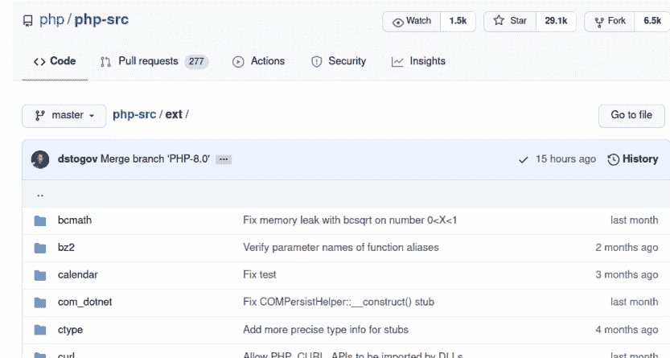

## 4 直接调用 C 语言

## 直接调用 C 语言

本章介绍了 **外部函数接口 (FFI)**。 在本章中，你将了解 FFI 是什么、它有什么用以及如何使用它。 本章中的这些信息对于有兴趣使用直接 C 语言调用进行快速自定义原型设计的开发者非常重要。

在本章中，你不仅了解将 FFI 引入 PHP 语言背后的背景，还学习如何将 C 语言结构和函数直接合并到你的代码中。 虽然——正如你将要了解的那样——这不应为了获得更高的速度而这样做，但它确实使你能够将任何 C 语言库直接合并到你的 PHP 应用程序中。 这种能力为 PHP 迄今为止无法使用的整个功能世界打开了大门。

本章涵盖的主题包括以下内容：

- 了解 FFI
- 学习在哪里使用 FFI
- 检查 FFI 类
- 在应用程序中使用 FFI
- 使用 PHP 回调


## Technical requirements

为了检查并运行本章提供的代码示例，这里列出了最低推荐硬件：

- 基于 X86_64 的台式电脑或笔记本电脑
- 1 **千兆字节 (GB)** 的可用磁盘空间
- 4 GB 的 **随机存取存储器 (RAM)**
- 500 **千比特每秒 (Kbps)** 或更快的互联网连接

此外，您需要安装以下软件：

- Docker
- Docker Compose

请参阅 *第 1 章，介绍新的 PHP 8 OOP 特性* 中的 *技术要求* 部分，了解有关 Docker 和 Docker Compose 安装的更多信息，以及如何构建本书中用于演示代码的 Docker 容器。在本书中，我们将恢复示例代码的目录称为 `/repo`。

本章的源代码位于此处：

```
https://github.com/PacktPublishing/PHP-8-Programming-Tips-Tricks-and-Best-Practices
```

我们现在可以开始讨论，首先了解 FFI。

## Understanding FFI

FFI 的主要目的是允许任何编程语言能够将用其他语言编写的外部库中的代码和函数调用纳入其中。早期的一个例子是 1980 年代微型计算机能够使用 `PEEK` 和 `POKE` 命令将汇编语言纳入原本缓慢的 **初学者通用符号指令代码 (BASIC)** 编程语言脚本中。与许多其他语言不同，PHP 在 PHP 7.4 之前不具备此功能，尽管自 2004 年以来一直在讨论。

为了全面了解 PHP 8 中的 FFI，有必要 digress 并看看为什么 FFI 花了这么长时间才完全被纳入 PHP 语言。也有必要快速了解一下 PHP 扩展的一般情况，以及处理 C 语言代码的能力。我们首先研究 PHP 与 C 语言之间的关系。

## Relationship between PHP and the C language

**C 语言** 由 Dennis Ritchie 于 1972 年底在贝尔实验室开发。从那时起，尽管引入了其面向对象的表亲 C++，该语言仍然主导着编程语言领域。PHP 本身是用 C 编写的；因此，能够直接加载 C 共享库并直接访问 C 函数和数据结构，是对 PHP 语言的一个非常重要的补充。

将 FFI 扩展引入 PHP 语言使 PHP 能够加载并直接处理 C 结构和 C 函数。为了在何时何地明智地决定使用 FFI 扩展，让我们先看看 PHP 扩展的一般情况。

## Understanding PHP extensions

**PHP 扩展**，顾名思义，*扩展* PHP 语言。每个扩展都可以添加 **面向对象编程 (OOP)** 类以及过程级函数。每个扩展都有一个不同的逻辑目的——例如，GD 扩展处理图形图像操作，而 PDO 扩展处理数据库访问。

作为一个类比，请考虑一家医院。在医院里，您有急诊、手术、儿科、骨科、心内科、X 光等部门。每个部门都是自成体系的，并服务于不同的目的。部门共同组成医院。同样，PHP 就像医院，而它的扩展就像各个部门。

并非所有扩展都相等。一些被称为 **核心扩展** 的扩展在安装 PHP 时始终可用。其他扩展必须手动下载、编译并启用。现在让我们看看核心扩展。

## Accessing PHP core extensions

PHP 核心扩展直接包含在位于此处的 PHP 主源代码存储库中：https://github.com/php/php-src/tree/master/ext。如果您访问此网页，您将看到子目录列表，如以下屏幕截图所示。每个子目录都包含构成特定扩展的 C 语言代码：



图 4.1 – GitHub 上看到的 PHP 核心扩展

因此，当 PHP 安装在服务器上时，所有核心扩展也会被编译和安装。我们现在将简要了解一下不属于核心的扩展。

## Examining non-core PHP extensions

不属于核心的 PHP 扩展通常由特定供应商维护（**Microsoft** 是一个例子）。非常典型的是，非核心扩展被视为可选且使用不广泛。

一旦非核心扩展开始被越来越多地使用，很有可能最终会被迁移到核心。这方面的例子很多。最近的一个是 JSON 扩展：它现在不仅是核心的一部分，而且在 PHP 8 中此扩展无法再被禁用。

核心扩展也可能被移除。一个例子是 `mcrypt` 扩展。它在 PHP 7.1 中已被弃用，因为该扩展所依赖的基础库已被 *废弃* 超过 9 年。在 PHP 7.2 中，它正式从核心中移除。我们现在考虑在哪里找到非核心扩展。

## Finding non-core extensions

在这一点上，您可能会问一个合乎逻辑的问题：*您从哪里获取非核心扩展？* 通常，非核心扩展可直接从供应商处获取，从 `github.com` 获取，或从此网站获取：`http://pecl.php.net/`。多年来，人们抱怨 `pecl.php.net` 包含过时且未维护的代码。虽然这部分是真的，但在这个网站上确实存在最新且积极维护的代码也是事实。

例如，如果您查看 MongoDB 的 PHP 扩展，您会看到最后一次发布是在 2020 年 11 月底。以下屏幕截图显示了该扩展的 **PHP 扩展社区库 (PECL)** 网站页面：

| Version | State | Release Date | Downloads |
|---|---|---|---|
| **1.9.0** | stable | 2020-11-25 | mongodb-1.9.0.tgz (1269.9kB) DLL [Changelog] |

图 4.2 – PHP MongoDB 扩展的 pecl.php.net 页面

在许多情况下，供应商更喜欢完全控制扩展。这意味着您需要访问他们的网站来获取 PHP 扩展。一个例子是 Microsoft SQL Server 的 PHP 扩展，可在此 **统一资源定位符 (URL)** 找到：`https://docs.microsoft.com/en-us/sql/connect/php/download-drivers-php-sql-server?view=sql-server-ver15`。

本小节的关键要点是 PHP 语言通过其扩展得到增强。扩展是用 C 语言编写的。因此，能够直接在 PHP 脚本内部模拟原型扩展的逻辑是非常重要的。现在让我们把注意力转向您应该在哪里使用 FFI。

## Learning where to use FFI

直接将 C 库导入 PHP 的潜力令人震惊。其中一位 PHP 核心开发者实际上使用 FFI 扩展将 PHP 绑定到 C 语言 **TensorFlow** 机器学习平台！

> **提示**
> 
> 有关 TensorFlow 机器学习平台的信息，请访问此网页：https://www.tensorflow.org/。要了解 PHP 如何绑定到此库，请在此查看：https://github.com/dstogov/php-tensorflow。

正如我们在本节中向您展示的那样，FFI 扩展并不是满足您所有需求的万能解决方案。本节讨论 FFI 扩展的主要优势和劣势，并为您提供使用指南。我们在本节中驳斥的一个神话是，使用 FFI 扩展进行直接 C 语言调用会加快 PHP 8 程序的执行速度。首先，让我们看看 FFI 扩展为何花了这么长时间才进入 PHP。

## Adopting FFI into PHP

第一个 FFI 扩展实际上是在 2004 年 1 月由 PHP 核心开发者 **Wez Furlong** 和 **Ilia Alshanetsky** 在 PECL 网站 (https://pecl.php.net/) 上为 PHP 5 引入的。然而，该项目从未通过 Alpha 阶段，开发在不到一个月的时间内被放弃。

随着 PHP 在接下来的 14 年中不断发展和成熟，很明显 PHP 将受益于能够直接在 PHP 脚本中快速原型化潜在扩展的能力。没有这种能力，PHP 有可能落后于 Python 和 Ruby 等其他语言。

在过去，由于缺乏快速原型化能力，扩展开发者被迫先使用 pecl 编译其完整扩展并安装，然后才能在 PHP 脚本中测试它。在某些情况下，开发者甚至必须 *重新编译 PHP 本身* 才能测试其新扩展！相比之下，FFI 扩展允许开发者将 C 函数调用 *直接放置* 在 PHP 脚本中以便立即测试。

从 PHP 7.4 开始并延续到 PHP 8，核心开发者 Dmitry Stogov 提出了一个改进版本的 FFI 扩展。在令人信服的概念验证之后（参见前面的提示框，关于 PHP 绑定到 TensorFlow 机器学习平台），该版本的 FFI 扩展被纳入 PHP 语言。

> **提示**
> 
> 原始 FFI PHP 扩展可以在此处找到：http://pecl.php.net/package/ffi。有关修订后的 FFI 提案的更多信息，请参阅以下文章：https://wiki.php.net/rfc/ffi。

现在让我们研究为什么不应使用 FFI 来提高速度。


## 不要为了速度使用 FFI

因为 FFI 扩展允许 PHP 直接访问 C 语言库，人们很容易认为你的 PHP 应用会突然以机器语言的速度飞快运行。遗憾的是，事实并非如此。FFI 扩展需要在执行前先打开给定的 C 库，然后解析并伪编译一个 FFI 实例。FFI 扩展随后充当 C 库代码与 PHP 脚本之间的桥梁。

对于一些读者来说，FFI 扩展相对迟缓的性能并不仅限于 PHP 8 可能会令人宽慰。其他语言在使用自己的 FFI 实现时也会遭受同样的节流效应。这里有基于 *Ary 3 基准测试* 的一个出色的性能比较：https://wiki.php.net/rfc/ffi#php_ffi_performance.

如果你查看刚才引用的网页上显示的表格，你会看到 Python FFI 实现在 0.343 秒内完成了基准测试，而仅使用原生 Python 代码运行同一基准测试则耗时 0.212 秒。

查看同一表格，PHP 7.4 FFI 扩展在 0.093 秒内运行了基准测试（比 Python 快 30 倍！），而仅使用原生 PHP 代码运行同一基准测试则耗时 0.040 秒。

下一个合乎逻辑的问题是：*为什么要使用 FFI 扩展呢？* 这将在下一节中介绍。

## 为什么使用 FFI 扩展？

前一个问题的答案很简单：该扩展主要设计用于快速 **PHP 扩展原型开发**。PHP 扩展是该语言的生命线。没有扩展，PHP 只是 *另一种编程语言*。

当高级开发者首次着手一个编程项目时，他们需要确定该项目的最佳语言。一个关键因素是可用的扩展数量以及这些扩展的维护活跃程度。一般来说，积极维护的扩展数量与使用该语言的项目长期成功潜力之间存在直接相关性。

因此，如果有办法加快扩展开发速度，PHP 语言本身的长期可行性就会得到改善。FFI 扩展为 PHP 语言带来的价值在于它能够直接在 PHP 脚本中测试扩展原型，而无需经过完整的编译-链接-加载-测试周期。

除了快速原型开发之外，FFI 扩展的另一个用例是允许 PHP 直接访问晦涩或专有的 C 代码。一个例子是用于控制工厂机器的自定义 C 代码。为了让 PHP 运行工厂，可以使用 FFI 扩展将 PHP 直接绑定到控制各种机器的 C 库。

最后，该扩展的另一个用例是使用它来预加载 C 库，可能减少内存消耗。在展示使用示例之前，让我们先看看 FFI 类及其方法。

## 检查 FFI 类

正如本章所述，并非每个开发者都需要使用 FFI 扩展。直接使用 FFI 扩展的经验会加深你对 PHP 语言内部机制的理解，而这种加深的理解可能对你作为 PHP 开发者的职业生涯产生积极影响：未来你很可能会被一家开发了自定义 PHP 扩展的公司雇佣。在这种情况下知道如何操作 FFI 扩展，可以让你为自定义 PHP 扩展开发新功能，同时帮助你排查扩展问题。

FFI 类由 20 个方法组成，可分为四个大类，概述如下：

- **创建型**：此类方法创建可从 FFI 扩展 **应用程序编程接口**（API）获得的类的实例。
- **比较**：比较方法旨在比较 C 数据值。
- **信息性**：这组方法提供有关 C 数据值的元数据，包括大小和 *对齐方式*。
- **基础设施**：基础设施方法用于执行诸如复制、填充和释放内存等后勤操作。

> 提示
> 完整的 FFI 类文档在这里：https://www.php.net/manual/en/class.ffi.php.

有趣的是，所有 FFI 类方法都可以以静态方式调用。现在是时候深入研究与 FFI 相关的类的细节和用法了，从 *创建型* 方法开始。

## 使用 FFI 创建型方法

属于创建型类别的 FFI 方法旨在直接生成 FFI 实例或由 FFI 扩展提供的类的实例。在使用 FFI 扩展提供的 C 函数时，重要的是要认识到你不能直接将原生 PHP 变量传递给函数并期望它能工作。数据必须首先作为 FFI 数据类型创建或导入到 FFI 数据类型中，然后才能将 FFI 数据类型传递给 C 函数。为了创建 FFI 数据类型，请使用表 4.1 中汇总的一个函数，如下所示：

| FFI 方法 | 返回 | 注释 |
|---|---|---|
| `arrayType()` | `FFI\CType` | 生成一个 C 数组。第一个参数是由调用 `FFI::type()` 产生的数据类型。第二个参数是一个表示数组维度的数组。 |
| `cdef()` | `FFI` | 作为参数你必须提供一个 C 语言代码块。返回的 FFI 实例在 PHP 程序和 C 语言库之间提供桥梁。 |
| `new()` | `FFI\CData` | 生成一个原生 C 数据结构。如果第一个参数是字符串，它必须是有效的 C 类型。否则，将 `FFI\CType` 对象作为第一个参数提供。 |
| `scope()` | `FFI` | 基于 *预加载* 的 C 声明创建 FFI 实例。 |
| `string()` | `string` | 从由给定字节数组成的 `FFI\CData` 实例返回一个原生 PHP 字符串。 |
| `type()` | `FFI\CType` | 创建一个可与其它 FFI 扩展类一起使用的 `FFI\CType` 对象。 |

表 4.1 – FFI 类创建型方法摘要

cdef() 和 scope() 方法都直接生成 FFI 实例，而其他方法生成可用于创建 FFI 实例的对象实例。string() 用于从原生 C 变量中提取给定数量的字节。让我们看看如何创建和使用 FFI\CType 实例。

## 创建和使用 FFI\CType 实例

必须特别注意，一旦创建了 FFI\CType 实例，不要像原生 PHP 变量那样简单地为其赋值。之所以如此，是因为 PHP 是松散类型的，这样做只会覆盖 FFI\CType 实例。相反，要为 FFI\CType 实例分配标量值，请使用其 cdata 属性。

以下示例创建一个 $arr C 数组。然后用值填充原生 C 数组直到其最大大小，之后我们使用简单的 var_dump() 来查看其内容。我们将按以下步骤进行：

- 1. 首先，我们使用 FFI::arrayType() 创建数组。作为参数，我们提供 FFI::type() 方法和维度。然后我们使用 FFI::new() 创建 FFI\Ctype 实例。代码如下所示：
- 2. 或者，我们也可以将操作合并为单个语句，如下所示：
- 3. 然后我们初始化三个提供测试数据的变量，如以下代码片段所示。请注意，原生的 PHP count() 函数可用于 FFI\CData 数组类型：
- 4. 现在我们可以像 PHP 数组一样填充值，只是我们需要使用 cdata 属性以便将元素保留为 FFI\CType 实例。代码如下所示：

```php
// /repo/ch04/php8_ffi_array.php
$type = FFI::arrayType(FFI::type("char"), [3, 3]);
$arr  = FFI::new($type);
```

```php
$arr  = FFI::new(FFI::type("char [3] [3]"));
```

```php
$pos  = 0;
$val  = 'ABCDEFGHIJKLMNOPQRSTUVWXYZ';
$y_max = count($arr);
```

```php
for ($y = 0; $y < $y_max; $y++) {
    $x_max = count($arr[$y]);
    for ($x = 0; $x < $x_max; $x++) {
        $arr[$y][$x]->cdata = $val[$pos++];
    }
}
var_dump($arr)
```

在前面的示例中，我们使用嵌套的 for() 循环用字母填充二维 3 x 3 数组。如果现在执行一个简单的 var_dump()，我们将得到以下结果：

```bash
root@php8_tips_php8 [/repo/ch04 ]# php
    php8_ffi_array.php
```


```
object(FFI\CData:char[3][3])#2 (3) {
    [0]=> object(FFI\CData:char[3])#3 (3) {
        [0]=> string(1) "A"
        [1]=> string(1) "B"
        [2]=> string(1) "C"
    }
    [1]=> object(FFI\CData:char[3])#1 (3) {
        [0]=> string(1) "D"
        [1]=> string(1) "E"
        [2]=> string(1) "F"
    }
    [2]=> object(FFI\CData:char[3])#4 (3) {
        [0]=> string(1) "G"
        [1]=> string(1) "H"
        [2]=> string(1) "I"
    }
}
```

从输出中首先需要注意的重要一点是，所有索引都是整数。从输出中得到的第二个结论是，这显然不是原生的 PHP 数组。var_dump() 显示给我们，每个数组元素都是一个 FFI\CData 实例。此外，请注意 C 语言字符串被当作数组处理。

由于该数组的类型为 char，我们可以使用 FFI::string() 来显示其中一行。以下是产生 ABC 响应的命令：

```
echo FFI::string($arr[0], 3);
```

任何尝试将 FFI\CData 实例提供给接受数组作为参数的 PHP 函数都注定会失败，即使它被定义为数组类型。在下面的代码片段中，请注意如果将此命令添加到前面的代码块中会产生的输出：

```
echo implode(',', $arr);
```

正如接下来所示的输出，你可以看到，由于数据类型不是数组，implode() 会引发致命错误。以下是 resulting 输出：

```
PHP Fatal error: Uncaught TypeError: implode(): Argument #2 ($array) must be of type ?array, FFI\CData given in /repo/ch04/php8_ffi_array.php:25
```

你现在已经知道如何创建和使用 FFI\CType 实例。现在让我们把注意力转向创建 FFI 实例。

## 创建和使用 FFI 实例

如本章引言中所述，FFI 扩展促进了快速原型设计。因此，使用 FFI 扩展，你可以一次开发一个设计用于新扩展的 C 函数，并在 PHP 应用程序内部立即对其进行测试。

> **重要提示**
> FFI 扩展不会编译 C 代码。为了使用 FFI 扩展中的 C 函数，你必须首先使用 C 编译器将 C 代码编译成共享库。你将在本章最后一节 *在应用程序中使用 FFI* 中学习如何执行此操作。

为了在 PHP 和原生 C 库函数调用之间建立桥梁，你需要创建一个 FFI 实例。FFI 扩展需要你提供一个 C 定义，该定义定义了 C 函数签名以及计划使用的 C 库。FFI::cdef() 和 FFI::scope() 都可以直接用于创建 FFI 实例。

以下示例使用 FFI::cdef() 来绑定两个原生 C 库函数。以下是发生的情况：

- 1. 第一个原生方法 srand() 用于为随机化序列设置种子。rand()，另一个原生 C 函数，调用序列中的下一个数字。$key 变量保存随机化的最终结果。$size 表示要调用的随机数个数。代码在以下片段中说明：
- 2. 然后我们通过调用 cdef() 创建 FFI 实例，并在字符串 $code 中标识原生 C 函数，该字符串取自 libc.so.6 原生 C 库，如下所示：

// /repo/ch04/php8_ffi_cdef.php
$key = '';
$size = 4;
```

```
$code = <<<EOT
    void srand (unsigned int seed);
    int rand (void);
EOT;
$ffi = FFI::cdef($code, 'libc.so.6');
```

3. 然后我们通过调用 srand() 为随机化设置种子。然后，在循环中，我们调用 rand() 原生 C 库函数来生成随机数。我们使用 sprintf() 原生 PHP 函数将结果整数转换为十六进制，其输出附加到 $key，然后输出。代码如下所示：

```php
$ffi->srand(random_int(0, 999));
for ($x = 0; $x < $size; $x++)
    $key .= sprintf('%x', $ffi->rand());
echo $key
```

以下是前面代码片段的输出。请注意，结果值可用作随机密钥：

```
```
root@php8_tips_php8 [/repo/ch04 ]# php php8_ffi_cdef.php
23f306d51227432e7d8d921763b7eedf
```
```

在输出中，你会看到一系列连接的随机整数转换为十六进制。请注意，每次调用脚本时，结果值都会发生变化。

**提示**
对于真正的随机化，使用 random_int() 原生 PHP 函数可能更好。openssl 扩展中也包含一些优秀的密钥生成函数。此处所示的示例主要旨在让你熟悉 FFI 扩展的使用。

**重要提示**
FFI 扩展还包括两个额外的创建方法：
FFI::load() 和 FFI::scope()。FFI::load() 用于在预加载过程中直接从 C 头文件（*.h）加载 C 函数定义。FFI::scope() 使预加载的 C 函数可通过 FFI 扩展使用。有关预加载的更多信息，请在此处查看 FFI 文档中的完整预加载示例：https://www.php.net/manual/en/ffi.examples-complete.php。

现在让我们看看 FFI 扩展中用于比较原生 C 数据类型的函数。

## 使用 FFI 比较数据

需要记住的是，当你使用 FFI 扩展创建 C 语言数据结构时，它存在于你的 PHP 应用程序之外。如你在前面的示例中看到的（参见 创建和使用 FFI\CType 实例 部分），PHP 在一定程度上可以与 C 数据交互。然而，对于比较目的，最好使用 FFI::memcmp()，因为原生 PHP 函数可能会返回不一致的结果。

FFI 扩展中可用的两个比较函数在此总结于表 4.2 中：

| FFI 方法 | 返回 | 说明 |
|---|---|---|
| isNull() | bool | 如果 FFI\CData 实例为空指针则返回 TRUE。 |
| memcmp() | int | 其操作方式与 PHP strcmp() 函数或 <=> 运算符非常相似。如果第一个 FFI\CData 实例小于第二个，则返回小于 0 的值。如果两者相等，则返回 0，如果第二个参数的值大于第一个，则返回大于 0 的值。 |

表 4.2 – FFI 类比较方法摘要

可以使用 FFI::isNull() 来确定 FFI\CData 实例是否为空。更有趣的是 FFI::memcmp()。尽管此函数的操作方式与 spaceship 运算符（<=>）相同，但它接受第三个参数，表示你希望包含在比较中的字节数。以下示例说明了此用法：

- 1. 我们首先定义一组四个变量，表示可以包含多达六个字符的 FFI\CData 实例，并用示例数据填充这些实例，如下所示：

// /repo/ch04/php8_ffi_memcmp.php
$a = FFI::new("char[6]");
$b = FFI::new("char[6]");
$c = FFI::new("char[6]");
$d = FFI::new("char[6]");
```

2. 回想一下，C 语言将字符数据视为数组，因此我们不能直接分配字符串，即使使用 cdata 属性。因此，我们需要定义一个匿名函数，用字母填充这些实例。我们使用以下代码来实现此目的：

```
$populate = function ($cdata, $start, $offset, $num) {
    for ($x = 0; $x < $num; $x++)
        $cdata[$x + $offset] = chr($x + $offset +
                                    $start);
    return $cdata;
};
```

3. 接下来，我们使用该函数用不同的字母集填充四个 FFI\CData 实例，如下所示：

```
$a = $populate($a, 65, 0, 6);
$b = $populate($b, 65, 0, 3);
$b = $populate($b, 85, 3, 3);
$c = $populate($c, 71, 0, 6);
$d = $populate($d, 71, 0, 6);
```

4. 现在我们可以使用 FFI::string() 方法来显示迄今为止的内容，如下所示：

```
$patt = "%2s : %6s\n";
printf($patt, '$a', FFI::string($a, 6));
printf($patt, '$b', FFI::string($b, 6));
printf($patt, '$c', FFI::string($c, 6));
printf($patt, '$d', FFI::string($d, 6));
```

5. 以下是 printf() 语句的输出：

```
$a : ABCDEF
$b : ABCXYZ
$c : GHIJKL
$d : GHIJKL
```


6. 从输出中可以看到，$c 和 $d 的值相同。$a 和 $b 的前三个字符相同，但最后三个不同。

7. 此时，如果我们尝试使用 spaceship 运算符（<=>）进行比较，结果如下：

```
PHP Fatal error: Uncaught FFI\Exception: Comparison of incompatible C types
```

8. 同样地，即使数据是字符类型，尝试使用 strcmp()，结果如下：

```
PHP Warning: strcmp() expects parameter 1 to be string, object given
```

9. 因此，我们唯一的替代方案是使用 FFI::memcmp()。在下面显示的比较集中，请注意第三个参数为 6，表示 PHP 应比较最多六个字符：

```
$p = "%20s : %2d\n";
printf($p, 'memcmp($a, $b, 6)', FFI::memcmp($a, $b, 6));
printf($p, 'memcmp($c, $a, 6)', FFI::memcmp($c, $a, 6));
printf($p, 'memcmp($c, $d, 6)', FFI::memcmp($c, $d, 6));
```

10. 如预期所示，输出与在原生 PHP 字符串上使用 spaceship 运算符的结果相同，如下所示：

```
memcmp($a, $b, 6) : -1
memcmp($c, $a, 6) : 1
memcmp($c, $d, 6) : 0
```

11. 注意如果我们将比较限制为仅三个字符会发生什么。以下是添加到代码块中的另一个 FFI::memcmp() 比较，将第三个参数设置为 3：

```
echo "\nUsing FFI::memcmp() but not full length\n";
printf($p, 'memcmp($a, $b, 3)', FFI::memcmp($a, $b, 3));
```

12. 从此处显示的输出可以看到，通过将 memcmp() 限制为仅三个字符，$a 和 $b 被认为是相等的，因为它们都以相同的三个字符 a、b 和 c 开头：

```
Using FFI::memcmp() but not full length
memcmp($a, $b, 3) : 0
```

从此示例中需要汲取的最重要一点是，你需要在比较的字符数与所比较数据的性质之间找到平衡。比较的字符越少，整体操作越快。然而，如果数据的性质使得出现错误结果成为可能，则必须增加字符数并承受轻微的性能损失。

现在让我们来看一下从 FFI 扩展数据中收集信息。

## 从 FFI 扩展数据中提取信息

当你使用 FFI 实例和原生 C 数据结构时，原生 PHP 信息方法如 strlen() 和 ctype_digit() 不会产生有用的信息。因此，FFI 扩展包含三种旨在产生有关 FFI 扩展数据信息的 方法。这三种方法在表 4.3 中进行了总结：

| FFI 方法 | 返回值 | 注释 |
|---|---|---|
| alignof() | int | 返回 FFI\CType 或 FFI\CData 实例的对齐方式。一种很好的可视化返回值的方式是内存中的块大小。 |
| sizeof() | int | 返回 FFI\CType 或 FFI\CData 实例使用的内存量。 |
| typeof() | FFI\CType | 返回 FFI\CData 对象的数据类型。返回的数据类型不是 PHP 原生数据类型。相反，返回的是标识 C 数据类型的 FFI\CType 实例。 |

表 4.3 – FFI 类信息方法的总结

我们首先查看 FFI::typeof()，然后深入研究另外两种方法。

## 使用 FFI::typeof() 确定 FFI 数据的性质

下面是一个说明 FFI::typeof() 用法的示例。该示例还演示了在处理 FFI 数据时，原生 PHP 信息函数不会产生有用的结果。我们的做法如下：

- 1. 首先，我们定义一个 $char C 字符串并用字母表的最初六个字母填充，如下所示：
- 2. 然后我们尝试使用 strlen() 获取字符串的长度。在以下代码片段中，请注意 $t::class 的使用：这相当于 get_class($t)。此用法仅在 PHP 8 及以上版本可用：
- 3. 在 PHP 7.4 中，结果是 Warning 消息。然而，在 PHP 8 中，如果你向 strlen() 传递除字符串之外的任何内容，将抛出致命的 Error 消息。以下是此时的 PHP 8 输出：
- 4. 以类似的方式，尝试使用 ctype_alnum()，如下所示：
- 5. 以下是步骤 4 中显示的 echo 命令的输出：

// /repo/ch04/php8_ffi_typeof.php
$char = FFI::new("char[6]");
for ($x = 0; $x < 6; $x++)
    $char[$x] = chr(65 + $x);
```

```
try {
    echo 'Length of $char is ' . strlen($char);
} catch (Throwable $t) {
    echo $t::class . ':' . $t->getMessage();
}
```

```
TypeError:strlen(): Argument #1 ($str) must be of type string, FFI\CData given
```

```
echo '$char is ' .
    ((ctype_alnum($char)) ? 'alpha' : 'non-alpha');
```

```
$char is non-alpha
```

6. 如你所见，我们使用原生 PHP 函数无法获得有关 FFI 数据的任何有用信息！然而，使用 FFI::typeOf()，如下面所示，会返回更好的结果：

```php
$type = FFI::typeOf($char);
var_dump($type);
```

7. 以下是 var_dump() 的输出：

```
object(FFI\CType:char[6])#3 (0) {}
```

从最终输出可以看到，我们现在有了有用的信息！现在让我们来看一下另外两个 FFI 信息方法。

## 使用 FFI::alignof() 和 FFI::sizeof()

在进入展示这两种方法用法的实际示例之前，了解 **对齐** 到底意味着什么很重要。为了理解对齐，你需要对大多数计算机中内存的组织方式有一个基本的了解。

RAM 仍然是在程序运行周期期间临时存储信息的最高效方式。你的计算机的 **中央处理器 (CPU)** 在程序执行时将信息移入和移出内存。内存按并行数组组织。alignof() 返回的对齐值是指可以从对齐内存数组的并行切片中一次获取的字节数。在旧计算机中，4 是一个典型值。对于大多数现代微型计算机，8 或 16（或更大）的值很常见。

现在让我们来看一个示例，说明这两种 FFI 扩展信息方法是如何使用的，以及该信息如何带来性能改进。我们将按以下方式进行：

1. 首先，我们创建一个 FFI 实例 $ffi，其中定义了两个分别标记为 Good 和 Bad 的 C 结构体。请注意，在以下代码片段中，两个结构体具有相同的属性；然而，属性的排列顺序不同：

```php
$struct = 'struct Bad { char c; double d; int i; }; '
    . 'struct Good { double d; int i; char c; }; ';
$ffi = FFI::cdef($struct);
```

2. 然后我们从 $ffi 中提取两个结构体，如下所示：

```
$bad = $ffi->new("struct Bad");
$good = $ffi->new("struct Good");
var_dump($bad, $good);
```

3. var_dump() 输出如下所示：

```
object(FFI\CData:struct Bad)#2 (3) {
    ["c"]=> string(1) ""
    ["d"]=> float(0)
    ["i"]=> int(0)
}
object(FFI\CData:struct Good)#3 (3) {
    ["d"]=> float(0)
    ["i"]=> int(0)
    ["c"]=> string(1) ""
}
```

4. 然后我们使用这两种信息方法来报告这两个数据结构，如下所示：

```
echo "\nBad Alignment:\t" . FFI::alignof($bad);
echo "\nBad Size:\t" . FFI::sizeof($bad);
echo "\nGood Alignment:\t" . FFI::alignof($good);
echo "\nGood Size:\t" . FFI::sizeof($good);
```

此代码示例的最后四行输出如下所示：

```
Bad Alignment:  8
Bad Size:       24
Good Alignment: 8
Good Size:      16
```

从输出可以看到，FFI::alignof() 的返回值告诉我们对齐块为 8 字节宽。然而，你也可以看到 Bad 结构体占用的字节大小比 Good 结构体所需的 大 50%。由于这两个数据结构具有完全相同的属性，任何理智的开发人员都会选择 Good 结构体。

从此示例可以看到，FFI 扩展信息方法能够让我们了解如何最好地组织我们的 C 数据以产生最有效的结果。

> **提示**
> 
> 有关 C 语言中 `sizeof()` 和 `alignof()` 之间差异的精彩讨论，请参阅本文：https://stackoverflow.com/questions/11386946/whats-the-difference-between-sizeof-and-alignof.

你现在已经了解了 FFI 扩展信息方法是什么，并看到了一些使用示例。现在让我们来看一下与基础设施相关的 FFI 扩展方法。

## 使用 FFI 基础设施方法

FFI 扩展基础设施类别方法可以被视为 *幕后* 组件，支持 C 函数绑定正常工作所需的基础设施。正如我们在本章中反复强调的，如果你希望从 PHP 应用程序中直接访问 C 数据结构，则需要 FFI 扩展。因此，如果你需要执行等同于 PHP `unset()` 语句以释放内存，或 PHP `include()` 语句以包含外部程序代码的操作，FFI 扩展基础设施方法提供了原生 C 数据与 PHP 之间的桥梁。

表 4.4 总结了此类别中的方法，如下所示：

| FFI 方法 | 返回值 | 注释 |
|---|---|---|
| `addr()` | `FFI\CData` | 创建指向 C 数据的指针 |
| `cast()` | `FFI\CData` | 执行 C 语言类型转换 |
| `free()` | `void` | 释放 FFI 指针。PHP 中没有直接等价物 |
| `memcpy()` | `void` | 从一个 `FFI\CData` 实例复制指定字节到另一个实例。 |
| `memset()` | `void` | 使用由 `$value` 组成的 `$size` 字节填充 `FFI\CData` 实例。 |

表 4.4 – FFI 类基础设施方法


先来看看 FFI::addr()、free()、memset() 和 memcpy()。

## 使用 FFI::addr()、free()、memset() 和 memcpy()

PHP 开发者经常通过 **引用** 为变量赋值。这使得对一个变量的更改会自动反映到另一个变量中。在向函数或方法传递参数时使用引用尤其有用，当你需要返回多个值时。通过引用传递允许函数或方法返回无限数量的值。

FFI::addr() 方法为现有的 FFI\CData 实例创建一个 C 指针。就像 PHP 引用一样，对指针关联的数据所做的任何更改也会同样发生。

在使用 FFI::addr() 方法构建示例的过程中，我们还向你介绍 FFI::memset()。该函数与 PHP 的 str_repeat() 函数类似，因为它（FFI::memset()）用特定值填充指定数量的字节。在此示例中，我们使用 FFI::memset() 用字母填充一个 C 字符字符串。

在本小节中，我们还将查看 FFI::memcpy()。此函数用于将数据从一个 FFI\CData 实例复制到另一个实例。与 FFI::addr() 方法不同，FFI::memcpy() 创建的克隆与复制数据的来源没有任何关联。此外，我们介绍 FFI::free()，一种用于释放使用 FFI::addr() 创建的指针的方法。

让我们看看这些 FFI 扩展方法如何使用，如下所示：

- 1. 首先，创建一个 FFI\CData 实例 $arr，由六个字符的 C 字符串组成。请注意在以下代码片段中使用 FFI::memset()，另一种基础设施方法，用 **美国信息交换标准代码**（ASCII）代码 65 填充字符串：字母 A：

```
// /repo/ch04/php8_ffi_addr_free_memset_memcpy.php
$size = 6;
$arr  = FFI::new(FFI::type("char[$size]"));
FFI::memset($arr, 65, $size);
echo FFI::string($arr, $size);
```

- 2. 使用 FFI::string() 方法的 echo 结果如下所示：

```
AAAAAA
```

- 3. 如输出所示，出现了六个 ASCII 代码 65（字母 A）的实例。然后我们创建另一个 FFI\CData 实例 $arr2，并使用 FFI::memcpy() 将六个字符从一个实例复制到另一个实例，如下所示：

```
$arr2 = FFI::new(FFI::type("char[$size]"));
FFI::memcpy($arr2, $arr, $size);
echo FFI::string($arr2, $size);
```

- 4. 不出所料，输出与第 2 步中的输出相同，如下所示：

```
AAAAAA
```

- 5. 接下来，我们为 $arr 创建一个 C 指针。请注意，当指针被赋值时，它们在原生的 PHP var_dump() 函数中显示为数组元素。然后我们可以更改数组元素 0 的值，并使用 FFI::memset() 用字母 B 填充它。代码显示在以下片段中：

```
$ref = FFI::addr($arr);
FFI::memset($ref[0], 66, 6);
echo FFI::string($arr, $size);
var_dump($ref, $arr, $arr2);
```

- 6. 以下是与第 5 步中显示的剩余代码相关的输出：

```
BBBBBB
object(FFI\CData:char(*)[6])#2 (1) {
  [0]=> object(FFI\CData:char[6])#4 (6) {
    [0]=> string(1) "B"
    [1]=> string(1) "B"
    [2]=> string(1) "B"
    [3]=> string(1) "B"
    [4]=> string(1) "B"
    [5]=> string(1) "B"
  }
}
object(FFI\CData:char[6])#3 (6) {
  [0]=> string(1) "B"
  [1]=> string(1) "B"
  [2]=> string(1) "B"
  [3]=> string(1) "B"
[4]=>  string(1) "B"
[5]=>  string(1) "B"
}
object(FFI\CData:char[6])#4 (6) {
    [0]=>  string(1) "A"
    [1]=>  string(1) "A"
    [2]=>  string(1) "A"
    [3]=>  string(1) "A"
    [4]=>  string(1) "A"
    [5]=>  string(1) "A"
}
```

如输出所示，我们首先有一个 BBBBBB 字符串。你可以看到指针的形式是 PHP 数组。原始 FFI\CData 实例 $arr 现在已更改为字母 B。然而，前面的输出也清楚地表明，副本 $arr2 不受对 $arr 或其 $ref[0] 指针所做的更改的影响。

- 7. 最后，为了释放使用 FFI::addr() 创建的指针，我们使用 FFI::free()。此方法类似于原生的 PHP unset() 函数，但设计用于处理 C 指针。以下是添加到我们示例中的最后一行代码：

```
FFI::free($ref);
```

现在你已经对如何处理 C 指针以及如何用信息填充 C 数据有了一定的了解，让我们看看如何对 FFI\CData 实例进行类型转换。

## 了解 FFI::cast()

在 PHP 中，类型转换过程经常发生。它用于 PHP 被要求执行涉及不同数据类型操作时。以下代码块显示了这一经典示例：

```
$a = 123;
$b = "456";
echo $a + $b;
```

在这个简单的示例中，$a 被赋予 int（整数）数据类型，而 $b 被赋予 string 类型。echo 语句要求 PHP 首先将 $b 类型转换为 int，执行加法，然后将结果类型转换为 string。

原生 PHP 还允许开发人员通过在变量或表达式前加上所需数据类型（用括号括起来）来强制数据类型。上一代码片段的重写示例可能如下所示：

```
$a = 123;
$b = "456";
echo (string) ($a + (int) $b);
```

强制类型转换使你的意图对使用你代码的其他开发人员非常清晰。它还保证了结果，因为强制类型转换对代码流程的控制更强，而不依赖于 PHP 的默认行为。

FFI 扩展具有类似的功能，即 FFI::cast() 方法。如本章所述，FFI 扩展数据与 PHP 隔离，且不受 PHP 类型转换的影响。为了强制数据类型，你可以使用 FFI::cast() 根据需要返回一个并行的 FFI\CData 类型。让我们在以下步骤中看看如何操作：

- 1. 在此示例中，我们创建一个类型为 int 的 FFI\CData 实例 $int1。我们使用其 cdata 属性为其赋值为 123，如下所示：

```
// /repo/ch04/php8_ffi_cast.php
// not all lines are shown
$patt = "%2d : %16s\n";
$int1 = FFI::new("int");
$int1->cdata = 123;
$bool = FFI::cast(FFI::type("bool"), $int1);
printf($patt, __LINE__, (string) $int1->cdata);
printf($patt, __LINE__, (string) $bool->cdata);
```

- 2. 如此处所示的输出所示，整数值 123 在类型转换为 bool（布尔）时，输出显示为 1：

```
8 :               123
9 :                 1
```

- 3. 接下来我们创建一个类型为 int 的 FFI\CData 实例 $int2 并赋值为 123。然后我们将其类型转换为 float 并再次转换回 int，如以下代码片段所示：

```
$int2 = FFI::new("int");
$int2->cdata = 123;
$float1 = FFI::cast(FFI::type("float"), $int2);
$int3   = FFI::cast(FFI::type("int"), $float1);
printf($patt, __LINE__, (string) $int2->cdata);
printf($patt, __LINE__, (string) $float1->cdata);
printf($patt, __LINE__, (string) $int3->cdata);
```

- 4. 最后三行的输出相当令人满意。我们看到原始值 123 表示为 1.7235971111195E-43。当转换回 int 时，我们的原始值得以恢复。以下是最后三行的输出：

```
15 :               123
16 : 1.7235971111195E-43
17 :               123
```

- 5. FFI 扩展与 C 语言一样，并不允许转换所有类型。例如，在最后一块代码中，我们尝试将类型为 float 的 FFI\CData 实例 $float2 类型转换为 char，如下所示：

```
try {
    $float2 = FFI::new("float");
    $float2->cdata = 22/7;
    $char1  = FFI::cast(FFI::type("char[20]"),
        $float2);
    printf($patt, __LINE__, (string) $float2->cdata);
    printf($patt, __LINE__, (string) $char1->cdata);
} catch (Throwable $t) {
    echo get_class($t) . ':' . $t->getMessage();
}
```

- 6. 结果是灾难性的！如此处所示的输出所示，抛出 FFI\Exception：

```
FFI\Exception: attempt to cast to larger type
```

在本节中，我们讨论了一系列 FFI 扩展方法，这些方法创建 FFI 扩展对象实例、比较值、收集信息并处理创建的 C 数据基础结构。你了解到有 FFI 扩展方法与原生 PHP 语言中的这些相同功能相对应。在下一节中，我们将回顾一个实用示例，该示例使用 FFI 扩展将 C 函数库合并到 PHP 脚本中。


## 在应用程序中使用 FFI

任何共享 C 库（通常带有 *.so 扩展名）都可以使用 FFI 扩展包含在 PHP 应用程序中。如果你计划使用任何核心 PHP 库或安装 PHP 扩展时产生的库，重要的是要注意你有能力修改 PHP 语言本身的行为。

在我们研究其工作原理之前，让我们先看看如何使用 FFI 扩展将外部 C 库合并到 PHP 脚本中。

## 将外部 C 库集成到 PHP 脚本中

为了说明目的，我们使用一个可能源自计算机科学 101（CS101）课程的简单函数：著名的冒泡排序。该算法在初学者的计算机科学课程中被广泛使用，因为它易于理解。

> **重要提示**
> **冒泡排序**是一种极其低效的排序算法，早已被更快的排序算法如 **希尔排序**、**快速排序** 或 **归并排序** 算法所取代。虽然冒泡排序算法没有权威参考资料，你可以在这里阅读对其的良好总体讨论：https://en.wikipedia.org/wiki/Bubble_sort.

在本小节中，我们不讨论算法的细节。相反，本小节的目的是演示如何获取现有的 C 库并将其中的一个函数合并到 PHP 脚本中。我们现在向你展示原始 C 源代码，如何将其转换为共享库，以及——最后——如何使用 FFI 将库合并到 PHP 中。我们将执行以下操作：

- 1. 第一步，当然是将 C 代码编译为目标代码。以下是此示例中使用的冒泡排序 C 代码：

```c
#include <stdio.h>
void bubble_sort(int [], int);
void bubble_sort(int list[], int n) {
    int c, d, t, p;
    for (c = 0 ; c < n - 1; c++) {
        p = 0;
        for (d = 0 ; d < n - c - 1; d++) {
            if (list[d] > list[d+1]) {
                t = list[d];
list[d] = list[d+1];
list[d+1] = t;
p++;
}
}
if (p == 0) break;
}
}
```

- 2. 然后，我们使用 GNU C 编译器（包含在此课程使用的 Docker 镜像中）按如下方式将 C 代码编译为目标代码：

```
gcc -c -Wall -Werror -fpic bubble.c
```

- 3. 接下来，我们将目标代码合并到共享库中。此步骤是必要的，因为 FFI 扩展只能访问共享库。我们运行以下代码来执行此操作：

```
gcc -shared -o libbubble.so bubble.o
```

- 4. 我们现在准备定义使用新共享库的 PHP 脚本。我们首先定义一个显示 FFI\CData 数组输出的函数，如下所示：

```
// /repo/ch04/php8_ffi_using_func_from_lib.php
function show($label, $arr, $max)
{
    $output = $label . "\n";
    for ($x = 0; $x < $max; $x++)
        $output .= $arr[$x] . ',';
    return substr($output, 0, -1) . "\n";
}
```

- 5. 接下来是关键部分：定义 FFI 实例。我们使用 FFI::cdef() 来实现此目的并提供两个参数。第一个参数是函数签名，第二个参数是我们新创建的共享库的路径。两个参数都可以在以下代码片段中看到：

```
$bubble = FFI::cdef(
    "void bubble_sort(int [], int);",
    "./libbubble.so");
```

- 6. 然后，我们使用 rand() 函数创建一个包含 16 个值的整数数组作为 FFI\CData 元素，并用随机整数填充。代码如下所示：

```
$max = 16;
$arr_b = FFI::new('int[' . $max . ']');
for ($i = 0; $i < $max; $i++)
    $arr_b[$i]->cdata = rand(0,9999);
```

- 7. 最后，我们在排序前显示数组的内容，执行排序，然后显示排序后的内容。请注意，在以下代码片段中，我们使用来自 FFI 实例的 bubble_sort() 调用执行排序：

```
echo show('Before Sort', $arr_b, $max);
$bubble->bubble_sort($arr_b, $max);
echo show('After Sort', $arr_b, $max);
```

- 8. 输出结果不出所料，在排序前显示一组随机整数。排序后，值按顺序排列。以下是第 7 步中所示代码的输出：

```
Before Sort
245,8405,8580,7586,9416,3524,8577,4713,
9591,1248,798,6656,9064,9846,2803,304
After Sort
245,304,798,1248,2803,3524,4713,6656,7586,
8405,8577,8580,9064,9416,9591,9846
```

现在你已经了解如何使用 FFI 扩展将外部 C 库集成到 PHP 应用程序中，我们转向最后一个主题：PHP 回调。

## 使用 PHP 回调

正如我们在本节开头提到的，可以使用 FFI 扩展来合并属于实际 PHP 语言（或其扩展）的共享 C 库。这种集成很重要，因为它允许你通过访问 PHP 共享 C 库中定义的 C 数据结构，在 C 库中读取和写入原生 PHP 数据。

## 了解 PHP 回调固有的危险

重要的是要理解，各种 PHP 共享库中定义的 C 函数通常被多个 PHP 函数使用。因此，如果你在 C 层覆盖其中一个低级函数，你可能会在 PHP 应用程序中遇到意外行为。

另一个已知问题是覆盖原生 PHP C 函数很可能导致内存泄漏。随着时间的推移，使用此类覆盖的长期运行应用程序可能会失败，并可能导致服务器崩溃！

最后一点需要考虑的是，PHP 回调功能并非在所有 FFI 平台上都受支持。因此，虽然代码可能在 Linux 服务器上运行，但在 Windows 服务器上可能无法运行（或可能无法以相同方式运行）。

> **提示**
> 与其使用 FFI PHP 回调来覆盖原生 PHP C 库功能，不如直接定义自己的 PHP 函数可能更容易、更快、更安全！

现在你已经了解使用 PHP 回调所涉及的危险，让我们来看一个示例实现。

## 实现 PHP 回调

在以下示例中，zend_write 内部 PHP 共享库 C 函数使用回调被覆盖，该回调在输出末尾添加换行符（LF）。请注意，此覆盖会影响依赖于它的任何原生 PHP 函数，包括 echo、print、printf：换句话说，任何产生直接输出的 PHP 函数。要实现 PHP 回调，请按照以下步骤操作：

- 1. 首先，我们使用 FFI::cdef() 定义一个 FFI 实例。第一个参数是 zend_write 的函数签名。代码如下所示：

```
// /repo/ch04/php8_php_callbacks.php
$zend = FFI::cdef("
typedef int (*zend_write_func_t) (
    const char *str,size_t str_length);
    extern zend_write_func_t zend_write;
");
```

- 2. 然后，我们添加代码以确认，未修改时，echo 不会在末尾添加额外的 LF。你可以在这里看到代码：

```
echo "Original echo command does not output LF:\n";
echo 'A','B','C';
echo 'Next line';
```

- 3. 不出所料，输出产生 ABCNext line。输出中没有回车或 LF，如下所示：

```
Original echo command does not output LF:
ABCNext line
```

- 4. 然后，我们将 zend_write 的指针克隆到 $orig_zend_write 变量中。如果我们不这样做，我们将无法使用原始函数！代码如下所示：

```
$orig_zend_write = clone $zend->zend_write;
```

- 5. 接下来，我们以匿名函数的形式生成一个 PHP 回调，以覆盖原始的 zend_write 函数。在函数中，我们调用原始的 zend_write 函数并在其输出后附加 LF，如下所示：

```
$zend->zend_write = function($str, $len) {
    global $orig_zend_write;
    $ret = $orig_zend_write($str, $len);
    $orig_zend_write("\n", 1);
    return $ret;
};
```

- 6. 剩余代码重新运行前一步所示的 echo 命令，如下所示：

```
echo 'Revised echo command adds LF:';
echo 'A','B','C';
```


7. 以下输出演示了 PHP echo 命令现在在每个命令末尾产生一个 LF：

| 修订后的 echo 命令添加 LF： |
|---|
| A |
| B |
| C |

还需要注意的是，修改 PHP 库 C 语言 zend_write 函数会影响使用此 C 语言函数的所有 PHP 原生函数。这包括 print()、printf()（及其变体）等等。

这结束了我们关于在 PHP 应用程序中使用 FFI 扩展的讨论。你现在知道如何从外部共享库中合并原生 C 函数。你也知道如何用 PHP 回调替换原生 PHP 核心或扩展共享库，从而有潜力改变 PHP 语言本身的行为。

## Summary

在本章中，你了解了 FFI、其历史以及它如何用于促进快速 PHP 扩展原型制作。你还了解到，尽管 FFI 扩展不应被用于提高速度，它也用于允许你的 PHP 应用程序直接调用来自外部 C 库的原生 C 函数。这种能力的强大之处通过一个从外部 C 库调用冒泡排序函数的示例得以证明。这种相同的能力可以扩展到涵盖数千个可用的 C 库，包括机器学习、光学字符识别、通信、加密；无穷无尽。

在本章中，你对 PHP 本身在 C 语言级别的运行方式有了更深入的理解。你学习了如何创建和直接使用 C 语言数据结构，从而能够与 PHP 语言交互，甚至覆盖它。此外，你现在也有了如何将任何 C 语言库的功能直接合并到 PHP 应用程序中的想法。这一知识的进一步好处是，如果你在一家计划开发或已经开发了自己的自定义 PHP 扩展的公司找到工作，它有助于增强你的职业前景。

下一章标志着本书新部分 PHP 8 Tricks 的开始。在下一部分，你将了解升级到 PHP 8 时的向后兼容性问题。下一章专门针对与 OOP 相关的向后兼容性问题。
