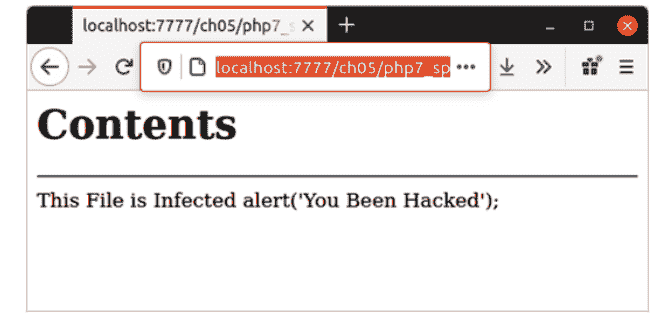

## 5 Discovering Potential OOP Backward-Compatibility Breaks

本章标志着本书第 2 部分 *PHP 8 Tricks* 的开始。在本部分，你将发现 PHP 8 的黑暗角落：存在 **backward-compatibility breaks** 的地方。本部分为你在将现有应用程序迁移到 PHP 8 之前避免问题提供了见解。你将学习在现有代码中寻找什么内容，这些内容可能导致在 PHP 8 升级后停止工作。一旦你掌握了本书本部分介绍的主题，你将能够很好地修改现有代码，使其在 PHP 8 升级后继续正常运行。

在本章中，你将[content]
7. 以下输出演示了 PHP echo 命令现在在每个命令末尾产生一个 LF：

| 修订后的 echo 命令添加 LF： |
|---|
| A |
| B |
| C |

还需要注意的是，修改 PHP 库 C 语言 zend_write 函数会影响使用此 C 语言函数的所有 PHP 原生函数。这包括 print()、printf()（及其变体）等等。

这结束了我们关于在 PHP 应用程序中使用 FFI 扩展的讨论。你现在知道如何从外部共享库中合并原生 C 函数。你也知道如何用 PHP 回调替换原生 PHP 核心或扩展共享库，从而有潜力改变 PHP 语言本身的行为。

## Summary

在本章中，你了解了 FFI、其历史以及它如何用于促进快速 PHP 扩展原型制作。你还了解到，尽管 FFI 扩展不应被用于提高速度，它也用于允许你的 PHP 应用程序直接调用来自外部 C 库的原生 C 函数。这种能力的强大之处通过一个从外部 C 库调用冒泡排序函数的示例得以证明。这种相同的能力可以扩展到涵盖数千个可用的 C 库，包括机器学习、光学字符识别、通信、加密；无穷无尽。

在本章中，你对 PHP 本身在 C 语言级别的运行方式有了更深入的理解。你学习了如何创建和直接使用 C 语言数据结构，从而能够与 PHP 语言交互，甚至覆盖它。此外，你现在也有了如何将任何 C 语言库的功能直接合并到 PHP 应用程序中的想法。这一知识的进一步好处是，如果你在一家计划开发或已经开发了自己的自定义 PHP 扩展的公司找到工作，它有助于增强你的职业前景。

下一章标志着本书新部分 PHP 8 Tricks 的开始。在下一部分，你将了解升级到 PHP 8 时的向后兼容性问题。下一章专门针对与 OOP 相关的向后兼容性问题。

## Section 2: PHP 8 Tricks

在本部分，你将进入 PHP 8 的黑暗角落：存在向后兼容性破坏的地方。本部分指导你完成将现有应用程序迁移到 PHP 8 的关键过程。

以下章节包含在此部分：

- Chapter 5, Discovering Potential OOP Backward-Compatibility Breaks
- Chapter 6, Understanding PHP 8 Functional Differences
- Chapter 7, Avoiding Traps When Using PHP 8 Extensions
- Chapter 8, Learning about PHP 8's Deprecated or Removed Functionality

## 5 Discovering Potential OOP Backward-Compatibility Breaks

本章标志着本书第 2 部分 *PHP 8 Tricks* 的开始。在本部分，你将发现 PHP 8 的黑暗角落：存在 **backward-compatibility breaks** 的地方。本部分为你在将现有应用程序迁移到 PHP 8 之前避免问题提供了见解。你将学习在现有代码中寻找什么内容，这些内容可能导致在 PHP 8 升级后停止工作。一旦你掌握了本书本部分介绍的主题，你将能够很好地修改现有代码，使其在 PHP 8 升级后继续正常运行。

在本章中，你将[content]
7. 以下输出演示了 PHP echo 命令现在在每个命令末尾产生一个 LF：

| 修订后的 echo 命令添加 LF： |
|---|
| A |
| B |
| C |

还需要注意的是，修改 PHP 库 C 语言 zend_write 函数会影响使用此 C 语言函数的所有 PHP 原生函数。这包括 print()、printf()（及其变体）等等。

这结束了我们关于在 PHP 应用程序中使用 FFI 扩展的讨论。你现在知道如何从外部共享库中合并原生 C 函数。你也知道如何用 PHP 回调替换原生 PHP 核心或扩展共享库，从而有潜力改变 PHP 语言本身的行为。

## Summary

在本章中，你了解了 FFI、其历史以及它如何用于促进快速 PHP 扩展原型制作。你还了解到，尽管 FFI 扩展不应被用于提高速度，它也用于允许你的 PHP 应用程序直接调用来自外部 C 库的原生 C 函数。这种能力的强大之处通过一个从外部 C 库调用冒泡排序函数的示例得以证明。这种相同的能力可以扩展到涵盖数千个可用的 C 库，包括机器学习、光学字符识别、通信、加密；无穷无尽。

在本章中，你对 PHP 本身在 C 语言级别的运行方式有了更深入的理解。你学习了如何创建和直接使用 C 语言数据结构，从而能够与 PHP 语言交互，甚至覆盖它。此外，你现在也有了如何将任何 C 语言库的功能直接合并到 PHP 应用程序中的想法。这一知识的进一步好处是，如果你在一家计划开发或已经开发了自己的自定义 PHP 扩展的公司找到工作，它有助于增强你的职业前景。

下一章标志着本书新部分 PHP 8 Tricks 的开始。在下一部分，你将了解升级到 PHP 8 时的向后兼容性问题。下一章专门针对与 OOP 相关的向后兼容性问题。

## Section 2: PHP 8 Tricks

在本部分，你将进入 PHP 8 的黑暗角落：存在向后兼容性破坏的地方。本部分指导你完成将现有应用程序迁移到 PHP 8 的关键过程。

以下章节包含在此部分：

- Chapter 5, Discovering Potential OOP Backward-Compatibility Breaks
- Chapter 6, Understanding PHP 8 Functional Differences
- Chapter 7, Avoiding Traps When Using PHP 8 Extensions
- Chapter 8, Learning about PHP 8's Deprecated or Removed Functionality

## 5 Discovering Potential OOP Backward-Compatibility Breaks

本章标志着本书第 2 部分 *PHP 8 Tricks* 的开始。在本部分，你将发现 PHP 8 的黑暗角落：存在 **backward-compatibility breaks** 的地方。本部分为你在将现有应用程序迁移到 PHP 8 之前避免问题提供了见解。你将学习在现有代码中寻找什么内容，这些内容可能导致在 PHP 8 升级后停止工作。一旦你掌握了本书本部分介绍的主题，你将能够很好地修改现有代码，使其在 PHP 8 升级后继续正常运行。

在本章中，你将[content]
7. 以下输出演示了 PHP echo 命令现在在每个命令末尾产生一个 LF：

| 修订后的 echo 命令添加 LF： |
|---|
| A |
| B |
| C |

还需要注意的是，修改 PHP 库 C 语言 zend_write 函数会影响使用此 C 语言函数的所有 PHP 原生函数。这包括 print()、printf()（及其变体）等等。

这结束了我们关于在 PHP 应用程序中使用 FFI 扩展的讨论。你现在知道如何从外部共享库中合并原生 C 函数。你也知道如何用 PHP 回调替换原生 PHP 核心或扩展共享库，从而有潜力改变 PHP 语言本身的行为。

## Summary

在本章中，你了解了 FFI、其历史以及它如何用于促进快速 PHP 扩展原型制作。你还了解到，尽管 FFI 扩展不应被用于提高速度，它也用于允许你的 PHP 应用程序直接调用来自外部 C 库的原生 C 函数。这种能力的强大之处通过一个从外部 C 库调用冒泡排序函数的示例得以证明。这种相同的能力可以扩展到涵盖数千个可用的 C 库，包括机器学习、光学字符识别、通信、加密；无穷无尽。

在本章中，你对 PHP 本身在 C 语言级别的运行方式有了更深入的理解。你学习了如何创建和直接使用 C 语言数据结构，从而能够与 PHP 语言交互，甚至覆盖它。此外，你现在也有了如何将任何 C 语言库的功能直接合并到 PHP 应用程序中的想法。这一知识的进一步好处是，如果你在一家计划开发或已经开发了自己的自定义 PHP 扩展的公司找到工作，它有助于增强你的职业前景。

下一章标志着本书新部分 PHP 8 Tricks 的开始。在下一部分，你将了解升级到 PHP 8 时的向后兼容性问题。下一章专门针对与 OOP 相关的向后兼容性问题。

## Section 2: PHP 8 Tricks

在本部分，你将进入 PHP 8 的黑暗角落：存在向后兼容性破坏的地方。本部分指导你完成将现有应用程序迁移到 PHP 8 的关键过程。

以下章节包含在此部分：

- Chapter 5, Discovering Potential OOP Backward-Compatibility Breaks
- Chapter 6, Understanding PHP 8 Functional Differences
- Chapter 7, Avoiding Traps When Using PHP 8 Extensions
- Chapter 8, Learning about PHP 8's Deprecated or Removed Functionality

## 5 Discovering Potential OOP Backward-Compatibility Breaks

本章标志着本书第 2 部分 *PHP 8 Tricks* 的开始。在本部分，你将发现 PHP 8 的黑暗角落：存在 **backward-compatibility breaks** 的地方。本部分为你在将现有应用程序迁移到 PHP 8 之前避免问题提供了见解。你将学习在现有代码中寻找什么内容，这些内容可能导致在 PHP 8 升级后停止工作。一旦你掌握了本书本部分介绍的主题，你将能够很好地修改现有代码，使其在 PHP 8 升级后继续正常运行。

在本章中，你将[content]
7. 以下输出演示了 PHP echo 命令现在在每个命令末尾产生一个 LF：

| 修订后的 echo 命令添加 LF： |
|---|
| A |
| B |
| C |

还需要注意的是，修改 PHP 库 C 语言 zend_write 函数会影响使用此 C 语言函数的所有 PHP 原生函数。这包括 print()、printf()（及其变体）等等。

这结束了我们关于在 PHP 应用程序中使用 FFI 扩展的讨论。你现在知道如何从外部共享库中合并原生 C 函数。你也知道如何用 PHP 回调替换原生 PHP 核心或扩展共享库，从而有潜力改变 PHP 语言本身的行为。

## Summary

在本章中，你了解了 FFI、其历史以及它如何用于促进快速 PHP 扩展原型制作。你还了解到，尽管 FFI 扩展不应被用于提高速度，它也用于允许你的 PHP 应用程序直接调用来自外部 C 库的原生 C 函数。这种能力的强大之处通过一个从外部 C 库调用冒泡排序函数的示例得以证明。这种相同的能力可以扩展到涵盖数千个可用的 C 库，包括机器学习、光学字符识别、通信、加密；无穷无尽。

在本章中，你对 PHP 本身在 C 语言级别的运行方式有了更深入的理解。你学习了如何创建和直接使用 C 语言数据结构，从而能够与 PHP 语言交互，甚至覆盖它。此外，你现在也有了如何将任何 C 语言库的功能直接合并到 PHP 应用程序中的想法。这一知识的进一步好处是，如果你在一家计划开发或已经开发了自己的自定义 PHP 扩展的公司找到工作，它有助于增强你的职业前景。

下一章标志着本书新部分 PHP 8 Tricks 的开始。在下一部分，你将了解升级到 PHP 8 时的向后兼容性问题。下一章专门针对与 OOP 相关的向后兼容性问题。

## Section 2: PHP 8 Tricks

在本部分，你将进入 PHP 8 的黑暗角落：存在向后兼容性破坏的地方。本部分指导你完成将现有应用程序迁移到 PHP 8 的关键过程。

以下章节包含在此部分：

- Chapter 5, Discovering Potential OOP Backward-Compatibility Breaks
- Chapter 6, Understanding PHP 8 Functional Differences
- Chapter 7, Avoiding Traps When Using PHP 8 Extensions
- Chapter 8, Learning about PHP 8's Deprecated or Removed Functionality

## 5 Discovering Potential OOP Backward-Compatibility Breaks

本章标志着本书第 2 部分 *PHP 8 Tricks* 的开始。在本部分，你将发现 PHP 8 的黑暗角落：存在 **backward-compatibility breaks** 的地方。本部分为你在将现有应用程序迁移到 PHP 8 之前避免问题提供了见解。你将学习在现有代码中寻找什么内容，这些内容可能导致在 PHP 8 升级后停止工作。一旦你掌握了本书本部分介绍的主题，你将能够很好地修改现有代码，使其在 PHP 8 升级后继续正常运行。

在本章中，你将[content]
7. 以下输出演示了 PHP echo 命令现在在每个命令末尾产生一个 LF：

| 修订后的 echo 命令添加 LF： |
|---|
| A |
| B |
| C |

还需要注意的是，修改 PHP 库 C 语言 zend_write 函数会影响使用此 C 语言函数的所有 PHP 原生函数。这包括 print()、printf()（及其变体）等等。

这结束了我们关于在 PHP 应用程序中使用 FFI 扩展的讨论。你现在知道如何从外部共享库中合并原生 C 函数。你也知道如何用 PHP 回调替换原生 PHP 核心或扩展共享库，从而有潜力改变 PHP 语言本身的行为。

## Summary

在本章中，你了解了 FFI、其历史以及它如何用于促进快速 PHP 扩展原型制作。你还了解到，尽管 FFI 扩展不应被用于提高速度，它也用于允许你的 PHP 应用程序直接调用来自外部 C 库的原生 C 函数。这种能力的强大之处通过一个从外部 C 库调用冒泡排序函数的示例得以证明。这种相同的能力可以扩展到涵盖数千个可用的 C 库，包括机器学习、光学字符识别、通信、加密；无穷无尽。

在本章中，你对 PHP 本身在 C 语言级别的运行方式有了更深入的理解。你学习了如何创建和直接使用 C 语言数据结构，从而能够与 PHP 语言交互，甚至覆盖它。此外，你现在也有了如何将任何 C 语言库的功能直接合并到 PHP 应用程序中的想法。这一知识的进一步好处是，如果你在一家计划开发或已经开发了自己的自定义 PHP 扩展的公司找到工作，它有助于增强你的职业前景。

下一章标志着本书新部分 PHP 8 Tricks 的开始。在下一部分，你将了解升级到 PHP 8 时的向后兼容性问题。下一章专门针对与 OOP 相关的向后兼容性问题。

## Section 2: PHP 8 Tricks

在本部分，你将进入 PHP 8 的黑暗角落：存在向后兼容性破坏的地方。本部分指导你完成将现有应用程序迁移到 PHP 8 的关键过程。

以下章节包含在此部分：

- Chapter 5, Discovering Potential OOP Backward-Compatibility Breaks
- Chapter 6, Understanding PHP 8 Functional Differences
- Chapter 7, Avoiding Traps When Using PHP 8 Extensions
- Chapter 8, Learning about PHP 8's Deprecated or Removed Functionality

## 5 Discovering Potential OOP Backward-Compatibility Breaks

本章标志着本书第 2 部分 *PHP 8 Tricks* 的开始。在本部分，你将发现 PHP 8 的黑暗角落：存在 **backward-compatibility breaks** 的地方。本部分为你在将现有应用程序迁移到 PHP 8 之前避免问题提供了见解。你将学习在现有代码中寻找什么内容，这些内容可能导致在 PHP 8 升级后停止工作。一旦你掌握了本书本部分介绍的主题，你将能够很好地修改现有代码，使其在 PHP 8 升级后继续正常运行。

在本章中，你将[content]
7. 以下输出演示了 PHP echo 命令现在在每个命令末尾都会产生一个 LF：

| 修订后的 echo 命令添加 LF： |
|---|
| A |
| B |
| C |

还需要注意的是，修改 PHP 库 C 语言的 zend_write 函数会影响所有使用该 C 语言函数 的 PHP 原生函数。这包括 print()、printf() 及其变体等。

至此，我们关于在 PHP 应用程序中使用 FFI 扩展的讨论结束。你现在知道如何从外部共享库中引入原生 C 函数。你也知道如何用 PHP 回调替换原生 PHP 核心或扩展共享库，从而有潜力改变 PHP 语言本身的行为。

## Summary

本章介绍了 FFI、其历史以及如何利用它进行快速 PHP 扩展原型开发。你还了解到，虽然 FFI 扩展不应用于提升速度，它也能让 PHP 应用直接调用外部 C 库中的原生 C 函数。这种能力通过调用外部 C 库中的冒泡排序函数示例得以体现。同样的方法可扩展到数千个 C 库，包括机器学习、光学字符识别、通信、加密等，无穷无尽。

本章加深了你对 PHP 在 C 语言层面运行方式的理解。你学会了如何创建和直接使用 C 语言数据结构，从而能与 PHP 语言交互甚至覆盖它。此外，你现在也知道如何将任意 C 语言库的功能直接集成到 PHP 应用中。掌握这些知识还能提升你在有自定义 PHP 扩展开发需求的公司中的职业前景。

下一章开启本书新部分 PHP 8 Tricks。在下一部分，你将学习升级到 PHP 8 时的向后兼容性问题。下一章专门讨论与 OOP 相关的向后兼容性问题。

## Section 2: PHP 8 Tricks

本部分带你进入 PHP 8 的暗角：存在向后兼容性破坏的地方。本部分指导你完成将现有应用迁移到 PHP 8 的关键流程。

本部分包含以下章节：

- Chapter 5, Discovering Potential OOP Backward-Compatibility Breaks
- Chapter 6, Understanding PHP 8 Functional Differences
- Chapter 7, Avoiding Traps When Using PHP 8 Extensions
- Chapter 8, Learning about PHP 8's Deprecated or Removed Functionality

## 5 Discovering Potential OOP Backward-Compatibility Breaks

本章开启本书第 2 部分 *PHP 8 Tricks*。在本部分，你将发现 PHP 8 的暗角：存在 **backward-compatibility breaks** 的地方。本部分帮助你在迁移现有应用到 PHP 8 之前规避问题。你将学习在现有代码中寻找可能导致 PHP 8 升级后失效的内容。掌握本部分主题后，你将能够修改现有代码，使其在 PHP 8 升级后仍能正常运行。

本章将介绍特定于 **object-oriented programming (OOP)** 的新 PHP 8 功能。本章提供大量简短代码示例，清晰展示新特性和概念。本章有助于你快速利用 PHP 8 的强大功能，将示例适配到自己的实践中。本章重点关注对象导向代码在 PHP 8 迁移后可能破坏的情况。

本章涵盖的主题包括：

- Discovering core OOP coding differences
- Navigating changes in magic methods
- Taking control of serialization
- Understanding expanded PHP 8 variance support
- Handling **Standard PHP Library (SPL)** changes

## Technical requirements

为检查和运行本章提供的代码示例，推荐的最低硬件如下：

- x86_64 based desktop PC or laptop
- 1 gigabyte (GB) of free disk space
- 4 GB of RAM
- A 500 kilobits per second (Kbps) or faster internet connection

此外，你需要安装以下软件：

- Docker
- Docker Compose

请参阅 *Chapter 1, Introducing New PHP 8 OOP Features* 中 *Technical requirements* 部分，了解 Docker 和 Docker Compose 的安装信息，以及如何构建本书中用于演示代码的 Docker 容器。本书中，我们将样本代码恢复的目录称为 `/repo`。

本章的源代码位于此处：https://github.com/PacktPublishing/PHP-8-Programming-Tips-Tricks-and-Best-Practices。

我们现在可以开始讨论，通过检查核心 OOP 编码差异来展开。

## Discovering core OOP coding differences

PHP 8 中编写 OOP 代码的方式存在多项重大变化。本节聚焦于三个可能带来向后兼容性破坏的关键领域。我们在本节讨论的领域是与进行静态方法调用、处理对象属性和 PHP 自动加载相关的常见不良实践。

阅读本节并[content]
7. 以下输出演示 PHP echo 命令现在在每个命令末尾产生 LF：

| 修订后的 echo 命令添加 LF： |
|---|
| A |
| B |
| C |

还需注意，修改 PHP 库 C 语言 zend_write 函数会影响使用该 C 函数的所有 PHP 原生函数。包括 print()、printf() 及其变体等。

至此结束关于在 PHP 应用中使用 FFI 扩展的讨论。你现在知道如何从外部共享库引入原生 C 函数。也知道如何用 PHP 回调替换原生 PHP 核心或扩展共享库，从而有潜力改变 PHP 语言本身行为。

## Summary

本章介绍了 FFI、历史及如何用于快速 PHP 扩展原型。你还了解到 FFI 不应用于提升速度，但可让 PHP 应用直接调用外部 C 库的原生 C 函数。该能力通过调用外部 C 库的冒泡排序函数示例得到体现。同样可扩展到数千个 C 库，包括机器学习、光学字符识别、通信、加密等。

本章加深了你对 PHP 在 C 语言层运行方式的理解。你学会创建和直接使用 C 语言数据结构，可与 PHP 语言交互甚至覆盖它。你也知道如何将任意 C 语言库功能直接集成到 PHP 应用。掌握此知识有助于你在开发自定义 PHP 扩展的公司提升职业前景。

下一章开启本书新部分 PHP 8 Tricks。下一部分将介绍升级到 PHP 8 的向后兼容性问题。下一章专门讨论与 OOP 相关的向后兼容性问题。

## Section 2: PHP 8 Tricks

本部分带你进入 PHP 8 的暗角：存在向后兼容性破坏之处。本部分指导将现有应用迁移到 PHP 8 的关键流程。

本部分包含以下章节：

- Chapter 5, Discovering Potential OOP Backward-Compatibility Breaks
- Chapter 6, Understanding PHP 8 Functional Differences
- Chapter 7, Avoiding Traps When Using PHP 8 Extensions
- Chapter 8, Learning about PHP 8's Deprecated or Removed Functionality

## 5 Discovering Potential OOP Backward-Compatibility Breaks

本章开启本书第 2 部分 *PHP 8 Tricks*。本部分让你发现 PHP 8 的暗角：存在 **backward-compatibility breaks** 之处。本部分帮助你在迁移现有应用到 PHP 8 前规避问题。你将学习现有代码中可能导致 PHP 8 升级后失效的内容。掌握本部分主题后，你可修改现有代码使其在 PHP 8 升级后仍正常运行。

本章将介绍特定于 **object-oriented programming (OOP)** 的新 PHP 8 功能。本章提供大量简短代码示例，清晰展示新特性和概念。本章有助于你快速利用 PHP 8 强大功能，将示例适配到自己的实践。本章重点关注对象导向代码在 PHP 8 迁移后可能破坏的情况。

本章涵盖主题包括：

- Discovering core OOP coding differences
- Navigating changes in magic methods
- Taking control of serialization
- Understanding expanded PHP 8 variance support
- Handling **Standard PHP Library (SPL)** changes

## Technical requirements

检查和运行本章代码示例的最低推荐硬件如下：

- x86_64 based desktop PC or laptop
- 1 gigabyte (GB) of free disk space
- 4 GB of RAM
- A 500 kilobits per second (Kbps) or faster internet connection

此外需安装以下软件：

- Docker
- Docker Compose

请参阅 *Chapter 1, Introducing New PHP 8 OOP Features* 中 *Technical requirements* 部分，了解 Docker 和 Docker Compose 安装及如何构建本书演示代码的 Docker 容器。本书中，样本代码恢复目录称为 `/repo`。

本章源代码位于：https://github.com/PacktPublishing/PHP-8-Programming-Tips-Tricks-and-Best-Practices。

我们现在可开始讨论，通过检查核心 OOP 编码差异展开。

## Discovering core OOP coding differences

PHP 8 中编写 OOP 代码的方式存在多项重大变化。本节聚焦三个可能带来向后兼容性破坏的关键领域。所讨论领域是与进行静态方法调用、处理对象属性和 PHP 自动加载相关的常见不良实践。

阅读本节并[content]
7. 以下输出演示 PHP echo 命令现在在每个命令末尾产生 LF：

| 修订后的 echo 命令添加 LF： |
|---|
| A |
| B |
| C |

还需注意，修改 PHP 库 C 语言 zend_write 函数会影响使用该 C 函数的所有 PHP 原生函数。包括 print()、printf() 及其变体等。

至此结束关于在 PHP 应用中使用 FFI 扩展的讨论。你现在知道如何从外部共享库引入原生 C 函数。也知道如何用 PHP 回调替换原生 PHP 核心或扩展共享库，从而有潜力改变 PHP 语言本身行为。

## Summary

本章介绍了 FFI、历史及如何用于快速 PHP 扩展原型。你还了解到 FFI 不应用于提升速度，但可让 PHP 应用直接调用外部 C 库的原生 C 函数。该能力通过调用外部 C 库的冒泡排序函数示例得到体现。同样可扩展到数千个 C 库，包括机器学习、光学字符识别、通信、加密等。

本章加深了你对 PHP 在 C 语言层运行方式的理解。你学会创建和直接使用 C 语言数据结构，可与 PHP 语言交互甚至覆盖它。你也知道如何将任意 C 语言库功能直接集成到 PHP 应用。掌握此知识有助于你在开发自定义 PHP 扩展的公司提升职业前景。

下一章开启本书新部分 PHP 8 Tricks。下一部分将介绍升级到 PHP 8 的向后兼容性问题。下一章专门讨论与 OOP 相关的向后兼容性问题。

## Section 2: PHP 8 Tricks

本部分带你进入 PHP 8 的暗角：存在向后兼容性破坏之处。本部分指导将现有应用迁移到 PHP 8 的关键流程。

本部分包含以下章节：

- Chapter 5, Discovering Potential OOP Backward-Compatibility Breaks
- Chapter 6, Understanding PHP 8 Functional Differences
- Chapter 7, Avoiding Traps When Using PHP 8 Extensions
- Chapter 8, Learning about PHP 8's Deprecated or Removed Functionality

## 5 Discovering Potential OOP Backward-Compatibility Breaks

本章开启本书第 2 部分 *PHP 8 Tricks*。本部分让你发现 PHP 8 的暗角：存在 **backward-compatibility breaks** 之处。本部分帮助你在迁移现有应用到 PHP 8 前规避问题。你将学习现有代码中可能导致 PHP 8 升级后失效的内容。掌握本部分主题后，你可修改现有代码使其在 PHP 8 升级后仍正常运行。

本章将介绍特定于 **object-oriented programming (OOP)** 的新 PHP 8 功能。本章提供大量简短代码示例，清晰展示新特性和概念。本章有助于你快速利用 PHP 8 强大功能，将示例适配到自己的实践。本章重点关注对象导向代码在 PHP 8 迁移后可能破坏的情况。

本章涵盖主题包括：

- Discovering core OOP coding differences
- Navigating changes in magic methods
- Taking control of serialization
- Understanding expanded PHP 8 variance support
- Handling **Standard PHP Library (SPL)** changes

## Technical requirements

检查和运行本章代码示例的最低推荐硬件如下：

- x86_64 based desktop PC or laptop
- 1 gigabyte (GB) of free disk space
- 4 GB of RAM
- A 500 kilobits per second (Kbps) or faster internet connection

此外需安装以下软件：

- Docker
- Docker Compose

请参阅 *Chapter 1, Introducing New PHP 8 OOP Features* 中 *Technical requirements* 部分，了解 Docker 和 Docker Compose 安装及如何构建本书演示代码的 Docker 容器。本书中，样本代码恢复目录称为 `/repo`。

本章源代码位于：https://github.com/PacktPublishing/PHP-8-Programming-Tips-Tricks-and-Best-Practices。

我们现在可开始讨论，通过检查核心 OOP 编码差异展开。

## Discovering core OOP coding differences

PHP 8 中编写 OOP 代码的方式存在多项重大变化。本节聚焦三个可能带来向后兼容性破坏的关键领域。所讨论领域是与进行静态方法调用、处理对象属性和 PHP 自动加载相关的常见不良实践。

在阅读本节并[content]
7. 以下输出演示 PHP echo 命令现在在每个命令末尾产生 LF：

| 修订后的 echo 命令添加 LF： |
|---|
| A |
| B |
| C |

还需注意，修改 PHP 库 C 语言 zend_write 函数会影响使用该 C 函数的所有 PHP 原生函数。包括 print()、printf() 及其变体等。

至此结束关于在 PHP 应用中使用 FFI 扩展的讨论。你现在知道如何从外部共享库引入原生 C 函数。也知道如何用 PHP 回调替换原生 PHP 核心或扩展共享库，从而可改变 PHP 语言本身行为。

## Summary

本章介绍了 FFI、历史及如何用于快速 PHP 扩展原型。你还了解到 FFI 不应用于提升速度，但可让 PHP 应用直接调用外部 C 库的原生 C 函数。该能力通过调用外部 C 库的冒泡排序函数示例得到体现。同样可扩展到数千个 C 库，包括机器学习、光学字符识别、通信、加密等。

本章加深了你对 PHP 在 C 语言层运行方式的理解。你学会创建和直接使用 C 语言数据结构，可与 PHP 语言交互甚至覆盖它。你也知道如何将任意 C 语言库功能直接集成到 PHP 应用。掌握此知识有助于你在开发自定义 PHP 扩展的公司提升职业前景。

下一章开启本书新部分 PHP 8 Tricks。下一部分将介绍升级到 PHP 8 的向后兼容性问题。下一章专门讨论与 OOP 相关的向后兼容性问题。

## Section 2: PHP 8 Tricks

本部分带你进入 PHP 8 的暗角：存在向后兼容性破坏之处。本部分指导将现有应用迁移到 PHP 8 的关键流程。

本部分包含以下章节：

- Chapter 5, Discovering Potential OOP Backward-Compatibility Breaks
- Chapter 6, Understanding PHP 8 Functional Differences
- Chapter 7, Avoiding Traps When Using PHP 8 Extensions
- Chapter 8, Learning about PHP 8's Deprecated or Removed Functionality

## 5 Discovering Potential OOP Backward-Compatibility Breaks

本章开启本书第 2 部分 *PHP 8 Tricks*。本部分让你发现 PHP 8 的暗角：存在 **backward-compatibility breaks** 之处。本部分帮助你在迁移现有应用到 PHP 8 前规避问题。你将学习现有代码中可能导致 PHP 8 升级后失效的内容。掌握本部分主题后，你可修改现有代码使其在 PHP 8 升级后仍正常运行。

本章将介绍特定于 **object-oriented programming (OOP)** 的新 PHP 8 功能。本章提供大量简短代码示例，清晰展示新特性和概念。本章有助于你快速利用 PHP 8 强大功能，将示例适配到自己的实践。本章重点关注对象导向代码在 PHP 8 迁移后可能破坏的情况。

本章涵盖主题包括：

- Discovering core OOP coding differences
- Navigating changes in magic methods
- Taking control of serialization
- Understanding expanded PHP 8 variance support
- Handling **Standard PHP Library (SPL)** changes

## Technical requirements

检查和运行本章代码示例的最低推荐硬件如下：

- x86_64 based desktop PC or laptop
- 1 gigabyte (GB) of free disk space
- 4 GB of RAM
- A 500 kilobits per second (Kbps) or faster internet connection

此外需安装以下软件：

- Docker
- Docker Compose

请参阅 *Chapter 1, Introducing New PHP 8 OOP Features* 中 *Technical requirements* 部分，了解 Docker 和 Docker Compose 安装及如何构建本书演示代码的 Docker 容器。本书中，样本代码恢复目录称为 `/repo`。

本章源代码位于：https://github.com/PacktPublishing/PHP-8-Programming-Tips-Tricks-and-Best-Practices。

我们现在可开始讨论，通过检查核心 OOP 编码差异展开。

## Discovering core OOP coding differences

PHP 8 中编写 OOP 代码的方式存在多项重大变化。本节聚焦三个可能带来向后兼容性破坏的关键领域。所讨论领域是与进行静态方法调用、处理对象属性和 PHP 自动加载相关的常见不良实践。

阅读本节并[content]
在阅读本节并完成示例后，你能更好地发现 OOP 不良实践，并了解 PHP 8 对此类使用的限制。本章教授良好的编码实践，最终会让你成为更好的程序员。你也能处理 PHP 自动加载的变化，这些变化可能导致迁移到 PHP 8 的应用失败。

让我们先看看 PHP 8 如何收紧了静态调用。

### Handling static calls in PHP 8

令人惊讶的是，PHP 7 及以下版本允许开发者对未声明为静态的类方法进行静态调用。乍一看，任何审查你代码的未来开发者都会立即假设该方法已定义为静态。这可能导致意外行为，因为在错误假设下工作的未来开发者开始误用你的代码。

在此简单示例中，我们定义了一个 Test 类，其中包含 notStatic() 方法。在类定义之后的过程代码中，我们 echo 该方法的返回值，但在这样做的过程中我们进行了静态调用：

// /repo/ch05/php8_oop_diff_static.php
class Test {
    public function notStatic() {
        return __CLASS__ . PHP_EOL;
    }
}
echo Test::notStatic();

当我们在 PHP 7 中运行此代码时，结果如下：

```
root@php8_tips_php7 [ /repo/ch05 ]#
php php8_oop_diff_static.php
```

```
PHP Deprecated:  Non-static method Test::notStatic() should not be called statically in /repo/ch05/php8_oop_diff_static.php on line 11
Test
```

正如输出所示，PHP 7 发出弃用通知，但允许调用！在 PHP 8 中，结果却是致命错误，如下所示：

```
root@php8_tips_php8 [ /repo/ch05 ]#
php php8_oop_diff_static.php
PHP Fatal error:  Uncaught Error: Non-static method
Test::notStatic() cannot be called statically in /repo/ch05/
php8_oop_diff_static.php:11
```

使用静态方法调用语法调用非静态方法是一种不良实践，因为编写良好的代码会让代码开发者的意图非常清晰。如果你未将方法定义为静态，但后来以静态方式调用它，未来负责维护你代码的开发者可能会感到困惑，并对代码的原始意图做出错误假设。最终结果会是更多不良代码！

在 PHP 8 中，你不能再使用静态方法调用来调用非静态方法。让我们现在看看另一个涉及将对象属性视为键的不良实践。

### Dealing with object property handling changes

数组一直是 PHP 从最早版本开始的核心功能。另一方面，OOP 直到 PHP 4 才引入。在 OOP 的早期，数组函数经常被扩展以适应对象属性。这导致对象与数组之间的区别变得模糊，进而催生了许多不良实践。

为了在数组处理和对象处理之间保持清晰分离，PHP 8 现在将 array_key_exists() 函数限制为仅接受数组作为参数。为了说明这一点，请考虑以下示例：

- 1. 首先，我们定义一个只有一个属性的简单匿名类：

// /repo/ch05/php8_oop_diff_array_key_exists.php
$obj = new class () { public $var = 'OK.'; };


2. 我们随后运行三个测试，每个测试都检查 $var 是否存在，使用 isset()、property_exists() 和 array_key_exists()：

// not all code is shown
$default = 'DEFAULT';
echo (isset($obj->var))
    ? $obj->var : $default;
echo (property_exists($obj,'var'))
    ? $obj->var : $default;
echo (array_key_exists('var',$obj))
    ? $obj->var : $default;
```

当我们在 PHP 7 中运行此代码时，所有测试都成功，如下所示：

```
root@php8_tips_php7 [ /repo/ch05 ]#
php php8_oop_diff_array_key_exists.php
OK.OK.OK.
```

然而在 PHP 8 中，会发生致命的 TypeError，因为 array_key_exists() 现在只接受数组作为参数。PHP 8 的输出如下所示：

```
root@php8_tips_php8 [ /repo/ch05 ]#
php php8_oop_diff_array_key_exists.php
OK.OK.PHP Fatal error: Uncaught TypeError: array_key_exists(): Argument #2 ($array) must be of type array, class@anonymous given in /repo/ch05/php8_oop_diff_array_key_exists.php:10
```

最佳实践是使用 property_exists() 或 isset()。我们现在将注意力转向 PHP 自动加载的更改。

## 使用 PHP 8 自动加载

最初在 PHP 5.1 中引入的基本自动加载类机制在 PHP 8 中工作方式相同。主要区别在于，对在 PHP 7.2 中已弃用的全局函数 __autoload() 的支持已在 PHP 8 中完全移除。从 PHP 7.2 开始，开发人员被鼓励使用自 PHP 5.1 起就为此目的提供的 spl_autoload_register() 来注册他们的自动加载逻辑。另一个主要区别是当无法注册自动加载器时 spl_autoload_register() 的反应方式。

理解使用 `spl_autoload_register()` 时自动加载过程的工作原理对您作为开发人员的工作至关重要。未能掌握 PHP 如何自动定位和加载类将限制您作为开发人员的成长能力，并可能对您的职业发展产生不利影响。

在深入了解 `spl_autoload_register()` 之前，让我们先看看 `__autoload()` 函数。

## 了解 __autoload() 函数

`__autoload()` 函数被许多开发人员用作自动加载逻辑的主要来源。此函数的行为与 *魔法方法* 非常相似，这就是为什么它会根据上下文自动调用。会触发对 `__autoload()` 函数的自动调用的情况包括在创建新类实例的时刻，但此时类定义尚未加载。此外，如果类扩展了另一个类，自动加载逻辑也会被调用，以便在创建扩展它的子类之前加载超类。

使用 `__autoload()` 函数的优点是它定义起来相当容易，并且通常定义在网站的初始 `index.php` 文件中。缺点包括以下内容：

- `__autoload()` 是 PHP 的过程式函数；未使用 OOP 原则定义或控制。例如，在为应用程序定义单元测试时，这可能会成为一个问题。
- 如果您的应用程序使用命名空间，则 `__autoload()` 函数必须定义在全局命名空间中；否则，`__autoload()` 函数所在命名空间之外的类将无法加载。
- `__autoload()` 函数与 `spl_autoload_register()` 配合不佳。如果您同时使用 `__autoload()` 函数和 `spl_autoload_register()` 定义自动加载逻辑，则 `__autoload()` 函数的逻辑将被完全忽略。

为了说明潜在问题，我们将定义一个 OopBreakScan 类，在第 11 章《将现有 PHP 应用迁移到 PHP 8》中会更详细地讨论：

- 1. 首先，我们定义 OopBreakScan 类，然后向其添加一个方法，该方法扫描文件内容以查找 __autoload() 函数。请注意，错误消息是 Base 类中定义的一个类常量，它只是警告 __autoload() 函数的存在：

```php
namespace Migration;
class OopBreakScan extends Base {
    public static function scanMagicAutoloadFunction(
        string $contents, array &$message) : bool {
        $found = 0;
        $found += (stripos($contents,
            'function __autoload(') !== FALSE);
        $message[] = ($found)
            ? Base::ERR_MAGIC_AUTOLOAD
            : sprintf(Base::OK_PASSED,
                __FUNCTION__);
        return (bool) $found;
    }
    // remaining methods not shown
}
```

此类扩展了 Migration\Base 类（未显示）。这很重要，因为任何自动加载逻辑不仅需要找到子类，还需要找到其超类。

- 2. 接下来，我们定义一个调用程序，其中定义了魔术 __autoload() 函数：

```php
// /repo/ch05/php7_autoload_function.php
function __autoload($class) {
    $fn = __DIR__ . '../src/'
        . str_replace('\\', '/', $class)
        . '.php';
    require_once $fn;
}
```

- 3. 然后我们通过让调用程序扫描自身来使用该类：

```
use Migration\OopBreakScan;
$contents = file_get_contents(__FILE__);
$message = [];
OopBreakScan::
    scanMagicAutoloadFunction($contents, $message);
var_dump($message);
```

这里是 PHP 7 中运行的输出：

```
root@php8_tips php7 [/repo/ch05 ]#
php php7_autoload_function.php
/repo/ch05/php7_autoload_function.php:23:
array(1) {
    [0] => string(96) "WARNING: the "__autoload()" function is removed in PHP 8: replace with "spl_autoload_register()""
}
```

正如您从输出中看到的，Migration\OopBreakScan 类已被自动加载。我们知道这一点是因为调用了 scanMagicAutoloadFunction 方法，并且我们有其结果。此外，我们知道 Migration\Base 类也被自动加载了。我们之所以知道这一点，是因为输出中出现的错误消息是超类的常量。

然而，同一代码在 PHP 8 中运行会产生以下结果：

```
root@php8_tips php8 [/repo/ch05 ]#
php php7_autoload_function.php
PHP Fatal error: __autoload() is no longer supported, use spl_autoload_register() instead in /repo/ch05/php7_autoload_function.php on line 4
```

这个结果并不令人惊讶，因为对魔术 __autoload() 函数的支持已在 PHP 8 中移除。在 PHP 8 中，您必须改用 spl_autoload_register()。我们现在将注意力转向 spl_autoload_register()。

## 学习使用 spl_autoload_register()

spl_autoload_register() 函数的主要优点是它允许您注册多个自动加载器。虽然这可能看起来有点过分，但想象一下这样的噩梦场景：您正在使用许多不同的开源 PHP 库……并且它们都有自己的自动加载器定义！只要所有此类库都使用 spl_autoload_register()，拥有多个自动加载器回调就不会有问题。

使用 spl_autoload_register() 注册的每个自动加载器必须是可调用的。以下任何一项都被视为可调用：

- PHP 过程式函数
- 匿名函数
- 可以以静态方式调用的类方法
- 定义了 __invoke() 魔法方法的任何类实例
- 这种形式的数组：[$instance, 'method']

> 提示
> 
> Composer 维护自己的自动加载器，而它又依赖于 spl_autoload_register()。如果您使用 Composer 管理开源 PHP 包，您只需在应用程序代码开始时包含 /path/to/project/vendor/autoload.php 即可使用 Composer 自动加载器。要让 Composer 自动加载您的应用程序源代码文件，请在 composer.json 文件的 autoload : psr-4 键下添加一个或多个条目。有关更多信息，请参阅 https://getcomposer.org/doc/04-schema.md#psr-4。

一个相当典型的自动加载器类可能如下所示。请注意，这是我们在本书中展示的许多 OOP 示例中使用的类：

- 1. 在 __construct() 方法中，我们分配源目录。之后，我们使用上面提到的数组可调用语法调用 spl_autoload_register()：

// /repo/src/Server/Autoload/Loader.php
namespace Server\Autoload;
class Loader {
    const DEFAULT_SRC = __DIR__ . '/../../';
    public $src_dir = '';
    public function __construct($src_dir = NULL) {

```php
$this->src_dir = $src_dir
?? realpath(self::DEFAULT_SRC);
spl_autoload_register([$this, 'autoload']);
}
```

2. 实际的自动加载代码与我们在上面的 __autoload() 函数示例中展示的类似。以下是执行实际自动加载的方法：

```php
public function autoload($class) {
    $fn = str_replace('\\', '/', $class);
    $fn = $this->src_dir . '/' . $fn . '.php';
    $fn = str_replace('//', '/', $fn);
    require_once($fn);
}
}
```

现在你已经对如何使用 spl_autoload_register() 函数有了一个概念，我们必须检查在运行 PHP 8 时可能出现的潜在代码中断。

## PHP 8 中 spl_autoload_register() 的潜在代码中断

spl_autoload_register() 函数的第二个参数是一个可选的布尔值，默认为 FALSE。如果第二个参数设置为 TRUE，则在 PHP 7 及以下版本中，如果自动加载器注册失败，spl_autoload_register() 函数会抛出一个 Exception。在 PHP 8 中，然而，如果第二个参数的数据类型不是 callable，则会抛出致命的 TypeError，而不管第二个参数的值如何！

下面所示的简单程序示例说明了这种危险。在此示例中，我们使用 spl_autoload_register() 函数注册一个不存在的 PHP 函数。我们将第二个参数设置为 TRUE：

```php
// /repo/ch05/php7_spl_spl_autoload_register.php
try {
    spl_autoload_register('does_not_exist', TRUE);
    $data = ['A' => [1,2,3],'B' => [4,5,6],'C' => [7,8,9]];
    $response = new \Application\Strategy\JsonResponse($data);
    echo $response->render();
} catch (Exception $e) {
    echo "A program error has occurred\n";
}
```

如果我们然后在 PHP 7 中运行这段代码，结果如下：

```
root@php8_tips_php7 [ /repo/ch05 ]#
php php7_spl_spl_autoload_register.php
A program error has occurred
```

如输出所示，会抛出一个 Exception。catch 块被调用，消息 A program error has occurred 出现。然而，当我们在 PHP 8 中运行相同的程序时，会抛出一个致命的 Error：

```
root@php8_tips_php8 [ /repo/ch05 ]#
php php7_spl_spl_autoload_register.php
PHP Fatal error: Uncaught TypeError: spl_autoload_register(): Argument #1 ($callback) must be a valid callback, no array or string given in /repo/ch05/php7_spl_spl_autoload_register.php:12
```

显然，catch 块被绕过了，因为它设计用来捕获 Exception，而不是 Error。简单的解决方案是让 catch 块捕获 Throwable 而不是 Exception。这使得相同的代码可以在 PHP 7 或 PHP 8 中运行

以下是重写后的代码可能的样子。输出未显示，因为它与在 PHP 7 中运行的相同示例相同：

```
// /repo/ch05/php8_spl_spl_autoload_register.php
try {
    spl_autoload_register('does_not_exist', TRUE);
    $data = ['A' => [1,2,3],'B' => [4,5,6],'C' => [7,8,9]];
    $response = new \Application\Strategy\JsonResponse($data);
    echo $response->render();
} catch (Throwable $e) {
    echo "A program error has occurred\n";
}
```

你现在对 PHP 8 的自动加载有了更好的理解，以及如何发现和纠正潜在的自动加载向后兼容性中断。现在让我们来看看 PHP 8 中与魔术方法相关的更改。

## 导航魔术方法的更改

PHP **魔法方法**是预定义的钩子，会中断 OOP 应用的正常流程。每个魔术方法，如果定义，会从对象实例创建的那一刻起改变应用程序的行为，直到实例 **超出作用域** 为止。

> **重要提示**
> 对象实例在被 unset 或覆盖时 *超出作用域*。对象实例也在定义在函数或类方法中，并且该函数或类方法的执行结束时超出作用域。最终，如果没有其他原因，对象实例会在 PHP 程序结束时超出作用域。

本节将使你对 PHP 8 中引入的魔术方法使用和行为的重要更改有扎实的理解。一旦你理解本节中描述的情况，你将能够做出适当的代码修改，以防止在迁移到 PHP 8 时应用程序代码失败。

让我们首先看看对象构造方法的更改。

## 处理构造函数更改

理想情况下，**类构造函数**是在对象实例创建时自动调用的方法，用于执行某种对象初始化。这种初始化最通常涉及使用作为参数提供给此方法的值填充对象属性。初始化还可以执行任何必要的任务，例如打开文件句柄、建立数据库连接等。

在 PHP 8 中，对类构造函数调用方式做了一些更改。这意味着在将应用程序迁移到 PHP 8 时存在向后兼容性中断的潜在风险。我们将首先检查的第一个更改与使用与类同名的方法作为类构造函数已弃用的用法有关。

## 处理方法与类同名更改

在 PHP 4 版本中引入的第一个 PHP OOP 实现中，确定了与类同名的方法将承担类构造函数的角色，并在创建新对象实例时自动调用。

一个鲜为人知的事实是，即使在 PHP 8 中，函数、方法和甚至类名都是 *大小写不敏感* 的。因此 `$a = new ArrayObject();` 等同于 `$b = new arrayobject();`。另一方面，变量名是大小写敏感的。

从 PHP 5 开始，随着一个新且更强大的 OOP 实现，魔术方法被引入。其中一个方法是 __construct()，专门保留用于类构造，设计用于取代旧的用法。使用与类同名的方法作为构造函数在 PHP 5 的剩余版本中得到支持，并且一直延续到 PHP 7 的所有版本。

在 PHP 8 中，对与类本身同名的类构造函数方法的支持已被移除。如果同时定义了 __construct() 方法，你将不会有问题：__construct() 作为类构造函数具有优先权。如果没有 __construct() 方法，并且你检测到与类()同名的方法，你可能会失败。请记住，方法和类名都是大小写不敏感的！

看看下面的示例。它在 PHP 7 中有效，但在 PHP 8 中无效：

- 1. 首先，我们定义一个 Text 类，其中有一个与类同名的类构造函数方法。构造函数方法基于提供的文件名创建一个 SplFileObject 实例：
- 2. 然后我们添加三行过程式代码来使用该类，提供包含葛底斯堡演说的文件名：

```
// /repo/ch05/php8_oop_bc_break_construct.php
class Text {
    public $fh = '';
    public const ERROR_FN = 'ERROR: file not found';
    public function text(string $fn) {
        if (!file_exists($fn))
            throw new Exception(self::ERROR_FN);
        $this->fh = new SplFileObject($fn, 'r');
    }
    public function getText() {
        return $this->fh->fpassthru();
    }
}
```

```
$fn   = __DIR__ . '../sample_data/gettysburg.txt';
$text = new Text($fn);
echo $text->getText();
```

- 3. 在 PHP 7 中运行程序首先会产生一个弃用通知，然后是预期的文本。这里仅显示输出的前几行：

```
root@php8_tips_php7 [ /repo/ch05 ]#
php php8_bc_break_construct.php
PHP Deprecated: Methods with the same name as their class will not be constructors in a future version of PHP; Text has a deprecated constructor in /repo/ch05/php8_bc_break_construct.php on line 4

Fourscore and seven years ago our fathers brought forth on this continent a new nation, conceived in liberty and dedicated to the proposition that all men are created equal. ... <remaining text not shown>
```

- 4. 然而，在 PHP 8 中运行相同的程序时，会抛出致命的 Error，如此输出所示：

```
root@php8_tips_php8 [ /repo/ch05 ]# php php8_bc_break_construct.php
PHP Fatal error: Uncaught Error: Call to a member function fpassthru() on string in /repo/ch05/php8_bc_break_construct.php:16
```

需要注意的是，PHP 8 中显示的错误并没有告诉你程序失败的真正原因。因此，极其重要的是你扫描你的 PHP 应用程序，特别是旧的应用程序，以查看是否存在与类同名的方法。因此，最佳实践是简单地将与类同名的方法重命名为 __construct()。

现在让我们看看 PHP 8 中如何解决类构造函数中处理 Exception 和 exit 的不一致问题。

## 解决类构造函数中的不一致问题

PHP 8 中解决的另一个问题与类构造方法要么抛出 Exception，要么执行 exit() 的情况有关。在 PHP 8 之前的版本中，如果在类构造函数中抛出 Exception，则如果定义了 __destruct() 方法，则不会调用它。另一方面，如果在构造函数中使用 exit() 或 die()（这两个 PHP 函数彼此等效），则会调用 __destruct() 方法。在 PHP 8 中，此不一致性得到解决。现在，在任何一种情况下，__destruct() 方法都不会被调用。


你可能会想知道为什么这很重要。你需要了解这一重要变更的原因在于，你可能在 __destruct() 方法中存在逻辑，而该方法在你同时调用 exit() 或 die() 的情况下会被调用。在 PHP 8 中，你已无法再依赖这段代码，这可能会导致向后兼容性破坏。

在此示例中，我们有两个连接类。ConnectPdo 使用 PDO 扩展来提供查询结果，而 ConnectMysqli 使用 MySQLi 扩展：

- 1. 我们首先定义一个指定查询方法的接口。该方法需要一个 SQL 字符串作为参数，并预期返回一个数组作为结果：
- 2. 接下来，我们定义一个基类，其中定义了 __destruct() 魔术方法。由于该类实现了 ConnectInterface 但未定义 query()，因此被标记为抽象类：
- 3. 接下来，我们定义 ConnectPdo 类。它继承自 Base，其 query() 方法使用 PDO 语法生成结果。__construct() 方法在创建连接出现问题时会抛出 PDOException：

// /repo/src/Php7/Connector/ConnectInterface.php
namespace Php7\Connector;
interface ConnectInterface {
    public function query(string $sql) : array;
}

// /repo/src/Php7/Connector/Base.php
namespace Php7\Connector;
abstract class Base implements ConnectInterface {
    const CONN_TERMINATED = 'Connection Terminated';
    public $conn = NULL;
    public function __destruct() {
        $message = get_class($this)
            . ':' . self::CONN_TERMINATED;
        error_log($message);
    }
}
```php
// /repo/src/Php7/Connector/ConnectPdo.php
namespace Php7\Connector;
use PDO;
class ConnectPdo extends Base {
    public function __construct(
        string $dsn, string $usr, string $pwd) {
        $this->conn = new PDO($dsn, $usr, $pwd);
    }
    public function query(string $sql) : array {
        $stmt = $this->conn->query($sql);
        return $stmt->fetchAll(PDO::FETCH_ASSOC);
    }
}
```
- 4. 以类似的方式，我们定义 ConnectMysqli 类。它继承自 Base，其 query() 方法使用 MySQLi 语法生成结果。__construct() 方法在创建连接出现问题时会执行 die()：
```php
// /repo/src/Php7/Connector/ConnectMysqli.php
namespace Php7\Connector;
class ConnectMysqli extends Base {
    public function __construct(
        string $db, string $usr, string $pwd) {
        $this->conn = mysqli_connect('localhost',
            $usr, $pwd, $db)
            or die("Unable to Connect\n");
    }
    public function query(string $sql) : array {
        $result = mysqli_query($this->conn, $sql);
        return mysqli_fetch_all($result, MYSQLI_ASSOC);
    }
}
```
- 5. 最后，我们定义一个调用程序，使用前面描述的两个连接类，并为连接字符串、用户名和密码定义无效值：
```php
// /repo/ch05/php8_bc_break_destruct.php
include __DIR__ . '/../../vendor/autoload.php';
use Php7\Connector\{ConnectPdo,ConnectMysqli};
$db = 'test';
$usr = 'fake';
$pwd = 'xyz';
$dsn = 'mysql:host=localhost;dbname=' . $db;
$sql = 'SELECT event_name, event_date FROM events';
$ptn = "%2d : %s : %s\n";
try {
    $conn = new ConnectPdo($dsn, $usr, $pwd);
    var_dump($conn->query($sql));
} catch (Throwable $t) {
    printf($ptn, __LINE__, get_class($t),
        $t->getMessage());
}
$conn = new ConnectMysqli($db, $usr, $pwd);
var_dump($conn->query($sql));
```
- 6. 接下来，在调用程序中，我们调用这两个类并尝试执行查询。连接故意失败，因为我们提供了错误的用户名和密码：
- 7. 如上文讨论所述，PHP 7 中运行的输出显示，在创建 ConnectPdo 实例时，PDOException 从类构造函数中抛出。另一方面，当 ConnectMysqli 实例失败时，会调用 die()，并显示消息 Unable to Connect。你还会在输出的最后一行看到来自 __destruct() 方法的错误日志信息。以下是该输出：
```
root@php8_tips_php7 [ /repo/ch05 ]#
php php8_bc_break_destruct.php
15 : PDOException : SQLSTATE[28000] [1045] Access denied for user 'fake'@'localhost' (using password: YES)
PHP Warning: mysqli_connect(): (HY000/1045): Access denied for user 'fake'@'localhost' (using password: YES) in /repo/src/Php7/Connector/ConnectMysqli.php on line 8
Unable to Connect
Php7\Connector\ConnectMysqli:Connection Terminated
```
- 8. 在 PHP 8 中，无论哪种情况 __destruct() 方法都不会被调用，从而产生此处所示的输出。如输出所示，PDOException 被捕获，并且发出 die() 命令。__destruct() 方法没有任何输出。以下是 PHP 8 的输出：
```
root@php8_tips_php8 [ /repo/ch05 ]#
php php8_bc_break_destruct.php
15 : PDOException : SQLSTATE[28000] [1045] Access denied for user 'fake'@'localhost' (using password: YES)
PHP Warning:  mysqli_connect(): (HY000/1045): Access denied for user 'fake'@'localhost' (using password: YES) in /repo/src/Php7/Connector/ConnectMysqli.php on line 8
Unable to Connect
```
现在你已经知道如何识别与 __destruct() 方法以及对 die() 或 exit() 的调用相关的潜在代码破坏问题，让我们将注意力转向 __toString() 方法的变更。

## 处理 __toString() 的变更

__toString() 魔术方法在对象作为字符串使用时被调用。一个经典的例子是当你简单地 echo 一个对象时。echo 命令期望一个字符串作为参数。当提供非字符串数据时，PHP 会执行类型转换以将数据转换为字符串。由于对象不能直接转换为字符串，PHP 引擎随后会检查是否定义了 __toString()，如果是，则返回其值。

此魔术方法的主要变更是引入了 Stringable，这是一个全新的接口。新的接口定义如下：
```
interface Stringable {
    public function __toString(): string;
}
```
在 PHP 8 中定义了 __toString() 魔术方法的任何类都会静默实现 Stringable 接口。这种新行为不会带来严重的代码破坏风险。然而，由于类现在实现了 Stringable 接口，你不再允许修改 __toString() 方法的签名。

下面是一个简短的示例，揭示了与 Stringable 接口的新关联：
- 1. 在此示例中，我们定义一个定义了 __toString() 的 Test 类：
- 2. 然后我们创建该类的一个实例，随后创建一个 ReflectionObject 实例：
// /repo/ch05/php8_bc_break_magic_to_string.php
class Test {
    public $fname = 'Fred';
    public $lname = 'Flintstone';
    public function __toString() : string {
        return $this->fname . ' ' . $this->lname;
    }
}
```
$test = new Test;
$reflect = new ReflectionObject($test);
echo $reflect;
```
在 PHP 7 中运行的输出（此处显示）的前几行只是表明它是一个 Test 类的实例：
```
root@php8_tips_php7 [ /repo/ch05 ]#
php php8_bc_break_magic_to_string.php
Object of class [ <user> class Test ] {
@@ /repo/ch05/php8_bc_break_magic_to_string.php 3-12
```
然而，在 PHP 8 中运行相同的代码示例，会揭示与 Stringable 接口的隐式关联：
```
root@php8_tips_php8 [ /repo/ch05 ]#
php php8_bc_break_magic_to_string.php
Object of class [ <user> class Test implements Stringable ] {
@@ /repo/ch05/php8_bc_break_magic_to_string.php 3-12
```
输出显示，即使你没有显式实现 Stringable 接口，该关联也在运行时创建，并由 ReflectionObject 实例揭示。

> **提示**
> 有关魔术方法的更多信息，请查看此文档页面：https://www.php.net/manual/en/language.oop5.magic.php。

现在你已经了解了涉及魔术方法的 PHP 8 代码可能导致代码破坏的情况，让我们来看看序列化过程中的变更。

## 控制序列化

在许多情况下，原生的 PHP 数据需要存储在文件中或数据库表中。当前技术的难题在于，直接存储复杂 PHP 数据（如对象或数组）是不可能的，除非有某些例外情况。

克服这一限制的一种方法是把对象或数组转换为字符串。**JSON（JavaScript 对象表示法）**常因此原因而被选用。一旦数据被转换为字符串，就能轻松存储在任何文件或数据库中。然而，使用 JSON 格式化对象存在问题。虽然 JSON 足以很好地表示对象属性，但它无法直接恢复原始对象的类和方法。

为解决这一不足，PHP 语言包含两个原生函数，`serialize()` 和 `unserialize()`，它们可以轻松地将对象或数组转换为字符串并恢复到原始状态。尽管听起来很棒，但原生 PHP 序列化存在一些问题。

在我们正确讨论现有 PHP 序列化架构的问题之前，我们需要更仔细地了解原生 PHP 序列化是如何工作的。

## 理解 PHP 序列化

当 PHP 对象或数组需要保存到非面向对象环境（如平面文件或关系数据库表）时，可以使用 `serialize()` 将对象或数组 *展平* 为适合存储的字符串。相反，`unserialize()` 会恢复原始对象或数组。


这里有一个简单的示例来演示这一概念：

- 1. 首先，我们定义一个包含三个属性的类：
- 2. 然后我们创建一个实例，序列化该实例并显示结果字符串：
- 3. 序列化后的对象如下所示：
- 4. 然后我们将对象反序列化到一个新变量中，并使用 var_dump() 来检查两者：

// /repo/ch05/php8_serialization.php
class Test {
    public $name = 'Doug';
    private $key = 12345;
    protected $status = ['A','B','C'];
}
```

```
$test = new Test();
$str = serialize($test);
echo $str . "\n";
```

```
O:4:"Test":3:{s:4:"name";s:4:"Doug";s:9:"Testkey";
i:12345;
s:9:"*status";a:3:{i:0;s:1:"A";i:1;s:1:"B";i:2;s:1:"C";}}
```

正如序列化字符串所示，字母 O 表示对象，a 表示数组，s 表示字符串，i 表示整数。

```
$obj = unserialize($str);
var_dump($test, $obj);
```

5. 将 var_dump() 输出并排放置，可以清楚地看到恢复后的对象与原始对象完全相同：

```
object(Test)#1 (3) {
  ["name"]=> string(4)
  "Doug"
  ["key":"Test":private]=> int(12345)
  ["status":protected]=>
  array(3) {
    [0]=> string(1)
    "A"
    [1]=> string(1)
    "B"
    [2]=> string(1)
    "C"
  }
}
```

```
object(Test)#2 (3) {
  ["name"]=> string(4)
  "Doug"
  ["key":"Test":private]=> int(12345)
  ["status":protected]=>
  array(3) {
    [0]=> string(1)
    "A"
    [1]=> string(1)
    "B"
    [2]=> string(1)
    "C"
  }
}
```

现在让我们来看一下提供旧版 PHP 序列化支持的魔术方法：__sleep() 和 __wakeup()。

## 了解 __sleep() 魔术方法

__sleep() 魔术方法的目的是提供一个过滤器，用于防止某些属性出现在序列化字符串中。以用户对象为例，你可能希望从序列化中排除敏感属性，例如国家识别号码、信用卡号码或密码。

以下是使用 __sleep() 魔术方法排除密码的示例：

- 1. 首先，我们定义一个包含三个属性的 Test 类：

// /repo/ch05/php8_serialization_sleep.php
class Test {
    public $name = 'Doug';
    protected $key = 12345;
    protected $password = '$2y$10$ux07vQNSA0ctbzZcZNA' .
        '1xOa8hi6kchJrJZzqWcxpw/XQUjSNqacx.';
}
```

2. 然后我们定义一个 __sleep() 方法来排除 $password 属性：

```
public function __sleep() {
    return ['name','key'];
}
}
```

3. 然后我们创建该类的一个实例并对其进行序列化。最后一行会输出序列化字符串的状态：

```
$test = new Test();
$str = serialize($test);
echo $str . "\n";
```

4. 在输出中，你可以清楚地看到 $password 属性不存在。以下是输出：

```
O:4:"Test":2:{s:4:"name";s:4:"Doug",s:6:"*key";i:12345;}
```

这很重要，因为在大多数情况下，你需要序列化对象的理由是希望将其存储在某处，无论是会话文件还是数据库。如果文件系统或数据库随后被攻破，你就少了一个需要担心的安全漏洞！

## 了解 __sleep() 方法中的潜在代码破坏

存在一个涉及 __sleep() 魔术方法的潜在代码破坏。在 PHP 8 之前的版本中，如果 __sleep() 返回一个包含不存在属性的数组，它们仍会被序列化并赋值为 NULL。这种方法的问题在于，当对象随后被反序列化时，一个额外的属性会出现，而该属性按设计本不应存在！

在 PHP 8 中，__sleep() 魔术方法返回中不存在的属性会被静默忽略。如果你的旧代码预期旧行为并采取措施删除不需要的属性，甚至更糟，如果你的代码假设不需要的属性存在，你最终会遇到错误。这种假设极其危险，因为它们可能导致意外的代码行为。

为了说明这个问题，请看以下代码示例：

1. 首先，我们定义一个 Test 类，其 __sleep() 返回一个不存在的变量：

```
class Test {
    public $name = 'Doug';
    public function __sleep() {
        return ['name', 'missing'];
    }
}
```

2. 接下来，我们创建一个 Test 实例并对其进行序列化：

```
echo "Test instance before serialization:\n";
$test = new Test();
var_dump($test);
```

3. 然后我们将字符串反序列化为一个新的实例，$restored：

```
echo "Test instance after serialization:\n";
$stored = serialize($test);
$restored = unserialize($stored);
var_dump($restored);
```

4. 理论上，两个对象实例 $test 和 $restored 应该相同。然而，请看在 PHP 7 中运行的输出：

```
root@php8_tips_php7 [ /repo/ch05 ]#
php php8_bc_break_sleep.php
Test instance before serialization:
/repo/ch05/php8_bc_break_sleep.php:13:
class Test#1 (1) {
    public $name => string(4) "Doug"
}
Test instance after serialization:
PHP Notice: serialize(): "missing" returned as member variable from __sleep() but does not exist in /repo/ch05/php8_bc_break_sleep.php on line 16
class Test#2 (2) {
    public $name => string(4) "Doug"
public $missing => NULL
}
```

5. 正如输出所示，两个对象显然 *not* 相同！然而，在 PHP 8 中，不存在的属性会被忽略。请看同一脚本在 PHP 8 中运行的情况：

```
root@php8_tips_php8 [ /repo/ch05 ]# php php8_bc_break_sleep.php
Test instance before serialization:
object(Test)#1 (1) {
  ["name"]=> string(4) "Doug"
}
Test instance after serialization:
PHP Warning: serialize(): "missing" returned as member variable from __sleep() but does not exist in /repo/ch05/php8_bc_break_sleep.php on line 16
object(Test)#2 (1) {
  ["name"]=> string(4) "Doug"
}
```

你可能还会注意到，在 PHP 7 中会发出 Notice，而在 PHP 8 中，同样的情况会产生 Warning。在这种情况下进行迁移前的检查以发现潜在的代码破坏是困难的，因为你需要确定，如果魔术方法 __sleep() 已定义，列表中是否包含不存在的属性。

现在让我们来看一下对应的方法，__wakeup()。

## 了解 __wakeup()

__wakeup() 魔术方法的主要目的是对反序列化后的对象执行额外的初始化。例如恢复数据库连接或重新建立文件句柄。以下是一个非常简单的示例，使用 __wakeup() 魔术重新打开文件句柄：

- 1. 首先，我们定义一个在实例化时打开文件句柄的类。我们还定义了一个返回文件内容的方法：

// /repo/ch05/php8_serialization_wakeup.php
class Gettysburg {
    public $fn = __DIR__ . '/gettysburg.txt';
    public $obj = NULL;
    public function __construct() {
        $this->obj = new SplFileObject($this->fn, 'r');
    }
    public function getText() {
        $this->obj->rewind();
        return $this->obj->fpassthru();
    }
}
```

2. 要使用该类，创建一个实例并运行 getText()。（这假定 $this->fn 引用的文件存在！）

```
$old = new Gettysburg();
echo $old->getText();
```

3. 输出（未显示）是葛底斯堡演说。

4. 如果我们现在尝试序列化此对象，就会遇到问题。以下是会序列化对象的代码示例：

```
$str = serialize($old);
```

5. 在此阶段，运行目前的代码，输出如下：

```
PHP Fatal error: Uncaught Exception: Serialization of 'SplFileObject' is not allowed in /repo/ch05/php8_serialization_wakeup.php:19
```

6. 为了解决这个问题，我们回到类中并添加一个 __sleep() 方法，防止 SplFileObject 实例被序列化：

```
public function __sleep() {
    return ['fn'];
}
```

7. 如果我们随后重新运行代码来序列化对象，一切正常。以下是反序列化和调用 getText() 的代码：

```
$str = serialize($old);
$new = unserialize($str);
echo $new->getText();
```


8. 然而，如果我们随后尝试反序列化该对象，会出现另一个错误：

```
PHP Fatal error: Uncaught Error: Call to a member function rewind() on null in /repo/ch05/php8_serialization_wakeup.php:13
```

当然，问题是文件句柄在序列化过程中丢失了。当对象被反序列化时，__construct() 方法未被调用。

9. 这正是 __wakeup() 魔术方法存在的目的。为了解决此错误，我们定义一个 __wakeup() 方法来调用 __construct() 方法：

```
public function __wakeup() {
    self::__construct();
}
```

10. 如果我们重新运行代码，现在会看到葛底斯堡演说两次（未显示）。

现在你对 PHP 原生序列化的工作原理有了大致了解，并且也对 __sleep() 和 __wakeup() 魔术方法以及潜在的代码破坏有所了解。让我们现在来看一个旨在促进对象自定义序列化的接口。

## 介绍 Serializable 接口

为了便于对象的序列化，Serializable 接口从 PHP 5.1 开始被添加到语言中。该接口背后的想法是提供一种识别能够自行序列化的对象的方法。此外，该接口指定的方法旨在提供一定程度的对象序列化控制。

只要一个类实现了该接口，开发人员就可以确保定义了两个方法：serialize() 和 unserialize()。以下是接口定义：

```
interface Serializable {
    public function serialize(): string|null
    public function unserialize(string $serialized): void
}
```

任何实现该接口的类，其自定义的 serialize() 和 unserialize() 方法都会在原生序列化和反序列化期间自动调用。为了说明此技术，请考虑以下示例：

- 1. 首先，我们定义一个实现 Serializable 接口的类。该类定义了三个属性——两个为字符串类型，另一个表示日期和时间：
- 2. 然后我们定义一个自定义的 serialize() 方法，在序列化对象属性之前初始化日期和时间。unserialize() 方法将值恢复到所有属性：
- 3. 然后我们创建一个实例并使用 var_dump() 检查其内容：
- 4. var_dump() 的输出显示 u 属性尚未初始化：

// /repo/ch05/php8_bc_break_serializable.php
class A implements Serializable {
    private $a = 'A';
    private $b = 'B';
    private $u = NULL;
}
```

```
public function serialize() {
    $this->u = new DateTime();
    return serialize(get_object_vars($this));
}
public function unserialize($payload) {
    $vars = unserialize($payload);
    foreach ($vars as $key => $val)
        $this->$key = $val;
}
```

```
$a1 = new A();
var_dump($a1);
```

```
object(A)#1 (3) {
  ["a":"A":private]=> string(1) "A"
  ["b":"A":private]=> string(1) "B"
  ["u":"A":private]=> NULL
}
```

- 5. 然后我们对其进行序列化，并将其恢复到变量 $a2：

```
$str = serialize($a1);
$a2 = unserialize($str);
var_dump($a2);
```

- 6. 从下面的 var_dump() 输出中，你可以看到对象已完全恢复。此外，我们知道自定义 serialize() 方法已被调用，因为 u 属性已使用日期和时间值初始化。以下是输出：

```
object(A)#3 (3) {
  ["a":"A":private]=> string(1) "A"
  ["b":"A":private]=> string(1) "B"
  ["u":"A":private]=> object(DateTime)#4 (3) {
    ["date"]=> string(26) "2021-02-12 05:35:10.835999"
    ["timezone_type"]=> int(3)
    ["timezone"]=> string(3) "UTC"
  }
}
```

让我们现在来看一下实现 Serializable 接口的对象的序列化过程中的问题。

## 检查 PHP 可序列化接口问题

早期序列化方法存在一个整体问题。如果要序列化的类定义了 __wakeup() 魔术方法，它并不会在反序列化时立即调用。相反，任何已定义的 __wakeup() 魔术方法首先会被排队，整个对象链被反序列化，然后队列中的方法才会被执行。这可能导致对象的 unserialize() 方法所看到的内容与队列中的 __wakeup() 方法所看到的内容不匹配。

这种架构缺陷可能导致在使用实现 Serializable 接口的对象时出现不一致的行为和模糊的结果。许多开发者认为 Serializable 接口严重损坏，因为在嵌套对象序列化发生时需要创建反向引用。这种需求出现在嵌套序列化调用发生的情况中。

例如，当一个类定义的方法进而调用 PHP serialize() 函数时，就可能发生此类嵌套调用。在 PHP 8 之前，反向引用的创建顺序在 PHP 序列化中是预设的，可能导致连锁故障的雪崩。

解决方案是使用两个新的魔术方法来完全控制序列化和反序列化顺序，接下来将介绍。

## 新的魔术方法来控制 PHP 序列化

一种新的序列化控制方式首次在 PHP 7.4 中引入并延续到 PHP 8。为了利用这项新技术，你需要做的就是实现两个魔术方法：__serialize() 和 __unserialize()。如果实现了，PHP 将序列化的控制完全交给 __serialize() 方法。同样，反序列化的控制完全由 __unserialize() 魔术方法控制。如果定义了 __sleep() 和 __wakeup() 方法，则会被忽略。

作为进一步的好处，PHP 8 在以下 SPL 类中提供了对这两个新魔术方法的完全支持：

- ArrayObject
- ArrayIterator
- SplDoublyLinkedList
- SplObjectStorage

> **最佳实践**
> 
> 为了完全控制序列化，请实现新的 __serialize() 和 __unserialize() 魔术方法。你不再需要实现 Serializable 接口，也不再需要定义 __sleep() 和 __wakeup()。有关 Serializable 接口最终弃用的更多信息，请参阅此 RFC：
> https://wiki.php.net/rfc/phase_out_serializable.

作为新的 PHP 序列化用法的示例，请考虑以下代码示例：

- 1. 在示例中，Test 类在实例化时使用随机密钥进行初始化：

// /repo/ch05/php8_bc_break_serialization.php
class Test extends ArrayObject {
    protected $id = 12345;
    public $name = 'Doug';
private $key = '';
public function __construct() {
    $this->key = bin2hex(random_bytes(8));
}
}
```

- 2. 我们添加一个 getKey() 方法来显示当前密钥值：

```
public function getKey() {
    return $this->key;
}
```

- 3. 序列化时，密钥会被从结果字符串中过滤掉：

```
public function __serialize() {
    return ['id' => $this->id,
        'name' => $this->name];
}
```

- 4. 反序列化时，会生成一个新的密钥：

```
public function __unserialize($data) {
    $this->id = $data['id'];
    $this->name = $data['name'];
    $this->__construct();
}
```

- 5. 我们现在创建一个实例，并显示密钥：

```
$test = new Test();
echo "\nOld Key: " . $test->getKey() . "\n";
```

密钥可能如下所示：

```
Old Key: mXq78Dhp1ByDWuPtzK820g==
```

- 6. 我们添加代码来序列化对象并显示字符串：

```
$str = serialize($test);
echo $str . "\n";
```

序列化字符串可能如下所示：

```
O:4:"Test":2:{s:2:"id";i:12345;s:4:"name";s:4:"Doug";}
```

请注意输出中秘密未出现在序列化字符串中。这很重要，因为如果序列化字符串的存储位置被攻破，可能会暴露安全漏洞，给攻击者提供入侵系统的途径。

- 7. 然后我们添加代码来反序列化字符串并显示密钥：

```
$obj = unserialize($str);
echo "New Key: " . $obj->getKey() . "\n";
```

这是最后的输出。请注意，已生成新的密钥：

```
New Key: kDgU7FGfJn5q1OKcHEbyqQ==
```

如你所见，使用新的 PHP 序列化功能并不复杂。任何时序问题现在完全在你的控制之下，因为新的魔术方法是在对象被序列化和反序列化的顺序中执行的。

> **重要说明**
> PHP 7.4 及以上版本*理解*来自旧版本 PHP 的序列化字符串，然而，由 PHP 7.4 或 8.x 序列化的字符串可能无法被旧版本 PHP 正确反序列化。

> **提示**
> 有关完整讨论，请参阅有关自定义序列化的 RFC：
> https://wiki.php.net/rfc/custom_object_serialization

你现在对 PHP 序列化以及两个新魔术方法提供的改进支持有了全面的了解。现在是时候转换思路，检查 PHP 8 如何扩展方差支持。


## 理解 PHP 8 扩展的方差支持

方差的概念是 OOP 的核心。**Variance** 是一个总称，涵盖了各种 **subtypes** 之间的相互关系。约 20 年前，一对早期的计算机科学家 Wing 和 Liskov 提出了一个重要的定理，它是 OOP 子类型核心，现在被称为 **the Liskov Substitution Principle.**

不深入精确的数学，这条原则可以概括如下：

> *如果可以将 X 类的实例替换为 Y 类的实例，并且应用程序的行为在任何方面都不发生变化，则可以认为 X 类是 Y 类的子类型。*

> **提示**
> 
> 最初描述并提供了里氏替换原则精确数学公式化定义的论文可以在这里找到：*子类型的行为概念*，ACM 程序设计语言和系统汇刊，由 B. Liskov 和 J. Wing 撰写，1994 年 11 月 (https://dl.acm.org/doi/10.1145/197320.197383)。

在本节中，我们将研究 PHP 8 如何以 **covariant returns** 和 **contravariant parameters** 的形式提供增强的方差支持。理解协变和逆变将提高你编写良好稳健代码的能力。没有这种理解，你的代码可能会产生不一致的结果并成为许多错误的来源。

让我们先介绍协变返回。

### 理解协变返回

PHP 中的协变支持旨在保留从最具体到最一般的类型的顺序。这种经典示例体现在 `try` / `catch` 块的构建方式中：

- 1. 在此示例中，`try` 块内创建了一个 PDO 实例。接下来的两个 `catch` 块首先查找 `PDOException`。之后是第二个 `catch` 块，它捕获实现 `Throwable` 的任何类。因为 PHP 的 `Exception` 和 `Error` 类都实现了 `Throwable`，第二个 `catch` 块最终成为除 `PDOException` 之外的任何错误的后备：

```php
try {
    $pdo = new PDO($dsn, $usr, $pwd, $opts);
} catch (PDOException $p) {
    error_log('Database Error: ' . $p->getMessage());
} catch (Throwable $t) {
    error_log('Unknown Error: ' . $t->getMessage());
}
```

- 2. 在此示例中，如果由于无效参数导致 PDO 实例失败，错误日志将具有条目 **Database Error**，后跟从 PDOException 获取的消息。

- 3. 另一方面，如果发生其他一般错误，错误日志将具有条目 **Unknown Error**，后跟来自其他 Exception 或 Error 类的消息。

- 4. 在此示例中，catch 块的顺序被反转：

```php
try {
    $pdo = new PDO($dsn, $usr, $pwd, $opts);
} catch (Throwable $t) {
    error_log('Unknown Error: ' . $t->getMessage());
} catch (PDOException $p) {
    error_log('Database Error: ' . $p->getMessage());
}
```

- 5. 由于 PHP 协变支持的工作方式，第二个 catch 块永远不会被调用。相反，源自此代码块的所有错误日志条目都将以 **Unknown Error** 开头。

现在让我们看看 PHP 协变支持如何应用于对象方法返回数据类型：

- 1. 首先，我们定义一个接口 FactoryInterface，它标识一个方法 make()。此方法接受数组作为参数，并预期返回 ArrayObject 类型的对象：

```php
interface FactoryInterface {
    public function make(array $arr): ArrayObject;
}
```

- 2. 接下来，我们定义一个 ArrTest 类，它扩展了 ArrayObject：

```php
class ArrTest extends ArrayObject {
    const DEFAULT_TEST = 'This is a test';
}
```

- 3. ArrFactory 类实现了 FactoryInterface 并完全定义了 make() 方法。注意，此方法返回的是 ArrTest 数据类型而不是 ArrayObject：

```php
class ArrFactory implements FactoryInterface {
    protected array $data;
    public function make(array $data): ArrTest {
        $this->data = $data;
        return new ArrTest($this->data);
    }
}
```

- 4. 在过程调用代码块中，我们创建 ArrFactory 的一个实例，并两次运行其 make() 方法，理论上产生两个 ArrTest 实例。然后我们使用 var_dump() 来揭示两个生成对象的当前状态：

```php
$factory = new ArrFactory();
$obj1 = $factory->make([1,2,3]);
$obj2 = $factory->make(['A','B','C']);
var_dump($obj1, $obj2);
```

- 5. 在 PHP 7.1 中，由于它不支持协变返回数据类型，会抛出致命 Error。输出显示，方法返回类型声明与 FactoryInterface 中定义的不匹配：

```php
root@php8_tips_php7 [/repo/ch05 ]#
php php8_variance_covariant.php
PHP Fatal error:  Declaration of ArrFactory::make(array $data): ArrTest must be compatible with
FactoryInterface::make(array $arr): ArrayObject in /repo/
ch05/php8_variance_covariant.php on line 9
```

- 6. 当我们在 PHP 8 中运行相同的代码时，你可以看到为返回类型提供了协变支持。执行不受阻碍，如下所示：

```php
root@php8_tips_php8 [ /repo/ch05 ]#
php php8_variance_covariant.php
object(ArrTest)#2 (1) {
  ["storage":"ArrayObject":private]=>
  array(3) {
    [0]=>  int(1)
    [1]=>  int(2)
    [2]=>  int(3)
  }
}
object(ArrTest)#3 (1) {
  ["storage":"ArrayObject":private]=>
  array(3) {
    [0]=>  string(1) "A"
    [1]=>  string(1) "B"
    [2]=>  string(1) "C"
  }
}
```

ArrTest 扩展了 ArrayObject，并且是一个合适的子类型，清楚地符合里氏替换原则所定义的标准。正如你从最后的输出中看到的那样，PHP 8 比早期版本的 PHP 更充分地拥抱了真正的 OOP 原则。最终结果是，使用 PHP 8 时，你的代码和应用程序架构可以更加直观和逻辑合理。

现在让我们看看逆变参数。

### 使用逆变参数

而协变关注的是从一般到具体的子类型的排序，**contravariance** 关注的是相反的方向：从具体到一般。在 PHP 7 及更早版本中，逆变的完整支持不可用。因此，在 PHP 7 中实现接口或扩展抽象类时，参数类型提示是 **invariant**。

另一方面，在 PHP 8 中，由于支持逆变参数，你可以在顶层的超类和接口中自由地具体化。只要子类型兼容，你就可以在扩展或实现的类中将类型提示修改为更一般。

这为你在定义接口或抽象类时定义整体架构提供了更大的自由。PHP 8 中使用你的接口或超类的开发人员在实现派生类逻辑方面获得了更大的灵活性。

让我们看看 PHP 8 对逆变参数的支持如何工作：

- 1. 在此示例中，我们首先定义一个 IterObj 类，它扩展了内置的 ArrayIterator PHP 类：
- 2. 我们然后定义一个抽象的 Base 类，它强制要求一个方法 stringify()。注意其唯一参数的数据类型是 IterObj：
- 3. 接下来，我们定义一个 IterTest 类，它扩展了 Base 并为 stringify() 方法提供了实现。特别值得注意的是，我们覆盖了数据类型，将其更改为 iterable：

```php
// /repo/ch05/php8_variance_contravariant.php
class IterObj extends ArrayIterator {}
```

```php
abstract class Base {
    public abstract function stringify(IterObj $it);
}
```

```php
class IterTest extends Base {
    public function stringify(iterable $it) {
        return implode(',',
            iterator_to_array($it)) . "\n";
    }
}
class IterObj extends ArrayIterator {}
```

- 4. 接下来的几行代码创建了 IterTest、IterObj 和 ArrayIterator 的实例。然后我们两次调用 stringify() 方法，提供后两个对象作为参数：

```php
$test = new IterTest();
$objIt = new IterObj([1,2,3]);
$arrIt = new ArrayIterator(['A','B','C']);
echo $test->stringify($objIt);
echo $test->stringify($arrIt);
```

- 5. 在 PHP 7.1 中运行此代码示例会产生预期的致命 Error，如下所示：

```php
root@php8_tips_php7 [ /repo/ch05 ]#
php php8_variance_contravariant.php
PHP Fatal error: Declaration of
IterTest::stringify(iterable $it) must be compatible with
Base::stringify(IterObj $it) in /repo/ch05/php8_variance_contravariant.php on line 11
```

因为 PHP 7.1 不提供逆变参数的支持，它将参数的数据类型视为不变的，并简单地显示一条消息，指出子类的的数据类型与父类中指定的数据类型不兼容。

- 6. PHP 8 另一方面提供了逆变参数的支持。因此，它认识到 Base 类中指定的数据类型 IterObj 是与 iterable 兼容的子类型。此外，提供的两个参数都与 iterable 兼容，允许程序执行继续进行。以下是 PHP 8 的输出：

```php
root@php8_tips_php8 [ /repo/ch05 ]# php php8_variance_contravariant.php
1,2,3
A,B,C
```

你从 PHP 8 对协变返回和逆变参数的支持中获得的主要优势是能够不仅覆盖方法逻辑，还能覆盖方法签名。你会发现，虽然 PHP 8 在执行良好的编码实践方面更加严格，但增强的方差支持为你设计继承结构提供了更大的自由。在某种程度上，至少就参数和返回值数据类型而言，PHP 8 如果不是更不限制的话，也是更不限制的！


> 提示
> 有关方差支持在 PHP 7.4 和 PHP 8 中如何应用的完整说明，请在此查看：https://wiki.php.net/rfc/covariant-returns-and-contravariant-parameters.

我们现在来看一下 SPL 的变化，以及这些变化在迁移到 PHP 8 后如何影响应用程序性能。

## 处理标准 PHP 库（SPL）变更

SPL 是一个扩展，包含实现基本数据结构并增强 OOP 功能的关键类。它首次在 PHP 5 中引入，现在已默认包含在所有 PHP 安装中。涵盖整个 SPL 超出了本书的范围。相反，在本节中，我们讨论在运行 PHP 8 时 SPL 发生显著变化的地方。此外，我们还提供提示和指导，说明 SPL 变更可能导致现有应用程序停止工作。

我们首先检查 SplFileObject 类的变更。

## 了解 SplFileObject 的变更

SplFileObject 是一个优秀的类，它将大多数独立的 f*() 函数，例如 fgets()、fread()、fwrite() 等，整合到一个类中。SplFileObject::__construct() 方法的参数与 fopen() 函数提供的参数相匹配。

PHP 8 中的主要区别是，一个相对晦涩的方法 fgetss() 已从 SplFileObject 类中移除。SplFileObject::fgetss() 方法在 PHP 7 及以下版本中可用，它与独立的 fgetss() 函数类似，因为它将 fgets() 与 strip_tags() 结合起来。

为说明起见，假设您创建了一个允许用户上传文本文件的网站。在显示文本文件内容之前，您希望移除任何标记标签。以下是使用 fgetss() 方法实现此目的的示例：

- 1. 我们首先定义一段获取文件名的代码：

// /repo/ch05/php7_spl_splfileobject.php
$fn = $_GET['fn'] ?? '';
if (!$fn || !file_exists($fn))
    exit('Unable to locate file');
```

- 2. 然后我们创建 SplFileObject 实例，并使用 fgetss() 方法逐行读取文件。最后，我们输出安全内容：

```
$obj = new SplFileObject($fn, 'r');
$safe = '';
while ($line = $obj->fgetss()) $safe .= $line;
echo '<h1>Contents</h1><hr>' . $safe;
```

- 3. 假设要读取的文件如下：

```
<h1>This File is Infected</h1>
<script>alert('You Been Hacked');</script>

```

- 4. 使用此 URL 在 PHP 7.1 中运行的输出如下：

http://localhost:7777/ch05/php7_spl_splfileobject.php?
fn=includes/you_been_hacked.html

正如接下来所示的输出，您可以看到所有 HTML 标记标签已被移除：



图 5.1 – 使用 SplFileObject::fgetss() 读取文件后的结果

要在 PHP 8 中实现相同功能，以前显示的代码需要通过将 fgetss() 替换为 fgets() 来修改。我们还需要在拼接到 $safe 的行上使用 strip_tags()。修改后的代码可能如下所示：

// /repo/ch05/php8_spl_splfileobject.php
$fn = $_GET['fn'] ?? '';
if (!$fn || !file_exists($fn))
    exit('Unable to locate file');
```

```
$obj = new SplFileObject($fn, 'r');
$safe = '';
while ($line = $obj->fgets())
    $safe .= strip_tags($line);
echo '<h1>Contents</h1><hr>' . $safe;
```

修改后代码的输出与图 5.1 中显示的输出相同。我们现在将注意力转向另一个 SPL 类的变更：SplHeap。

## 检查 SplHeap 的变更

SplHeap 是一个基础类，用于表示作为二叉树结构的数据。还有两个额外的类构建于 SplHeap 之上。SplMinHeap 将树组织为最小值在顶部。SplMaxHeap 则相反，将最大值放在顶部。

堆结构在数据乱序到达的情况下尤其有用。一旦插入堆中，项目会自动放置到正确的位置。因此，在任何给定时刻，您都可以安全地显示堆，因为所有项目都会有序排列，而无需运行 PHP 的排序函数之一。

保持自动排序的关键是定义一个抽象方法 compare()。由于该方法是抽象的，SplHeap 不能直接实例化。相反，您需要扩展该类并实现 compare()。

在使用 SplHeap 时，在 PHP 8 中存在向后兼容的代码中断的可能性，因为 compare() 的方法签名必须完全如下：SplHeap::compare($value1, $value2)。

让我们看一个使用 SplHeap 按姓氏组织亿万富翁列表的代码示例：

- 1. 首先，我们定义一个包含亿万富翁数据的文稿。在此示例中，我们只是从此来源复制并粘贴了数据：https://www.bloomberg.com/billionaires/。
- 2. 然后我们定义一个 BillionaireTracker 类，它从粘贴的文本中提取信息到有序对数组中。该类的完整源代码（此处未显示）可以在源代码仓库的此处找到：/repo/src/Services/BillionaireTracker.php。

以下是该类生成的数据的示例：

```
array(20) {
    [0] =>  array(1) {
        [177000000000] =>  string(10) "Bezos,Jeff"
    }
    [1] =>  array(1) {
        [157000000000] =>  string(9) "Musk,Elon"
    }
    [2] =>  array(1) {
        [136000000000] =>  string(10) "Gates,Bill"
    }
    ... remaining data not shown
```

正如您所见，数据以降序呈现，其中键代表净资产。相比之下，在我们的示例程序中，我们计划按姓氏升序生成数据。

- 3. 然后我们定义一个标识亿万富翁数据源文件的常量，并设置自动加载器：

// /repo/ch05/php7_spl_splheap.php
define('SRC_FILE', __DIR__
    . '/../sample_data/billionaires.txt');
require_once __DIR__
    . '/../src/Server/Autoload/Loader.php';
$loader = new \Server\Autoload\Loader();
```

- 4. 接下来，我们创建 BillionaireTracker 类的实例并将结果赋给 $list：

```
use Services\BillionaireTracker;
$tracker = new BillionaireTracker();
$list = $tracker->extract(SRC_FILE);
```

- 5. 现在是最有趣的部分：创建堆。为此，我们定义一个扩展 SplHeap 的匿名类。然后我们定义一个 compare() 方法来执行必要的逻辑，以将插入的元素放置到正确的位置。PHP 7 允许您更改方法签名。在此示例中，我们以数组形式提供参数：

```
$heap = new class () extends SplHeap {
    public function compare(
        array $arr1, array $arr2) : int {
        $cmp1 = array_values($arr2)[0];
        $cmp2 = array_values($arr1)[0];
        return $cmp1 <=> $cmp2;
    }
};
```

您可能还注意到，$cmp1 的值是从第二个数组分配的，而 $cmp2 的值来自第一个数组。之所以这样切换，是因为我们希望生成升序结果。

- 6. 然后我们使用 SplHeap::insert() 将元素添加到堆中：

```
foreach ($list as $item)
    $heap->insert($item);
```

- 7. 最后，我们定义一个 BillionaireTracker::view() 方法（未显示）来遍历堆并显示结果：

```
$patt = "%20s\t%32s\n";
$line = str_repeat('-', 56) . "\n";
echo $tracker->view($heap, $patt, $line);
```

- 8. 以下是我们的程序在 PHP 7.1 中运行产生的输出：

```
root@php8_tips_php7 [ /repo/ch05 ]#
php php7_spl_splheap.php
--------------------------------------------------------
                Net Worth                              Name
--------------------------------------------------------
        84,000,000,000                        Ambani,Mukesh
       115,000,000,000                        Arnault,Bernard
        83,600,000,000                        Ballmer,Steve
```

```
... some lines were omitted to save space ...
58,200,000,000                     Walton,Rob
100,000,000,000                    Zuckerberg,Mark
--------------------------------------------------
                                   1,795,100,000,000
--------------------------------------------------
```

然而，您会注意到，当我们尝试在 PHP 8 中运行同一程序时，会抛出错误。以下是同一程序在 PHP 8 中运行的输出：

```
root@php8_tips_php8 [ /repo/ch05 ]# php php7_spl_splheap.php
PHP Fatal error: Declaration of SplHeap@anonymous::compare(array $arr1, array $arr2): int must be compatible with SplHeap::compare(mixed $value1, mixed $value2) in /repo/ch05/php7_spl_splheap.php on line 16
```

因此，为了使其正常工作，我们必须重新定义扩展 SplHeap 的匿名类。以下是该部分代码的修改版本：

```
$heap = new class () extends SplHeap {
    public function compare($arr1, $arr2) : int {
        $cmp1 = array_values($arr2)[0];
        $cmp2 = array_values($arr1)[0];
        return $cmp1 <=> $cmp2;
    }
};
```

唯一的变化是在 compare() 方法签名中。执行时，结果（未显示）是相同的。PHP 8 的完整代码可在 /repo/ch05/php8_spl_splheap.php 查看。

这结束了我们对 SplHeap 类变更的讨论。请注意，相同的变更也适用于 SplMinHeap 和 SplMaxHeap。让我们现在来看一下 SplDoublyLinkedList 类中一个可能重要的变更。

## 处理 SplDoublyLinkedList 的变更

SplDoublyLinkedList 类是一个迭代器，能够以 FIFO（先进先出）或 LIFO（后进先出）顺序显示信息。然而，更常见的是说您可以向前或向后遍历列表。


这是任何开发人员库中的一个非常强大的补充。例如，要用 ArrayIterator 实现同样的功能，至少需要十几行代码！因此，PHP 开发者喜欢在需要随意双向导航列表的情况下使用此类。

不幸的是，由于 push() 和 unshift() 方法的返回值存在差异，可能导致代码中断。push() 方法用于在列表末尾添加值。另一方面，unshift() 方法将值添加到列表开头。

在 PHP 7 及更早版本中，这些方法如果成功则返回布尔值 TRUE。如果方法失败，则返回布尔值 FALSE。在 PHP 8 中，然而，这两种方法都不返回值。如果查看当前文档中的方法签名，你会看到返回数据类型为 void。潜在的代码中断可能在继续之前检查 push() 或 unshift() 的返回值时出现。

让我们看一个简单的示例，该示例使用包含五个值的简单列表填充双向链表，并在 FIFO 和 LIFO 顺序下显示它们：

1. 首先，我们定义一个扩展 SplDoublyLinkedList 的匿名类。我们还添加了一个 show() 方法来显示列表的内容：

// /repo/ch05/php7_spl_spldoublylinkedlist.php
$double = new class() extends SplDoublyLinkedList {
    public function show(int $mode) {
        $this->setIteratorMode($mode);
        $this->rewind();
        while ($item = $this->current()) {
            echo $item . '. ';
            $this->next();
        }
    }
};
2. 接下来，我们定义一个示例数据数组，并使用 push() 将值插入到链表中。请注意，使用了 if() 语句来确定操作是否成功或失败。如果操作失败，则抛出 Exception：
```php
$item = ['Person', 'Woman', 'Man', 'Camera', 'TV'];
foreach ($item as $key => $value)
    if (!$double->push($value))
        throw new Exception('ERROR');
```

这是存在潜在代码中断的代码块。在 PHP 7 及更早版本中，push() 返回 TRUE 或 FALSE。在 PHP 8 中没有返回值。

3. 然后我们使用 SplDoublyLinkedList 类常量将模式设置为 FIFO（向前），并显示列表：
```php
echo "************** Forward ****************\n";
$forward = SplDoublyLinkedList::IT_MODE_FIFO
          | SplDoublyLinkedList::IT_MODE_KEEP;
$double->show($forward);
```

4. 接下来，我们使用 SplDoublyLinkedList 类常量将模式设置为 LIFO（反向），并显示列表：
```php
echo "\n\n************** Reverse ****************\n";
$reverse = SplDoublyLinkedList::IT_MODE_LIFO
          | SplDoublyLinkedList::IT_MODE_KEEP;
$double->show($reverse);
```

在 PHP 7.1 中运行的输出如下：
```
root@php8_tips_php7 [ /repo/ch05 ]#
php php7_spl_spldoublylinkedlist.php
************** Forward ****************
Person. Woman. Man. Camera. TV.
************** Reverse ****************
TV. Camera. Man. Woman. Person.
```

5. 如果我们在 PHP 8 中运行相同的代码，结果如下：
```
root@php8_tips_php8 [ /home/ch05 ]#
php php7_spl_spldoublylinkedlist.php
PHP Fatal error: Uncaught Exception: ERROR in /home/ch05/php7_spl_spldoublylinkedlist.php:23
```

如果 push () 没有返回值，在 if () 语句内部 PHP 会假定为 NULL，而 NULL 又被解释为布尔值 FALSE！因此，在第一次 push () 命令之后，if () 块会导致抛出 Exception。由于 Exception 未被捕获，因此会生成致命错误。

要重写此代码块使其在 PHP 8 中工作，只需删除 if () 语句，并不抛出 Exception。以下是重写后的代码块（在第 2 步中显示）可能的样子：
```
$item = ['Person', 'Woman', 'Man', 'Camera', 'TV'];
foreach ($item as $key => $value)
    $double->push($value);
```

现在，如果我们执行重写后的代码，结果如下所示：
```
root@php8_tips_php7 [ /home/ch05 ]#
php php8_spl_spldoublylinkedlist.php
**************** Forward *****************
Person. Woman. Man. Camera. TV.
**************** Reverse *****************
TV. Camera. Man. Woman. Person.
```

现在你对如何使用 SplDoublyLinkedList 有了概念，并且也了解了与 push() 或 unshift() 相关的潜在代码中断。你还对在 PHP 8 中使用各种 SPL 类和函数时的潜在代码中断有了概念。本章的讨论到此结束。

## 摘要

在本章中，你了解了在迁移到 PHP 8 时 OOP 代码中可能出现的问题。

在第一部分中，你了解了 PHP 7 及更早版本中允许的许多不良实践，但现在在 PHP 8 中代表了潜在的代码中断。有了这些知识，你成为了一名更好的开发者，并且可以提供高质量的代码来造福你的公司。

在下一部分中，你学习了使用魔术方法时的良好习惯。潜在的代码中断可能发生，因为 PHP 8 现在强制执行了在早期 PHP 版本中未见的程度的一致性。这些不一致涉及类构造函数的使用和魔术方法使用的某些方面。以下部分教你关于 PHP 序列化的知识以及 PHP 8 中所做的更改如何使你的代码在 serialize 和 unserialize 过程中更具弹性且不易受错误或攻击的影响。

在本章中，你还了解了 PHP 8 对协变返回类型和逆变参数的增强支持。了解方差以及 PHP 8 中支持的改进情况，使你在 PHP 8 中开发类继承结构时能够更具创造性和灵活性。你现在知道如何编写在早期 PHP 版本中根本不可能的代码。

最后部分涵盖了 SPL 中的多个关键类。你深入了解了如何在 PHP 8 中实现堆和链表等基本数据结构。该部分的信息对于帮助你避免涉及 SPL 的代码问题至关重要。

下一章继续讨论潜在的代码中断。然而，下一章的重点是过程式代码而非面向对象代码。
