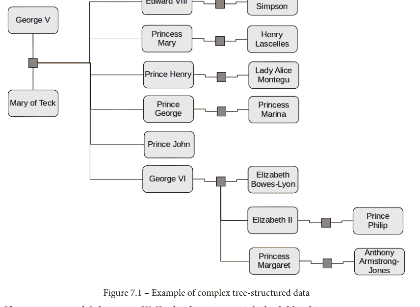

## 7 在使用 PHP 8 扩展时避免陷阱

PHP：超文本预处理器（PHP）语言的主要优势之一是其扩展。PHP 8 中引入的 PHP 语言更改也要求扩展开发团队同时更新其扩展。在本章中，你将了解对扩展做出的主要更改以及在将现有应用程序更新到 PHP 8 时如何避免陷阱。

一旦你完成本章介绍的示例代码和主题的审阅，你将能够为迁移到 PHP 8 准备任何现有的 PHP 代码。除了了解各种扩展的更改外，你还将深入了解其运行方式。这种能力将使你在 PHP 8 中使用扩展时做出明智的决策。

本章涵盖的主题包括以下内容：

- 了解从资源到对象的转变
- 了解 **可扩展标记语言** (**XML**) 扩展的更改
- 避免使用更新后的 `mbstring` 扩展时出现的问题
- 处理 `gd` 扩展的更改
- 发现 `Reflection` 扩展的更改
- 处理其他扩展的陷阱

## 技术要求

要检查和运行本章提供的代码示例，最低推荐硬件如下所示：

- 基于 x86_64 的台式电脑或笔记本电脑
- 1 **千兆字节** (**GB**) 可用磁盘空间
- 4 GB **随机存取存储器** (**RAM**)
- 500 **千位每秒** (**Kbps**) 或更快的互联网连接

此外，你需要安装以下软件：

- Docker
- Docker Compose

请参阅 *第 1 章，介绍新的 PHP 8 OOP 功能* 中的 *技术要求* 部分，了解有关 Docker 和 Docker Compose 安装的更多信息，以及如何构建本书中用于演示代码的 Docker 容器。在本书中，我们将恢复本书示例代码的目录称为 `/repo`。


本章的源代码位于此处：

```
https://github.com/PacktPublishing/PHP-8-Programming-Tips-Tricks-and-Best-Practices/tree/main/ch07
```

我们现在可以通过考察 PHP 8 中向对象而非资源发展的整体趋势来开始我们的讨论。

## 理解从资源到对象的转变

PHP 语言与资源的关系一直不太融洽。资源代表与外部系统的连接，例如文件句柄或使用客户端 URL（cURL）扩展连接到远程 Web 服务。然而，资源的一个大问题是它们违抗数据类型化的尝试。无法区分文件句柄和 cURL 连接——它们都被标识为资源。

在 PHP 8 中，已做出重大努力远离资源并用对象取代它们。在 PHP 8 之前，这一趋势最早的例子之一是 PDO 类。当你创建一个 PDO 实例时，它会自动创建数据库连接。从 PHP 8 开始，许多以前产生资源的功能现在改为产生对象实例。让我们从查看现在产生对象而非资源的扩展函数开始讨论。

## PHP 8 扩展资源到对象迁移

很重要，你要了解 PHP 8 中哪些函数现在产生对象而不是资源。好消息是，扩展函数也已被重写，以便接受对象作为参数而非资源。坏消息是，在你初始化资源（现在是对象）并使用 is_resource() 函数测试成功时，存在潜在的向后兼容代码中断。

下表总结了以前返回资源但现在返回对象实例的函数：

| 扩展 | 函数 | 返回值 |
|---|---|---|
| 核心 | socket_create() <br> socket_create_listen() <br> socket_accept() <br> socket_import_stream() <br> socket_addrinfo_connect() <br> socket_addrinfo_bind() <br> socket_wsprotocol_info_import() <br> socket_addrinfo_lookup() | Socket <br> Socket <br> Socket <br> Socket <br> Socket <br> Socket <br> Socket <br> array of AddressInfo |
| cURL | curl_init() <br> curl_multi_init() <br> curl_share_init() | CurlHandle <br> CurlMultiHandle <br> CurlShareHandle |
| Enchant | enchant_broker_init() <br> enchant_broker_request_dict() <br> enchant_broker_request_pwl_dict() | EnchantBroker <br> EnchantDictionary <br> EnchantDictionary |
| GD | imagecreate*() | GdImage |
| OpenSSL | openssl_x509_read() <br> openssl_csr_sign() <br> openssl_csr_new() <br> openssl_pkey_new() | OpenSSLCertificate <br> OpenSSLCertificate <br> OpenSSLCertificateSigningRequest <br> OpenSSLAsymmetricKey |
| Semaphore | msg_get_queue() <br> sem_get() <br> shm_attach() | SysvMessageQueue <br> SysvSemaphore <br> SysvSharedMemory |
| 共享内存 | shmop_open() | Shmop |
| XML 解析器 | xml_parser_create() <br> xml_parser_create_ns() | XMLParser <br> XMLParser |
| Zlib | inflate_init() <br> deflate_init() | InflateContext <br> DeflateContext |

表 7.1 – PHP 8 资源到对象迁移

表 7.1 是函数现在产生对象而非资源的宝贵指南。在将任何现有应用程序迁移到 PHP 8 之前，请查阅此表。下一节将详细说明潜在的向后兼容代码中断以及如何调整有问题的代码的指南，然后再介绍好处。

## 涉及 is_resource() 的潜在代码中断

你可能会遇到的问题是，PHP 8 之前编写的代码假定表 7.1 中列出的函数返回资源。因此，聪明的开发者习惯使用 is_resource() 作为测试连接是否成功建立的手段。

虽然这是一种极其合理的检查方式，但此技术在 PHP 8 升级后现在引入了向后兼容的代码中断。以下示例演示了此问题。

在此代码示例中，为外部网站初始化了 cURL 连接。接下来的几行使用 is_resource() 函数测试成功：

```php
// ///repo/ch07/php7_ext_is_resource.php
$url = 'https://unlikelysource.com/';
$ch  = curl_init($url);
if (is_resource($ch))
    echo "Connection Established\n";
else
    throw new Exception('Unable to establish connection');
```

PHP 7 的以下输出显示成功：

```
root@php8_tips_php7 [ /repo/ch07 ]#
php php7_ext_is_resource.php
Connection Established
```

同一代码在 PHP 8 中运行的输出不成功，如下所示：

```
root@php8_tips_php8 [ /repo/ch07 ]#
php php7_ext_is_resource.php
PHP Fatal error:  Uncaught Exception: Unable to establish connection in /repo/ch07/php7_ext_is_resource.php:9
```

PHP 8 的输出具有误导性，因为连接已建立！然而，因为程序代码正在检查 cURL 句柄是否为资源，所以代码抛出 Exception 错误。失败的原因是返回的是 CurlHandle 实例而不是资源。

在这种情况下，你可以通过用 !empty()（非空）代替 is_resource()，使代码在 PHP 8 和任何更早的 PHP 版本中都能成功运行，从而避免代码中断，如下所示：

```php
// ///repo/ch07/php8_ext_is_resource.php
$url = 'https://unlikelysource.com/';
$ch  = curl_init($url);
if (!empty($ch))
    echo "Connection Established\n";
else
    throw new Exception('Unable to establish connection');
var_dump($ch);
```

代码示例在 PHP 7 中运行的输出如下：

```
root@php8_tips php7 [ /repo/ch07 ]#
php php8_ext_is_resource.php
Connection Established
/repo/ch07/php8_ext_is_resource.php:11:
resource(4) of type (curl)
```

同一代码示例在 PHP 8 中运行的输出如下：

```
root@php8_tips php8 [ /repo/ch07 ]#
php php8_ext_is_resource.php
Connection Established
object(CurlHandle)#1 (0) {}
```

从两个输出中可以看到，代码运行成功：在 PHP 7 中，$ch 是一个资源。在 PHP 8 中，$ch 是一个 CurlHandle 实例。现在你已经了解了关于 is_resource() 的潜在问题，让我们来看看由此变化带来的优势。

## 对象相对于资源的优势

在 PHP 8 之前，在将资源传递给函数或方法或从函数或方法返回资源时，没有办法提供数据类型。相对于资源产生对象的一个明显优势是，你可以利用对象类型提示。

为了说明这一优势，想象一组实现策略软件设计模式的超文本传输协议（HTTP）客户端类。一种策略涉及使用 cURL 扩展发送消息。另一种策略使用 PHP 流，如下所示：

- 1. 我们首先定义一个 Http/Request 类。类构造函数将给定的 URL 解析为其组成部分，如以下代码片段所示：

```php
// /repo/src/Http/Request.php
namespace Http;
class Request {
    public $url      = '';
    public $method   = 'GET';
    // not all properties shown
    public $query    = '';
    public function __construct(string $url) {
$result = [];
$parsed = parse_url($url);
$vars   = array_keys(get_object_vars($this));
foreach ($vars as $name)
    $this->$name = $parsed[$name] ?? '';
    if (!empty($this->query))
        parse_str($this->query, $result);
    $this->query = $result;
    $this->url   = $url;
}
}
```

- 2. 接下来，我们定义一个使用 cURL 扩展发送消息的 CurlStrategy 类。请注意，__construct() 方法使用构造函数参数提升。你可能还会注意到，我们为 $handle 参数提供了 CurlHandle 数据类型。这是一个仅在 PHP 8 中可用的巨大优势，并且确保创建此策略类实例的任何程序都必须提供正确资源数据类型。代码如下所示：

```php
// /repo/src/Http/Client/CurlStrategy.php
namespace Http\Client;
use CurlHandle;
use Http\Request;
class CurlStrategy {
    public function __construct(
        public CurlHandle $handle) {}
```

- 3. 然后我们定义用于发送消息的实际逻辑，如下所示：

```php
public function send(Request $request) {
    // not all code is shown
    curl_setopt($this->handle,
        CURLOPT_URL, $request->url);
    if (strtolower($request->method) === 'post') {
        $opts = [CURLOPT_POST => 1,
            CURLOPT_POSTFIELDS =>
                http_build_query($request->query)];
        curl_setopt_array($this->handle, $opts);
```

```
}
    return curl_exec($this->handle);
}
}
```

4. 我们然后可以用 StreamsStrategy 类做同样的事情。再次注意，在下面的代码片段中，我们如何使用类作为构造函数参数类型提示以确保策略的正确使用：

// /repo/src/Http/Client/StreamsStrategy.php
namespace Http\Client;
use SplFileObject;
use Exception;
use Http\Request;
class StreamsStrategy {
    public function __construct(
        public ?SplFileObject $obj) {}
    // remaining code not shown
```

5. 然后我们定义一个调用程序来调用两个策略并传递结果。在设置自动加载之后，我们创建一个新的 Http\Request 实例，提供一个任意 URL 作为参数，如下所示：

// //repo/ch07/php8_objs_returned.php
require_once __DIR__
    . './../../src/Server/Autoload/Loader.php';
$autoload = new \Server\Autoload\Loader();
use Http\Request;
use Http\Client\{CurlStrategy,StreamsStrategy};
$url = 'https://api.unlikely-source.com/api?city=Livonia&country=US';
$request = new Request($url);
```

6. 接下来，我们定义一个 StreamsStrategy 实例并发送请求，如下所示：

```
$streams = new StreamsStrategy();
$response = $streams->send($request);
echo $response;
```

7. 然后我们定义一个 CurlStrategy 实例并发送相同的请求，如下所示的代码片段所示：

```
$curl = new CurlStrategy(curl_init());
$response = $curl->send($request);
echo $response;
```

两个策略的输出是相同的。这里显示了部分输出（请注意，此示例只能在 PHP 8 中使用！）：

```
root@php8_tips_php8 [ /repo/ch07 ]#
php php8_objs_returned.php
CurlStrategy Results:
{"data":[{"id":"1227826","country":"US","postcode":"14487","city":"Livonia","state_prov_name":"New York","state_prov_code":"NY","locality_name":"Livingston","locality_code":"051","region_name":"","region_code":"","latitude":"42.8135","longitude":"-77.6635","accuracy":"4"},{"id":"1227827","country":"US","postcode":"14488","city":"Livonia Center","state_prov_name":"New York","state_prov_code":"NY","locality_name":"Livingston","locality_code":"051","region_name":"","region_code":"","latitude":"42.8215","longitude":"-77.6386","accuracy":"4"}]}
```

现在让我们看一下资源到对象迁移的另一个方面：它对迭代的影响。

## Traversable 到 IteratorAggregate 迁移

`Traversable` 接口首次在 PHP 5 中引入。它没有方法，主要用于允许对象使用简单的 foreach() 循环进行迭代。随着 PHP 开发的不断演进，经常需要获取内部迭代器。因此，在 PHP 8 中，许多以前实现 Traversable 的类现在改为实现 IteratorAggregate。

这并不意味着增强的类不再支持 `Traversable` 接口固有的能力。恰恰相反：`IteratorAggregate` 扩展了 `Traversable`！此增强意味着您现在可以对受影响的类的任何实例调用 `getIterator()`。这可能具有巨大的好处，因为在 PHP 8 之前，没有办法访问各种扩展中使用的内部迭代器。下表总结了受此增强影响的扩展和类：

| 扩展 | 实现 IteratorAggregate |
|---|---|
| Date | DatePeriod |
| DOM | DOMNamedNodeMap and DOMNodeList |
| Intl | IntlBreakIterator and ResourceBundle |
| MySQLi | mysqli_result |
| PDO_MySQL | PDOStatement |
| SPL | SplFixedArray |

表 7.2 – 现在实现 IteratorAggregate 而不是 Traversable 的类

在本节中，您了解到了 PHP 8 中引入的一项重要更改：使用对象而非资源的趋势。您学到的一个优点是，与资源相比，对象允许您获得更大的控制权。本节中涵盖的另一个优点是，PHP 8 向 `IteratorAggregate` 的转变允许访问以前无法访问的内置迭代器。

我们现在将注意力转向基于 XML 的扩展的更改。

## 了解 XML 扩展的更改

XML 版本 1.0 于 1998 年作为 **万维网联盟 (W3C)** 规范引入。XML 与 **超文本标记语言 (HTML)** 有些相似；然而，XML 的主要目的是提供一种可供机器和人类阅读的格式化数据的方式。XML 仍然被广泛使用的原因之一是它易于理解，并且在表示树形结构数据方面做得非常出色。

PHP 提供了许多扩展，允许您同时使用和生成 XML 文档。在 PHP 8 中，对其中许多扩展引入了一些更改。就其大部分而言，这些更改是微小的；然而，如果您希望成为一名全面且知情的 PHP 开发者，了解这些更改非常重要。

让我们首先看看 `XMLWriter` 扩展的更改。

## 检查 XMLWriter 扩展差异

所有 XMLWriter 扩展过程函数现在接受并返回 XMLWriter 对象而不是资源。如果您查看 XMLWriter 扩展的官方 PHP 文档，您会发现没有对过程函数的引用。其原因有二：首先，PHP 语言正慢慢远离离散的过程函数，而青睐 **面向对象编程 (OOP)**。

第二个原因是 XMLWriter 过程函数实际上只是 XMLWriter OOP 方法的包装器！例如，xmlwriter_open_memory() 是 XMLWriter::openMemory() 的包装器，xmlwriter_text() 是 XMLWriter::text() 的包装器，等等。

如果您真的坚持使用过程式编程技术使用 XMLWriter 扩展，xmlwriter_open_memory() 在 PHP 8 中创建 XMLWriter 实例而不是资源。同样，所有 XMLWriter 扩展过程函数都使用 XMLWriter 实例而不是资源。

与本章中提到的现在生成对象实例而不是资源的任何扩展一样，可能存在向后兼容的破坏。一个这样的破坏示例是您在使用 XMLWriter 过程函数并使用 is_resource() 检查是否已创建资源时。我们在这里不向您展示示例，因为问题和解决方案与上一节中描述的相同：使用 !empty() 而不是 is_resource()。

使用 XMLWriter 扩展 OOP **应用程序编程接口 (API)** 而不是过程 API 是一个 *最佳实践*。幸运的是，OOP API 自 PHP 5.1 起就已可用。以下是供下一个示例使用的示例 XML 文件：

```xml
<?xml version="1.0" encoding="UTF-8"?>
<fruit>
    <item>Apple</item>
    <item>Banana</item>
</fruit>
```

这里显示的示例在 PHP 7 和 8 中都有效。此示例的目的是使用 XMLWriter 扩展构建前面显示的 XML 文档。以下是完成此操作的步骤：

- 1. 我们首先创建 XMLWriter 实例。然后我们打开共享内存连接并初始化 XML 文档类型，如下所示：

```php
// //repo/ch07/php8_xml_writer.php
$xml = new XMLWriter();
```

```php
$xml->openMemory();
$xml->startDocument('1.0', 'UTF-8');
```

- 2. 接下来，我们使用 startElement() 初始化 fruit 根节点，并添加一个值为 Apple 的子节点 item，如下所示：

```php
$xml->startElement('fruit');
$xml->startElement('item');
$xml->text('Apple');
$xml->endElement();
```

- 3. 接下来，我们添加另一个值为 Banana 的子节点 item，如下所示：

```php
$xml->startElement('item');
$xml->text('Banana');
$xml->endElement();
```

- 4. 最后，我们关闭 fruit 根节点并结束 XML 文档。以下代码片段中的最后一条命令显示当前 XML 文档：

```php
$xml->endElement();
$xml->endDocument();
echo $xml->outputMemory();
```

以下是 PHP 7 中运行示例程序的输出：

```
root@php8_tips_php7 [/repo/ch07 ]# php php8_xml_writer.php
<?xml version="1.0" encoding="UTF-8"?>
<fruit><item>Apple</item><item>Banana</item></fruit>
```

正如您所见，所需的 XML 文档已生成。如果我们在 PHP 8 中运行相同的程序，结果是相同的（未显示）。

我们现在将注意力转向 SimpleXML 扩展的更改。

## 处理 SimpleXML 扩展的更改

SimpleXML 扩展是面向对象的并且被广泛使用。因此，了解 PHP 8 中对该扩展所做的一些重大更改至关重要。好消息是您不需要重写任何代码！更好的消息是，这些更改大大提高了 SimpleXML 扩展的功能。


自 PHP 8 起，SimpleXMLElement 类现在实现了标准 PHP 库（SPL）RecursiveIterator 接口，并包含了 SimpleXMLIterator 类的功能。在 PHP 8 中，SimpleXMLIterator 现在是 SimpleXMLElement 的一个空扩展。考虑到 XML 常常用于表示复杂的树形结构数据，这一看似简单的更新具有重要意义。

例如，请查看温莎王朝家族树的局部视图，如下所示：



图 7.1 – 复杂树形结构数据的示例

如果我们用 XML 来建模，它可能看起来像这样：

```
<?xml version="1.0" encoding="UTF-8"?>
<!-- /repo/ch07/tree.xml -->
<family>
    <branch name="Windsor">
        <descendent gender="M">George V</descendent>
<spouse gender="F">Mary of Teck</spouse>
<branch name="George V">
    <descendent gender="M">George VI</descendent>
    <spouse gender="F">Elizabeth Bowes-Lyon</spouse>
    <branch name="George VI">
        <descendent gender="F">Elizabeth II</descendent>
        <spouse gender="M">Prince Philip</spouse>
        <branch name="Elizabeth II">
            <descendent gender="M">Prince Charles</descendent>
            <spouse gender="F">Diana Spencer</spouse>
            <spouse gender="F">Camilla Parker Bowles</spouse>
            <branch name="Prince Charles">
                <descendent gender="M">William</descendent>
                <spouse gender="F">Kate Middleton</spouse>
            </branch>
            <!-- not all nodes are shown -->
        </branch>
    </branch>
</branch>
</branch>
</family>
```

然后我们开发代码来解析树。然而在 PHP 8 之前的版本中，我们需要定义一个递归函数来解析整个树。为此，我们将遵循以下步骤：

- 1. 我们首先定义一个递归函数，用于显示后代的姓名和配偶（如有），如下面的代码片段所示。该函数还会识别后代的性别并检查是否存在子嗣。如果为真，则函数会再次调用自身：

```
function recurse($branch) {
    foreach ($branch as $node) {
        echo $node->descendent;
        echo ($node->descendent['gender'] == 'F')
            ? ', daughter of '
            : ', son of ';
        echo $node['name'];
        if (empty($node->spouse)) echo "\n";
        else echo ", married to {$node->spouse}\n";
        if (!empty($node->branch))
            recurse($node->branch);
    }
}
```

- 2. 然后我们从外部 XML 文件创建一个 SimpleXMLElement 实例并调用递归函数，如下所示：

```
// /repo/ch07/php7_simple_xml.php
$fn = __DIR__ . './includes/tree.xml';
$xml = simplexml_load_file($fn);
recurse($xml);
```

此代码块在 PHP 7 和 PHP 8 中均可运行。以下是 PHP 7 下的输出：

```
root@php8_tips_php7 [ /repo/ch07 ]#
php php7_simple_xml.php
George V, son of Windsor, married to Mary of Teck
George VI, son of George V, married to Elizabeth Bowes-Lyon
Elizabeth II, daughter of George VI, married to Philip
Prince Charles, son of Elizabeth II, married to Diana Spencer
William, son of Prince Charles, married to Kate Middleton
Harry, son of Prince Charles, married to Meghan Markle
Princess Anne, daughter of Elizabeth II, married to M. Phillips
Princess Margaret, daughter of George VI, married to A. Jones
Edward VIII, son of George V, married to Wallis Simpson
Princess Mary, daughter of George V, married to H.Lascelles
Prince Henry, son of George V, married to Lady Alice Montagu
Prince George, son of George V, married to Princess Marina
Prince John, son of George V
```

然而在 PHP 8 中，由于 SimpleXMLElement 现在实现了 RecursiveIterator，产生相同结果的代码更简单。

- 3. 与前面示例一样，我们从外部文件定义一个 SimpleXMLElement 实例。然而无需定义递归函数——我们只需要定义一个 RecursiveIteratorIterator 实例，如下所示：

```php
// /repo/ch07/php8_simple_xml.php
$fn = __DIR__ . '/includes/tree.xml';
$xml = simplexml_load_file($fn);
$iter = new RecursiveIteratorIterator($xml,
    RecursiveIteratorIterator::SELF_FIRST);
```

- 4. 之后，我们只需要一个简单的 foreach() 循环，其内部逻辑与前一个示例相同。无需检查是否存在分支节点，也无需递归——这些都由 RecursiveIteratorIterator 实例处理！所需的代码如下所示：

```php
foreach ($iter as $branch) {
    if (!empty($branch->descendent)) {
        echo $branch->descendent;
        echo ($branch->descendent['gender'] == 'F')
            ? ', daughter of '
            : ', son of ';
        echo $branch['name'];
        if (empty($branch->spouse)) echo "\n";
        else echo ", married to {$branch->spouse}\n";
    }
}
```

此代码示例在 PHP 8 下的输出如下所示。如你所见，输出完全相同：

```
root@php8_tips_php8 [ /repo/ch07 ]# php php8_simple_xml.php
George V, son of Windsor, married to Mary of Teck
George VI, son of George V, married to Elizabeth Bowes-Lyon
Elizabeth II, daughter of George VI, married to Philip
Prince Charles, son of Elizabeth II, married to Diana Spencer
William, son of Prince Charles, married to Kate Middleton
Harry, son of Prince Charles, married to Meghan Markle
Princess Anne, daughter of Elizabeth II, married to M. Phillips
Princess Margaret, daughter of George VI, married to A. Jones
Edward VIII, son of George V, married to Wallis Simpson
Princess Mary, daughter of George V, married to H.Lascelles
Prince Henry, son of George V, married to Lady Alice Montagu
Prince George, son of George V, married to Princess Marina
Prince John, son of George V
```

> 重要提示
> 请注意，使用 Docker 容器运行这些示例时，此处显示的输出已略作修改以适应页面宽度。

现在让我们来看一下其他 XML 扩展的更改。

## 了解其他 XML 扩展更改

PHP 8 的其他 XML 扩展也有一些更改。大多数情况下，这些更改很小，不会造成显著的向后兼容代码中断的潜在风险。然而，如果我们不讨论这些额外更改就疏忽了。我们建议您浏览本小节中的剩余更改，以便提高您的认识。使用这些 XML 扩展将使您能够排查在 PHP 8 更新后行为不一致的应用程序代码。

### 对 libxml 扩展的更改

**libxml** 扩展利用了 **Expat C 库**，提供了各种 PHP XML 扩展使用的 XML 解析函数（https://libexpat.github.io/）。

服务器上安装的 libxml 版本有新的要求。运行 PHP 8 时的最低版本必须为 2.9.0（或更高）。此更新要求的主要好处之一是提高对 **XML 外部实体** (**XXE**) 处理攻击的防护。

推荐的 libxml 最低版本默认禁用了依赖于 libxml 扩展的 PHP XML 扩展加载外部 XML 实体的能力。这反过来减少了为防止 XXE 攻击而采取昂贵且耗时的额外步骤的需求。

> **提示**
> 有关 XXE 攻击的更多信息，请使用以下链接咨询 **开放式 Web 应用程序安全项目** (**OWASP**)：https://owasp.org/www-community/vulnerabilities/XML_External_Entity_(XXE)_Processing.

### 对 XMLReader 扩展的更改

`XMLReader` 扩展补充了 `XMLWriter` 扩展。`XMLWriter` 扩展旨在生成 XML 文档，而 `XMLReader` 扩展旨在读取。

两个方法 `XMLReader::open()` 和 `XMLReader::xml()` 现在被定义为 **静态方法**。您仍然可以创建 `XMLReader` 实例，但如果您扩展 `XMLReader` 并重写其中任何一个方法，请确保将其声明为静态。

### 对 XMLParser 扩展的更改

`XMLParser` 扩展是 PHP 最古老的 XML 扩展之一。因此，它几乎完全由过程函数组成，而不是类和方法。然而在 PHP 8 中，该扩展遵循了从资源转向对象的趋势。因此，当您运行 `xml_parser_create()` 或 `xml_parser_create_ns()` 时，会创建一个 `XMLParser` 实例而不是资源。

如 *涉及 is_resource() 的潜在代码中断* 部分所述，您只需将使用 `is_resource()` 的任何检查替换为 `!empty()` 即可。资源到对象迁移的另一个副作用是使 `xml_parser_free()` 函数变得多余。要停用解析器，只需使用 `XMLParser` 对象即可。

现在您已经了解了与 XML 扩展相关的更改，这将帮助您更高效地解析和管理 XML 数据。通过利用本节中提到的新功能，您可以编写比 PHP 8 之前更高效、性能更好的代码。现在让我们来看一下 `mbstring` 扩展。


## 避免更新 mbstring 扩展时出现的问题

mbstring 扩展最早在 PHP 4 中引入，此后一直是该语言的活跃组成部分。该扩展最初的目的是提供对各种日文字符编码系统的支持。此后，增加了对多种其他编码的支持——最显著的是基于 **通用编码字符集 2 (UCS-2)**、**UCS-4**、**Unicode 转换格式 8 (UTF-8)**、**UTF-16**、**UTF-32**、**Shift_JIS 日本工业标准 (SJIS)** 和 **国际标准化组织 8859 (ISO-8859)** 等的编码支持。

如果不确定服务器支持哪些编码，只需按如下方式运行 `mb_list_encodings()` 命令（显示部分输出）：

```
root@php8_tips_php7 [ /repo/ch07 ]#
php -r "var_dump(mb_list_encodings());"
Command line code:1:
array(87) {
    ... only selected output is shown ...
    [14] => string(7) "UCS-4BE"
    [16] => string(5) "UCS-2"
    [19] => string(6) "UTF-32"
    [22] => string(6) "UTF-16"
    [25] => string(5) "UTF-8"
    [26] => string(5) "UTF-7"
    [27] => string(9) "UTF7-IMAP"
    [28] => string(5) "ASCII"
    [29] => string(6) "EUC-JP"
    [30] => string(4) "SJIS"
    [31] => string(9) "eucJP-win"
    [32] => string(11) "EUC-JP-2004"
    [76] => string(6) "KOI8-R"
    [78] => string(9) "ArmSCII-8"
    [79] => string(5) "CP850"
    [80] => string(6) "JIS-ms"
    [81] => string(16) "ISO-2022-JP-2004"
    [86] => string(7) "CP50222"
}
```

如前面的输出所示，我们在书中使用的 PHP 7.1 Docker 容器支持 87 种编码。在 PHP 8.0 Docker 容器中（未显示输出），支持 80 种编码。现在让我们看看 PHP 8 中引入的更改，从 mb_str*() 函数开始。

### 发现 mb_str*() 函数中 needle 参数的差异

在第 6 章《理解 PHP 8 功能差异》中，你了解到 PHP 8 对核心 str*pos()、str*str() 和 str*chr() 函数的 needle 参数处理引入了更改。两个主要的 needle 参数差异是能够接受空的 needle 参数以及严格的类型检查以确保 needle 参数仅为字符串。为了保持一致性，PHP 8 在对应的 mb_str*() 函数中引入了相同的更改。

首先让我们先查看空 needle 参数的处理。

### mb_str*() 函数的空 needle 参数处理

为了使 mbstring 扩展与核心字符串函数的这一更改保持一致，以下 mbstring 扩展函数现在允许空的 needle 参数。需要注意的是，这并不意味着参数可以省略或为可选！此更改的含义是，作为 needle 参数提供的值现在也可以包括被视为空的内容。快速了解 PHP 认为为空的内容的好方法可以在 empty() 函数的文档中找到（https://www.php.net/empty）。以下是现在允许空 needle 参数值的 mbstring 函数列表：

- `mb_strpos()`
- `mb_strrpos()`
- `mb_stripos()`
- `mb_strripos()`
- `mb_strstr()`
- `mb_stristr()`
- `mb_strrchr()`
- `mb_strrichr()`

> 提示
> 
> 这里提到的八个 mbstring 扩展函数各自与其核心 PHP 对应函数完全平行。有关这些函数的更多信息，请查看此参考文档：https://www.php.net/manual/en/ref.mbstring.php。

下面简短的代码示例说明了上述八个函数中的空 needle 处理。以下是导致此的步骤：

1. 首先，我们初始化一个多字节文本字符串。在以下示例中，这是 *敏捷的棕色狐狸跳过了栅栏* 的泰语翻译。needle 参数设为 NULL，并初始化要测试的函数数组：

```php
// /repo/ch07/php8_mb_string_empty_needle.php
$text   = 'สุนัขจิ้งจอกสีน้ำตาลกระโดดข้ามรั้วอย่างรวดเร็ว';
$needle = NULL;
$funcs  = ['mb_strpos',  'mb_strrpos', 'mb_stripos',
           'mb_strripos', 'mb_strstr', 'mb_stristr',
           'mb_strrchr',  'mb_strrichr'];
```

2. 然后我们定义一个 printf() 模式，并循环遍历要测试的函数。对每个函数调用，我们提供文本后跟空的 needle 参数，如下所示：

```php
$patt = "Testing: %12s : %s\n";
foreach ($funcs as $str)
    printf($patt, $str, $str($text, $needle));
```

PHP 7 的输出如下所示：

```
root@php8_tips_php7 [ /repo/ch07 ]#
php php8_mb_string_empty_needle.php
PHP Warning:  mb_strpos(): Empty delimiter in /repo/ch07/php8_mb_string_empty_needle.php on line 12
Testing:      mb_strpos :
Testing:      mb_strrpos :
PHP Warning:  mb_stripos(): Empty delimiter in /repo/ch07/php8_mb_string_empty_needle.php on line 12
Testing:      mb_stripos :
Testing:      mb_strripos :
```

```
PHP Warning:  mb_strstr(): Empty delimiter in /repo/ch07/php8_mb_string_empty_needle.php on line 12
Testing:      mb_strstr :
PHP Warning:  mb_stristr(): Empty delimiter in /repo/ch07/php8_mb_string_empty_needle.php on line 12
Testing:      mb_stristr :
Testing:      mb_strrchr :
Testing:      mb_strrichr :
```

如你所见，输出为空，并且在某些情况下会发出 Warning 消息。PHP 8 中的输出截然不同，如预期所示，如下所示：

```
root@php8_tips_php8 [ /repo/ch07 ]#
php php8_mb_string_empty_needle.php
Testing:      mb_strpos : 0
Testing:      mb_strrpos : 46
Testing:      mb_stripos : 0
Testing:      mb_strripos : 46
Testing:      mb_strstr : สุนัขจึงอกสั่นน้ำตาลกระโดดข้ามรั้วอย่างรวดเร็ว
Testing:      mb_stristr : สุนัขจึงอกสั่นน้ำตาลกระโดดข้ามรั้วอย่างรวดเร็ว
Testing:      mb_strrchr :
Testing:      mb_strrichr :
```

有趣的是，当此代码在 PHP 8 中运行时，空的 needle 参数对于 mb_strpos() 和 mb_stripos() 返回整数 0 的值，对于 mb_strrpos() 和 mb_strripos() 返回整数 46。在 PHP 8 中，空的 needle 参数在此情况下被解释为字符串的开头或结尾。mb_strstr() 和 mb_stristr() 的结果均为整个字符串。

### mb_str*() 函数的数据类型检查

为了与核心 str*() 函数保持一致，对应的 mb_str*() 函数中的 needle 参数必须是字符串类型。如果提供 American Standard Code for Information Interchange (ASCII) 值而不是字符串，受影响的函数现在将抛出 ArgumentTypeError 错误。本小节未显示示例，因为第 6 章《理解 PHP 8 功能差异》已在核心 str*() 函数中提供了此差异的示例。

### mb_strrpos() 的差异

在 PHP 的早期版本中，允许将字符编码作为第三个参数传递给 mb_strrpos() 而不是偏移量。这种不良做法在 PHP 8 中不再受支持。相反，你可以提供 0 作为第三个参数，或者考虑使用 PHP 8 的命名参数（在第 1 章《Introducing New PHP 8 OOP Features》中的“Understanding named arguments”部分讨论）以避免必须为可选参数提供值。

现在让我们看一个代码示例，演示 PHP 7 和 PHP 8 之间处理上的差异。按如下方式操作：

- 1. 我们首先定义一个常量来表示要使用的字符编码。分配一个代表敏捷的棕色狐狸跳过了栅栏的泰语翻译的文本字符串。然后我们使用 mb_convert_encoding() 确保使用正确的编码。代码在以下片段中说明：
- 2. 然后我们将栅栏的泰语翻译分配给 $needle 并输出字符串的长度和 $needle 在文本中的位置。然后我们调用 mb_strrpos() 查找 $needle 的最后一次出现。请注意，在以下代码片段中，我们故意遵循使用编码作为第三个参数而不是偏移量的不良做法：

```php
// /repo/ch07/php7_mb_string_strpos.php
define('ENCODING', 'UTF-8');
$text    = 'สุนัขจิ้งจอกสีน้ำตาลกระโดดข้ามรั้วอย่างรวดเร็ว';
$encoded = mb_convert_encoding($text, ENCODING);
```

```php
$needle  = 'รั้ว';
echo 'String Length: '
    . mb_strlen($encoded, ENCODING) . "\n";
echo 'Substring Pos: '
    . mb_strrpos($encoded, $needle, ENCODING) . "\n";
```

此代码示例的输出在 PHP 7 中完美运行，如下所示：

```
root@php8_tips_php7 [ /repo/ch07 ]#
php php7_mb_string_strpos.php
String Length: 46
Substring Pos: 30
```


从前面的输出可以看到，多字节字符串的长度为 46，针的位置为 30。另一方面，在 PHP 8 中，我们会得到一个致命的 Uncaught TypeError 消息，如下所示：

```
root@php8_tips_php8 [ /repo/ch07 ]#
php php7_mb_string_strpos.php
String Length: 46
PHP Fatal error: Uncaught TypeError: mb_strrpos(): Argument #3 ($offset) must be of type int, string given in /repo/ch07/php7_mb_string_strpos.php:14
```

从 PHP 8 的输出可以看到，mb_strrpos() 的第三个参数必须是整数形式的偏移值。重写此示例的一个简单方法是利用 PHP 8 的命名参数。以下是重写的代码行：

```
echo 'Substring Pos: '
    . mb_strrpos($encoded, $needle, encoding:ENCODING) . "\n";
```

输出与 PHP 7 示例相同，此处不显示。现在让我们转向 mbstring 扩展的正则表达式（regex）处理差异。

## Examining changes to mb_ereg*() functions

mb_ereg*() 函数的更改

The mb_ereg*() family of functions allows regex processing of strings encoded using multi-byte character sets. In contrast, the core PHP language provides the Perl Compatible Regular Expressions (PCRE) family of functions, with modern and more up-to-date functionality.

mb_ereg*() 函数族允许对使用多字节字符集编码的字符串进行正则表达式处理。相比之下，PHP 核心语言提供了 Perl 兼容正则表达式（PCRE）函数族，具有更现代、更新的功能。

If you add a u (lowercase letter U) modifier to a regex pattern when using the PCRE functions, any UTF-8 encoded multi-byte character string is accepted. However, UTF-8 is the only multi-byte character encoding accepted. If you are dealing with other character encodings and wish to perform regex functionality, you will need to either convert to UTF-8 or use the mb_ereg*() family of functions. Let's now have a look at a number of changes to the mb_ereg*() family of functions.

如果在使用 PCRE 函数时在正则表达式模式中添加 u（小写字母 U）修饰符，则接受任何 UTF-8 编码的多字节字符字符串。但是，UTF-8 是唯一被接受的多字节字符编码。如果您处理的是其他字符编码并且希望执行正则表达式功能，则需要将其转换为 UTF-8 或使用 mb_ereg*() 函数族。现在让我们看一下 mb_ereg*() 函数族的许多更改。

## Oniguruma library required in PHP 8

PHP 8 需要 Oniguruma 库

One change to this family of functions is in how your PHP installation is compiled. In PHP 8, your operating system must provide the libonig library. This library provides Oniguruma functionality. (See https://github.com/kkos/oniguruma for more information.) The older --with-onig PHP source-compile-configure option has been removed in favor of using pkg-config to detect libonig.

此函数族的一个更改在于 PHP 安装的编译方式。在 PHP 8 中，您的操作系统必须提供 libonig 库。该库提供 Oniguruma 功能。（有关更多信息，请参阅 https://github.com/kkos/oniguruma。）旧的 --with-onig PHP 源代码编译配置选项已被移除，取而代之的是使用 pkg-config 来检测 libonig。

## Changes to mb_ereg_replace()

mb_ereg_replace() 的更改

Formerly, you were able to supply an integer as an argument to mb_ereg_replace(). This argument was interpreted as an ASCII code point. In PHP 8, such an argument is now typecast as string. If you need an ASCII code point, you need to use mb_chr() instead. As the typecast to string is done silently, there is a potential backward-compatible code break, in that you won't see any Notice or Warning messages.

以前，您可以向 mb_ereg_replace() 供应一个整数作为参数。该参数被解释为 ASCII 代码点。在 PHP 8 中，此类参数现在被类型转换为字符串。如果您需要 ASCII 代码点，则需要改用 mb_chr()。由于类型转换是静默完成的，因此存在潜在的向后兼容代码中断，即您不会看到任何 Notice 或 Warning 消息。

The following program code example illustrates the differences between PHP 7 and PHP 8. We'll follow these next steps:

以下程序代码示例说明了 PHP 7 和 PHP 8 之间的差异。我们将按以下步骤进行：

- 1. First, we define the encoding to be used and assign the Thai translation of *Two quick brown foxes jumped over the fence* as a multi-byte string to `$text`. Next, we use `mb_convert_encoding()` to ensure that the proper encoding is used. We then set `mb_ereg*` to the chosen encoding, using `mb_regex_encoding()`. The code is illustrated in the following snippet:
- 1. 首先，我们定义要使用的编码，并将 *两只敏捷的棕色狐狸跳过了栅栏* 的泰语翻译分配为多字节字符串赋给 `$text`。接下来，我们使用 `mb_convert_encoding()` 来确保使用正确的编码。然后，我们使用 `mb_regex_encoding()` 将 `mb_ereg*` 设置为所选编码。代码在以下片段中说明：
- 2. We then call `mb_ereg_replace()` and supply as a first argument an integer value 50, and replace it with the string "3". Both the original and modified strings are echoed. You can view the code here:
- 2. 然后我们调用 `mb_ereg_replace()` 并以整数值 50 作为第一个参数提供，并将其替换为字符串 "3"。原始字符串和修改后的字符串都会被输出。您可以在此处查看代码：

```php
// /repo/ch07/php7_mb_string_strpos.php
define('ENCODING', 'UTF-8');
$text = 'สุนัขจิ้งจอกสีน้ำตาล 2 ตัวกระโดดข้ามรั้ว';
$str = mb_convert_encoding($text, ENCODING);
mb_regex_encoding(ENCODING);
```

```php
$mod1 = mb_ereg_replace(50, '3', $str);
echo "Original: $str\n";
echo "Modified: $mod1\n";
```

Note that the first argument for mb_ereg_replace() should be a string, but we supply an integer instead. In versions of the mbstring extension prior to PHP 8, if an integer is supplied as the first argument, it's treated as an ASCII code point.

请注意，mb_ereg_replace() 的第一个参数应为字符串，但我们提供的是整数。在 PHP 8 之前的 mbstring 扩展版本中，如果提供整数作为第一个参数，则将其视为 ASCII 代码点。

If we run this code example in PHP 7, the number 50 is interpreted as the ASCII code point value for "2", as expected, as we can see here:

如果我们在 PHP 7 中运行此代码示例，数字 50 将被解释为 "2" 的 ASCII 代码点值，正如预期的那样，如下所示：

```
root@php8_tips_php7 [ /repo/ch07 ]#
php php7_mb_string_ereg_replace.php
Original: สุนัขจิ้งจอกสีน้ำตาล 2 ตัวกระโดดข้ามรั้ว
Modified: สุนัขจิ้งจอกสีน้ำตาล 3 ตัวกระโดดข้ามรั้ว
```

As you can see from the preceding output, the number 2 is replaced by the number 3. In PHP 8, however, the number 50 is typecast into a string. As this source string doesn't contain the number 50, no replacements are made, as we can see here:

从前面的输出可以看到，数字 2 被数字 3 替换。然而在 PHP 8 中，数字 50 被类型转换为字符串。由于源字符串不包含数字 50，因此没有进行任何替换，如下所示：

```
root@php8_tips_php8 [ /repo/ch07 ]#
php php7_mb_string_ereg_replace.php
Original: สุนัขจิ้งจอกสีน้ำตาล 2 ตัวกระโดดข้ามรั้ว
Modified: สุนัขจิ้งจอกสีน้ำตาล 2 ตัวกระโดดข้ามรั้ว
```

The danger here is that if your code relies upon this silent interpretation process, your application might either fail or exhibit inconsistent behavior. You'll also note a lack of Notice or Warning messages. PHP 8 relies upon the developer to supply the correct arguments!

这里的危险在于，如果您的代码依赖于这种静默解释过程，您的应用程序可能会失败或表现出不一致的行为。您还会注意到缺少 Notice 或 Warning 消息！PHP 8 依赖开发者提供正确的参数！

The *best practice*, if you do actually need to use an ASCII code point, is to use `mb_chr()` to produce the desired search string. The modified code example might look like this:

*最佳实践* 是，如果您确实需要使用 ASCII 代码点，请使用 `mb_chr()` 来生成所需的搜索字符串。修改后的代码示例可能如下所示：

```
$mod1 = mb_ereg_replace(mb_chr(50), '3', $str);
```

You now have an idea about what changed in the `mbstring` extension. Without this information, you could easily end up writing faulty code. Developers who are unaware of this information might end up making mistakes in PHP 8, such as assuming the `mbstring` aliases are still in place. Such mistaken understanding can easily cause hours of lost time tracking down errors in program code following a PHP 8 migration.

您现在对 `mbstring` 扩展发生了什么变化有了大致了解。没有这些信息，您很容易写出有缺陷的代码。不了解这些信息的开发者可能会在 PHP 8 中犯错误，例如假设 `mbstring` 别名仍然存在。这种错误的理解很容易导致在 PHP 8 迁移后花费数小时追踪程序代码中的错误。

It's now time to have a look at another extension with major changes: the GD extension.

现在是时候查看另一个发生重大更改的扩展：GD 扩展。

## Dealing with changes to the GD extension

处理 GD 扩展的更改

The **GD extension** is an image-manipulation extension that leverages the GD library. GD originally stood for **GIF Draw**. Oddly, the GD library had to withdraw support for the **Graphics Interchange Format (GIF)** after Unisys revoked the open source license for the compression technology used when generating GIFs. After 2004, however, the Unisys patent on this technology expired and GIF support was restored. As it stands today, the PHP GD extension offers support for the **Joint Photographic Experts Group (JPEG or JPG)**, **Portable Network Graphic (PNG)**, **GIF**, **X BitMap (XBM)**, **X PixMap (XPM)**, **Wireless Bitmap (WBMP)**, **WebP**, and **Bitmap (BMP)** formats.

**GD 扩展** 是一个利用 GD 库的图像处理扩展。GD 最初代表 **GIF Draw**。奇怪的是，在 Unisys 撤销用于生成 GIF 的压缩技术的开源许可后，GD 库不得不撤回对 **图形交换格式 (GIF)** 的支持。然而在 2004 年之后，Unisys 对该技术的专利到期，GIF 支持得以恢复。截至目前，PHP GD 扩展提供对 **联合摄影专家组 (JPEG 或 JPG)**、**便携式网络图形 (PNG)**、**GIF**、**X 位图 (XBM)**、**X 像素图 (XPM)**、**无线位图 (WBMP)**、**WebP** 和 **位图 (BMP)** 格式的支持。

> **Tip**
> For more information on the GD library, see https://libgd.github.io/.
> **提示**
> 有关 GD 库的更多信息，请参阅 https://libgd.github.io/.

Let's now have a look at the impact of resource-to-object migration on the GD extension.

现在让我们看看资源到对象迁移对 GD 扩展的影响。

## GD extension resource-to-object migration

GD 扩展资源到对象迁移

As with other PHP extensions that previously used *resources*, the GD extension has also primarily migrated from *resource* to *object*. As mentioned in the *PHP 8 extension resource-to-object migration* section, all of the `imagecreate*()` functions now produce GdImage objects rather than resources.

与其他以前使用 *资源* 的 PHP 扩展一样，GD 扩展也主要从 *资源* 迁移到 *对象*。如 *PHP 8 扩展资源到对象迁移* 部分所述，所有 `imagecreate*()` 函数现在生成 GdImage 对象而不是资源。

For an example of how this might present a code break after a PHP 8 migration, run these examples in two different browser tabs (on your local computer) and compare the difference. First, we run the PHP 7 example using this URL: http://172.16.0.77/ch07/php7_gd_is_resource.php. Here is the result:

作为 PHP 8 迁移后可能出现代码中断的示例，请在两个不同的浏览器标签页（在本地计算机上）运行这些示例并比较差异。首先，我们使用此 URL 运行 PHP 7 示例：http://172.16.0.77/ch07/php7_gd_is_resource.php。结果如下：


Figure 7.2 – PHP 7 GD image resource

图 7.2 – PHP 7 GD 图像资源

As you can see from the preceding output, a resource extension is identified, but there's no descriptive information. Now, let's run the PHP 8 example using this URL: http://172.16.0.88/ch07/php8_gd_is_resource.php. Here is the result:

从前面的输出可以看到，识别出资源扩展，但没有描述性信息。现在，让我们使用此 URL 运行 PHP 8 示例：http://172.16.0.88/ch07/php8_gd_is_resource.php。结果如下：


Fixed point implementation of the bilinear interpolation (default (also on image creation))

双线性插值的定点实现（默认（也在图像创建时））

Figure 7.3 – PHP 8 GD image object instance

图 7.3 – PHP 8 GD 图像对象实例

The output from PHP 8 not only identifies the return type as a GdImage instance but also displays descriptive information below the image.

PHP 8 的输出不仅将返回类型识别为 GdImage 实例，还在图像下方显示描述性信息。

We now turn our attention to other GD extension changes.

我们现在将注意力转向 GD 扩展的其他更改。

## GD extension compile flag changes

GD 扩展编译标志更改

The GD extension not only leverages the GD library but a number of supporting libraries as well. These libraries are needed to provide support for the various graphics formats. Previously, when compiling a custom version of PHP from the source code, you needed to specify the location of the libraries for JPEG, PNG, XPM, and VPX formats. In addition, as compression is an important aspect in reducing the overall final file size, the location of ZLIB was needed as well.

GD 扩展不仅利用 GD 库，还利用了许多支持库。这些库是提供各种图形格式支持所必需的。以前，从源代码编译自定义 PHP 版本时，您需要指定 JPEG、PNG、XPM 和 VPX 格式库的位置。此外，由于压缩是减少最终文件总大小的重要方面，还需要 ZLIB 的位置。

When compiling PHP 8 from source, there are a number of significant configuration flag changes that were first introduced in PHP 7.4 and subsequently carried into PHP 8. The primary change is that you no longer need to specify the directory where libraries are located. PHP 8 now locates libraries using the pkg-config operating system equivalent.

从源代码编译 PHP 8 时，有许多重要的配置标志更改，这些更改首次在 PHP 7.4 中引入，随后保留到 PHP 8。主要更改是您不再需要指定库所在的目录。PHP 8 现在使用 pkg-config 操作系统等效方式定位库。


下表总结了编译标志的更改。这些标志在实际编译过程之前与 configure 实用程序一起使用：

| 旧编译标志 | 新编译标志 |
|---|---|
| --with-gd | --enable-gd |
| --with-jpeg-dir=DIR | --with-jpeg |
| --with-xpm-dir=DIR | --with-xpm |
| --with-vpx-dir=DIR | --with-webp |
| --with-png-dir=DIR | 已移除：需要 libpng |
| --with-zlib-dir | 已移除：需要 zlib |

表 7.3 – GD 编译选项更改

从表中可以看出，大多数情况下，大多数 --with-*-dir 选项都被 --with-* 替换。此外，PNG 和 ZLIB 支持现在是自动的；但是，您必须在操作系统上安装 libpng 和 zlib。

我们现在来看看 GD 扩展的其他次要更改。

## 其他 GD 扩展更改

除了上一节描述的主要更改之外，还发生了许多其他次要更改，表现为函数签名更改和一个新函数。让我们从 imagecropauto() 函数开始讨论。

以下是 imagecropauto() 的旧函数签名：

```
imagecropauto(resource $image , int $mode = -1,
    float $threshold = .5 , int $color = -1 )
```

在 PHP 8 中，$image 参数现在的类型为 GdImage。$mode 参数现在默认为 IMG_CROP_DEFAULT 预定义常量。

另一个更改影响 imagepolygon()、imageopenpolygon() 和 imagefilledpolygon() 函数。以下是 imagepolygon() 的旧函数签名：

```
imagepolygon(resource $image, array $points,
    int $num_points, int $color)
```

在 PHP 8 中，$num_points 参数现在是可选的。如果省略，点的数量将按如下方式计算：count($points) / 2。但是，这意味着 $points 数组中的元素数量必须是偶数！

最后的重要更改是新增了一个函数 `imagegetinterpolation()`。以下是其函数签名：

```
imagegetinterpolation(GdImage $image) : int
```

返回值是一个整数，其本身并不是很有用。但是，如果您查看 `imagesetinterpolation()` 函数的文档（`https://www.php.net/manual/en/function.imagesetinterpolation.php`），您将看到插值方法代码的列表以及解释。

您现在已经了解了在 GD 扩展中引入了哪些更改。接下来我们检查 `Reflection` 扩展的更改。

## 发现 Reflection 扩展的更改

**Reflection extension** 用于对对象、类、方法、函数等执行 *introspection*。`ReflectionClass` 和 `ReflectionObject` 分别提供有关类或对象实例的信息。`ReflectionFunction` 提供有关过程级函数的信息。此外，`Reflection` 扩展有一组由刚才提到的主类产生的次要类。这些次要类包括由 `ReflectionClass::getMethod()` 产生的 `ReflectionMethod`、由 `ReflectionClass::getProperty()` 产生的 `ReflectionProperty` 等等。

您可能会想：*Who uses this extension?* 答案是：任何需要对外部类集进行分析的应用程序。这可能包括执行自动 **code generation**、**testing** 或 **documentation generation** 的软件。执行 **hydration**（从数组填充对象）的类也受益于 `Reflection` 扩展。

> **提示**
>
> 书中没有足够的篇幅来涵盖每一个 `Reflection` 扩展类和方法。如果您希望获取更多信息，请查看此处的文档参考：`https://www.php.net/manual/en/book.reflection.php`。

现在让我们看一个 `Reflection` 扩展的使用示例。

## Reflection 扩展使用

我们现在将展示一个代码示例，演示如何使用 Reflection 扩展生成 docblocks（docblock 是使用特殊语法来表示方法的目的、其传入参数和返回值 的 PHP 注释）。以下是导致此结果的步骤：

- 1. 我们首先定义一个 __construct() 方法，该方法创建目标类的 ReflectionClass 实例，如下所示：
- 2. 然后我们定义一个 check() 方法，该方法获取所有类方法，返回一个 ReflectionMethod 实例数组，如下所示：
- 3. 然后我们遍历所有方法并使用 getDocComment() 检查是否已存在 docblock，如下所示：
- 4. 如果 docblock 尚不存在，我们开始一个新的 docblock，然后调用 getParameters()，它返回一个 ReflectionParameter 实例数组，如以下代码片段所示：

// /repo/src/Services/DocBlockChecker.php
namespace Services;
use ReflectionClass;
class DocBlockChecker {
    public $target = '';    // class to check
    public $reflect = NULL; // ReflectionClass instance
    public function __construct(string $target) {
        $this->target = $target;
        $this->reflect = new ReflectionClass($target);
    }
```

```
public function check() {
    $methods = [];
    $list = $this->reflect->getMethods();
```

```
foreach ($list as $refMeth) {
    $docBlock = $refMeth->getDocComment();
```

```
if (!$docBlock) {
    $docBlock = "/**\n * "
```

```
. $refMeth->getName() . "\n";
$params = $refMeth->getParameters();
```

- 5. 如果我们确实有参数，我们收集信息以供显示，如下所示：

```
if ($params) {
    foreach ($params as $refParm) {
        $type = $refParm->getType()
            ?? 'mixed';
        $type = (string) $type;
        $name = $refParm->getName();
        $default = '';
        if (!$refParm->isVariadic()
            && $refParm->isOptional()) {
            $default=$refParm->getDefaultValue(); }
        if ($default === '') {
            $default = "(empty string)"; }
        $docBlock .= " * @param $type "
            . "\${$name} : $default\n";
    }
}
```

- 6. 然后我们设置返回类型并将 docblock 分配给随后返回的 $methods 数组，如下所示：

```
if ($refMeth->isConstructor())
    $return = 'void';
else
    $return = $refMeth->getReturnType()
        ?? 'mixed';
    $docBlock .= " * @return $return\n";
    $docBlock .= " */\n";
}
$methods[$refMeth->getName()] = $docBlock;
}
return $methods;
}
}
```

- 7. 现在新的 docblock 检查类已完成，我们定义一个调用程序，如以下代码片段所示。调用程序针对 /repo/src/Php7/Reflection/Test.php 类（此处未显示）。该类包含具有参数和返回值的混合方法：

// //repo/ch07/php7_reflection_usage.php
$target = 'Php7\Reflection\Test';
require_once __DIR__
    . '../src/Server/Autoload/Loader.php';
use Server\Autoload\Loader;
use Services\DocBlockChecker;
$autoload = new Loader();
$checker = new DocBlockChecker($target);
var_dump($checker->check());
```

调用程序的输出如下所示：

```
root@php8_tips_php7 [ /repo/ch07 ]#
php php7_reflection_usage.php
/repo/ch07/php7_reflection_usage.php:10:
array(4) {
  '__construct' =>  string(75)
"/**
 * __construct
 * @param PDO $pdo : (empty string)
 * @return void
 */"
  'fetchAll' =>  string(41)
"/**
 * fetchAll
 * @return Generator
 */"
  'fetchByName' =>  string(80)
"/**
 * fetchByName
 * @param string $name : (empty string)
 * @return array
 */"
}
```

```
'fetchLastId' => string(38)
"/**
 * fetchLastId
 * @return int
 */"
}
```

正如您所见，这个类构成了潜在的自动文档或代码生成应用程序的基础。

现在让我们看看 Reflection 扩展的改进。

## 了解 Reflection 扩展的改进

Reflection 扩展也进行了一些改进，您可能需要了解这些改进。请记住，虽然使用 Reflection 扩展的开发人员数量有限，但您有一天可能会遇到使用此扩展的代码的情况。如果在 PHP 8 升级后注意到异常行为，本节涵盖的材料将为您在故障排除过程中提供先机。

### ReflectionType 修改

ReflectionType 类现在在 PHP 8 中是抽象的。当您使用 ReflectionProperty::getType() 或 ReflectionFunction::getReturnType() 方法时，您可能会注意到返回的是 ReflectionNamedType 实例。此更改不会影响程序代码的正常功能，除非您依赖于返回 ReflectionType 实例。然而，ReflectionNamedType 扩展了 ReflectionType，因此任何 instanceof 操作都不会受到影响。

还值得注意的是，isBuiltIn() 方法已从 ReflectionType 移动到 ReflectionNamedType。同样，由于 ReflectionNamedType 扩展了 ReflectionType，这不应在当前代码中造成任何向后兼容性中断。


## ReflectionParameter::*DefaultValue* 方法增强

在 PHP 较早的版本中，ReflectionParameter 与默认值相关的 方法 无法反映内部 PHP 函数。这在 PHP 8 中已发生变化。以下 ReflectionParameter 方法现在也能从内部函数返回默认值信息：

- getDefaultValue()
- getDefaultValueConstantName()
- isDefaultValueAvailable()
- isDefaultValueConstant()

如列表所示，方法名称自解释。我们现在将展示一个利用这些增强功能的代码示例。以下是通往此处的步骤：

1. 首先，我们定义一个接受 ReflectionParameter 实例并返回包含参数名称和默认值的数组的函数，如下所示：

```php
// /repo/ch07/php8_reflection_parms_defaults.php
$func = function (ReflectionParameter $parm) {
    $name = $parm->getName();
    $opts = NULL;
    if ($parm->isDefaultValueAvailable())
        $opts = $parm->getDefaultValue();
```

2. 接下来，我们定义一个 switch() 语句来清理选项，如下所示：

```php
switch (TRUE) {
    case (is_array($opts)) :
        $tmp = '';
        foreach ($opts as $key => $val)
            $tmp .= $key . ':' . $val . ',';
        $opts = substr($tmp, 0, -1);
        break;
    case (is_bool($opts)) :
        $opts = ($opts) ? 'TRUE' : 'FALSE';
        break;
    case ($opts === '') :
        $opts = "''";
        break;
    default :
        $opts = 'No Default';
}
    return [$name, $opts];
};
```

3. 然后我们确定要反射的函数并获取其参数。在以下示例中，我们反射 setcookie()：

```php
$test = 'setcookie';
$ref = new ReflectionFunction($test);
$parms = $ref->getParameters();
```

4. 然后我们遍历 ReflectionParameter 实例的数组并生成输出，如下所示：

```php
$patt = "%18s : %s\n";
foreach ($parms as $obj)
    vprintf($patt, $func($obj));
```

以下是 PHP 7 中运行的输出：

```
root@php8_tips_php7 [ /repo/ch07 ]#
php php8_reflection_parms_defaults.php
Reflecting on setcookie
        Parameter : Default(s)
        ------------ : ------------
        name : No Default
        value : No Default
        expires : No Default
        path : No Default
        domain : No Default
        secure : No Default
        httponly : No Default
```

结果始终为 No Default，因为在 PHP 7 及更早版本中，Reflection 扩展无法读取内部 PHP 函数的默认值。相比之下，PHP 8 的输出要准确得多，如下所示：

```
root@php8_tips_php8 [ /repo/ch07 ]#
php php8_reflection_parms_defaults.php
Reflecting on setcookie
    Parameter : Default(s)
    ------------ : ------------
    name : No Default
    value : ''
expires_or_options : No Default
    path : ''
    domain : ''
    secure : FALSE
    httponly : FALSE
```

如输出所示，PHP 8 中的 Reflection 扩展能够准确报告内部函数默认值！

现在让我们看看 Reflection 扩展的其他更改。

## 其他 Reflection 扩展更改

在 PHP 8 之前的版本中，ReflectionMethod::isConstructor() 和 ReflectionMethod::isDestructor() 无法反射接口中定义的魔术方法。在 PHP 8 中，这两个方法现在会对接口中定义的相应魔术方法返回 TRUE。

使用 ReflectionClass::getConstants() 或 ReflectionClass::getReflectionConstants() 方法时，现在已添加一个新的 $filter 参数。该参数允许您按可见性级别过滤结果。因此，新参数可以接受以下任何新添加的预定义常量：

- ReflectionClassConstant::IS_PUBLIC
- ReflectionClassConstant::IS_PROTECTED
- ReflectionClassConstant::IS_PRIVATE

您现在已经对如何使用 Reflection 扩展以及 PHP 8 迁移后应期待什么有了一定的了解。是时候看看 PHP 8 中发生变化的许多其他扩展了。

## 处理其他扩展的陷阱

PHP 8 对本章中已讨论的扩展之外的多个 PHP 扩展引入了许多其他值得注意的更改。正如我们在本书中一再强调的那样，作为 PHP 开发人员了解这些更改对您未来的职业生涯至关重要。

我们先来看看数据库扩展的更改。

## 新的数据库扩展操作系统库要求

使用 MySQL、MariaDB、PostgreSQL 或 PHP 数据对象（PDO）的任何开发人员都需要了解支持操作系统库的新要求。下表总结了 PHP 8 中所需的新最低版本：

| 扩展 | 库 | 最低版本 |
|---|---|---|
| PgSQL | libpq | 9.1 |
| PDO_PGSQL | libpq | 9.1 |
| MySQLi | libmysqlclient | 5.1 |
| PDO_MySQL | libmysqlclient | 5.1 |

表 7.4 – PHP 8 数据库库要求

如前表所示，有两个主要库更改。libpq 影响 PostgreSQL 扩展和 PDO 扩展的驱动程序。libmysqlclient 是 MySQL Improved（MySQLi）扩展使用的库，也是 PDO 扩展的 MySQL 驱动程序。还应注意，如果您使用的是 MariaDB，即流行的 MySQL 开源版本，则新的最低 MySQL 库要求也适用于您。

现在您已经了解了数据库扩展的更改，我们接下来将关注 ZIP 扩展。

## 审查 ZIP 扩展的更改

ZIP 扩展用于以编程方式创建和管理压缩归档文件，利用 libzip 操作系统库。还存在其他压缩扩展，例如 Zlib、bzip2、LZF、PHP 归档格式（phar）和 Roshal 归档压缩（RAR）；然而，没有其他扩展提供 ZIP 扩展提供的丰富功能范围。此外，大多数其他扩展都是专用用途，通常不适合通用的 ZIP 文件管理。

我们先来看看该扩展最值得注意的更改。

## 处理 ZIP 扩展 OOP 迁移

ZIP 扩展的最大更改是可能在未来导致大规模向后兼容代码中断的更改。自 PHP 8 起，过程式 API（所有过程式函数）已被弃用！尽管这目前不会影响任何代码，但所有 ZIP 扩展函数最终将被从语言中移除。

最佳实践是使用 ZipArchive 类将任何 ZIP 扩展过程式代码迁移到 OOP API。以下代码示例说明了如何从过程式代码迁移到对象代码，打开 test.zip 文件并生成条目列表：

```php
// /repo/ch07/php7_zip_functions.php
$fn = __DIR__ . '/includes/test.zip';
$zip = zip_open($fn);
$cnt = 0;
if (!is_resource($zip)) exit('Unable to open zip file');
while ($entry = zip_read($zip)) {
    echo zip_entry_name($entry) . "\n";
    $cnt++;
}
echo "Total Entries: $cnt\n";
```

以下是 PHP 7 中运行的输出：

```
root@php8_tips_php7 [ /repo/ch07 ]#
php php7_zip_functions.php
ch07/includes/
ch07/includes/test.zip
ch07/includes/tree.xml
ch07/includes/test.png
ch07/includes/kitten.jpg
ch07/includes/reflection.html
ch07/php7_ext_is_resource.php
ch07/php7_gd_is_resource.php
... not all entries shown ...
ch07/php8_simple_xml.php
ch07/php8_xml_writer.php
ch07/php8_zip_oop.php
Total Entries: 27
```

如前输出所示，共找到 27 个条目。（另请注意，并非所有 ZIP 文件条目都显示。）然而，如果我们在 PHP 8 中尝试相同的代码示例，我们会得到非常不同的结果，如下所示：

```
root@php8_tips_php8 [ /repo/ch07 ]#
php php7_zip_functions.php
PHP Deprecated: Function zip_open() is deprecated in /repo/ch07/php7_zip_functions.php on line 5
PHP Deprecated: Function zip_read() is deprecated in /repo/ch07/php7_zip_functions.php on line 8
PHP Deprecated: Function zip_entry_name() is deprecated in /repo/ch07/php7_zip_functions.php on line 9
ch07/includes/
PHP Deprecated: Function zip_entry_name() is deprecated in /repo/ch07/php7_zip_functions.php on line 9
... not all entries shown ...
ch07/php8_zip_oop.php
PHP Deprecated: Function zip_read() is deprecated in /repo/ch07/php7_zip_functions.php on line 8
Total Entries: 27
```

如前面的 PHP 8 输出所示，代码示例可以工作，但会发出一系列弃用 Notice 消息。

这是在 PHP 8 中编写相同代码示例的方式：

```php
// /repo/ch07/php8_zip_oop.php
$fn = __DIR__ . './includes/test.zip';
$obj = new ZipArchive();
$res = $obj->open($fn);
```

```
if ($res !== TRUE) exit('Unable to open zip file');
for ($i = 0; $entry = $obj->statIndex($i); $i++) {
    echo $entry['name'] . "\n";
}
echo "Total Entries: $i\n";
```

（未显示）输出与前一个示例完全相同。有趣的是，重写的示例在 PHP 7 中也有效！还值得注意的是，在 PHP 8 中，你可以使用 ZipArchive::count() 获取每个目录的总条目数。你可能也注意到了，要检查 ZIP 归档是否正确打开，在 PHP 8 中已不能再使用 is_resource()。

## 新的 ZipArchive 类方法

除了资源到对象的迁移之外，ZipArchive 类还进行了多项改进。其中一项改进是添加了以下新方法：

- setMtimeName()
- setMtimeIndex()
- registerProgressCallback()
- registerCancelCallback()
- replaceFile()
- isCompressionMethodSupported()
- isEncryptionMethodSupported()

方法名不言自明。Mtime 指的是 **修改时间**。

## addGlob() 和 addPattern() 的新选项

ZipArchive::addGlob() 和 ZipArchive::addPattern() 方法有一组新的选项。这两个方法相似之处在于两者都用于向归档中添加文件。区别在于 addGlob() 使用与 PHP 核心 glob() 命令相同的[content]
```
if ($res !== TRUE) exit('Unable to open zip file');
for ($i = 0; $entry = $obj->statIndex($i); $i++) {
    echo $entry['name'] . "\n";
}
echo "Total Entries: $i\n";
```

（未显示）输出与前一个示例完全相同。有趣的是，重写的示例在 PHP 7 中也有效！还值得注意的是，在 PHP 8 中，你可以使用 ZipArchive::count() 获取每个目录的总条目数。你可能也注意到了，要检查 ZIP 归档是否正确打开，在 PHP 8 中已不能再使用 is_resource()。

## 新的 ZipArchive 类方法

除了资源到对象的迁移之外，ZipArchive 类还进行了多项改进。其中一项改进是添加了以下新方法：

- setMtimeName()
- setMtimeIndex()
- registerProgressCallback()
- registerCancelCallback()
- replaceFile()
- isCompressionMethodSupported()
- isEncryptionMethodSupported()

方法名不言自明。Mtime 指的是 **修改时间**。

## addGlob() 和 addPattern() 的新选项

ZipArchive::addGlob() 和 ZipArchive::addPattern() 方法有一组新的选项。这两个方法相似之处在于两者都用于向归档中添加文件。区别在于 addGlob() 使用与 PHP 核心 glob() 命令相同的[content]
```
if ($res !== TRUE) exit('Unable to open zip file');
for ($i = 0; $entry = $obj->statIndex($i); $i++) {
    echo $entry['name'] . "\n";
}
echo "Total Entries: $i\n";
```

（未显示）输出与前一个示例完全相同。有趣的是，重写的示例在 PHP 7 中也有效！还值得注意的是，在 PHP 8 中，你可以使用 ZipArchive::count() 获取每个目录的总条目数。你可能也注意到了，要检查 ZIP 归档是否正确打开，在 PHP 8 中已不能再使用 is_resource()。

## 新的 ZipArchive 类方法

除了资源到对象的迁移之外，ZipArchive 类还进行了多项改进。其中一项改进是添加了以下新方法：

- setMtimeName()
- setMtimeIndex()
- registerProgressCallback()
- registerCancelCallback()
- replaceFile()
- isCompressionMethodSupported()
- isEncryptionMethodSupported()

方法名不言自明。Mtime 指的是 **修改时间**。

## addGlob() 和 addPattern() 的新选项

ZipArchive::addGlob() 和 ZipArchive::addPattern() 方法有一组新的选项。这两个方法相似之处在于两者都用于向归档中添加文件。区别在于 addGlob() 使用与 PHP 核心 glob() 命令相同的[content]
```
if ($res !== TRUE) exit('Unable to open zip file');
for ($i = 0; $entry = $obj->statIndex($i); $i++) {
    echo $entry['name'] . "\n";
}
echo "Total Entries: $i\n";
```

（未显示）输出与前一个示例完全相同。有趣的是，重写的示例在 PHP 7 中也有效！还值得注意的是，在 PHP 8 中，你可以使用 ZipArchive::count() 获取每个目录的总条目数。你可能也注意到了，要检查 ZIP 归档是否正确打开，在 PHP 8 中已不能再使用 is_resource()。

## 新的 ZipArchive 类方法

除了资源到对象的迁移之外，ZipArchive 类还进行了多项改进。其中一项改进是添加了以下新方法：

- setMtimeName()
- setMtimeIndex()
- registerProgressCallback()
- registerCancelCallback()
- replaceFile()
- isCompressionMethodSupported()
- isEncryptionMethodSupported()

方法名不言自明。Mtime 指的是 **修改时间**。

## addGlob() 和 addPattern() 的新选项

ZipArchive::addGlob() 和 ZipArchive::addPattern() 方法有一组新的选项。这两个方法相似之处在于两者都用于向归档中添加文件。区别在于 addGlob() 使用与 PHP 核心 glob() 命令相同的[content]
```
if ($res !== TRUE) exit('Unable to open zip file');
for ($i = 0; $entry = $obj->statIndex($i); $i++) {
    echo $entry['name'] . "\n";
}
echo "Total Entries: $i\n";
```

（未显示）输出与前一个示例完全相同。有趣的是，重写的示例在 PHP 7 中也有效！还值得注意的是，在 PHP 8 中，你可以使用 ZipArchive::count() 获取每个目录的总条目数。你可能也注意到了，要检查 ZIP 归档是否正确打开，在 PHP 8 中已不能再使用 is_resource()。

## 新的 ZipArchive 类方法

除了资源到对象的迁移之外，ZipArchive 类还进行了多项改进。其中一项改进是添加了以下新方法：

- setMtimeName()
- setMtimeIndex()
- registerProgressCallback()
- registerCancelCallback()
- replaceFile()
- isCompressionMethodSupported()
- isEncryptionMethodSupported()

方法名不言自明。Mtime 指的是 **修改时间**。

## addGlob() 和 addPattern() 的新选项

ZipArchive::addGlob() 和 ZipArchive::addPattern() 方法有一组新的选项。这两个方法相似之处在于两者都用于向归档中添加文件。区别在于 addGlob() 使用与 PHP 核心 glob() 命令相同的文件模式，而 addPattern() 使用正则表达式过滤文件。新的选项总结如下：

- flags: 让你使用 *按位运算符* 组合适当的类常量
- comp_method: 使用任意 ZipArchive::CM_* 常量作为参数指定压缩方法

- `comp_flags`: 使用期望的 `ZipArchive::FL_*` 常量指定压缩标志
- `enc_method`: 让你指定期望的字符编码（使用任意 `ZipArchive::FL_ENC_*` 标志）
- `enc_password`: 如果为此 ZIP 归档设置了加密，则让你指定加密密码

还值得在此提及的是，在 PHP 8 之前，`remove_path` 选项必须是有效的目录路径。自 PHP 8 起，该选项是一个简单的字符串，表示要删除的字符。这允许你删除文件名前缀以及不需要的目录路径。

在继续检查选项时，值得注意的是，添加了两个新的编码方法类常量：`ZipArchive::EM_UNKNOWN` 和 `ZipArchive::EM_TRAD_PKWARE`。此外，还添加了一个新的 `lastId` 属性，以便你能够确定最后一个 ZIP 归档条目的索引值。

## 其他 ZipArchive 方法变更

除了前面提到的变更之外，PHP 8 中还有一些其他 `ZipArchive` 方法发生了变化。本节总结了其他 `ZipArchive` 方法的变更，如下：

- `ZipArchive::extractTo()` 之前使用当前日期和时间作为修改时间。自 PHP 8 起，该方法会恢复原始文件的修改时间。
- `ZipArchive::getStatusString()` 在调用 `ZipArchive::close()` 之后仍返回结果。
- `ZipArchive::addEmptyDir()`、`ZipArchive::addFile()` 和 `ZipArchive::addFromString()` 方法都新增了一个 flags 参数。你可以使用任意适当的 `ZipArchive::FL_*` 类常量，使用按位运算符组合。
- `ZipArchive::open()` 现在可以打开空的（零字节）文件。

现在你对 ZIP 扩展引入的变更和改进有了一个概念，让我们检查正则表达式方面的变更。

## 检查 PCRE 扩展变更

**PCRE** 扩展包含许多用于使用 *正则表达式* 进行模式匹配的函数。术语 *正则表达式* 通常缩写为 *regex*。**regex** 是一个描述另一个字符串的字符串。以下是 PCRE 扩展的一些变更。

模式中的无效转义序列不再被解释为字面量。过去你可以使用 X 修饰符；然而，该修饰符在 PHP 8 中现在被忽略了。值得庆幸的是，为了帮助你处理内部 PCRE 模式分析错误，新增了 `preg_last_error_msg()` 函数，该函数在遇到 PCRE 错误时会返回人类可读的消息。

`preg_last_error()` 函数允许你确定在模式分析期间是否发生内部 PCRE 错误。该函数仅返回一个整数。然而，在 PHP 8 之前，开发者需要自行查找代码并弄清楚实际的错误。

> Tip
> `preg_last_error()` 返回的错误代码列表可以在此处找到：
> https://www.php.net/manual/en/function.preg-last-error.php#refsect1-function.preg-last-error-returnvalues

下面是一个简短的代码示例，说明了上述问题。以下是导致此示例的步骤：

1. 首先，我们定义一个执行匹配并检查是否发生错误的功能，如下所示：

```
$pregTest = function ($pattern, $string) {
    $result  = preg_match($pattern, $string);
    $lastErr = preg_last_error();
    if ($lastErr == PREG_NO_ERROR) {
        $msg = 'RESULT: ';
        $msg .= ($result) ? 'MATCH' : 'NO MATCH';
    } else {
        $msg = 'ERROR : ';
        if (function_exists('preg_last_error_msg'))
            $msg .= preg_last_error_msg();
        else
            $msg .= $lastErr;
    }
    return "$msg\n";
};
```

2. 我们然后创建一个故意包含 \8+ 无效转义序列的模式，如下所示：

```php
$pattern = '/\8+/';
$string = 'test 8';
echo pregTest($pattern, $string);
```

3. 接下来，我们定义一个故意导致 PCRE 超出其回溯限制的模式，如下所示：

```php
$pattern = '/(?:\D+|<\d+>)*[!?]/';
$string = 'test ';
echo pregTest($pattern, $string);
```

以下是 PHP 7.1 中的输出：

```
root@php8_tips_php7 [ /repo/ch07 ]# php php7_pcre.php
RESULT: MATCH
ERROR : 2
```

正如前面的输出所示，无效模式被视为字面值 8。因为字符串中存在 8，所以认为匹配被找到。至于第二个模式，回溯限制被超出；然而，PHP 7.1 无法报告该问题，迫使你自行查找。

PHP 8 中的输出截然不同，如下所示：

```
root@php8_tips_php8 [ /repo/ch07 ]# php php7_pcre.php
PHP Warning: preg_match(): Compilation failed: reference to non-existent subpattern at offset 1 in /repo/ch07/php7_pcre.php on line 5
ERROR : Internal error
ERROR : Backtrack limit exhausted
```

正如前面的输出所示，PHP 8 会产生一个 Warning 消息。你也可以看到 preg_last_error_msg() 产生了有用的消息。让我们现在来看一下国际化（Intl）扩展。

## 处理 Intl 扩展变更

**Intl 扩展** 包含多个类，用于处理可能根据区域设置而变化的各种应用程序方面。各个类处理诸如国际化数字和货币格式化、文本解析、日历生成、时间和日期格式化以及字符集转换等任务。

在 PHP 8 中引入的 Intl 扩展的主要变更是以下新的日期格式：

- IntlDateFormatter::RELATIVE_FULL
- IntlDateFormatter::RELATIVE_LONG
- IntlDateFormatter::RELATIVE_MEDIUM
- IntlDateFormatter::RELATIVE_SHORT

下面是一个代码示例，展示了新的格式。以下是导致此示例的步骤：

1. 首先，我们定义一个 DateTime 实例和一个包含新格式代码的数组，如下所示：

```php
$dt = new DateTime('tomorrow');
$pt = [IntlDateFormatter::RELATIVE_FULL,
    IntlDateFormatter::RELATIVE_LONG,
    IntlDateFormatter::RELATIVE_MEDIUM,
    IntlDateFormatter::RELATIVE_SHORT
];
```

2. 我们然后遍历格式并回显输出，如下所示：

```php
foreach ($pt as $fmt)
    echo IntlDateFormatter::formatObject($dt, $fmt)."\n";
```

此示例在 PHP 7 中不起作用。以下是 PHP 8 的输出：

```
root@php8_tips_php8 [ /repo/ch07 ]#
php php8_intl_date_fmt.php
tomorrow at 12:00:00 AM Coordinated Universal Time
tomorrow at 12:00:00 AM UTC
tomorrow, 12:00:00 AM
tomorrow, 12:00 AM
```


As you can see, the new relative date formats work quite well! We now briefly return to the cURL extension.

## 理解 cURL 扩展的变更

The cURL extension leverages libcurl (http://curl.haxx.se/) to provide powerful and highly efficient HTTP client capabilities. In PHP 8, you must have libcurl version 7.29 (or above) installed on your server's operating system.

Another difference in PHP 8 is that this extension now uses objects rather than resources. This change was described earlier in this chapter, in Table 7.1, PHP 8 resource-to-object migration. An example was shown in the Potential code break involving is_resource() section. A side effect of this change is that any of the curl*close() functions are redundant, as the connection is closed when the object is unset or otherwise goes out of scope.

Let's now have a look at changes to the COM extension.

## 回顾 COM 扩展的变更

**组件对象模型（COM）** is a Windows-only extension that enables programming code written in one language to call and interoperate with code written in any other COM-aware programming language. This information is important for any PHP developers who plan to develop PHP applications that run on Windows servers.

The most significant change to the COM extension is that case sensitivity is now automatically enforced. Accordingly, you can no longer import from type libraries any constants that are case-insensitive. In addition, you can no longer specify $case_insensitive, the second argument to the com_load_typelib() function, as FALSE.

Along these lines, COM extension php.ini settings that deal with case sensitivity have been altered. These include the following:

- `com.autoregister_casesensitive`: Permanently enabled in PHP 8.
- `com.typelib_file`: Any type libraries whose names end with either `#cis` or `#case_insensitive` no longer cause the constants to be treated as case-insensitive.

One change is a new php.ini setting, com.dotnet_version. This setting sets the **.NET** version to use for dotnet objects. We now examine other extension changes of note.

## 检查其他扩展变更

There are a few other changes to other PHP extensions that deserve a mention. Table 7.5, shown next, summarizes these changes:

| 扩展 | 函数 | 备注 |
|---|---|---|
| Date | mktime()<br>gmmktime() | 第一个参数（$hour）现在是强制性的 |
| Enchant | enchant_broker_list_dicts()<br>enchant_broker_describe()<br>enchant_dict_suggest() | 如果没有结果，这三个函数现在返回空数组而不是 NULL |
| Tidy | tidy_repair_string() | $use_include_path 参数不再受支持。 |

表 7.5 – PHP 8 数据库库要求

You now have an idea about changes to extensions in PHP 8. This wraps up the chapter. Now, it's time for a recap!

## 摘要

One of the most important concepts you learned in this chapter is a general trend away from resources and toward objects. You learned where this trend is noticeable in the various PHP extensions covered in this chapter, and how to develop workarounds to avoid problems in code that relies upon resources. You also learned how to detect and develop code to address changes in XML extensions, especially in the SimpleXML and XMLWriter extensions.

Another important extension with significant changes covered in this chapter is the mbstring extension. You learned to detect code that relies upon changed mbstring functionality. As you learned, changes to the mbstring extension for the most part mirror changes made to the equivalent core PHP string functions.

You also learned about major changes to the GD, Reflection, and ZIP extensions. In this chapter, you also learned about changes to a number of database extensions, as well as a medley of additional extension changes to note. All in all, with the awareness you will have gained by reading this chapter and by studying the examples, you are now in a better position to prevent your applications from failing after you have performed a PHP 8 upgrade.

In the next chapter, you will learn about functionality that has been deprecated or removed in PHP 8.
