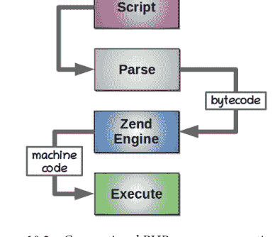
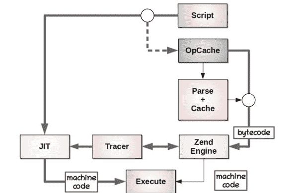
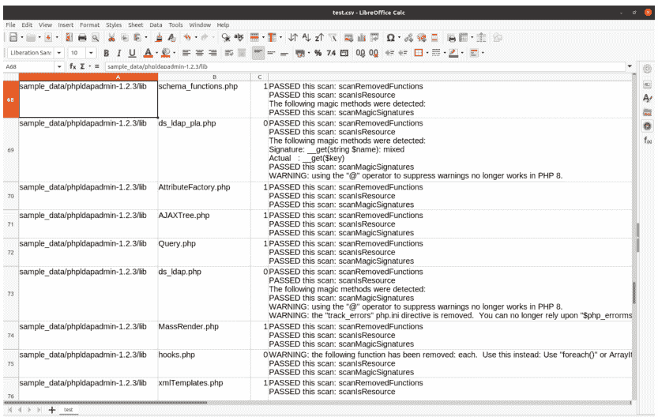
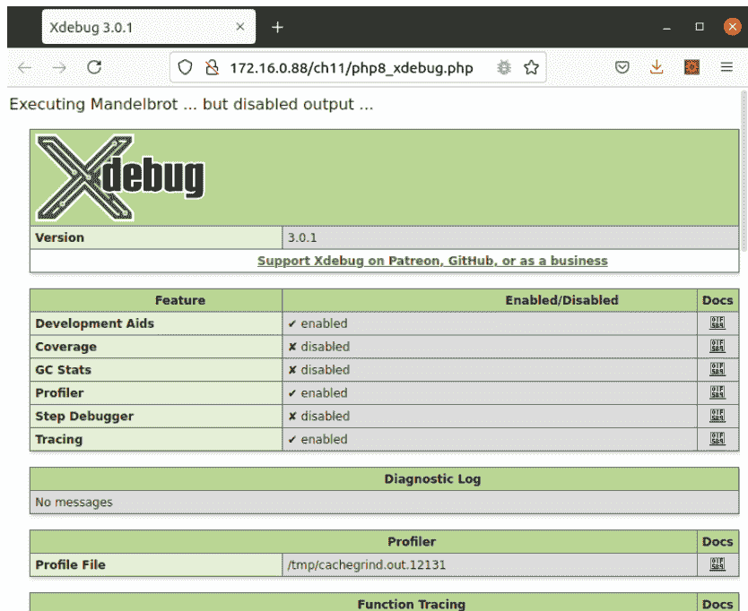
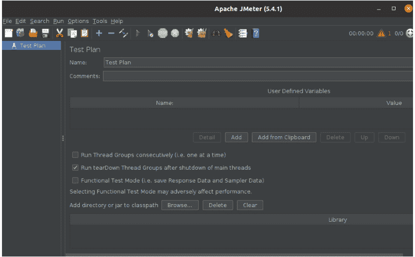
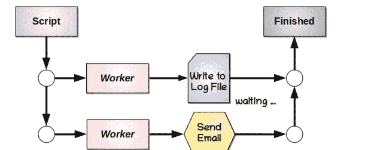
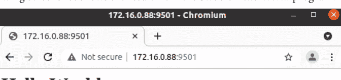

## 10 提升性能

PHP 8.x 引入了许多对性能产生积极影响的新特性。此外，许多内部改进，尤其是在数组处理和对象引用管理方面，导致了相比早期 PHP 版本的实质性性能提升。此外，本章涵盖的许多 PHP 8 最佳实践带来了更高的效率和更低的内存使用。在本章中，您将了解如何优化 PHP 8 代码以实现最大性能。

PHP 8 包含一种被称为弱引用的技术。通过掌握本章最后一节讨论的该技术，您的应用程序将使用更少的内存。通过仔细回顾本章涵盖的材料并研究代码示例，您将能够编写更快、更高效的代码。这种精通将极大地提高您作为 PHP 开发人员的地位，并带来满意的客户，同时提高您的职业发展潜力。

本章涵盖的主题包括以下内容：

- 使用 **即时编译 (JIT)** 编译器
- 加速数组处理
- 实现稳定排序
- 使用弱引用提高效率

### 技术要求

要检查和运行本章提供的代码示例，推荐的最低硬件配置如下：

- 基于 x86_64 的台式电脑或笔记本电脑
- 1 千兆字节（GB）可用磁盘空间
- 4 GB 内存
- 500 千比特每秒（Kbps）或更快的互联网连接

此外，您需要安装以下软件：

- Docker
- Docker Compose

请参阅 *第 1 章，介绍新的 PHP 8 OOP 特性* 中的 *技术要求* 部分，了解有关 Docker 和 Docker Compose 安装的更多信息，以及如何构建用于演示本书中解释的代码的 Docker 容器。在本书中，我们将存放本书示例代码的目录称为 `/repo`。

本章的源代码位于此处： https://github.com/PacktPublishing/PHP-8-Programming-Tips-Tricks-and-Best-Practices。 我们现在可以开始讨论，先来看看备受期待的 JIT 编译器。

### 使用 JIT 编译器

PHP 8 引入了备受期待的 **JIT 编译器**。这是重要的一步，对 PHP 语言的长期可行性具有重要影响。尽管 PHP 已经具备生成和缓存 **字节码** 的能力，但在 JIT 编译器引入之前，PHP 没有直接缓存 **机器码** 的能力。

实际上，自 2011 年以来，已经有多次尝试为 PHP 添加 JIT 编译器功能。PHP 7 中看到的性能提升正是这些早期努力的直接结果。由于这些早期 JIT 编译器尝试并未显著提升性能，因此均未作为 **RFC（征求意见稿）** 提出。核心团队现在认为，任何进一步的性能提升只能通过使用 JIT 实现。作为附带好处，这为 PHP 作为非 Web 环境的语言使用打开了可能性。另一个好处是 JIT 编译器为使用 C 以外的语言开发 PHP 扩展提供了可能性。

非常重要的是要密切关注本章提供的细节，因为正确使用新的 JIT 编译器有可能极大地提高您的 PHP 应用程序的性能。在深入实现细节之前，首先有必要解释 PHP 如何在没有 JIT 编译器的情况下执行字节码。然后我们将向您展示 JIT 编译器的工作原理。在此之后，您将更好地理解各种设置以及如何对其进行微调，以为您的应用程序代码产生最佳性能。

现在让我们把注意力转向 PHP 在没有 JIT 编译器的情况下的工作方式。

### 了解 PHP 在没有 JIT 时的工作原理

当 PHP 安装在服务器上（或 Docker 容器中）时，除了核心扩展之外，安装的主要组件实际上是一个通常被称为 Zend Engine 的虚拟机（VM）。该 VM 的运行方式与 VMware 或 Docker 等虚拟化技术大不相同。Zend Engine 在性质上更接近 Java 虚拟机（JVM），因为它接受字节码并生成机器码。

这就引出了一个问题：什么是字节码，什么是机器码？现在让我们来看看这个问题。

### 理解字节码和机器码

机器码，或机器语言，是一组由 CPU 直接理解的硬件指令。每条机器码都是一条指令，会导致 CPU 执行特定操作。这些低级操作包括在寄存器之间移动信息、在内存中进出移动指定数量的字节、加法、减法等等。

机器码通常通过使用汇编语言变得 somewhat 人类可读。以下是用汇编语言呈现的机器码示例：

```
JIT$Mandelbrot::iterate: ;
    sub $0x10, %esp
    cmp $0x1, 0x1c(%esi)
    jb .L14
    jmp .L1
.ENTRY1:
    sub $0x10, %esp
.L1:
    cmp $0x2, 0x1c(%esi)
jb .L15
mov $0xec3800f0, %edi
jmp .L2
.ENTRY2:
sub $0x10, %esp
.L2:
cmp $0x5, 0x48(%esi)
jnz .L16
vmovsd 0x40(%esi), %xmm1
vsubsd 0xec380068, %xmm1, %xmm1
```

尽管在大多数情况下命令不易理解，但从汇编语言表示中可以看出，指令包括比较命令（cmp）、在寄存器和/或内存之间移动信息（mov），以及跳转到指令集中的另一点（jmp）。

字节码，也称为 **操作码**，是原始程序代码的高度简化的符号表示。字节码由解析过程（通常称为 **解释器**）生成，该过程将人类可读的程序代码分解为称为 **标记** 的符号以及值。值可以是程序代码中使用的任何字符串、整数、浮点数和布尔数据。

以下是基于稍后所示用于创建 Mandelbrot 的示例代码生成的字节码片段示例：

```
00000840  ff ff ff ff 00 00 00 00  ff ff ff ff ff ff ff ff  |................|
00000850  40 02 00 00 00 00 00 00  0d 00 00 00 00 ff ff ff ff  |@..............|
00000860  1d aa 83 9f 7a c3 f4 d5  20 08 00 00 00 00 00 00  |....z....... ...|
00000870  01 00 00 00 56 00 00 00  1d aa 83 9f 7a c3 f4 d5  |....V.....z....|
00000880  39 00 00 00 00 00 00 00  00 70 68 70 38 5c 6a 69  |9......php8\ji|
00000890  74 5c 6d 61 6e 64 65 6c 62  62 72 6f 74 2f 72 65 70  |t\mandelbrot/rep|
000008a0  6f 2f 73 72 63 2f 50 68 70  38 2f 4a 69 74 2f 4d  |o/src/Php8/Jit/M|
000008b0  61 6e 64 65 6c 62 72 6f 74  74 2e 70 68 70 3a 35 24  |andelbrot.php:5$|
000008c0  30 00 00 00 00 00 00 00  01 00 00 00 56 00 00 00  |0........V...|
000008d0  8c 06 62 77 f6 61 07 b3  13 00 00 00 00 00 00 00  |..bw.a........|
000008e0  50 68 70 38 5c 6a 69 74  5c 4d 61 6e 64 65 6c 62  |Php8\Jit\Mandelb|
000008f0  72 6f 74 00 00 00 00 00  ff ff ff ff ff ff ff ff  |rot...........|
```

图 10.1 – PHP 解析过程产生的字节码片段

现在让我们来看看 PHP 程序的常规执行流程。

### 理解常规 PHP 程序执行

在常规 PHP 程序运行周期中，PHP 程序代码由称为 **解析** 的操作进行评估并分解为字节码。然后字节码被传递给 Zend Engine，后者进而将字节码转换为机器码。

当 PHP 第一次安装在服务器上时，安装过程会启动必要的逻辑，将 Zend Engine 定制为该特定服务器的特定 CPU 和硬件（或虚拟 CPU 和硬件）。因此，当您编写 PHP 代码时，您对最终运行代码的实际 CPU 的具体细节没有任何了解。提供硬件特定感知的是 Zend Engine。

*图 10.2，接下来所示，说明了常规 PHP 执行：*



图 10.2 – 常规 PHP 程序执行流程

尽管 PHP，尤其是 PHP 7，已经相当快，但获得额外速度仍然很有意义。为此，大多数安装还启用了 PHP **OPcache** 扩展。在继续 JIT 编译器之前，让我们先快速了解一下 OPcache。

### 理解 PHP OPcache 的运行机制

顾名思义，PHP OPcache 扩展在 PHP 程序首次运行时 *缓存* 操作码（字节码）。在后续程序运行中，字节码从缓存中取出，从而消除了解析阶段。这节省了大量时间，并且是在生产站点上启用的一项非常理想的功能。PHP OPcache 扩展是核心扩展集的一部分；然而，它默认未启用。


在启用此扩展之前，您必须首先确认您的 PHP 版本是否已使用 --enable-opcache 配置选项编译。您可以通过在运行在 Web 服务器上的 PHP 代码中执行 phpinfo() 命令来检查这一点。从命令行，输入 php -i 命令。以下是使用本书中使用的 Docker 容器运行 php -i 的示例：

```
root@php8_tips_php8 [ /repo/ch10 ]# php -i
phpinfo()
PHP Version => 8.1.0-dev
System => Linux php8_tips_php8 5.8.0-53-generic #60~20.04.1-Ubuntu SMP Thu May 6 09:52:46 UTC 2021 x86_64
Build Date => Dec 24 2020 00:11:29
Build System => Linux 9244ac997bc1 3.16.0-4-amd64 #1 SMP Debian 3.16.7-ckt11-1 (2015-05-24) x86_64 GNU/Linux
Configure Command => './configure' '--prefix=/usr' '--sysconfdir=/etc' '--localstatedir=/var' '--datadir=/usr/share/php' '--mandir=/usr/share/man' '--enable-fpm' '--with-fpm-user=apache' '--with-fpm-group=apache'
// not all options shown
'--with-jpeg' '--with-png' '--with-sodium=/usr' '--enable-opcache-jit' '--with-pcre-jit' '--enable-opcache'
```

从输出中可以看到，OPcache 已包含在此 PHP 安装的配置中。要启用 OPcache，请添加或取消注释以下 php.ini 文件设置：

- zend_extension=opcache
- opcache.enable=1
- opcache.enable_cli=1

最后一个设置是可选的。它决定 PHP 命令行执行的命令是否也由 OPcache 处理。启用后，还有许多其他 php.ini 文件设置会影响性能，然而，这些超出了本次讨论的范围。

> **Tip**
> 
> 有关影响 OPcache 的 PHP php.ini 文件设置的更多信息，请查看此处：https://www.php.net/manual/en/opcache.configuration.php。

让我们现在来看看 JIT 编译器的运行方式，以及它与 OPcache 的区别。

## Discovering PHP program execution with the JIT compiler

当前方法的问题在于，无论字节码是否被缓存，Zend Engine 每次程序请求时仍需要将字节码转换为机器码。JIT 编译器提供的能力不仅是将字节码编译为机器码，还可以缓存机器码。该过程由创建请求跟踪的跟踪机制促进。跟踪允许 JIT 编译器确定哪些机器代码块需要优化和缓存。使用 JIT 编译器的执行流程在图 10.3 中进行了总结：



图 10.3 – 使用 JIT 编译器的 PHP 执行流程

从图中可以看到，包含 OPcache 的正常执行流程仍然存在。主要区别在于请求可能会触发跟踪，导致程序流程立即转移到 JIT 编译器，有效地绕过了不仅是解析过程而且还绕过了 Zend Engine。JIT 编译器和 Zend Engine 都可以生成可直接执行的机器码。

JIT 编译器并非凭空出现。PHP 核心团队选择移植了性能高且经过充分测试的 DynASM 预处理汇编器。虽然 DynASM 最初是为 Lua 编程语言使用的 JIT 编译器开发的，但其设计使其非常适合作为任何基于 C 的语言（如 PHP！）的 JIT 编译器的基础。

PHP JIT 实现的另一个有利方面是它不会产生任何 **Intermediate Representation (IR)** 代码。相比之下，用于运行使用 JIT 编译器技术运行 Python 代码的 **PyPy VM**，必须先在 **graph structure** 中生成 IR 代码，用于流分析 and 优化，然后才生成实际的机器码。PHP JIT 中的 DynASM 核心不需要此额外步骤，从而实现了比其他解释型编程语言更高的性能。

> **Tip**
> 
> 有关 DynASM 的更多信息，请查看此网站：`https://luajit.org/dynasm.html`。以下是 PHP 8 JIT 运行方式的优秀概述：`https://www.zend.com/blog/exploring-new-php-jit-compiler`。您也可以在此处阅读官方 JIT RFC：`https://wiki.php.net/rfc/jit`。

现在您已经了解了 JIT 编译器如何融入 PHP 程序执行周期的总体流程，是时候学习如何启用它了。

## Enabling the JIT compiler

由于 JIT 编译器的主要功能是缓存机器码，因此它作为 OPcache 扩展的独立部分运行。OPcache 既充当启用 JIT 功能的网关，也从其自身分配中为 JIT 编译器分配内存。因此，为了启用 JIT 编译器，您必须首先启用 OPcache（请参阅上一节，*Understanding the operation of PHP OPcache*）。

为了启用 JIT 编译器，您必须首先确认 PHP 已使用 `--enable-opcache-jit` 配置选项编译。然后，您可以通过简单地将非零值分配给 `php.ini` 文件的 `opcache.jit_buffer_size` 指令来启用或禁用 JIT 编译器。

值指定为整数——在这种情况下，值表示字节数；值为零（默认值），禁用 JIT 编译器；或者您可以分配一个数字后跟以下字母之一：

- K: 千字节
- M: 兆字节
- G: 千兆字节

您为 JIT 编译器缓冲区大小指定的值必须小于您分配给 OPcache 的内存分配，因为 JIT 缓冲区是从 OPcache 缓冲区中取出。

以下是将 OPcache 内存消耗设置为 256 M 并将 JIT 缓冲区设置为 64 M 的示例。这些值可以放在 php.ini 文件的任何位置：

```
opcache.memory_consumption=256
opcache.jit_buffer_size=64M
```

现在您已经了解了 JIT 编译器的运行方式以及如何启用它，极其重要的是您知道如何正确设置跟踪模式。

## Configuring the tracing mode

php.ini 设置 opcache.jit 控制 JIT 跟踪器操作。为方便起见，可以使用以下四种预设字符串之一：

- `opcache.jit=disable`
  完全禁用 JIT 编译器（无论其他设置如何）。
- `opcache.jit=off`
  禁用 JIT 编译器，但在大多数情况下您可以使用 `ini_set()` 在运行时启用它。
- `opcache.jit=function`
  将 JIT 编译器跟踪器设置为函数模式。此模式对应于 **CPU Register Trigger Optimization (CRTO)** 数字 1205（接下来解释）。
- `opcache.jit=tracing`
  将 JIT 编译器跟踪器设置为跟踪模式。此模式对应于 CRTO 数字 1254（接下来解释）。在大多数情况下，此设置可为您提供最佳性能。
- `opcache.jit=on`
  这是跟踪模式的别名。

> **Tip**
> 
> 依赖运行时 JIT 激活存在风险，可能导致应用程序行为不一致。最佳做法是使用 `tracing` 或 `function` 设置。

这四个方便的字符串实际上解析为一个四位数。每个数字对应于 JIT 编译器跟踪器的不同方面。这四个数字不是位掩码，不像其他 `php.ini` 文件设置，并且按此顺序指定：`CRTO`。以下是每个数字的摘要。

### C (CPU opt flags)

第一个数字表示 CPU 优化设置。如果将此数字设置为 0，则不进行 CPU 优化。值为 1 可启用 **Advanced Vector Extensions (AVX) instructions** 的生成。AVX 是英特尔和 AMD 微处理器的 x86 指令集架构的扩展。AVX 已在英特尔和 AMD 处理器上得到支持，自 2011 年以来。AVX2 可在大多数服务器型处理器上使用，例如英特尔 Xeon。

### R (register allocation)

第二个数字控制 JIT 编译器如何处理 **registers**。寄存器类似于 RAM，只是它们直接位于 CPU 内部。CPU 不断将信息移入和移出寄存器以执行操作（例如，加法、减法、执行逻辑 AND、OR 和 NOT 操作等）。与此设置相关的选项允许您禁用寄存器分配优化或在本地或全局级别允许它。

### T (JIT trigger)

第三个数字决定 JIT 编译器何时触发。选项包括让 JIT 编译器在脚本首次加载时或首次执行时运行。或者，您可以指示 JIT 何时编译 **hot functions**。热函数是调用最频繁的函数。还有一个设置告诉 JIT 仅编译带有 `@jit` `docblock` 注解的函数。

### O (optimization level)

第四个数字对应于优化级别。选项包括禁用优化、最小和选择性。您还可以指示 JIT 编译器根据单个函数、调用树或内部过程分析的结果进行优化。


> 提示
> 有关四种 JIT 编译器跟踪器设置的完整分解，请查看此文档参考页面：https://www.php.net/manual/en/opcache.configuration.php#ini.opcache.jit.

现在让我们看看 JIT 编译器的实际运行情况。

## 使用 JIT 编译器

在本示例中，我们使用一个经典的基准测试程序来生成 **Mandelbrot**。这是一个极佳的测试，因为它极其计算密集。我们在此使用的实现取自 **Dmitry Stogov** 编写的实现代码，他是 PHP 核心开发团队成员之一。你可以在此处查看原始实现：https://gist.github.com/dstogov/12323ad13d3240aee8f1：

1. 我们首先定义 Mandelbrot 参数。尤其是迭代次数（MAX_LOOPS）非常重要。较大的数值会产生更多计算并减慢整体执行速度。我们还捕获开始时间：

```php
// /repo/ch10/php8_jit_mandelbrot.php
define('BAILOUT', 16);
define('MAX_LOOPS', 10000);
define('EDGE', 40.0);
$d1 = microtime(1);
```

2. 为了便于多次程序运行，我们添加了一个选项来捕获命令行参数 -n。如果存在此参数，则 Mandelbrot 输出将被抑制：

```php
$time_only = (bool) ($argv[1] ?? $_GET['time'] ?? FALSE);
```

3. 然后，我们定义一个函数 iterate()，直接取自 Dmitry Stogov 的 Mandelbrot 实现。实际代码在此未显示，可在前面提到的 URL 中查看。

4. 接下来，我们通过遍历由 EDGE 确定的 X/Y 坐标来生成 ASCII 图像：

```php
$out = '';
$f = EDGE - 1;
for ($y = -$f; $y < $f; $y++) {
    for ($x = -$f; $x < $f; $x++) {
        $out .= (iterate($x/EDGE,$y/EDGE) == 0)
            ? '*' : ' ';
    }
    $out .= "\n";
}
```

5. 最后，我们生成输出。如果通过 Web 请求运行，输出将被包裹在 <pre> 标签中。如果存在 -n 标志，则只显示经过的时间：

```php
if (!empty($_SERVER['REQUEST_URI'])) {
    $out = '<pre>' . $out . '</pre>';
}
if (!$time_only) echo $out;
$d2 = microtime(1);
$diff = $d2 - $d1;
printf("\nPHP Elapsed %0.3f\n", $diff);
```

6. 我们首先在 PHP 7 Docker 容器中使用 -n 标志运行程序三次。以下是结果。请注意，在与本书一起使用的演示 Docker 容器中，经过的时间很容易超过 10 秒：

```
root@php8_tips_php7 [ /repo/ch10 ]#
php php8_jit_mandelbrot.php -n
PHP Elapsed 10.320
root@php8_tips_php7 [ /repo/ch10 ]#
php php8_jit_mandelbrot.php -n
PHP Elapsed 10.134
root@php8_tips_php7 [ /repo/ch10 ]#
php php8_jit_mandelbrot.php -n
PHP Elapsed 11.806
```

7. 现在我们转向 PHP 8 Docker 容器。首先，我们调整 php.ini 文件以禁用 JIT 编译器。以下是设置：

```
opcache.jit=off
opcache.jit_buffer_size=0
```

8. 以下是使用 -n 标志在 PHP 8 中运行程序三次的结果：

```
root@php8_tips_php8 [ /repo/ch10 ]#
php php8_jit_mandelbrot.php -n
PHP Elapsed 1.183
root@php8_tips_php8 [ /repo/ch10 ]#
php php8_jit_mandelbrot.php -n
PHP Elapsed 1.192
root@php8_tips_php8 [ /repo/ch10 ]#
php php8_jit_mandelbrot.php -n
PHP Elapsed 1.210
```

9. 立即可见切换到 PHP 8 的一个很好的理由！即使没有 JIT 编译器，PHP 8 也能在略高于 1 秒的时间内执行相同的程序：时间约为 1/10！

10. 接下来，我们修改 php.ini 文件设置以使用 JIT 编译器函数跟踪器模式。以下是使用的设置：

```
opcache.jit=function
opcache.jit_buffer_size=64M
```

11. 然后我们再次使用 -n 标志运行相同的程序。以下是使用 JIT 编译器函数跟踪器模式在 PHP 8 中运行的结果：

```
root@php8_tips_php8 [ /repo/ch10 ]#
php php8_jit_mandelbrot.php -n
PHP Elapsed 0.323
root@php8_tips_php8 [ /repo/ch10 ]#
php php8_jit_mandelbrot.php -n
PHP Elapsed 0.322
root@php8_tips_php8 [ /repo/ch10 ]#
php php8_jit_mandelbrot.php -n
PHP Elapsed 0.324
```

12. 哇！我们成功将处理速度提高了 3 倍。速度现在不到 1/3 秒！但如果我们尝试推荐的 JIT 编译器跟踪模式会怎样？以下是调用该模式的设置：

```
opcache.jit=tracing
opcache.jit_buffer_size=64M
```

13. 以下是我们最后一组程序运行的结果：

```
root@php8_tips_php8 [ /repo/ch10 ]#
php php8_jit_mandelbrot.php -n
PHP Elapsed 0.132
root@php8_tips_php8 [ /repo/ch10 ]#
php php8_jit_mandelbrot.php -n
PHP Elapsed 0.132
root@php8_tips_php8 [ /repo/ch10 ]#
php php8_jit_mandelbrot.php -n
PHP Elapsed 0.131
```

最后的结果，如输出所示，令人震惊。不仅我们可以比没有 JIT 编译器的 PHP 8 快 10 倍地运行相同的程序，而且比 PHP 7 快 *100 倍*！

> **重要提示**
> 需要注意的是，时间会根据你用于运行本书相关 Docker 容器的主机计算机而有所不同。你不会看到与此处所示完全相同的时间。

现在让我们看看 JIT 编译器的调试。

## 使用 JIT 编译器进行调试

使用 **XDebug** 或其他工具进行常规调试在使用 JIT 编译器时效果不佳。因此，PHP 核心团队添加了一个额外的 `php.ini` 文件选项 `opcache.jit_debug`，它会产生额外的调试信息。在这种情况下，可用的设置采用位标志的形式，这意味着你可以使用按位运算符（如 AND、OR、XOR 等）将它们组合起来。

*表 10.1* 总结了可分配给 `opcache.jit_debug` 设置的值。请注意，标记为 **内部常量** 的列不显示 PHP 预定义常量。这些值是内部 C 代码引用：

| 内部常量 | 值 | 含义 |
|---|---|---|
| ZEND_JIT_DEBUG_ASM | 1 | 转储汇编代码 |
| ZEND_JIT_DEBUG_SSA | 2 | 转储静态单赋值 |
| ZEND_JIT_DEBUG_REG_ALLOC | 4 | 寄存器分配信息 |
| ZEND_JIT_DEBUG_ASM_STUBS | 8 | 汇编存根 |
| ZEND_JIT_DEBUG_PERF | 16 | 为 Linux perf 创建 perf.map |
| ZEND_JIT_DEBUG_PERF_DUMP | 32 | 为 Linux perf 创建 perf.dump |
| ZEND_JIT_DEBUG_OPROFILE | 64 | Linux Oprofile 调试信息 |
| ZEND_JIT_DEBUG_VTUNE | 128 | Intel VTune 调试信息 |
| ZEND_JIT_DEBUG_GDB | 256 | 使用 GNU 调试器进行调试 |
| ZEND_JIT_DEBUG_SIZE | 512 | 内存大小 |
| ZEND_JIT_DEBUG_ASM_ADDR | 1024 | 汇编寻址 |
| ZEND_JIT_DEBUG_TRACE_START | 4096 | 跟踪开始 |
| ZEND_JIT_DEBUG_TRACE_STOP | 8192 | 跟踪停止 |
| ZEND_JIT_DEBUG_TRACE_COMPILED | 16384 | 跟踪编译 |
| ZEND_JIT_DEBUG_TRACE_EXIT | 32768 | 跟踪退出 |
| ZEND_JIT_DEBUG_TRACE_ABORT | 65536 | 跟踪中止 |
| ZEND_JIT_DEBUG_TRACE_BLACKLIST | 131072 | 跟踪黑名单 |
| ZEND_JIT_DEBUG_TRACE_BYTECODE | 262144 | 跟踪字节码引用 |
| ZEND_JIT_DEBUG_TRACE_TSSA | 524288 | 跟踪静态单赋值 |
| ZEND_JIT_DEBUG_TRACE_EXIT_INFO | 1048576 | 跟踪退出信息 |

表 10.1 – opcache.jit_debug 设置

因此，例如，如果你想为 ZEND_JIT_DEBUG_ASM、ZEND_JIT_DEBUG_PERF 和 ZEND_JIT_DEBUG_EXIT 启用调试，你可以在 php.ini 文件中按如下方式进行赋值：

- 首先，你需要将想要设置的数值相加。在此示例中，我们将相加：

```
1 + 16 + 32768
```

- 然后将总和应用到 php.ini 设置：

```
opcache.jit_debug=32725
```

- 或者， alternatively，使用按位或表示这些值：

```
opcache.jit_debug=1|16|32768
```

根据调试设置，你现在可以使用 Linux perf 命令或 Intel VTune 等工具调试 JIT 编译器。

以下是运行上一节讨论的 Mandelbrot 测试程序时的部分调试输出示例。为说明目的，我们使用 php.ini 文件设置 opcache.jit_debug=32725：

```
root@php8_tips php8 [ /repo/ch10 ]#
php php8_jit_mandelbrot.php -n
---- TRACE 1 start (loop) iterate()
/repo/ch10/php8_jit_mandelbrot.php:34
---- TRACE 1 stop (loop)
---- TRACE 1 Live Ranges
#15.CV6($i): 0-0 last_use
#19.CV6($i): 0-20 hint=#15.CV6($i)
... not all output is shown
---- TRACE 1 compiled
---- TRACE 2 start (side trace 1/7) iterate()
/repo/ch10/php8_jit_mandelbrot.php:41
---- TRACE 2 stop (return)
TRACE-2$iterate$41: ; (unknown)
    mov $0x2, EG(jit_trace_num)
    mov 0x10(%r14), %rcx
    test %rcx, %rcx
    jz .L1
    mov 0xb0(%r14), %rdx
    mov %rdx, (%rcx)
    mov $0x4, 0x8(%rcx)
... not all output is shown
```

输出向你展示的是以汇编语言呈现的机器代码。如果在使用 JIT 编译器时遇到程序代码问题，汇编语言转储可能有助于你找到错误源。

但是，请注意汇编语言不可移植，并且完全面向所使用的 CPU。因此，你可能需要获取该 CPU 的硬件参考手册并查找正在使用的汇编语言代码。

现在让我们看看影响 JIT 编译器运行的其他 php.ini 文件设置。


## Discovering additional JIT compiler settings

Table 10.2 provides a summary of all other opcache.jit* settings in the php.ini file that have not already been covered:

| opcache.* Setting | Type | Description |
|---|---|---|
| jit_bisect_limit | int | 类似于断点，这会告诉 JIT 在达到此限制后停止。 使用它来隔离导致中断的过程。 |
| jit_prof_threshold | float | 如果你的 "T" 值设置为 2，此设置会设定函数被视为“热”的水平。 (# calls to this func) divided by the (# calls to all funcs) must be > the value set here. For example, 0.1 means that functions that comprise more than 10% of all calls will be compiled |
| jit_max_root_traces | int | 最大根跟踪数。 |
| jit_max_side_traces | int | 最大侧跟踪数。 |
| jit_max_exit_counters | int | 侧跟踪退出计数器的最大数量。 限制侧跟踪的总数量。 |
| jit_hot_loop | int | 循环在经过这么多次迭代后被视为“热”。 |
| jit_hot_func | int | 函数在经过这么多次迭代后被视为“热”。 |
| jit_hot_return | int | 返回在经过这么多次迭代后被视为“热”。 |
| jit_hot_side_exit | int | 退出在经过这么多次迭代后被视为“热”。 |
| jit_blacklist_root_trace | int | 根跟踪编译在被列入黑名单前可以失败的最大次数。 |
| jit_blacklist_side_trace | int | 侧跟踪编译在被列入黑名单前可以失败的最大次数。 |
| jit_max_loop_unrolls | int | 在侧跟踪编译上尝试关闭循环失败并在被列入黑名单前的最大次数。 |
| jit_max_recursive_calls | int | 递归调用循环关闭可能失败的最大次数。 |
| jit_max_recursive_returns | int | 递归返回循环关闭可能失败的最大次数。 |
| jit_max_polymorphic_calls | int | 多态（动态或方法）调用可以内联的最大次数。 超过此限制的任何调用都被归类为巨型多态，不会被内联。 |

Table 10.2 – Additional opcache.jit* php.ini file settings

As you can see from the table, you have a high degree of control over how the JIT compiler operates. Collectively, these settings represent thresholds that control decisions the JIT compiler makes. These settings, if properly configured, allow the JIT compiler to ignore infrequently used loops and function calls. We'll now leave the exciting world of the JIT compiler and have a look at how to improve array performance.

## Speeding up array handling

Arrays are a vital part of any PHP program. Indeed, dealing with arrays is unavoidable as much of the real-world data your program handles day to day arrives in the form of an array. One example is data from an HTML form posting. The data ends up in either $_GET or $_POST as an array.

In this section, we'll introduce you to a little-known class included with the SPL: the SplFixedArray class. Migrating your data from a standard array over to a SplFixedArray instance will not only improve performance but requires significantly less memory as well. Learning how to take advantage of the techniques covered in this chapter can have a substantial impact on the speed and efficiency of any program code currently using arrays with a massive amount of data.

## Working with SplFixedArray in PHP 8

The SplFixedArray class, introduced in PHP 5.3, is literally an object that acts like an array. Unlike ArrayObject, however, this class requires you to place a hard limit on the array size, and only allows integer indices. The reason why you might want to use SplFixedArray rather than ArrayObject is SplFixedArray takes significantly less memory and is highly performant. In fact, SplFixedArray actually takes less memory than a standard array with the same data!

## Comparing SplFixedArray with array and ArrayObject

A simple benchmark program illustrates the differences between a standard array, ArrayObject, and SplFixedArray:

- 1. First, we define a couple of constants used later in the code:
- 2. Next, we define a function that adds 1 million elements comprised of a string 64 bytes long:

```php
// /repo/ch10/php7_spl_fixed_arr_size.php
define('MAX_SIZE', 1000000);
define('PATTERN', "%14s : %8.8f : %12s\n");
```

```php
function testArr($list, $label) {
    $alpha = new InfiniteIterator(
        new ArrayIterator(range('A','Z')));
    $start_mem = memory_get_usage();
    $start_time = microtime(TRUE);
    for ($x = 0; $x < MAX_SIZE; $x++) {
        $letter = $alpha->current();
        $alpha->next();
        $list[$x] = str_repeat($letter, 64);
    }
    $mem_diff = memory_get_usage() - $start_mem;
    return [$label, (microtime(TRUE) - $start_time),
        number_format($mem_diff)];
}
```

- 3. We then call the function three times, supplying array, ArrayObject, and SplFixedArray respectively as arguments:

```php
printf("%14s : %10s : %12s\n", '', 'Time', 'Memory');
$result = testArr([], 'Array');
vprintf(PATTERN, $result);
$result = testArr(new ArrayObject(), 'ArrayObject');
vprintf(PATTERN, $result);
$result = testArr(
    new SplFixedArray(MAX_SIZE), 'SplFixedArray');
vprintf(PATTERN, $result);
```

- 4. Here are the results from our PHP 7.1 Docker container:

```
root@php8_tips_php7 [ /repo/ch10 ]#
php php7_spl_fixed_arr_size.php
                :      Time :       Memory
        Array : 1.19430900 :  129,558,888
    ArrayObject : 1.20231009 :  129,558,832
  SplFixedArray : 1.19744802 :   96,000,280
```

- 5. In PHP 8, the amount of time taken is significantly less, as shown here:

```
root@php8_tips_php8 [ /repo/ch10 ]#
php php7_spl_fixed_arr_size.php
                :      Time :       Memory
        Array : 0.13694692 :  129,558,888
    ArrayObject : 0.11058593 :  129,558,832
  SplFixedArray : 0.09748793 :   96,000,280
```

As you can see from the results, PHP 8 handles arrays 10 times faster than PHP 7.1. The amount of memory used is identical between the two versions. What stands out, using either version of PHP, is that SplFixedArray uses significantly less memory than either a standard array or ArrayObject. Let's now have a look at how SplFixedArray usage has changed in PHP 8.

## Working with SplFixedArray changes in PHP 8

You might recall a brief discussion on the Traversable interface in Chapter 7, Avoiding Traps When Using PHP 8 Extensions, in the Traversable to IteratorAggregate migration section. The same considerations brought out in that section also apply to SplFixedArray. Although SplFixedArray does not implement Traversable, it does implement Iterator, which in turn extends Traversable.

In PHP 8, SplFixedArray no longer implements Iterator. Instead, it implements IteratorAggregate. The benefit of this change is that SplFixedArray in PHP 8 is faster, more efficient, and also safe to use in nested loops. The downside, and also a potential code break, is if you are using SplFixedArray along with any of these methods: current(), key(), next(), rewind(), or valid().

If you need access to array navigation methods, you now must use the SplFixedArray::getIterator() method to access the inner iterator, from which all of the navigation methods are available. A simple code example, shown here, illustrates the potential code break:

- 1. We start by building an SplFixedArray instance from an array:
- 2. We then use array navigation methods to iterate through the array:

```php
// /repo/ch10/php7_spl_fixed_arr_iter.php
$arr = ['Person', 'Woman', 'Man', 'Camera', 'TV'];
$fixed = SplFixedArray::fromArray($arr);
```

```php
while ($fixed->valid()) {
    echo $fixed->current() . '. ';
    $fixed->next();
}
```

In PHP 7, the output is the five words in the array:

```
root@php8_tips_php7 [ /repo/ch10 ]#
php php7_spl_fixed_arr_iter.php
Person. Woman. Man. Camera. TV.
```

In PHP 8, however, the result is quite different, as seen here:

```
root@php8_tips_php8 [ /repo/ch10 ]#
php php7_spl_fixed_arr_iter.php
```


```
PHP Fatal error: Uncaught Error: Call to undefined method SplFixedArray::valid() in /repo/ch10/php7_spl_fixed_arr_iter.php:5
```

为了让示例在 PHP 8 中正常工作，你所需要做的就是使用 SplFixedArray::getIterator() 方法来访问内部迭代器。其余代码无需重写。以下是为 PHP 8 重写的修订代码示例：

// /repo/ch10/php8_spl_fixed_arr_iter.php
$arr  = ['Person', 'Woman', 'Man', 'Camera', 'TV'];
$obj  = SplFixedArray::fromArray($arr);
$fixed = $obj->getIterator();
while ($fixed->valid()) {
    echo $fixed->current() . '. ';
    $fixed->next();
}
```

输出现在是五个单词，且没有错误：

```
root@php8_tips_php8 [ /repo/ch10 ]#
php php8_spl_fixed_arr_iter.php
Person. Woman. Man. Camera. TV.
```

现在你已经了解了如何改进数组处理性能，我们将把注意力转向数组性能的另一个方面：排序。

## 实现稳定排序

在设计数组排序逻辑时，原来的 PHP 开发者为了速度牺牲了稳定性。当时这被认为是一个合理的牺牲。然而，如果排序过程中涉及复杂对象，则需要稳定排序。

在本节中，我们讨论什么是稳定排序，以及它为什么重要。如果能确保数据稳定排序，你的应用代码将产生更准确的输出，从而提高客户满意度。在深入了解 PHP 8 如何实现稳定排序之前，我们首先需要定义什么是稳定排序。

## 理解稳定排序

当用于排序的属性值相等时，在稳定排序中元素的原始顺序得到保证。这种结果更符合用户预期。让我们看一个简单的数据集并确定稳定排序应包含什么。为便于说明，假设我们的数据集包含访问时间和用户名条目：

```
2021-06-01 11:11:11    Betty
2021-06-03 03:33:33    Betty
2021-06-01 11:11:11    Barney
2021-06-02 02:22:22    Wilma
2021-06-01 11:11:11    Wilma
2021-06-03 03:33:33    Barney
2021-06-01 11:11:11    Fred
```

如果我们按时间排序，你会立刻注意到 2021-06-01 11:11:11 有重复。如果对该数据集执行稳定排序，预期结果如下所示：

```
2021-06-01 11:11:11    Betty
2021-06-01 11:11:11    Barney
2021-06-01 11:11:11    Wilma
2021-06-01 11:11:11    Fred
2021-06-02 02:22:22    Wilma
2021-06-03 03:33:33    Betty
2021-06-03 03:33:33    Barney
```

你会注意到，从排序后的数据集中，重复时间 2021-06-01 11:11:11 的条目出现的顺序与它们最初输入的顺序相同。因此，我们可以说这个结果代表了稳定排序。

在理想世界中，同一原则也应适用于保留键/值关联的排序。稳定排序的另一个额外标准是，其性能与未受监管的排序相比不应有差异。

> 提示
> 有关 PHP 8 稳定排序的更多信息，请在此查看官方 RFC：https://wiki.php.net/rfc/stable_sorting.

在 PHP 8 中，核心 *排序*() 函数和 ArrayObject::*排序*() 方法已被重写以实现稳定排序。让我们看一个代码示例，说明在较早版本的 PHP 中可能出现的问题。

## 对比稳定与非稳定排序

在此示例中，我们希望按时间对 Access 实例的数组进行排序。每个 Access 实例有两个属性，$name 和 $time。示例数据集包含重复的访问时间，但用户名不同：

- 1. 首先，我们定义 Access 类：
- 2. 接下来，我们定义一个示例数据集，它由 CSV 文件 /repo/sample_data/access.csv 组成，共 21 行。每行代表一个不同的名称和访问时间组合：

// /repo/src/Php8/Sort/Access.php
namespace Php8\Sort;
class Access {
    public $name, $time;
    public function __construct($name, $time) {
        $this->name = $name;
        $this->time = $time;
    }
}
```

```
"Fred",  "2021-06-01 11:11:11"
"Fred",  "2021-06-01 02:22:22"
"Betty", "2021-06-03 03:33:33"
"Fred",  "2021-06-11 11:11:11"
"Barney","2021-06-03 03:33:33"
"Betty", "2021-06-01 11:11:11"
"Betty", "2021-06-11 11:11:11"
"Barney","2021-06-01 11:11:11"
"Fred",  "2021-06-11 02:22:22"
"Wilma", "2021-06-01 11:11:11"
"Betty", "2021-06-13 03:33:33"
"Fred",  "2021-06-21 11:11:11"
"Betty", "2021-06-21 11:11:11"
"Barney","2021-06-13 03:33:33"
"Betty","2021-06-23 03:33:33"
"Barney","2021-06-11 11:11:11"
"Barney","2021-06-21 11:11:11"
"Fred","2021-06-21 02:22:22"
"Barney","2021-06-23 03:33:33"
"Wilma","2021-06-21 11:11:11"
"Wilma","2021-06-11 11:11:11"
```

你会注意到，扫描示例数据后，所有条目时间为 11:11:11 的日期都是重复的，然而，你也会注意到对于任何给定日期，原始顺序始终是用户 Fred、Betty、Barney 和 Wilma。此外，请注意，对于时间为 03:33:33 的日期，Betty 的条目始终在 Barney 之前。

- 3. 然后我们定义一个调用程序。此程序要做的第一件事是配置自动加载并使用 Access 类：

// /repo/ch10/php8_sort_stable_simple.php
require __DIR__ .
'../src/Server/Autoload/Loader.php';
$loader = new \Server\Autoload\Loader();
use Php8\Sort\Access;
```

- 4. 接下来，我们将示例数据加载到 $access 数组中：

```
$access = [];
$data = new SplFileObject(__DIR__
 . '../sample_data/access.csv');
while ($row = $data->fgetcsv())
  if (!empty($row) && count($row) === 2)
    $access[] = new Access($row[0], $row[1]);
```

- 5. 然后我们执行 usort()。请注意，用户定义的回调函数对每个实例的时间属性进行比较：

```
usort($access,
  function($a, $b) { return $a->time <=> $b->time; });
```

- 6. 最后，我们遍历新排序的数组并显示结果：

```
foreach ($access as $entry)
    echo $entry->time . "\t" . $entry->name . "\n";
```

在 PHP 7 中，请注意，虽然时间是有序的，但名称并不反映预期的顺序 Fred、Betty、Barney 和 Wilma。以下是 PHP 7 的输出：

```
root@php8_tips_php7 [ /repo/ch10 ]#
php php8_sort_stable_simple.php
2021-06-01 02:22:22    Fred
2021-06-01 11:11:11    Fred
2021-06-01 11:11:11    Wilma
2021-06-01 11:11:11    Betty
2021-06-01 11:11:11    Barney
2021-06-03 03:33:33    Betty
2021-06-03 03:33:33    Barney
2021-06-11 02:22:22    Fred
2021-06-11 11:11:11    Barney
2021-06-11 11:11:11    Wilma
2021-06-11 11:11:11    Betty
2021-06-11 11:11:11    Fred
2021-06-13 03:33:33    Barney
2021-06-13 03:33:33    Betty
2021-06-21 02:22:22    Fred
2021-06-21 11:11:11    Fred
2021-06-21 11:11:11    Betty
2021-06-21 11:11:11    Barney
2021-06-21 11:11:11    Wilma
2021-06-23 03:33:33    Betty
2021-06-23 03:33:33    Barney
```

正如输出所示，在第一组 11:11:11 日期中，最终顺序是 Fred、Wilma、Betty 和 Barney，而原始输入顺序为 Fred、Betty、Barney 和 Wilma。你还会注意到，对于日期和时间 2021-06-13 03:33:33，Barney 在 Betty 之前，而原始输入顺序则相反。根据我们的定义，PHP 7 并未实现稳定排序！

现在让我们看一下在 PHP 8 中运行的相同代码示例。以下是 PHP 8 的输出：

```
root@php8_tips_php8 [/repo/ch10 ]#
php php8_sort_stable_simple.php
2021-06-01 02:22:22      Fred
2021-06-01 11:11:11      Fred
2021-06-01 11:11:11      Betty
2021-06-01 11:11:11      Barney
2021-06-01 11:11:11      Wilma
2021-06-03 03:33:33      Betty
2021-06-03 03:33:33      Barney
2021-06-11 02:22:22      Fred
2021-06-11 11:11:11      Fred
2021-06-11 11:11:11      Betty
2021-06-11 11:11:11      Barney
2021-06-11 11:11:11      Wilma
2021-06-13 03:33:33      Betty
2021-06-13 03:33:33      Barney
2021-06-21 02:22:22      Fred
2021-06-21 11:11:11      Fred
2021-06-21 11:11:11      Betty
2021-06-21 11:11:11      Barney
2021-06-21 11:11:11      Wilma
2021-06-23 03:33:33      Betty
2021-06-23 03:33:33      Barney
```

正如 PHP 8 的输出所示，对于所有 11:11:11 条目，原始输入顺序 Fred、Betty、Barney 和 Wilma 都得到保留。你还会注意到，对于日期和时间 2021-06-13 03:33:33，Betty 一直在 Barney 之前。因此，我们可以得出结论，PHP 8 执行的是稳定排序。

现在你可以看到 PHP 7 中的问题，并且已经了解到 PHP 8 解决了此问题，让我们来看看稳定排序对键的影响。


## 检查稳定排序对键的影响

稳定排序的概念在使用 asort()、uasort() 或等效的 ArrayIterator 方法时也会影响键/值对。接下来所示的示例中，ArrayIterator 被填充了 20 个元素，每隔一个元素都是重复的。键是按顺序递增的十六进制数字：

- 首先，我们定义一个函数来生成随机的 3 字母组合：

// /repo/ch10/php8_sort_stable_keys.php
$randVal = function () {
    $alpha = 'ABCDEFGHIJKLMNOPQRSTUVWXYZ';
    return $alpha[rand(0,25)] . $alpha[rand(0,25)]
        . $alpha[rand(0,25)];};
```

- 接下来，我们用示例数据加载一个 ArrayIterator 实例。每隔一个元素是重复的。我们同时捕获开始时间：

```
$start = microtime(TRUE);
$max   = 20;
$iter  = new ArrayIterator;
for ($x = 256; $x < $max + 256; $x += 2) {
    $key = sprintf('%04X', $x);
    $iter->offsetSet($key, $randVal());
    $key = sprintf('%04X', $x + 1);
    $iter->offsetSet($key, 'AAA'); // <-- duplicate
}
```

- 然后，我们执行 ArrayIterator::asort() 并显示结果顺序以及经过的时间：

// not all code is shown
$iter->asort();
foreach ($iter as $key => $value) echo
"$key\t$value\n";
echo "\nElapsed Time: " . (microtime(TRUE) - $start);
```

以下是该代码示例在 PHP 7 中运行的结果：

```
root@php8_tips_php7 [ /repo/ch10 ]#
php php8_sort_stable_keys.php
0113    AAA
010D    AAA
0103    AAA
0105    AAA
0111    AAA
0107    AAA
010F    AAA
0109    AAA
0101    AAA
010B    AAA
0104    CBC
... some output omitted ...
010C    ZJW
Elapsed Time: 0.00017094612121582
```

正如输出所示，虽然值是有序的，但在重复值的情况下，键的出现顺序是混乱的。相比之下，请看同一程序代码在 PHP 8 中运行的输出：

```
root@php8_tips_php8 [/repo/ch10 ]#
php php8_sort_stable_keys.php
0101    AAA
0103    AAA
0105    AAA
0107    AAA
0109    AAA
010B    AAA
010D    AAA
010F    AAA
0111    AAA
0113    AAA
0100    BAU
... some output omitted ...
0104    QEE
Elapsed Time: 0.00010395050048828
```

输出显示，任何重复条目的键都以其原始顺序出现在输出中。输出证明 PHP 8 对键也实现了稳定排序，而不仅仅是对值。此外，正如经过时间的结果所示，PHP 8 已成功保持与之前相同（或更好）的性能。现在让我们把注意力转向 PHP 8 中的另一个直接影响数组排序的差异：对非法排序函数的处理。

## 处理非法排序函数

PHP 7 及更早版本允许开发者在使用 usort() 或 uasort()（或等效的 ArrayIterator 方法）时使用非法函数而不受惩罚。了解这种不良做法对你来说非常重要。否则，当你将代码迁移到 PHP 8 时，可能存在向后兼容性中断。

在接下来所示的示例中，与“对比稳定和非稳定排序”部分所述的示例中创建的数组相同。非法排序函数返回一个布尔值，而 u*sort() 回调需要返回两个元素之间的相对位置。直白地说，用户定义的函数或回调需要返回 -1 如果第一个操作数小于第二个，0 如果相等，1 如果第一个操作数大于第二个。如果我们重写定义 usort() 回调的代码行，非法函数可能如下所示：

```
usort($access, function($a, $b) {
    return $a->time < $b->time; });
```

在此代码片段中，我们没有使用会返回 -1、0 或 1 的 spaceship 运算符（<=>），而是使用小于号（<）。在 PHP 7 及以下版本中，返回布尔值的回调是可以接受的，并且会产生所需的结果。但实际上发生的是，PHP 解释器需要添加一个额外的操作来弥补缺失的操作。因此，如果回调仅执行此比较：

```
op1 > op2
```

PHP 解释器会添加一个额外的操作：

```
op1 <= op2
```

在 PHP 8 中，非法排序函数会触发弃用通知。以下是重写后的代码在 PHP 8 中运行的情况：

```
root@php8_tips_php8 [ /repo/ch10 ]#
php php8_sort_illegal_func.php
PHP Deprecated: usort(): Returning bool from comparison
function is deprecated, return an integer less than, equal to,
or greater than zero in /repo/ch10/php8_sort_illegal_func.php
on line 30
2021-06-01 02:22:22      Fred
2021-06-01 11:11:11      Fred
2021-06-01 11:11:11      Betty
2021-06-01 11:11:11      Barney
... not all output is shown
```

正如输出所示，PHP 8 允许操作继续进行，并且在使用正确的回调时结果是一致的。然而，你也可以看到会发出 Deprecation 通知。

> **提示**
> 你也可以在 PHP 8 中使用箭头函数。之前显示的回调可以重写如下：
> 
> `usort($array, fn($a, $b) => $a <=> $b).`

你现在对什么是稳定排序以及它为什么重要有了更深入的理解。你也能够发现由于 PHP 8 与早期版本处理方式的差异而可能出现的问题。我们现在来看一下 PHP 8 中引入的其他性能改进。

## 使用弱引用提高效率

随着 PHP 的不断发展和成熟，越来越多的开发者转向使用 PHP 框架来促进快速应用开发。然而，这种做法的必然副产品是占用内存的越来越大且更复杂的对象。包含许多属性、其他对象或大型数组的大对象通常被称为 **昂贵对象。**

加剧这种趋势导致潜在内存问题的是，所有 PHP 对象赋值都是自动按引用进行的。没有引用，使用第三方框架将变得极其繁琐。然而，当你按引用赋值对象时，对象必须完整地保留在内存中，直到所有引用都被销毁。只有在 unset 或覆盖对象之后，它才会被完全销毁。

在 PHP 7.4 中，弱引用支持作为解决此问题的潜在方案被引入。PHP 8 通过添加弱映射类扩展了这一新功能。在本节中，你将了解这项新技术的工作原理，以及它如何对开发有利。让我们先来看看弱引用。

## 利用弱引用

弱引用首次在 PHP 7.4 中引入，并在 PHP 8 中得到改进。该类作为对象创建的包装器，允许开发者以这样的方式使用对象引用，即超出作用域（例如 unset()）的对象不会受到垃圾回收的保护。

目前在 pecl.php.net 上驻留着一些提供弱引用支持的 PHP 扩展。大多数实现都侵入 PHP 语言核心的 C 语言结构，要么重载对象处理器，要么操作栈和各种 C 指针。在大多数情况下，其净结果是可移植性丧失和大量段错误。PHP 8 实现避免了这些问题。

如果你正在处理涉及大型对象且程序可能长时间运行的代码，那么掌握 PHP 8 弱引用的使用非常重要。在进入使用细节之前，让我们先看看类定义。

## 查看 WeakReference 类定义

WeakReference 类的正式定义如下：

```php
WeakReference {
    public __construct() : void
    public static create (object $object) : WeakReference
    public get() : object|null
}
```

正如你所见，类定义相当简单。该类可用于为任何对象提供包装器。包装器使得完全销毁对象变得更容易，而不必担心可能存在残留引用导致对象仍驻留在内存中。


> **提示**
> 
> 有关弱引用的背景和本质的更多信息，请在此查看： https://wiki.php.net/rfc/weakrefs。 文档参考在这里： https://www.php.net/manual/en/class.weakreference.php.

现在让我们看一个简单的示例以帮助理解。

## 使用弱引用

本示例演示了弱引用如何使用。你将在本示例中看到，当通过引用进行普通对象赋值时，即使原始对象被 unset，它仍然保留在内存中。另一方面，如果你使用 WeakReference 分配对象引用，一旦原始对象被 unset，它就会完全从内存中移除：

- 首先，我们定义四个对象。请注意，$obj2 是对 $obj1 的普通引用，而 $obj4 是对 $obj3 的弱引用：

```php
// /repo/ch010/php8_weak_reference.php
$obj1 = new class () { public $name = 'Fred'; };
$obj2 = $obj1; // normal reference
$obj3 = new class () { public $name = 'Fred'; };
$obj4 = WeakReference::create($obj3); // weak ref
```

- 然后我们在 $obj1 被 unset 之前和之后显示 $obj2 的内容。由于 $obj1 和 $obj2 之间的连接是普通的 PHP 引用，$obj1 由于创建的强引用而保留在内存中：

```php
var_dump($obj2);
unset($obj1);
var_dump($obj2); // $obj1 still loaded in memory
```

- 然后我们对 $obj3 和 $obj4 做同样的操作。请注意，我们需要使用 WeakReference::get() 来获取关联对象。一旦 $obj3 被 unset，与 $obj3 和 $obj4 相关的所有信息都会从内存中移除：

```php
var_dump($obj4->get());
unset($obj3);
var_dump($obj4->get()); // both $obj3 and $obj4 are gone
```

运行此代码示例在 PHP 8 中的输出如下：

```
root@php8_tips_php8 [ /repo/ch10 ]#
php php8_weak_reference.php
object(class@anonymous)#1 (1) {
  ["name"]=>  string(4) "Fred"
}
object(class@anonymous)#1 (1) {
  ["name"]=>  string(4) "Fred"
}
object(class@anonymous)#2 (1) {
  ["name"]=>  string(4) "Fred"
}
NULL
```

输出告诉我们一个有趣的故事！第二次 var_dump() 操作显示，尽管 $obj1 已被 unset，但由于 $obj2 创建的强引用，它仍然像僵尸一样存活。如果您处理的是昂贵对象和复杂的应用程序代码，为了释放内存，您需要在内存被释放之前先找到并销毁所有引用！

另一方面，如果您确实需要内存，而不是进行直接对象赋值（在 PHP 中会自动按引用），请使用 WeakReference::create() 方法创建引用。弱引用具有普通引用的全部功能。唯一的区别是，如果它引用的对象被销毁或超出作用域，弱引用也会自动被销毁。

正如输出所示，最后一次 var_dump() 操作的结果为 NULL。这告诉我们对象确实已被销毁。当主对象被 unset 时，其所有弱引用都会自动消失。现在您已经对如何使用弱引用以及它们解决的潜在问题有了一些了解，是时候来看一个新的类 WeakMap 了。

## 使用 WeakMap

在 PHP 8 中，添加了一个新类 WeakMap，它利用了弱引用支持。新类的功能与 SplObjectStorage 相似。以下是官方类定义：

```php
final WeakMap implements Countable,
    ArrayAccess, IteratorAggregate {
public function __construct()
public function count() : int
public function getIterator() : Traversable
public function offsetExists(object $object) : bool
public function offsetGet(object $object) : mixed
public function offsetSet(object $object, mixed $value) : void
public function offsetUnset(object $object) : void
}
```

就像 SplObjectStorage 一样，这个新类表现为对象数组。由于它实现了 IteratorAggregate，您可以使用 getIterator() 方法来访问内部迭代器。因此，新类不仅提供传统的数组访问，还提供 OOP 迭代器访问，两者兼得！在深入了解如何使用 WeakMap 的细节之前，了解 SplObjectStorage 的典型用法对您很重要。

## 使用 SplObjectStorage 实现容器类

SplObjectStorage 类的一个潜在用途是将其用作依赖注入（DI）容器（也称为服务定位器或控制反转容器）的基础。DI 容器类旨在创建并保存对象实例以便轻松检索。

在本示例中，我们使用来自 Laminas\Filter\* 类的昂贵对象数组加载一个容器类。然后我们使用容器来清理示例数据，之后我们 unset 过滤器数组：

- 首先，我们基于 SplObjectStorage 定义一个容器类。（稍后，在下一节中，我们将开发另一个基于 WeakMap 的容器类，实现同样的功能。）以下是 UsesSplObjectStorage 类。在 __construct() 方法中，我们将配置好的过滤器附加到 SplObjectStorage 实例：

```php
// /repo/src/Php7/Container/UsesSplObjectStorage.php
namespace Php7\Container;
use SplObjectStorage;
class UsesSplObjectStorage {
    public $container;
    public $default;
    public function __construct(array $config = []) {
        $this->container = new SplObjectStorage();
        if ($config) foreach ($config as $obj)
            $this->container->attach(
                $obj, get_class($obj));
        $this->default = new class () {
            public function filter($value) {
                return $value; }};
    }
}
```

- 然后我们定义一个 get() 方法，它遍历 SplObjectStorage 容器并在找到时返回过滤器。如果未找到，则返回一个仅将数据直接传递的默认类：

```php
public function get(string $key) {
    foreach ($this->container as $idx => $obj)
        if ($obj instanceof $key) return $obj;
    return $this->default;
}
```

请注意，使用 foreach() 循环遍历 SplObjectStorage 实例时，我们返回的是值（$obj），而不是键。另一方面，如果使用 WeakMap 实例，我们需要返回键而不是值！

然后我们定义一个调用程序，使用我们新创建的 UsesSplObjectStorage 类来包含过滤器集：

- 首先，我们定义自动加载并使用适当的类：

```php
// /repo/ch010/php7_weak_map_problem.php
require __DIR__ .
'../../src/Server/Autoload/Loader.php';
$loader = new \Server\Autoload\Loader();
use Laminas\Filter\{StringTrim, StripNewlines,
    StripTags, ToInt, Whitelist, UriNormalize};
use Php7\Container\UsesSplObjectStorage;
```

- 接下来，我们定义一个示例数据数组：

```php
$data = [
    'name'  => '<script>bad JavaScript</script>name',
    'status' => 'should only contain digits 9999',
    'gender' => 'FMZ only allowed M, F or X',
    'space'  => "  leading/trailing whitespace or\n",
    'url'    => 'unlikelysource.com/about',
];
```

- 然后我们为所有字段分配必需的过滤器（$required）以及特定字段的过滤器（$added）：

```php
$required = [StringTrim::class,
            StripNewlines::class, StripTags::class];
$added = ['status'  => ToInt::class,
          'gender'  => Whitelist::class,
          'url'     => UriNormalize::class ];
```

- 之后，我们创建一个过滤器实例数组，用于填充我们的服务容器 UsesSplObjectStorage。请记住，每个过滤器类都带有大量开销，可以被视为昂贵对象：

```php
$filters = [
    new StringTrim(),
    new StripNewlines(),
    new StripTags(),
    new ToInt(),
    new Whitelist(['list' => ['M','F','X']]),
    new UriNormalize(['enforcedScheme' => 'https']),
];
$container = new UsesSplObjectStorage($filters);
```

- 现在我们使用容器类循环遍历数据文件以检索过滤器实例。filter() 方法会生成特定于该过滤器的清理值：

```php
foreach ($data as $key => &$value) {
    foreach ($required as $class) {
        $value = $container->get($class)->filter($value);
    }
}
```


```
if (isset($added[$key])) {
    $value = $container->get($added[$key])
        ->filter($value);
}
}
var_dump($data);
```

6. 最后，我们抓取内存统计信息以形成 SplObjectStorage 与 WeakMap 使用之间的比较基准。我们还取消设置 $filters，这理论上应该释放大量内存。我们运行 gc_collect_cycles() 来强制 PHP 垃圾回收过程，将释放的内存归还到内存池中：

```
$mem = memory_get_usage();
unset($filters);
gc_collect_cycles();
$end = memory_get_usage();
echo "\nMemory Before Unset: $mem\n";
echo "Memory After  Unset: $end\n";
echo 'Difference      : ' . ($end - $mem) . "\n";
echo 'Peak Memory Usage : ' . memory_get_peak_usage();
```

以下是调用程序的运行结果，在 PHP 8 中运行：

```
root@php8_tips_php8 [ /repo/ch10 ]#
php php7_weak_map_problem.php
array(5) {
["name"]=>  string(18) "bad JavaScriptname"
["status"]=>  int(0)
["gender"]=>  NULL
["space"]=>  string(30) "leading/trailing whitespace or"
["url"]=>  &string(32) "https://unlikelysource.com/about"
}
Memory Before Unset: 518936
Memory After  Unset: 518672
Difference      :  264
Peak Memory Usage : 780168
```

正如输出所示，我们的容器类工作完美，使我们能够访问任何存储的过滤器类。值得注意的是，执行 unset ($filters) 命令后释放的内存为 264 字节：并不多！

你现在已经了解了 SplObjectStorage 类的典型用法。让我们现在来看一下 SplObjectStorage 类的一个潜在问题，以及 WeakMap 如何解决它。

## 理解 WeakMap 相对于 SplObjectStorage 的优势

SplObjectStorage 的主要问题是，当分配的对象被取消设置或超出作用域时，它仍然保留在内存中。其原因是当对象附加到 SplObjectStorage 实例时，是通过引用完成的。

如果你只处理少量对象，可能不会遇到任何严重问题。如果你使用 SplObjectStorage 并为存储分配大量昂贵的对象，这最终可能导致长期运行的程序中出现内存泄漏。另一方面，如果你使用 WeakMap 实例进行存储，垃圾回收就可以移除该对象，从而释放内存。当你开始将 WeakMap 实例集成到常规编程实践中时，你最终会得到更高效的代码，占用更少的内存。

> **提示**
> 有关 WeakMap 的更多信息，请在此处查看原始 RFC：https://wiki.php.net/rfc/weak_maps。另请查看文档：https://www.php.net/weakMap。

让我们现在重写上一节中的示例 (/repo/ch010/php7_weak_map_problem.php)，但这次使用 WeakMap：

- 1. 如前面的代码示例所述，我们定义了一个名为 UsesWeakMap 的容器类来保存我们的昂贵过滤器类。此类与上一节中显示的类的主要区别在于，UsesWeakMap 使用 WeakMap 而不是 SplObjectStorage 进行存储。以下是类设置和 __construct() 方法：

// /repo/src/Php7/Container/UsesWeakMap.php
namespace Php8\Container;
use WeakMap;
class UsesWeakMap {
```

```php
public $container;
public $default;
public function __construct(array $config = []) {
    $this->container = new WeakMap();
    if ($config)
        foreach ($config as $obj)
            $this->container->offsetSet(
                $obj, get_class($obj));
    $this->default = new class () {
        public function filter($value) {
            return $value; }};
    }
```
```

- 2. 这两个类之间的另一个区别是 WeakMap 实现了 IteratorAggregate。然而，这仍然允许我们在 get() 方法中使用简单的 foreach() 循环：

```php
public function get(string $key) {
    foreach ($this->container as $idx => $obj)
        if ($idx instanceof $key) return $idx;
    return $this->default;
    }
}
```

请注意，使用 foreach() 循环迭代 WeakMap 实例时，我们返回键 ($idx) 而不是值！

- 3. 然后我们定义一个调用程序来调用自动加载器并使用适当的过滤器类。此调用程序与上一节中的调用程序之间的最大区别在于，我们使用了基于 WeakMap 的新容器类：

```php
// /repo/ch010/php8_weak_map_problem.php
require __DIR__ .
'../../src/Server/Autoload/Loader.php';
$loader = new \Server\Autoload\Loader();
use Laminas\Filter\ {StringTrim, StripNewlines,
    StripTags, ToInt, Whitelist, UriNormalize};
use Php8\Container\UsesWeakMap;
```

- 4. 与前一个示例一样，我们定义一个示例数据数组并分配过滤器。此代码未显示，因为它与前一个示例的步骤 2 和 3 相同。

- 5. 然后我们在一个数组中创建过滤器实例，该数组作为我们新容器类的参数。我们使用过滤器数组作为参数来创建容器类实例：

```php
$filters = [
    new StringTrim(),
    new StripNewlines(),
    new StripTags(),
    new ToInt(),
    new Whitelist(['list' => ['M','F','X']]),
    new UriNormalize(['enforcedScheme' => 'https']),
];
$container = new UsesWeakMap($filters);
```

- 6. 最后，正如前一个示例的步骤 6 所示，我们遍历数据并应用容器类中的过滤器。我们还收集并显示内存统计信息。

以下是使用 WeakMap 的修订程序的输出，在 PHP 8 中运行：

```
root@php8_tips_php8 [/repo/ch10 ]#
php php8_weak_map_problem.php
array(5) {
["name"]=> string(18) "bad JavaScriptname"
["status"]=> int(0)
["gender"]=> NULL
["space"]=> string(30) "leading/trailing whitespace or"
["url"]=> &string(32) "https://unlikelysource.com/about"
}
Memory Before Unset: 518712
Memory After  Unset: 517912
Difference       :   800
Peak Memory Usage  : 779944
```

正如你所预期的那样，总体内存使用量略低。然而，最大的区别是取消设置 $filters 后的内存差异。在前一个示例中，差异为 264 字节。在此示例中，使用 WeakMap 产生的差异为 800 字节。这意味着使用 WeakMap 有可能释放比使用 SplObjectStorage 多三倍以上的内存！

这结束了我们对弱引用和弱映射的讨论。你现在有能力编写更高效、占用更少内存的代码。存储的对象越大，节省内存的潜力就越大。

## Summary

在本章中，你不仅了解了新的 JIT 编译器的工作原理，还了解了传统的 PHP 解释-编译-执行循环。使用 PHP 8 并启用 JIT 编译器有可能将你的 PHP 应用程序加速三倍以上。

在下一节中，你了解了什么是稳定排序，以及 PHP 8 如何实现这一重要技术。通过掌握稳定排序，你的代码将以合理的方式生成数据，从而提高客户满意度。

接下来的部分向你介绍了一种技术，通过利用 SplFixedArray 类可以大幅提高性能并减少内存消耗。之后，你了解了 PHP 8 对弱引用的支持以及新的 WeakMap 类。使用本章介绍的技术将使你的应用程序执行速度更快、运行更高效、占用更少内存。

在下一章中，你将学习如何成功迁移到 PHP 8。

## 11 迁移现有

## 迁移现有
PHP 应用到 PHP 8

整本书中都已警告过潜在的代码破坏。遗憾的是，实际上并没有很好的工具可以扫描你的现有代码并检查潜在的代码破坏。在本章中，我们将带你开发一组类的基础，这些类构成了 PHP 8 **向后兼容 (BC)** 破坏扫描器的基础。此外，你将学习将现有客户 PHP 应用程序迁移到 PHP 8 的推荐流程。

阅读完本章并仔细研究示例后，你将更好地处理 PHP 8 迁移。了解整体迁移流程后，你将更有信心并能够以最少的问题执行 PHP 8 迁移。

本章涵盖的主题包括以下内容：

- 了解开发、暂存和生产环境
- 学习如何在迁移前发现 BC 破坏
- 执行迁移
- 测试和排除迁移故障


## 技术要求

为了检查并运行本章提供的代码示例，推荐的最低硬件配置如下：

- 基于 x86_64 的台式电脑或笔记本电脑
- 1 **千兆字节 (GB)** 可用磁盘空间
- 4 GB 的内存
- 500 **千比特每秒 (Kbps)** 或更快的互联网连接

此外，您还需要安装以下软件：

- Docker
- Docker Compose

请参阅 *第 1 章，介绍新的 PHP 8 OOP 特性* 中的 *技术要求* 部分，了解有关 Docker 和 Docker Compose 安装的更多信息，以及如何构建本書中用于演示所解释代码的 Docker 容器。在本書中，我们将恢复本書示例代码的目录称为 `/repo`。

本章的源代码位于 https://github.com/PacktPublishing/PHP-8-Programming-Tips-Tricks-and-Best-Practices。我们现在可以开始讨论，看看在整体迁移过程中使用的环境。

## 了解开发、暂存和生产环境

网站更新的最终目标是以尽可能无缝的方式将更新后的应用程序代码从开发环境移至生产环境。这种应用程序代码的移动被称为 **部署**。在此上下文中，移动涉及从一个 **环境** 复制应用程序代码和配置文件到另一个环境。

在深入了解将应用程序迁移到 PHP 8 的细节之前，让我们先看看这些环境是什么。了解不同环境可能采取的形式对于您作为开发者的角色至关重要。有了这种理解，您就能以最少的错误将代码部署到生产环境。

## 定义环境

我们使用 *环境* 一词来描述包括操作系统、Web 服务器、数据库服务器和 PHP 安装在内的软件栈组合。过去，环境等同于 *服务器*。然而，在这个现代时代，*服务器* 这一术语具有误导性，因为它暗示着一个放在某个看不见的服务器机房机架上的金属盒子里的物理计算机。今天，鉴于云服务提供商的 abundance 和高性能虚拟化技术（例如 Docker）的存在，这种情况更可能不会发生。因此，当我们使用 *环境* 这一术语时，请理解其含义为物理或虚拟服务器。

环境通常分为三个不同的类别：**开发**、**暂存** 和 **生产**。一些组织还提供单独的 **测试** 环境。让我们先看看所有环境共有的内容。

## 常见组件

需要注意的是，所有环境中包含的内容都由生产环境决定。生产环境是应用程序代码的最终目的地。因此，所有其他环境应尽可能与操作系统、数据库、Web 服务器和 PHP 安装相匹配。因此，例如，如果生产环境启用了 PHP OPCache 扩展，则所有其他环境也必须启用此扩展。

所有环境，包括生产环境，至少需要操作系统和 PHP 安装。根据应用程序的需求，安装 Web 服务器和数据库服务器也很常见。Web 服务器和数据库服务器的类型和版本应尽可能与生产环境相匹配。

作为一般规则，您的开发环境越接近生产环境，部署后出现错误的可能性就越小。

我们现在来看开发环境包含什么。

## 开发环境

开发环境是您最初开发和测试代码的地方。它的独特之处在于它拥有应用程序维护和开发所需的工具。这包括托管源代码存储库（例如 Git），以及启动、停止和重置环境所需的各种脚本。

开发环境通常会有脚本来触发自动部署流程。这样的脚本可以代替 **提交钩子**，它们设计为在您向源代码存储库发出提交时激活。一个例子是 **Git Hooks**，可以放置在 `.git/hooks` 目录中的脚本文件。

> **Tip**
> 有关 Git Hooks 的更多信息，请查看此处的文档：
> `https://git-scm.com/book/en/v2/Customizing-Git-Git-Hooks.`

传统的开发环境由一台个人计算机组成，其中包含数据库服务器、Web 服务器和 PHP。这种传统范式没有考虑到目标生产环境中可能存在的差异。例如，如果您定期与 12 位客户合作，那么这 12 位客户拥有完全相同的操作系统、数据库服务器、Web 服务器和 PHP 版本的可能性极小！*最佳实践* 是以虚拟机或 Docker 容器的形式尽可能精确地模拟生产环境。

代码编辑器或 **IDE（集成开发环境）** 因此不位于开发环境内部。相反，您在开发环境外部执行代码创建和编辑。然后，您可以通过共享目录直接将文件复制到虚拟开发环境中来本地推送更改，或者将更改提交到源代码存储库，然后从开发环境虚拟机内部拉取更改。

在开发环境中进行单元测试也是合适的。开发单元测试不仅能让您更有信心代码在生产环境中有效，而且也是在应用程序开发早期阶段发现错误的好方法。当然，您需要在本地环境中尽可能多地进行调试！在开发中捕获和修复错误通常只需要修复生产环境中发现的错误所需时间的十分之一！

现在让我们检查暂存环境。

## 暂存环境

对于大型应用程序开发项目来说，多个开发人员都在同一个代码库上工作是很常见的。在这种情况下，使用版本控制存储库至关重要。*暂存* 环境是所有开发人员在开发环境测试和调试阶段完成后上传其代码的地方。

暂存环境必须是生产环境的 *精确副本*。您可以将暂存环境想象为汽车工厂装配线上的最后一步。这里是将来自一个或多个开发环境的各种组件组装到位的地方。暂存环境是生产环境应有的外观的原型。

需要注意的是，暂存服务器通常具有直接的互联网访问权限；然而，它通常位于需要密码才能访问的安全区域。

最后，让我们看看生产环境。

## 生产环境

生产环境通常由客户直接维护和托管。该环境也被称为 **实时环境**。为了做一个宝莱坞制作的类比，如果开发环境是练习，暂存环境是彩排，那么生产环境就是现场演出（也许没有唱歌和跳舞！）。

生产环境具有直接的互联网访问权限，但受防火墙保护，并且通常还受入侵检测和预防系统（例如 `https://snort.org/`）的进一步保护。此外，生产环境可能隐藏在运行在面向互联网的 Web 服务器上的反向代理配置之后。否则，至少在理论上，生产环境应该是暂存环境的 *精确克隆*。

现在您已经了解了应用程序代码从开发到生产所经过的环境，让我们来看一下 PHP 8 迁移中的一个关键第一步：发现潜在的 BC 代码破坏。

## 在迁移前学习如何发现 BC 破坏

理想情况下，您应该带着行动计划进入 PHP 8 迁移。该行动计划的一个关键部分包括了解当前代码库中存在多少潜在的 BC 破坏。在本节中，我们将向您展示如何开发一个 BC 破坏嗅探器，以自动化查找数百个代码文件中潜在 BC 破坏的过程。

首先，我们将退一步回顾迄今为止关于 PHP 8 中可能出现的 BC 问题所学到的内容。


## 获取 BC 破坏概览

你已经知道，在阅读完本书的前几章后，潜在的代码破坏源自多个来源。让我们简要总结一下迁移后可能导致代码失败的一般趋势。请注意，我们在本章中不涵盖这些主题，因为这些主题已全部在本书的早期章节中介绍过：

- 资源到对象迁移
- 支持操作系统库的最低版本
- Iterator 到 IteratorAggregate 迁移
- 已移除的函数
- 用法变更
- 魔术方法签名强制执行

许多变更都可以通过基于 preg_match() 或 strpos() 的简单回调来检测。用法的变更则更难以检测，因为乍一看，自动化破坏扫描器无法在不大量使用 eval() 的情况下检测用法的结果。

让我们现在来看一下破坏扫描配置文件可能是什么样的。

## 创建 BC 破坏扫描配置文件

配置文件允许我们独立于 BC 破坏扫描器类开发一组搜索模式。使用这种方法，BC 破坏扫描器类定义了执行搜索的实际逻辑，而配置文件则提供特定条件列表以及警告和建议的补救措施。

相当多的潜在代码破坏可以通过简单地查找 PHP 8 中已移除的函数的存在来检测。为此，简单的 strpos() 搜索就足够了。另一方面，更复杂的搜索可能需要我们开发一系列回调。让我们先看看如何基于简单的 strpos() 搜索来开发配置。

## 定义简单的 strpos() 搜索配置

在简单的 strpos() 搜索的情况下，我们需要做的就是提供一个键/值对数组，其中键是已移除函数的名称，值是其建议的替代方案。然后 BC 破坏扫描器类中的搜索逻辑可以这样做：

```
$contents = file_get_contents(FILE_TO_SEARCH);
foreach ($config['removed'] as $key => $value)
    if (strpos($contents, $key) !== FALSE)  echo $value;
```

我们将在下一节介绍完整的 BC 破坏扫描器类实现。现在，我们只关注配置文件。以下是前几个 strpos() 搜索条目可能出现的样子：

```
// /repo/ch11/bc_break_scanner.config.php
use Migration\BreakScan;
return [
    // not all keys are shown
    BreakScan::KEY_REMOVED => [
        '__autoload' => 'spl_autoload_register(callable)',
        'each' => 'Use "foreach()" or ArrayIterator',
        'fgetss' => 'strip_tags(fgets($fh))',
        'png2wbmp' => 'imagebmp',
        // not all entries are shown
    ],
];
```

不幸的是，一些 PHP 8 向后不兼容性可能超出了简单 strpos() 搜索的能力。我们现在将注意力转向检测由 PHP 8 资源到对象迁移引起的潜在破坏。

## 检测与 is_resource() 相关的 BC 破坏

在第 7 章《使用 PHP 8 扩展时避免陷阱》中，在 PHP 8 扩展资源到对象迁移部分，你了解到 PHP 普遍存在从资源转向对象的趋势。正如你可能回忆的那样，这种趋势本身并不会构成 BC 破坏的威胁。然而，如果在确认连接已建立时，你的代码使用 is_resource()，则存在 BC 破坏的潜在风险。

为了考虑这种 BC 破坏的可能性，我们的 BC 破坏扫描配置文件需要列出任何以前产生资源但现在产生对象的函数。然后我们需要在 BC 破坏扫描类中添加一个方法（稍后讨论），该方法使用此列表。

受影响函数的潜在配置键可能如下所示：

```php
// /repo/ch11/bc_break_scanner.config.php
return [  // not all keys are shown
    BreakScan::KEY_RESOURCE => [
        'curl_init',
        'xml_parser_create',
        // not all entries are shown
    ],
];
```

在破坏扫描类中，我们需要做的就是首先确认是否调用了 is_resource()，然后检查 BreakScan::KEY_RESOURCE 数组下列出的任何函数是否存在。

我们现在将注意力转向魔术方法签名违规。

## 检测魔术方法签名违规

PHP 8 严格执行魔术方法签名。如果你的类使用宽松的定义，其中不执行方法签名数据类型，并且不为魔术方法定义返回值的类型，那么你就不会受到潜在代码破坏的影响。另一方面，如果你的魔术方法签名确实包含数据类型，并且这些数据类型与 PHP 8 中强制执行的严格定义集合不匹配，那么你就遇到了潜在的代码破坏！

因此，我们需要创建一组正则表达式来检测魔术方法签名违规。此外，我们的配置应包括正确的签名。这样，如果检测到违规，我们可以在结果消息中呈现正确的签名，从而加快更新过程。

魔术方法签名配置可能如下所示：

```php
// /repo/ch11/bc_break_scanner.config.php
use Php8\Migration\BreakScan;
return [
    BreakScan::KEY_MAGIC => [
'__call' => [ 'signature' =>
    '__call(string $name, array $arguments): mixed',
    'regex' => '/__call\s*\((string\s)?'
        . '\$.*? (array\s)?\$.*?\ ) (\s*:\s*mixed)?/',
    'types' => ['string', 'array', 'mixed'],
    // other configuration keys not shown
    '__wakeup' => ['signature' => '__wakeup(): void',
    'regex' => '/__wakeup\s*\(\) (\s*:\s*void)?/',
    'types' => ['void']],
]
    // other configuration keys not shown
];
```

你可能会注意到我们包含了一个额外的选项 types。这是为了自动生成正则表达式而包含的。执行此操作的代码未显示。如果你感兴趣，请查看 /path/to/repo/ch11/php7_build_magic_signature_regex.php。

让我们看看当简单的 strpos() 搜索不足时，你如何处理复杂的破坏检测。

## 处理复杂的 BC 破坏检测

在简单的 strpos() 搜索证明不足的情况下，我们可以开发另一组键/值对，其中值是回调。作为示例，考虑潜在的 BC 破坏，其中一个类定义了 __destruct() 方法，但也在 __construct() 方法中使用了 die() 或 exit()。在 PHP 8 中，在这些情况下 __destruct() 方法可能不会被调用。

在这种情况下，简单的 strpos() 搜索是不够的。相反，我们必须开发以下逻辑：

- 检查是否定义了 __destruct() 方法。如果是，则无需继续，因为在 PHP 8 中没有破坏的危险。
- 检查 __construct() 方法是否使用了 die() 或 exit()。如果是，则发出潜在 BC 破坏的警告。

在我们的 BC 破坏扫描配置数组中，回调采用匿名函数的形式。它接受文件内容作为参数。然后我们将回调分配给数组配置键，并包含在回调返回 TRUE 时要传递的警告消息：

```php
// /repo/ch11/bc_break_scanner.config.php
return [
    // not all keys are shown
    BreakScan::KEY_CALLBACK => [
        'ERR_CONST_EXIT' => [
            'callback' => function ($contents) {
                $ptn = '/__construct.*?\{.*? (die|exit).*?}/im';
                return (preg_match($ptn, $contents)
                    && strpos('__destruct', $contents)); },
            'msg' => 'WARNING: __destruct() might not get '
                . 'called if "die()" or "exit()" used '
                . 'in __construct()',
        ], // etc.
        // not all entries are shown
];
```

在我们的 BC 破坏扫描器类中（稍后讨论），调用回调所需的逻辑可能如下所示：

```php
$contents = file_get_contents(FILE_TO_SEARCH);
$className = 'SOME_CLASS';
foreach ($config['callbacks'] as $key => $value)
    if ($value['callback']($contents)) echo $value['msg'];
```

如果检测额外潜在 BC 破坏的要求超出了回调的能力，我们将在 BC 破坏扫描类内部直接定义一个单独的方法。

正如你所见，可以开发一个配置数组，不仅支持简单的 strpos() 搜索，还支持使用回调数组进行更复杂的搜索。

现在你对配置数组中会包含什么有了一些概念，是时候定义执行破坏扫描的主要类了。


## 开发 BC 断裂扫描类

BreakScan 类面向单个文件。在此类中，我们定义了利用刚才介绍的各种断裂扫描配置的方法。如果需要扫描多个文件，调用程序会生成一个文件列表并逐个将其传递给 BreakScan。

BreakScan 类可以分为两个主要部分：定义基础设施的方法，以及定义如何执行特定扫描的方法。后者主要由配置文件结构决定。对于每个配置文件部分，我们需要一个 BreakScan 类方法。

我们先来看一下基础设施方法。

## 定义 BreakScan 类基础设施方法

在本节中，我们来看 BreakScan 类的初始部分。我们还将介绍执行基础设施相关活动的方法：

- 首先，我们设置类基础设施，将其放置在 /repo/src/Php8/Migration 目录中：

// /repo/src/Php8/Migration/BreakScan.php
declare(strict_types=1);
namespace Php8\Migration;
use InvalidArgumentException;
use UnexpectedValueException;
class BreakScan {
- 接下来，我们定义一组类常量，用于渲染指示每次扫描后失败性质的消息：

```
const ERR_MAGIC_SIGNATURE = 'WARNING: magic method '
    . 'signature for %s does not appear to match '
    . 'required signature';
const ERR_NAMESPACE = 'WARNING: namespaces can no '
    . 'longer contain spaces in PHP 8.';
const ERR_REMOVED = 'WARNING: the following function'
    . 'has been removed: %s. Use this instead: %s';
// not all constants are shown
```
- 我们还定义了一组表示配置数组键的常量。这样做是为了在配置文件和调用程序（稍后讨论）中的键定义之间保持一致：

```php
const KEY_REMOVED = 'removed';
const KEY_CALLBACK = 'callbacks';
const KEY_MAGIC = 'magic';
const KEY_RESOURCE = 'resource';
```
- 然后我们初始化关键属性，表示配置、待扫描文件的内容以及任何消息：

```php
public $config = [];
public $contents = '';
public $messages = [];
```
- __construct() 方法接受我们的断裂扫描配置文件作为参数，并遍历所有键以确保它们存在：

```php
public function __construct(array $config) {
    $this->config = $config;
    $required = [self::KEY_CALLBACK,
        self::KEY_REMOVED,
        self::KEY_MAGIC,
        self::KEY_RESOURCE];
    foreach ($required as $key) {
        if (!isset($this->config[$key])) {
            $message = sprintf(
                self::ERR_MISSING_KEY, $key);
            throw new Exception($message);
        }
    }
}
```
- 然后我们定义一个读取待扫描文件内容的方法。请注意，我们移除了回车符 ("\r") 和换行符 ("\n")，以便通过正则表达式扫描更容易处理：

```php
public function getFileContents(string $fn) {
    if (!file_exists($fn)) {
        throw new Exception(
            sprintf(self::ERR_FILE_NOT_FOUND, $fn));
    }
    $this->contents = file_get_contents($fn);
    $this->contents = str_replace(["\r","\n"],
        ['',' '], $this->contents);
    return $this->contents;
}
```
- 一些回调需要一种方法来仅提取类名或仅提取命名空间。为此，我们定义了静态 getKeyValue() 方法：

```
public static function getKeyValue(
    string $contents, string $key, string $end) {
    $pos = strpos($contents, $key);
    $end = strpos($contents, $end,
        $pos + strlen($key) + 1);
    return trim(substr($contents,
        $pos + strlen($key),
        $end - $pos - strlen($key)));
}
```

该方法查找关键字（例如 class）。然后它找到关键字之后直到分隔符（例如 '; '）的内容。因此，如果你想获取类名，你可以执行以下操作：$name = BreakScan::getKeyValue($contents,'class',';')。
- 我们还需要一种方法来检索和重置 $this->messages。以下是执行此操作的两个方法：

```
public function clearMessages() : void {
    $this->messages = [];
}
public function getMessages(bool $clear = FALSE) {
    $messages = $this->messages;
    if ($clear) $this->clearMessages();
    return $messages;
}
```
- 然后我们定义一个运行所有扫描的方法（将在下一节介绍）。该方法还收集检测到的潜在 BC 断裂数量并报告总数：

```php
public function runAllScans() : int {
    $found = 0;
    $found += $this->scanRemovedFunctions();
    $found += $this->scanIsResource();
    $found += $this->scanMagicSignatures();
    $found += $this->scanFromCallbacks();
    return $found;
}
```

现在你对基本 BreakScan 类基础设施的可能外观有了一些概念，让我们来看一下各个扫描方法。

## 检查各个扫描方法

四个单独的扫描方法直接对应于断裂扫描配置文件中的顶级键。每个方法预计会在 $this->messages 中累积有关潜在 BC 断裂的消息。此外，每个方法预计返回一个表示检测到的潜在 BC 断裂总数的整数。

现在让我们按顺序检查这些方法：

- 我们首先检查的方法是 scanRemovedFunctions()。在此方法中，我们搜索函数名后紧跟一个左括号 ' ('，或一个空格和左括号 ' ( '。如果找到函数，我们递增 $found，并将适当的警告和建议的替换添加到 $this->messages。如果未发现潜在断裂，我们添加成功消息并返回 0：

```php
public function scanRemovedFunctions() : int {
    $found = 0;
    $config = $this->config[self::KEY_REMOVED];
    foreach ($config as $func => $replace) {
        $search1 = ' ' . $func . '(';
        $search2 = ' ' . $func . ' (';
        if (
            strpos($this->contents, $search1) !== FALSE
            ||
            strpos($this->contents, $search2) !== FALSE)
        {
            $this->messages[] = sprintf(
                self::ERR_REMOVED, $func, $replace);
            $found++;
        }
    }
    if ($found === 0)
        $this->messages[] = sprintf(
            self::OK_PASSED, __FUNCTION__);
    return $found;
}
```

这种方法的主要问题是，如果函数前面没有空格，其使用将无法被检测到。然而，如果我们在搜索中不包含前导空格，我们可能会出现误报。例如，如果不包含前导空格，break 扫描器在查找 each() 时，每一个 foreach() 实例都会触发警告！
- 接下来我们来看一个扫描 is_resource() 用法的方法。如果找到引用，此方法会遍历不再产生资源的功能列表。如果同时找到 is_resource() 和其中一个方法，则会标记潜在的 BC 断裂：

```php
public function scanIsResource() : int {
    $found = 0;
    $search = 'is_resource';
    if (strpos($this->contents, $search) === FALSE)
        return 0;
    $config = $this->config[self::KEY_RESOURCE];
    foreach ($config as $func) {
        if ((strpos($this->contents, $func) !== FALSE)) {
            $this->messages[] =
                sprintf(self::ERR_IS_RESOURCE, $func);
            $found++;
        }
    }
    if ($found === 0)
        $this->messages[] =
            sprintf(self::OK_PASSED, __FUNCTION__);
    return $found;
}
```
- 然后我们来看遍历回调列表所需的步骤。正如你所回忆的，在简单的 strpos() 不足的情况下，我们需要使用回调。因此，我们首先收集所有回调子键并逐一循环。如果没有底层键 callback，我们抛出 Exception。否则，我们运行回调，并将 $this->contents 作为参数提供。如果发现任何潜在的 BC 断裂，我们添加适当的错误消息，并递增 $found：

```
public function scanFromCallbacks() {
    $found = 0;
    $list = array_keys($this->config[self::KEY_CALLBACK]);
    foreach ($list as $key) {
        $config = $this->config[self::KEY_CALLBACK][$key] ?? NULL;
        if (empty($config['callback']) || !is_callable($config['callback'])) {
            $message = sprintf(self::ERR_INVALID_KEY, self::KEY_CALLBACK . ' => ' . $key . ' => callback');
            throw new Exception($message);
        }
        if ($config['callback']($this->contents)) {
            $this->messages[] = $config['msg'];
            $found++;
        }
    }
    return $found;
}
```


4. 最后，我们转向迄今为止最复杂的方法，该方法用于扫描无效的魔术方法签名。主要问题是方法签名差异很大，因此我们需要构建单独的正则表达式来正确测试有效性。正则表达式存储在 BC 断裂配置文件中。如果检测到魔术方法，我们会检索其正确的签名并将其添加到 $this->messages。

5. 首先，我们通过查找匹配 function __ 的任何内容来检查是否存在魔术方法：

```
public function scanMagicSignatures() : int {
    $found  = 0;
    $matches = [];
    $result  = preg_match_all(
        '/function __(.+?)\b/',
        $this->contents, $matches);
```

6. 如果匹配数组不为空，我们遍历匹配集合并将魔术方法名赋给 $key：

```
if (!empty($matches[1])) {
    $config = $this->config[self::KEY_MAGIC] ?? NULL;
    foreach ($matches[1] as $name) {
        $key = '__' . $name;
```

7. 如果与此推定的魔术方法匹配的配置键未设置，我们假设它要么不是魔术方法，要么是配置文件中不存在的方法，因此无需担心。否则，如果存在键，我们提取一个表示方法调用的子字符串并将其赋给 $sub：

```
if (empty($config[$key])) continue;
if ($pos = strpos($this->contents, $key)) {
    $end = strpos($this->contents,
        '{', $pos);
    $sub = (empty($sub) || !is_string($sub))
        ? '' : trim($sub);
```

8. 然后我们从配置中提取正则表达式并将其与子字符串进行匹配。该模式代表该特定魔术方法的正确签名。如果 preg_match() 返回 FALSE，我们就知道实际签名不正确，并将其标记为潜在的 BC 断裂。我们检索并存储警告消息并递增 $found：

```
```php
$ptn = $config[$key]['regex'] ?? '/.*/';
if (!preg_match($ptn, $sub)) {
    $this->messages[] = sprintf(
        self::ERR_MAGIC_SIGNATURE, $key);
    $this->messages[] =
        $config[$key]['signature']
        ?? 'Check signature';
    $found++;
}}}}
if ($found === 0)
    $this->messages[] = sprintf(
        self::OK_PASSED, __FUNCTION__);
return $found;
}
```
```

这就结束了我们对 BreakScan 类的检查。现在我们将注意力转向定义运行 BreakScan 类中编程的扫描所需的调用程序。

## 构建 BreakScan 类调用程序

调用 BreakScan 类的程序的主要任务是接受路径参数并递归构建位于该路径中的 PHP 文件列表。然后我们遍历列表，逐个提取每个文件的内容并运行 BC 断裂扫描。最后，我们会根据选择的详细程度呈现简略或详细的报告。

请记住，我们即将讨论的 BreakScan 类和调用程序都设计为在 PHP 7 下运行。我们不使用 PHP 8 的原因是我们假设开发人员希望在进行 PHP 8 更新之前运行 BC 断裂扫描器：

1. 我们首先配置自动加载器，并从命令行 ($argv) 或 URL ($_GET) 获取路径和详细程度级别。此外，我们提供将结果写入 CSV 文件的选项，并接受此类文件的名称作为参数。你可能会注意到，我们还执行了一定程度的输入清理，尽管理论上 BC 断裂扫描器只会在开发服务器上由开发人员直接使用：

```
```php
// /repo/ch11/php7_bc_break_scanner.php
define('DEMO_PATH', __DIR__);
require __DIR__ . '/../src/Server/Autoload/Loader.php';
$loader = new \Server\Autoload\Loader();
use Php8\Migration\BreakScan;
// some code not shown
$path = $_GET['path'] ?? $argv[1] ?? NULL;
$show = $_GET['show'] ?? $argv[2] ?? 0;
$show = (int) $show;
$csv  = $_GET['csv'] ?? $argv[3] ?? '';
$csv  = basename($csv);
```
```

2. 接下来我们确认路径。如果未找到，我们将退出并显示使用信息（$usage 未显示）：

```
```php
if (empty($path)) {
    if (!empty($_SERVER['REQUEST_URI']))
        echo '<pre>' . $usage . '</pre>';
    else
        echo $usage;
    exit;
}
```
```

3. 然后我们获取 BC 断裂配置文件并创建 BreakScan 实例：

```
```php
$config = include __DIR__
    . '/php8_bc_break_scanner_config.php';
$scanner = new BreakScan($config);
```
```

4. 为了构建文件列表，我们使用 RecursiveDirectoryIterator，并将其包装在 RecursiveIteratorIterator 中，从给定路径开始。然后该列表由 FilterIterator 过滤，仅将扫描限制为 PHP 文件：

```
```php
$iter = new RecursiveIteratorIterator(
    new RecursiveDirectoryIterator($path));
$filter = new class ($iter) extends FilterIterator {
    public function accept() {
        $obj = $this->current();
        return ($obj->getExtension() === 'php');
    }
};
```
```

5. 如果开发人员选择 CSV 选项，则会创建 SplFileObject 实例。同时，我们写出一个标题数组。此外，我们定义一个匿名函数来写入 CSV 文件：

```
```php
if ($csv) {
    $csv_file = new SplFileObject($csv, 'w');
    $csv_file->fputcsv(
        ['Directory','File','OK','Messages']);
}
$write = function ($dir, $fn, $found, $messages)
    use ($csv_file) {
    $ok = ($found === 0) ? 1 : 0;
    $csv_file->fputcsv([$dir, $fn, $ok, $messages]);
    return TRUE;
};
```
```

6. 我们通过遍历 FilterIterator 实例提供的文件列表来启动扫描。在逐个文件扫描时，每次循环 $found 都会被清零。我们确实会维护 $total，以便在最后给出潜在 BC 断裂的总数。你可能还注意到我们区分文件和目录。如果目录发生变化，其名称将作为标题显示：

```
$dir = '';
$total = 0;
foreach ($filter as $name => $obj) {
    $found = 0;
    $scanner->clearMessages();
    if (dirname($name) !== $dir) {
        $dir = dirname($name);
        echo "Processing Directory: $name\n";
    }
}
```

7. 我们使用 SplFileObject::isDir() 来确定文件列表中的项目是否为目录。如果是，则继续处理列表中的下一个项目。然后我们将文件内容推送到 $scanner 并运行所有扫描。消息随后以字符串形式检索：

```
if ($obj->isDir()) continue;
$fn = basename($name);
$scanner->getFileContents($name);
$found = $scanner->runAllScans();
$messages = implode("\n", $scanner->getMessages());
```

8. 我们使用 switch() 块根据 $show 表示的显示级别采取行动。级别 0 仅显示发现潜在 BC 断裂的文件。级别 1 显示这些文件加上消息。级别 2 显示所有可能的输出，包括成功消息：

```
switch ($show) {
    case 2:
        echo "Processing: $fn\n";
        echo "$messages\n";
        if ($csv)
            $write($dir, $fn, $found, $messages);
        break;
    case 1:
        if (!$found) break;
```

```
echo "Processing: $fn\n";
echo BreakScan::WARN_BC_BREAKS . "\n";
printf(BreakScan::TOTAL_BREAKS, $found);
echo "$messages\n";
if ($csv)
    $write($dir, $fn, $found, $messages);
break;
case 0 :
default :
    if (!$found) break;
    echo "Processing: $fn\n";
    echo BreakScan::WARN_BC_BREAKS . "\n";
    if ($csv)
        $write($dir, $fn, $found, $messages);
}
```

9. 最后，我们累积总数并显示最终结果：

```
$total += $found;
}
echo "\n" . str_repeat('-', 40) . "\n";
echo "\nTotal number of possible BC breaks: $total\n";
```

现在你对调用方式有了一个大致的了解，让我们来看看一次测试扫描的结果。

## 扫描应用程序文件

为了演示目的，在本书附带的源代码中，我们包含了一个较旧版本的 phpLdapAdmin。你可以在 /path/to/repo/sample_data/phpldapadmin-1.2.3 找到源代码。对于本次演示，我们打开了 PHP 7 容器的 shell 并运行了以下命令：

```
root@php8_tips_php7 [ /repo ]#
php ch11/php7_bc_break_scanner.php \
    sample_data/phpldapadmin-1.2.3/ 1 |less
```

以下是运行此命令的部分结果：

```
```
Processing: functions.php
WARNING: the code in this file might not be
compatible with PHP 8
Total potential BC breaks: 4
WARNING: the following function has been removed: function __autoload.
Use this instead: spl_autoload_register(callable)
WARNING: the following function has been removed: create_function. Use this instead: Use either "function () {}" or "fn () => <expression>"
WARNING: the following function has been removed: each.
    Use this instead: Use "foreach()" or ArrayIterator
PASSED this scan: scanIsResource
PASSED this scan: scanMagicSignatures
WARNING: using the "@" operator to suppress warnings
no longer works in PHP 8.
```

从输出结果可以看出，尽管 functions.php 通过了 scanMagicSignatures 和 scanIsResource 扫描，但此代码文件使用了 PHP 8 中已移除的三个函数：__autoload()、create_function() 和 each()。你还会注意到，此文件使用 @ 符号来抑制错误，而在 PHP 8 中这种做法已不再有效。

如果您指定了 CSV 文件选项，您可以在任何电子表格程序中打开它。以下是它在 Libre Office Calc 中的显示方式：



图 11.1 – CSV 文件在 Libre Office Calc 中打开

您现在已经了解如何创建自动程序来检测潜在的 BC 兼容性破坏。请记住，代码远非完美，并不能涵盖每一种可能的代码破坏。对于这种情况，您必须在仔细阅读本书内容后依靠自己的判断。

现在是时候将注意力转向实际的迁移工作本身了。

## 执行迁移

从当前版本实际迁移到 PHP 8 版本的过程与向现有应用程序部署新功能集的过程非常相似。如果可能，您可以考虑并行运行两个网站，直到您确信新版本按预期工作为止。许多组织出于此目的会并行运行 staging 环境和生产环境。

在本节中，我们提供一份 **十二步指南** 来执行成功的迁移。
虽然我们专注于迁移到 PHP 8，但这十二个步骤适用于您可能希望执行的任何 PHP 更新。理解并仔细遵循这些步骤对于生产网站的成功至关重要。这十二个步骤中包含许多可以在遇到问题时回滚到早期版本的位置。

在进入细节之前，这里是从旧版本的 PHP 到 PHP 8 的十二步迁移过程的总体概述：

-   1. 仔细查看位于 PHP 文档附录中的适当迁移指南。在我们的例子中，我们选择 *从 PHP 7.4x 迁移到 PHP 8.0x。* (`https://www.php.net/manual/en/appendices.php`)。
-   2. 确保您的当前代码在当前版本的 PHP 上运行正常。
-   3. 备份数据库（如有）、所有源代码以及任何相关文件和资源（例如 CSS、JavaScript 或图形图像）。
-   4. 在您的版本控制软件中为即将更新的应用程序代码创建一个新分支。
-   5. 扫描 BC 兼容性破坏（可能使用上一节讨论的 `BreakScan` 类）。
-   6. 更新任何不兼容的代码。
-   7. 根据需要重复 *步骤 5* 和 *步骤 6*。
-   8. 将您的源代码上传到存储库。
-   9. 在更新到 PHP 8 且与生产服务器高度相似的虚拟环境中测试源代码。
-   10. 如果虚拟化模拟不成功，请返回 *步骤 5*。
-   11. 将 staging 服务器（或等效虚拟环境）更新到 PHP 8，确保您可以切换回旧版本。
-   12. 运行您能想象到的每项测试。如果不成功，请切换回 master 分支并返回 *步骤 5*。如果成功，请将 staging 环境克隆到生产环境。

让我们现在逐一查看每个步骤。

### 第 1 步 – 查看迁移指南

在 PHP 的每次主要发布中，PHP 核心团队都会发布一份 **迁移指南**。本书主要关注的指南是 *从 PHP 7.4.x 迁移到 PHP 8.0.x*，位于 `https://www.php.net/manual/en/migration80.php`。该迁移指南分为四个部分：

-   - 新功能
-   - 向后不兼容的更改
-   - 已弃用的功能
-   - 其他更改

如果您从 PHP 7.4 以外的版本迁移到 PHP 8.0，您还应查看从当前 PHP 版本到 PHP 8 的所有过去迁移指南。我们现在将查看迁移过程中的其他推荐步骤。

### 第 2 步 – 确保当前代码正常工作

在开始对当前代码库进行更改以确保其在 PHP 8 中工作之前，您必须绝对确保它现在正在工作。如果代码现在不能工作，迁移到 PHP 8 后肯定也不会工作！运行任何单元测试以及任何 **黑盒测试**，以确保代码在当前版本的 PHP 中功能正确。

如果您在迁移前对当前代码进行任何更改，请确保这些更改反映在版本控制软件的主分支（通常称为 **主分支**）中。

### 第 3 步 – 备份所有内容

下一步是备份所有内容。这包括数据库、源代码、JavaScript、CSS、图像等。此外，请不要忘记备份重要的配置文件，例如 `php.ini` 文件、Web 服务器配置以及与 PHP 和 Web 通信相关的任何其他配置文件。

### 第 4 步 – 创建版本控制分支

在此步骤中，您应该在版本控制系统中创建一个新分支并检出该分支。在主分支中，您应该只有当前可工作的代码。

使用 Git 执行此类命令的方式可能如下：

```
$ git branch php8_migration
$ git checkout php8_migration
Switched to branch 'php8_migration'
```

所示的第一个命令创建了一个名为 php8_migration 的分支。第二个命令使 git 切换到新分支。在此过程中，您所有现有的代码都会被移植到新分支。主分支现在是安全的，并且不受在新分支中进行的任何更改的影响。

有关使用 Git 进行版本控制的更多信息，请查看这里：
https://git-scm.com/.

### 第 5 步 – 扫描 BC 兼容性破坏

现在是充分利用 BreakScan 类的时候了。运行调用程序，并将项目的起始目录路径以及详细程度级别（0、1 或 2）作为参数提供。您还可以指定 CSV 文件作为第三个选项，如图 11.1 之前所示。

### 第 6 步 – 修复不兼容性

在此步骤中，了解破坏所在的位置后，您可以继续修复不兼容性。您应该能够以代码在当前版本的 PHP 中继续运行，同时也能在 PHP 8 中运行的方式进行修复。正如我们在本书中始终指出的那样，BC 兼容性破坏在很大程度上源于不良的编码实践。通过修复不兼容性，您同时改进了代码。

### 第 7 步 – 根据需要重复步骤 5 和 6

有一句名言，在许多好莱坞电影中反复出现，医生对焦虑的病人说，服用两片阿司匹林，明天早上再打电话给我。相同的建议适用于处理 BC 兼容性破坏的过程。您必须有耐心，并继续修复和扫描、修复和扫描。一直这样做，直到扫描不再显示潜在的 BC 兼容性破坏为止。

### 第 8 步 – 将更改提交到存储库

一旦您相对确信没有进一步的 BC 兼容性破坏，就该将更改提交到您在版本控制软件中创建的新 PHP 8 迁移分支了。现在就推送更改。之后，您就可以在生产服务器上解决 PHP 更新后从该分支检索更新后的代码。

请记住这一点：您当前的工作代码安全地存储在主分支中。在此阶段，您只保存到 PHP 8 迁移分支，因此您可以随时切换回去。

### 第 9 步 – 在模拟虚拟环境中测试

将此步骤视为真正的彩排。在此步骤中，您创建一个虚拟环境（例如使用 Docker 容器），使其尽可能接近生产服务器的模拟。在此虚拟环境中，您然后安装 PHP 8。虚拟环境创建后，您可以打开到其中的命令 shell，并从 PHP 8 迁移分支下载源代码。

然后您可以运行单元测试，以及您认为有必要测试更新后代码的任何其他测试。希望这里能捕获任何额外的错误。

### 第 10 步 – 如果测试不成功则返回步骤 5

如果在虚拟环境中执行的单元测试、黑盒测试或其他测试显示您的应用程序代码失败，您必须返回步骤 5。在明知会失败的情况下继续进行实时生产站点是极不明智的！

### 第 11 步 – 在 staging 环境上安装 PHP 8

下一步是在 staging 环境中安装 PHP 8。正如您可能从本章第一部分讨论中回忆的那样，传统流程是从开发环境到 staging，然后到生产。一旦在 staging 环境上完成所有测试，您就可以将 staging 克隆到生产环境。

PHP 安装在主要的 php.net 网站上已有详细记录，因此这里无需进一步详细介绍。相反，在本节中我们为您提供 PHP 安装的简要概述，重点关注在 PHP 8 和当前 PHP 版本之间切换的能力。


> **提示**
> 有关在各种环境中安装 PHP 的信息，请参阅此文档页面：https://www.php.net/manual/en/install.php.

为说明目的，我们选择讨论在 Linux 的两个主要分支上安装 PHP 8：Debian/Ubuntu 和 Red Hat/CentOS/Fedora。让我们从 Debian/Ubuntu Linux 开始。

## 在 Debian/Ubuntu Linux 上安装 PHP 8

安装 PHP 8 的最佳方式是通过可用的预编译二进制包。新版本的 PHP 通常在其发布日期之后很久才提供，PHP 8 也不例外。在这种情况下，建议您使用个人软件包档案（PPA）。托管在 https://launchpad.net/~ondrej 的 PPA 是最全面且使用最广泛的。

如果您想在自己的计算机上模拟以下步骤，请使用以下命令运行预装了 PHP 7.4 的 Ubuntu Docker 镜像：

```
docker run -it \
  unlikelysource/ubuntu_focal_with_php_7_4:latest /bin/bash
```

为在 Debian 或 Ubuntu Linux 上安装 PHP 8，请在生产服务器（或演示容器）上打开一个命令 shell，并以 root 用户身份按以下步骤操作。或者，如果无法访问 root 用户，请在每个所示命令前加上 sudo。

从命令 shell 安装 PHP 8，请按以下步骤操作：

- 1. 使用 apt 工具更新和升级当前软件包集。可以使用的任何软件包管理器；然而，我们展示 apt 的使用以保持此处涵盖的安装步骤之间的一致性：
- 2. 将 Ondrej PPA 仓库添加到您的 apt 源中：
- 3. 安装 PHP 8。这仅安装 PHP 8 核心和基本扩展：

```
apt update
apt upgrade
```

```
add-apt-repository ppa:ondrej/php
```

```
apt install php8.0
```

- 4. 使用以下命令扫描仓库以查找其他扩展，并根据需要使用 apt 安装它们：

```
apt search php8.0-*
```

- 5. 执行 PHP 版本检查以确保您现在正在运行 PHP 8：

```
php --version
```

以下是版本检查输出：

```
root@ec873e16ee93:/# php --version
PHP 8.0.7 (cli) (built: Jun  4 2021 21:26:10) ( NTS )
Copyright (c) The PHP Group
Zend Engine v4.0.7, Copyright (c) Zend Technologies
with Zend OPcache v8.0.7, Copyright (c), by Zend Technologies
```

现在您对 PHP 8 安装的大致流程有了基本了解，让我们看看如何在当前版本和 PHP 8 之间切换。为说明目的，我们假设在 PHP 8 安装之前，PHP 7.4 是当前的 PHP 版本。

## 在 Debian 和 Ubuntu Linux 中切换 PHP 版本

如果您检查 PHP 的位置，会注意到在安装 PHP 8 后，旧版本的 PHP 7.4 仍然存在。您可以使用 whereis php 来实现此目的。我们模拟的 Docker Ubuntu 容器上的输出如下所示：

```
root@ec873e16ee93:/# whereis php
php: /usr/bin/php /usr/bin/php8.0 /usr/bin/php7.4 /usr/lib/php /etc/php /usr/share/php7.4-opcache /usr/share/php8.0-opcache /usr/share/php8.0-readline /usr/share/php7.4-readline /usr/share/php7.4-json /usr/share/php8.0-common /usr/share/php7.4-common
```

如您所见，我们现在同时安装了 7.4 和 8.0 版本的 PHP。要在两者之间切换，请使用以下命令：

```
update-alternatives --config php
```

然后您会看到一个选项屏幕，允许您选择应处于活动状态的 PHP 版本。以下是 Ubuntu Docker 镜像上输出屏幕的显示方式：

```
root@ec873e16ee93:/# update-alternatives --config php
There are 2 choices for the alternative php
(providing /usr/bin/php).
  Selection    Path                Priority   Status
------------------------------------------------------------
* 0            /usr/bin/php8.0      80         auto mode
  1            /usr/bin/php7.4      74         manual mode
  2            /usr/bin/php8.0      80         manual mode
Press <enter> to keep the current choice[*], or type selection number:
```

切换后，您可以再次执行 php --version 以确认另一个 PHP 版本已处于活动状态。

现在让我们把注意力转向 Red Hat Linux 及其衍生版上的 PHP 8 安装。

## 在 Red Hat、CentOS 或 Fedora Linux 上安装 PHP 8

在 Red Hat、CentOS 或 Fedora Linux 上安装 PHP 与 Debian/Ubuntu 安装程序相似。主要区别在于您很可能使用 dnf 和 yum 的组合来安装预编译的 PHP 二进制文件。

如果您想跟随本节概述的安装，可以使用已预装 PHP 7.4 的 Fedora Docker 容器。以下是运行模拟的命令：

```
docker run -it unlikelysource/fedora_34_with_php_7_4 /bin/bash
```

与上一节描述的 PPA 环境类似，在 Red Hat 世界中，Remi 的 RPM 仓库项目（http://rpms.remirepo.net/）以 Red Hat 软件包管理（RPM）格式提供预编译的二进制文件。

要在 Red Hat、CentOS 或 Fedora 上安装 PHP 8，请在生产服务器（或演示环境）上打开命令 shell，并以 root 用户身份按以下步骤操作：

- 1. 首先，最好确认您使用的操作系统版本和发行版。为此，使用 uname 命令，以及一个简单的 cat 命令来查看发行版（存储为 /etc 目录中的文本文件）：

```
[root@9d4e8c93d7b6 /]# uname -a
Linux 9d4e8c93d7b6 5.8.0-55-generic #62~20.04.1-Ubuntu
SMP Wed Jun 2 08:55:04 UTC 2021 x86_64 x86_64 x86_64
GNU/Linux
[root@9d4e8c93d7b6 /]# cat /etc/fedora-release
Fedora release 34 (Thirty Four)
```

- 2. 开始之前，请确保更新 dnf 并安装配置管理器：

```
dnf upgrade
dnf install 'dnf-command(config-manager)'
```

- 3. 然后您将 Remi 的仓库添加到软件包源中，使用您偏好的版本号代替 NN：

```
dnf install \
    https://rpms.remirepo.net/fedora/remi-release-NN.rpm
```

- 4. 此时，您可以使用 dnf module list 确认已安装的 PHP 版本。我们还使用 grep 将显示的模块列表限制为仅 PHP。 [e] 表示已启用：

```
[root@56b9fbf499d6 /]# dnf module list | grep php
php                     remi-7.4 [e]      common [d] [i],
devel, minimal          PHP scripting language
php                     remi-8.0          common [d],
devel, minimal          PHP scripting language
```

- 5. 然后我们检查当前 PHP 版本：

```
[root@d044cbe477c8 /]# php --version
PHP 7.4.20 (cli) (built: Jun  1 2021 15:41:56) (NTS)
Copyright (c) The PHP Group
Zend Engine v3.4.0, Copyright (c) Zend Technologies
```

- 6. 接下来，我们重置 PHP 模块并安装 PHP 8：

```
dnf -y module reset php
dnf -y module install php:remi-8.0
```

- 7. 另一次快速的 PHP 版本检查显示我们现在使用的是 PHP 8 而不是 PHP 7：

```
[root@56b9fbf499d6 /]# php -v
PHP 8.0.7 (cli) (built: Jun  1 2021 18:43:05)
( NTS gcc x86_64 ) Copyright (c) The PHP Group
Zend Engine v4.0.7, Copyright (c) Zend Technologies
```

- 8. 要切换回较早的 PHP 版本，请按以下操作，其中 X.Y 是您计划使用的版本：

```
dnf -y module reset php
dnf -y module install php:remi-X.Y
```

这完成了针对 Red Hat、CentOS 或 Fedora 的 PHP 安装说明。对于此演示，我们只向您展示了 PHP 命令行安装。如果您计划将 PHP 与 Web 服务器一起使用，还需要安装适当的 PHP Web 服务器软件包和/或安装 PHP-FPM（FastCGI 处理模块）软件包。

现在让我们看看最后一步。

## 第 12 步 – 测试并将暂存环境克隆到生产环境

在最后一步，您从 PHP 8 迁移分支下载源代码到暂存环境并运行各种可想象的测试以确保一切正常工作。一旦您确信成功，就将暂存环境克隆到生产环境。

如果您使用虚拟化，克隆过程可能只需创建相同的 Docker 容器或虚拟磁盘文件。否则，如果涉及实际硬件，您可能最终会克隆硬盘，或根据您的设置采用适当的方法。

这结束了我们关于如何执行迁移的讨论。现在让我们看看测试和故障排除。


## 测试和排查迁移问题

在理想情况下，迁移的故障排查会在实际迁移到生产环境之前，就在暂存服务器或模拟虚拟环境中进行。然而，正如经验丰富的开发者所熟知，我们需要为最好的情况做好希望，但也要为最坏的情况做好准备！在本节中，我们将介绍一些容易被忽视的测试和故障排查的额外方面。

为了本节的目的，如果你正在按照 Debian/Ubuntu 或 Red Hat/CentOS/Fedora 安装流程操作，可以退出临时 shell。返回本课程使用的 Docker 容器，并在 PHP 8 容器中打开一个命令 shell。如果不确定如何操作，请参阅第 1 章《Introducing New PHP 8 OOP Features》（介绍新 PHP 8 OOP 特性）中的技术要求部分获取更多信息。

## 测试和排查工具

这里有太多优秀的测试和故障排查工具无法在此全部记录，因此我们重点介绍一些开源工具来帮助进行测试和故障排查。

## 使用 Xdebug

Xdebug 是一款提供诊断、分析、追踪和单步调试等功能的工具。它是 PHP 扩展，因此在遇到难以轻松解决的问题时，能够提供详细的信息。其主网站是 https://xdebug.org/。

要启用 Xdebug 扩展，你可以像安装任何其他 PHP 扩展一样安装它：使用 pecl 命令，或从 https://pecl.php.net/package/xdebug 下载并编译源代码。

此外，至少应设置以下 /etc/php.ini 配置：

```
zend_extension=xdebug.so
xdebug.log=/repo/xdebug.log
xdebug.log_level=7
xdebug.mode=develop,profile
```

图 11.2 显示了从 /repo/ch11/php8_xdebug.php 调用的 xdebug_info() 命令的输出：



图 11.2 – xdebug_info() 输出

现在让我们来看另一个从外部视角检查应用程序的工具。

## 使用 Apache JMeter

一个极其有用的用于测试 Web 应用程序的开源工具是 Apache JMeter（https://jmeter.apache.org/）。它允许你开发一系列模拟浏览器请求的测试计划。你可以模拟数百个用户请求，每个请求都有自己的 cookie 和会话。虽然主要设计用于 HTTP 或 HTTPS，但它也能够处理十几种其他协议。此外，除了出色的图形用户界面外，它还具有命令行模式，使得可以将 JMeter 纳入自动化部署流程成为可能。

安装相当简单，只需从 `https://jmeter.apache.org/download_jmeter.cgi` 下载一次即可。JMeter 运行前必须安装 **Java 虚拟机 (JVM)**。测试计划的执行超出了本书的范围，但文档相当详尽。此外，请记住 JMeter 设计为在客户端运行，而不是在服务器上运行。因此，如果你想测试本书中 Docker 容器里的网站，你需要在本地计算机上安装 Apache JMeter，然后构建一个指向 Docker 容器的测试计划。通常 PHP 8 容器的 IP 地址为 `172.16.0.88`。

图 11.3 显示了 Apache JMeter 在本地计算机上运行的启动屏幕：



图 11.3 – Apache JMeter

从此屏幕你可以开发一个或多个测试计划，指定要访问的 URL、模拟 GET 和 POST 请求、设置用户数量等等。

> **提示**
>
> 如果在尝试运行 jmeter 时遇到此错误：`Can't load library: /usr/lib/jvm/java-11-openjdk-amd64/lib/libawt_xawt.so`，请尝试安装 *OpenJDK 8*。然后你可以使用前面部分提到的技术在 Java 版本之间切换。

现在让我们来看看 PHP 8 升级后 Composer 可能出现的问题。

## 处理 Composer 问题

迁移到 PHP 8 完成后，开发者常遇到的问题之一是第三方软件。在本节中，我们将讨论与流行的 PHP 包管理器 Composer 使用相关的潜在问题。

你可能遇到的第一个问题与 Composer 本身的版本有关。2020 年，Composer 版本 2 发布了。然而，托管在主打包网站（https://packagist.org/）上的 30 万多个包并非全部已更新到版本 2。因此，为了安装某个包，你可能需要在这两个版本之间切换。每个版本的最新发行版可在以下位置获取：

- 版本 1: https://getcomposer.org/download/latest-1.x/composer.phar
- 版本 2: https://getcomposer.org/download/latest-2.x/composer.phar

另一个更严重的问题与你可能使用的各种 Composer 包的平台要求有关。每个包都有自己的 composer.json 文件，并有自己的要求。在许多情况下，包提供者可能会添加 PHP 版本要求。

问题在于，虽然大多数 Composer 包现在可以在 PHP 7 上运行，但其要求是以排除 PHP 8 的方式指定的。在 PHP 8 更新后，当你使用 Composer 更新第三方包时，会出现错误并导致更新失败。具有讽刺意味的是，大多数 PHP 7 包在 PHP 8 上也能工作！

作为示例，我们安装一个名为 laminas-api-tools 的 Composer 项目。截至撰写时，虽然该包本身已为 PHP 8 做好准备，但其若干依赖包尚未准备好。运行安装 API 工具的命令时，会遇到以下错误：

```
root@php8_tips_php8 [ /srv ]#
composer create-project laminas-api-tools/api-tools-skeleton
Creating a "laminas-api-tools/api-tools-skeleton" project at "./api-tools-skeleton"
Installing laminas-api-tools/api-tools-skeleton (1.3.1p1)
  - Downloading laminas-api-tools/api-tools-skeleton (1.3.1p1)
  - Installing laminas-api-tools/api-tools-skeleton (1.3.1p1):
Extracting archive
Created project in /srv/api-tools-skeleton
Loading composer repositories with package information
Updating dependencies
Your requirements could not be resolved to an installable set of packages.
    Problem 1
      - Root composer.json requires laminas/laminas-developer-tools dev-master, found laminas/laminas-developer-tools[dev-release-1.3, 0.0.1, 0.0.2, 1.0.0alpha1, ..., 1.3.x-dev, 2.0.0, ..., 2.2.x-dev] but it does not match the constraint.
    Problem 2
      - zendframework/zendframework 2.5.3 requires php ^5.5 || ^7.0 -> your php version (8.1.0-dev) does not satisfy that requirement.
```

核心问题，如刚才输出的最后一部分所示，是其中一个依赖包要求 PHP ^7.0。在 composer.json 文件中，这表示从 PHP 7.0 到包括 PHP 8.0 的版本范围。在此特定示例中，所使用的 Docker 容器运行的是 PHP 8.1，因此我们出现了问题。

幸运的是，在这种情况下，我们有信心如果该包能在 PHP 8.0 上运行，也应该能在 PHP 8.1 上运行。因此，我们所需要做的就是添加 --ignore-platform-reqs 标志。当我们重试安装时，如以下输出所示，安装成功：

```
root@php8_tips_php8 [/srv]#
composer create-project --ignore-platform-reqs \
    laminas-api-tools/api-tools-skeleton
Creating a "laminas-api-tools/api-tools-skeleton" project at "./api-tools-skeleton"
Installing laminas-api-tools/api-tools-skeleton (1.6.0)
  - Downloading laminas-api-tools/api-tools-skeleton (1.6.0)
  - Installing laminas-api-tools/api-tools-skeleton (1.6.0):
Extracting archive
Created project in /srv/api-tools-skeleton
Installing dependencies from lock file (including require-dev)
Verifying lock file contents can be installed on current
platform.
Package operations: 109 installs, 0 updates, 0 removals
  - Downloading laminas/laminas-zendframework-bridge (1.3.0)
  - Downloading laminas-api-tools/api-tools-asset-manager (1.4.0)
```

-   下载 squizlabs/php_codesniffer (3.6.0)
-   下载 dealerdirect/phpcodesniffer-composer-installer (v0.7.1)
-   下载 laminas/laminas-component-installer (2.5.0)
... 未显示全部输出

在刚刚显示的输出中，未出现平台需求错误，我们可以继续使用该应用程序。

现在让我们把注意力转向单元测试。

### 使用单元测试

使用 **PHPUnit** 进行单元测试是在新功能添加后或 PHP 更新后确保应用程序能够运行的过程中的关键因素。大多数开发者会创建一组单元测试，至少执行证明应用程序按预期运行所需的最低限度操作。测试是扩展 `PHPUnit\Framework\TestCase` 的类中的方法。测试的核心被称为 **断言**。

> 提示
> 关于如何创建和运行测试的说明超出了本书的范围。然而，你可以在 PHPUnit 官方网站上查阅内容丰富且示例众多的优秀文档：https://phpunit.de/。

PHP 迁移后你可能会遇到的问题是 **PHPUnit** (https://phpunit.de/) 本身可能会失败！原因在于 PHPUnit 每年都会发布新版本，对应当年当前的 PHP 版本。旧版本的 PHPUnit 基于官方支持的 PHP 版本。因此，当前为你的应用程序安装的 PHPUnit 版本很可能是一个较旧的版本，不支持 PHP 8。最简单的解决方案是使用 Composer 执行更新。

为了说明可能出现的问题，我们假设某个应用程序的测试目录目前包含 PHPUnit 5。如果我们在运行 PHP 7.1 的 Docker 容器中运行测试，一切按预期工作。以下是输出：

```
root@php8_tips_php7 [ /repo/test/phpunit5 ]# php --version
PHP 7.1.33 (cli) (built: May 16 2020 12:47:37) (NTS)
Copyright (c) 1997-2018 The PHP Group
Zend Engine v3.1.0, Copyright (c) 1998-2018 Zend Technologies
with Xdebug v2.9.1, Copyright (c) 2002-2020, by Derick Rethans
root@php8_tips_php7 [ /repo/test/phpunit5 ]#
vendor/bin/phpunit
PHPUnit 5.7.27 by Sebastian Bergmann and contributors.
........
8 / 8 (100%)
Time: 27 ms, Memory: 4.00MB
OK (8 tests, 8 assertions)
```

然而，如果我们在运行 PHP 8 的 Docker 容器中运行相同版本，结果就大不相同：

```
root@php8_tips_php8 [ /repo/test/phpunit5 ]# php --version
PHP 8.1.0-dev (cli) (built: Dec 24 2020 00:13:50) (NTS)
Copyright (c) The PHP Group
Zend Engine v4.1.0-dev, Copyright (c) Zend Technologies
    with Zend OPcache v8.1.0-dev, Copyright (c),
    by Zend Technologies
root@php8_tips_php8 [ /repo/test/phpunit5 ]#
vendor/bin/phpunit
PHP Warning:  Private methods cannot be final as they are never overridden by other classes in /repo/test/phpunit5/vendor/phpunit/phpunit/src/Util/Configuration.php on line 162
PHPUnit 5.7.27 by Sebastian Bergmann and contributors.
........
8 / 8 (100%)
Time: 33 ms, Memory: 2.00MB
OK (8 tests, 8 assertions)
```

正如输出所示，PHPUnit 本身报告了错误。当然，简单的解决方案是，在升级到 PHP 8 后，你还需要重新运行 Composer 并更新应用程序中使用的所有第三方包。

这结束了我们关于测试和故障排除的讨论。你现在已经了解可以引入哪些额外工具来协助测试和故障排除。请注意，这绝不是所有测试和故障排除工具的完整列表。还有很多很多，有的免费开源，有的提供免费试用期，还有一些只能通过购买获得。

### 摘要

在本章中，你学习了为什么使用术语 *environment* 而不是 *server*，因为如今许多网站都使用虚拟化服务。然后你了解了部署阶段使用的三种不同环境：开发、暂存和生产。

接下来介绍了一种能够扫描应用程序代码以查找潜在代码中断的自动化工具。正如你在该部分所学到的那样，一个中断扫描应用程序可能由一个处理已移除功能、方法签名更改、不再产生资源的功能以及用于复杂使用检测的一组回调的配置文件、一个扫描类以及一个收集文件名的调用程序组成。

接下来，你了解了一个典型的十二步 PHP 8 迁移流程，该流程在你最终准备升级生产环境时可确保更高的成功率。每个步骤都旨在发现潜在的代码中断，并在出现问题时提供回退程序。你还学习了如何在两种常见平台上安装 PHP 8，以及如何轻松回滚到旧版本。最后，你了解了一些可以协助测试和故障排除的免费开源工具。

总之，在仔细阅读本章并研究示例后，你现在不仅能够使用现有的测试和故障排除工具，而且还了解如何开发自己的扫描工具，从而大大降低 PHP 8 迁移后出现潜在代码中断的风险。你现在也对迁移到 PHP 8 涉及的内容有了很好的了解，可以在没有失败恐惧的情况下进行更顺畅的过渡。你的预测和修复迁移问题的能力将减轻你可能经历的任何焦虑。你也可以期待拥有快乐且满意的客户。

下一章将向你介绍可以进一步提高性能的新颖且令人兴奋的 PHP 编程趋势。

## 12 使用异步编程创建 PHP 8 应用程序

近年来，一项令人兴奋的新技术席卷了 **PHP: Hypertext Preprocessor** (**PHP**) 社区：**异步编程**，也称为 **PHP async**。异步编程模型解决了使用传统同步编程模式编写的任何应用程序代码中存在的[content]
-   下载 squizlabs/php_codesniffer (3.6.0)
-   下载 dealerdirect/phpcodesniffer-composer-installer (v0.7.1)
-   下载 laminas/laminas-component-installer (2.5.0)
... 未显示全部输出

在刚刚显示的输出中，未出现平台需求错误，我们可以继续使用该应用程序。

现在让我们把注意力转向单元测试。

### 使用单元测试

使用 **PHPUnit** 进行单元测试是在新功能添加后或 PHP 更新后确保应用程序能够运行的过程中的关键因素。大多数开发者会创建一组单元测试，至少执行证明应用程序按预期运行所需的最低限度操作。测试是扩展 `PHPUnit\Framework\TestCase` 的类中的方法。测试的核心被称为 **断言**。

> 提示
> 关于如何创建和运行测试的说明超出了本书的范围。然而，你可以在 PHPUnit 官方网站上查阅内容丰富且示例众多的优秀文档：https://phpunit.de/。

PHP 迁移后你可能会遇到的问题是 **PHPUnit** (https://phpunit.de/) 本身可能会失败！原因在于 PHPUnit 每年都会发布新版本，对应当年当前的 PHP 版本。旧版本的 PHPUnit 基于官方支持的 PHP 版本。因此，当前为你的应用程序安装的 PHPUnit 版本很可能是一个较旧的版本，不支持 PHP 8。最简单的解决方案是使用 Composer 执行更新。

为了说明可能出现的问题，我们假设某个应用程序的测试目录目前包含 PHPUnit 5。如果我们在运行 PHP 7.1 的 Docker 容器中运行测试，一切按预期工作。以下是输出：

```
root@php8_tips_php7 [ /repo/test/phpunit5 ]# php --version
PHP 7.1.33 (cli) (built: May 16 2020 12:47:37) (NTS)
Copyright (c) 1997-2018 The PHP Group
Zend Engine v3.1.0, Copyright (c) 1998-2018 Zend Technologies
with Xdebug v2.9.1, Copyright (c) 2002-2020, by Derick Rethans
root@php8_tips_php7 [ /repo/test/phpunit5 ]#
vendor/bin/phpunit
PHPUnit 5.7.27 by Sebastian Bergmann and contributors.
........
8 / 8 (100%)
Time: 27 ms, Memory: 4.00MB
OK (8 tests, 8 assertions)
```

然而，如果我们在运行 PHP 8 的 Docker 容器中运行相同版本，结果就大不相同：

```
root@php8_tips_php8 [ /repo/test/phpunit5 ]# php --version
PHP 8.1.0-dev (cli) (built: Dec 24 2020 00:13:50) (NTS)
Copyright (c) The PHP Group
Zend Engine v4.1.0-dev, Copyright (c) Zend Technologies
    with Zend OPcache v8.1.0-dev, Copyright (c),
    by Zend Technologies
root@php8_tips_php8 [ /repo/test/phpunit5 ]#
vendor/bin/phpunit
PHP Warning:  Private methods cannot be final as they are never overridden by other classes in /repo/test/phpunit5/vendor/phpunit/phpunit/src/Util/Configuration.php on line 162
PHPUnit 5.7.27 by Sebastian Bergmann and contributors.
........
8 / 8 (100%)
Time: 33 ms, Memory: 2.00MB
OK (8 tests, 8 assertions)
```

正如输出所示，PHPUnit 本身报告了错误。当然，简单的解决方案是，在升级到 PHP 8 后，你还需要重新运行 Composer 并更新应用程序中使用的所有第三方包。

这结束了我们关于测试和故障排除的讨论。你现在已经了解可以引入哪些额外工具来协助测试和故障排除。请注意，这绝不是所有测试和故障排除工具的完整列表。还有很多很多，有的免费开源，有的提供免费试用期，还有一些只能通过购买获得。

### 摘要

在本章中，你学习了为什么使用术语 *environment* 而不是 *server*，因为如今许多网站都使用虚拟化服务。然后你了解了部署阶段使用的三种不同环境：开发、暂存和生产。

接下来介绍了一种能够扫描应用程序代码以查找潜在代码中断的自动化工具。正如你在该部分所学到的那样，一个中断扫描应用程序可能由一个处理已移除功能、方法签名更改、不再产生资源的功能以及用于复杂使用检测的一组回调的配置文件、一个扫描类以及一个收集文件名的调用程序组成。

接下来，你了解了一个典型的十二步 PHP 8 迁移流程，该流程在你最终准备升级生产环境时可确保更高的成功率。每个步骤都旨在发现潜在的代码中断，并在出现问题时提供回退程序。你还学习了如何在两种常见平台上安装 PHP 8，以及如何轻松回滚到旧版本。最后，你了解了一些可以协助测试和故障排除的免费开源工具。

总之，在仔细阅读本章并研究示例后，你现在不仅能够使用现有的测试和故障排除工具，而且还了解如何开发自己的扫描工具，从而大大降低 PHP 8 迁移后出现潜在代码中断的风险。你现在也对迁移到 PHP 8 涉及的内容有了很好的了解，可以在没有失败恐惧的情况下进行更顺畅的过渡。你的预测和修复迁移问题的能力将减轻你可能经历的任何焦虑。你也可以期待拥有快乐且满意的客户。

下一章将向你介绍可以进一步提高性能的新颖且令人兴奋的 PHP 编程趋势。

## 12 使用异步编程创建 PHP 8 应用程序

近年来，一项令人兴奋的新技术席卷了 **PHP: Hypertext Preprocessor** (**PHP**) 社区：**异步编程**，也称为 **PHP async**。异步编程模型解决了使用传统同步编程模式编写的任何应用程序代码中存在的

## 理解 PHP 异步编程模型

在深入了解如何使用异步库开发 PHP 应用的细节之前，重要的是退一步来看一下 PHP **异步编程模型**。理解它与传统的 **同步编程模型** 之间的差异，将为你在开发 PHP 应用时利用高性能打开一扇新世界的大门。让我们先来看一下同步编程模型，然后再深入探讨异步。

## 开发同步编程代码

在传统的 PHP 编程中，代码以线性方式执行。一旦代码被编译成机器码，CPU 就会以顺序的方式一行接一行地执行代码，直到代码结束。这对于 PHP *过程式编程* 来说是完全正确的。令人惊讶的是，这对于 **面向对象编程 (OOP)** 也同样正确！无论你是否在代码中使用对象，OOP 代码都会被编译成字节码然后再编译成机器码，并以与过程式代码完全相同的方式以同步方式处理。

使用 OPcache 和 **即时编译 (JIT)** 编译器不会影响代码是否以同步方式运行。OPcache 和 JIT 编译器带来的唯一好处是能够比以往更快地运行同步代码。

> **重要说明**
> 
> 请不要认为使用同步编程模型编写代码有什么问题！这种方法不仅经过验证且可靠，而且相当成功。此外，同步代码还得到许多辅助工具的支持，例如 PHPUnit、Xdebug、众多框架等等。

然而，同步编程模型存在一个主要缺点。使用这种模型，CPU 必须不断等待某些任务完成，程序才被允许继续进行。在很大程度上，这类任务包括访问外部资源，例如执行数据库查询、写入日志文件或发送电子邮件。这类任务被称为 **阻塞操作**（会阻塞进度的操作）。

下图给出了一个应用程序流程的视觉表示，其中涉及写入日志文件和发送电子邮件通知的阻塞操作：


图 12.1 – 同步编程模型

正如图 12.1 所示，当应用程序写入日志文件时，CPU 会暂停程序代码的执行，直到操作系统 (OS) 通知日志文件的写入操作已完成。稍后，代码可能会发送电子邮件通知。同样，CPU 会暂停代码执行，直到电子邮件发送操作完成。

虽然每个等待间隔本身可能微不足道，但当把所有此类阻塞操作的等待间隔加在一起时——尤其是涉及冗长循环时——性能就会开始下降。

一种解决方案是大量实施缓存解决方案。另一种解决方案，如你所猜测的那样，是使用异步编程模型编写应用程序。现在就让我们来看一下。

## 理解异步编程模型

异步操作的想法已经存在相当一段时间了。一个极其著名的例子是 Apache Web Server，其具有多处理模块 (MPMs)。MaxRequestWorkers 指令允许你指定 Web 服务器可以处理的并发请求数量（有关更多信息，请参阅 https://httpd.apache.org/docs/current/mod/mpm_common.html#maxrequestworkers）。

异步编程模型通常涉及设置管理节点，被称为 worker。这允许程序执行继续进行，而无需等待任何特定任务完成。性能提升可能非常显著，尤其是在发生大量阻塞操作（例如文件系统访问或数据库查询）时。

下图可视化了如何使用异步编程模型完成写入日志文件和发送电子邮件的任务：



图 12.2 – 异步编程模型

总等待时间会按分配的 worker 数量减少一个因子。图 12.2 所示的程序流程涉及的等待时间只有图 12.1 所示的一半。随着分配处理阻塞操作的 worker 数量增加，整体性能会提高。

**重要说明**
异步编程模型*不应混淆*与 **并行编程**。在并行编程中，任务是真正同时执行的，通常分配给不同的 CPU 或 CPU 核心。另一方面，异步编程按顺序运行，但允许顺序代码在等待阻塞操作（例如文件系统请求或数据库查询）的结果时继续进行。

现在你已经对 PHP 异步编程模型的工作原理有了一个概念，让我们来看一下协程支持。

## 使用异步协程支持

*协程* 与 **线程** 类似，但运行在用户空间而不是内核空间，因此不需要涉及操作系统。如果此支持可用，协程支持组件会检测阻塞操作（例如读取或写入文件），并有效地暂停该操作，直到收到结果。这可以释放 CPU 在阻塞进程返回结果之前继续处理其他任务。此过程在机器码级别运行，因此对我们来说是不可检测的，除了我们的代码运行得更快这一事实。

理论上，使用提供 **协程支持** 的扩展或框架可能会提升性能，即使你的代码使用同步编程模型编写。请注意，并非所有 PHP 异步框架或扩展都提供此支持，这可能会影响你为未来开发选择框架或扩展的选择。

**Swoole 扩展**（https://www.swoole.co.uk/）提供协程支持。另一方面，ReactPHP（https://reactphp.org/）是其中最受欢迎的 PHP 异步框架之一，除非与 Swoole 扩展（接下来讨论）或 PHP fibers（在 *了解 PHP 8.1 fibers* 部分讨论）一起使用，否则不提供协程支持。然而，ReactPHP 如此受欢迎的一个原因正是 Swoole 扩展并非必需。如果你在一个无法控制 PHP 安装的主机环境中操作，你仍然可以使用 ReactPHP 并实现显著的性能提升，而无需触及 PHP 安装。

我们现在将注意力转向为异步模型编写代码。

## 创建 PHP 异步应用程序

现在到了困难的部分！不幸的是，使用同步编程模型编写的应用程序无法利用异步模型所提供的好处。即使你使用提供协程支持的框架和/或扩展，除非你重构代码以遵循异步编程模型，否则你无法实现最大性能提升。

大多数 PHP 异步框架和扩展为你分离任务提供了多种方式。以下是更常用的方法的简要总结。

## 事件循环

从某种意义上说，**事件循环** 是一段重复执行的代码块，会持续运行直到发生指定的事件。所有 PHP 异步扩展和框架都以一种或另一种形式提供此功能。以回调形式出现的监听器被添加到事件循环中。当事件被触发时，监听器的逻辑将被调用。

Swoole 事件循环利用了 Linux epoll_wait（https://linux.die.net/man/2/epoll_wait）功能。由于基于硬件的事件通过伪文件句柄报告给 Linux，Swoole 事件循环允许开发者不仅基于实际文件的属性，而且基于产生 **文件描述符 (FD)** 的任何硬件进程来决定事件循环的开始和停止。


ReactPHP 框架提供相同的功能，但默认使用 PHP 的 `stream_select()` 函数，代替操作系统的 `epoll_wait` 功能。这使得 ReactPHP 事件循环 **应用程序编程接口 (API)** 在服务器之间具有可移植性，尽管反应时间会变慢。ReactPHP 还提供基于 `ext-event`、`ext-ev`、`ext-uv` 或 `ext-libevent` PHP 扩展定义事件循环的能力。利用这些扩展使 ReactPHP 能够访问硬件，就像 Swoole 一样。

## Promises

一个 **promise** 是允许你将任务的处理推迟到稍后的软件构造。该概念最初作为 **CommonJS** 项目 (`http://wiki.commonjs.org/wiki/Promises/A`) 的一部分提出。它被设计为同步和异步编程世界之间的桥梁。

在同步编程中，函数（或类方法）通常要么 *成功* 要么 *失败*。在 PHP 中，失败的处理方式是故意抛出的异常或致命错误。在异步模型中，*promise* 的一部分识别出三种状态：**已兑现**、**已失败** 和 **未兑现**。因此，当创建 *promise* 实例时，你需要提供三个处理程序，根据它们所代表的状态采取行动。

在 ReactPHP 的情况下，当你创建 `React\Promise\Promise` 实例时，你将 **解析器** 作为第一个构造函数参数提供。解析器本身需要三个分别标记为 `$resolve`、`$reject` 和 `$notify` 的回调。这三个对应于 promise 的三种可能状态：已兑现、已失败或未兑现。

## Streams

许多异步框架为 PHP **流** 提供包装器。PHP 流最常用于处理涉及文件系统的操作。文件访问是一个阻塞操作，会导致程序执行暂停，直到操作系统返回结果。

为了避免文件访问阻塞异步应用程序的进展，会使用 `streams` 组件。例如，ReactPHP 在 `React\Stream` 命名空间下提供类，实现 `ReadableStreamInterface` 或 `WritableStreamInterface`。这些类充当普通 PHP 流函数的包装器，例如 `fopen()`、`fread()` 和 `fwrite()`，以及 `file_get_contents()` 和 `file_put_contents()`。ReactPHP 类使用内存来避免阻塞并将实际的读写推迟到稍后，从而允许异步活动继续。

## Timers

**计时器** 是可以在给定间隔后运行的独立任务。在这方面，计时器类似于 JavaScript 的 `setTimeout()` 函数。使用计时器安排的任务可以设置为仅运行一次，或在指定间隔连续运行。

大多数 PHP 异步框架或扩展中的计时器实现通常避免使用 PHP 的 `pcntl_alarm()` 函数。后者函数允许开发人员在经过一定秒数后向进程发送 `SIGALRM` 信号。然而，`pcntl_alarm()` 函数一次只允许设置一个，并且最低时间间隔以秒为单位。相比之下，PHP 异步框架和扩展允许你精确设置多个计时器，精确到毫秒。PHP 异步计时器实现的另一个区别是它不依赖于 `declare(ticks=1)` 语句。

计时器有许多潜在用途——例如，计时器可以检查包含 **完全自动化公共图灵测试来区分计算机和人类 (CAPTCHA)** 图像的目录并删除旧图像。另一个潜在用途是定期刷新缓存。

## Channels

**通道** 是在并发进程之间通信的一种方式。通道的当前实现基于 1978 年由查尔斯·安东尼·霍尔爵士提出的代数模型。他的提案在多年中得到完善，并演变为他在 1985 年出版的书籍 *通信顺序进程* 中描述的模型。通道和 **通信顺序进程 (CSP)** 模型是许多当前流行的语言（如 **Go.**）的特性。

与其它更复杂的方法相比，使用通道时 CSP 进程是匿名的，而通道是明确命名的。通道方法的另一个方面是，发送者在接收者准备好接收之前无法发送。这种简单原则减轻了实现大量共享锁定逻辑的需要。例如，在 Swoole 扩展中，通道用于实现连接池或作为调度并发任务的一种方式。

现在你对 PHP 异步理论有了基本了解，是时候将理论付诸实践了。我们首先研究如何使用 Swoole 扩展。

## Using the Swoole extension

PHP **Swoole 扩展** 最早于 2013 年 12 月在 PHP 扩展 C 库网站 (`https://pecl.php.net/`) 上提供。自那时起，它获得了相当大的关注。随着 PHP 8 中 JIT 编译器的引入，Swoole 扩展重新引起了相当大的兴趣，因为它快速稳定，并且有能力使 PHP 应用程序运行得更快。总下载量接近 600 万，平均每月约 50,000 次。

在本节中，你将了解该扩展、如何安装以及如何使用它。让我们首先对其进行概述。

## Examining the Swoole extension

由于该扩展是用 C 语言编写的，一旦编译、安装并启用，就会向当前 PHP 安装添加一组函数和类。然而，该扩展利用了一些仅在源自 UNIX 的操作系统中可用的低级功能。这意味着，如果你在 Windows 服务器上运行，唯一能让使用 Swoole 扩展的 PHP 异步应用程序运行的方法是安装 **Windows Services for Linux (WSL)** 或在 Windows 服务器上设置应用程序在 Docker 容器中运行。

> **提示**
> 如果你想在 Windows 服务器上尝试 PHP 异步，请考虑使用 ReactPHP（在 *使用 ReactPHP* 部分讨论），它不需要 Swoole 扩展所需的 OS 依赖项。

PHP 异步的一个巨大优势是初始代码块会立即加载并保留在内存中，直到异步服务器实例停止。使用 Swoole 扩展时也是如此。在你的代码中，你创建一个异步服务器实例，有效地将 PHP 转变为在指定端口监听的持续运行的守护进程。然而，这也是一个缺点，因为如果你对程序代码进行更改，异步服务器实例在重新加载之前不会识别这些更改。

Swoole 扩展的优秀特性之一是其 **协程支持**。从实际意义上讲，这意味着我们不必对使用同步编程模型编写的应用程序进行大手术。Swoole 会自动挑选出文件系统访问和数据库查询等阻塞操作，并允许这些操作被挂起，同时应用程序的其余部分继续进行。由于这种支持，你通常只需使用 Swoole 运行同步应用程序，即可获得即时的性能提升。

Swoole 扩展的另一个非常棒的特性是 `Swoole\Table`。此功能让你完全在内存中创建等同于数据库表的结构，可在多个进程之间共享。这种构造有许多可能的用途，其潜在的性能提升令人震惊。

Swoole 扩展具有监听 **用户数据报协议 (UDP)** 传输而非 **传输控制协议 (TCP)** 的能力。这是一个极其有趣的可能性，因为 UDP 比 TCP 快得多。Swoole 还包括精确到毫秒的计时器实现，以及 MySQL、PostgreSQL、Redis 和 cURL 的异步客户端。Swoole 扩展还让你能够使用 **Golang** 风格的通道设置 **进程间通信 (IPC)**。现在让我们看看如何安装 Swoole。

## Installing the Swoole extension

Swoole 扩展可以使用与安装任何用 C 语言编写的 PHP 扩展相同的技术进行安装。一种方法是直接使用操作系统的包管理器。示例包括 Debian 或 Ubuntu Linux 的 `apt`（或其不太友好的表亲 `apt-get`），以及 Red Hat、CentOS 或 Fedora 的 `yum` 或 `dnf`。使用操作系统包管理器时，Swoole 扩展以预编译二进制文件的形式提供。

然而，推荐的方法是使用 `pecl` 命令。如果你的安装中没有此命令，可以以 root 用户登录后按如下方式在 Ubuntu 或 Debian 操作系统上安装 `pecl` 命令：`apt install php-pear`。对于 Red Hat、CentOS 或 Fedora 安装，以下方法有效：`yum install php-pear`。

使用 `pecl` 安装 Swoole 扩展时，你可以指定多个选项。这些选项总结如下：


| 选项 | 描述 |
|---|---|
| --enable-openssl | 将此设置为允许 Swoole 使用 OpenSSL。存在对操作系统库 `libssl.so` 的硬依赖。 |
| --with-openssl-dir | 这告诉 Swoole 在何处查找 OpenSSL 库。本书中使用的 Docker 容器的一个示例为 `--with-openssl-dir=/usr/include/openssl`。 |
| --enable-http2 | 这在你直接从命令行使用 Swoole 时尤其重要。此选项允许 Swoole 使用其内置库 `nghttp2` 处理 HTTP2 请求。 |
| --enable-swoole-json | 使 Swoole JSON 函数可用。PHP `ext/json` 也必须存在，然而这已是默认扩展。 |
| --enable-swoole-curl | 提供对 cURL 的原生支持。为使此功能正常工作，你还必须在操作系统上安装 `libcurl4` OpenSSL 开发库。 |
| --enable-mysqlnd | 此选项为 PHP `mysqlnd`（MySQL Native Driver）模块提供支持。推荐的选项是改用 PDO MySQL，在这种情况下你无需启用 `mysqlnd` 支持。 |
| --enable-sockets | 如果你依赖 PHP Sockets 扩展，请使用此选项。启用后，由 Sockets 扩展创建的连接可以由 `Swoole\Event::add()` 处理。然而最佳实践是改用 `Coroutine\Socket`。 |
| --enable-debug | 如果已安装 `gdb`（GNU 调试器），请启用此选项以进行 Swoole 调试。 |
| --enable-debug-log | 仅用于开发环境，启用此选项以访问 Swoole 调试日志。 |
| --enable-trace-log | 启用此选项可在调试日志中添加内核级跟踪。 |

表 12.1 – Swoole 扩展 pecl 安装选项

有关这些选项的更多信息以及安装过程的概述，请查看此处：

```
https://www.swoole.co.uk/docs/get-started/installation
```

让我们现在来看一个示例安装，其中包含对 sockets、JavaScript Object Notation（JSON）和 cURL 的 Swoole 支持，如下所示：

- 1. 我们需要做的第一件事是更新 pecl channel。这是一个 PHP 扩展源代码存储库和功能的列表，很像 apt 或 yum 包管理器中使用的 sources 列表。以下是执行此操作的的代码：
```
pecl channel-update pecl.php.net
```
- 2. 接下来，我们指定安装命令并使用 -D 标志添加选项，如下所示：
```
pecl install -D \
    'enable-sockets="yes" \
    enable-openssl="no" \
    enable-http2="no" \
    enable-mysqlnd="no" \
enable-swoole-json="yes" \
 enable-swoole-curl="yes" \
 swoole
```
3. 这启动了扩展安装过程。你现在会看到各种 C 语言代码文件和头文件被下载，之后你的本地 C 编译器将被用来编译扩展。以下是编译过程的部分视图：
```
root@php8_tips_php8 [/ ]# pecl install swoole
downloading swoole-4.6.7.tgz ...
Starting to download swoole-4.6.7.tgz (1,649,407 bytes)
............................................................
............................................................
............................................................
............................................................
...............................................done: 1,649,407 bytes
364 source files, building
running: phpize
Configuring for:
PHP Api Version:          20200930
Zend Module Api No:       20200930
Zend Extension Api No:    420200930
building in /tmp/pear/temp/pear-build-defaultuserQakGt8/swoole-4.6.7
running: /tmp/pear/temp/swoole/configure --with-php-config=/usr/bin/php-config --enable-sockets=no --enable-openssl=no --enable-http2=no --enable-mysqlnd=yes --enable-swoole-json=yes --enable-swoole-curl=yes
...
Build process completed successfully
Installing '/usr/include/php/ext/swoole/config.h'
Installing '/usr/lib/php/extensions/no-debug-non-zts-20200930/swoole.so'
install ok: channel://pecl.php.net/swoole-4.6.7
configuration option "php_ini" is not set to php.ini location
You should add "extension=swoole.so" to php.ini
```
4. 如果未找到 C 编译器，你将收到警告。此外，你可能需要为你的操作系统安装 PHP 开发库。如果是这种情况，警告消息会为你提供进一步的指导。

5. 完成后，你需要启用扩展。这是通过在 `php.ini` 文件中添加 `extension=swoole` 来实现的。如果不确定其位置，请使用 `php -i` 命令并查找 `php.ini` 文件的位置。以下是你可以从命令行发出以添加此指令的命令：
```
echo "extension=swoole" >>/etc/php.ini
```
6. 然后你可以使用以下命令确认 Swoole 扩展的可用性：
```
php --ri swoole
```
这完成了 Swoole 扩展的安装。如果你正在自定义编译 PHP，也可以在编译前运行 `configure` 时添加 `--enable-swoole` 选项。这会导致 Swoole 扩展与你的核心 PHP 安装一起编译并启用（并且允许你绕过刚刚概述的安装步骤）。我们现在将查看文档中提供的简短 *Hello World* 示例以测试安装。

## 测试安装

Swoole 文档提供了简单的示例，你可以用它快速测试安装是否成功。示例代码显示在 Swoole 文档主页面（`https://www.swoole.co.uk/docs/`）。出于版权原因，我们在此不予复现。以下是运行 *Hello World* 测试的步骤：

- 1. 首先，我们将 *Hello World* 示例从 https://www.swoole.co.uk/docs/ 复制到 `/path/to/repo/ch12/php8_swoole_hello_world.php` 文件。

接下来，我们修改了演示程序并将 `$server = new Swoole\HTTP\Server("127.0.0.1", 9501);` 改为 `$server = new Swoole\HTTP\Server("0.0.0.0", 9501);`。

此更改允许 Swoole 服务器在端口 9501 上监听任何 **Internet Protocol（IP）** 地址。

2. 然后我们修改了 /repo/ch12/docker-compose.yml 文件以使端口 9501 在 Docker 容器外部可用，如下所示：
```
version: "3"
services:
  ...
  php8-tips-php8:
    ...
    ports:
      - 8888:80
      - 9501:9501
    ...
```
3. 为了使此更改生效，我们必须将服务停止并重新启动。从本地计算机上的命令提示符/终端窗口，使用这两个命令：
```
/path/to/repo/init.sh down
/path/to/repo/init.sh up
```
4. 请注意，如果你正在运行 Windows，请移除 .sh。

5. 然后我们进入 PHP 8 Docker 容器并运行 Hello World 程序，如下所示：
```
$ docker exec -it php8_tips_php8 /bin/bash
#### cd /repo/ch12
#### php php8_swoole_hello_world.php
```
6. 最后，在 Docker 容器外部，我们打开浏览器访问此 IP 地址和端口：http://172.16.0.88:9501。

以下屏幕截图显示了 Swoole *Hello World* 程序的结果：



图 12.3 – Swoole 演示 Hello World 程序输出

在详细了解如何使用 Swoole 扩展来提高应用程序性能之前，我们需要检查一个是 PHP 异步模型主要候选的示例应用程序。

## 检查一个示例 I/O 密集型应用程序

为了说明目的，我们创建了一个作为 **REpresentational State Transfer（REST）** API 编写的示例应用程序，设计用于在 PHP 8 中运行。示例应用程序提供了一个聊天或即时消息 API，具有以下简单功能：

- 使用 **HyperText Transfer Protocol（HTTP）** `POST` 方法向特定用户或所有用户发布消息。成功发布后，API 返回刚刚发布的消息。
- 带有 `from=username` 参数的 HTTP `GET` 方法返回与该用户名有关的全部消息以及发给所有用户的消息。如果设置了 `all=1` 参数，则返回所有用户名的列表。
- HTTP `DELETE` 方法从 `messages` 表中删除所有消息。

本节仅显示应用程序代码的一部分。如果你对整个 `Chat` 应用程序感兴趣，源代码位于 `/path/to/repo/src/Chat` 下。主要的 API 端点在此提供：`http://172.16.0.81/ch12/php8_chat_ajax.php`。


以下示例在 PHP 8.1 Docker 容器中执行。请确保按如下方式停止现有容器，从本地计算机上的 Windows 计算机上的命令提示符：C:\path\to\repo\init down。对于 Linux 或 Mac，从终端窗口：/path/to/repo/init.sh down。从 Windows 计算机启动 PHP 8.1 容器：C:\path\to\repo\ch12\init up。从 Linux 或 Mac 终端窗口：/path/to/repo/ch12/init.sh up。

以下示例在 PHP 8.1 Docker 容器中执行。请确保按如下方式停止现有容器，从本地计算机上的 Windows 计算机上的命令提示符：C:\path\to\repo\init down

对于 Linux 或 Mac，从终端窗口：

```
/path/to/repo/init.sh down
```

从 Windows 计算机启动 PHP 8.1 容器：

```
C:\path\to\repo\ch12\init up
```

从 Linux 或 Mac 终端窗口：

```
/path/to/repo/ch12/init.sh up
```

我们现在来看核心 API 程序本身的源代码，如下所示：

- 1. 首先，我们定义一个 Chat\Message\Pipe 类，识别我们需要使用的所有外部类，如下所示：

```php
// /repo/src/Chat/Message/Api.php;
namespace Chat\Message;
use Chat\Handler\ {GetHandler, PostHandler,
    NextHandler,GetAllNamesHandler,DeleteHandler};
use Chat\Middleware\ {Access,Validate,ValidatePost};
use Chat\Message\Render;
use Psr\Http\Message\ServerRequestInterface;
class Pipe {
```
```

- 2. 然后我们定义一个 exec() 静态方法，该方法调用一组符合 PHP 标准建议 15（PSR-15）的处理器。我们还通过调用 Chat\Middleware\Access 中间件类的 process 方法来调用管道的第一阶段。NextHandler 的返回值被忽略：

```php
public static function exec(
    ServerRequestInterface $request) {
    $params = $request->getQueryParams();
```
```

```
$method = strtolower($request->getMethod());
$dontcare = (new Access())
    ->process($request, new NextHandler());
```

3. 仍在同一方法中，我们使用 match() 构造来检查 HTTP GET、POST 和 DELETE 方法调用。如果方法是 POST，我们使用 Chat\Middleware\ValidatePost 验证中间件类来验证 POST 参数。如果验证成功，则清理后的数据随后传递给 Chat\Handler\PostHandler。如果 HTTP 方法是 DELETE，我们直接调用 Chat\Handler\DeleteHandler：

```
$response = match ($method) {
    'post' => (new ValidatePost())
        ->process($request, new PostHandler()),
    'delete' => (new DeleteHandler())
        ->handle($request),
```

4. 如果 HTTP 方法是 GET，我们首先检查 all 参数是否已设置。如果设置，则调用 Chat\Handler\GetAllNamesHandler。否则，默认子句将数据通过 Chat\Middleware\Validate 传递。如果验证成功，则清理后的数据传递给 Chat\Handler\GetHandler：

```
'get' => (!empty($params['all'])
    ? (new GetAllNamesHandler())->handle($request)
    : (new Validate())->process($request,
        new GetHandler())),
    default => (new Validate())
        ->process($request, new GetHandler()});
    return Render::output($request, $response);
}
```

5. 然后可以使用简短的常规程序调用核心 API 类，如下所示。在此调用程序中，我们使用 Laminas\Diactoros\ServerRequestFactory 构建一个符合 PSR-7 的 Psr\Http\Message\ServerRequestInterface 实例。然后请求通过 Pipe 类传递并生成响应：

```
// /repo/ch12/php8_chat_ajax.php
include __DIR__ . '/vendor/autoload.php';
```

```php
use Laminas\Diactoros\ServerRequestFactory;
use Chat\Message\Pipe;
$request = ServerRequestFactory::fromGlobals();
$response = Pipe::exec($request);
echo $response;
```
```

我们还创建了一个测试程序（/repo/ch12/php8_chat_test.php—未显示），该程序以固定次数调用 API 端点（默认为 100）。每次迭代时，测试程序都会发布一条随机消息，该消息由随机收件人用户名、随机日期和 /repo/sample_data/geonames.db 数据库中的顺序条目组成。测试程序接受两个参数。第一个参数是代表 API 的 URL。第二个（可选）参数代表迭代次数。

以下是从 PHP 8.1 Docker 容器中的命令外壳运行 /ch12/php8_chat_test.php 的示例结果：

```
root@php8_tips_php8_1 [/repo/ch12 ]# php php8_chat_test.php \
http://localhost/ch12/php8_chat_ajax.php 10000  bboyer :
Dubai:AE:2956587 : 2021-01-01 00:00:00
1 fcompton :           Sharjah:AE:1324473 : 2022-02-02 01:01:01
...
998 hrivas : Caloocan City:PH:1500000 : 2023-03-19 09:54:54
999 lpena :             Budta:PH:1273715 : 2021-04-20 10:55:55
From User: dwallace
Elapsed Time: 3.3177478313446
```
```

从输出中，注意经过的时间。在下一节中，使用 Swoole，我们可以将此时间减半！在使用 Swoole 之前，公平起见，我们应先加入 JIT 编译器。我们使用以下命令启用 JIT：

```bash
#### php /repo/ch10/php8_jit_reset.php on
```
```

在 PHP 8.0.0 中，您可能会遇到一些错误，甚至可能出现段错误。但是在 PHP 8.1 中，启用 JIT 编译器后 API 应该按预期工作。然而，JIT 编译器不太可能提高性能，因为频繁的 API 调用会导致应用程序等待。任何具有频繁阻塞 I/O 操作的应用程序都是异步编程模型的绝佳候选者。在继续之前，我们需要使用与之前相同的实用程序程序关闭 JIT，如下所示：

```bash
#### php /repo/ch10/php8_jit_reset.php off
```
```

让我们现在看看如何使用 Swoole 扩展来提高此 I/O 密集型应用程序的性能。

## 使用 Swoole 扩展提高应用程序性能

由于 Swoole 提供了协程支持，我们只需要重写 /repo/ch12/php8_chat_ajax.php 调用程序，将其变成一个在 9501 端口监听的 Swoole 服务器实例的 API，即可提高 Chat 应用程序的性能。以下是重写主 API 调用程序的步骤：

- 1. 首先，我们启用自动加载并识别所需的外部类：

```
// /repo/ch12/php8_chat_swoole.php
include __DIR__ . '/vendor/autoload.php';
use Chat\Message\Pipe;
use Chat\Http\SwooleToPsr7;
use Swoole\Http\Server;
use Swoole\Http\Request;
use Swoole\Http\Response;
```

- 2. 接下来，我们启动 PHP 会话并创建一个监听任何 IP 地址 9501 端口的 Swoole\HTTP\Server 实例：

```
session_start();
$server = new Swoole\HTTP\Server('0.0.0.0', 9501);
```

- 3. 然后我们调用 on() 方法并将其与 start 事件关联。在这种情况下，我们记录日志以标识 Swoole 服务器何时启动。其他服务器事件记录在此处：https://www.swoole.co.uk/docs/modules/swoole-http-server-doc：

```
$server->on("start", function (Server $server) {
    error_log('Swoole http server is started at '
        . 'http://0.0.0.0:9501');
});
```

- 4. 最后，我们定义一个主服务器事件，$server->on('request', function () {}), 用于处理传入请求。以下是实现此目的的代码：

```php
$server->on("request", function (
    Request $swoole_request, Response $swoole_response) {
    $request = SwooleToPsr7::
        swooleRequestToServerRequest($swoole_request);
    $swoole_response->header(
        "Content-Type", "text/plain");
    $response = Pipe::exec($request);
    $swoole_response->end($response);
});
$server->start();
```
```

不幸的是，传递给与 on() 方法关联的回调的 Swoole\Http\Request 实例不符合 PSR-7！因此，我们需要定义一个 Chat\Http\SwooleToPsr7 类和一个 swooleRequestToServerRequest() 方法，该方法使用静态调用执行转换。然后我们在 Swoole\Http\Response 实例上设置标头并从管道返回一个值以完成电路。

请务必注意，标准 PHP 超全局变量，例如 $_GET 和 $_POST，从正在运行的 Swoole 服务器实例中并不能按预期工作。入口点是您用来从命令行启动 Swoole 服务器的初始程序。唯一的传入请求参数是实际的初始程序文件名。任何后续输入都必须通过传递给 on() 函数的 Swoole\Http\Request 实例捕获。

在 https://php.net/swoole 上找到的文档并未显示 Swoole\HTTP\Request 和 Swoole\HTTP\Response 类的所有可用方法。但是，在 Swoole 网站本身，您可以找到相关文档，也在此列出：

- https://www.swoole.co.uk/docs/modules/swoole-http-request
- https://www.swoole.co.uk/docs/modules/swoole-http-response

还值得注意的是，Swoole\HTTP\Request 对象属性大致对应于 PHP 超全局变量，如下所示：


| Swoole\HTTP\Request 属性 | 等效 PHP 超全局变量 |
|---|---|
| Request::header | $_SERVER['HTTP_*'] |
| Request::server | $_SERVER[*] |
| Request::get | $_GET |
| Request::post | $_POST |
| Request::cookie | $_COOKIE |
| Request::files | $_FILES |

表 12.2 – Swoole 请求映射到 PHP 超全局变量

另一个需要考虑的是，在 Swoole 协程中使用 Xdebug 可能导致段错误和其他问题，甚至包括核心转储。最佳实践是在使用 pecl 首次安装 Swoole 时，使用 --enable-debug 标志启用 Swoole 调试。测试应用程序时，我们按如下步骤进行：

- 1. 从进入 PHP 8.1 Docker 容器的命令 shell，我们按如下方式运行 Chat API 的 Swoole 版本。立即显示的消息是 $server->on("start", function() {}) 的结果：
```
#### cd /repo/ch12
#### php php8_chat_swoole.php
Swoole http server is started at http://0.0.0.0:9501
```
- 2. 然后我们在主机计算机上打开另一个终端窗口，并再次进入 PHP 8.1 Docker 容器的 shell。从那里，我们可以按如下方式运行 /repo/ch12/php8_chat_test.php 测试程序：
```
#### cd /repo/ch12
#### php php8_chat_test.php http://localhost:9501 1000
```
- 3. 注意这两个附加参数。第一个参数告诉测试程序使用 Swoole 版本的 API，而不是使用 Apache Web 服务器的旧版本。最后一个参数告诉测试程序运行 1,000 次迭代。

现在让我们查看输出，如下所示：
```
root@php8_tips_php8_1 [ /repo/ch12 ]# php php8_chat_test.php \
    http://localhost:9501 1000
0    coconnel :     Dubai:AE:2956587 :  2021-01-01 00:00:00
1    htyler :     Sharjah:AE:1324473 :  2022-02-02 01:01:01
...
998  cvalenci : Caloocan City:PH:1500 :  2023-03-19 09:54:54
999 smccormi : Budta:PH:1273715 : 2021-04-20 10:55:55
From User: ajenkins
Elapsed Time: 1.8595671653748
```

输出最显著的特征是经过的时间。如果回顾上一节，你会注意到，使用 Apache 运行的传统 PHP 应用程序 API 完成 1,000 次迭代大约需要 3.35 秒，而在 Swoole 下运行的相同 API 大约在 1.86 秒内完成：几乎快了一半！

请注意，这是在没有任何额外优化的情况下。Swoole 还有许多其他功能，我们可以使用，包括定义内存表、在额外的 worker 线程上生成任务，以及使用事件循环来促进缓存，等等。正如你所见，Swoole 立即可提供性能提升，并且非常值得作为从现有应用程序中获得更多性能的可能方式进行调查。

现在你已经对 Swoole 如何用于提高应用程序性能有了一些概念，让我们看看其他潜在的 PHP 异步解决方案。

## 使用异步模式的选定 PHP 框架

有许多其他 PHP 框架实现了异步编程模型。在本节中，我们介绍 ReactPHP，即最流行的 PHP 异步框架之一，以及 Amp，另一个流行的 PHP 异步框架。此外，我们还展示了选定的 PHP 框架如何以异步模式使用。

需要注意的是，许多能够以异步模式运行的 PHP 框架都依赖于 Swoole 扩展。唯一没有此依赖的是下一节介绍的 ReactPHP。

### 使用 ReactPHP

ReactPHP (https://reactphp.org/) 是 Reactor 软件设计模式的实现之一，并受到了非阻塞异步 Node.js 框架 (https://nodejs.org/en/) 等的启发。

尽管 ReactPHP 没有像 Swoole 扩展那样提供自动性能提升，但它具有一个很大的优势，即它不依赖于 UNIX 或 Linux 的特性，因此可以在 Windows 服务器上运行。ReactPHP 的另一个优势是，除了作为标准扩展已包含的那些之外，它没有特定的 PHP 扩展依赖。

任何 ReactPHP 应用程序的核心都是 React\EventLoop\Loop 类。如名称所示，Loop 实例有效地作为无限循环启动。大多数 PHP 无限循环会对应用程序造成灾难！然而，在这种情况下，循环与服务器实例一起使用，后者会持续监听给定端口上的请求。

ReactPHP 的另一个关键组件是 React\Socket\Server。该类在给定端口上打开一个套接字，使 ReactPHP 应用程序能够直接监听 HTTP 请求，而无需涉及 Web 服务器。

ReactPHP 的其他功能包括能够监听 UDP 请求、非阻塞缓存以及异步 promise 的实现。ReactPHP 还具有 Stream 组件，允许你延迟文件系统的读写操作，从而大大提高性能，因为你的应用程序不再需要等待此类文件 I/O 请求完成。

使用 ReactPHP 的最后一个优势是它完全符合 PSR-7（HTTP 消息传递）。我们现在将查看使用 ReactPHP 重写的 Chat API 示例程序。以下是重写程序的步骤：

- 1. 从进入 Docker PHP 8 容器的命令提示符，使用 Composer，我们安装必要的 ReactPHP 组件：
- 2. 然后我们重写 /repo/ch12/php8_chat_swoole.php 并将其重命名为 /repo/ch12/php8_chat_react.php。我们需要更改的第一件事是 use 语句：
```
cd /repo/ch12
composer require --ignore-platform-reqs react/event-loop
composer require --ignore-platform-reqs react/http
composer require --ignore-platform-reqs react/socket
```
// /repo/ch12/php8_chat_react.php
include __DIR__ . '/vendor/autoload.php';
use Chat\Message\Pipe;
use React\EventLoop\Factory;
use React\Http\Server;
use React\Http\Message\Response as ReactResponse;
use Psr\Http\Message\ServerRequestInterface;
```
- 3. 然后我们启动一个会话并创建 React\EventLoop\Loop 实例，如下所示：
```
session_start();
$loop = Factory::create();
```
- 4. 现在我们定义一个处理程序，它接受 PSR-7 ServerRequestInterface 实例作为参数并返回 React\Http\Message\Response 实例：
```
$server = new Server($loop,
function (ServerRequestInterface $request) {
    return new ReactResponse(200,
        ['Content-Type' => 'text/plain'],
        Pipe::exec($request)
    );
});
```
- 5. 然后我们设置一个 React\Socket\Server 实例在端口 9501 上监听并执行循环，如下所示：
```
$socket = new React\Socket\Server(9501, $loop);
$server->listen($socket);
echo "Server running at http://localhost:9501\n";
$loop->run();
```

然后我们打开另一个进入 PHP 8.1 容器的命令 shell 并按如下方式启动 ReactPHP 服务器：
```
root@php8_tips_php8_1 [/repo/ch12 ]# php php8_chat_react.php
```

从进入 PHP 8.1 容器的另一个命令 shell，我们可以按如下方式运行测试程序：
```
root@php8_tips_php8_1 [/repo/ch12 ]# php php8_chat_test.php \
http://localhost:9501
```

输出（未显示）与使用 Swoole 扩展时显示的输出相似。

接下来，我们来看另一个流行的 PHP 异步框架：Amp。

### 使用 Amp 实现 PHP 异步

**Amp 框架** (https://amphp.org/) 与 ReactPHP 类似，提供定时器、promise 和流的实现。Amp 还提供协程支持以及异步迭代器组件。后者极具吸引力，因为迭代对大多数 PHP 应用程序至关重要。如果可以将迭代移动到异步处理模式中，尽管可能涉及大量重构，它可能会极大地提升应用程序的性能。另一个有趣的转折是 Amp 可以直接使用任何 ReactPHP 组件！

要安装 Amp，请使用 Composer。各种 Amp 组件可在独立的存储库中使用，因此你不必安装整个框架——只需要你需要的。PHP Amp 服务器的实际实现与为 ReactPHP 显示的示例类似。

现在让我们看另一个可以在 PHP 异步模式下运行的框架：**Mezzio**，以前称为 **Zend Expressive**。

### 使用 Swoole 的 Mezzio

**Mezzio** 框架 (https://docs.mezzio.dev/) 是 Matthew Weier O'Phinney (https://mwop.net/) 的创作成果，代表了较老框架 **Zend Framework** 和后来的 **Zend Expressive** 的延续。Mezzio 属于相对较新的 **微框架** 类别。微框架不依赖于老化的 **模型-视图-控制器 (MVC)** 软件设计模式，主要面向 **RESTful API 开发**。从实际角度来看，微框架支持 PHP 中间件原则，并以更少的开销和相应的更高速度运行。

为了使用 Swoole 使用 Mezzio 应用程序，只需要以下三件事：

- 1. 安装 Swoole 扩展（本章前面已描述）。
- 2. 安装 mezzio-swoole 组件，如下所示：
- 3. 然后你需要使用 Swoole 服务器实例运行 Mezzio。这可以通过以下命令实现：
```
composer require mezzio/mezzio-swoole
```
/path/to/project/vendor/bin/laminas mezzio:swoole:start


4. 在你的 Mezzio 应用的配置文件中，你需要添加以下键：

```
return [
    'mezzio-swoole' => [
        'swoole-http-server' => [
            'host' => '0.0.0.0',    // all IP addresses
            'port' => 9501,
        ],
    ],
];
```

为了获得进一步的性能提升，你当然还应该重写代码的适当部分以利用 PHP 异步功能。接下来，我们来看一个超越异步的 PHP 扩展。

## 使用 parallel 扩展

parallel 扩展 (https://www.php.net/parallel) 是为 PHP 7.2 及以上版本引入的。其目的是在 PHP 异步的基础上更进一步，进入全面并行处理的世界。parallel 扩展提供了五个关键的低级类，可作为并行处理应用程序的基础。使用此扩展允许 PHP 开发者编写类似于 Go 语言的并行代码。我们先从 parallel\Runtime 开始。

### parallel\Runtime 类

每个 parallel\Runtime 实例都会生成一个新的 PHP 线程。然后你可以使用 parallel\Runtime::run() 来调度任务。run() 的第一个参数是 Closure（匿名函数）。可选的第二个参数是 $argv，表示在运行时传递给任务的输入参数。parallel\Runtime::close() 用于优雅地关闭线程。当出现错误条件时，可以使用 parallel\Runtime::kill() 立即退出线程。

### parallel\Future 类

A `parallel\Future` 实例作为 `parallel\Runtime::run()` 的返回值创建。它与 PHP 异步 *promise*（本章前面描述过）非常相似。此类有三个方法，列于此处，执行以下操作：

- `parallel\Future::value()`
  返回任务的已兑现值
- `parallel\Future::cancel()`
  取消代表 promise *失败* 状态的任务
- `parallel\Future::cancelled() | done()`
  如果任务仍未兑现，则返回任务状态

### parallel\Channel 类

`parallel\Channel` 类允许开发者在任务之间共享信息。使用 `__construct()` 方法或 `make()` 来创建通道。如果未向 `__construct()` 供应参数或未向 `make()` 供应第二个参数，则通道被视为无缓冲。如果向 `__construct()` 供应整数或作为 `make()` 的第二个参数供应，则该值表示通道的 **容量**。然后你可以使用 `parallel\Channel::send()` 和 `parallel\Channel::recv()` 方法通过通道发送和接收数据。

无缓冲通道会阻塞对 `send()` 的调用，直到有接收者，反之亦然。另一方面，缓冲通道在达到容量之前不会阻塞。

### parallel\Events 类

`parallel\Events` 类类似于本章第一部分描述的 *事件循环*。此类具有 `addChannel()` 和 `addFuture()` 方法来添加要监视的通道和/或 future 实例。`setBlocking()` 方法允许事件循环以阻塞或非阻塞模式监视事件。使用 `setTimeout()` 方法设置整体控制周期（以毫秒为单位），以允许循环继续的时间。最后，`poll()` 方法使事件循环轮询下一个事件。

### 安装 parallel 扩展

parallel 扩展可以使用 pecl 命令或使用预编译的二进制文件安装，就像任何其他非标准的 PHP 扩展一样。然而，必须极其重要地指出，此扩展仅在 Zend Thread Safety（ZTS）PHP 安装上工作。因此，如果使用 Docker，你需要获取 PHP ZTS 镜像，或者，如果自定义编译 PHP，你需要使用 --enable-zts（Windows）或 --enable-maintainer-zts（非 Windows）配置实用程序标志。

现在你已经对如何在异步模式下使用一些选定的 PHP 扩展和框架有了一些概念，我们将展望未来并讨论 PHP 8.1 fibers。

## 了解 PHP 8.1 fibers

一份请求评论（RFC）于 2021 年 3 月由 Aaron Piotrowski 和 Niklas Keller 发布，两者都是 PHP 核心团队开发者，概述了在 PHP 语言核心中包含 fibers 支持的理由。RFC 在当月末得到批准，现在已在即将发布的 PHP 8.1 版本中实现。

fiber 实现是低级的，这意味着它主要设计为作为 PHP 异步框架（如 ReactPHP 或 Amp）或扩展（如 Swoole 扩展）的一部分使用。因为从 PHP 8.1 及以后，这将成为语言的核心部分，开发者不必太担心加载了哪些扩展。此外，这极大地增强了 PHP 异步框架，因为它们现在在语言核心中具有低级支持，大大提高了性能。让我们现在来看 Fiber 类本身。

### 发现 Fiber 类

PHP 8.1 Fiber 类提供了一个简陋的实现，异步框架和扩展开发者可以在此基础上构建计时器、事件循环、promise 和其他异步构件。

以下是正式的类定义：

```
final class Fiber {
    public function __construct(callable $callback) {}
    public function start(mixed ...$args): mixed {}
    public function resume(mixed $value = null): mixed {}
    public function throw(Throwable $exception): mixed {}
    public function isStarted(): bool {}
    public function isSuspended(): bool {}
    public function isRunning(): bool {}
    public function isTerminated(): bool {}
    public function getReturn(): mixed {}
    public static function this(): ?self {}
    public static function suspend(
        mixed $value = null): mixed {}
}
```

以下是 Fiber 类方法的摘要：

| Fiber 方法 | 描述 |
|---|---|
| Fiber::start() | 启动 fiber 执行。随后与 fiber 关联的回调可以随意挂起、取消和恢复。任何参数都传递给回调。通过进行静态调用 $fiber::suspend() 来挂起 fiber。通过让它使用 $fiber->throw() 抛出异常来取消 fiber。 |
| Fiber::resume() | 重新启动 fiber 执行。返回 Fiber::suspend() 提供的值。 |
| Fiber::suspend() | 此方法通过在分配给 fiber 的回调内部进行静态调用来制作。然后你可以使用 suspend() 或 throw() 恢复或取消 fiber。 |
| Fiber::throw() | 调用此方法时，提供 Throwable 的实例。然后 fiber 被取消。 |
| Fiber::isStarted()
Fiber::isSuspended()
Fiber::isRunning()
Fiber::isTerminated() | 这四个方法返回布尔值，并用于显示 fiber 的状态。 |
| Fiber::getReturn() | 就像 PHP Generator 一样，你可以使用此方法获取回调的返回值（如果有）。 |
| Fiber::this() | 返回当前运行的 fiber 实例。 |

表 12.3 – Fiber 类方法摘要

如表 12.3 所示，在创建 Fiber 实例后，使用 start() 运行与 fiber 关联的回调。之后，你可以自由地使用 throw() 挂起、恢复或导致 fiber 失败。你也可以让回调在其自己的 fiber 中运行，并使用 getReturn() 检索返回的信息。你可能还注意到 is*() 方法可用于在任何给定时刻确定 fiber 的状态。

> **提示**
> 
> 有关 PHP 8.1 fibers 实现的更多信息，请查看以下 RFC：https://wiki.php.net/rfc/fibers。

让我们现在来看一个说明 fibers 用法的示例。

### 使用 fibers

PHP 8.1 fibers 构成了 PHP 异步应用程序的基础。虽然 fibers 的主要受众是框架和扩展开发者，但任何 PHP 开发者都可以从此类中受益。为了说明 PHP fibers 可以解决的问题，让我们来看一个简单的示例。

### 定义一个执行阻塞操作的示例程序

在此示例中，使用同步编程模型编写，我们执行以下三个操作：

- 执行 HTTP GET 请求。
- 执行数据库查询。
- 将信息写入访问日志。

已经具备一些异步编程知识，你会意识到这三个任务都代表 *阻塞* 操作。我们将采取以下步骤：

- 1. 首先，我们定义一个要包含的 PHP 文件来定义回调：

```
// /repo/ch12/php8_fibers_include.php
define('WAR_AND_PEACE',
    'https://www.gutenberg.org/files/2600/2600-0.txt');
define('DB_FILE', __DIR__
    . '/../sample_data/geonames.db');
define('ACCESS_LOG', __DIR__ . '/access.log');
$callbacks = [
    'read_url' => function (string $url) {
        return file_get_contents($url); },
    'db_query' => function (string $iso2) {
        $pdo = new PDO('sqlite:' . DB_FILE);
        $sql = 'SELECT * FROM geonames '
            . 'WHERE country_code = ?'
        $stmt = $pdo->prepare($sql);
        $stmt->execute([$iso2]);
        return var_export(
            $stmt->fetchAll(PDO::FETCH_ASSOC), TRUE);
    },
    'access_log' => function (string $info) {
        $info = date('Y-m-d H:i:s') . ": $info\n";
```

return file_put_contents(
    ACCESS_LOG, $info, FILE_APPEND);
},
];
return $callbacks;

2. 接下来，我们定义一个包含回调定义并按顺序执行它们的 PHP 程序。我们使用 PHP 8 的 match {} 构造来为适当的回调分配不同的参数。最后，我们通过简单地返回一个字符串并运行 strlen() 来返回回调生成的字节数：

```php
// /repo/ch12/php8_fibers_blocked.php
$start = microtime(TRUE);
$callbacks = include __DIR__ . '/php8_fibers_include.php';
foreach ($callbacks as $key => $exec) {
    $info = match ($key) {
        'read_url' => WAR_AND_PEACE,
        'db_query' => 'IN',
        'access_log' => __FILE__,
        default => ''
    };
    $result = $exec($info);
    echo "Executing $key" . strlen($result) . "\n";
}
echo "Elapsed Time:" . (microtime(TRUE) - $start) . "\n";
```

如果我们按原样运行该程序，结果可以预见地糟糕，正如这里所示：

```
root@php8_tips_php8_1 [ /repo/ch12 ]#
php php8_fibers_blocked.php
Executing read_url:      3359408
Executing db_query:      23194
Executing access_log:      2
Elapsed Time:6.0914640426636
```

下载托尔斯泰《战争与和平》的统一资源定位符（URL）请求花费了最多的时间，并产生了超过 300 万的字节数。总的经过时间略高于 6 秒。

让我们现在看看调用程序如何使用纤程重写。

## 使用纤程的示例程序

从 PHP 8.1 Docker 容器中，我们可以定义一个使用纤程的调用程序。以下是执行此操作的步骤：

- 1. 首先，我们像之前一样包含回调，如下所示：
- 2. 接下来，我们创建 Fiber 实例来包装每个回调。然后我们使用 start() 启动回调，提供适当的信息：
- 3. 然后我们设置一个循环并检查每个回调是否已完成。如果是，我们从 getReturn() 输出结果并取消设置纤程：

```php
// /repo/ch12/php8_fibers_unblocked.php
$start = microtime(TRUE);
$callbacks = include __DIR__
    . '/php8_fibers_include.php';
```

```php
$fibers = [];
foreach ($callbacks as $key => $exec) {
    $info = match ($key) {
        'read_url' => WAR_AND_PEACE,
        'db_query' => 'IN',
        'access_log' => __FILE__,
        default => ''
    };
    $fibers[$key] = new Fiber($exec);
    $fibers[$key]->start($info);
}
```

```php
$count = count($fibers);
$names = array_keys($fibers);
while ($count) {
    $count = 0;
    foreach ($names as $name) {
```

```php
if ($fibers[$name]->isTerminated()) {
    $result = $fibers[$name]->getReturn();
    echo "Executing $name: \t"
        . strlen($result) . "\n";
    unset($names[$name]);
} else {
    $count++;
}
}
}
echo "Elapsed Time:" . (microtime(TRUE) - $start) . "\n";
```

请注意，此示例仅用于说明。更可能的是你会使用现有的框架，如 ReactPHP 或 Amp，两者都已重写以利用 PHP 8.1 纤程。还需要注意的是，即使多个纤程同时运行，你能达到的最短运行时间与最长运行任务所花费的时间成直接比例。现在让我们看看纤程对 ReactPHP 和 Swoole 的影响。

## 检查纤程对 ReactPHP 和 Swoole 的影响

为了说明这一点，你需要在 PHP 8.1 Docker 容器中打开两个独立的命令 shell。按照上一节给出的说明进行操作，但打开两个命令 shell 而不是一个。然后我们将使用 /repo/ch12/php8_chat_test.php 程序来测试纤程的效果。让我们运行第一个测试，使用内置 PHP Web 服务器作为对照。

## 使用内置 PHP Web 服务器进行测试

在第一个测试中，我们使用内置 PHP Web 服务器和传统的 /repo/ch12/php8_chat_ajax.php 实现。以下是我们将采取的步骤：

- 1. 在两个命令 shell 中，都切换到 /repo/ch12 目录，如下所示：
- 2. 在第一个命令 shell 中，使用此命令使用内置 PHP Web 服务器运行标准 HTTP 服务器：

```bash
#### cd /repo/ch12
```

```bash
#### php -S localhost:9501 php8_chat_ajax.php
```

3. 在第二个命令 shell 中，如图所示执行测试程序：

```
php php8_chat_test.php http://localhost:9501 1000 --no
```

生成的输出应如下所示：

```
root@php8_tips_php8_1 [/repo/ch12 ]#
php php8_chat_test.php http://localhost:9501 1000 --no
From User: pduarte
Elapsed Time: 1.687940120697
```

正如你所见，使用同步编程编写的传统代码在 1,000 次迭代中约为 1.7 秒。现在让我们看看使用 ReactPHP 运行相同测试的情况。

## 使用 ReactPHP 进行测试

在第二个测试中，我们使用我们的 /repo/ch12/php8_chat_react.php ReactPHP 实现。以下是我们将采取的步骤：

- 1. 在第一个命令 shell 中，按 Ctrl + C 退出内置 PHP Web 服务器。
- 2. 使用 exit 退出并重新进入第一个命令 shell，然后使用 init shell（Windows）或 ./init.sh shell（Linux 或 Mac）。
- 3. 使用以下命令启动 ReactPHP 服务器：
- 4. 在第二个命令 shell 中，如下执行测试程序：

```
#### php php8_chat_react.php
```

```
php php8_chat_test.php http://localhost:9501 1000 --no
```

生成的输出应如下所示：

```
root@php8_tips_php8_1 [/repo/ch12 ]#
php php8_chat_test.php http://localhost:9501 1000 --no
From User: klang
Elapsed Time: 1.2330160140991
```

从输出中可以看出，ReactPHP 从纤程中获得了很大益处。总经过时间为令人印象深刻的 1,000 次迭代的 1.2 秒！

这结束了我们对 PHP 8.1 纤程的讨论。你现在对纤程是什么以及如何在程序代码中直接使用它们有了概念，以及它们如何使外部 PHP 异步框架受益。

## 摘要

在本章中，你学习了传统同步编程与异步编程之间的区别。涵盖了事件循环、计时器、Promise 和通道等关键术语。这些知识使你能够确定代码块是否使用异步编程模型编写，以及如何重写现有同步模型应用程序的部分内容以利用异步功能。

然后你学习了 Swoole 扩展及其如何应用于现有应用程序代码以实现性能改进。你还学习了许多其他以异步方式运行的框架和扩展。你回顾了具体的代码示例，现在在编写异步代码方面有了先发优势。

在最后一节中，你被介绍到 PHP 8.1 纤程。然后你回顾了一个代码示例，展示了如何使用 PHP 8.1 纤程创建协作多任务函数和类方法。你还看到了选定的 PHP 异步框架如何从 PHP 8.1 纤程支持中受益，提供更多性能改进。

这是本书的最后一章。我们希望你喜欢回顾 PHP 8 中提供的众多新功能和优势。你现在对在面向对象和过程式代码中应避免的潜在陷阱以及 PHP 8 扩展的各种更改也有了更深入的理解。有了这些知识，你不仅现在处于编写更好代码的位置，而且还拥有一个坚实的行动计划，可最大限度地减少 PHP 8 迁移后应用程序代码失败的可能性。


Packt.com

订阅我们的在线数字图书馆，全面访问超过 7,000 本书籍和视频，以及行业领先的工具，帮助你规划个人发展并推进你的职业生涯。更多信息，请访问我们的网站。

## 为什么订阅？

- 花更少时间学习，花更多时间编码，使用来自 4,000 多名行业专业人士的实用电子书和视频
- 使用专门为你构建的技能计划改善你的学习
- 每月获得一本免费电子书或视频
- 全文可搜索，便于快速访问重要信息
- 复制粘贴、打印和书签内容

你知道 Packt 为每本出版的书籍提供电子书版本，支持 PDF 和 ePub 文件吗？你可以在 packt.com 升级到电子书版本，并且作为印刷书籍客户，你有权享受电子书副本的折扣。更多详情请联系 customercare@packtpub.com。

在 www.packt.com，你还可以阅读一系列免费技术文章，订阅各种免费新闻通讯，并获得 Packt 书籍和电子书的独家折扣和优惠。


## 你可能会喜欢的其他书籍

如果你喜欢这本书，你可能也会对 Packt 出版的其他这些书籍感兴趣：


### 微前端的艺术

Florian Rappl

ISBN: 978-1-80056-356-8

- 了解如何选择合适的微前端架构
- 为组合式 UI 设计屏幕
- 为微前端解决方案打造出色的开发者体验
- 通过微前端实现增强的用户体验
- 引入治理和边界检查以管理分布式前端
- 从零开始构建可扩展的模块化 Web 应用，或通过迁移现有单体应用实现


### 使用 HTML5 和 CSS 进行响应式 Web 设计 - 第三版

Ben Frain

ISBN: 978-1-83921-156-0

- 将 CSS 媒体查询集成到你的设计中；为不同设备应用不同的样式
- 根据屏幕尺寸或分辨率加载不同的图像集
- 利用可访问 HTML 模式的速度、语义和干净的标记
- 在设计中实现 SVG 以提供分辨率无关的图像
- 应用 CSS 的最新功能，如自定义属性、可变字体和 CSS Grid
- 向 HTML 表单添加验证和界面元素，如日期和颜色选择器
- 了解使用滤镜、阴影、动画等增强界面元素的多种方式

## Packt 正在寻找像你这样的作者

如果你有兴趣成为 Packt 的作者，请访问 authors.packtpub.com 并立即申请。我们已与数千名开发者和技术专业人士合作，就像你一样，帮助他们与全球技术社区分享他们的见解。你可以提交通用申请、申请我们正在招聘作者的特定热门主题，或提交你自己的想法。

## 分享你的想法

现在你已经读完了 *PHP 8 编程技巧、窍门和最佳实践*，我们很想听听你的想法！如果你是在 Amazon 购买了本书，请点击这里直接前往本书在 Amazon 的评论页面分享你的反馈，或在你购买该书的网站上留下评论。

你的评论对我们和技术社区都很重要，并将帮助我们确保我们提供优质的内容。
