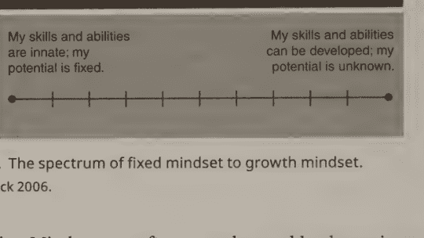

## 辛普森 3Ds 教练模型：教练的“方法论”

> 通常，管理者行为或观念上微小的改变，就能为团队绩效带来惊人的变化。
> ——艾伦·索克威尔，私营和公共董事会顾问

高效教练的技能始于一个有效的教练模型。就像 J.R.R. 托尔金《指环王》中的至尊魔戒一样，你需要“一个统御一切的教练模型”。

当然，教练模型和教练一样多，但大多数都遵循相同的基本流程。你需要一种循序渐进的方法来应对任何教练机会——无论是绩效挑战、职业发展机会、思维或行为改变、人际关系问题——因为你作为教练的许多成功将来自对教练过程的精通。优秀的教练要求教练在正确的时间，以正确的方式，提出正确的问题。

多年来，我研究了许多有影响力的教练模型，这些模型被用来激发卓越的表现和潜力。¹ 套用托尔金的话，所有教练模型都有其价值，每个模型都为其他模型的价值做出贡献。从我研究的众多模型中，我试图将教练简化为一个非常基本的框架，我称之为辛普森 3Ds 教练模型：一个简单、相互关联的流程，任何人都可以用它来辅导他人，无论对方面临什么问题。在本章中，我将概述 3Ds 教练模型及相关工具，你可以在 www.simpsonexecutivecoaching.com 在线访问或下载。

¹ 这些模型包括哥伦比亚大学的 3C 教练模型、共创式教练模型、约翰·惠特莫尔爵士的 GROW 模型、盖洛普的优势导向教练模型、马歇尔·戈德史密斯的利益相关者中心教练模型、约翰·麦克斯韦的专业教练模型、NLP 模型、行动学习模型、循证教练模型、赫曼大脑优势工具（HBDI）、70:20:10 模型、情商教练模型、ASPIRE、FUEL、OSKAR、CINERGY、SOAR、CLEAR、ARROW 等许多其他模型。

3Ds 如下：

1. 诊断：教练议程是什么？
2. 设计：什么最重要？
3. 交付：将采取什么行动？

下面我将逐一解释，并提供在每个阶段都能发挥作用的强力教练式提问。

### 1. 诊断：教练议程是什么？

> *如果我有一个小时来解决一个问题，而我的生命取决于这个解决方案，我会花前 55 分钟来确定提出什么样正确的问题，因为一旦我知道正确的问题，我就能在不到五分钟内解决它。*
> ——阿尔伯特·爱因斯坦，德裔科学家和理论物理学家

在诊断阶段，你要弄清正在发生什么以及为什么发生。你以同理心诊断当前和过去的状态，以便更好地理解员工：他们的优势、他们的观点，以及他们对他人的影响。你正在了解历史背景，倾听他们的故事，弄清他们的思维方式。你正在定义教练过程的议程。

假设你的销售团队中有一位摩根。接近年底，摩根没有达到预期的销售业绩。你不知道原因。你请摩根与你见面，找一个安静的房间进行教练式对话。你向摩根解释，你想了解销售过程中发生了什么，并更好地了解客户在销售管道中的位置。你可能会问这些诊断性问题：

- “你能多告诉我一些你和你的团队在销售目标上的进展吗？”
- “你当前的销售目标是多少？”
- “你目前如何衡量成功？”
- “你目前是否在按计划达成销售数字？”
- “对你来说，成功是什么样子？”
- “未来你需要在哪些方面取得成功？”
- “当你考虑你的销售管道时，哪些客户最接近成交？”
- “是什么似乎在阻碍你实现整体销售目标？”
- “你尝试过哪些活动来推动客户在销售过程中前进？”
- “成交的最大挑战是什么？”

摩根说管道中有几笔交易，但本季度没有成交，因为市场正在放缓。

你可以更深入地挖掘：

- “多告诉我一些客户平均销售周期的情况。”
- “多告诉我为什么客户很难及时做出决定。”
- “在你客户那里，哪些关键影响者可能有助于影响销售决策？”
- “销售管道的哪些方面直接处于你的影响或控制范围内？”
- “销售管道的哪些方面完全超出你的影响或控制范围？”
- “专注于你能直接影响的部分，你认为影响销售决策最关键的行动是什么？”
- “我们是否为客户制定了一个扎实的商业案例来促成行动？”
- “他们理解我们所提供东西的价值吗？”
- “他们如何知道我们所提供的东西具有最大的价值？”
- “他们最可能在哪些方面想要[产品/服务/价值]？”
- “在一个没有障碍的世界里，你希望未来几周/几个月有哪些不同？”
- “考虑到你当前的管道，你认为哪些客户最接近做出决定？”
- “是否有需要安排电话或当面会议的客户决策者？”
- “你认为我怎样才能最好地帮助你推进管道中的客户？”
- “我们的团队或组织如何帮助你处理那些最接近成交的客户？”
- “未来几天是否有客户愿意当面会面？”
- “你认为哪些客户最有可能在短期内会面并成交？”
- “在 1 到 5 的评分中，1 = 低，5 = 非常高，你追求管道中这些客户的动力处于什么水平？”
- “什么能帮助你把寻求成交的动力提升到 4 或 5？”
- “现在最能激发你并让你专注的最大销售机会是什么？”

在诊断过程中，重点是发现和学习状况、环境、背景、历史、基设、问题、当前状态、障碍和阻碍。当你诊断时，你探索个人意识、差距、能力和优势、当前思维模式和范式、当前行为，以及员工对其个人故事的观点。

当你在诊断阶段提问时，你正在确定摩根工作的范围，明确期望，决定要关注的重点，找出阻碍他们的因素，阐明商业案例或收益，探索内在创新，并为建立有效、高度信任的教练关系奠定基础。你是一个在一旁的向导，帮助他们好奇地探索现实和背景。

以下是一些优秀的教练式提问，可以在任何一般教练对话的诊断阶段提出：

- “是什么让你来寻求教练辅导？你想从哪里开始？你的议程是什么？”
- “你希望在这次会谈中实现什么？”
- “你想讨论/探索哪些问题、挑战或大机会？”
- “主要的问题似乎是什么？”
- “关于[主题]，你最担心的是什么？”
- “你当前要实现的目标是什么？你想对自己/你的团队/组织改变什么？”

- “你的未来目标是什么？你有哪些选择？什么是有可能的？什么让你兴奋？”
- “现在发生了什么？绩效挑战是什么？”
- “你能给我介绍一下现在发生的事情的历史和背景吗？”
- “什么数据、观察或经历表明存在问题/机会？”
- “你能多告诉我一些吗？还有什么发生了？关于[topic]你有什么感受？”
- “这之前发生了什么？发生了什么？是什么导致了这个？你能多说一点吗？”
- “事情进展如何？有什么新情况？最新消息是什么？”
- “采取这一行动方案的好处是什么？不这样做的成本是什么？”
- “目前有哪些障碍或挑战阻碍了你？”
- “你需要克服哪些障碍？”
- “你对克服这个障碍有什么感受？能多说一点吗？”
- “是否需要对思维方式、行为、行动或资源进行任何必要的转变或改变？”
- “你在通往目标的道路上现在处于什么位置？你想处于什么位置[差距]？”
- “你希望做出哪些具体改变？”
- “你能否用一句话说明你现在的位置以及你希望取得的成就？”
- “什么标题可以描述你想要关注的内容以及你最大的挑战或机会？”
- “在1到5的量表上，1=低，5=非常高，你在实现目标的动力上处于什么位置？”
- “如果你的理想情况或期望的成功状态在量表上是5，你现在在哪里？”
- “在一个没有障碍的世界里，在接下来的几周/几个月/年里，你希望有什么不同？”
- “你如何知道自己已经成功？有什么成功衡量标准？有什么期望的状态结果？”
- “如果你有一根魔杖，可以改变任何事情来确保你现在的成功，那会是什么？”
- “现在有哪些巨大的机会让你兴奋并激励你专注于此？”
- “你想要或希望实现什么？还有什么？”
- “你会如何总结你今后想要关注的内容？”
- “通过今天的对话，在下次会议之前，你希望在哪些一两件事上集中精力？”
- “你将采取什么行动？何时完成？”
- “我/团队如何最好地支持你今后的发展？”

总之，诊断阶段是帮助客户、团队成员或同事了解他们过去和现在的思维方式、障碍、错误的假设和信念。教练在诊断阶段帮助总结他们的学习成果，以便他们能够清楚地定义问题、挑战以及成长和成功的机会。在诊断中，关键是澄清差距或目标，并总结他们为什么需要改变、什么最重要以及痛苦、收益或机会的范围。他们优先考虑并缩小重点，集中在几个关键领域，并讨论他们针对行为改变、绩效改进、发展或目标设定的重点领域。

## 2. 设计：什么最重要？

> 你将注意力从低价值活动转移到高价值活动的能力，是你生活中取得一切成就的核心。
> ——Brian Tracy，加拿大美国激励演说家和自我发展作家

在教练的第二阶段，你帮助客户为自己、他们的团队或他们的组织环境设计解决方案。你考虑什么有效，什么无效，并开始创造性地头脑风暴可能有效的方法。当你进行诊断时，你会发现正在发生的事情并澄清关键优先事项和目标。当你进行设计时，你会检验假设，进行创造性和创新性的头脑风暴，设想期望的未来状态，并探索前进的各种选择。

在设计阶段，你可能想问 Morgan：

- “过去什么方法帮助你成功签单？”
- “你能采取什么新颖或创造性的行动来帮助推进和完成你的销售渠道？”

以下是可以在设计阶段提出的一些优秀教练问题：

- “你今天想解决什么[教练主题]？”
- “你如何描述和总结这种情况？”
- “你最有动力和兴奋专注于什么？为什么？”
- “你从这种情况中获得的主要收获是什么？”
- “你从反馈、数据、观察或证据中获得了什么见解？”
- “你对[数据/情况]有什么感受或反应？”
- “你获得了任何新的见解吗？能多说一点吗？”
- “你从中得到的关键教训或见解是什么？”
- “你认为这种情况意味着什么？你会如何总结这种情况？”
- “你强调了哪些关键数据点、关键问题或重大机会，或关键关系？”
- “对话或数据的任何方面让你感到困惑？不清楚？不合理？”
- “这种情况告诉你关于你自己的什么？”
- “你认为自己如何才能最积极主动和负责任地应对这种情况/信息？”
- “你是否注意到改善与关键人物或利益相关者关系的机会？”
- “谁是重要的人、关键关系或重要的利益相关者，他们有特定的需求，你需要有效改善？”
- “是否有任何团队、组织或客户关系或绩效机会需要你加强和改善？”
- “你在这一领域的当前优势和劣势是什么？”
- “你在处理这一[关系/情况]时有哪些选择？”
- “你从中得到的重要的教训是什么？”
- “那个解决方案会是什么样子？你能给我举个例子吗？”
- “当你进行创造性头脑风暴时，哪些想法会浮现？”
- “哪些重点领域最让你兴奋或最有动力去改进？”
- “采取这些选项有哪些预期收益？”
- “如果重来一次，你会做些什么不同的事？”
- “今后有哪些缺点、陷阱或需要注意的地方？”
- “过去有什么有效的方法吗？它如何适用于这种情况？”
- “鉴于可用的选项，你希望追求哪些领域？”
- “你认为最重要的是追求哪些优先事项？”
- “如果你专注于你的自然优势和才能，你有动力去追求什么？”
- “你需要什么资源才能成功？”
- “如果你要优先考虑一到三个最重要的行动领域，那会是什么？”
- “你认为如何可以改善这种情况？”
- “可能的解决方案是什么？”
- “考虑到你所有的选择和选项，你希望追求或去做的是什么？”
- “你最兴奋今后专注于什么？”
- “你将采取什么行动？何时完成？”
- “我/团队如何最好地支持你今后的发展？”
- “由于我们今天的对话，在下次会议之前，你希望在哪些一两件事上集中精力？”

总之，设计阶段的重点是帮助客户、团队成员或同事为自己、他们的团队和他们的组织环境设计创新解决方案。设计阶段的教练帮助他们考虑什么有效，什么无效，并开始澄清和筛选各种解决方案和期望的未来情景。会探索他们如何最好地优先考虑和影响关键绩效领域、重要的利益相关者关系以及组织和客户需求。设计阶段是关于探索、头脑风暴和创造性地讨论各种选项和计划，这些计划在付诸行动之前最具激励性和成功性。在设计阶段，教练可以通过帮助他人澄清优先事项、探索选项和选择、挖掘创造力、内在创新、优势、兴奋感以及今后令人兴奋的新更好选项，从而增加巨大的价值。

## 3. 交付：将采取哪些行动？

> 清晰、简单的目标若无人认真对待，便意义甚微。商业中普遍存在未能贯彻到底的现象，这也是执行力不佳的主要原因。你需要强有力的对话来揭示业务的现实。你需要对结果负责——由责任人公开讨论并达成一致——以便把事情办成，并奖励表现最佳者。你需要跟进落实，确保计划在正轨上。
>
> ——拉姆·查兰（Ram Charan）与拉里·博西迪（Larry Bossidy），《执行：如何完成任务的学问》（*Execution: The Discipline of Getting Things Done*）

彼得·德鲁克曾说过类似这样的话：“所有宏伟的战略最终都会归结为工作。”在交付阶段，详细的计划和执行问责流程被落实到位，使其成为现实。这是关于聚焦目标、预期结果、里程碑和成功衡量标准、执行计划、问责机制、持续沟通和行动学习的领域。

在交付阶段，详细的问责步骤被规划出来。你确定如何以及何时将计划付诸行动，以提升绩效、达成结果，并通过与所有关键利益相关者的持续互动来建立信任。

教练可以通过提出以下问题来帮助推进交付阶段：

- “这个问题[主题]对你来说为什么如此重要？使命、目的或大局是什么？”
- “你的战略、路径和前进计划是什么？”
- “你的关键目标、成果、目的和衡量标准是什么？成功是什么样的？”
- “你希望将哪些目标[主题领域]付诸行动？”
- “需要达成哪些衡量标准或关键里程碑来确定你的成功？”
- “需要谁参与或向谁汇报，以确保获得支持和成功？”
- “你打算如何完成这件事？你明确的行为和行动是什么？”
- “你计划何时实施这些关键行动？你打算何时开始每日/每周的行动？”
- “在接下来的30、60、90天内，你需要制定哪些行动计划？”
- “你认为实现这些目标和目的有哪些障碍？你需要采取哪些步骤来避免或克服这些障碍？”
- “我/团队如何为你的未来成功提供支持和所需资源？”
- “你需要与谁合作才能完成这件事？”
- “你必须有效调动哪些人员、团队、部门、领导层、关键利益相关者或组织支持，才能执行你的目标和目的？”
- “你将采取哪些行动？截止何时？”

回到摩根（Morgan）的案例研究。在帮助摩根进入交付阶段时，教练可能会说：“摩根，要最好地执行你的计划，你需要采取的第一步是什么？”

摩根可能会决定联系客户联系人，并与关键决策者安排一次现场会议。

然后你可能会问：“摩根，你还可能遇到哪些其他障碍？”摩根可能会分享他的演示中有一个技术部分需要帮助。如果领导层能有人出席演示，以影响决策者，那将对演示至关重要且有益。

“摩根，这是个很棒的计划。你什么时候可以安排？我如何支持你？什么能为客户和即将到来的会议带来最大价值？会议之后，你将如何衡量成功？我如何跟进你？你还需要我、团队或组织提供其他什么吗？怎样才能最好地让你对自己的计划负责？”最后，表达支持、信心和肯定来结束。“我相信事情会进展得非常顺利。我认为这是一个很棒的计划。我很兴奋能支持这项努力。”

以下是一些在交付阶段可以提出的优秀教练问题：

- “什么问题、挑战或机会[主题领域]是你最期待执行的？”
- “什么最能激励你、让你最兴奋地去关注和改进？”

绩效目标和目的被清晰界定。汇报的明确期望已达成一致。未来的行动步骤以及与关系、合作伙伴、团队成员和关键利益相关者的成功互动已被规划出来，以供执行。

## 教练实战：丽贝卡的故事

丽贝卡面临一个挑战：她被引入一家国际组织，帮助加强与客户和本地分销商的关系。通过研究数据，她根据分销商的绩效和与其合作的便利程度，将现有分销商分为三大类：高绩效、中绩效和低绩效。她的目标是处理低绩效分销商的问题，但当她仔细审视情况时，发现这些分销商通过与CEO的友谊而受到“保护”。

在与丽贝卡的教练会谈中，我们运用了辛普森3D教练模型：1. 诊断，2. 设计，3. 交付。

### 1. 诊断：教练议程是什么？

丽贝卡向我解释道：“迈克尔，这里有一个严重的问题。我们有一些低绩效分销商，他们正在流失客户，也在流失自己的员工。但他们知道，自己受到与CEO长期友谊的保护。我无法与他们讨论这个问题，否则他们会向CEO抱怨，而我可能会被解雇。我在这里没有权力。当存在严重的政治后果，而CEO又有权让我丢掉工作时，我该如何向上影响呢？”

正如那个儿童故事提醒我们的那样，告诉皇帝他没穿衣服是非常困难的。

我复述了情况，以确保我理解无误。“丽贝卡，这是一个困难而敏感的局面。这些分销商似乎是老派哥们儿，用一种不创造价值的方式保护自己，并使这件事变成了政治问题。”

然后我向丽贝卡介绍了“勇气与体谅”（courage and consideration）的心态（稍后详述）。在向上教练时，关键是要以绝对的体谅为先导——从忠诚和尊重开始，表达希望就改善现状进行一次艰难的对话。

然后用勇气来平衡体谅——摆出你的数据、反馈和你对风险的看法。向老板保证你完全透明。专注于客户价值和目标、组织利益，以及客户与业务的共同机会。

### 2. 设计：什么最重要？

“丽贝卡，现在你是独自面对这个问题，如果你单独去解决，你会被如何看待？”她回应道：“作为一个抱怨者、诉苦者，而且不忠于老板。”“你能直接攻击他的自尊吗？”我问。她意识到自己会输掉那场战斗，而且她需要内部的政治和业务支持。

“还有谁受到这种情况的影响？”我问。“哪些利益相关者也在为此付出代价？你还能从哪里获得支持？跟我说说你需要影响谁，以及谁可能在内部提供政治支持？”

丽贝卡分享说，首席运营官（COO）平易近人，会是一个好盟友。丽贝卡明白，她还需要影响董事会成员。她开始头脑风暴，制定一个包容性强、以解决方案为导向的计划，而不是关注问题或个人。

“什么信息能吸引COO？能吸引董事会？你需要编制哪些业务数据，你需要为他们准备什么样的基于事实的信息？数据如何体现客户需求、客户价值以及业务的最佳利益？”

“迈克尔，数据清楚地显示，我们正在流失优秀员工和优秀客户，”她回答说。“这两种流失对业务以及我们未来的生存能力和可持续性来说，代价高昂且风险巨大。这意味着我们的增长机会正在受损，企业文化也在遭受磨难。我需要向CEO展示，保护几个表现不佳、却在示范错误价值观和行为的朋友，正在以巨大的方式适得其反。我需要谈论人员流动率、低生产率、绩效不佳问题、价值观偏离以及客户反馈不佳。最终，CEO是个理性的人，他想要对业务最有利的东西，也想在董事会眼中表现良好。有了COO的帮助和董事会的支持，我想他会倾听逻辑、事实、数据和客户需求的。”

## 3. 交付：将会做什么？

为了总结我们的教练对话，我问 Rebecca：“我们今天谈了很多。你完成它的计划是什么？基于我们的对话，你有动力去解决哪些问题？你觉得自己首先需要做什么？” Rebecca 然后制定了计划。她决定首先与她的首席运营官和董事会成员组成一个联盟。她会测试他们的支持并获取反馈，以确保信息准确，并且会得到 CEO 的认可。

她需要招募能够以专业、尊重和忠诚的方式支持她的人，而不是以情绪化或评判的方式。她需要在反馈和信息传递中既高度体谅，又高度勇敢。否则，信息将不会被听见，或者她的工作将处于风险之中。

“你需要什么工具？你需要什么资源？”她觉得自己需要根据客户需求、市场需求、人员流失报告、离职面谈以及损益报表汇编一份有说服力的数据资料包。她必须为 CEO 串联起这些要点，并确保他不会感到被攻击。这意味着要呈现硬事实：客户数据、客户忠诚度反馈、员工流失、离职面谈数据等等。

“在接下来的 30、60 和 90 天里，你承诺要做什么？”我问。Rebecca 承诺首先安排与她的首席运营官会面，然后与她在董事会中有信誉的关键影响者会面，然后与她的 CEO 会面。

“我如何支持你并帮助你对这个计划负责？”我问。我们同意我可以每两周给她打电话一次，检查进展情况。我们还同意，如果出现任何不可预见的情况或她需要额外支持，她可以随时通过电子邮件或电话联系我。

## 实践：你的教练手册

考虑一下你团队或组织中变得具有挑战性的问题。独自或与你的团队一起，花时间练习以下教练阶段及其相互关联的有力教练问题：

- 1. 诊断：教练议程是什么？
- 2.  设计：什么最重要？
- 3.  交付：将会采取哪些行动？

挑战，你会深入挖掘，你会有效参与吗？还是你在必须投入太多之前就脱节并离开？你是否坚信自己和自己的能力，还是你脑中不断传来一个信息，坚信你是个失败者？你的故事是什么？

## 构建你的个人故事

> 不要低估你的心态和愿景改变世界的力量。无论这个世界是你的企业、你的社区、你的政府、一个行业还是一个全球运动，你都需要有一种核心信念，即你所贡献的东西可以从根本上改变范式或思考问题的方式。
>
> ——Leroy Hood，美国生物学家和科学仪器开发者

你的个人故事是你基于生活经历的心态。它是你的个人叙述、你的内心对话；当你准备分析问题、做出决定或采取行动时，它会告诉你你是谁，是继续前进取得成功，还是停止因为你会失败。亨利·福特说过：“你认为你能，还是你认为你不能——你是对的。”你的心态是你大部分决定、动机和行动的强大驱动力。当你深入了解某人如何思考以及什么激励他们时，你就可以开始影响新的视角、看待世界的新方式以及新的创新形式。教练从评估和理解心态开始发现过程。

《心态》一书的作者 Carol S. Dweck 博士描述了一项关于孩子们尝试解谜的研究。随着谜题变得更难，她对两位沉浸在困难中的学生感到惊讶。一个男孩表达了他终于得到一个具有挑战性的谜题的喜悦。另一个人兴奋地认为他那天将学到一些有用的东西。Dweck 写道，当她看着他们时，她想：“他们怎么了？”（Dweck 2006）。

那是他们心态的问题。这些孩子喜欢挑战，并且知道如果他们付出努力，他们就能解决遇到的任何问题并从中学习！

心态是你看待周围世界的方式。根据 Dweck 博士，你的心态深刻地影响着你过日子的方式。

顺便说一下，就像个人一样，团队也有心态。当你发现驱动团队愿景、价值观和目标的集体心态时，你可以有效地检验假设、发挥他们的优势并改善他们的决策和创新。

审视你自己的个人心态。有些心态可能是现实的，有些可能是限制性的，而另一些可能是完全扭曲的、虚假的和错误的。正是在你的心态中提出这样的问题：“我为什么这么聪明？”或“我为什么这么愚蠢？”“我周围的人为什么更聪明（或更愚蠢）？”这些内心对话是你一生中最重要的对话。你与自己的对话将决定你人生的结果，并极大地影响你周围的每一个人。

教练只需提出正确的问题，就能为是什么激励和影响心态提供极大的见解。

## 克服固定型心态

我们通常将心态归类为*固定型*或*成长型*心态。

如果你有固定型心态，你相信你无法成长、改进或改变。你还相信你天生就具有一定的智力水平和某些人格特质。就这样。它是固定的——它是确定的。

相比之下，如果你有成长型心态，你相信随着时间的推移、努力和帮助，你可以不断成长和学习。天空就是极限。有成长型心态的人同意前美国大联盟棒球投手 Roger Clemens 的观点：“我认为只要你有心态、有意志和欲望去做并付出时间，任何事情都是可能的。”

作为教练，你的主要任务之一是帮助你的客户在自己内部发现*内在创新*：成长型心态而非固定型心态（见图 3.1）。如果有固定型心态，他们就无法取得多大进展，因为他们认为这是不可能的。对你作为教练来说更是如此：如果你背负着固定、评判或悲观的心态，你就不太可能帮助他人。

此外，心态是可以改变的，而且确实会改变。那些有固定型心态的人实际上相信一种幻觉——认为没有任何东西可以改变他们。

## 固定型或成长型心态

图 3.1. 从固定型心态到成长型心态的光谱。

来源：Dweck 2006。

这是错误的。心态往往是多变的、动态的、进步的和不断发展的。

例如，我的熟人 Carter 在服役期间脊柱受伤后，他在一家看起来很适合他和他家人的社区找到了一份工作。幸运的是，他的老板也是退伍军人。他们彼此理解，并基于相似的生活经历进行良好沟通。Carter 与他的老板有着强烈的同志情谊。当新同事 Mallory 来到时，Carter 告诉她，老板是他漫长职业生涯中遇到的最好的人之一。

不幸的是，Carter 的老板有一天向他承诺——然后违背了诺言。（至少这是 Carter 的看法。）几乎一夜之间，Carter 的老板从世界上最好的人变成了可怕的人和骗子。Carter 的工作从理想变成了折磨。

发生了什么事？Carter 的心态发生了负面、有毒的转变。

理想情况下，Carter 的老板本可以介入并解决这种情况，但他没有。Carter 的同事 Mallory 看到她的同事开始向下螺旋并脱离，只做维持工作的最低限度。这对每个人来说都是糟糕的情况。虽然她是他的同事，但 Mallory 决定尝试指导 Carter。一开始，她需要发现他心态转变的原因：他是如何迅速地从热爱工作到憎恨工作的？这种情况中还能挽救什么？让我们观察 Mallory 与 Carter 练习 3D 教练阶段中的两个阶段：

## 1. Diagnose Phase: What Is the Coaching Agenda?

午餐时间抽空离开办公室，Mallory 问 Carter：“我很好奇。为什么你对工作的感受变化如此之快？你以前是满意的。给我一些你当前情况的背景。过去几个月发生了什么？”她富有同理心地仔细倾听他的故事，没有打断他，也没有表示同意，或试图修复或为老板辩护。

相反，她提供了支持。“听起来你在工作中经历了信任的背叛和缺乏明确的期望。”

## 2. Design Phase: What Matters Most?

Mallory 然后开始设计过程，通过重新框定情况：“留下来有什么积极的理由吗？展望未来，哪些好处和创造性机会让你兴奋？在一个没有障碍的世界里，你能做哪些创新和创造性的事情来最好地影响老板和当前的情况？如果你离开，你会带走哪些积极的东西到你的未来工作？”

教练最令人满意的事情之一就是帮助某人挑战虚假、限制性或无效的心态——帮助他们重新框定情况并克服悲观或缺乏希望。许多人发现自己处于绝望或自我挫败行为的状态；我喜欢见证转变，当我辅导的人开始利用创造力、技能和希望的自然资源来寻找新的策略和方法时。重新框定限制性或虚假的心态；帮助人们克服心理障碍；解放他们以提高自我意识、扩大责任和选择以及信心——这些是有效教练的内在回报之一。

你的内心叙事是什么？关于你自己的什么故事影响了你的心态？正如作者 Patrick Rothfuss 在他的书《风之名》中所说：“每个人都在自己脑海里讲述关于自己的故事。总是。一直如此。这个故事造就了你。我们由这个故事构建自己”（Rothfuss 2007）。

我们的内心叙事也会分散、扭曲或欺骗我们。它会告诉我们我们很笨，我们不够，或我们缺乏影响我们生活处境的力量。它会告诉我们我们毫无价值。如果是这样，我们就会隐藏在羞耻、自怜、自卑或恐惧中。我们避免可能失败的情况，因为我们的心态告诉我们我们总是失败——我们是失败者。在他的书《与情绪智商共事》中，Daniel Goleman 说：“如果我们缺乏能够应对[生活]挑战的信念，我们就会开始以注定失败的方式行事。‘我做不到’这个想法是致命的”（Goleman 1998）。我们陷入停滞。我们脱离。

我们如何克服这种消极、恐惧的内心叙事？我们找到我们的个人力量。我们找到我们的真理并开始生活它。

Dr. Mark Goulston，《Get Out of Your Own Way at Work》的作者，分享了他如何变得慢性晕车的故事。他写道，当他还是个小男孩时，他在家庭汽车的后座上读漫画书，感到不适，然后呕吐了。

他妈妈解释说他容易晕车，每次在车上读书都会晕车。而他确实会！Dr. Goulston 承认，每次他试图在车上读书时他都会生病。他在飞机或火车上没有类似的问题，因为他母亲从未警告他在这些环境中会生病。但后来他真的很想在车上读书。所以，他开始读书了！他立即感到恶心，但他坚持下去直到不适感消失。“从那以后我就能在车上读书而不生病了。思想和坚持的意志真是令人惊叹，不是吗？”（Goulston 2005）。

Dr. Goulston 指出我们很容易陷入限制性叙事中——并且突破它！如果他能在车上读书，他还能做什么？为什么他没有更早意识到呢？我们的内心叙事告诉我们我们可以做什么和不能做什么，而我们听从它！我们在限制范围内工作。许多自我强加的限制可能成为自我实现的预言。如果你认为你可以或你不能，你是对的。

也许你小时候被狗吓到并长大后坚信所有狗都很具攻击性和凶恶。 也许你看着你爸爸沉迷于他的新福特，他每个星期六早上亲手洗车，而你长大后变得不同？ 理想的回应会是什么样子？
- 你如何以更有效的方式回应？
- 以这种新而更好的方式回应有什么好处？如果未来你不以不同的方式回应，成本或缺点会是什么？
- 你如何开始分享你的天赋、才能和优势？
- 你为团队带来什么优势，你如何最好地利用它们为团队的整体利益服务？

## Coaching from the Inside-Out

记住，教练并不是要进行治疗。我不需要对 Maria 进行精神分析、评估、修复或建议。我不需要发现是否有五年级的老师或过去的负面父母告诉 Maria 她永远不会像男孩一样聪明。那不是教练。需要在房间里成为专家，或增加价值或提供建议的需求，对大多数教练来说都具有挑战性。这也很难以做到！我们想帮助并告诉人们该怎么做。很多时候我们的天性是修复、解决并让一切变得更好。

在为 *Forbes.com* 的一篇文章中，Susanne Biro 讨论了教练和咨询之间的界限经常被模糊的问题（Biro 2017）：

> 许多领导者认为他们了解如何很好地教练。然而，当我教领导者教练并让他们进行第一次教练对话时，我不可避免地发现领导者给出他们的建议，告诉人们该做什么，以及如何做。那些出于好意的策略往往会妨碍表演者、下属或被辅导者进行发现和承担重任，Biro 认为。“我们想帮忙！但告诉某人该做什么并无帮助。”作为老板，请记住如果你不断告诉人们该做什么，而它不起作用，那是谁的错？

一位优秀的教练提出问题以使人们拥有自己的问题，解决自己的问题，并探索改善其处境的创造性方法。教练并不意味着我们必须把所有的智慧、判断、建议和经验都放在门口。我们可以

按需使用。但我们的能力和经验往往阻碍了帮助他人发展自己的能力并从自己的经验中学习。被辅导的人是否应该总是承担繁重的工作？在你的员工会议上，关于你的天赋、优势和才能，什么是真实的？在团队讨论中，你如何最好地将团队与客户需求、相互关联的系统和利益相关者的支持联系起来？你是否真的在会议中没有增加价值，应该保持沉默？你的团队是否在没有你的关键见解和观点的情况下做出了合理的工程决策？” 显而易见的答案是“不是”。

我请玛丽亚设定一个目标，在即将到来的员工会议上至少发表三条评论。我们进行了角色扮演，演练她可以做什么、可以提出哪些关键问题。“当你出现却保持沉默时，你就是在一种扭曲和自欺的状态下生活，”我提醒她。

最终，玛丽亚的上司注意到了她的变化。“我真的很欣赏你在我们会议上的贡献和发言，”他告诉她。“我们现在向客户提出了更有连贯性、更一致的问题，涉及我们的产品和服务。”玛丽亚变得更加自信。她仍然难以开口发言，但她意识到了退缩的负面影响。她知道她让自己沉默太久了，她为生活在一个没有羞愧和恐惧的世界里而兴奋。

教练辅导帮助玛丽亚摆脱了消极心态，更充分地发挥了她天生的天赋和优势。

彼得·德鲁克、大卫·库珀里德、马丁·塞利格曼博士、唐·克利夫顿、马库斯·白金汉、汤姆·拉思等专家的重大研究都指向一种基于优势的方法，以获得更高的生产力、积极性、留任率、参与度、绩效和成果。事实上，在教练辅导中，员工的长处是我们最大的资产。

正如金融励志演讲家T.哈维·艾克所说：“去做吧。投入其中。朝着正确方向迈出一步，胜过一百年的思考——关于发生在我们身上的事，以及我们的选择。” 吉姆·柯林斯在他的著作*从优秀到卓越*中说得最好：“伟大的成就从来不是运气、境遇或环境的产物，它永远是自律思考、自律选择和自律行动的结果”（柯林斯，2001）。

## 拥有你自己的故事

> 你必须进去。
>
> ——尤达

糟糕的事情会发生。生活是不公平的。人们会让人失望。挫折和失败会出现。但这些事情不一定要定义你自己的内心故事。

在1980年的电影*《帝国反击战》*中，主角充满潜力，但有点爱抱怨，遇到困难时容易放弃。他叫卢克·天行者。作为绝地训练的一部分，他必须在一个黑暗的洞穴中面对自己的恐惧。他很害怕。但他的老师尤达解释说：“你必须进去。”在洞穴里，他与敌人达斯·维达战斗；当卢克砍下维达的头时，卢克看到自己斩首的头正盯着自己。

作家兼心理学家布琳·布朗博士在她的著作*《崛起的力量》*中指出，我们都必须面对那些伤害我们的内在叙事。这可能令人恐惧。但正如布朗所解释的：“拥有我们的故事意味着承认我们的感受，并与艰难的情绪搏斗——我们的恐惧、愤怒、攻击性、羞耻和责备……要驾驭原力，我们必须拥有自己的故事，活出自己的真理。你必须进去。”作家兼励志演说家莱斯·布朗曾说过：“生活是为了活着。当你制定目标和梦想时，在你准备好之前就行动吧”（布朗，1992）。找到你内在的力量，设计你自己的故事——一个你想要专注于并活出的故事！

## 重新构建你自己的故事

重新构建内在叙事被称为“日常教练工具箱中最强大的工具”（Stubblebine，2016）。其基本原理是，我们的大脑必然只能容纳这么多信息，这意味着我们必须有所选择。“你喂养大脑的东西，将引领你的人生，”专业教练克米·索古恩勒如是说。

为了说明这一点，从前有两个能干、勤奋、合格的鞋类销售员。他们各自被分配到一个太平洋岛屿的新区域。一到那里，第一个销售员就紧急给总部打电话：“让我离开这里。这里又热又脏，岛上没有人穿鞋。这个区域是浪费时间！”第二个销售员也给总部打电话：“你不会相信我的区域。请立即让我与制造和运输部门联系。我们的前景非常好。这里有很多人，而且岛上没有人有鞋。”我们看待情况的方式比我们的境况、教育、金钱或才能更为关键。

另一位教练曾与一位CEO谈论一名棘手的员工（Stubblebine，2016）。这名员工很有天赋，入职时得到了非常有力的推荐。CEO对这名员工的潜在贡献感到兴奋——但员工却一事无成。一直以来，CEO都告诉自己：“我有这么一位才华横溢的员工！”直到一位教练走过来问了一个问题：“这名员工对你和组织有什么贡献？”CEO很快回答：“没有。”直到那时，CEO才知道该怎么做：他必须让这名员工离开，并祝福他。CEO能够重新调整自己的视角并采取行动。

通过简单的问题，教练辅导可以揭示我们为什么这样思考，为什么我们会对某些触发因素采取行动或做出反应，以及如何探索对困难情况的可能回应。当我们认识到我们所

## 成为自信的教练

> 这是我在每一位与我共事过的高管身上寻找并试图培养的品质。信心赋予你勇气，拓展你的能力范围。它让你敢于承担更大的风险，取得比你想象中更大的成就。建立他人的自信是领导力的重要组成部分。它源于为人们提供机会和挑战，让他们去做从未想过自己能做的事情——在他们每一次成功后，用尽一切可能的方式奖励他们。
>
> ——杰克·韦尔奇（2001）

杰克·韦尔奇是我们这个时代最伟大的商人之一，他从小就有语言障碍。正如他在其著作*《直抒己见》*中解释的那样，他从小就被口吃所困扰。后来，他的母亲帮助他重新构建了自己的局限。“那是因为你太聪明了，”她对儿子说。“没有人的舌头能跟上像你这样聪明的大脑！”

韦尔奇相信了母亲的话：他的大脑比嘴巴运转得更快，这就是他口吃的原因。于是，他不再为此担心。

几十年后，韦尔奇看到了一些小时候的照片，被自己的样子震惊了。他身材矮小。“然而我从来不知道，也没有感觉到，”韦尔奇写道。“我没有更在意自己的体型，这简直荒唐……我母亲让我相信，我可以成为任何我想成为的人。这真的取决于我自己”（韦尔奇，2001）。这种心态不但没有限制他，反而推动了他作为商业领袖的成功。

一名有效的教练能够帮助客户培养投入、高效、适应性强且富有创新性的心态。这就是为什么领导者需要成为有效的教练。正如领导力专家、作家小弗雷德·A·曼斯克所言：“终极领导者是愿意培养员工，使他们最终在知识和能力上超越自己或自己的人”（曼斯克，1999）。

## 选择你的故事

> 你无法阻止汹涌海浪的冲击，但你可以学会冲浪。
> ——乔恩·卡巴特-津，医学荣休教授、正念导师，美国人

像杰克·韦尔奇一样，我们可以为自己的挑战讲述一个不同的故事并克服它们。一位优秀的教练会不断敦促客户采取一种能最大化利用任何局面的心态。当客户的故事行不通时，教练会帮助他们重新框架、重写并选择一个不同的故事。

当我辅导伊森时，他所在的公司正在国际化扩张。伊森在国内为新产品设定价格点方面做得不错，但国际市场要棘手得多。与此同时，伊森的同事在定价方面是真正的专家。“而且，说实话，他认为自己应该得到我的职位，”伊森承认道。“他的被动攻击性有时令人难以承受。”

我问伊森，他是否认为自己对同事的反应在自己的控制之下。当然在控制之内，他说。无论情况多么困难，我们总可以选择自己的回应。我们无法控制他人如何行为，无论他们是被动攻击、 toxic 还是公开敌对，但我们可以框定自己的回应。别人的愤怒、敌意、自负、支配和贬低行为与我们无关，那我们为什么要让它们控制我们的行为并可能毁掉我们的生活呢？

我问伊森：“当你遇到这种被动攻击行为时，有什么富有成效的回应方式？有哪些改善这一情况的机会？你如何以更积极的方式影响这一情况？你的盟友是谁？当有人在破坏或贬低你时，谁是你的倡导者？”

不幸的是，那位挑衅的同事并没有成为他的好朋友——这里没有童话结局——但通过持续的教练，伊森茁壮成长。作为他的教练，我能够帮助他重新框架他关于苦涩的无助和受害者的故事。他在工作中找到了新的资源和盟友。他开发了一些实用的工具来应对这一困难局面。

“当你经历困难时期时，你内心的一部分并不理解一切都会好起来的，你会走过这一关，”伊森后来告诉我。“当我只想放弃时，很难让我继续前进。我过于专注于负面，根本没有为正面留下足够的空间。知道我可以控制自己的回应，并且我有理性的选择，这帮助我以不同的视角看待情况。我开始通过积极的镜头看待，而不是消极的末日悲观镜头。”

教练成功的根本在于帮助人们重新框架无成效心态的能力。作为教练，你首先要发现客户的心态，以及它是否准确。那种心态中有什么阻碍客户看到无限可能？这是你作为教练可以做出的最关键的发现，因为它决定了你此后所做的一切。除了心态之外，审视他们的成果也很重要，看看这些成果是否能为他们带来成功的回报。

### 实践：你的教练手册

根据本章所学的内容，评估你自己的心态。在 1（低）到 10（高）的量表上，你的心态有多积极乐观？你在哪方面不足？你是命运或境遇的受害者，还是固守于无成效的叙事？你内心是否有成长、改进和改变叙事的能力？你能帮助他人发现他们自己的有效故事吗？作为领导者，你可以在哪些方面开始改善你和团队的心态？对照以下问题检查自己。

### 心态检查清单

1. 你对自己是否有积极的内心想法和信息，并且出于良好的意图或动机？
2. 你的行为是否诚实并且与你根深蒂固的动机、价值观和信念一致？
3. 你是否假设并寻找他人善意的意图？
4. 你是否以真诚的关怀、尊重和互利的方式对待他人？
5. 你如何抓住他人做得对的地方？
6. 你将如何抽出时间与他人进行真诚开放的沟通？
7. 你将如何积极倾听、表示尊重并充分理解他人的观点？

## 参考文献

- Biro, Susanne. (2017). The four foundations of exceptional coaching. Forbes.com. https://www.forbes.com/sites/forbescoachescouncil/2017/01/04/the-four-foundations-of-exceptional-coaching/#3bafed2c7c7b.
- Brown, Brené. (2012). *Daring Greatly: How the Courage to Be Vulnerable Transforms the Way We Live, Love, Parent, and Lead.* Avery.
- Brown, Brené. (2015). *Rising Strong: The Reckoning. The Rumble. The Revolution.* Spiegel & Grau.
- Brown, Les. (1992). *Live Your Dreams.* HarperCollins.
- Calabrese, Kelli. (2015). Creating new habits. Quoted on Josh Trent’s Wellness Force Radio podcast. https://radiopublic.com/wellness-force-radio-WzYLBp.
- Collins, Jim. (2001). *Good to Great: Why Some Companies Make the Leap and Others Don’t.* HarperBusiness.
- Dweck, Carol. (2006). *Mindset: The New Psychology of Success.* Random House.
- Eker, T. Harv. (2009). In *The Compass* by Tammy Kling and John Spencer Ellis. Harper Element.
- Engel, Beverly. (2008). *The Nice Girl Syndrome: Stop Being Manipulated and Abused—and Start Standing Up for Yourself.* Wiley.
- Goleman, Daniel. (1998). *Working with Emotional Intelligence.* Bantam.
- Goulston, Mark. (2005). *Get Out of Your Own Way at Work.* Putnam Adult.
- Manske, Fred A., Jr. (1999). *Secrets of Effective Leadership: A Practical Guide to Success.* Leadership Education & Development.
- Rothfuss, Patrick. (2007). *The Name of the Wind.* DAW.
- Stubblebine, Tony. (2016). The complete guide to reframing for coaches and people who care about smarter decisions. BetterHumans. https://betterhumans.coach.me/the-complete-guide-to-reframing-for-coaches-and-people-who-care-about-smarter-decisions-29a3565d21be.
- Welch, Jack. (2001). *Straight from the Gut.* Business Plus.

他谈吐不错，并在职业生涯中获得了丰厚的财务成功。

但在为他工作时，我意识到他的成功是有代价的。他是终极的推卸责任者。他不为自己的错误负责。他无法认可他人的贡献，因为他太不安全了。他真心相信自己比所有人都更好、更成功。他认为自己站在世界之巅，而当他的承诺未能兑现，当商业交易和发票受到抗议时，他总能找到办法责备、羞辱和评判所有人，自己仍留在顶端。他没有任何脆弱性或真实性，不能表现出任何弱点，必须不惜一切代价保持控制和保护自己的形象。作为内部或外部教练，评估团队中某个人是否愿意开放于改变、自我反思、改进和变得更好是很重要的。

米卡可以很聪明、有魅力、机智，但他可以一键切换，很快变得凶残、侮辱和残忍。他经常在背后诋毁他人。他会表现得好像信任别人，但随后又微观管理他们。他会毫不犹豫地把人推下车，操纵数据，歪曲事实，只是为了看起来好，并作为经理再多活一天。

我在米卡手下工作了两年。我想知道他是否会愿意进行一次教练对话，以及他是否会有自我觉察去问：我与我的领导团队是如何出现的？哪些破坏性行为可能在阻碍？在如此有毒的文化中工作令人沮丧。每天我都会问自己：“我为什么还在这里？我的薪水值得这样吗？我真的对这位关键经理和管理团队有影响力吗？”

对我来说，这只是一份工作。当我意识到生活不仅仅是增长销售额、达成目标和赚钱时，我就离开了。虽然为教练创造一个安全的环境可以增加巨大的绩效改进机会，但不幸的是，并非所有人、团队或组织都鼓励教练文化。有些人可能不可教练或尚未准备好接受教练。

许多人相信的业力普遍法则：“善恶终有报”——你如何对待他人，最终会回到你身上，无论是正面还是负面。米卡的行为最终反噬了他。他最终被公司董事会解雇。许多他认为忠于他的人一直在

fear and self-preservation. 不幸的是，这位领导者所塑造和营造的有毒环境，在他人面前显得光鲜成功，却导致了一种虚假的文化，充斥着不信任、羞耻、恐惧、怨恨和不忠。最终，这场幻象随着他与董事会和管理团队的自毁而破灭。当他被要求离开组织时，他缺乏善意的本质也得到了完整的体现。

个人伟大并非源于财富和地位，而是源于寻求有效影响他人并建立他人。并非所有组织都会拥抱开放、领导力发展和教练的文化。许多组织目光短浅，只关注其他一切——金钱、头衔、职位、控制——而这些本应是次要的。

> 前美国总统德怀特·D·艾森豪威尔说过，“你不能通过打人来领导——那是袭击，而不是领导。” 有效的领导者是充盈的、慷慨的、彬彬有礼的，他们寻求影响他人的生活以实现互利。

我的一个客户 Ashley 于 2002 年在经济低迷时期换了工作。她为了更稳定但仍充满机会的工作而接受了降薪。“我以为我找到了一个非常适合我的岗位，”Ashley 承认道。作为一名中层高管，她被承诺从主导高层谈判的机会到有趣的出差。

> “2002 年面试时答应我的那些事，现在想起来几乎可笑，”Ashley 说。“我很少能离开办公室四面墙之外。幸运的是，我从窗户看出去的景色很棒！”

发生了什么？据 Ashley 说，她的雇主 Scott 将关系视为“赢-输”。如果 Ashley 建立了良好的联系，Scott 就会认为这是对自己的打击。Ashley 发现自己被排除在重要会议之外。于是，她变得孤立，直到 Scott 准备另谋出路。

Scott 很聪明也很有效率。他很友好。他很外向。如果你问他每天在员工中是如何“展现自己”的，他可能会说他是忠诚的、有趣的，并且完成了很多工作。但他缺乏情商去理解自己对周围人造成了什么影响。他没有意识到自己是从匮乏和不安全感出发进行管理，而不是从充盈出发。

因此，Scott 仅从 Ashley 能为公司提供的才华中获益了一小部分。她的才能和天赋被低估了。

## Adopting a Learner Mindset

> *Asking a question is the simplest way of focusing to be different in the future?
- What are the negative impacts of being a Judger and being closed, inflexible, and intolerant of others’ viewpoints?
- Are you showing up as a Learner 80% of the time?
- When have you recently been a Learner? What were you curious about? What was the impact? In what ways can you continually seek to receive the benefits of being a Learner with others?
- What would be the benefits in your relationships of being a Learner versus a Judger?
- What are the benefits of practicing being a Learner, seeking common understanding and common purposes?
- How can you reframe situations and become more flexible, adaptable, open-minded, and encouraging of diverse and challenging perspectives?
- How are you being accepting and open with self, others, and situations?
- How are you being curious, thoughtful, engaging, and empathic?
- How can you become increasingly more abundant and a better Learner?
- Who do you need to begin building trust from a Learner mindset perspective?
- As a Learner, how would you like to act and behave more effectively?
- What choices can you begin to make as a Learner that will benefit your role as a leader?

作为一名学习者型教练，你将开始获得更大的自我觉察，了解如何更有效地影响他人。你也将开始以新的、更好的方式行动，从而更好地吸引、激励和赋能你周围的人。

## 构建富足心态

> > *稀缺心态按盎司计量生活；它总是得出结论：需求永远大于资源。*
> >
> > ——埃琳·M·斯特拉扎，作家兼演讲者

1987年8月，在结束了英国伦敦的春夏大学留学项目后，我加入了柯维领导中心（现为富兰克林柯维公司），成为第35名员工。斯蒂芬·R·柯维博士是我职业生涯早期的老师兼导师之一。我从他那里学到的一个关键洞见，就是以双赢的方式思考和行动的价值（对于他《高效能人士的七个习惯》一书的读者来说，这就是习惯4——互利原则）。

柯维博士教导说，双赢思维就是富足心态在行动中的体现。“双赢思维把生活以及我们需要有效互动的人视为合作的舞台，而非竞争的竞技场。大多数人倾向于用二元对立的方式思考：非此即彼、好坏、对错、强弱、硬球或软球、赢或输。但这种思维方式有根本性的缺陷……双赢思维基于这样一种范式：每个人都有足够的资源可以享受。其理念是，一个人的成功不是以牺牲或排斥他人的成功为代价的”（柯维，1989，第218页）。

多年来，一直有人告诉柯维博士，在竞争激烈的商业环境中秉持双赢思维是天真、不切实际且无法实现的。但他并未退缩。他明白，许多领导者、管理者和主管每天带着稀缺心态来上班。这种心态会聚焦于诸如此类的话语：

- “资源不够……”
- “那永远行不通……”
- “根本没有办法做到……”
- “我不能分享……”
- “我不能信任……”
- “我们不能冒险……”
- “他们欠我的……”
- “如果他们赢了……”
- “我们都有麻烦了……”
- “如果功劳给了他们……”

## 52 以富足心态进行辅导

这些语言揭示了稀缺心态和评判者心态。如何将一个固守的立场调整为双赢立场？

有些竞争是好的，甚至是必要的，但当需要建立伙伴关系、协作、相互依赖和合作时，唯一现实的选择就是真正的双赢之道。柯维博士建议首先要识别身边富足且值得信赖的人，向他们学习，与他们交往，并选择以他们为榜样（柯维，1989，第231页）。

对我来说，富足思维和行为的典范就是斯蒂芬·柯维的儿子——斯蒂芬·M·R·柯维。在我职业生涯早期，正如我之前提到的，他是我在柯维领导中心的老板。我与斯蒂芬·M·R·共事多年，至今仍与他保持个人和职业上的合作伙伴关系。他以各种可能的方式践行着双赢和富足的心态。

在亲自会见客户之前，斯蒂芬总是想更多地了解对方。他对客户的背景故事和未来充满好奇。他想理解客户的需求，并力求以定制化、灵活且基于价值的方式与他们互动。他以身作则，诠释了什么是共情、富有创造力、适应性强且灵活地满足客户需求。他是交易促成者，也是确保谈判中每个人都能受益和获胜的倡导者。

他对同事和客户都实践着富足心态。当我们会面时，他真诚地关心我的生活、我的职业兴趣，以及我对自己工作贡献的感受。我进展如何？我个人过得怎么样？他没有政治或隐藏的议程，只有真诚地希望帮助身边的每个人取得成功。他也非常诚实透明，有着值得信赖的议程。

我过去想——现在依然想——成为更像斯蒂芬·M·R·柯维那样的人。一位作为教练的有效领导者，将会像他一样——成为学习者思维和富足心态的榜样。

### 作为学习者的教练

> *无知并非坏事；不愿求知才是更糟的。*
> ——尼日利亚谚语

在你能够指望辅导或影响他人之前，你必须建立人际关系和融洽感。如果你是一位学习者，这并不需要太长时间。当然，建立信任需要时间，但你对他人的真诚、持续的兴趣，或对客户的关心，会让这一过程更容易。多年来，我在亚洲做了大量商务合作与伙伴工作，深切体会到深厚、信任的关系对于建立可信度至关重要。

以下是一些有力的问题，可以帮助你开启建立更牢固、更具参与感的工作关系的过程。

- “跟我聊聊你的背景吧。你在哪里长大？空闲时间最喜欢做什么？”
- “你个人有什么兴趣爱好？你喜欢做什么？在生活中，你在哪里表现出色并找到你的热情？”
- “如果必须选一个最喜欢的度假地重游，你会去哪里？”
- “如果你拥有无限的时间和资源，你会选择做什么？”
- “回忆一下你人生中感到快乐的时刻。那是什么时候？”
- “你认为迄今为止自己最大的成就是什么？”
- “你在这里的工作角色是什么？”
- “你觉得自己在这里的贡献如何？”
- “你对团队最大的贡献是什么？”
- “你天生的禀赋、优势和才能是什么？”
- “你工作中最好的部分是什么？”
- “什么时候你觉得自己处于最佳状态？”
- “你希望工作中哪一部分能有更多时间去做？”
- “你希望工作中哪一部分能少做一些？”
- “你觉得如何能让这份工作更令人有成就感？”
- “这份工作如何与你的人生总体目标相契合？”
- “未来五年，你希望在职业中做些什么？”
- “你现在的位置与你想要达到的位置之间的差距是什么？你如何弥合这一差距？”
- “你如何过上一种更投入、更连接、更充实、更平衡的生活？”
- “是什么阻碍你在生活中实现更多平衡？”
- “你如何知道你已经实现了那种平衡？”
- “哪些是最重要的人际关系，你愿意为此投入？”
- “我怎样才能最好地帮助你实现你的目标、梦想和抱负？”

### 进行有效对话，达成更优成果

下面是一个案例研究，帮助你思考如何开展有效对话以实现更优成果。

莎拉是一位事业部负责人，以拒绝协作、拒不接受本部门以外的主意而闻名。她在组织内不太合群，不信任他人，沟通也很差。她在组织内部为自己筑起了一座孤岛。

其他想要并需要与她合作的事业部都感到挫败。想象一下你是莎拉的同级，另一个事业部的负责人。你想通过运用一些辅导技巧来改善关系。但该从哪里、如何着手呢？

从一个尊重的开场问题开始：“莎拉，你愿意和我聊一聊我们两个事业部如何能更好地协同合作吗？”避免指责、评判，或任何可能妨碍莎拉敞开心扉或愿意进一步讨论的事情。

询问莎拉看到了市场上哪些未被满足的需求和机会，在共同使命或宗旨、客户需求、跨事业部更好对齐方面有什么想法。你们共同的目标、需求或前进的机会是什么？是否有更好的方式来建立伙伴关系、增加价值，并在组织内共同提升贡献？你们如何克服各自为政、冲突或分歧，探索共同利益和共同目标？

寻找共同宗旨、共同使命或对齐的目标：在满足客户需求、践行你们的价值观、明确共同目标方面，你们共同的机会池是什么？先放在职能孤岛、历史问题或不协调的工作领域一边，着眼于全局和共同目标，让两个部门能够在其中增加更好的价值、服务和支撑。你和莎拉可以开始识别并勾勒出共同使命领域、共享的客户需求以及未来合作的市场机会。确保你们双方都清晰透明，理解大局是什么，以及以新的、更好的方式合作可能带来的益处。

以共情式的精确倾听：询问莎拉她如何看待这两个事业部可以开始携手合作，以实现共同的利益、目标和目的，从而更好地达成使命。

客户或市场需求。“你看到了什么？”“你在想什么？”“你感觉如何？”“什么可能阻碍了进展？”如果她表达了挫败感，请以同理心回应。“听到这些我很抱歉；你一定感到非常沮丧。”捕捉并转述听到的关键问题，然后询问哪些问题最重要。提出一些澄清性问题，例如“你能多说一点吗？你观察到了什么？你学到了什么？你能告诉我更多关于你对质量、成本、定价、服务或及时成功地将产品推向市场的担忧吗？”

将人与问题分开：这次教练式对话不是为了修复、责备或评判莎拉。而是讨论质量、成本、定价、服务或及时产品发布等关键问题如何影响信心和信誉。“这种情况或问题如何影响你的业务部门？这种情况可能如何影响你的客户？”

## 专注于问题和挑战的解决方案，而非追究责任

当你以教练身份与同事建立关系时，你并不是在指责任何人，而只是在审视导致问题的事实、数据、可观察的行为、事件、问题或关注领域。其理念是你们可以改善协作并共同寻求解决问题。重点应首先确保双方都以完全诚实、透明和开放的态度确认问题是什么。很多时候，人们试图解决错误的问题，或去解决客户并不关心的问题。

带着富足心态去面对如何变得更好、如何进行持续改进、以及如何从客户和合作伙伴的反馈中学习。所有焦点都应放在市场、客户、共同使命机会以及未来的共同目标上。关键问题是：“你认为对业务和客户最有利的是什么？你觉得你的业务部门应该做出哪些改变？未来更好地服务内部合作伙伴和外部客户，你的最佳选择和替代方案是什么？”

在提出这些问题时，保持沉默。让他人分享他们的意图和对情况的理解。不要用你的建议、故事或意见来填补沉默。让他们参与到发现自己的故事部分中。

## 人际成熟度和有效性需要平衡勇气与体谅

平衡勇气与体谅。这样做是高度成熟的核心。柯维博士教导说，领导者可以同时做到勇敢（诚实直接）和体贴（忠诚尊重）。勇气是一种意愿和能力，能够完全透明地表达你的想法、感受、问题和挑战。体谅是一种意愿和能力，能够以肯定、礼貌和尊重来寻求并倾听他人的想法和感受。

作为教练的领导者应该勇敢，即诚实直接地面对关于目标、指标、衡量标准、数字、记分牌、道德、价值观、规则、政策、指导方针和法律的残酷事实。同时，作为教练的领导者应该体谅他人，并以有帮助、安全、友善和尊重的方式给予反馈。要记住感受、背景、环境、能力、差异、历史、期望和个性差异。

作为教练的领导者如果勇敢但不体谅他人，可能会被视为“赢/输”的思考者。然而，如果作为教练的领导者只寻求体谅而不勇敢，他们会被视为“输/赢”。这两种方式都不可持续，无法获得长期成功。作为教练的领导者应该在对话中练习平衡使用这两种方式（Covey 2006，第230-232页）。要取得成功，你必须首先以善良、尊重和体贴的语言和行为开始。然后寻求对目标、衡量标准、指标、法律和宗旨保持勇敢、诚实和透明。

明确你的意图。开放而明确地分享你的动机。“这就是我打算做的事情以及原因。”基于你的观察和个人经验，你可以说：“我认为问题在于……” “从我的角度来看，这是我观察到的……” “这就是我的出发点……” “我的观点可能有限或短视，但这是我看到的……或者这是我打算做的。”始终首先从开放、体谅和尊重的立场出发。当我们以体谅开始时，人们会敞开心扉，因为他们感到安全且不被评判。询问你的客户、顾客或合作伙伴如何共同前进并变得更好。“我们有哪些共同目标或共同机会可以更好地合作？未来我们的团队可以通过哪些方式开始更好地合作？”

确认并取得相互承诺，共同找到前进的道路。在对话结束时，表达对你们未来共同成功的信心。展示以新的、更好的方式行动和表现的真诚承诺。“基于我们今天的对话，我想表达我对我们未来合作机会的兴奋、动力或信心。我知道我们能取得伟大的成就。让我们回顾一下我们承诺在未来要做的事情。” “你未来的责任是什么？” “我未来的责任是什么？” “我们还需要让谁参与这个项目以使其成功？” “我们如何衡量成功？” “我们如何追踪进展？” “我们未来如何解决任何问题？” “我们应该多久会面一次来讨论进展？” “我们应该与谁、在哪里会面？”以及“未来最佳的下一个步骤是什么？”

## 确保“你的成功就是我的成功”

> 天赋是上天赐予的，要保持谦逊；名声是他人给予的，要心存感激；自负是自己养成的，要小心提防。
> 
> ——约翰·伍登（1972年）

体现富足心态的一位领导者是已故的美国大学篮球教练约翰·伍登。伍登带领加州大学洛杉矶分校的男子篮球队赢得了10次NCAA冠军，取得了88连胜和38场连续锦标赛胜利。ESPN称他为有史以来最伟大的教练。他以高尚的品格和仆人式领导者的谦逊而闻名。约翰·伍登执教的球队在篮球场上取得了前所未有的成功，但比他们取得的成就更重要的是他们如何取得这些成就。

他给其他教练的建议是：“记住，赢得冠军的不是你，而是球员。”伍登教练将自己的角色视为教师和导师。他尊重每一个人。他设定了非常高的期望，并坚持对自己和身边每个人都要求绝对的正直。

## 以富足心态进行教练辅导

他谦逊地将自己个人和职业上的名声与成功归功于他的团队和球员。他以他们的成功来定义自己的成功，不仅仅是在篮球场上，也包括在生活中。他花了数小时进行训练和练习，但他从不谈论胜利。他专注于做好准备并最大化每个人的潜力。

只有当你自我感觉良好时，你才能拥有富足心态。只有那时，你才会想帮助周围的人也自我感觉良好。这源于内心的安全感和自信。当你看到有人以控制、辱骂、傲慢或贬低的方式对待他人时，他们的行为正是缺乏自尊和内心安全感的表现。他们需要贬低别人来让自己感觉良好。

相比之下，伍登教练总是努力提升他人。所有球员都知道，伍登教练深切关心他们作为人的本身，超越了任何战术（Xs and Os）或篮球训练。

> “优秀的领导者会不遗余力地提升员工的自尊心，”沃尔玛创始人山姆·沃尔顿如是说。“如果人们有信心并相信自己，他们能取得的成就会令人惊叹。”

## 拥抱富足心态

> 在你成为领导者之前，成功在于成长自己；当你成为领导者之后，成功在于成长他人。
> 
> ——杰克·韦尔奇，通用电气前首席执行官

稀缺心态是自然的，往往源于自私、恐惧、自我驱动的视角，或对有限资源的感知。每一种稀缺情境可能来自不同的驱动因素。想象一下一个幼儿的普通一天：

- “我的玩具，我的球，我的奶瓶，我的奶嘴，我的毯子，该我了，我的妈妈……”

你能听到围绕这些话的哭闹，对吧？我们从孩子那里听到这些东西，但不幸的是，我们也从成年人那里听到。有些成年人可能会说：

“My title, my position, my office, my power, my decision, my team, my recognition, my promotion, my bonus, my credit, my need to be famous and constantly recognized . . .”

如果匮乏心态可以是对童年的自然反应，那么当我们成长到更高层次的个人安全感、自尊和成熟时，我们如何拥抱丰盛心态？

教练和作者 Naphtali Hoff 提出了几种在工作和生活中丰盛生活和领导的方式（Hoff 2017）。一种方法是写下丰盛生活的益处。这可以帮助你更自知丰盛的益处，并重塑你的思维，做出积极改变。其他方法可能是奖励那些选择以丰盛双赢方式行事的周围人。找到一种方式将慷慨、文明和互利带入你的工作环境和家庭。记住，种瓜得瓜，种豆得豆。你给予他人的，最终会以某种方式回馈给你。“人们欣赏慷慨，往往会找到回馈的方式，”Hoff 说。

当我为 Zotec Corporation 的 CEO 和执行团队准备一次关于信任的研讨会时，该公司的首席人力资源官来找我，说：“我们有一位领导力顾问今天会参加你的信任与文化工作坊。他的名字是 Coach Lou Holtz，他在 1986 年至 1996 年担任圣母大学的主教练。他多年来一直在为 Zotec 的领导者提供建议，今天想来旁听向你学习。”

我感到惊讶和震惊——甚至可以说“震惊”——因为我心里认真地想：“我宁愿整天听 Coach Holtz 谈论领导力和信任，也不愿听自己说话。” Coach Holtz 彬彬有礼、善良、风趣、聪明、见解深刻。我会提出一个话题并说：“嘿教练，能否分享一下你对这个话题的观点和经验？你在这种情况下做了什么？”他会用他丰富的经验和简单却深刻的想法——总是带点幽默——吸引整个团队。到了当天结束时，我对他说：“我希望你能和我一起旅行，每周和我的客户一起工作。”他微笑着说：“你今天教的大部分内容，就是我在圣母大学带队的方式。”

Coach Holtz 是我的英雄。能够花一整天向他学习，他的慷慨、经验、丰盛、善良和机智——我可以诚实地说，为什么这么多人愿意为他拼尽全力，并且至今仍如此忠诚和紧密地与他保持联系。他在足球场上与球员们培养了丰盛心态，并让他们为在商业、家庭和社区中领导做好准备。

在我们的工作坊之后，Coach Holtz 给我发了以下电子邮件：“亲爱的 Michael，刚想给你写个便条，告诉你我对你在 Zotec 的演讲印象非常深刻，很高兴有机会参与其中。你显然做了大量的研究，我很感谢你的努力。如果我能以任何方式帮助你，请给我打电话。我只是想让你知道——干得漂亮！Lou Holtz。”

在 40 年传奇的教练领导之后，Lou Holtz 感谢我训练他？这就是慷慨、谦逊和丰盛的典范。

## PRACTICE: YOUR COACHING PLAYBOOK

当你寻求以更丰盛的方式教练他人时，使用以下丰盛问题来帮助构建你持续的教练对话：

- 1. “对你来说，谁是那些以丰盛、双赢方式运作的绝佳榜样？”
- 2. “以丰盛生活和领导他人的关键益处是什么？”
- 3. “在个人和工作生活中，你可以在哪些方面选择变得更丰盛？”
- 4. “你如何奖励那些选择丰盛行事的周围人？”
- 5. “你需要与谁练习变得更丰盛？”
- 6. “今天？本周？本月？今年？你可以在哪些方面变得慷慨？”

## References

Adams, Marilee. (2016). Change Your Questions, Change Your Life. Berrett-Koehler Publishers.

Covey, Stephen M.R. (2006). The 13 behaviors of trust action plan. In The Speed of Trust. Free Press.

## References

Covey, Stephen R. (1989). *The 7 Habits of Highly Effective People*. Free Press.
Hoff, Naphtali. (2017). *7 strategies to lead with abundance*. Tanveer Naseer Leadership. http://www.tanveernaseer.com/how-leaders-tap-power-of-abundance-naphtali-hoff.
Wooden, John. (1972). *They Call Me Coach*. Word Books.

## Coaching with Authenticity

到现在，你可能已经意识到，你作为领导力教练的成功取决于你是什么样的人。你意识到成功的教练始于你自己。你知道你需要丰盛心态。但你不能伪装一个有效教练的人格和心态。在本章中，我们将谈论做*authentic*的重要性。

我们都曾遇到过虚假、不真诚、做作的领导者。与这些类型的领导者互动时，你很快就会发现他们是自私的、投机的和自恋的。在超过三年的时间里，我有机会与一位我认为体现了真实领导者的人密切合作。他的名字是 Brent Smith。我们第一次见面时，他看着我和我的同事说：“Michael 和 Barney，我们会玩得很开心，而且我们会做很多好事——按这个顺序。”

我们确实做到了！与 Brent 合作时，我感到投入和被赋能。我从不害怕犯错。他总是支持我。我不必担心掩盖自己的痕迹。Brent 为我们提供了清晰的愿景和目标感，并在我们的角色上信任我们。我了解到他会为我和我们的团队做任何事，我们也会为他做任何事。我曾经说过：“我会为他冲破砖墙。”

Brent 为什么是如此有影响力的领导者？他真诚、聪明、努力工作、谦逊。他服务他人并深切关心他们。他不仅仅是一个忠诚的领导者——Brent 完全将注意力 outward 放在他能为他人做什么以及如何指导周围的人。他让团队中的每个人都感到被重视、被需要和被尊重。他以善良和诚实对待他人，从不玩“抓现行”的游戏。他的风格低调，他更喜欢寻找和利用周围人的优势，而不是关注他们的弱点和错误。与 Brent 在一起时，我实际上感觉自己更聪明、更好！

“我们正在培养未来的领导者，”他会提醒我们。“当我们的团队成员离开这里时，他们将拥有所需的信心、技能和资源，在一生中取得成功。”

在超过 30 年的教练生涯中，我一直在不断问自己，Brent Smith 等领导力教练有什么不同？一个关键答案：他们选择做真实的。我四个儿子和我的妻子从我这里听了大量关于领导力的谈话——我总是问他们，“你想成为什么样的人？ 你想追随什么样的人？ 你不想追随谁？”他们的答案都一样：你总是能分辨出虚假的领导者和真正的领导者。

你怎么分辨？

我有一个朋友喜欢狂看自我提升节目，特别是减肥节目。为了证明时间花得值得，他告诉我他正在考虑写一篇关于这些节目中人们使用的语言类型的论文。

他觉得他仅凭参与者的开场独白就能相当准确地判断出他们的成功程度。他们是否怀着希望、自信和兴奋讨论前方的道路？还是他们带着痛苦和绝望展望未来，害怕自己与想要达到的目标之间的巨大差距？

说实话，大多数人同时受得失两种动机的驱动。伟大的教练用对将要获得的东西的愿景来激励我们。他们点燃我们的热情，激发我们内心的最好。当我们试图解释他们为何如此有效时，我们会关注他们与我们的情感——心灵和精神——积极互动的能力。此外，脑科学现在告诉我们，关注获得会释放动机和积极的化学物质，如血清素和多巴胺。真实的领导者帮助他人关注正确的思维模式、习惯、有纪律的行动以及令人兴奋的理想未来状态的可能性。他们不会仅仅关注新时代的术语、速效公式或表面和肤浅的解决方案。

相比之下，糟糕的领导者寻求通过恐惧、控制、操纵手段和愤怒来影响他人。这些有毒的行为会引发

说到塑造影响力，一个很好的起点是你的心态、你的语言和你的对话。圣雄甘地说过：“成为你在世界上寻求的改变。”认识到你的话语很重要，所以言出必行，言为心声。从真诚地关心他人开始，让人们听到你关心他们。坐下来进行一对一的对话，了解他们并连接对他们重要的事情，是无可替代的。谈论你如何欣赏他们。表达关心，倾听并了解他们，认可他们。作为教练，你必须与人建立这种情感连接，否则你的言行都不会有持久的价值。

有些领导对自己作为影响者的角色变得懒惰和冷漠。他们抛弃人，或把人当作物品，或仅仅作为获取所需的手段。他们疏于投入。几个星期甚至几个月过去了，除了例行会议外几乎没有联系。或者，他们反其道而行之——微观管理，使独立行动瘫痪，把人质困在指责与评判的受害者循环中。或者，他们可能会如谚语所说那样漠视他人，毫无忠诚或支持地将他人牺牲掉。

回想我的朋友玛丽莉·亚当斯博士关于“学习者”和“评判者”的论述。学习者是有情商的领导者，他们的语言和行为带来积极影响；而评判者则情商不高。他们的语言和行为制造焦虑、无助和怨恨。以下是一些学习者和评判者语言的例子（亚当斯，2015年）：

## 评判者语言
- “我做不到……”
- “我不会……”
- “这是不可能的……”
- “他们有什么毛病……”
- “我有什么毛病……”
- “他们为什么要那样做……”
- “这没法做到……”
- “这不是我的责任……”
- “我什么都知道……”
- “真是一群白痴……”
- “规则对我不适用……”
- “我有权这样，因为……”
- “我不在乎……”

为了帮助安东尼，我们设计了一个新游戏，让他可以追踪自己的行为。每天开始时，他在左口袋放10枚便士。目标是在一天结束时把那10枚便士从左口袋移到右口袋。每当他受到负面触发，想要以评判或消极情绪的方式回应时，他就会深呼吸，练习新的“学习者”行为；每有一次积极互动，他就把一枚便士移到右口袋。虽然这个小小的游戏没有其他人知道，但他每天都能享受到许多私人的胜利，因为他变得更加有自我意识，并选择用新的、更好的方式应对困难局面。

改变行为很难，但当人们开始计分时，他们在生活和工作中会以不同的方式行事。当人们受到更好的对待时，他们也会表现得更出色。

最终，安东尼成为了一位优秀的领导者兼教练。他能够真正地帮助他人，而不是伤害他们。

## 成为高情商领导者

> 情绪是会传染的。我们都曾亲身感受过。你知道，和朋友喝杯咖啡或小酌一杯后，你会感觉很好。当你在商店里遇到粗鲁的店员和负面的互动，你会带着糟糕的感觉离开。
>
> ——丹尼尔·戈尔曼博士，作家、演讲者、心理学家

我的客户艾莉森负责为一家国际公司管理企业差旅。她的团队很小，大约19人，但他们每天可能都要追踪数百名旅行者，确保世界各地的行程一切顺利。

每天早上她走进办公室时，都会和几个同事沟通，看看他们所谓的“情绪检查”。“谁见到老板了？他笑了吗？他在走向角落办公室的路上有没有和谁打招呼？他今天怎么样？”

“这太让人精疲力竭了，”艾莉森向我吐露。“每天都是不同的心情，我们不得不据此调整我们所做的一切。”

毫不意外，办公室的人员流动率非常高，员工要么被解雇，要么自己决定离开。“只有四个人在这里工作超过了一年，”艾莉森说。

## 以真诚之心进行教练

当艾莉森在老板心情好的日子去上班时，她会像我们享受一月的晴天那样珍惜它：趁还能享受时赶紧享受。但这些晴天并不会迷惑艾莉森。不幸的是，她已经明白这些日子不会持久。

一个好的领导者、好的教练，不会拥有像天气一样变幻无常的心态。好的领导者兼教练会选择自己的“天气”。他们选择积极、乐观、好奇和高情商。

> 丹尼尔·戈尔曼博士写道：“当领导者习惯性地用坏情绪来激励员工时，表面上可能完成了更多工作——但这不一定是更好的工作。而且持续不断的坏情绪会侵蚀情绪氛围，破坏大脑发挥最佳工作状态的能力”（戈尔曼，2014年）。

> 戈尔曼继续说道：“领导者可以让员工的情绪状态变得更好或更糟。”你选择哪一种状态？

这取决于你的情商有多高。

根据词典定义，*情商*是控制自己情绪，并“明智且富有同理心地”处理人际关系的能力。简而言之，情商高的人能够与他人有效且持续地建立连接。

情商低的领导者不能很好地控制自己的情绪。他们扮演受害者，争斗，放弃，微观管理，操控——他们不知道还有其他方式取得结果。不幸的是，他们的有毒情绪是会传染的。戈尔曼将它们比作病毒：“来自高层的持续有毒能量，会促使宝贵的团队成员更新简历，而不是更新他们的待办事项清单”（戈尔曼，2015年）。

这种能量也可以在同事之间传递。一项针对不同行业70个工作团队的研究发现，一起开会的人最终会相互感染情绪，无论好坏（戈尔曼，2015年）。

情商高的领导者会引导团队走向觉察。例如，以创新世界级产品闻名的IDEO公司，刻意摒弃受害者心态、指责和羞辱。IDEO的网站（https://www.ideo.com/about）称其为“一家致力于产生积极影响的全球设计公司”。IDEO相信失败是创新所必需的。公司遵循以下标准：

- 1. 保持乐观。
- 2. 协作。
- 3. 拥抱不确定性。
- 4. 从失败中学习。
- 5. 让他人成功。
- 6. 主动负责。
- 7. 少说多做。

作为领导者兼教练，你需要以身作则，展现出像IDEO这样的公司所具备的那种情商。一个很好的起点是你如何看待他人、从你口中说出的话，以及随之而来的行为。伟大的成就和可持续的成果将随之而来。

## 将自己视为仆人，而非主人

> 领导者是知道方向、身先士卒并指明方向的人。
>
> ——约翰·C.麦克斯韦尔，《纽约时报》畅销书作者

很难找到真正领导力的榜样。当我们查看关于政府、教育、商业和国际关系的新闻时，我们找到的大多是反面教材，说明如何不要领导。

罗伯特·格林利夫，著名的领导力研究者和教师，也是《*仆人式领导*》一书的作者，是最早研究和定义*仆人式领导*概念的人之一。他说：“核心思想是领导力必须关乎服务。你不能把伟大的领导力与服务分开。”他意识到，优秀组织中的人们视自己为相互服务、减轻他人负担并使其成功的人（格林利夫，1998年，第5-10页）。

根据肯德基和AFC企业前首席执行官谢丽尔·巴切尔德的说法，传统领导力存在一个“聚光灯问题”。在她的书《*敢于服务：通过服务他人取得卓越成果*》中，巴切尔德说大多数领导者是“推动者和高成就者，虽然可能有点自我陶醉。我们容忍这一点，因为他们正朝着我们想去的方向前进。如果他们成功了，我们也会成功。”

## 以真实性进行教练

Bachelder 将传统的领导者与谦逊的仆人式领导者形成对比，后者避开聚光灯，选择多倾听他人而不是多说话。“他们让人们参与决策。他们做出服务于人们的决定；他们给他人应有的认可”（Bachelder 2015）。

我们看到了这种差异。我们感受到了这种差异。但尽管如此，Bachelder 指出，我们害怕仆人式领导者。“我们害怕他们无法让我们取得成功。他们能否交付卓越的绩效结果？我们对此表示怀疑。”我们为什么会怀疑呢？她说，这正是因为我们被告知，善良的人总是最后一名。

Bachelder 恳请我们重新审视我们的观点。“你是否曾为一个热爱名声、权力或聚光灯的领导者工作过？你被很好地服务了吗？”她问道。她鼓励领导者走出聚光灯，投身于以最佳努力服务他们的人和客户。

太多领导者认为自己是“掌权者”，而就客户而言，他们是“服务者”。太多教练把自己看作聚光灯下的明星。作为教练和领导者，你每天都要做出选择：你想服务，还是想被服务？你想对人说教，还是想与人建立联系？你想成为台上的人，还是帮助他人成功的人？伟大的领导者型教练会压抑自己的自我和利益，把他人的需求置于自己之上。

## 建立信任

> *任何组织的文化不过是其领导者集体行为的体现。如果你想改变你的文化，就改变你领导者的集体行为。*  
> —Ram Charan，教授、企业顾问和作家

去年夏天，我有一次难得的机会翻阅几个频道，看看电视上有没有值得观看的东西。最终，我的目光被一个前提如此夸张的节目吸引住了，我以为它不可能真实。

当然，它可能和大多数“真人秀”一样真实，但就几分钟时间，我被吸引住了。一个人在全国电视上寻找爱情，节目时长60分钟。虽然这个人躲在暗色的面板后面，但潜在的伴侣被一个个带上舞台。这个人只能通过名字、年龄、职业，也许还有一个爱好来筛选潜在伴侣。节目结束时，这个人走出来，提出求婚，并附带节目提供的钻戒。

然而最后，这似乎也不算离谱。也许我们看到爱情时就知道那是爱情。信任也是如此：我们感受到它时就知道它。谁知道我们的短期判断是否正确？

真实的领导者应该始终如一，在任何情况下都是同一个人。他们是可信的、值得信赖的。他们在业余时间不是懒散的，而在工作场所也不是暴君。值得信赖的领导者是正直和可信的人，这意味着他们始终选择按自己的价值观生活，走道德之路，即使无人注视。

在教练中，信任和可信度至关重要。要成为受信任的教练，你必须不断练习教练技能并跟上新发展。同样重要的是，你必须成为正直的真实榜样。这关乎既有能力又有爱心。这关乎定义你作为仆人式领导者可以做出的贡献，然后付诸实践。这关乎帮助你的团队成员定义并实现他们的贡献。

仆人式领导者会做出贡献。仆人式领导者知道为他们服务的人需要完成什么工作。仆人式领导者通过持续为周围的人在职业和个人生活上创造价值，从而赢得他们的信任。作为仆人式领导者，这里有一些你可以问自己和你指导的人的问题：

- 我在工作中的角色中能做出的最大贡献是什么？
- 如何通过贡献的生活带来满足感和幸福感？
- 我们组织的使命是什么？我们对该使命的具体贡献是什么？
- 我们的贡献产生了什么影响？
- 你可以（并且愿意）做哪些具体的事情来更好地做出贡献？
- 我如何最好地帮助他人在工作中做出有意义且重大的贡献？

## 为教练创造安全的空间

> 没有失败，就没有创新和创造力，句号。
> —Dr. Brené Brown，《纽约时报》畅销书作者、心理学家、顾问和演讲者

只有当人们知道他们可以信任你时，他们才会感到安全向你敞开心扉。仆人式领导者的存在是为了为他们服务的人创造舒适和幸福。为了使教练成功，必须有一个安全的环境。你的教练对话的时机、氛围和环境至关重要。通过提出以下问题，你可以确保人们会信任你并感到安全地敞开心扉：

- 你愿意进行一次对话吗？
- 你想进行一次对话吗？
- 现在是谈话的好时机吗？
- 我很乐意尽快见面并聊聊。什么时候联系比较合适？
- 我想听取你对一些事情的建议，同时也分享一些我的想法。
- 我想了解一下，确保一切对你来说都进展顺利。
- 你愿意就我们如何一起变得更好进行一次对话吗？

作为教练，在开始教练之前始终征得许可。这是表明良好意图并同时体现价值和尊重的好方法。

最近，我为一个名为承包商和建筑商协会的团体做了一场主题演讲，主题是改善工作场所安全标准的执行。根据联邦法律，你的雇主必须提供一个安全的工作场所，免受已知的健康和安全危害及违规行为的困扰。当我演讲时，我注意到房间里有一条横幅，上面有一张妈妈、爸爸和孩子的照片。标语写着：“每个家庭都有权让他们的亲人每晚安全回家，免于事故、伤害或死亡。”我深受这个关于安全的重要信息感动。

就像身体安全一样，每个人都有权在工作场所享有心理安全。教练确保每次互动都是开放的、尊重的、包容的、值得信赖的和安全的。保密性和无报复恐惧也是安全的重要组成部分。

在他们的书《Driving Fear Out of the Workplace》中，Daniel K. Oestreich 和 Kathleen Ryan 问道：“在工作中感到心理安全意味着什么？”他们的研究发现：当人们知道可以说真话而不必担心后果时，质量、创新、协作和生产力的指标都会显著改善（Oestreich and Ryan 1991, pp. 65–67, 86–94）。

那么，你如何打破恐惧和不信任的循环，创造一个值得信赖和安全的环境呢？

创造安全环境的一种方法是允许人们犯错并从中学习。我有一个亲密的朋友 Tanios Viviani，我曾在他领导多家数十亿美元的公司时对他进行教练。多年来，我们分享了人生的起起落落和许多成功。讨论生活教训与 Tanios 交谈让我耳目一新。我们谈论过的一个有趣话题是失败。我们提出了关于失败的四个关键教训：

- 1. *Fail fast.* 克服自负、自我和傲慢。快速失败意味着你拥有开放的、双向的反馈循环，这些循环是透明的，并提供快速、诚实的反馈，以便你进行方向修正。
- 2. *Fail cheaply.* 我们都从代价高昂的错误中吸取了教训，当我们全力以赴时。通过在投入大量时间、金钱和资源之前进行 alpha 和 beta 测试——试点和试水——来降低失败的成本。
- 3. *Fail publicly.* 不要因失败而感到尴尬。每个人都会失败！如果你公开失败，你会赢得尊重而不是失去它，因为你展示了绝对的诚实和承诺。把失败放到公共领域，让每个人都能从中学习并变得更好。
- 4. *Fail forward.* 失败并无耻辱。适应并继续前进！你无法在恐惧的环境中创新和协作。如果一个幼儿摔倒，我们不会对他们大喊。我们知道他们会摔倒一百次，但每次摔倒，他们都会变得更强壮、更明智，并继续前进。学习并反思过去，但把所有努力都集中在持续改进的成功未来上。

## 实践：你的教练行动手册

想想那些人——工作中的领导、老师、教练、导师、讲师、训练员、家人、朋友——他们曾经并继续对你的人生产生影响。他们相信你，信任你，激发出你最好的一面。

现在轮到你去这样做了：

1. 你的愿景是什么？你如何以及在哪里最能发挥影响力？
2. 你独特的贡献是什么？
3. 你打算帮助和激励谁？
4. 你打算对哪些人的生活施加正面的影响？
5. 你计划何时去做？
6. 你将采取哪些行动来实现这一目标？
7. 还需要谁参与？

## 参考文献

- Adams, Marilee. (2015). *改变你的问题，改变你的人生*. Berrett-Koehler Publishers.
- Bachelder, Cheryl. (2015). *敢于服务：如何通过服务他人实现卓越成果*. Berrett-Koehler Publishers.
- Goleman, Daniel. (1998). *工作情商*. Bantam.
- Goleman, Daniel. (2014). 情商. http://www.danielgoleman.info/daniel-goleman-be-mindful-of-the-emotions-you-leave-behind.
- Goleman, Daniel. (2015). 放松的心态是高产的心态。*正念*. https://www.mindful.org/a-relaxed-mind-is-a-productive-mind.
- Greenleaf, Robert. (1998). *仆人式领导的力量*. Berrett-Koehler Publishers.
- Oestreich, Daniel K., and Ryan, Kathleen. (1991). *将恐惧驱出职场*. Jossey-Bass.

## 辅导个人与团队

- 第6章：知道何时辅导
- 第7章：设定优先级
- 第8章：提出正确的问题
- 第9章：通过设定SMART目标实现GROW
- 第10章：同理心倾听
- 第11章：辅导与反馈
- 第12章：激发投入的辅导
- 第13章：促进贡献的辅导
- 第14章：全人辅导
