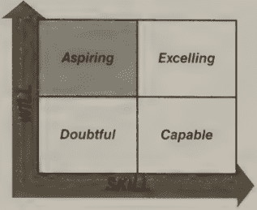
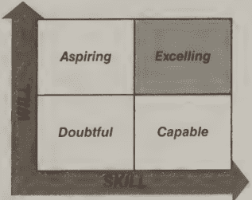
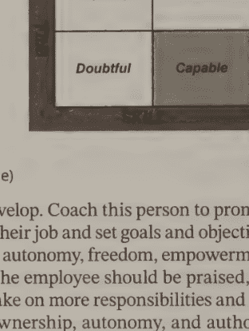
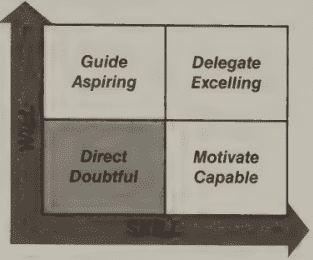

## 教练与反馈

> 有时候，只有通过他人的眼睛，你才能看清自己。
> —艾伦·德杰尼勒斯，美国喜剧演员、电视主持人、
> 演员、性别平等活动家、作家和制片人

前台接待员艾米认为自己是公司面向客户的门面。人们进来时，首先看到并与之互动的就是她。她想确保每一次互动都是积极的。她经常微笑、大笑，并尽力帮助每一个向她求助的人。

直到有一天，她收到反馈，说她太努力取悦所有人。她对自己角色的心态和感受发生了变化。她曾经认为的积极之事——实际上正是她的本职工作——变成了怀疑和沮丧的来源。负面反馈夺走了她的一些自信。她仍然努力提供帮助，但不再那么开心了。

反馈的目的是什么？通过发挥人们的优势、技能、能力、积极性和经验，帮助他们充分投入工作。毕竟，他们的成功就是你的成功！据估计，客户对公司品牌的体验中，70%是通过他们与一线员工的互动获得的。我们应该像对待最优秀的客户一样对待我们的员工。

### 给予反馈的平衡之道

我们大多数人在职业生涯中都收到过工作表现反馈。许多领导者具备出色的教练技能，知道如何给予反馈以帮助人们改进。其他人则把反馈当作锤子。还有一些人不太确定如何给予反馈。

严厉的反馈可能会削弱积极性并破坏表现。查尔斯·施瓦布，前首席执行官、杰出的个人财富管理者和金融投资者，曾说过：“我尚未找到一个人，无论其地位多么显赫，在认可和支持的精神下工作，不比为批评所驱使时做得更好、付出更多努力”（施瓦布，2004）。

唐·克利夫顿博士，美国心理学会前主席，优势反馈和发展心理学的奠基人，收集了50年的盖洛普研究，包括20,000次领导力访谈和10,000次员工访谈，以找出高效领导者做得好的地方。克利夫顿发现，最有效的领导者会定期且频繁地寻求和提供反馈，以最大化员工优势。

如果人们能够以开放和积极的态度对待反馈过程，他们就会充满活力。

但很多损害可能以反馈的名义造成——这或许就是为什么我们害怕给予反馈几乎和害怕接受反馈一样多。如果反馈被用作惩罚性、处罚性、“背后捅刀”的方式，员工参与度和绩效反而会下降而不是提高。有些人躲在匿名反馈调查后面：就像互联网上的喷子，他们对自己通常希望改进的同事进行攻击性、辱骂性的抨击。有指导性、有帮助的反馈；也有非常消极、辱骂性的反馈。反馈绝不应该以惩罚、操纵或辱骂的方式使用。

反馈有其目的：大多数人以为自己知道自己擅长什么，但他们通常错了。他们没有停下来去看看自己天生的天赋和才能在哪里。反馈有可能填补盲点，明确优势，并识别需要改进的领域和机会。

马歇尔·戈德史密斯认为，反馈是必要的，因为有些人“极其自欺欺人”。他观察到，95%的员工相信自己的表现处于团队前一半。戈德史密斯写道，这在“统计上荒谬”，但在“心理上真实”。与此同时，“给人们负面反馈意味着‘证明’他们错了。向成功人士证明他们错了，效果几乎和强迫他们改变一样。不会发生的……但成功人士的身份往往与他们的所作所为紧密相连，如果认为他们在接受对自己生活中最重要活动的负面反馈时不会往心里去，那就太天真了”（戈德史密斯，2014）。

教练应该平衡正面和纠正性反馈。过多的负面反馈可能让人感觉是辱骂、打击积极性和士气。另一方面，只有正面强化而没有纠正，可能显得不真诚和空洞。经验法则是提供的正面表扬、肯定和支持，要比纠正多两到三倍。

通常，正式的风格和优势测评工具以及360度调查在给予反馈时很有用，因为它们为你对人的看法增加了可信度。

### 反馈与教练的实际应用

如果你对给予反馈感到不自在，可以练习以下步骤，以帮助改进发展和行动计划：

- 1. 说明你给予反馈是为了帮助每个人理解如何更好地为团队目标或特定领域的改进做出贡献。将反馈与文化、价值观、人才发展、目标、行为和公司绩效标准相结合。
- 2. 具体描述你或他人观察到了什么。将反馈限于客观数据或观察。要有尊重和帮助，绝不能有害或贬低。不要攻击对方，也不要在任何评论中人身攻击。
- 3. 解释任何期望行为改变的影响。明确你的期望。与公司价值观、目标、绩效标准或工作中期望的新的更好行为联系起来。
- 4. 给团队成员回应的机会，让他们公开分享自己的观察和反应。不要关注过去；而要关注未来，以及他们能如何有效改进。为反馈创造一个安全的环境，让人们不会产生抵触或防御心理。
- 5. 共同头脑风暴如何让事情变得不同。不要关注问题，而是关注可能性、机会和解决方案。瞄准期望的未来状态，设定目标，确定重点领域，并协作制定承诺或计划。以肯定、鼓励和信心结束反馈会面。通过提供支持，在积极的语气中结束。

所有反馈和教练都应导向一个清晰、可问责的行动计划。马库斯·白金汉在讨论如何提高人类表现时说：“领导者必须开发一个系统化的流程，以发现并明确他们的优势是什么，以及如何利用这些优势”（白金汉，2001）。专注于积极面，帮助人们发挥优势，而不是只关注差距或弱点，将大大有助于增强他们的能力、激发活力和动力，从而改进他们的表现。

以下是一些有用的规划工具，用于更好地吸引和赋能人们，以积极的方向有效规划和运用他们的反馈和教练。

### 实践：我的“当前状态”自我：我现在是谁？

问题、挑战或机会是什么？我现在处于什么位置？我喜欢什么？我擅长什么？优势？需要改进的目标领域？别人如何看待我？有什么差距？

我的优势是什么——即那些推动我走向“理想状态”自我的特质？

我目前被观察到和确定需要改进的领域是什么？有哪些关键差距领域？我希望/他人希望我发展的方面是什么？我如何在我的“当前状态”自我和“理想状态”自我之间创造更多一致性？

## 练习：我的“理想状态”自我：在未来状态中，我真正渴望成为什么样的人？

我真正想从生活中得到什么？我真正想成为什么样的人？作为一个人，我的目标是什么？我的目的或贡献是什么？

当你比较所记录的与“当前状态”自我和“理想状态”自我相关的内容时，会出现哪些洞见？有哪些关键行动？要在什么时候完成？

## 作为教练给予反馈

> 领导者是能够借助他人并与他人一起有效完成事情的人。
> ——沃伦·巴菲特，伯克希尔·哈撒韦公司首席执行官、商业投资者、演讲者和慈善家

谁对你的人生产生了最积极的影响？谁是支持和鼓励你的人？谁是批评和贬低你的人？他们对你的影响有什么重大差异？这在商业文化或环境中意味着什么？如果你告诉一个人四件关于他的好事和一件负面的事情——你猜哪种反馈会被记住？那件负面的事情。请记住，针对一个需要改进的指导领域，应当给出三四个积极反馈领域，这一点非常重要。例如：

1. “麦凯，你非常可靠。你每天准时出现，准备好投入工作。”
2. “麦凯，你的工作无可挑剔。你的信息来源专业可靠，你报告中做的研究也毫无瑕疵。”
3. “麦凯，大家真的很喜欢和你共事。你态度很好，让协作变得轻松而有成效。”
4. “麦凯，你确实超越了自己的岗位职责。你非常有才华，你正以我们甚至认为不可能的方式拓展你的工作角色。”
5. “麦凯，你的最终工作成果总是很出色，但你似乎总是把事情推到截止时间的最后一刻。你似乎经常拖延。有没有什么办法可以让你停止拖延，更快、更准时地完成报告？”

你认为麦凯会从这次评估中记住什么？如果他像我们大多数人一样，他最清晰的记忆会是老板说他拖延、太慢。为了确保反馈是积极的，请记住，要首先慷慨地、大量地给予肯定和优势。

我曾与一位领导交谈，他刚刚结束了对直属下属的季度绩效评估。他的一名员工被称为办公室的顶尖绩效者。她的总体评估等级是“优秀”，但他在她的评估中指出，她全年没有参加足够的培训课程。尽管她的总体评级是“优秀”，她还是与主管争论了三个小时。

如果某人走在错误的道路上，并且有严重的脱轨行为，关键在于以有帮助、支持的方式向他们展示这些行为是什么、观察到的证据、负面影响，以及他们如何改进。当人们带着愤怒、仇恨、内疚或羞耻的情绪给予反馈时，很多时候反馈不会被完全接受。指责、羞辱和评判是无效的，并且会压过所有其他有效的反馈过程。反馈应该是诚实和透明的，但也应该在基于事实的观察和支持方面提供帮助。反馈应该始终创造希望，并指出通向潜力和改进的道路。反馈是为了帮助人们变得更好，而不是变得更痛苦。永远不要把反馈当作武器、操纵工具，或用来制造绝望。

让我们来看看一些给予反馈的坏方式和好方式。

1. 在指称可观察的行为时要具体，并寻找改进的方法：

   - **差**——“卢克，你很懒，你不努力工作，而且你在工作上的态度很差。”
   - **好**——“卢克，我观察到这周你上班迟到了三次，每次15分钟。你能解释一下你迟到的原因，以及你希望如何改变这种情况吗？”

2. 关注个人或团队成员能够改变的可观察行为：

   - **差**——“雅各布，你为什么这么内向和害羞？你似乎不喜欢和财务部门的其他人交谈。”
   - **好**——“雅各布，我们希望你能让团队充分了解情况。我们怎样才能就所有预算保持更紧密的沟通？”

3. 不要对人有负面情绪。明确该行为对团队和业务的影响，并专注于如何解决问题：

   - **差**——“萨布丽娜，你为什么总不能准时把报告交给我？”
   - **好**——“萨布丽娜，当你的报告不能准时送到我手上时，我也无法准时把报告交给我的老板和其他领导。这会减慢他们的决策过程；当我们急需资源时，他们也无法把资源分配给我们。我们能一起想办法按时完成报告吗？”

4. 避免给人贴上负面标签。关注可观察的行为，并探索如何做得更好：

   - **差**——“扎克，你对我们客服团队的成员真的很不体贴。你打断他们的话，不听他们说话，而且语气粗鲁。”
   - **好**——“扎克，我知道做一个好的团队合作者对你来说有多重要。我理解你在销售方面压力很大。我收到了客服部门的反馈，说我们需要改善与他们的沟通。关于如何做到这一点，你有什么想法吗？”

5. 以平静、不带情绪的语气给予反馈，并使用表示尊重和支持的良好肢体语言。专注于让另一方参与到问题的解决方案中，避免通过评判和羞辱引发防御心理：

   - **差**——“史蒂夫，你又搞砸了！你显然不知道如何操作那台机器，你一直在搞乱我们的生产线。”
   - **好**——“史蒂夫，我认为有一些方法可以让你在使用我们的机器时提高质量并改善生产运行。你注意到了质量和生产方面的问题吗？对这两个方面，你有什么改进建议吗？”

所有反馈都应针对我们所辅导人员的发展。如果我们只关注反馈而不着眼于培养人才，我们或许能获得短期成果，但人员仍然缺乏技能。始终牢记你为接受你反馈的人设定的发展目标。

## 给予基于优势的反馈

最好的教练会基于他们所辅导人员的优势来给予反馈。除了优势之外，这还关乎澄清个人的目标、意义和重要贡献。你应该在辅导议程中加入一些有助于识别这些优势和激励目标的问题：

- “你最重要的两三项天赋、优势和才能是什么？”
- “你一直喜欢做的事情是什么？”
- “是什么让你每天早上有动力、兴奋地起床？”
- “你在什么时候感觉自己聪明、有才华、处于最佳状态？”
- “你什么时候对工作最投入、最有热情？”
- “你希望在工作中多做些什么？”
- “如果不需要钱，你会用一生去做什么？”
- “你希望在哪些优势上得到更充分的发展或运用？”
- “在团队工作时，你最喜欢做什么？”

## 辅导与反馈

使用这类辅导工作表工具，你可以回顾以下关键问题，以帮助你在持续的辅导对话中进行规划和跟进：

1. **在每个优先领域（优势和改进领域）集思广益，制定行动方案：**
   - “你如何才能最有效地发挥自己的优势？”
   - “你将如何抓住机会改进自己的弱点/局限？”
   - “你将如何调整自己的行动，以推进团队、业务和组织的战略优先事项和目标？”

2. **制定领导力发展/工作绩效行动计划（以工作绩效为重点）：**
   - “列出关键工作绩效行动/行为/能力的具体描述。”
   - “列出你当前工作中预期的完成时间和成功衡量标准。”
   - “在接下来的30、60和90天内，你预计能在工作绩效中取得哪些速赢？”
   - “你预计能在工作绩效中取得哪些更长期的成果？”

3. **制定长期职业发展目标（以职业为重点）：**
   - “你对未来的职业期望和抱负是什么？”
   - “在未来一到五年内，你希望自己在职业上达到什么位置？”
   - “谁是你的职业导师？谁是你职业支持网络中的一员？”
   - “你未来最重要的职业目标是什么？”
   - “要实现这些目标，你需要培养哪些技能、人脉或资源？”

4. **确定利益相关者的支持、资源和问责机制：**
   - “你需要让哪些利益相关者参与到你的成功之中（例如，老板、同事、你的经理、团队成员、其他部门、家人等）？”

## 教练与反馈

领导力。并非每个人都想要改变和改进。人们在自己身上只看到他们准备看到的东西。作为教练，你接受他人反馈的方式会定下基调：如果你以谦逊的态度接受反馈，他人也会更愿意接受你的反馈。

在他的著作 *从优秀到卓越* 中，吉姆·柯林斯通过广泛研究发现，卓越组织中表现最优异的领导者都谦逊。他们通常安静、内敛、害羞，并倾向于根据良好信息采取行动，而不是用自己的魅力和自我压倒所有人。事实上，柯林斯认为谦逊是伟大领导者的首要特质，也是他所说的*第五级*最高层领导者。他们的谦逊主要体现在利用反馈的能力上——倾听客户、市场、竞争对手和员工的声音——并根据输入和持续反馈适应必要的变革（柯林斯，2001年）。

我对这项研究并不感到惊讶，因为我们都已看到，大多数文明、国家、公司和个人的衰落，始于它们变得以自我为中心、只关注内部、傲慢、短视，并与诚实、坦率的反馈隔绝之时。

著名的哈佛商学院教授克莱顿·克里斯坦森博士曾要求他的MBA学生描述一位他们认识的非常谦逊的人。结果发现，他们认识的最谦逊的人也是他们最钦佩的人。对学生来说，谦逊并不是一种自我贬低的行为，而是一种健康的自尊心以及乐于接受反馈的表现。

我记得在我职业生涯早期，史蒂芬·柯维博士常说，谦逊是一切原则之母，而对原则的遵从则是一切原则之父。我们需要对市场、客户和员工的反馈保持开放和谦逊。然后，我们需要忠实地遵循持续改进、创新和变得更好的原则。

我曾被指派去教练各种谦逊程度的领导者。例如，奥斯汀是一位非常有活力、创新且经验丰富的高管。多年后，他在公司中一路升迁，最终坐上了传说中的角落办公室。不幸的是，既然奥斯汀在职业成功方面终于得到了一切他想要的东西，他就把周围的人都当成白痴对待。他必须成为房间里最聪明的人。他是部门里所有知识的来源，如果有人独立发言，奥斯汀很快就会压制他们的声音。

奥斯汀所在的部门后果严重且引人注目。他的员工缺乏投入。他们变得沉默，而他对此并不在意。

我被请来担任奥斯汀的教练。我问他：“奥斯汀，你知道你在办公室里与团队相处时是什么样子吗？”奥斯汀认为自己充满活力、有魅力且有趣。他确实有很有魅力的一面，而员工们在某种程度上也看到了。我问他们：“你们喜欢奥斯汀什么？”他们承认他聪明、有魅力，并且在自己的职位上能力很强——但他脾气不好，有自己的小算盘，而且他们无法信任他。他觉得自己手段圆滑，但其他人非常不喜欢他，并视他为团队成功的障碍。

我问他：“你有什么想要改变的破坏性行为吗？”他想不出任何一个。“你打算怎么办？”我问道，同时将他员工的调查反馈摆在他面前。他迅速变成了受害者。“我能怎么办？”他问。“我已经在尽力对待手下的员工了；他们都是白痴，如果我对愚蠢的人容易感到沮丧，我也没办法！”

自我就像一个骗子；它想要保护自己免受诚实反馈的伤害。它必须是房间里最聪明的人。它需要掌控一切，对他人非常苛刻，并不停地自我推销。自我甚至能隐藏在虚伪谦逊的面具之下。奥斯汀的自我正在召唤援军；他对反馈、意见和改变并不开放。

“但是，奥斯汀，”我说，“如果你不改变，代价会是什么？”不幸的是，奥斯汀很快就知道了代价：他被解雇了。尽管他取得了扎实的财务业绩，但他失去了影响力，因为他的价值观与公司文化相悖，而且他不愿改变。他的失败不在于他产出的[目标、财务结果、衡量指标和目标]，而在于他如何通过[语言、沟通、行为和价值观]来实现这些产出。这个“如何”是不可持续的，也与他建立高度信任文化的能力不符。

与我对奥斯汀的工作形成鲜明对比的是，我在德克萨斯州达拉斯市与一家市值十亿美元的全球公司进行了一次领导力工作会议和教练项目，这段经历让我满意得多。我与CEO邓肯（他已成为我非常好的朋友）以及他的执行团队（来自欧洲、亚洲、拉丁美洲、加拿大和美国）合作。

在一次领导团队外部静修会上，我们审查了每位领导者的360度领导力画像中的汇总数据，其中包含来自其上司、同事、直接下属和其他人的坦率直接反馈。

我惊叹于CEO在这次会议上的开放、谦逊和真诚。有一次，他公开与团队分享了自己反馈报告中的关键数据。他在智力和情感上都表现得非常脆弱。他分享了自己需要改进的事项：在公司各层级进行沟通、让其他人承担责任，以及更关注客户需求。他没有表现出任何防御性：“这些反馈是真实的，”他说，“我需要在这三个方面都做得更好。”

第二天，当我和邓肯团队成员交谈时，他们说：“看到我们的CEO分享自己的缺点，真是令人耳目一新。我们了解他的长处和短处，但有了这些客观数据，我更清楚地看到他是一位了不起的领导者。他谦逊而开放。他的缺点根本没让他显得软弱。相反，他真诚的改进愿望给了我们领导团队所有人敞开心扉、展现脆弱以及同样改进的勇气。”

像邓肯这样伟大的领导者愿意直面商业环境中的残酷现实，评估自己的表现，诚实面对自己的领导力缺陷，并做出必要的个人和组织变革，以在动荡的全球环境中引领前行。

## 通过反馈获得认知

> > 信念和希望的能力是生命中最重要的事实。它赋予人类方向感和开始行动的能量。  
> > —诺曼·卡曾斯，政治记者、作家、教授和世界和平倡导者

约翰·惠特沃斯爵士认为，提高自我认知是教练能做的最重要的工作。望远镜和放大镜都能为上方星系或看不见的微观世界提供清晰的视野和洞察。有效的教练辅导也是如此。

教练像举着一面镜子，照见一个人的思维方式、想法、感受、动机、行为和选择。

我们全家喜欢去夏威夷。当我和家人在考艾岛潜水或浮潜时，我的潜水面镜帮助我清晰地看到美丽的珊瑚礁、色彩斑斓的鱼、海龟、僧海豹和海豚，没有它这一切只是一片模糊。就像我的潜水面镜一样，好的反馈帮助我厘清周围的关键问题、可能性和机遇。

我教练过的一位大型全球科技公司总裁说他正陷入困境，但无法确切指出原因。尽管他处于职业生涯的顶峰，并被视为高绩效者，他却感到精疲力竭和压力重重，告诉我：“我越努力工作，越感到疏离。我正在失去我的优势、平衡，以及激励团队取得成功的能力。”

随着我们逐步收集和分析反馈，他的自我认知逐渐增强。他开始意识到自己陷入了每天紧急“救火”的忙碌中。他忽视了战略优先事项，并且在工作的战术层面变成了微观管理者。他意识到自己的执行团队缺乏投入，因为他试图独自完成所有工作。而当他确实下放任务时，团队成员从未被完全授权去决策和行动。最后他得出结论：他需要更具战略性地领导，授权给团队，给予他们更多独立于他行事的权力，并在个人生活和工作生活之间取得平衡。

反馈帮助这位领导者重新全身心投入改善公司，更多地授权团队，并与家人重新建立联系。他专注于设定明确的靶子、目标和目的，这些是他和团队都觉得更有激励性且更现实的。他重新找回了热情，但自我认知必须先行。

以下开放式问题可以指导领导者兼教练收集和分析反馈。

## 收集反馈

- “谁是你的关键利益相关者——客户、同行、同事、团队成员——他们能给你坦率的反馈？”
- “他们提供的什么信息对你有帮助？你想收集哪些数据点、关键事件或证据？”

-   “你认为这些人的反馈中会提到哪些问题？”
-   “某个重大问题影响最大的人群有哪些？对他们造成了什么影响？关于这个问题，他们能告诉你什么？”
-   “描述一下改善（情况或问题）会如何为你、你的工作、职业、家庭带来更大的好处。”
-   “描述问题如果保持不变会产生什么后果。”
-   “如果一切照旧，你愿意继续维持现状吗？”

## 分析反馈

-   “你对这份反馈感受如何？”
-   “你认为这份反馈中提出的问题有什么影响？”
-   “基于这些提出的问题，你希望哪些方面有所改变？”
-   “你认为自己如何能以更积极的方式影响这一情况？”
-   “你可以采取哪些可能的策略来扭转这一局面？”
-   “你认为自己在改善这一情况方面有哪些优势？”
-   “其他人会说你在改善这一情况方面有哪些优势？”
-   “你最想着手解决的是什么？”
-   “针对这个问题或机会，你会采取哪些行动来改进？”
-   “你个人承诺采取哪些具体行动？”
-   “你打算何时开始，与谁一起？你的下一步行动步骤是什么？”

## 将人与问题分离

> 唯有变化是永恒不变的。正是在变化之中，我们找到了自己的目标。
> ——以弗所的赫拉克利特，公元前六世纪晚期希腊哲学家

肯·布兰查德常说：“反馈是冠军的早餐。”处理得当，反馈可以成为持续改进的有力工具。坦诚对待反馈并讨论真正的问题，有助于增进信任、克服恐惧。那么，如何以安全、高效且具有指导性的方式提供有效反馈呢？

当人们感到反馈带有威胁性时——如果受到严厉评判、批评或指责，或者收到自己并不认同的负面反馈——就会产生防御心理，甚至心怀怨恨。为了自保，他们可能会制造出已解决问题的假象。他们回避反馈中提出的问题，在不愿面对现实的情况下责怪他人、回避问题或进行归因。

优秀的教练可以通过尽可能将人与问题区分开来，将这类反应降到最低。这在一定程度上是一场平衡表演：既强调人的优点，又以持续改进的心态对待缺点。在提供有效反馈时，可参考以下指导原则：

-   以尊重的方式开场，使用具体、明确、面向未来的表述。
-   反馈应具描述性，而非评判性。使用事实数据、直接观察和具体示例，而不是主观印象或直觉感受。保持客观，避免标签化、刻板印象和任何负面偏见。
-   用“我”的表述来描述你对情况的看法，而不是用“你”的表述造成防御情绪。例如：“这就是我对这一情况的看法/观察。”“这是我听到你说的内容。”“让我确认一下是否准确理解了你的观点。”“这就是我此刻对这种情况的感受。”“这就是它在我面前呈现出的样子。”“我可能没有看到全貌，但这是我看到和观察到的情况。”
-   认真、同理心倾听回应，并花时间理解历史或情境背景。反馈可能会对情绪造成冲击：让对方通过交谈来消化反馈。用澄清性问题确认理解是否准确。
-   关注对方的优势、可能性和机会。识别他们当前的状态，并为理想的未来状态设定目标。不要让人们被过去所束缚。
-   谈论可以实际改善的行为。
-   愿意放下自己的议程，专注于对方的议程。

## 实践：你的教练战术手册

尝试讨论反馈。选择一位你信任的人进行练习。以下是一些示例教练问题，可用于年终总结、360度反馈汇报、规划对话以及其他涉及反馈的持续对话：

1.  “你对收到的反馈的第一反应是什么？”
2.  “你的反馈中显示出的最大优势是什么？”
3.  “最让你惊讶的是什么？”
4.  “你想重点改进哪些方面？”
5.  “哪些主题或问题出现时，你需要密切关注？”
6.  “你最想在哪里取得进步？”
7.  “基于你的反馈，你会采取哪些短期行动？”
8.  “过去一年你最大的成就是什么？”
9.  “今年你做出的最佳决定是什么？”
10. “你冒的最大风险是什么？”
11. “最让你意外的是什么？”
12. “你想继续做哪些事情？”
13. “哪些事情你永远都不想再做？”
14. “哪个错误让你学到最多？”
15. “过去一年你最大的心得是什么？”
16. “今年你是否改善了某些关系？”
17. “今年你是否消除了某些干扰因素？”
18. “今年你收到的最好的赞美是什么？”
19. “哪些本应得到认可的事情，你却没有收到相应的赞美？”
20. “回顾过去一年，是否有其他关键问题、事项、领域或关系你想谈谈？”

## 参考文献

-   白金汉，马库斯。(2001). *现在，发现你的优势*. 盖洛普出版社。
-   柯林斯，吉姆。(2001). *从优秀到卓越：为什么有些公司实现了跨越，而另一些没有*. 哈珀商业出版社。
-   戈德史密斯，马歇尔。(2014). *让你达到现在位置的东西，无法让你到达下一步*. MJF出版社。
-   施瓦布，查尔斯。(2004). *查尔斯·施瓦布的财务独立新指南：忙碌人士的简单解决方案*. 皇冠商业出版社。
-   辛普森，迈克尔·K. (2014). *释放潜能：7种改变个人、团队与组织的教练技巧*. 港桥出版社。

你听过这样的评论吗？也许你自己也说过类似的话。

这些是职场中人的心声——遍布世界各地的数百万高管、领导者、经理、主管、员工、专业人士、教师和家庭。许多人的生活充满痛苦。许多人感到迷惘、不堪重负、充满怨恨，不知道如何“点燃内心的火焰”。

你有同感吗？

当然，许多人在工作和生活中完全投入、贡献力量、充满热情、感到满足且精力充沛。但快乐、有连接感且投入的人实在太少了。在世界各地的许多工作会议中，我喜欢问这样一个问题：“有多少人同意，你们组织中的大多数员工所拥有的才华、能力、创造力和主动性，远超他们目前工作所需或允许他们发挥的程度？”大多数人举手表示同意。

在全球范围内，一场争夺优秀人才之战正在打响。员工面临新的、日益增长的期望：做更多工作，却拿更少的钱。过去，公司可以提供终身雇佣；而今天，它们只能提供就业能力。在这个高度竞争、充满活力的世界里，组织需要更高水平的信任、授权以及员工的全力投入。具有讽刺意味的是，许多员工不被允许使用他们大部分的才能、创新、动力和智慧。由于人们没有完全投入，未被充分利用的才华、精力和能力被明显浪费。

## 不敬业的高昂代价

哈里斯互动研究集团对23,000名全职美国员工进行了调查，受访者来自多个不同行业和不同的职能领域。以下是这项研究中一些最令人震惊的发现：

-   只有37%的受访者表示，他们清楚了解组织的目标、组织试图实现什么以及为什么。
-   只有五分之一的员工对自己的团队和组织目标充满热情。

- 每 5 名员工中只有 1 名表示，他们清楚自己的工作角色与团队及组织目标之间的“一致性”。
- 只有 50% 的员工对每周结束时完成的工作感到满意。
- 只有 15% 的员工觉得自己在高信任环境中工作。

这些数据令人警醒。世界各地组织中的员工情况如出一辙。尽管我们在教育、工程、技术、产品创新和全球业务方面取得了种种进步，但大多数员工并未在其所在组织中充分投入、蓬勃发展。他们既不感到满足，也缺乏热情。许多人感到沮丧和疏离。他们不清楚组织的发展方向，也不知道其最高优先级是什么。许多人感觉自己未被重视或尊重。

你能开始估算未能充分激发员工热情、才能和智慧所带来的个人与组织成本吗？员工不投入和生产效率低下所造成的代价是惊人的。对企业而言，这一成本远超税收、利息和人工成本的总和！

事实上，盖洛普研究曾震惊商界：员工不投入使美国公司每年损失 4500 亿美元。美国只有 30% 的员工投入工作，全球范围内这一比例仅为 13%。盖洛普将投入型员工定义为“那些参与工作、对工作充满热情并致力于其工作和职场的人”（Gallup 2014）。可悲的是，在当今许多组织中，如果为人们提供薪酬更高的工作或更充实、更具吸引力的文化，大多数人才都会选择离开。

## 投入的益处

是什么让员工投入工作？最大的变量似乎是员工的直接上司或经理。盖洛普估计，在各业务单元的员工投入度评分差异中，管理者至少占据了 70% 的变异（Beck and Harter 2015）。

盖洛普研究还表明，当管理者让员工在自身工作角色中专注于运用其天赋、优势和才能时，他们的工作满意度和投入度得分会达到 75% 或更高。

盖洛普发现，在具有投入文化的组织中，员工对组织成功的承诺度高出 480%，提出改进建议的可能性高出 250%，将公司推荐为理想雇主的可能性高出 370%。

这些都是很好的方面，但我想再补充一点。投入的员工会留下来并有效地产出结果，这会影响到任何组织的底线。而那些未能有效投入、也未能与发挥其天赋、才能和优势相匹配的员工，只会选择另谋高就。

伟大的领导者会获取合适的人才，留住并发展他们，同时培养和辅导他们的优势与技能，以取得卓越绩效。一个领导者也许拥有世界上最优秀的人才，但如果这些人没有被安排在合适的岗位上，没有得到尊重、信任、重视和发展，他们就不会充分投入、积极进取和高产。

我们通常很少关注人才发展和保留。我们没有花时间思考：“我们的文化正在发生什么？”“我的团队投入度如何？”“我的后备力量如何，未来的人才梯队是什么样的？”“我有哪些机会和计划来帮助员工更加投入？”“我如何投资于建设以优势为基础的团队和以人才为导向的组织？”“我如何创建一个系统来帮助员工发展其职业路径？”作为领导者兼教练，你的角色不仅是招聘、匹配、发展和留住人才；你的角色还包括寻求方法去赋能、信任和吸引团队成员，使他们能够发挥出最佳能力。

## 确保你辅导的是合适的人

> 在高绩效团队中，团队领导者的角色不那么重要，也更难界定，因为所有成员会在不同时刻领导团队。
> ——道格拉斯·史密斯（Douglas Smith）和乔恩·卡岑巴赫（Jon Katzenbach）（1999）

吉姆·柯林斯在他的著作《从优秀到卓越》中建议：“你首先必须让合适的人上车（让不合适的人下车），然后再考虑如何扩大车上的座位，以及把车开往何处

## 通过辅导保持员工投入

> *领导者是更关心他人成功而非自己成功的人。*  
> ——凯瑟琳·普尔西弗（Catherine Pulsifer），加拿大励志作家

既然你已经让“合适的人上了车”，你的下一个任务就是辅导他们，让他们保持投入和高产。这种辅导与投入的持续过程永远不会结束。这是所有伟大领导者和经理人需要持续付出的努力。

作为一家成熟且成功的家族企业的第三代，马里奥的成功几乎是有保障的。企业正以前所未有的速度蓬勃发展。但在企业前进的同时，马里奥对自己职业生涯的方向感到不满足。一边是巨大的成功，另一边是失望。

> “每个人都有自己需要跨越的障碍，而我正坐在这里面对我的障碍，不知道该往哪个方向走，也不知道如何跨越它，”马里奥向我分享道。“我正在帮助家人经营家族企业，但却困在原地，试图找到自己的道路、自己的声音，同时担心一些家人会试图把我排挤出去，为他们自己孩子的传承和最终接管腾出空间。我感到沮丧，情绪不断积压，已经到了愤怒和充满怨恨的地步。”

在辅导马里奥时，我从他的情绪触发点以及他目前对自身角色和所感知贡献的不满入手。我们必须剖析并揭示大量原始情绪、怨恨，以及他陷入困境的方面。

> “马里奥，你对这家公司感觉如何？你爱它还是怨恨它？它是否仅仅是一种家庭义务？”

他告诉我，他热爱成为家族公司的一员。他把公司看作一艘船。他爱他的船员。他喜欢当船长，带领它前进。对他来说，公司是一个积极的地方。多年来，他担任过许多有趣的职位，承担过许多责任和项目，并了解了业务的每一个领域。在父亲和祖父传承的基础上，他建立了强烈的自豪感。

> “但现在我感到被困住了，我不知道该怎么办。我想建立自己的传承，而不只是实现父亲和祖父的传承，”他承认。

它与执行工作有关。如果他们的技能未能达到基础绩效水平，或者他们正在落后，他们就可能脱离投入或失去信心；同样，如果他们缺乏意愿——激情、动力、动机、强度和兴奋感——他们的生产力和绩效会随着时间推移而下滑。

马里奥的情况就是如此。我们需要确定他的技能最适合应用在其角色和职责的哪些方面。我们还需要找到能让他充满活力、帮助他找到激情并增强意愿与动力的机会。

技能-意愿矩阵由马克斯·兰茨伯格在其著作*《教练之道》*中提出，是一种帮助你找到激励他人并使其保持充分投入的方法的工具。该矩阵让你能够评估某个特定个体的现状，并引导他们在工作中发现新技能和新激情。

技能-意愿矩阵从两个维度评估员工（图 12.1）：技能维度是个体基于经验、培训、能力、技能和知识所具备的能力。意愿维度是个体的态度、动机、欲望、驱动力、决心和激情。高技能且高意愿的人对任何高绩效组织文化都至关重要。

## 技能/意愿

|  |  |
|---|---|
| 指导 有抱负 投资 培训 | 授权 卓越 支持 晋升 |
| 直接指挥 存疑 决策 移除 | 激励 有能力 挑战 投入 |

图 12.1 技能-意愿矩阵

来源：改编自（Landsberg 1997）。

# 低技能/高意愿（渴望型）

如何最好地引导那些渴望型员工：
- 尽早投入时间，进行全方位辅导、培训、讲解和答疑。
- 营造无风险的环境，允许早期犯错和学习。
- 随着进步显现，逐步放松控制。

**图 12.2** 低技能/高意愿（渴望型）

技能-意愿矩阵有四个象限：

- *象限1——渴望型*（图 12.2）：这类人有完成任务的意愿，但缺乏必要技能。通常，他们是对工作充满热情的新人。对于这一象限的员工，领导者应通过培训、指导、讲解和答疑进行深入辅导。领导者应营造无风险的环境，让他们能在早期犯错并持续学习。
- *象限2——卓越型*（图 12.3）：这类人兼具高技能和高意愿，能够出色完成工作任务或岗位职责。他们通常是有经验、寻求更多

# 高技能/高意愿（卓越型）

如何最好地引导那些卓越型员工：
- 赋予他们完成工作的自由；设定目标而非方法。
- 多表扬，别忽视。
- 鼓励他们承担责任，并让他们参与决策。
- 承担适当风险，包括更有挑战性的任务。
- 不要过度管理。

**图 12.3** 高技能/高意愿（卓越型）

成长与发展机会的人。辅导这类人时，要给予他们完成工作的自由和灵活性，设定目标与目的，而不是规定方法。在岗位上给他们更多自主权、自由、授权和灵活性。员工应得到表扬而非被忽视，并应被鼓励承担更多责任，通过扩大职责范围，在决策中拥有更高水平的所有权、自主权和权威。应给予员工承担适当风险的自由，给予支持和信任，但不要过度管理。

# 高技能/低意愿（能力型）

如何最好地引导那些能力型员工：
- 找出低意愿的原因（例如任务/管理、风格/个人因素）。
- 识别并连接他们的关键激励因素。
- 通过展望他们能把任务完成得有多好，来增强他们的信心。
- 通过反馈和表扬进行监督。

图 12.4 高技能/低意愿（能力型）

象限3——能力型（图 12.4）：这类人有能力，但缺乏完成工作或任务的意愿和动力。他们遇到了瓶颈，需要一个新的“为什么”、一个目标、或者来自他人的挑战或支持，以克服执行障碍，把事情做成。领导者应设法与这类人的动机建立连接，并利用他们的长处。有时，这些员工可能说得头头是道，非常善于分析或经验丰富，但他们执行不力，或言行不一。要通过定期的反馈和表扬来辅导他们。让他们身边围绕能帮助他们执行的人、资源和事物，并弥补他们在意愿、动力、驱动力或执行能力方面的不足。

象限4——疑虑型（图 12.5）：这类人既缺乏完成工作或任务的技能，又缺乏意愿，无法有效履行职责。他们也可能是初学者，不愿冒险，害怕失败。领导者应首先评估和辅导，通过识别动机、价值观和愿景，为

# 低技能/低意愿（疑虑型）

如何最好地引导那些疑虑型员工：
-   首先，建立意愿。提供清晰的简报，识别动机，并勾画未来表现的愿景。
-   然后，培养技能。将任务结构化以快速获胜；进行辅导和培训。
-   最后，维持意愿。提供频繁反馈；赞扬和培育。
-   自始至终，严密监督，严格控制，并设定明确的规则和期限。

**图 12.5** 低技能/低意愿（疑虑型）

未来。通过将工作任务结构化以确保快速获胜和持续指导来培养技能。最后，通过提供频繁的反馈、奖励、认可和表扬，以及增强信心的任务来维持意愿和动力。如果未能及时看到成效，就应将该员工调离。不要在这里浪费太多时间。保护表现不佳者会适得其反，因为其他员工会因他们的不称职而憎恨他们，也会因你留用他们而怨恨你。如果不让他们承担责任、提供纠偏反馈，或因不称职而调离，他们还会摧毁你未来文化的成功。

人们会根据自身经验、知识和职业生命周期的阶段，从一个象限移动到另一个象限。不明智的岗位变动甚至可能使象限2（高技能、高意愿）的人变成象限4（高技能、低意愿）！史蒂芬·R·柯维博士的智慧在此适用。你需要持续地辅导、参与、连接，并努力激励他人。柯维博士曾说过：“领导力就是如此清晰地传达他人的价值和潜能，以至于他们受到启发，也能在自己身上看到这些。”（Covey，2007）

下面是一系列实用的“技能-意愿”辅导问题，帮助你互动和激励员工，并让你的员工保持在象限2（高技能、高意愿）。这些应该是持续而频繁的对话，以带动你的员工达到更高的参与度

和绩效。花点时间找出你直接影响力范围内的那些人，并开始问自己这些问题：

-   这个人身上有价值和发展潜力吗？
-   他们是否坐上了公共汽车的正确座位？
-   作为教练，你如何培养团队成员的高技能和高意愿？
-   你是否具备正确的思维模式，能够根据员工在技能-意愿矩阵中的位置来辅导他们？
-   你是否相信每个人都是领导者，都有取得卓越表现的高潜力？
-   你是否相信有些人只是需要一点帮助、资源、鼓励和支持？
-   你是否看到了评估、培训、发展、指导和辅导这个人的价值？
-   你如何做到对他人抱有最好的期望，并帮助激发出最好的表现？

以下是一些问题，帮助你与员工建立连接，帮助他们明确并释放自己的优势和才能：

-   “你如何描述你当前技能、能力或状况与未来期望之间的差距？”
-   “你希望未来工作表现或职业发展的哪些方面作为重点？”
-   “未来机会让你感到兴奋的是什么？”
-   “你想从哪里开始？”
-   “你想建立在哪些优势之上？”
-   “你对什么充满热情？是什么点燃了你的动力、干劲和激情？”
-   “你一直喜欢做的事情是什么？你真正擅长什么？”
-   “你在哪些方面表现出色？你最大的优势和才能是什么？”
-   “你想克服什么？”
-   “你想实现什么？”
-   “关于你的工作，你想改进什么？”
-   “你想培养哪些技能？”
-   “你希望提升哪些额外能力？”
-   “是否存在阻碍你成长的思维模式？”
-   “你的工作与生活是否平衡？是处于平衡状态，还是有精疲力尽的风险？”

# 针对潜在倦怠的辅导

> *亲爱的压力，我想离婚。请理解，不是你，而是我。*
>
> ——托马斯·E·罗霍·奥布里 (2019)

最后一个领域——倦怠——是矛盾的，因为它可能影响那些投入强烈甚至可能过度的团队成员。他们往往是你最宝贵的人；正因为如此宝贵，他们常常负担过重，面临崩溃的风险。

例如，我辅导过的一位优秀高管担心失去他最好的一位经理。她叫麦肯纳。她工作非常努力，执行力强。她的职业道德无可挑剔。总是早来晚走。她与人沟通良好，对周围人充满同理心。她的产出在最高水平，几乎所有交给她的任务都能完成。这是理想员工，对吧？但这名高管担心的不是如何从麦肯纳身上榨取更多生产力。他是一位人才领导者。他有足够的远见，知道如果她继续这样激进地过度工作，将来会有麻烦。

> “在我们的组织中，第一个来最后一个走并不是成功的勋章。停留在快车道上，专注于完成所有迎面而来的紧急任务，会导致倦怠。”麦肯纳的老板说。“我们重视人。我们重视他们和家人生活的平衡。我们想从高层树立正确的工作与生活平衡文化。关键在于我们的人要照顾好自己的身体健康，管理工作对个人生活造成的情感成本，有效管理工作之外的个人和家庭关系时间，然后设法缩减工作量以实现平衡。”

这名高管对麦肯纳的辅导议程完全围绕帮助她找到工作、职业与生活的平衡。这是最佳状态的辅导。没有什么“不对劲”，没有什么“出了问题”。但未来问题的风险是真实的。我们都见过这种情况。公司不断要求越来越多

and more. 如果不加以控制，工作可能会变成全年无休，每天 24 小时，每周 7 天，每年 365 天。

麦肯娜的老板经常与她联系。他们一起头脑风暴，创造性地思考如何实现工作、职业和个人生活之间更好的平衡。麦肯娜喜欢扑灭火情，参加所有会议，并做出大部分，如果不是全部的话，日复一日的业务决策。她需要更好地调动团队成员，更好地明确角色，授权并信任她的下属做出决策，并在业务的运营和战术层面让出道路——特别是在这些方面。

她意识到大多数日子里，她晚上很晚才离开办公室，这对她来说行不通。她决定每天在下午 2:00 到 4:00 之间开始处理邮件，而不是从下午 6:00 左右开始；新的时间安排将有助于她在晚餐时间与丈夫和孩子们待在一起。

很长一段时间以来，她一直觉得工作日永远不会结束。“它永远感觉不完整，我很想把它带回家，并在整夜保持在线连接。”一位外部教练能够帮助她建立一个一致的仪式：她现在每天在离开办公室前花 15–20 分钟来规划第二天。这看似微小的仪式产生了巨大的影响。麦肯娜在变得更有条理的同时获得了自律。教练帮助她计划、准备、优先排序、授权、信任他人、明确角色并保持在更战略的层面，同时将更具运营和战术性的任务推给她的团队成员。麦肯娜现在不仅拥有提升自己工作和生活的工具，而且还能让周围的人学习和发展。

我们生活在一个紧迫的旋风环境中，来自电子邮件、短信、电话、会议以及智能手机上的社交媒体帖子的 24 × 7 全天候访问不断推送提醒和紧急请求，带来源源不断的数据和信息。工作要求高且感觉无休无止。越来越难以在我们各种角色和责任之间找到工作与生活的平衡。在工作场所、家庭、家人、朋友、社区以及我们日常互动的人之间切换开和关是困难的。倦怠可能导致焦虑、抑郁、失眠、人际关系紧张或破裂、健康问题、脱节、疲劳和怨恨。

我们每个人对情绪压力、负面触发因素和身体压力的反应能力都不同。倦怠应该是所有雇主的警钟，帮助治疗尚未

苹果公司是他的激情所在。不仅仅是他创立然后拯救的公司，而是苹果所代表的东西。苹果是一辆载具，将最高科技的应用带给人类，使生活和工作变得更好。人们对苹果的产品充满热情，并且仍然如此。苹果的品牌成为他们品牌的一种延伸。

想想有多少令人惊叹的创造物来自史蒂夫·乔布斯管理的公司。Apple II，世界上第一台大规模生产的个人电脑。Macintosh，几乎今天地球上每台个人电脑界面的基础。皮克斯，有史以来最成功和最具创新性的电影工作室之一。iPod 和 iTunes，改变了音乐产业并改变了我们获取和聆听音乐的方式。iPhone，颠覆了停滞不前的手机行业并创造了现代智能手机的概念。而 iPad，则定义了一个新的、更小的计算类别，兑现了 Mac 最初作为“为我们其他人而生的电脑”的承诺。

如果你想要平静，如果你想要目标，如果你想要完整，就要发现只有你才能做出的伟大贡献。作为一名教练，你最高的使命之一是帮助他人为自己发现那种目标、激情和贡献。你的同事和团队成员可能永远找不到像史蒂夫·乔布斯那样的目标，但他们可以找到他们真正想要在世界上留下印记的方式，并以自己的方式过上一种充满灵感、充实、有意义和目标的生活。

“你的时间有限，所以不要浪费它去过别人的生活。不要被教条所困——即活在其他人的思考结果中”去解决社区或社会、市场、你的组织或团队中的外部问题、挑战或需求。有时，催化剂可能来自你的价值观或良知，对服务他人的召唤。或者，你可能在满足深厚的激情或个人兴趣时开始做出贡献。

但在四项发现的交汇处，才是你独特的人生目标和贡献。让我们按顺序看一下每个要素。

## 发现需求或机会

> > 我们永远不知道我们影响了哪些生命，或何时，或为什么。
> > —斯蒂芬·金，美国悬疑和科幻小说及电影作家

识别我们的优势、才能和激情固然重要，但大多数人如果不满足社会或市场中的需求，就永远无法让工作超越爱好。我们必须将我们的激情和价值观与人们真正想要和需要我们提供的东西相一致。我喜欢这句话“没有任何组织天生就拥有存在的权利。”没有

## 为贡献而教练

公司如果没有愿意为产品或服务付费的客户就无法存在；一旦你失去对市场的关注，你就会失去你的价值。而这些需求在不断变化，这意味着我们必须在寻求创造价值的过程中不断学习、改进和适应。同样，在政府、教育或非营利组织中，组织存在的意义是为社会需求、社区价值观或特定使命驱动的需求创造价值。

你的贡献必须推动一个伟大的总体目标：为一系列已识别的人类需求服务。这不仅仅是社会或市场上的当务之急。当我们为他人付出自我时，我们在个人上也会成长。这样来看，领导力更像是一种创造性、创新性和赋能的艺术，而不仅仅是一门科学。

根据一些伟大的心理学家——亚伯拉罕·马斯洛、克莱顿·阿尔德弗和弗雷德里克·赫茨伯格——我们每个人都有五个基本需求领域：财务、身体、情感、心理和精神。作为一名教练，你引导你的团队通过这五个领域来制定他们想要做出的贡献。帮助他们审视自己的技能、能力、天赋和愿望，以在每个领域中有所改善。

当你的团队成员发展出他们能做出什么贡献的自我定义时，以下教练问题可能会有所帮助：

- “你在整个社会以及你的外部客户、供应商、分销商、投资者、商业伙伴、团队成员和其他关键利益相关者中看到了哪些未满足的需求或机会？”
- “你在我们的内部客户中看到了哪些未满足的需求或机会？”
- “他们面临着什么财务问题？我们如何帮助？”
- “他们面前有什么身体、心理或精神挑战？我们如何帮助？”
- “最大的差距或需要满足的机会是什么？”
- “任何人需要我们什么？”
- “我们能为客户提供的伟大价值是什么，只有我们能提供？”
- “我们能做出什么贡献来帮助他们成长并实现他们的目标？”
- “他们的成长和成功机会在哪里？”

## 发现你的天赋

> *生活的意义在于拥有目标的生活。*
> 
> —罗伯特·伯恩，作者

你在哪里找到你的自然优势、恩赐和天赋？通常人们擅长自己喜欢做的事情。你可能非常擅长把自己的想法写在纸上，或者你擅长网页设计，或是你团队中最擅长管理预算或项目的人。有时我们擅长自己热爱的事情；有时我们擅长自己并不热衷或兴奋的事情。以下几个教练问题可能有助于评估天赋和才能：

- “你的天赋、能力和优势是什么？”
- “你一直以来都能轻松做到的事情是什么？你最自然成功的领域在哪里？”
- “你喜欢做什么？你比团队中的任何人都做得更好的是什么？”
- “其他人依靠你完成哪些任务？你天生擅长什么？”
- “人们会转向你来满足哪些需求？”
- “你是否曾经被分配一项工作任务，做得非常出色，即使你可能并不特别喜欢它？”
- “你是否发现自己在做某些任务时能快速有效地完成，而你并不期望如此？”

## 激发你的热情

> *生命的意义在于找到你的天赋。生命的目的在于把它奉献出去。*
> 
> —巴勃罗·毕加索，艺术家

我们的热情是生活中能量和满足感的伟大来源，也是我们 DNA 中独特的一部分。与人而异，热情涉及巨大的情感驱动、决心和能量。我们的热情就是我们深切关心的价值观、信念和事物。它们是我们感兴趣的事物，激励我们的事物，也是我们最具创造性能量和兴趣所在的地方。

## 为贡献而教练

我们的热情常常会让我们感到沮丧，因为它们如此消耗和吸收；但如果我们能将它们与市场和客户需求联系起来，我们就为做出贡献做好了准备。以下是一些可以用来激发他人热情的关键教练问题：

- “你一直以来热爱做什么？”
- “是什么驱动和激励你？”
- “你是否有一种兴趣、热情或爱好是你热爱的？”
- “你最热衷的是什么？”
- “你是否深深被某种事业或信念体系吸引，这种体系似乎能激发你和你周围人的最好一面？”
- “有没有什么事情你喜欢做得如此之多，以至于你愿意不计报酬只为能做它？”

## 与你的价值观、良知和信念保持一致

> *生活不在于拥有和获取，而在于存在和成为。*
> 
> —马修·阿诺德，英国诗人及文化评论家

最后，要找到我们的贡献，我们必须与史蒂夫·乔布斯所说的内心声音相连接：基于我们深层次的价值观、信念和欲望而对我们说话的贡献之声。我们倾听内心声音来告诉我们，我们是否真正为客户、组织、团队以及人们的生活做出贡献并增加价值。以下教练问题将有助于使价值观、信念和良知保持一致：

- “对你来说最重要的价值观、信念或原则是什么？”
- “是什么激发了你生活中的目标和意义？”
- “工作和生活中的哪个方面带给你最多的热情和喜悦？”
- “你的工作生活元素中哪些能带给你最多的满足感、喜悦和成就感？”
- “你对自己生活或工作的哪一部分感觉最好？”
- “这份工作是你应该做的事情吗？”
- “你的工作是否能服务他人和社会更大的利益？”
- “你是否在履行道德上的必然——你工作的伦理基础？”
- “你对被要求做的一些事情感到不舒服吗？”
- “在工作中你何时感到最脱节、最不满足和最绝望？”
- “你的工作是否存在任何潜在的法律或伦理冲突？为什么？”

天赋、热情和需求是不够的。我们希望将这些因素与我们内心的道德罗盘和内心信念保持一致，并问自己，“我内心对自己正在做的事情感觉好吗？这项工作是否与我的价值观和良知一致？”

## 行动呼吁：为贡献而教练

> 拥有生活中的具体意义和目标有助于鼓励你过上充实而富有灵感的生活。
> —维克·约翰逊，美国职棒大联盟球员

每个人都可以选择通往实现和伟大的道路。我们在做出只有我们能做出的贡献中发现伟大。对我们每个人来说，这项追求或道路可能有点不同。没有“一刀切”的方法；更像是“一人一尺”。我们必须不断质疑他人的需求、我们独有的天赋、我们与生俱来的热情以及良知的声音。倾听你内心的声音：它会告诉你你是谁，你在生活中应该做什么，以及如何产生影响。

我的一个客户罗伯特，经历了“寻找他独特而重要贡献”的危机。他在自己的角色中感到深深的挫败，并求助于教练来帮助他重新获得目标感。

罗伯特的父亲在他两个儿子都很年幼时创办了一家企业。罗伯特记得自己经常被告知，“罗伯特，有一天你会和你哥哥一起经营这家企业。”果然，这家企业每年都变得更强大、更盈利，直到他的父亲准备退休并把大权交给两个儿子。

但事情变糟了。罗伯特是“小儿子”，他哥哥从未让他忘记这一点。罗伯特一生都在哥哥的阴影下生活。

在我们的教练对话中，我们花了很多时间处理罗伯特的心态——帮助他从怨恨的评判者心态转变为学习者心态。也许他哥哥是“彻头彻尾的白痴”。也许他哥哥自私且控制欲强。也许他哥哥必须不断证明自己是房间里最聪明的人。也许他哥哥从不倾听，从不认可罗伯特的贡献。但罗伯特仍然可以选择如何回应。

我们努力重新构建他消极的内心故事，以及他对自己、他哥哥和关键利益相关者的看法。以下是我们在教练对话中探讨的一些关键教练问题：

- “你目前的处境是什么？”
- “关于你父亲、你哥哥和你们家族企业，你的故事是什么？”
- “什么运作得很好？什么运作得不好？”
- “你希望在职业生涯的哪些领域集中精力？”
- “什么障碍阻碍了你的职业目标？”
- “什么触发事件或人影响了你的负面情绪？”
- “什么虚假或限制性信念阻碍了你前进？”
- “你可以做出什么选择来最好地推动你的生活和职业生涯向前发展？”
- “如果你选择宽恕会怎样？”
- “放手并向前迈进对你和他人可能有什么好处？”
- “如果你不向前迈进，对你和他人会有什么代价？”
- “你擅长什么？”
- “你一直以来喜欢做什么？”
- “你如何专注于发挥你的自然天赋和优势？”
- “你的热情和优势是什么？”
- “目前需要改变什么才能让你发挥你的热情和优势？”
- “你希望目前的处境有什么不同？”
- “你的内心声音在告诉你关于你应该做不同的事情？”
- “你理想的未来会是什么样子？”
- “你在哪里看到成长、发展和产生影响的机会？”
- “你如何看待你的未来贡献更成功、更充实？”
- “你的最佳下一步是什么？”
- “谁可能是潜在的合作伙伴？他们的优势如何能与你的优势相加？”
- “你希望从哪里开始规划你未来的新游戏计划？”
- “我如何最好地支持你制定新的游戏计划？”
- “在接下来的 30 天、60 天和 90 天内，有哪些可能的快速胜利或成功？”

事实证明，罗伯特擅长数字：他非常有创造力和创新性，并且有许多大机会和潜在合作伙伴来帮助发挥他的技能、经验和热情。

> “迈克尔，我不必被困在这个职业位置上受制于人，”他告诉我。“我可以选择不同！我感到解放，仿佛被从监狱里放了出来。我对规划我的未来感到兴奋，并从那些消耗我、引起怀疑、而且我根本不快乐的工作领域中转型。我的头上笼罩着一团乌云已经有一段时间了，现在我开始看到光线和希望的曙光。”

在教练之前，罗伯特专注于过去的不公，感到不受尊重，并且认为自己在角色中没有增加价值。他的哥哥和他们的高级员工都对他进行了强烈的比较。通过教练，他认识到他可以选择自己的回应，停止与哥哥竞争和比较成功，并为自己的梦想而活。“我有一个很棒的品牌、很棒的教育、巨大的资源和工作经验。我有很好的机会规划自己的道路并留下伟大的遗产。我面前有一整片充满机会的未来，我可以看到并且我充满热情。”

> 在我们教练合作结束时，他说，“迈克尔，感谢你帮助我头脑风暴并探索从过去的成功[和失败]向未来成功转型的教练。这改变了我的生活，我现在走在非常好的道路上。我可以说，我的商业伙伴和我关心彼此的成功就像关心自己的成功一样。生活就是与你信任的好人合作并围绕自己，让他们帮助你做出重大的贡献，这是有利可图的，同时你做着你热爱的工作。”

许多人缺乏热情、目标和对生活方向的清晰度。为贡献而教练可以对个人和团队绩效、参与度以及整体贡献产生巨大影响。通过使用本节中的教练问题，任何领导者教练都能够

## 教练式贡献

帮助人们结合自己的愿景和目标，明确期望状态的结果、他们想要达到的预期效果，以及态度、思维方式、核心价值观和动机的转变，从而更好地发挥他们独特的天赋、优势、才能和抱负，在世界上留下重要的印记。

## 在贡献中找到满足感

> > *你所拥有的、别人没有的唯一东西就是你自己。你的声音、你的思想、你的故事、你的愿景。所以，请以只有你才能做到的方式写作、绘画、建造、玩耍、舞蹈和生活。*  
> > —尼尔·盖曼，英国小说、戏剧和电影作家

没有什么比发现你此生能做出的贡献更有力量的了——也许，除了激励另一个人发现他们的贡献之外。想一想那些对你的人生和事业贡献良多的人。你对这些人怀有何种情感？他们做了什么，从而对你产生了如此深远的影响？

他们相信你，并在你身上看到了某些东西。他们信任你。他们挑战你、帮助你成为最好的自己。他们鼓励你成长。当你失败时，他们帮助你学习和成长，并激励你变得更好。他们提供反馈、纠正方向、给予肯定和问责。他们忠诚，并且支持你。正因为你与他们共事，你变得更好，并受到激励去做出自己最大的贡献。

毫无疑问，领导者的最大作用莫过于帮助他人认识并最大化自身潜力，然后帮助他们实现这一潜力。我们真的不知道某个人可能有多大的能力。发现人们无限的潜能，可以是人生中最伟大的体验之一。

## 成为变革推动者

> > *有些人（男人和女人）看到事物本来的样子，就会问为什么。*  
> > *我梦想从未有过的事物，并问为什么不。*  
> > —罗伯特·F·肯尼迪，美国参议员、美国司法部长、政治家、律师和活动家

## 教练式贡献

围绕期望的未来变革状态，建立网络和与他人的合作伙伴关系。他们帮助自己和他人明确组织和团队的战略、目标和目的，同时帮助识别他人的胜利，以及他们成长、发展和成功的机会。他们帮助共同创造新的、更好的习惯和成功行动计划。他们有同理心，善于肯定他人，重视他人的意见和反馈；他们克服恐惧、冷漠、失败和对变革的抵制。作为变革推动者的教练，帮助描绘和定义切实可行的成功行动与计划。他们让人们对结果负责，并且在变革举措成功实施时，保持无可挑剔的诚实和支持。

教练可以提供改变人生的工具，帮助人们走向幸福、成就和巨大成功的道路。理解一个人的人生历史、背景、经历和路线图，将大大有助于影响他们的个人心态、优势、行为、局限、不一致之处和挫败感，以及他们在人生旅程中可能经历的许多痛苦和羞耻。教练必须提供一个安全、保密的空间，让人们可以好奇、探索真相、挑战假设、保持同理心、聚焦客户的议程、探索选择和方案，并帮助重新构建正确的心态或故事——如果错误的故事一直束缚着他们，或使他们无法克服生活中的挑战。

让我来分享教练的背景，以及它如何促使你理解自己的人生旅程，并如何在挫折与挑战中找到热情、目标和意义。我的一个好朋友、前同事萨姆·布拉肯（Sam Bracken），小时候在内华达州拉斯维加斯长大，成长环境令人难以想象：贫困、毒品、赌博和打架；情感、身体和性虐待；以及缺乏父母的支持。最终，萨姆在青少年时期不得不转入寄养家庭。

鉴于他早年遭遇了许多挫折，萨姆的心态本可能是“我真可怜，生活太不公平，没有人爱我或关心我”（这些对萨姆来说基本上是真的！）。他本可能陷入自我受害者心态，并像其他家庭成员或处于类似境地的青少年一样，轻易流落街头或锒铛入狱。

但萨姆内心深处有个声音说：“不是我。我不像他们，也不会成为他们那样的人。” 萨姆没有责备、哀叹、抱怨，也没有变得愤恨和痛苦，而是变得更好了！他天生拥有一副强壮的运动体魄和一颗宽广的心，他追随自己的热情，练习田径和打橄榄球。尽管他生命中的每个声音都告诉他，他很愚蠢、毫无价值、是个失败者，但他发现了真相：他并非毫无价值，并非失败者，也并非愚蠢。

在心理咨询、支持他的寄养家庭以及许多关注和关心他的人的帮助下，萨姆得以重新构建他内心的负面对话。他开始每天进行内心对话，这些对话变得积极、自我肯定且充满希望。他意识到自己很聪明，他可以成为一名好学生，他勤奋努力的精神可以在课堂和橄榄球场上得到回报。他还通过参加本地教堂的活动找到了平静，并通过信仰获得了更多关于自己是谁、自己的命运可能指向何处的光明与希望。他与上帝建立连接，在敬拜中找到了幸福，这帮助他克服了那些年轻人本不应在人生中面对的负面生活挑战。

最终，这个“脏兮兮的小孩子”（萨姆这样称呼自己）凭借体育奖学金在佐治亚理工学院参加一级联赛橄榄球赛，作为四年的首发球员、球队队长，并当选ACC年度最佳新人。他在大三和大四时两次获得学术全美明星荣誉。他以优异成绩毕业于佐治亚理工学院，在加拿大多伦多为他的教会完成了为期两年的全职传教，随后获得了杨百翰大学的MBA学位。萨姆与他的挚爱金姆已经幸福地结婚超过30年，他们育有四个漂亮的孩子。

> “我的主动改变首先始于获得一个大胆的人生愿景。我必须重新构建那些负面经历，并看到一个关于‘我是谁’以及‘我想成为谁’的全新、更好的未来。永远不要满足于自己现在的位置。不要带着愤怒、遗憾或怨恨回望负面的人生经历。我意识到，生活是艰难的，充满挫折和阻力。我必须向前看，找到自己人生的热情和目标。我意识到，我可以选择一条不同于当初所走的人生道路。一路走来，人们帮助我构建了一个关于‘我能成为谁’和‘我想成为谁’的愿景。他们帮助我认识到，尽管过去不堪回首，我依然可以在生活中做出选择，实现独特的贡献。一旦你在自己的道路上取得了实质性进展，回首自己走了多远，以及在这么多人的帮助下取得的成就，生活会让人感到谦卑和满足——这是甜蜜的生活”（Bracken 2012，第1—31页）。

萨姆的人生故事有很多值得解读的地方。我们都是自己人生故事的产物，其中充满曲折、转折、起伏和跌宕。生活会艰难，充满挑战。一位优秀的教练可以帮助评估历史、故事、信念、观点和选择。当教练帮助客户或表现者评估他们目前所处的位置、需要改进的差距或领域；评估必要的改变或负面影响；以及评估克服虚假内心对话、不良行为或失败/有待提升领域的能力时，教练过程会出现巨大的突破。教练可以帮助人们将心态、态度、旧习惯和低效行为转变为一种更有效、更有功能、更理想和成功的状态。

花点时间教练自己。花点时间反思并思考工作或家庭中一个非常令人沮丧或消极的挑战情境，在那里你感到无能为力、失去信心或视角，或无法控制结果。你能以哪些方式成为变革推动者，走出受害者角色，转变为负责任的领导者？哪种心态需要改变？你负责任的选择是什么？你对理想未来状态的大胆而勇敢的愿景是什么？你会做哪些不同的事情来改变这种状况？你可以借助哪些资源和人物来一路支持自己？

## 练习：你的教练行动手册

以下活动不可能在几分钟或一天内完成。可持续的改变往往是一个自我发现和领悟的过程，有时会很快到来，但可能需要长期的沉思和规划，以及随着时间推移在行为和行动上的改变。

想一想你生活中的两三个主要角色，你希望在这些角色中做出改变或做出重大贡献，并问自己以下问题：

- 1. 我需要做出哪些对自己和他人有益的改变？
- 2. 我看到了哪些未被满足的需求或变革的大好机会？
- 3. 为什么变革对我自己和他人如此重要？
- 4. 我对变革的大胆愿景是什么？
- 5. 做出这些改变的好处是什么？
- 6. 不改变的代价是什么？
- 7. 我一直喜欢做什么？做这些事情如何为世界或身边的人做出贡献？

- 8. 我可以在哪里成为变革的推动者或产生重大影响？
- 9. 什么能让我的生活更有意义、更快乐、更投入？
- 10. 我必须满足什么内在需求，才能感觉自己在做出贡献？
- 11. 这种变革的需求或机会是否触及我的热情和兴奋点？
- 12. 对我来说最重要的价值观、信念或原则是什么，以便推进或追求？
- 13. 我的价值观和良知是否激励我采取行动并参与其中？
- 14. 我是否拥有做出我想要的贡献所需的正确技能、天赋和资源？
- 15. 我期望的未来成功或贡献是什么样的？

# 参考文献

Bracken, Sam. (2012). *My Orange Duffel Bag: A Journey to Radical Change.* Crown Archetype.
Jobs, Steve. (2005). *Commencement address*, Stanford University.
Snell, Jason. (2011). *Steve Jobs: Making a dent in the universe.* Macworld. https://www.macworld.com/article/1162827/steve-jobs-making-a-dent-in-the-universe.html.

发展最终通向终极的自我实现和满足。许多人认为幸福来自于与家人、朋友或工作同事建立牢固、紧密且充满爱的联系。其他人则基于精神联系、内心平静和服务而获得高度的满足感和启迪。还有一些人专注于公共服务、推动社会正义、政治平台，或提供社区服务来解决更大的社会或全球社区需求。

这些维度每一个都很重要。为了提高更高层次的表现、满足感和幸福感，我们需要审视并深思熟虑我们如何规划和整合身体、财务、内心、思想和精神等各个方面。有时，生活会感觉单调乏味，缺乏真正的目标。学术或工作领域的表现压力可能无情不止。生活感觉像一波又一波的冲击不断击中我们，让我们站不稳。许多人感到陷入困境、过度工作、报酬不足，或感觉自己在人生的跑步机上飞快奔跑却无法停下。生活中许多事件都可能对我们的个人健康、价值感或满足感产生负面或不利的影响。

一位具有整体人思维的教练可以真正帮助人们自我评估当前的状况，并深入了解生活的每个维度。教练可以帮助人们审视对他们而言最重要的东西。每个人都有多样化的需求、抱负、热情、期望和欲望。关键是要记住，每个人都是一个整体的人，他们的兴趣、梦想、追求和需求与宇宙中的星星一样多样。教练可以帮助人们审视他们的财务财富和安全目标；他们的身体健康、健康和营养目标；他们重要的亲密关系和社会联系目标；他们的学术、职业和职业发展目标；以及他们的精神健康、内心平静和对人生目标的抱负。同样，太多时候人们被短期职业成功、金钱或职业抱负蒙蔽了双眼，以至于耗尽精力或破坏关键关系。教练可以提供极大的洞察力、创造力和创新，帮助人们探索有意义的服务、社会或政治事业、宗教联系、在线网络以及积极影响更大社区的创新项目。

整体人教练是一种简单却具有变革性的方式，能够在广泛的需求之间建立广泛的联系，并以整体和有意义的方式确定对每个人而言的满足感和幸福感意味着什么。

# 拥抱整体人

> > *生活不是关于找到自我；而是关于创造自我。*  
> > *所以过你想象的生活。*  
> > —Henry David Thoreau, American essayist, poet, journalist, and philosopher

如果你以整体的方式看待生活，你可以将它分为五个关键领域。在这五个领域中努力提升自我，你将享受更丰富、更整合、有目的且更充实的生活。如果你希望改善你的整体人思维，你将希望投入时间来澄清和定义你的整体人需求和陈述。考虑以下整体人愿景陈述示例：

- 1. *你的财务需求陈述是什么？* “我将选择通过努力工作、储蓄、财富创造、创新、财务杠杆以及投资于我有热情和目标的商业创意和创业领域，来投资时间、资源和生活。我将改善我的赚钱模式、时间和资源，以解决大问题，满足大市场需求，增加我未来的商业和创收机会，改善现金流，扩大我的财务资源，并更好地管理和控制开支。我将努力成为更好的企业家，投资时间和金钱于初创企业创意，彻底摆脱100%的信用卡债务和高利息支出。我将有效地管理时间、资本和所有资产与资源。我将建立合作伙伴关系，扩大我的专业网络，并向其他企业家、商业伙伴和投资者学习未来的商业和财务增长机会。”
- 2. *你的身体健康需求陈述是什么？* “我将主动投入时间和精力，更好地照顾我的身体和整体健康与福祉，通过持续的锻炼和愉快的体育活动。我将以更自律、控制份量和更好的营养方式进食。我将为休息、放松、睡眠和恢复留出时间。我每周将投入时间进行体育运动、爱好和个人兴趣，以帮助我改善健康、福祉和精力。”

- 3. 你的情感关系需求陈述是什么？ “我将选择投入时间建立负责任的关系和与家人、朋友和商业同事的积极联系。我喜欢建立积极、健康、充满爱且互利的关系。我将扩大我的社交网络和联系。我有清晰的界限，并选择我将与谁共度时光以及不会与谁共度时光。我对他人充满爱意和真诚的兴趣，因为我寻求更好地倾听、更有同理心、更乐观和积极地与他人相处。我将对我所爱的人保持在场和可得，帮助他们被看见、被听见、被肯定和被重视。我与他人的时间将基于振奋人心的活动、乐趣、幽默和愉快的活动。我鼓励我的成功和他人的成功。”

- 4. 你的智力、学术或职业生涯需求陈述是什么？ “我拥有广泛的创造性、好奇和创新的智力兴趣。我将投资我的天赋、技能、头脑和资源于阅读、教育、专业发展、职业发展和技能建设，成为我专业领域的思想领袖。我将牺牲时间并保持韧性，投资于专业教育课程，每年至少进行一次专业发展体验。我将加入两到三个专业网络。我将在我有友谊、财务或职业兴趣的业务领域担任两到三个董事会或顾问职位。我将主动投入时间进行持续的职业培训、指导和证书项目。”

- 5. 你的精神、目标或贡献需求陈述是什么？ “上帝的荣耀是智慧、光明和真理。我变得越智慧，我的信仰就会越增长、发展和扩展。我选择投入时间在精神上成长，通过澄清我的价值观和目标，改善我的动机和行为，并寻求内心平静、幸福和精神联系。我将通过祈祷、冥想、个人学习、社区敬拜和对他人的有意义服务来增长我的信仰。与我的家人和朋友一起，我将投入时间享受文化、艺术、音乐、自然和鼓舞人心的音乐，并为社会做出贡献。我将做简单的善行，并以服务、同情、爱和宽恕与他人互动。”

在此练习澄清你的整体性需求陈述。花上 10–15 分钟写下你的整体性希望、梦想、原则以及期望的未来状态愿景。

- 1. **财务需求陈述**
- 2. **身体健康需求陈述**
- 3. **社会关系需求陈述**
- 4. **智力、学术或职业生涯需求陈述**
- 5. **精神、目标或贡献需求陈述**

以下是可帮助实现整体性投入的全面教练问题清单：

- “你是否制定了整体性行动计划？”
- “从整体性发展的角度来看，在 1–5 分的量表上（1 = 低效，5 = 高效），你的工作与生活平衡如何？”
- “在整体性的哪些维度上你最满意和最充实？”
- “整体性的哪些维度被忽视或未得到满足？”
- “你今年希望实现什么？”
- “你在实现整体性平衡方面最大的障碍或挑战在哪里？”
- “在即将到来的这一年中，哪些梦想、抱负或目标真正激励你？”
- “哪些改变会对你的整体性生活方式产生最大影响？”
- “你在整体性的每个维度上目前表现如何？”
- “你的优势在哪里？你可能会在哪些地方获得最多的幸福、快乐和满足感？”
- “你在哪些方面需要改进？哪里可以做得更好？”
- “你认为可以在哪些方面努力以获得更好的工作与生活平衡？”
- “你在一周中在哪里以及如何花费大部分时间？”
- “周末的时间呢？”
- “你在哪里利用时间最有效？在哪里最无效？你在每周最大的时间浪费是什么？”
- “你可以在哪些最重要的领域更有效地花费时间？”
- “为这些重要领域腾出时间专注的益处是什么？”
- “如果你不花时间和精力在这些重要领域上，可能会有什么负面代价？”
- “你将承诺做什么来变得更好？”
- “你最想先改进哪些重要事情？”
- “你如何在每个领域衡量成功？”
- “你将承诺何时为自己安排时间？每周/每天多少时间？”
- “你将承诺何时为他人安排时间？每周/每天多少时间？”
- “在年度基础上，我将提高我在 [主题领域] 的有效性……”
- “在季度基础上，我将提高我在 [主题领域] 的有效性……”
- “在月度基础上，我将提高我在 [主题领域] 的有效性……”
- “在每周基础上，我将提高我在 [主题领域] 的有效性……”
- “在每日基础上，我将提高我在 [主题领域] 的有效性……”

2008 年我在哥伦比亚大学执行教练认证项目学习期间，每个教练同伴小组在我们与其他人练习提升教练技能时都被拍摄下来。拍摄和反思是我们持续改进的非常重要的方面，以便我们能够从彼此的成功和错误中学习并寻求变得更好。在一次督导教练会议中，我们的同伴组负责人 Ann Powers 帮助我更深入地了解了整体性需求、挑战和自我意识的重要性。她使用了非常有力且透明的问题来评估并帮助揭示我生活中的各个方面，在那里我没有保持平衡，并且没有给予我自身整体性发展的重要方面足够的时间和关注。

当她询问我紧张的工作旅行日程和生活失衡时，Ann 开始评估和审视我工作与生活平衡中的健康和关系方面。我感到很多内疚、压力和失衡，因为我每年大约 150–160 天都在旅行、远离家乡。在过去的 25 年里，几乎每周我都在世界各地为我的教练和咨询客户工作。我一直在跳舞和躲避许多我感到内疚的真正问题。Ann 一眼看穿了我的伪装，并开始问我一些问题，让我更深入、更诚实、更脆弱地审视我所说的话和我的行为方式。我最深层的价值观是做一个好丈夫和好父亲，并且我重视我的健康和福祉。她尖锐的教练问题帮助揭示了我的价值观和信念与我实际所做的行为非常不一致。暴露出的这种差距让我非常不舒服。

在我们的公开教练会议期间，我被拍摄下来供大家审视这个差距。我明显变得情绪化，并对真理与我所相信的东西之间不一致感到非常糟糕。Ann 怀着极大的同理心帮助我梳理了我的不一致价值观、我宣称的信念以及我的内疚感，并提高了自我意识。我们开始探索关于我如何与妻子和孩子们度过时间的新选择，以及我如何在周末在家有限的时间里做得更好。然后她要求我做出几个公开承诺，关于我希望如何不同地行为——全部都在镜头前！然后我们讨论了她如何帮助我对改变我的心态和行为负责，以便我能以更符合我的价值观、信念和我生命中最重要的东西的方式生活。

我与 Ann Powers 作为教练的个人经历是生命转变和改变人生的。她帮助我揭示了我的内疚、痛苦和失衡的需求。她在没有羞愧、指责或评判的情况下指导我。她使用诚实的标签帮助我诚实地审视真相和需要改进的差距领域。然后她帮助我重新承诺过一种符合我的价值观、信念、真理和行动的生活，从而更好地服务于我的健康和福祉、我的家庭，以及我与最重要的关系之间的联系。

她说的一句话深深印在我脑海里：“Michael，当你周末在家与家人共处时，你需要更加专注和可得。当你在家时，你能否看到你正在浪费时间做许多非增值活动，这些活动你可以委托、或外包、或简单地选择不做？更好地利用你的时间，通过与家人情感连接、一起共进午餐和晚餐、观看孩子们的体育赛事、一起参加你的敬拜仪式，并消除那些不增加持久价值的紧迫活动和分散注意力的事件。此外，鉴于你繁重的工作和旅行日程，你能否看到你需要抽出时间投资于你自己的健康和福祉？否则，你会感到压力和精疲力竭，这种失衡会影响你的整体精力和有效性。”

Ann 发现我周末把太多事情塞进日程。与家人和朋友打高尔夫、做社区服务项目、以及指导体育队伍都是好事——但不能以牺牲关系和与最重要的人的联系为代价。我试图过度补偿我缺席太多的情况。对大家庭、朋友和社区服务说不非常困难——我非常珍视这些人和社区联系。然而，它们不应以牺牲最重要的事情为代价，鉴于我与家人相处的时间有限。

保持平衡仍然很难。但现在，当我在家时，我学会了更好地对许多“好事”、“好关系”和“值得的紧迫活动”说不。在有限的时间里，我正在学习为自己和锻炼或恢复、与家人和朋友最重要的关系，以及其他关键的社区兴趣分配时间块。

你永远会有比你有时间和能力执行的更有价值、更紧迫、更好的需求。整体性平衡和五大维度之间的纪律关键在于每周回顾每个领域。不要以牺牲其他领域为代价而忽视其中一个。不要只沉迷于一两个维度的好事。正如吉姆·柯林斯所说，“伟大的敌人是好的。”在每个维度上保持整体、平衡的视角。

这次来自我哥伦比亚教练同伴实践的“顿悟”时刻让我意识到我需要更好地规划、优先排序并完全承诺我的使命和愿景陈述。然后，我需要负责任地承诺改善我自己的健康和精力水平，同时找到更好地与我的妻子、四个儿子以及其他最重要的人建立联系的方法。德国作家和政治家约翰·沃尔夫冈·冯·歌德说得最好：“最重要的事情，绝不能任由最不重要的事情摆布。”当我反思我与 Ann Powers 的教练经历以及歌德的这句话时，我开始理解，生活中选择并不总是好与坏或对与错之间的选择；很多时候，负责任的选择是在好、更好和最好之间。

我们都会做出决定，并对我们选择花费时间和不花费时间的目标、价值观、需求和重要性进行定位。定义为什么以及在哪里对于了解我们如何分配时间、精力和资源至关重要。19 岁时失去父亲让我更加专注于为什么我希望作为我妻子和儿子们生活中积极的一部分而“更加专注和可得”。我真诚地希望与他们建立联系和互动，教导和肯定他们，并培养这些优秀的男孩成为有责任感的男人，过着正直的生活，并为社会和他们未来的家庭做出有意义的贡献。

## 教练全人

> *长寿、健康、幸福的生活是做出贡献的结果，是拥有一些能令个人兴奋、并有助于造福他人的有意义项目的结果。*  
> ——汉斯·塞利，匈牙利裔加拿大压力研究科学先驱

正如我与我的督导教练安·鲍尔斯相处的经历所示，你从来不只是教练一名员工、一个团队成员或一位执行者；你教练的是一个全人——这个人与关键利益相关者以及对他们最重要的人紧密相连。当你选择教练全人时，你就是在生活的所有五个领域中触及并吸引人们：财务、身体、情感、智力和精神。这样一来，你就能更好地激发和释放他们的全部创造潜能。你会更了解什么对他们个人而言是重要的，以及如何将他们的优先事项与团队、组织和关键利益相关者的优先事项对齐。全人教练关乎发掘个体的创新、激情、兴奋感、抱负、未来发展和动力。

在实践中，当你教练全人时，你会问些什么？你会进行整体性思考，因此你的问题在个人、团队或组织的发展层面也应是整体性的。可以考虑提出涵盖以下全人主题领域的教练式问题：

1. **财务领域**

   **个人层面：**

   - 自立
   - 收入
   - 预算
   - 消费习惯
   - 投资/商业敏锐度
   - 储蓄
   - 减少债务
   - 财务规划/税务策略
   - 创业

   **团队/组织层面：**

   - 总体薪酬方案
   - 公平/同等报酬
   - 奖励与认可
   - 带薪休假（PTO）
   - 奖金激励/401K/股票期权
   - 福利/医疗/健康/牙科
   - 保险/伤残/工伤保险
   - 投资/退休/储蓄/养老金
   - 大学学费报销
   - 专业与职业发展
   - 专业协会/人际网络/指导

2. **身体/健康/养生领域**

   **个人层面：**

   - 工作与生活平衡
   - 健康与养生
   - 锻炼与娱乐
   - 营养/饮食/进食习惯
   - 营养补充剂
   - 睡眠/休息/恢复
   - 冥想/瑜伽
   - 减压

   **团队/组织层面：**

   - 安全工作条件
   - 工作与生活平衡
   - 敬业与信任的文化
   - 远程办公/弹性工作制/居家办公
   - 家事假/育儿假/休假

3. **情感/关系领域**

   **个人层面：**

   - 伴侣/配偶/重要他人
   - 家庭成员与关系
   - 朋友/同事/伙伴
   - 社区/社交网络

   **团队/组织层面：**

   - 公司文化
   - 业务单元/团队/项目
   - 专业网络/协会
   - 董事会
   - 咨询小组
   - 社区服务
   - 工会/会员组织/倡导团体

4. **智力/职业领域**

   **个人层面：**

   - 学术/教育培训
   - 出国留学/旅行/爱好
   - 实习/职业技能经验
   - 专业工作经验
   - 专业人际网络/协会/俱乐部

   **团队/组织层面：**

   - 专业工作经验
   - 专业培训/岗位能力
   - 财务、技术和工作技能培训
   - 管理与领导力发展
   - 人际网络/协会/认证
   - 指导/教练/职业发展

5. **精神/目标/贡献领域**

   **个人层面：**

   - 写日记/阅读/祈祷/冥想
   - 董事会/顾问委员会
   - 倡导与服务团体
   - 志愿服务/社区/公民服务
   - 信仰/宗教组织

   **团队/组织层面：**

   - 企业社会责任
   - 慈善/非营利机构
   - 教育/职业/社区与全球外展
   - 儿童/弱势群体/少数群体与老年人支持团体
   - 法律/社会正义/政治与环境保护倡导团体
   - 国际服务组织

也许你不习惯就这些整体性主题领域中许多问题提问。其中一些相当私密。但这些问题涉及人们所关注的许多议题、需求和重要事项。教练可以提供一个安全且富有创新性的环境，帮助人们探索并找到他们在最关心领域中的心声、激情和兴趣。

人们被要求延长工作时间，以更少的资源做更多的事，并在更复杂、多元和竞争激烈的全球环境中工作。当教练者聚焦于全人时，他们更可能以各种可能的方式关心并培养这个人。

正如亨利·戴维·梭罗所说，许多人“过着宁静的绝望生活”。他们想知道是否有人关心他们在众多方面所面临的压力。健康问题、财务困难、家庭困扰、疏离感——所有这些都可能而且确实影响着每一位员工，进而影响企业业绩。由于睡眠不足、压力、冲突和持续不断的工作要求，他们忽视了全人需求，最终陷入非常糟糕的境地。即使是一些最成功的生产者，也在忽视生活中的关键领域，正走向心力交瘁、绝望和重大挫折。

我最近教练了一位女性，姑且称她为艾米丽。她在一家国际咨询公司工作，并取得了巨大的职业成功。尽管拥有超过20年的成功职业生涯，她还是被其高要求角色不停歇的节奏弄得筋疲力尽，并在健康问题和家庭困扰中挣扎。

当我们开始教练合作时，我们发现她最大的困境之一是无法设定界限。她觉得需要不断取悦他人，同时要完成一项让三个人都感到不堪重负的工作。大多数晚上，给同事的电子邮件和即时消息一直持续到深夜，而每天早上5点45分，总有一连串后续邮件准时出现。她利用周末和假期来赶工作。

于是，我们探索了她的使命、价值观、人生目标，以及她所期望的未来愿景。她制定了一项计划，设定了明确的界限，留出了休息时间，同时仍对工作保持适当关注。当我们识别出全人的各种需求（财务、身体、情感、智力、精神），以及她在每个角色（职业、家庭、个人）中的核心价值观时，她随后确定了最重要的优先事项，以及她在生活中每个重要领域可以分配的时间比例。

教练使她得以从一条通往心力交瘁、健康受损和关系弱化的道路上恢复过来。她改变了行为，养成了新习惯和每周的仪式，满足了全人各个维度的需求。

### 采用仪式来服务全人

> 世界的主要工作不是由天才完成的，而是由那些在生活中保持平衡、并学会以非凡方式工作的普通人完成的。  
> ——戈登·B·欣克利，鼓舞人心的宗教领袖、教育家和作家

一旦你设定了全人目标，你需要在日历上腾出时间来实现它们。转变通常需要大量重复：一次锻炼不会带来多大好处，所以你需要为一系列有组织、能改变你生活的活动腾出时间。我把这些活动称为“仪式”，因为它们是有计划且不断重复的。采用某些仪式将帮助你更轻松地满足全人需求。

你的全人计划可能包括这样的仪式：

1. 在未来三到五年内，我将安排……
2. 在未来两年内……
3. 以年为周期……
4. 以季度为周期……
5. 以月为周期……
6. 以周为周期……
7. 以日为周期……

你永远会有比时间、资源或执行能力更多的好点子。保持简单，缩小焦点，不要试图一次做得太多。你持续执行几个仪式的能力会逐步增长。

艾玛有一个16岁的女儿。仅凭这句话，就足以说明艾玛在全人教练方面所面对的情况。她有一个情感需求：如何与一个认为母亲不可亲近、与自己疏离的女儿建立联系。

> “我还有两个夏天能和女儿在一起，之后她就要搬出去了，”艾玛向我解释说。“我没有多少时间去跟她建立联系了。我该怎么办？”

我把“学习者/评判者”心态介绍给了艾玛，我们讨论了她如何能开始以不评判的方式更好地与女儿建立联系。

我和艾玛集思广益了一些选项。她希望女儿少花时间精力在手机和社交媒体上。她想找到一个安全、不受干扰的环境来与女儿交流。经过讨论，艾玛选定了一个在墨西哥的服务项目——帮助修建一所学校。

作为团队的一部分，艾玛和女儿一起拌水泥、锯木梁、钉钉子、刷油漆，每天都做不同的工作。但她们也参与某些日常仪式。每天早晨从敬拜开始。早餐时，她们会与那些将……

目标很重要。行动更重要。将承诺转化为行动的关键之一是拥有一个教练作为问责伙伴：你可以向其汇报的人，他会让你兑现承诺。

大约一年时间里，我有机会担任帕克的教练问责伙伴。帕克是一位企业家，也是家非常成功且盈利的初创企业的总裁。他极具动力、聪明且富有远见。他工作 ethic 非常强，但他仍然需要有人帮助他坚持计划。

我们为帕克制定了一项教练计划，帮助他在五个整体人格领域的工作上实现个人和职业目标：财务、身体、社会/情感、智力、精神，重点关注他的关键关系和职业成功。

该计划还包括我作为帕克同伴问责教练的指导方针：

- 每周持续担任他的“随行向导”
- 帮助他持续坚持自己的仪式
- 倾听并保持持续的支持、问责和保密
- 指导他解决重大问题和克服重大挑战
- 帮助他保持正确的领导心态、行为和绩效结果
- 与他人进行关键对话的角色扮演，以便他建立信任关系
- 在他践行自己所信奉的价值观方面对他提出挑战并给予支持
- 帮助审阅和跟踪他的成功衡量指标，并在需要时帮助他调整计划

帕克是一个尽职尽责的人，完全有意愿坚持自己的目标，但他告诉我，他的目标始终在他脑海中占据首位，因为他知道我会打电话、检查进展并挑战他。他取得了真正的进步，因为他有计划，并且知道会有持续的支持和问责。

以下是作为同伴问责教练伙伴时可以提出的一些问题：

- “你希望通过你的教练议程实现什么？”
- “你今年希望取得什么成就？”
- “我们需要讨论的最重要的个人整体人格问题是什么？为什么？”
- “我们需要讨论的最重要的团队和组织整体人格问题是什么？为什么？”
- “你的关键利益相关者和影响者是谁？他们的需求是什么？对他们来说最重要的是什么？”
- “你将如何衡量与关键利益相关者的成功？谁来决定？”
- “你希望有什么不同？为什么这对你的关键利益相关者重要？对你重要？”
- “你期望 3、6、9 或 12 个月后有什么不同？一年、两年或三年后呢？”
- “你现在在整体人格问题上处于什么位置？未来需要处于什么位置？”
- “可能阻碍你实现这些目标的障碍或挑战是什么？”
- “你将承诺哪些持续的仪式？”
- “我如何在你的旅程中最好地对你负责？”
- “如果你没有按计划进行，你在做什么来重新回到正轨？”
- “你将在何时[主题领域]做什么？”
- “你希望如何庆祝关键的胜利或里程碑？”
- “你需要什么时间、系统、支持、流程、信息、培训或资源？”
- “我今后如何最好地支持你并对你负责？”

## PRACTICE: YOUR COACHING PLAYBOOK

在这里，我提供了关于如何处理教练对话中五个整体人格需求领域的建议，这些对话能带来更高水平的参与度。以下是整体人格规划的问题：

1. *Financial (money/budgets/resources)*： “你如何创造更多收入、收入和现金？你如何更好地预算和管理你的开支？你对食物、衣物、住房等所有基本卫生因素需求的处理情况如何？写下你在财务领域将要做的一两件事以改善和进步。”

## Determining Purpose and Motivation

### 1. THE WHY:

为什么你的目标如此关键必须实现？

你的理由和驱动动机是什么？

### Define my motive:

- Consecration
- Sacrifice
- Commitments
- Covenant

### 2. THE WHAT:

定义你最重要需要实现的目标：

Vision—5–10 years?  
Strategy—2–5 years?  
Important goal this year?

### Focus & clarity?
Analyze & plan

- Years
- Quarters
- Months
- Weeks

### 3. THE HOW:

定义你将采取的策略或路径。

你将如何实现你的目标？  
什么策略？  
什么行动？  
什么行为？

### Define my action plan:

- Disciplined thought
- Disciplined choices
- Disciplined actions

### 4. THE WHEN:

你将在何时实现你的目标、目标和指标？

| | | |
|---|---|---|
| A High | Must be done | |
| B Medium | Should be done | |
| C Low | Could be done | |

### Achievement milestones:

- Define X to Y
- Ongoing at X to Y (date)
- Get a finish line
- Clear measures

### 5. THE WHO:

谁将对你负责？  
谁会帮助你？  
谁全力以赴？  
My board

1. Health coach
2. Financial advisor
3. Spousal counseling
4. Professional mentor
5. Comm/religious/service

### Accountability!

My board of directors:

- Ongoing, present, future check-in?
- Past, present, future
- Celebrate successes
- Clear the path
