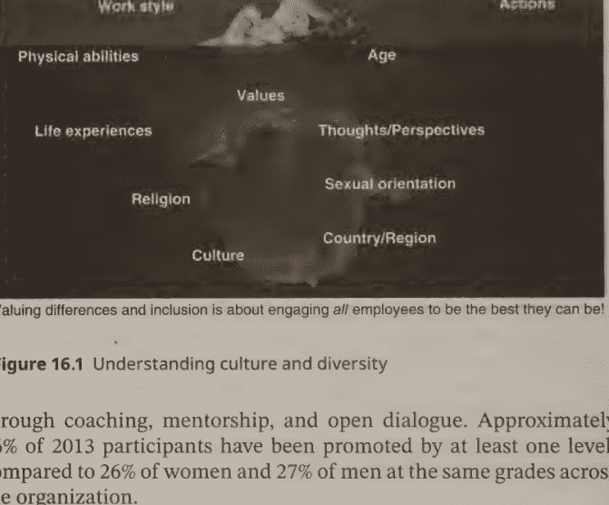

## 全球范围内的教练式辅导

> 我们实现多样中求统一的能力，将成为我们文明的美丽之处，也是对我们文明的考验。
> ——圣雄甘地，印度律师、政治家、作家和社会活动家

1987 年，我前往英国伦敦，参加了杨百翰大学伦敦国际研究中心为期两个学期的海外学习项目。那是一次绝佳的学习机会。在那短短几个月里，我有机会学习国际商业、政治、历史、文化、艺术和音乐，当然，还看了很多戏剧和交响乐，吃了许多对我来说新奇的食物。

这段跨文化经历改变了我。我原本计划主修商业营销，但回国后立刻转到了国际关系与商业专业。

伦敦之行后，我深切地渴望与世界各地多元而精彩的人们交流。毕业后，我回到欧洲三个月，游历了斯堪的纳维亚、东欧和西欧、以色列和埃及。所遇文明的多样性令人振奋和欣喜。

此外，在科维领导力机构工作八年后，杨百翰大学肯尼迪国际研究中心为我提供了一份为期一年的教学教授职位，授课地点是中国广州的华南理工大学。我之前的大部分旅行都在欧洲和美洲。现在，一个全新的亚洲世界向我敞开。当我与那里聪明的大学生共事时，我深深陶醉于亚洲的历史、人文、文化和美食。我还有机会设计、授课并辅导高潜力领导者长达一年，项目是我在广州的耐克公司为中国高潜力管理项目开发的。

在耐克担任外部顾问期间，我接触到了著名心理学家吉尔特·霍夫斯泰德博士的研究成果。他曾任职于 IBM，并在马斯特里赫特大学担任人类学与国际管理教授。

我发现霍夫斯泰德的框架对跨文化辅导非常有用，从中国领导者开始，随后延伸到欧洲、澳大利亚、新西兰，再回到美国。后来，在哥伦比亚大学期间，我在联合国纽约总部的研究生实习中教授冲突解决和调解课程时，成功地将霍夫斯泰德的理论融入其中。我最喜欢的一句话，是我妻子辛西娅在我从哥伦比亚大学毕业并完成联合国工作时送给我的。这句话出自参议员威廉·富布赖特：“我们生活在一个多元的世界。国际教育合理而现实的目标既不是皈依也不是灌输，而是鼓励不同文化间的共情与理解。”在我的整个学术和职业生涯中，我一直在 35 个以上的国家（并且还在增加）学习并实践如何在多元文化世界中有效领导、工作和辅导。

## 教练式辅导与全球多样性

> *如果我们现在无法消除分歧，至少我们可以帮助世界走向多元共存的安全之地。*
> ——约翰·F·肯尼迪，美国前总统

组织正在认识到，不仅劳动力日益多元化，市场、客户和利益相关者也在多元化。在全球经济日益一体化的今天，各国之间仍存在持续的文化差异，没有任何一种普适的管理方法可以在所有地方都有效。对于任何从事国际商业和全球贸易的公司而言，理解并善用文化多样性至关重要。即使只在本土或国内经营的公司，也能从理解全球多元化市场的细微差别中受益。

我满怀希望，我们不会回到孤立、恐惧和保护主义的旧时代。前方只有令人兴奋的、全新的多元化

and innovative frontiers ahead. I like to say that with an increase in globalization, the world of work is becoming smaller and smaller. With international trade and global outsourcing, as well as advances in technology, communication, and travel, the world is truly open for business 24 hours a day every day of the year.

This reality means the competition to attract, retain, and engage global talent has never been more intense and competitive. There is a war for recruiting, developing, leveraging, and keeping the best talent. Thus, it makes sense that organizations are embracing global diversity and inclusion not only in trade and commerce but also in leveraging a diverse talent pool.

Can you coach people to adopt a global mindset? Can you effectively engage a diverse, multicultural talent pool? Do you possess global self-awareness? Do you value diversity and inclusion? Hopefully, you can say yes to each of these questions. If not, keep open and practicing.

Leaders who understand the significance of these skills can connect more effectively with others, understand and respect different worldviews, and improve learning, innovation, collaboration, and results. Coaches who demonstrate cross-cultural intelligence can build trust and rapport with others far more quickly and easily than those who ignore cross-cultural issues and the unconscious bias that exists within all people.

However, engaging diversity is not simple. Like an iceberg, the elements of culture are often both visible and invisible. Figure 16.1 displays both sides of culture and diversity.

While race, gender, work style, language, and behavioral norms are easy enough to see on the surface, coaches must be aware of the many attitudes that are not so perceptible. Religious values, national sensitivities, life experiences, orientation, and diverse attitudes and perceptions toward life need careful study and empathy, which are less visible beneath the surface.

Therefore, managing global diversity requires a long-term commitment to coaching about handling differences across cultures. Business issues such as strategy, goals, values, leadership philosophy, and talent management can present minefields. Diversity touches nearly everything: recruitment, development, business transactions, partnerships, and relationships.

One example of a successful diversity and inclusion initiative with coaching at its heart is GlaxoSmithKline’s (GSK) Accelerating Difference program. The aim of the diversity and inclusion program is to promote more women to senior levels within the organization through coaching, mentorship, and open dialogue. Approximately 46% of 2013 participants have been promoted by at least one level, compared to 26% of women and 27% of men at the same grades across the organization.

Participants were also 76% more likely to stay at the organization, and they improved in manager effectiveness and overall engagement scores more than three times faster than the control group. This is just one of many examples of how coaching for diversity can support professional growth, organizational development, and overall success of the enterprise.

## The Diversity Iceberg

It's what we see AND cannot see

Valuing differences and inclusion is about engaging all employees to be the best they can be!

## Figure 16.1 Understanding culture and diversity

## Recognizing Cultural Diversity

> It is never too late to give up your prejudices.
> —Henry David Thoreau, American essayist, poet, and philosopher

I felt the world getting much smaller when I taught an executive leadership development course at an offsite retreat in Denmark that included global leaders from Europe and Asia. I was able to coach several of them on their 360-degree feedback and help co-create action plans to be more effective and build trust across cultures. One leader I coached was from Denmark and was a key operations leader with an international retail firm. Responsible for global operations, he often visited his colleagues at manufacturing plants in Thailand. While there, he met with the local leaders, managers, and team members, fielding issues such as poor on-time delivery of products, operating process breakdowns, and quality and cost issues.

While coaching the leader in Denmark, I became aware that his strong, direct leadership style was based on individualism, being honest and direct, supporting low power distance to challenge ideas from everywhere, a value for equality of both masculinity and femininity, and a high level of certainty and value for risk. When this great Danish leader was working with his colleagues in Thailand, he confided in me, “I am stepping on cultural land mines everywhere! They don’t get me, and I don’t get them. It’s like communicating with strangers! It is very frustrating because I think we have agreement when I am open, direct, and transparent on their operational issues. I am sharing facts openly and publically with the entire team. I could not be more honest and transparent about our issues. But then nothing ever seems to change.” This manager was clearly struggling with his cross-cultural awareness. He had failed to adapt his communication and management style to a different culture in Asia.

The Asian culture of his colleagues tended to value collectivism and teamwork, high power distance and respect for the leader, indirect communication in which they would “save face” and not embarrass a leader in front of the leader’s people, and uncertainty avoidance where risk was low, decisions took consensus and group input, and final decisions came from authority at the top. Their approach to leadership was radically different from his. His colleagues in Thailand were loyal and protective of each other, and they considered his factual, open, direct communication to be rude and somewhat arrogant and insensitive—particularly when he seemed harsh and judgmental in front of the entire team.

The results were awful. The company went through four CEOs in four years. It lost 25% of its market share in two years. It did not have a clear vision or strategy for growth. There was no transparency or integrity, and

## Coaching Across the Globe

a complete inability to communicate about how to get better. Essentially, there was a toxic relationship between Denmark and Thailand, with suspicion, mistrust, and plenty of blame to go around. It was very unhealthy.

My coaching client wanted a healthy company with a healthy, trusting, two-way relationship between the two global offices, so he needed a new plan.

We discussed the research on cultural diversity from Geert Hofstede. We talked about the differences between a Judger and a Learner mindset, and the choice to change even if it meant leaving some old ways behind. He realized that he needed to support his colleagues and to stop diminishing and judging them harshly in public settings. In our conversations, he outlined four key goals to try to build cross-cultural trust and to turn things around:

- 1. Show better loyalty and respect for his Thailand leader and team.
- 2. Clarify his intent and take the time to listen better first, clarify issues, and express support with affirmation and loyalty to the leader and team.
- 3. Allow his Thailand leader to “save face” and share difficult data in a respectful, indirect, and open way, even using confidential one-on-one communications with the leader to get his buy-in, support, and respect for the process of desired changes. After sharing the data, he could offer resources and support to improve the processes and communication breakdowns. He began to look for ways to lead and engage his Asian counterparts without a spirit of guilt, blame, judgment, and defensiveness.
- 4. Leave each conversation by clarifying what was expected, what everyone had agreed to, and how each side would be accountable to improve and get better over time.

## Coaching Across Diverse Cultures

> *When we’re talking about diversity, it’s not a box to check. It is a reality that should be deeply felt and held and valued by all of us.*
> 
> —Ava DuVernay, American filmmaker and film distributor

Business today is often global, and success requires self-awareness and cross-cultural intelligence regarding the nuances of diverse cultural

价值观、行为与习俗，这要求人们在适应这些差异时具备更高的学习敏捷性和个人责任感。每个组织都有独特的文化，正如每个民族国家都有多元的文化。吉尔特·霍夫斯泰德（Geert Hofstede）在长达三十多年的时间里，对53种文化和20种语言中的文化维度进行了研究，考察了全球的规范、价值观和商业风格，并提出了五个关键要素及相关问题，能够帮助任何领导者-教练在几乎任何全球情境中有效工作并从容应对。回答这些问题，可以极大地提高任何领导者-教练的跨文化智力和效能。以下即霍夫斯泰德定义的跨文化差异五个关键维度。

## 1. 权力距离：低权力距离与高权力距离

这一维度指的是，社会或文化中的人们对彼此之间在权力、地位、级别、职务或领导层级/职位差异上的接受程度。高权力距离型的领导和管理风格是自上而下的，审批和决策的正式层级更多。例如，高权力距离社会中的人往往更等级森严、更专制，并表现出自上而下的独裁控制。在低权力距离社会中，人们强烈偏好扁平化的组织结构，拥有更信任、开放、透明的沟通；鼓励开放的向上反馈、角色平等，并在所有组织层级鼓励参与式决策和授权。

根据霍夫斯泰德的观点，如果你正在与来自高权力距离文化（如东南亚、日本、中国、印度、中东、俄罗斯或东欧）的人互动，对方很可能更愿意处在层级之中，被指挥、被命令，并在任务中得到引导。这类人可能倾向于：

- 在会议上不太愿意提问或向上级直接反馈，尤其当资深成员在场时
- 表达不同意见时更委婉或间接
- 尊重权威，不太愿意在公开场合辩论问题
- 希望某些事情被回避、不予言明

另一方面，低权力距离组织存在于更扁平、更赋权、层级更少的结构中（如美国、加拿大、英国、斯堪的纳维亚和澳大利亚）。授权和赋权是人们期待的；当一项决策影响到所有人时，他们很可能有机会提供意见和反馈。这些人往往：

- 在提问、批评观点或向他人提供坦诚的向上反馈时更直言不讳、更直接
- 表达不同意见时更不委婉，更开放、透明
- 更愿意在会议中直接公开地辩论问题
- 更直接、更迅速地切入要点

*关键教练提问：* 这个社会或组织倾向于拥有高权力距离还是低权力距离的文化、行为和沟通风格？

## 2. 个人主义与集体主义

个人主义指一种高度重视个人自由、个人表达和个人利益的社会结构和文化。集体主义文化则更关注集体社会、群体或团队的需求和利益。

例如，在高度个人主义文化中，人们往往关注个人需求、成功、个人成就感、个人权利和自由、自主、愉悦和福祉。“我”比“我们”或群体更重要（如美国、加拿大、英国、斯堪的纳维亚和澳大利亚）。

相比之下，集体主义关注的是人们所属的群体；社会、群体或团队的利益和成功比满足个人权利和需求更重要。整体国家或组织利益往往超过任何个人需求和关切。然而，在集体主义思维下，国家和组织必须设法照顾个人需求；个人的义务则是尊重整个社会或群体成员身份。在集体主义社会（如俄罗斯、东欧、中国、东南亚、印度和中东），人们彼此非常忠诚，更具公共性、社会主义式、关怀性，并为彼此负责。在这种文化中，个人往往：

- 在采取行动前需要更多来自他人的意见
- 将个人权利置于国家或政府之下
- 较少发表个人意见，在表达不同意见时更加谨慎
- 更欣赏和尊重社会、组织或民族国家中的礼仪规范

这一要素在商业中表现为何？在高度个人主义文化中，个人成就受到鼓励。努力工作会获得个人奖励，个人生产力很高，个人想法受到鼓励并被透明地公开分享。如果你在高度集体主义文化中做生意，层级、和谐、尊重和平等至关重要。任何会破坏和谐与尊重的想法都会受到压制。在公开场合给予直接或负面的反馈是非常无礼和不当的；个人和群体都被期望表现出毫无保留的忠诚。

*关键教练提问：* 这种文化或组织是更倾向于个人主义，还是更倾向于支持集体观点和行为，以实现社会、组织和群体成功的更大利益？

## 3. 男性气质与女性气质

这一维度指的是，文化在多大程度上建立在强调男性特质和女性特质的价值观之上。在男性导向的社会中，男性和女性的角色很少重叠；性别角色被明确区分。男性化文化旨在让男性领导、女性跟随：人们崇敬男性的成就和建树。他们重视男性的独立、进取、支配和果断。女性往往获得较低的报酬，并从事较低层级的支持性角色和工作。

如果你在高度男性化的国家或文化中做生意，你需要认识到性别、头衔、自我、权力、地位和金钱比其他考虑更重要。男性导向社会的例子包括拉丁美洲和南美洲、东南亚、中国、印度、中东、俄罗斯和东欧国家。

玻璃天花板。男性和女性都不被视为比对方更优秀，而是被视为在能力、技能和经验上平等。两性都因其工作而得到认可，并在工作场所和社会中被接纳。重点不在于强势果断，而在于合作、平等和建立良好关系。女性导向社会的例子包括美国、加拿大、英国、斯堪的纳维亚、西欧和澳大利亚。

如果你在高度女性化的文化中开展业务，你需要明白：关系很重要，人人平等很重要；成功往往通过共情倾听、相互理解和尊重、协商与合作来实现。此外，重视并促进灵活性也很重要，同时强调工作与生活的平衡以及对性别差异的包容。

*关键教练提问：* 这种文化如何看待男性和女性的角色？这种文化或组织是否倾向于存在男性主导、好斗和男性支配的特征与行为？还是这种文化或组织在薪酬、角色责任、职业发展与晋升机会、决策机会和社会地位方面平等重视男女？在一种更协作、公平和共情的文化中，男性和女性角色之间是否有大量重叠？

## 4. 决策能力：确定性规避（高风险）与不确定性规避（低风险）

这一要素指的是，文化在多大程度上愿意做出或安心于做出需要承担风险的绝对的或确定的决策。无论哪种情况，生活都是不确定的，充满风险和不可预测的事件。

确定性规避（即接受风险）更注重信任、舒适，以及较低程度的结构和控制。生活本就是要冒险；容忍和重视差异至关重要；冲突可以被建设性地管理；规则和法律应尽可能少。这些国家和文化往往更愿意拥抱风险，更放松、悠闲、灵活、适应性强，并对想法和变化持开放态度。他们偏好快速决策和快速结果，非常重视灵活性和主动性。他们更看重速度而非周密。他们的座右铭也许是：放轻松，一天一天来。

在不确定性规避文化中做生意时，可以预期看到整体的开放性；信任的延伸；以及对创新、失败、纠偏和上市速度的渴望。在这种文化中，过多的结构是不受欢迎的，头衔的重要性不如适应新情况和新环境的能力。不确定性规避国家包括：美国、英国、印度、中国和新加坡。

不确定性规避文化（风险低且不被容忍）更以恐惧为基础且倾向于微观管理。生活被视为危险、不确定，充满必须在外部和内部加以控制的风险。这些文化寻求可预测的结果和对未来的控制。它们在背景调查、政策、规则和研究上花费大量时间。它们在开始项目之前建立适当的程序。它们更重视彻底性而非速度。这种文化对成文的法律、规则和法规、大量政策和程序、以及高问责和监督感到更舒适；并且对结构、问责措施以及减少不确定性和风险所需的负面后果和威胁有很高的需求。这种社会中的稳定来自大量的保障、问责和监督。不确定性规避国家包括意大利、韩国、墨西哥、比利时和俄罗斯。

在不确定性规避文化中做生意意味着对期望、角色和责任要清晰、直接和简洁。还有许多文化结构、政策和规则必须遵守。

关键教练问题：这种文化或组织如何看待其对失败、错误、未知或承担计算风险的舒适度或容忍度？这种文化是否基于对未知的恐惧而规避风险？这种文化是否乐于承担计算风险和潜在失败？这是一个高度参与的信任、创新、协作、合作、开放和透明的文化吗？

## 5. 长期与短期导向

本节指的是文化或社会在多大程度上强调长期未来并重视节俭、节俭和坚持。长期导向会寻找渐进式改进和牢固的关系，而非突破，因此他们舒适地保持耐心，决策缓慢。这种文化风格希望保持谦逊，使用更间接的沟通，并希望学习

- 经验、跨文化交流、提高意识培训和包容性
- 2. 关于全球和多元文化意识、多样性和包容性以及无意识偏见的持续培训
- 3. 促进导师制、赞助以及多元化群体与关键高级领导者的接触，并提供晋升机会
- 4. 提供领导力发展、教练和指导，让高级管理人员参与
- 5. 提供多元化团体以促进社交网络并发展专业社区，例如：女性团体、西班牙裔团体、非裔美国人团体、LGBTQ-plus 团体以及各种族裔和宗教团体。
- 6. 提供同工同酬和晋升机会，并提供全球工作轮换和跨文化工作分配
- 7. 鼓励突破或对行动的补偿）。

我们的行为起源于前额叶皮层，大脑中相对较新的部分。但要使行为成为习惯，它需要进入基底神经节，即大脑中最古老的部分，位于颅骨中心附近。基底神经节不需要思考或决策；我们的习惯在这里变得自动。意识决策发生在前额叶皮层。要到达基底神经节，在那里我们出于自然习惯而行动，我们需要依靠（线索）情感触发和（奖励）强化或补偿。线索可能是一种仪式、一天中的某个时间、一个地点、其他人的存在，或情感联系。奖励是对习惯的情感或身体补偿。

如果听起来太困难，杜希格希望通过提醒你来激励你，你每天不假思索地做的事情曾经并不常见。大约 100 年前，没有人（也许除了上层阶级）刷牙——直到一家牙膏公司的老板决定让刷牙成为一种习惯。怎么做到的？通过创造线索、仪式和奖励。

线索是让人们对牙齿上的那层膜感到不舒服，通过广告宣传这种膜是不好的东西。例行程序是每天刷牙。但奖励呢？什么奖励会让人们回来寻求更多？令人惊讶的是，这并不是健康的牙齿或更白的牙齿。而是那种清凉、清新的薄荷味感觉！

早在 1915 年，佩斯登在牙膏中添加了使口腔发麻的成分。人们对这种感觉上瘾了！这种刺痛感是一种很好的奖励，并与清洁感联系在一起。杜希格报道，在佩斯登新广告活动开始后的五年内，美国有一半的人每天刷牙。这就是习惯行为改变背后的大脑科学。

如果你想养成习惯，你需要确定要采用什么线索和奖励。这对教练来说是一个重要原则。杜希格解释说：“好的管理者理解习惯的重要性，并会思考它。坏的管理者假装组织习惯不存在。因此，当习惯出现时，它们最终会变得扭曲或有毒。”

如果你想让习惯坚持下去，选择你的线索，选择你的行为，选择你的奖励。

## 实践：你的教练手册

在本书大多数章节的末尾，你会找到一个名为“实践：你的教练手册”的活动。在体育界，手册是教练的工具，其中包含战术，即针对不同情况的策略和行动计划。这些活动是为了帮助你在每章中应用所学内容。

为了方便你，以下是整个手册。如果你通过手册工作，选择可以成为你习惯的战术，你将成为他人的有效教练。而且你将在此过程中改变自己！

## 实践：你的教练手册：辛普森 3DS 教练模型：教练的“怎么做”

考虑一下你团队或组织中出现的一个挑战问题。单独或与团队一起，花时间练习以下教练阶段及其相关的有力教练问题：

- 1. 诊断：教练议程是什么？
- 2. 设计：什么最重要？
- 3. 交付：将采取哪些行动？

## 实践：你的教练手册：由内而外的教练

根据你在本章所学的内容，给自己的心态打分。从1分（低）到10分（高），你的心态有多积极和乐观？你在哪些方面有所欠缺？你是命运或环境的受害者，还是困在一种无效的叙事中？你内心是否具备成长、改进并改变自己叙事的能力？你能帮助他人发现他们自己有效的故事吗？作为领导者，你可以从哪些方面开始改善自己的心态和团队的心态？请对照以下问题进行自我检查。

### 心态检查清单

- 1. 你是否对自己怀有积极的内心想法和自我对话，且带有良好的意图或动机？
- 2. 你是否本着正直诚信行事，并与自己最深层的动机、价值观和信念保持一致？
- 3. 你是否会假定并寻找他人行为中的善意？
- 4. 你是否以真诚的关心、尊重和互利的方式对待他人？
- 5. 你能如何发现他人做对了什么事情？
- 6. 你将如何腾出时间，以坦诚开放的沟通与他人建立联系？
- 7. 你将如何积极倾听、表示尊重，并充分理解他人的观点？

## 实践：你的教练手册：以富足心态进行教练

当你寻求以更富足的方式教练他人时，可以使用以下关于富足的问题，来帮助你构建持续的教练对话：

- 1. “在你看来，有哪些人以富足、双赢的方式行事，是你的绝佳榜样？”
- 2. “以富足的心态生活和领导他人，有哪些关键益处？”
- 3. “你可以选择在哪些方面让自己的个人生活和工作生活变得更加富足？”
- 4. “你会如何奖励身边那些选择以富足方式行事的人？”
- 5. “你需要与谁一起练习变得更加富足？”
- 6. “今天你可以在哪些方面表现得慷慨？本周呢？本月呢？今年呢？”

## 实践：你的教练手册：以真诚进行教练

想一想那些人——工作中的领导者、老师、教练、导师、讲师、培训师、家人、朋友——他们曾经并且仍在对你的人生产生影响。他们相信你，信任你，激发出了你最好的一面。

现在轮到你做同样的事了：

- 1. 你的愿景是什么？你怎样才能、又能在哪里发挥最大的影响？
- 2. 你独特的贡献是什么？
- 3. 你将要帮助和激励谁？
- 4. 你打算去影响哪些人的生命，使其变得更好？
- 5. 你计划在什么时候做这件事？
- 6. 你将采取哪些行动来让这一切成为现实？
- 7. 还需要让哪些人参与？

## 实践：你的教练手册：知道何时进行教练

举办一次练习性教练会谈，努力遵循本章中的关键原则。邀请一位你信任的人作为被教练对象，并向他们说明本次练习中的关键要素。请记住：

- 1. 关心你正在教练的人。
- 2. 提出支持他们目标的问题，而不是你自己的目标。
- 3. 明确识别对话的主题。
- 4. 在当下保持勇气。
- 5. 提出本章重点强调的教练式问题。
- 6. 将所有对话落实到聚焦的行动上。

## 实践：你的教练手册：设定优先级

以下是一组问题，你可以在教练他人设定最重要的优先级、愿景和明确的目标时使用：

- 1. “你的工作有多大的意义？”
- 2. “你的使命、愿景、价值观、战略或目标是什么？”
- 3. “在实现你最重要的目标时，你承担着哪些角色？”
- 4. “你最重要的关系对象是谁（客户、合作伙伴、利益相关者）？”
- 5. “你如何才能更有效地利用时间并聚焦关键优先级？”
- 6. “你希望开始多做哪些事情？”
- 7. “哪些事情目前进展良好，你应该继续做下去？”
- 8. “是什么在干扰你，使你无法更有效地实现关键目标？”
- 9. “你应该停止做哪些低杠杆、非必要的活动？”
- 10. “你想要停止或放下什么？”
- 11. “你正忙于哪些其实并不那么重要的紧急事务？”
- 12. “在哪些方面你可以把非必要或低附加值的活动委派出去？”
- 13. “你可以如何有意地为关键优先级投入更多时间？”
- 14. “你承诺要做出的不同做法是什么？”
- 15. “你接下来最有效的步骤会是什么？”

## 实践：你的教练手册：提出正确的问题

举办一次练习性教练会谈，努力遵循以正确方式、在正确时机提出正确问题的关键要素。邀请一位你信任的人作为被教练对象，并向他们说明这是一次练习。请记住：

- 1. 向你正在教练的人表达欣赏与尊重。
- 2. 提出支持他们目标的问题，而不是你自己的目标。
- 3. 明确识别对话的主题。练习 3Ds！
- 4. 在当下的关键时刻，对任何关键问题或重点机会保持勇气和透明。
- 5. 提出好的教练问题，清晰地总结问题。
- 6. 帮助参与者将焦点缩小到关键行动和下一步上。

## 实践：你的教练手册：通过设定 SMART 目标实现成长

回想一次你实现了为自己、团队或组织所设定目标的经历。再回想一次你未能达成目标的经历。是什么造成了成功与失败之间的差别？

你是否曾设定过宏大而鼓舞人心的目标，随后却对目标失去了承诺或专注？当时发生了什么？你将来如何避免这些问题？

你如何帮助他人保持责任感，并持续致力于实现他们最重要的目标和目的？

你是否能通过定期跟进检查和持续的绩效对话，来改善绩效和问责？

在不久的将来，你最重要的目标是什么？它们是 SMART 目标吗？

当你开始设计和调整目标规划流程时，这里有一种编写 SMART 目标的方法，以确保它们贯穿你的组织结构，与业务单元或事业部层面、团队层面，并最终与个人层面保持一致。请确保你的个人目标和团队目标向上对齐到事业部级和组织级的更高目标：

- 1. 组织目标（战略层面）：

- 2. 业务单元/事业部/部门目标（运营层面）：

## 实践：你的教练手册：以同理心倾听

在百老汇音乐剧*《汉密尔顿》*中，亚历山大·汉密尔顿与阿伦·伯尔交谈，伯尔建议他：“少说话，多微笑。”这是一个教练挑战：在接下来的一周里，选择一场对话，让自己少说多听。事实上，请有意识地努力，让自己说得比谈话对象少。不要说话，而是停下来反思对方所说的内容，认真倾听。不要插话或评论，只需要倾听。不要插入自己的观点、不要压过对方、不要主导对话，只是倾听。一周结束时，花点时间记录：你在哪些时刻成功运用了同理心？在哪些方面还可以做得更好？

- 1. 当对方发现我完全专注于他们时，他们对我有什么反应？
- 2. 在对话过程中我的感受如何？保持沉默很难吗？是否感到尴尬？
- 3. 我是否学到了某些如果自己一直说话就会错过的东西？
- 4. 练习同理心带来了哪些益处？
- 5. 是什么障碍或挑战阻碍了我成为更好的倾听者？
- 6. 最难的部分是什么？
- 7. 最简单的部分是什么？
- 8. 由于练习同理心沟通，其他人是否给出了任何正面反馈——无论是言语的还是非言语的？

## 实践：你的教练手册：教练与反馈

尝试讨论反馈。选择一位你信任的人一起练习。以下是一些示例教练问题，你可以用于年终评估、360 度反馈复盘、规划对话，以及其他涉及反馈的持续对话：

- 1. “你对你的反馈最初的反应是什么？”
- 2. “反馈中提到你最大的优势是什么？”
- 3. “最让你惊讶的是什么？”
- 4. “你希望在哪些方面设定改进目标？”
- 5. “有哪些主题或问题浮现出来，需要你密切关注？”
- 6. “你最想在哪方面变得更好？”
- 7. “根据反馈，你将采取哪些短期行动？”
- 8. “过去一年你最大的成功是什么？”
- 9. “今年你做出的最佳决定是什么？”
- 10. “你冒的最大风险是什么？”
- 11. “最让你惊讶的是什么？”
- 12. “你想继续在什么方面努力？”
- 13. “你永远不想再做的是什么？”
- 14. “哪个错误让你学到最多？”
- 15. “过去一年你最大的收获或教训是什么？”
- 16. “今年你是否改善了某些关系？”
- 17. “今年你是否消除了某些干扰？”
- 18. “今年你收到的最好的称赞是什么？”
- 19. “有哪些本应得到肯定的事，却没有得到相应的称赞？”
- 20. “回顾过去一年，还有没有其他关键问题、事项、领域或关系是你想讨论的？”

# 你的教练手册：提升投入度的教练方法

- 1. 你有没有把合适的人放在合适的位置？如果没有，谁需要被调离现职或安排到其他岗位？你将如何以及在何处找到合适的人？
- 2. 谁看起来正在疏离工作？你知道原因吗？你打算如何让这个人重新投入？
- 3. 试着将你的团队成员放入“技能-意愿矩阵”中进行评估。谁技能高且意愿强？谁技能高但意愿低？其他人又如何？针对这些结果，你会采取什么行动？

# 你的教练手册：为贡献而教练

**练习：** 以下活动无法在几分钟或一天内完成。可持续的改变往往是一个自我发现与领悟的过程，有时会很快到来，但也可能需要长时间的深思和规划，并随着时间推移在行为和行动上做出改变。

请思考你在生活中希望做出改变或做出重大贡献的两三个主要角色，并问自己以下问题：

- 1. 我需要做出哪些对自己和他人都有益的改变？
- 2. 我看到哪些未被满足的需求或重大变革机会？
- 3. 为什么这种改变对我和他人如此重要？

2. 身体（健康/养生）：“你的健康状况如何？你在身体上如何自我更新？身体越健康，你的投入度就越高，表现也越好。写下你在身体方面将要做的两三件事，以改善和提升状态。”

3. 心灵（社交与情感健康/人际关系）：“你怎样才能变得更投入、更支持他人、更友善、更尊重、更乐观、更积极、更有希望？你在工作中与老板、同事、团队、同行、利益相关方、客户、合作伙伴等人际关系维护得如何？哪些重要的个人或家庭关系、友谊或社区网络是你需要维护或发展的？你如何真正建立令人振奋、充满爱与相互尊重的关系？写下你在社交/情感方面将要做的两三件事，以改善和提升状态。”

4. 头脑（教育/职业经历/职业发展）：“你如何在心智上保持清醒？你对自己的技能和知识现状感觉如何？你需要发展哪些新的教育、培训、学习、技能和能力来提升自己的表现？写下你在教育和职业发展领域将要做的两三件事。”

5. 精神（意义/目的/服务/贡献）：“你将如何培养一种真正富有意义和目的的生活？你如何超越自我，与组织的整体目的和贡献相连？你如何被一项事业、目标感、服务、原则、价值观以及尚未完成的贡献所激励和鼓舞？写下你在精神领域将要做的两三件事。”

以下教练问题可指导你进行全人规划，随后你还可以用它们帮助他人同样进行全人规划。这种全面的生活方法可能带来颠覆性的改变！

# 个人全人示例

你的个人需求、机遇和目标是什么？作为全人，你如何设计一个充实的人生？

- 1. 财务
- 1. 自立
- 2. 增加收入
- 3. 预算管理
- 4. 消费习惯
- 5. 储蓄
- 6. 减少债务
- 7. 投资
- 8. 商业敏锐度
- 9. 财务规划
- 10. 税务策略
- 11. 创业
- 12. 财务合作伙伴

- 2. 健康
- 1. 工作与生活平衡
- 2. 健康与养生
- 3. 锻炼与休闲
- 4. 营养、饮食与进食习惯
- 5. 营养补充剂
- 6. 睡眠
- 7. 身体恢复
- 8. 冥想与瑜伽
- 9. 减压

- 3. 人际关系
- 1. 社交联系
- 2. 伴侣、配偶
- 3. 重要他人
- 4. 家庭关系
- 5. 家庭聚餐
- 6. 朋友与同事
- 7. 合作伙伴关系
- 8. 社区服务
- 9. 社交网络
- 10. 旅行/爱好

- 4. 职业
- 1. 学业/学校
- 2. 在线培训
- 3. 留学、实习
- 4. 职业技能培训
- 5. 职业发展
- 6. 工作经验
- 7. 职业社交网络
- 8. 协会
- 9. 认证

- 5. 人生目的
- 1. 亲近自然
- 2. 写日记、阅读
- 3. 冥想、祈祷
- 4. 宗教崇拜
- 5. 尊敬家人/祖先
- 6. 志愿服务
- 7. 倡议与服务团体
- 8. 社区与公共服务
- 9. 政府服务组织

# 个人全人规划

你的个人需求、机遇和目标是什么？作为全人，你如何设计一个充实的人生？

# 1. 财务

# 目标/行动

# 2. 健康

# 目标/行动

# 3. 人际关系

# 目标/行动

# 4. 职业

# 目标/行动

# 5. 人生目的

# 目标/行动

# 练习：你的教练手册：围绕组织变革的7大核心因素开展教练

领导者兼教练必须花时间与各级别的其他领导者、管理人员和员工一同探讨这些问题。如有可能，请记得先从高层或战略层面开始，然后进入业务单元或运营层面，最后再到战术或团队层面，以便在组织各个层面设计清晰度、聚焦点、一致性和问责制：

- 1. 为什么：“我们为什么存在？我们服务谁？我们的使命、愿景和价值观是什么？”
- 2. 在哪里：“我们将在哪里竞争？我们独特且有竞争力的战略是什么？”“我们的路径和计划是什么？”
- 3. 是什么：“我们聚焦的核心且最重要的目标是什么？”
- 4. 怎么做：“我们如何执行正确的行动和行为？”
- 5. 何时：“我们以卓越达成目标的时间框架是什么？”
- 6. 谁：“谁是合适的人？他们是否坐在合适的座位上？”
- 7. 系统：“我们如何认可、奖励和培养人才？”

针对7大核心因素，问自己：

- 1. 我们的组织在哪些方面可以更好地聚焦和保持一致？
- 2. 我们在哪些方面已经高度一致、有承诺和认同感？
- 3. 我们在哪些方面是清晰、专注且协调一致的？
- 4. 我们在哪些方面不清晰、不专注且不一致？
- 5. 我们在哪些方面需要更好的支持、参与和协助？
- 6. 我们在哪些方面可以帮助教练并提供更好的支持和问责？

# 练习：你的教练手册：跨文化教练

为了支持组织中持续的多样性和包容性发展，你可能会发现以下练习很有帮助。

在相互尊重、责任、共情、机会、包容和可及性的基础上，制定一套明确的全球价值观和跨文化期望。同时考虑本章讨论的文化多样性问题。请记住，多样性和包容性关乎人才准备、人才投入和领导力管道，是当务之急。

作为领导者兼教练，你可以通过以下方式帮助提升多样性、多元文化意识和全球实践：

- 1. 建立与相互尊重、尊严和平等相符的共同组织价值观、法律和政策；重视并拥抱差异、倡导多样性、全球经验、跨文化交流、改进的认知培训以及包容性
- 2. 持续开展关于全球与多元文化认知、多样性与包容性以及无意识偏见的培训
- 3. 促进不同群体获得高级领导者的指导、支持和举荐，并为他们提供晋升机会
- 4. 为不同群体提供与高管共事的发展性领导力培训、教练和指导机会
- 5. 提供多样化的群体以促进社交网络和建立专业社区，例如：女性团体、西班牙裔团体、非裔美国人团体、LGBTQ+群体，以及各种族和宗教团体
- 6. 提供同工同酬和晋升机会，并安排全球轮岗和跨文化工作任务
- 7. 鼓励突破性思维、创新、创造，并对各个层面的所有人的想法持开放态度
- 8. 倡导平等就业机会法律、多样性与包容性政策和程序，以及反歧视政策

# 参考资料

Duhigg, Charles. (2012). Habits: Why we do what we do. Interview. Harvard Business Review.

