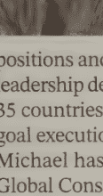

## 作者简介

Michael K. Simpson 是全球最杰出的执行教练之一，也是领导力思想领袖和组织发展顾问，为全球顶尖领导者和团队提供咨询。他是八本领导力和教练书籍的著名作者，是一位引人入胜的主旨演讲者，也是拥有高级管理职位并担任多家董事会董事的实践者。作为教练和领导力发展思想领袖，Michael 在 30 年的时间里，足迹遍布 35 多个国家，帮助领导者和团队推动愿景、战略方向、目标执行、问责制和高信任文化。20 多年来，Michael 一直担任 FranklinCovey 战略执行、领导力和信任实践的执行教练董事总经理和全球顾问。作为一名引导者、教师和主旨演讲者，他曾在 Covey 的执行领导力峰会上任教三年，与 Dr. Stephen Covey、Dr. Ram Charan 和 Dr. Mette Norgaard 一起授课。Michael 还在华盛顿特区的美国国防部高级执行官先锋领导力项目中，为期三年教授和指导高级政府领导人。Michael 主持了数千次高管离职领导力静修会，并为顶尖组织的资深领导者和团队提供执行教练服务，包括：General Electric、PepsiCo、Frito-Lay、Marriott、Hilton、Coca-Cola、IBM、Hewlett Packard、Xerox、Lilly、Baxter、Amgen、Sunovion、Johnson & Johnson、Nike、HSBC Bank、OCBC Bank、Bank of Islam、John Deere、Whirlpool、TE Connectivity、ExxonMobil、Chevron、Shell、Petronas、United Nations、NASA、NATO、Los Alamos National Labs、US Nuclear Regulatory Commission、US Department of Homeland Security/ICE、US Army、US Navy、US Air Force、US Marines 和 US Coast Guard。

Michael 曾是 PricewaterhouseCoopers 纽约市战略与组织变革实践的首席顾问。他曾是 Ernst & Young 华盛顿特区变革管理部的资深顾问。他曾担任两家领先科技公司 Mediconnect Global 和 America To Go 的销售和营销副总裁。Michael 是 Simpson Executive Coaching 的首席执行官，也是与 FranklinCovey International 合作的中国 Impact International Education (IIE) 的首席执行官。他领导 7 Habits 和 Leader in Me 教育领导力和教育技术，面向中国大陆的儿童、青少年、大学生、领导者和家长。

Michael 是认证执行教练，也是哥伦比亚大学执行教练认证项目和哥伦比亚教练学习协会 (CCLA) 的合作伙伴。他是哈佛大学教练学院 (IOC) 的研究员和思想领袖，该学院与 McLean Hospital 和哈佛医学院合作。

Michael 将深厚的学术背景带入了他的实践商业经验。他曾在哥伦比亚学院商学院担任兼职教授；在广州华南理工大学担任一年访问教授。他曾在香港大学、马来西亚大学、西北大学凯洛格商学院、杨百翰大学 Marriott 商学院、肯尼迪国际研究中心和犹他州立大学 E-MBA 项目担任客座讲师。Michael 撰写的书籍包括：《通过教练实现强大领导力》；《释放潜能》；《天赋释放》；与 Dr. Marshall Goldsmith 和 Dr. Ken Blanchard 合著的《Ready, Aim, Excel》；《Your Seeds of Greatness》；以及与 PricewaterhouseCoopers 合著的《The Execution-focused Leader》。Michael 拥有哥伦比亚大学组织行为学硕士学位，以及杨百翰大学肯尼迪国际研究中心的学士学位。

当他不忙于旅行、演讲、教学、教练或咨询时，Michael 喜欢旅行、滑雪、山地自行车、徒步旅行，并在犹他州美丽的 Wasatch 山脉与家人共度时光。

### 联系 Michael K. Simpson

**你想为下一次高管离职领导力静修会、主旨演讲，或一对一执行和团队教练，或教练认证预订 Michael 吗？**

如需了解预订 Michael K. Simpson 进行一对一或团队执行教练、教练培训和认证、主旨演讲、愿景和战略规划以及领导力发展培训或领导力静修会的信息，请通过电话联系：435-602-9031，电子邮件：mssimpson@ebacs.net，或网站：www.simpsonexecutivecoaching.com。

**你想购买书籍的团购订单吗？**

如需批量购买和订购《Powerful Leadership Through Coaching》书籍，请联系 www.simpsonexecutivecoaching.com。

