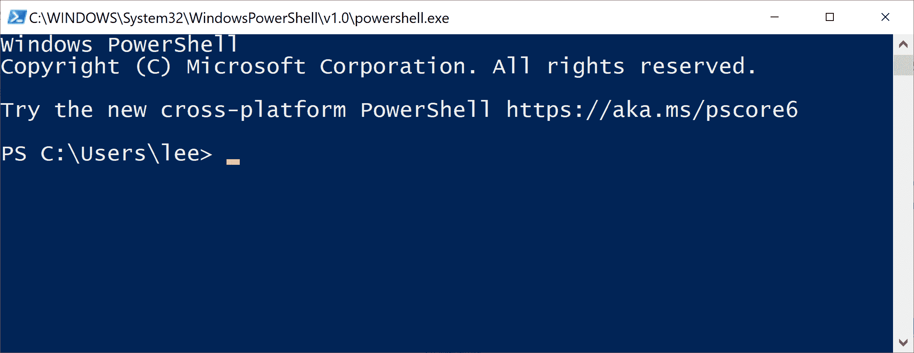

## PowerShell 导览

### 简介


### 简介 (重复)

PowerShell 承诺将彻底改变系统管理和命令行 Shell 的世界。从基于对象的管道到面向管理员的设计，再到对其他 Microsoft 管理技术的广泛触达，PowerShell 极大地提高了管理员和高级用户的工作效率。

在学习新技术时，初次面对所有陌生的特性和功能而感到困惑是很自然的。这对于 PowerShell 新用户来说或许尤为真实，因为这可能是他们第一次体验功能齐全的命令行 Shell。更糟的是，他们可能听说过 PowerShell 令人惊叹的集成脚本功能，从而担心被迫进入一个他们一直主动避免的编程世界。

幸运的是，这些担心完全是多余的；PowerShell 是一个与你共同成长、让你越用越顺手的 Shell。让我们来一场之旅，看看它能做什么：

*   PowerShell 可与标准 Windows 命令和应用程序协同工作。你不必抛弃已知和正在使用的工具。
*   PowerShell 引入了一种强大的新命令类型。PowerShell 命令（称为 `cmdlet`）共享通用的 `Verb-Noun`（动词-名词）语法，并相较于标准命令提供了许多易用性改进。
*   PowerShell 理解对象。直接处理结构丰富的对象，使得使用（和组合）PowerShell 命令比在传统 Shell 的纯文本世界中工作容易得多。
*   PowerShell 面向管理员。尽管有诸多进步，PowerShell 仍强烈专注于其作为交互式 Shell 的用途：在运行中的 PowerShell 应用程序中输入命令的体验。
*   PowerShell 支持发现。只需三条简单的命令，你就能学习和发现 PowerShell 提供的几乎所有功能。
*   PowerShell 实现了无处不在的脚本编写。通过一个成熟的脚本语言直接在命令行工作，PowerShell 让你轻松自动化任务。
*   PowerShell 连接多种技术。通过让你处理 .NET、COM、WMI、XML 和 Active Directory，PowerShell 使得操作这些以前孤立的技术比以往任何时候都更容易。
*   PowerShell 简化了数据存储的管理。通过其提供程序模型，PowerShell 让你使用管理文件和文件夹的相同技术来管理数据存储。

在 PowerShell 的这趟入门之旅中，我们将探讨这些支柱中的每一个。如果你运行的是任何受支持的 Windows 版本（Windows 7 或更高版本，或 Windows Server 2012 R2 或更高版本），Windows PowerShell 已经安装好了。话虽如此，与此默认安装相比，开源的 `PowerShell Core` 代表了一个显著的飞跃。如果你想稍微抢跑一步，可以在 食谱 1.1 中了解更多关于升级到 `PowerShell Core`（或简称为“`PowerShell`”）的信息。

### 交互式 Shell

从本质上讲，PowerShell 首先且最重要的是一个交互式 Shell。虽然它支持脚本编写和其他强大功能，但其作为 Shell 的定位支撑了一切。

开始使用 PowerShell 只需启动 `powershell.exe` 而不是 `cmd.exe`——随着你探索中级和高级功能，这两个 Shell 会开始分道扬镳，但你可以立即在 PowerShell 中高效工作。

要启动 PowerShell，请点击 `Start`（开始），然后输入 `PowerShell`（如果你已经抢跑了，则输入 `pwsh`）。

一个 PowerShell 提示符窗口将打开，它与其祖先传统的命令提示符几乎一模一样。`PS C:\Users\Lee>` 提示符表明 PowerShell 已准备好接受输入，如 图 P-1 所示。



启动 PowerShell 提示符后，你可以输入 DOS 风格和 Unix 风格的命令来浏览文件系统，就像使用任何 Windows 或 Unix 命令提示符一样——如 示例 P-1 所示的交互式会话。在该示例中，我们使用 `pushd`、`cd`、`dir`、`pwd` 和 `popd` 命令来存储当前位置、浏览文件系统、列出当前目录中的项目，然后返回原始位置。试试看！

#### 示例 P-1. 输入许多标准 DOS 和 Unix 风格的文件操作命令，会产生与在任何其他 Windows Shell 中使用它们时相同的结果

```
PS C:\Users\Lee> function prompt { "PS > " }
PS > pushd .
PS > cd \
PS > dir

    Directory: C:\

Mode                 LastWriteTime         Length Name
----                 -------------         ------ ----
d----           5/8/2007   8:37 PM                Blurpark
d----           5/15/2016  4:32 PM                Chocolatey
d----            3/8/2020 12:45 PM                DXLab
d----           4/30/2020  7:00 AM                Go
d----            4/2/2016  3:05 PM                Intel
d-r--          12/15/2020  1:41 PM                Program Files
d-r--          11/28/2020  5:06 PM                Program Files (x86)
d----           5/12/2019  6:37 PM                Python27
d----           3/25/2018  1:11 PM                Strawberry
d----          12/16/2020  8:13 AM                temp
d-r--           8/11/2020  5:02 PM                Users
da---          12/16/2020 10:51 AM                Windows

PS > popd
PS > pwd

Path
----
C:\Users\Lee
```

在该示例中，我们的第一条命令自定义了提示符。在 `cmd.exe` 中，自定义提示符看起来像 `prompt $P$G`。在 Bash 中，它看起来像 `PS1="[\h] \w> "`。在 PowerShell 中，你定义一个返回你想要显示的任何内容的函数。食谱 11.2 介绍了函数及其编写方法。

`pushd` 命令是功能描述性强得多的 PowerShell 命令 `Push-Location` 的别名（替代名称）。同样，`cd`、`dir`、`popd` 和 `pwd` 命令都有更易记的对应命令。

虽然浏览文件系统很有帮助，但运行你熟知且喜爱的工具（如 `ipconfig` 和 `notepad`）同样重要。输入命令名称，你将看到如 示例 P-2 所示的结果。

#### 示例 P-2. Windows 工具和应用程序（如 ipconfig）在 PowerShell 中运行，就像在 cmd.exe 中一样

```
PS > ipconfig

Windows IP Configuration

Ethernet adapter Wireless Network Connection 4:

        Connection-specific DNS Suffix .  : hsd1.wa.comcast.net.
        IP Address. . . . . . . . . . . . : 192.168.1.100
        Subnet Mask . . . . . . . . . . . : 255.255.255.0
        Default Gateway . . . . . . . . . : 192.168.1.1
PS > notepad
(notepad launches)
```

输入 `ipconfig` 将显示当前网络连接的 IP 地址。输入 `notepad` 将运行——正如你所料——随 Windows 提供的记事本编辑器。在你自己的机器上试试这两个命令。

### 结构化命令

除了支持传统的 Windows 可执行程序外，PowerShell 还引入了一种称为 `cmdlet`（发音为 "command-let"，即“小命令”）的强大新命令类型。所有 cmdlet 都遵循 `Verb-Noun`（动词-名词）命名模式，例如 `Get-Process`、`Get-Content` 和 `Stop-Process`。

```
PS > Get-Process -Name lsass

Handles  NPM(K)    PM(K)    WS(K) VM(M)   CPU(s)    Id ProcessName
-------  ------    -----    ----- -----   ------    -- -----------
    668      13     6228     1660    46            932 lsass
```

在该示例中，你向 `ProcessName` 参数提供一个值，以按名称获取特定进程。

#### 注意

一旦你了解了 PowerShell 中那一小把常用动词，学习如何使用新名词就会变得容易得多。虽然你以前可能从未处理过某个特定对象（例如 Service），但标准的 `Get`、`Set`、`Start` 和 `Stop` 操作仍然适用。有关这些常用动词的列表，请参阅 附录 J 中的 表 J-1。


### PowerShell 基础：别名、参数和 Tab 补全

不过，你并不总是必须输入这些完整的 cmdlet 名称。PowerShell 允许你使用 `Tab` 键来自动补全 cmdlet 名称和参数名称：

```
PS > Get-Pro<TAB> -N<TAB> lsass
```

对于快速交互式使用，即使这样可能也嫌输入太多。为了帮助提高你的效率，PowerShell 为所有常用命令定义了别名，并允许你定义自己的别名。除了别名，PowerShell 只要求你输入足以将参数名称与该 cmdlet 中的其他参数区分开来的字符即可。PowerShell 也不区分大小写。使用内置的 `gps` 别名（代表 `Get-Process` cmdlet）以及参数缩写，你可以改为输入：

```
PS > gps -n lsass
```

更进一步，PowerShell 支持 cmdlet 的*位置参数*。位置参数允许你在命令行的特定位置提供参数值，而不必按名称指定它们。`Get-Process` cmdlet 将进程名作为其第一个位置参数。该参数甚至支持通配符：

```
PS > gps l*s
```

### 对象的深度集成

当你探索 PowerShell 处理结构化数据和功能丰富的对象的方式时，它开始展现更多的实力。例如，以下命令生成一个简单的文本字符串。由于没有任何东西捕获该输出，PowerShell 将其显示给你：

```
PS > "Hello World"
Hello World
```

你刚生成的字符串实际上是一个来自 .NET Framework 的功能完整的对象。例如，你可以访问其 `Length` 属性，它会告诉你字符串中有多少字符。要访问属性，请在对象及其属性名称之间放置一个点：

```
PS > "Hello World".Length
11
```

所有产生输出的 PowerShell 命令也都将输出作为对象生成。例如，`Get-Process` cmdlet 生成一个 `System.Diagnostics.Process` 对象，你可以将其存储在变量中。在 PowerShell 中，变量名以 `$` 字符开头。如果你正在运行一个记事本实例，以下命令会存储对它的引用：

```
$process = Get-Process notepad
```

由于这是一个来自 .NET Framework 的功能完整的 `Process` 对象，你可以调用该对象上的方法来对其执行操作。此命令调用 `Kill()` 方法，该方法会停止进程。要访问方法，请在对象及其方法名称之间放置一个点：

```
$process.Kill()
```

PowerShell 通过 `Stop-Process` cmdlet 更直接地支持此功能，但此例演示了你与这些丰富对象交互能力的一个重要观点。

### 管理员作为一等用户

虽然 PowerShell 对 .NET Framework 对象的支持让大多数用户心跳加速，但 PowerShell 仍然高度专注于管理任务。例如，PowerShell 支持 `MB`（兆字节）和 `GB`（吉字节）作为其标准管理常量之一。例如，一个 800 GB 的硬盘能装多少 GIF 表情包？

```
PS > 800GB / 2.2MB
372363.636363636
```

虽然 .NET Framework 传统上是一个开发平台，但它包含大量对管理员也有用的功能！事实上，它使 PowerShell 成为一个很棒的日历。例如，2096 年是闰年吗？PowerShell 可以告诉你：

```
PS > [DateTime]::IsLeapYear(2096)
True
```

更进一步，你如何确定距离 Y2038 纪元灾难还剩多少时间？以下命令将 `"01/19/2038"`（2038 年问题的日期）转换为日期，然后从该日期中减去当前日期。它将结果存储在 `$result` 变量中，然后访问 `TotalDays` 属性。

```
PS > $result = [DateTime] "01/19/2038" - [DateTime]::Now
PS > $result.TotalDays
6242.49822756465
```

### 可组合的命令

每当一个命令生成输出时，你都可以使用*管道字符* (`|`) 将该输出直接作为输入传递给另一个命令。如果第二个命令理解第一个命令生成的对象，它就可以对结果进行操作。你可以通过这种方式将许多命令链接在一起，从几个简单的操作中创建出强大的组合。例如，以下命令获取 `Path1` 目录中的所有项目并将它们移动到 `Path2` 目录：

```
Get-Item Path1\* | Move-Item -Destination Path2
```

通过向管道添加其他 cmdlet，你可以创建更复杂的命令。在示例 P-3 中，第一个命令获取系统上运行的所有进程。它将这些进程传递给 `Where-Object` cmdlet，后者对每个传入项运行比较。在这种情况下，比较是 `$_.Handles -ge 500`，它检查当前对象（由 `$_` 变量表示）的 `Handles` 属性是否大于或等于 `500`。对于使此比较成立的每个对象，你将结果传递给 `Sort-Object` cmdlet，要求它按其 `Handles` 属性对项目进行排序。最后，你将对象传递给 `Format-Table` cmdlet 以生成一个包含进程的 `Handles`、`Name` 和 `Description` 的表格。

#### 示例 P-3. 你可以通过使用管道链接 cmdlet 来构建更复杂的 PowerShell 命令，如下所示，使用了 Get-Process、Where-Object、Sort-Object 和 Format-Table

```
PS > Get-Process |
    Where-Object { $_.Handles -ge 500 } |
    Sort-Object Handles |
    Format-Table Handles,Name,Description -Auto

Handles Name     Description
------- ----     -----------
    588 winlogon
    592 svchost
    667 lsass
    725 csrss
    742 System
    964 WINWORD  Microsoft Office Word
   1112 OUTLOOK  Microsoft Office Outlook
   2063 svchost
```

### 保护你免受自身伤害的技术

虽然别名、通配符和可组合管道功能强大，但它们在修改系统信息的命令中使用时很容易让人紧张。毕竟，这个命令是做什么的？想一想，但先别尝试：

```
PS > gps [b-t]*[c-r] | Stop-Process
```

它似乎会停止所有以字母 `b` 到 `t` 开头、以字母 `c` 到 `r` 结尾的进程。你怎么能确定呢？让 PowerShell 告诉你。对于修改数据的命令，PowerShell 支持 `-WhatIf` 和 `-Confirm` 参数，让你可以看到命令*将会*做什么：

```
PS > gps [b-t]*[c-r] | Stop-Process -whatif
What if: Performing operation "Stop-Process" on Target "ctfmon (812)".
What if: Performing operation "Stop-Process" on Target "Ditto (1916)".
What if: Performing operation "Stop-Process" on Target "dsamain (316)".
What if: Performing operation "Stop-Process" on Target "ehrecvr (1832)".
What if: Performing operation "Stop-Process" on Target "ehSched (1852)".
What if: Performing operation "Stop-Process" on Target "EXCEL (2092)".
What if: Performing operation "Stop-Process" on Target "explorer (1900)".
(...)
```

在此交互中，将 `-WhatIf` 参数与管道传递的 `Stop-Process` 命令一起使用，让你可以在实际执行操作之前预览系统上将会停止哪些进程。

> **注意：** 此示例不是挑战！正如一位评论者所言：
>
> > 不仅停止了一切，而且在我的一台旧机器上，它强制关机，只给了一分钟的警告！
> >
> > 不过这很有趣……至少我有足够的时间先保存所有东西！

### 常见发现命令

虽然阅读指导性的介绍很有帮助，但我发现大多数学习都是以临时的方式发生的。要查找与给定通配符匹配的所有命令，请使用 `Get-Command` cmdlet。例如，通过输入以下内容，你可以找出哪些 PowerShell 命令（和 Windows 应用程序）包含单词 *process*：


### 无处不在的脚本

PowerShell 不区分在命令行输入的命令和在脚本中编写的命令。您常用的 cmdlet 可在脚本中工作，您常用的脚本技术（例如 `foreach` 语句）可直接在命令行上工作。例如，要汇总所有正在运行的进程的句柄计数：

```
PS > $handleCount = 0
PS > foreach($process in Get-Process) { $handleCount += $process.Handles }
PS > $handleCount
19403
```

虽然 PowerShell 提供了一个命令（`Measure-Object`）来度量集合的统计信息，但这个简短的示例展示了 PowerShell 如何让您应用通常需要单独脚本或编程语言的技术。

除了使用 PowerShell 脚本关键字外，您还可以创建并直接使用您可能熟悉的 .NET Framework 对象。PowerShell 变得几乎就像 Visual Studio 中的 C# 即时模式。示例 P-4 展示了 PowerShell 如何让您轻松地与 .NET Framework 交互。

#### 示例 P-4. 使用来自 .NET Framework 的对象来检索网页并处理其内容

```
PS > $webClient = New-Object System.Net.WebClient
PS > $content = $webClient.DownloadString(
                "https://devblogs.microsoft.com/powershell/feed/")
PS > $content.Substring(0,1000)
<?xml version="1.0" encoding="UTF-8"?><rss version="2.0"
        xmlns:content="http://purl.org/rss/1.0/modules/content/"
        xmlns:wfw="http://wellformedweb.org/CommentAPI/"
        xmlns:dc="http://purl.org/dc/elements/1.1/"
        xmlns:atom="http://www.w3.org/2005/Atom"
        xmlns:sy="http://purl.org/rss/1.0/modules/syndication/"
        xmlns:slash="http://purl.org/rss/1.0/modules/slash/" >
<channel>
        <title>PowerShell</title>
        <atom:link href="https://devblogs.microsoft.com/powershell/feed/"
        <link>https://devblogs.microsoft.com/powershell</link>
        <description>Automating the world one-liner at a time...</description>
(...)
```

### 临时开发

通过模糊交互式管理和编写脚本之间的界限，PowerShell 会话的历史缓冲区迅速成为临时脚本开发的基础。在本示例中，您调用 `Get-History` cmdlet 来检索会话的历史记录。对于每一项，您获取其 `CommandLine` 属性（您输入的内容）并将输出发送到新的脚本文件。

```
PS > Get-History | ForEach-Object { $_.CommandLine } > c:\temp\script.ps1
PS > notepad c:\temp\script.ps1
(保存您想要保留的内容)
PS > c:\temp\script.ps1
```

> **注意：** 如果这是您第一次在 PowerShell 中运行脚本，您将需要配置执行策略。有关选择执行策略的更多信息，请参阅 食谱 18.1。

有关将会话历史保存到脚本的更多详细信息，请参阅 食谱 1.22。

### 桥接技术

我们已经看到 PowerShell 如何让您在任务中充分利用 .NET Framework，但它对常见技术的支持远不止于此。正如 示例 P-5（接续自 示例 P-4）所示，PowerShell 支持 XML。

#### 示例 P-5. 在 PowerShell 中处理 XML 内容

```
PS > $xmlContent = [xml] $content
PS > $xmlContent

xml                       xml-stylesheet            rss
---                       --------------            ---
version="1.0" encoding... type="text/xsl" href="... rss

PS > $xmlContent.rss

version : 2.0
content : http://purl.org/rss/1.0/modules/content/
wfw     : http://wellformedweb.org/CommentAPI/
dc      : http://purl.org/dc/elements/1.1/
atom    : http://www.w3.org/2005/Atom
sy      : http://purl.org/rss/1.0/modules/syndication/
slash   : http://purl.org/rss/1.0/modules/slash/
channel : channel

PS > $xmlContent.rss.channel.item | select Title

title
-----
PowerShell 7.2 Preview 2 release
Announcing PowerShell Crescendo Preview.1
You've got Help!
SecretManagement preview 6 and SecretStore preview 4
Announcing PowerShell 7.1
Announcing PSReadLine 2.1+ with Predictive IntelliSense
Updating help for the PSReadLine module
PowerShell Working Groups
(...)
```

PowerShell 还允许您使用 Windows Management Instrumentation (WMI) 和 Common Information Model (CIM)：

```
PS > Get-CimInstance Win32_Bios

SMBIOSBIOSVersion : ASUS A7N8X Deluxe ACPI BIOS Rev 1009
Manufacturer      : Phoenix Technologies, LTD
Name              : Phoenix - AwardBIOS v6.00PG
SerialNumber      : xxxxxxxxxxx
Version           : Nvidia - 42302e31
```

或者，正如 示例 P-6 所示，您可以使用 Active Directory Service Interfaces (ADSI)。

#### 示例 P-6. 在 PowerShell 中使用 Active Directory


PS > `[ADSI] "WinNT://./Administrator"` | `Format-List *`

UserFlags                  : {66113}
MaxStorage                 : {-1}
PasswordAge                : {19550795}
PasswordExpired            : {0}
LoginHours                 : {255 255 255 255 255 255 255 255 255 255 255
                             255 255 255 255 255 255 255 255 255 255}
FullName                   : {}
Description                : {Built-in account for administering the computer/domain}
BadPasswordAttempts        : {0}
LastLogin                  : {5/21/2007 3:00:00 AM}
HomeDirectory              : {}
LoginScript                : {}
Profile                    : {}
HomeDirDrive               : {}
Parameters                 : {}
PrimaryGroupID             : {513}
Name                       : {Administrator}
MinPasswordLength          : {0}
MaxPasswordAge             : {3710851}
MinPasswordAge             : {0}
PasswordHistoryLength      : {0}
AutoUnlockInterval         : {1800}
LockoutObservationInterval : {1800}
MaxBadPasswordsAllowed     : {0}
RasPermissions             : {1}
objectSid                  : {1 5 0 0 0 0 0 5 21 0 0 0 121 227 252 83 122
                             130 50 34 67 23 10 50 244 1 0 0}

或者，正如示例 P-7 所示，你甚至可以使用 PowerShell 来编写传统 COM 对象的脚本。

#### 示例 P-7. 在 PowerShell 中使用 COM 对象

```
PS > $firewall = New-Object -com HNetCfg.FwMgr
PS > $firewall.LocalPolicy.CurrentProfile

Type                                         : 1
FirewallEnabled                              : True
ExceptionsNotAllowed                         : False
NotificationsDisabled                        : False
UnicastResponsesToMulticastBroadcastDisabled : False
RemoteAdminSettings                          : System.__ComObject
IcmpSettings                                 : System.__ComObject
GloballyOpenPorts                            : {Media Center Extender Service,
                                               Remote Media Center Experience,
                                               Adam Test Instance, QWAVE...}
Services                                     : {File and Printer Sharing,
                                               UPnP Framework, Remote Desktop}
AuthorizedApplications                       : {Remote Assistance, Windows
                                               Messenger, Media Center, Trillian...}
```

### 通过提供程序导航命名空间

PowerShell 为系统操作提供的另一种途径是*提供程序*。PowerShell 提供程序让你能够使用处理文件系统的相同技术来导航和管理数据存储，如示例 P-8 所示。

#### 示例 P-8. 导航文件系统

```
PS > Set-Location c:\
PS > Get-ChildItem

    Directory: C:\

Mode                 LastWriteTime         Length Name
----                 -------------         ------ ----
d----           5/8/2007   8:37 PM                Blurpark
d----           5/15/2016  4:32 PM                Chocolatey
d----            3/8/2020 12:45 PM                DXLab
d----           4/30/2020  7:00 AM                Go
d----            4/2/2016  3:05 PM                Intel
d-r--          12/15/2020  1:41 PM                Program Files
d-r--          11/28/2020  5:06 PM                Program Files (x86)
d----           5/12/2019  6:37 PM                Python27
d----           3/25/2018  1:11 PM                Strawberry
d----          12/16/2020  8:13 AM                temp
d-r--           8/11/2020  5:02 PM                Users
da---          12/16/2020 10:51 AM                Windows
```

这在注册表上同样适用，如示例 P-9 所示。

#### 示例 P-9. 导航注册表

```
PS > Set-Location HKCU:\Software\Microsoft\Windows\
PS > Get-ChildItem

    Hive: HKEY_CURRENT_USER\Software\Microsoft\Windows

Name                           Property
----                           --------
CurrentVersion
DWM                            Composition                  : 1
                               ColorPrevalence              : 0
                               ColorizationColor            : 3290322719
                               EnableAeroPeek               : 1
                               AccentColor                  : 4280243998
                               EnableWindowColorization     : 1
Shell
TabletPC
Windows Error Reporting

PS > Set-Location CurrentVersion\Run
PS > Get-ItemProperty .

(...)
OneDrive            : "C:\Users\lee\AppData\Local\Microsoft\OneDrive\OneDrive.exe"
    /background
OpenDNS Updater     : "C:\Program Files (x86)\OpenDNS Updater\OpenDNSUpdater.exe"
    /autostart
Ditto               : C:\Program Files\Ditto\Ditto.exe
(...)
```

甚至在机器的证书存储上也适用，如示例 P-10 所示。

#### 示例 P-10. 导航证书存储

```
PS > Set-Location cert:\CurrentUser\Root
PS > Get-ChildItem

    Directory: Microsoft.PowerShell.Security\Certificate::CurrentUser\Root

Thumbprint                                Subject
----------                                -------
CDD4EEAE6000AC7F40C3802C171E30148030C072  CN=Microsoft Root Certificate...
BE36A4562FB2EE05DBB3D32323ADF445084ED656  CN=Thawte Timestamping CA, OU...
A43489159A520F0D93D032CCAF37E7FE20A8B419  CN=Microsoft Root Authority, ...
9FE47B4D05D46E8066BAB1D1BFC9E48F1DBE6B26  CN=PowerShell Local Certifica...
7F88CD7223F3C813818C994614A89C99FA3B5247  CN=Microsoft Authenticode(tm)...
245C97DF7514E7CF2DF8BE72AE957B9E04741E85  OU=Copyright (c) 1997 Microso...
(...)
```

### 更多内容

尽管这次导览令人振奋，但它仅触及了如何使用 PowerShell 提高生产力和系统管理技能的皮毛。有关 PowerShell 入门的更多信息，请参阅第 1 章。
