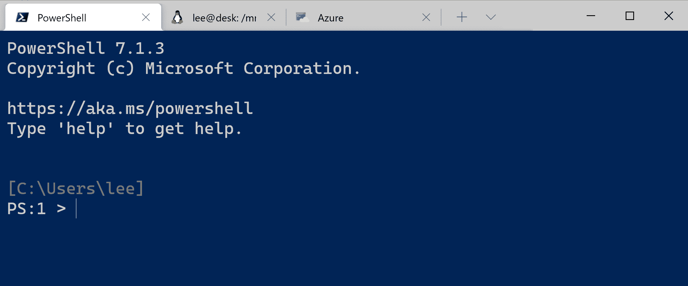
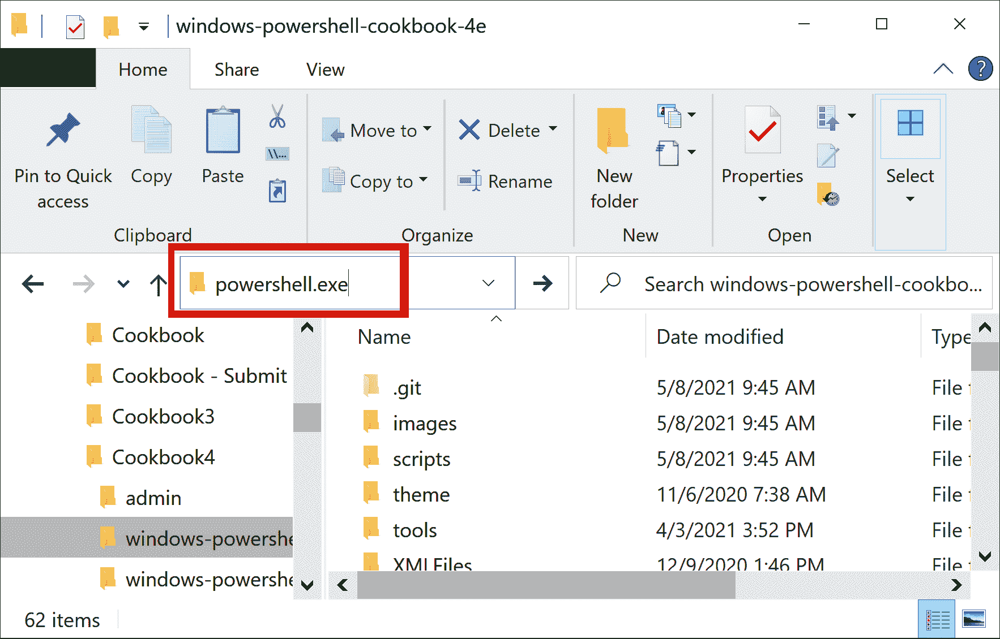
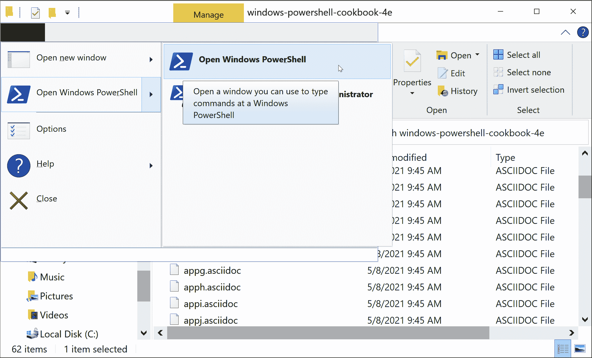
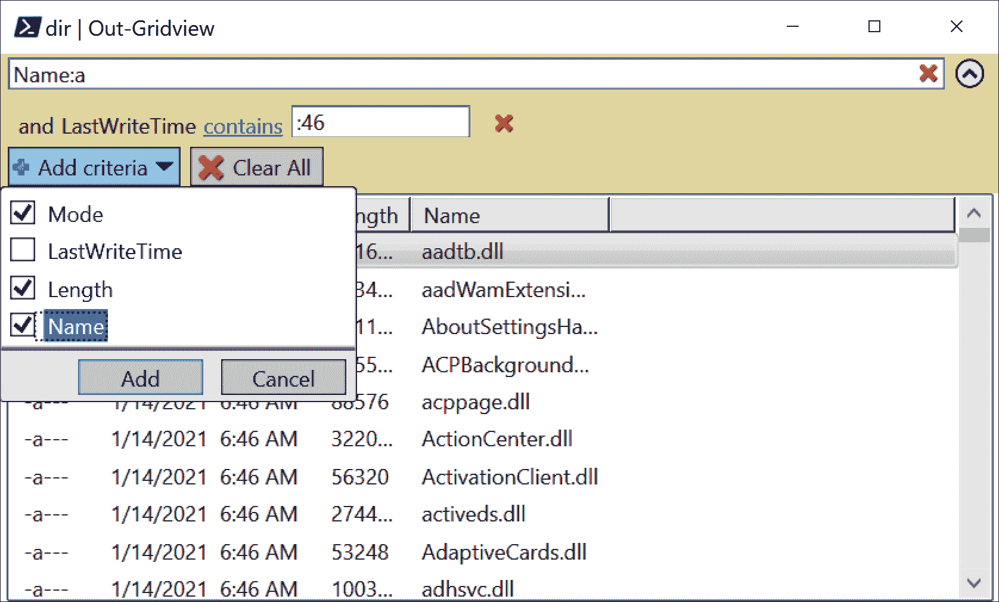

## 第 1 章 PowerShell 交互式 Shell

### 1.0 简介

最重要的是，PowerShell 的设计将其作为高效且强大的交互式 Shell 的用途放在首位。即使是其脚本语言，也在这一努力中发挥着关键作用，因为它同样严重偏向交互式使用。

当人们首次启动 PowerShell 时，最令人惊讶的是它与长期作为 Windows 一部分的命令提示符的相似性。熟悉的工具继续运行。熟悉的命令继续运行。甚至熟悉的热键也相同。不过，支持这个熟悉 UI 的是一个强大的引擎，让你能够轻松完成曾经繁琐的管理和脚本任务。

本章从交互式 Shell 的角度介绍 PowerShell。

### 1.1 安装 PowerShell Core

#### 问题

你想要在 Windows、Mac 或 Linux 系统上安装最新版本的 PowerShell。

#### 解决方案

访问[微软网站](https://microsoft.com/PowerShell)以查找你想要安装的操作系统和平台的安装说明。对于最常见的情况：

##### Windows


### 1.1 安装 PowerShell (重复)

#### 解决方案

##### Windows

通过“开始”菜单中的 Microsoft Store 应用程序，从 Microsoft 安装 PowerShell。然后，通过“开始”菜单中的 Microsoft Store 应用程序，从 Microsoft 安装 Windows Terminal。

##### Mac

通过 Homebrew 安装 PowerShell：

```
brew install --cask powershell
```

##### Linux

安装说明因 Linux 发行版而异，但在 PowerShell Core 用户中最常见的发行版是 Ubuntu：

```
##### 更新包列表
sudo apt-get update

##### 安装先决条件包。
sudo apt-get install -y wget apt-transport-https software-properties-common

##### 下载 Microsoft 存储库 GPG 密钥
wget -q https://packages.microsoft.com/config/ubuntu/20.04/packages-microsoft-prod.deb

##### 注册 Microsoft 存储库 GPG 密钥
sudo dpkg -i packages-microsoft-prod.deb

##### 添加 packages.microsoft.com 后更新包列表
sudo apt-get update

##### 安装 PowerShell
sudo apt-get install -y powershell
```

#### 讨论

##### PowerShell 历史

PowerShell 已经走过了一段漫长而激动人心的历程。在其存在的前 15 年里，它被称为“Windows PowerShell”：一个极好的基于对象的管理 Shell 和平台，使管理员、开发人员和高级用户能够轻松愉快地完成工作。

在早期阶段，这种支持作为“Windows 管理框架”的一部分提供：一个独立下载，在 Windows 上提供了这种急需的功能。Windows PowerShell 最终成为了 Windows 本身的一部分，并自 Windows 7 以来一直是操作系统的核心组成部分。

2016 年，PowerShell 宣布将在多个操作系统平台上发布 PowerShell，并同时将整个项目开源，从而实现了巨大的转变！Windows PowerShell 随着其新的未来获得了一个新名字：简称为 *PowerShell*。这一重大变革为更快的创新、社区参与以及通过以前不可能的途径获取软件打开了大门。虽然经典的 Windows PowerShell 仍默认包含在操作系统中，但它不再接收更新，应避免使用。

##### 在 Windows 上安装和运行 PowerShell

正如解决方案中所述，获取 PowerShell 的最佳方式是通过 Microsoft Store 安装。这使得安装和更新变得容易。安装完成后，你可以像找其他应用程序一样在“开始”菜单中找到 PowerShell。

###### 注意

如果你想为自动化和其他管理任务安装系统级的 PowerShell 版本，你可能更倾向于基于 MSI 的安装机制。有关详细信息，请参阅 [Microsoft 网站](https://microsoft.com/PowerShell)。

当你从 Microsoft Store 安装 PowerShell 时，现在也是从 Microsoft Store 安装 Windows Terminal 应用程序的好时机。Windows 中包含的传统控制台界面（PowerShell 运行在其内部的窗口）有如此多的工具和应用程序依赖于其确切的怪癖，以至于几乎不可能对其进行有意义的更改。它在你期望的终端控制台界面功能方面已严重落后，因此来自 Microsoft Store 的 Windows Terminal 应用程序（如图 1-1 所示）是解决方案。与 PowerShell 一样，它是开源的，是快速创新的焦点，并极大地改进了 Windows 默认附带的终端。



你可以在 Windows Terminal 的选项卡中运行许多 Shell：`PowerShell`、`Windows PowerShell`、`cmd.exe`、`Bash`（如果你已启用适用于 Linux 的 Windows 子系统），甚至可以连接到 Azure Cloud Shell。如果你安装了 PowerShell，Windows Terminal 默认使用 PowerShell。

##### 在 Windows Terminal 上自定义 PowerShell

默认的 Windows Terminal + PowerShell 安装有两项更改能真正改善体验：任务栏固定和主题。

###### 任务栏固定

当你启动 Windows Terminal 时，右键单击其任务栏图标。选择“固定到任务栏”，然后将图标拖到任务栏的最左侧。从现在起，每当你同时按下 Windows 键 + `1` 时，你都会启动 Windows Terminal 和 PowerShell（如果它尚未打开），或将其激活。这是让你最喜欢的 Shell 触手可及的绝佳方式。

###### 主题

Windows PowerShell 拥有华丽的 Noble Blue（高贵蓝）主题。它赏心悦目、易于识别，并使其在众多其他 Shell 中脱颖而出。PowerShell Core 默认没有带走这套配色方案，但仍然可以自定义你的安装。在 Windows Terminal 中，按 Ctrl+Comma 或点击选项卡栏右侧的向下箭头以打开 Windows Terminal 的“设置”对话框。包含这些设置的文件将在默认文本编辑器中打开。在 `Profiles` 下，找到 `source` 为 `Windows.Terminal.PowershellCore` 的项，并添加 `Campbell Powershell` 作为 `colorScheme`。结果应如下所示：

```
{
    "guid": ...
    "hidden": false,
    "name": "PowerShell",
    "colorScheme": "Campbell Powershell",
    "source": "Windows.Terminal.PowershellCore"
},
```

注意大小写、引号、冒号和逗号，你的 PowerShell 会话很快就会再次变得高贵！

##### 在 Mac 和 Linux 上安装和运行 PowerShell

在很大程度上，在 Mac 和 Linux 上安装 PowerShell 遵循你可能已经熟悉的模式。

在 Mac 上，推荐的安装方法是通过流行的 *Homebrew* 包管理器。Homebrew 默认未安装在 macOS 上，但安装非常容易。如果你尚未安装 Homebrew，可以在 [Homebrew 官方网站](https://brew.sh) 找到说明。

在 Linux 上，安装方法因你感兴趣的发行版而异。在很大程度上，安装就像为你的发行版包管理器注册 Microsoft 存储库，然后安装 PowerShell 一样简单。解决方案提供了特定于 Ubuntu `20.04` 的示例，但你可以在 [Microsoft 网站](https://oreil.ly/VKXLZ) 上获取针对你的发行版和特定版本的具体说明。

### 1.2 运行程序、脚本和现有工具

#### 问题

你依赖在当前工具上投入的大量精力。你有传统的可执行文件、Perl 脚本、VBScript，当然还有一个有机地发展成批处理文件纠缠不清的遗留构建系统。你想使用 PowerShell，但不想放弃你已拥有的一切。

#### 解决方案

要运行系统路径中的程序、脚本、批处理文件或其他可执行命令，请输入其文件名。对于这些可执行类型，扩展名是可选的：

```
Program.exe arguments
ScriptName.ps1 arguments
BatchFile.cmd arguments
```

要运行名称中包含空格的命令，请将其文件名用单引号 (`'`) 括起来，并在命令前加上和号 (`&`)，即 PowerShell 中所谓的 *调用运算符*：

```
& 'C:\Program Files\Program\Program.exe' arguments
```

要运行当前目录中的命令，请在其文件名前加上 `.\`：

```
.\Program.exe arguments
```

要从当前目录运行名称中包含空格的命令，请在其前面同时加上和号和 `.\`：

```
& '.\Program With Spaces.exe' arguments
```

#### 讨论

在这种情况下，解决方案主要是像往常一样使用你当前的工具。唯一的区别是你在 PowerShell 交互式 Shell 中运行它们，而不是在 `cmd.exe` 中。

##### 指定命令名称

解决方案中的最后三条提示值得特别注意。它们是许多新用户在运行程序时会在 PowerShell 上绊倒的功能。第一个是运行包含空格的命令。在 `cmd.exe` 中，运行包含空格的命令的方法是用引号将其括起来：

```
"C:\Program Files\Program\Program.exe"
```


在 PowerShell 中，将文本放在引号内是一项功能的一部分，该功能允许你在提示符下计算复杂表达式，如示例 1-1 所示。

##### 示例 1-1. 在 PowerShell 提示符下计算表达式

```
PS > 1 + 1
2
PS > 26 * 1.15
29.9
PS > "Hello" + " World"
Hello World
PS > "Hello World"
Hello World
PS > "C:\Program Files\Program\Program.exe"
C:\Program Files\Program\Program.exe
PS >
```

因此，带引号的程序名称与带引号的任何其他字符串没有区别。它只是一个表达式。如前所示，在字符串中运行命令的方法是在此字符串前加上调用运算符（`&`）。如果你要运行的命令是一个修改其环境的批处理文件，请参阅食谱 3.5。

###### 注意

默认情况下，PowerShell 的安全策略阻止脚本运行。但一旦你开始编写或使用脚本，就应该将此策略配置为限制较少的设置。有关如何配置执行策略的信息，请参阅食谱 18.1。

新用户（和喝咖啡前的资深老手！）容易绊倒的第二个命令是从当前目录运行命令。在 `cmd.exe` 中，当前目录被视为 `path` 的一部分：Windows 搜索以查找你输入的程序名称的目录列表。如果你在 `C:\Programs` 目录中，`cmd.exe` 会在 `C:\Programs`（以及其他位置）中查找要运行的应用程序。

PowerShell 像大多数 Unix Shell 一样，要求你明确声明想要从当前目录运行程序。为此，请使用 `.\Program.exe` 语法，如前所示。这可以防止系统上的恶意用户在你的硬盘上散布邪恶程序，这些程序的名称与你在访问该目录时可能运行的命令相似（或相同）。

为了避免输入常用脚本和程序的位置，许多用户将常用工具及其 PowerShell 脚本放在一个“tools”目录中，并将其添加到系统的 `path` 中。如果 PowerShell 能在你的系统 `path` 中找到脚本或工具，你就不需要显式指定其位置。

如果你想让 PowerShell 自动在当前工作目录中查找脚本，可以将句点（`.`）添加到 `PATH` 环境变量中。

有关更新系统路径的更多信息，请参阅食谱 16.2。

如果你想捕获命令的输出，可以将结果保存到变量中，或保存到文件中。要将结果保存到变量中，请参阅食谱 3.3。要将结果保存到文件中，请参阅食谱 9.2。

##### 指定命令参数

要指定命令的参数，可以像在其他 Shell 中一样输入它们。例如，要使指定文件变为只读（`attrib.exe` 的两个参数），只需输入：

```
attrib +R c:\path\to\file.txt
```

许多编写脚本的人在如何在脚本中更改命令参数时会被误导。例如，如何从 PowerShell 变量获取文件名？答案是定义一个变量来保存参数值，然后在原来写命令参数的地方使用该变量：

```
$filename = "c:\path\to\other\file.txt"
attrib +R $filename
```

调用 PowerShell cmdlet、脚本或函数时，可以使用相同的技术：

```
$filename = "c:\path\to\other\file.txt"
Get-Acl -Path $filename
```

如果你看到使用 `Invoke-Expression` cmdlet 来组合命令参数的解决方案，那几乎肯定是不正确的。`Invoke-Expression` cmdlet 接受你给它的字符串，并将其视为完整的 PowerShell 脚本。仅举一个可能导致的问题示例：文件名允许包含分号（`;`）字符，但当 `Invoke-Expression` 看到分号时，它会假定这是新的一行 PowerShell 脚本。例如，尝试运行以下代码：

```
$filename = "c:\file.txt; Write-Warning 'This could be bad'"
Invoke-Expression "Get-Acl -Path $filename"
```

鉴于这些动态参数通常来自用户输入，使用 `Invoke-Expression` 组合命令（在最好的情况下）会导致不可预测的脚本结果。更糟的是，它可能导致系统损坏或安全漏洞。

除了让你一次一个地通过变量提供参数外，PowerShell 还通过一种称为“splatting”的技术让你一次提供多个参数。有关 splatting 的更多信息，请参阅食谱 11.14。

#### 另请参阅

- 食谱 3.3，“在变量中存储信息”
- 食谱 3.5，“程序：保留批处理文件设置的环境变量更改”
- 食谱 11.14，“动态组合命令参数”
- 食谱 16.2，“修改用户或系统路径”
- 食谱 18.1，“通过执行策略启用脚本”

### 1.3 运行 PowerShell 命令

#### 问题

你想运行一个 PowerShell 命令。

#### 解决方案

要运行 PowerShell 命令，请在命令提示符下输入其名称。例如：

```
PS > Get-Process

 NPM(K)    PM(M)      WS(M)     CPU(s)      Id  SI ProcessName
 ------    -----      -----     ------      --  -- -----------
     14     3.47      10.55       0.00    6476   0 AGMService
     14     3.16      10.57       0.00    3704   0 AGSService
     37    40.12      40.51       2.06   17676   1 ApplicationFrameHost
```

#### 讨论

`Get-Process` 命令是原生 PowerShell 命令（称为 `cmdlet`）的一个示例。与传统命令相比，cmdlet 为管理员和开发人员提供了显著的优势：

- 它们共享通用且规则的命令行语法。
- 它们支持丰富的管道场景（将一个命令的输出作为另一个命令的输入）。
- 它们生成易于管理的基于对象的输出，而不是容易出错的纯文本输出。

因为 `Get-Process` cmdlet 生成丰富的基于对象的输出，所以你可以将其输出用于许多与进程相关的任务。

每个 PowerShell 命令都允许你通过其 `parameters` 向命令提供输入。有关向命令提供输入的更多信息，请参阅“运行命令”。

`Get-Process` cmdlet 只是 PowerShell 支持的众多 cmdlet 之一。请参阅食谱 1.12，了解查找 PowerShell 支持的其他命令的技巧。

有关使用 .NET Framework 类的更多信息，请参阅食谱 3.8。

#### 另请参阅

- 食谱 1.12，“查找完成任务的命令”
- 食谱 3.8，“使用 .NET 对象”
- “运行命令”

### 1.4 解决调用原生可执行文件时的错误

#### 问题

你有一个在 `cmd.exe` 中有效的命令行，想要解决在 PowerShell 中运行该命令时发生的错误。

#### 解决方案

将任何受影响的命令参数用单引号括起来，以防止它们被 PowerShell 解释，并将命令中的任何单引号替换为两个单引号：

```
PS > cmd /c echo '!"#$%&''()*+,-./09:;<=>?@AZ[\]^_`az{|}~'
!"#$%&'()*+,-./09:;<=>?@AZ[\]^_`az{|}~
```

对于这种方法不起作用的复杂命令，请使用逐字参数（`--%`）语法：


```
PS > cmd /c echo 'quotes' "and" $variables @{ etc = $true }
quotes and System.Collections.Hashtable

PS > cmd --% /c echo 'quotes' "and" $variables @{ etc = $true }
'quotes' "and" $variables @{ etc = $true }
```

#### 讨论

PowerShell 的主要目标之一始终是命令一致性。因此，cmdlet 在接受参数的方式上非常规范。原生可执行程序编写自己的参数解析，因此在使用它们时，你永远不知道会发生什么。此外，PowerShell 提供了许多功能，使你在命令行下工作更高效：命令替换、变量扩展等。由于许多原生可执行程序是在 PowerShell 开发之前编写的，它们可能会使用与这些功能冲突的特殊字符。

例如，解决方案中给出的命令使用了典型键盘上所有可用的特殊字符。如果没有引号，PowerShell 会将其中一些视为语言特性，如 `#ch01.xhtml#sample_of_special` 所示。

表 1-1. 特殊字符示例

| 特殊字符 | 含义 |
| --- | --- |
| `"` | 引用文本的开始（或结束） |
| `#` | 注释的开始 |
| `$` | 变量的开始 |
| `&` | 后台管道操作符 |
| `( )` | 用于子表达式的括号 |
| `;` | 语句分隔符 |
| `{ }` | 脚本块 |
| `|` | 管道分隔符 |
| `` ` `` | 转义字符 |

当被单引号包围时，PowerShell 会按原样接受这些字符，而不赋予它们特殊含义。

尽管采取了这些预防措施，你有时仍可能遇到从 PowerShell 调用时似乎无法工作的命令。在大多数情况下，你可以使用逐字参数标记（`--%`）来解决这些问题，它可防止 PowerShell 解释该行上剩余的任何字符。你可以将此标记放在命令参数的任何位置，从而在适当的地方受益于 PowerShell 的构造。以下示例对部分命令参数使用 PowerShell 变量，但对其余部分使用逐字参数：

```
PS > $username = "Lee"
PS > cmd /c echo Hello $username with 'quotes' "and" $variables @{ etc = $true }
Hello Lee with quotes and System.Collections.Hashtable
PS > cmd /c echo Hello $username `
     --% with 'quotes' "and" $variables @{ etc = $true }
Hello Lee with 'quotes' "and" $variables @{ etc = $true }
```

在此模式下，PowerShell 还接受 `cmd.exe` 风格的环境变量——因为这些变量常用于那些“过去一直能工作”的命令中：

```
PS > $env:host = "localhost"
PS > ping %host%
Ping request could not find host %host%. Please check the name and try again.
PS > ping --% %host%

Pinging localhost [127.0.1.1] with 32 bytes of data:
(...)
```

#### 另请参考

- 附录 A，*PowerShell 语言和环境*

### 1.5 为参数提供默认值

#### 问题

你想要在 PowerShell 命令中为参数定义默认值。

#### 解决方案

向 `PSDefaultParameterValues` 哈希表添加一个条目：

```
PS > Get-Process

Handles  NPM(K)    PM(K)      WS(K) VM(M)   CPU(s)     Id ProcessName
-------  ------    -----      ----- -----   ------     -- -----------
    150      13     9692       9612    39    21.43    996 audiodg
   1013      84    45572      42716   315     1.67   4596 WWAHost
(...)

PS > $PSDefaultParameterValues["Get-Process:ID"] = $pid
PS > Get-Process

Handles  NPM(K)    PM(K)      WS(K) VM(M)   CPU(s)     Id ProcessName
-------  ------    -----      ----- -----   ------     -- -----------
    584      62   132776     157940   985    13.15   9104 powershell

PS > Get-Process -Id 0

Handles  NPM(K)    PM(K)      WS(K) VM(M)   CPU(s)     Id ProcessName
-------  ------    -----      ----- -----   ------     -- -----------
      0       0        0         20     0               0 Idle
```

#### 讨论

在 PowerShell 中，许多命令（cmdlet 和高级函数）都有参数，可让你配置其行为。有关如何向命令提供输入的完整说明，请参阅“运行命令”。不过，有时在每次调用时为这些参数提供值会变得笨拙或重复。

在 PowerShell 的早期版本中，识别笨拙或重复的配置属性并为 cmdlet 构建“首选项变量”支持，是每个 cmdlet 作者的责任。例如，如果你未为 `Send-MailMessage` cmdlet 的 `-SmtpServer` 参数提供值，它会查找 `$PSEmailServer` 变量。

为了使此支持更加一致和可配置，PowerShell 支持 `PSDefaultParameterValues` 首选项变量。此首选项变量是一个哈希表。与所有其他 PowerShell 哈希表一样，条目分为两部分：键和值。

`PSDefaultParameterValues` 哈希表中的键必须匹配 `cmdlet`:`parameter` 模式——即 cmdlet 名称和参数名称，以冒号分隔。两者（或两者皆）均可使用通配符，命令名称、冒号和参数之间的空格将被忽略。

cmdlet/参数对的值可以是简单的参数值（字符串、布尔值、整数等）或脚本块。简单参数值是你最常使用的。

如果你需要默认值根据目前已提供的参数值动态变化，可以使用脚本块作为默认值。这样做时，PowerShell 会计算脚本块并将其结果用作默认值。如果你的脚本块不返回结果，PowerShell 则不应用默认值。

当 PowerShell 调用你的脚本块时，`$args[0]` 包含有关目前已绑定参数的信息：`BoundDefaultParameters`、`BoundParameters` 和 `BoundPositionalParameters`。作为一个示例，考虑根据要连接的计算机为 `-Credential` 参数提供默认值。下面是一个仅输出所用凭据的函数：

```
function RemoteConnector
{
    param(
        [Parameter()]
        $ComputerName,

        [Parameter(Mandatory = $true)]
        $Credential)

    "Connecting as " + $Credential.UserName
}
```

现在，你可以定义一个凭据映射：

```
PS > $credmap = @{}
PS > $credmap["RemoteComputer1"] = Get-Credential
PS > $credmap["RemoteComputer2"] = Get-Credential
```

然后，为所有 `Credential` 参数创建一个参数默认值，该默认值查看 `ComputerName` 绑定参数：

```
$PSDefaultParameterValues["*:Credential"] = {
    if($args[0].BoundParameters -contains "ComputerName")
    {
        $cred = $credmap[$PSBoundParameters["ComputerName"]]
        if($cred) { $cred }
    }
}
```

下面是其用法示例：

```
PS > RemoteConnector -ComputerName RemoteComputer1
Connecting as UserForRemoteComputer1
PS > RemoteConnector -ComputerName RemoteComputer2
Connecting as UserForRemoteComputer2
PS > RemoteConnector -ComputerName RemoteComputer3

cmdlet RemoteConnector at command pipeline position 1
Supply values for the following parameters:
Credential: (...)
```

有关在 PowerShell 中使用哈希表的更多信息，请参阅“哈希表（关联数组）”。

#### 另请参考

- “哈希表（关联数组）”
- “运行命令”

### 1.6 调用长时间运行或后台命令

#### 问题

你想要在本地或远程计算机上调用一个长时间运行的命令。

#### 解决方案

将命令作为 `Job` 调用，以让 PowerShell 在后台运行它：


```
PS > Start-Job { while($true) { Get-Random; Start-Sleep 5 } } -Name Sleeper

Id              Name            State      HasMoreData     Location
--              ----            -----      -----------     --------
1               Sleeper         Running    True            localhost

PS > Receive-Job Sleeper
671032665
1862308704
PS > Stop-Job Sleeper
```

或者，如果你的命令是单个管道，请在行尾放置一个 `&` 字符，以在后台运行该管道：

```
PS > dir c:\windows\system32 -recurse &

Id     Name            PSJobTypeName   State         HasMore
                                                     Data
--     ----            -------------   -----         -------
1      Job1            BackgroundJob   Running       True

PS > 1+1
2

PS > Receive-Job -id 1 | Select -First 5

    Directory: C:\Windows\System32

Mode                 LastWriteTime         Length Name
----                 -------------         ------ ----
d----           12/7/2019  1:50 AM                0409
d----           11/5/2020  7:09 AM                1028
d----           11/5/2020  7:09 AM                1029
d----           11/5/2020  7:09 AM                1031
d----           11/5/2020  7:09 AM                1033
```

#### 讨论

PowerShell 的作业 cmdlet 提供了一种创建和交互后台任务的统一方式。在解决方案中，我们使用 `Start-Job` cmdlet 在本地计算机上启动一个后台作业。我们给它命名为 `Sleeper`，但除此之外并未过多自定义其执行环境。

除了允许你自定义作业名称外，`Start-Job` cmdlet 还允许你使用备用用户凭据启动作业，或作为 32 位进程运行（如果最初是从 64 位进程运行的）。

作为 `Start-Job` cmdlet 的替代方案，你也可以使用 `Start-ThreadJob` cmdlet。`Start-ThreadJob` cmdlet 启动后台作业的速度稍快，还允许你在创建的作业中提供和交互实时对象。但是，它会消耗当前 PowerShell 进程的资源，且不允许你在备用用户凭据下运行作业。

启动作业后，你可以使用其他 `Job` cmdlet 与其交互：

`Get-Job`
: 获取与当前会话关联的所有作业。此外，`-Before`、`-After`、`-Newest` 和 `-State` 参数允许你根据作业的状态或完成时间筛选作业。

`Wait-Job`
: 等待作业直到其有可检索的输出。

`Receive-Job`
: 检索自上次调用 `Receive-Job` 以来作业生成的任何输出。

`Stop-Job`
: 停止作业。

`Remove-Job`
: 从活动作业列表中移除作业。

##### 注意

除了 `Start-Job` cmdlet，你还可以在许多 cmdlet 中使用 `-AsJob` 参数，让它们在后台执行任务。其中两个最有用的例子是 `Invoke-Command` cmdlet（针对远程计算机操作时）和 `ForEach-Object` cmdlet。

如果作业生成错误，`Receive-Job` cmdlet 会在你接收结果时显示该错误，如 示例 1-2 所示。如果你想进一步调查这些错误，`Get-Job` 返回的对象会通过 `Error` 属性暴露它们。

##### 示例 1-2. 从作业检索错误

```
PS > Start-Job -Name ErrorJob { Write-Error Error! }

Id              Name            State      HasMoreData     Location
--              ----            -----      -----------     --------
1               ErrorJob        Running    True            localhost


PS > Receive-Job ErrorJob
Write-Error: Error!

PS > $job = Get-Job ErrorJob
PS > $job | Format-List *

State         : Completed
HasMoreData   : False
StatusMessage :
Location      : localhost
Command       :  Write-Error Error!
JobStateInfo  : Completed
Finished      : System.Threading.ManualResetEvent
InstanceId    : 801e932c-5580-4c8b-af06-ddd1024840b7
Id            : 1
Name          : ErrorJob
ChildJobs     : {Job2}
Output        : {}
Error         : {}
Progress      : {}
Verbose       : {}
Debug         : {}
Warning       : {}

PS > $job.ChildJobs[0] | Format-List *
State         : Completed
StatusMessage :
HasMoreData   : False
Location      : localhost
Runspace      : System.Management.Automation.RemoteRunspace
Command       :  Write-Error Error!
JobStateInfo  : Completed
Finished      : System.Threading.ManualResetEvent
InstanceId    : 60fa85da-448b-49ff-8116-6eae6c3f5006
Id            : 2
Name          : Job2
ChildJobs     : {}
Output        : {}
Error         : {Microsoft.PowerShell.Commands.WriteErrorException,Microso
                ft.PowerShell.Commands.WriteErrorCommand}
Progress      : {}
Verbose       : {}
Debug         : {}
Warning       : {}


PS > $job.ChildJobs[0].Error
Write-Error: Error!

PS >
```

正如此例所示，作业有时是其他作业的容器，称为 `子作业`。通过 `Start-Job` cmdlet 创建的作业将始终作为子作业附加到一个通用容器中。要访问这些作业返回的错误，你需要访问其第一个子作业（称为子作业编号零）中的错误。

除了在当前 PowerShell 会话控制下执行的长时间运行作业外，你可能还想注册和控制按计划运行的作业，或独立于当前 PowerShell 会话运行的作业。PowerShell 提供了一些命令让你处理此类计划作业；有关详细信息，请参阅 食谱 27.14。

#### 另请参阅

食谱 27.14，“在计算机上管理计划任务”

食谱 29.5，“在远程计算机上调用命令”

### 1.7 程序：监视命令的变化

尽管我们的生活充满刺激，但有些日子归结为反复运行同一个命令。文件复制完了吗？构建完成了吗？网站还在运行吗？

通常，这些问题的答案来自运行命令、查看其输出，然后决定是否符合你的标准。通常这意味着只是等待输出发生变化、等待某些文本出现，或等待某些文本消失。

幸运的是，示例 1-3 为你自动化了这个繁琐的过程。

#### 示例 1-3. Watch-Command.ps1


#### Watch-Command

源自 *PowerShell Cookbook*（O'Reilly 出版），作者 Lee Holmes (http://www.leeholmes.com/guide)

```powershell
<#

.SYNOPSIS

监视命令调用的结果，当输出与指定字符串匹配、缺少指定字符串或仅仅是发生变化时发出警报。

.EXAMPLE

PS > Watch-Command { Get-Process -Name Notepad | Measure } -UntilChanged
监视 Notepad 进程，直到启动或停止一个进程。

.EXAMPLE

PS > Watch-Command { Get-Process -Name Notepad | Measure } -Until "Count    : 1"
监视 Notepad 进程，直到恰好有一个打开。

.EXAMPLE

PS > Watch-Command {
     Get-Process -Name Notepad | Measure } -While 'Count    : \d\s*\n'
监视 Notepad 进程，当打开的数量在 0 到 9 之间时持续监视
（冒号后的数字）。

#>

[CmdletBinding(DefaultParameterSetName = "Forever")]
param(
    ## 要在监视时调用的脚本块
    [Parameter(Mandatory = $true, Position = 0)]
    [ScriptBlock] $ScriptBlock,

    ## 监视尝试之间的延迟（以秒为单位）
    [Parameter()]
    [Double] $DelaySeconds = 1,

    ## 指定不播放警报声音
    [Parameter()]
    [Switch] $Quiet,

    ## 仅当命令输出保持不变时才继续监视。
    [Parameter(ParameterSetName = "UntilChanged", Mandatory = $false)]
    [Switch] $UntilChanged,

    ## 要搜索的正则表达式。监视将持续到找到此表达式为止。
    [Parameter(ParameterSetName = "Until", Mandatory = $false)]
    [String] $Until,

    ## 要搜索的正则表达式。监视将持续到未找到此表达式为止。
    [Parameter(ParameterSetName = "While", Mandatory = $false)]
    [String] $While
)

Set-StrictMode -Version 3

$initialOutput = ""
$lastCursorTop = 0
Clear-Host

##### 开始持续循环
while($true)
{
    ## 运行提供的脚本块
    $r = & $ScriptBlock

    ## 清屏并显示结果
    $buffer = $ScriptBlock.ToString().Trim() + "`r`n"
    $buffer += "`r`n"
    $textOutput = $r | Out-String
    $buffer += $textOutput

    [Console]::SetCursorPosition(0, 0)
    [Console]::Write($buffer)

    $currentCursorTop = [Console]::CursorTop
    $linesToClear = $lastCursorTop - $currentCursorTop
    if($linesToClear -gt 0)
    {
        [Console]::Write((" " * [Console]::WindowWidth * $linesToClear))
    }

    $lastCursorTop = [Console]::CursorTop
    [Console]::SetCursorPosition(0, 0)

    ## 如果尚未存储初始输出，则记住它
    if(-not $initialOutput)
    {
        $initialOutput = $textOutput
    }

    ## 如果只是查找任何变化，
    ## 请检查文本是否已更改。
    if($UntilChanged)
    {
        if($initialOutput -ne $textOutput)
        {
            break
        }
    }

    ## 如果需要确保找到某些文本，
    ## 如果未找到则中断。
    if($While)
    {
        if($textOutput -notmatch $While)
        {
            break
        }
    }

    ## 如果需要等待找到某些文本，
    ## 如果找到则中断。
    if($Until)
    {
        if($textOutput -match $Until)
        {
            break
        }
    }

    ## 延迟
    Start-Sleep -Seconds $DelaySeconds
}

##### 通知用户
if(-not $Quiet)
{
    [Console]::Beep(1000, 1000)
}
```

有关运行脚本的更多信息，请参阅 食谱 1.2。

#### 另请参阅

- 食谱 1.2，“运行程序、脚本和现有工具”

### 1.8 在作业完成时通知自己

#### 问题

你希望在长时间运行的作业完成时收到通知。

#### 解决方案

使用 食谱 31.3 中提供的 `Register-TemporaryEvent` 命令来注册事件的 `StateChanged` 事件：

```powershell
PS > $job = Start-Job -Name TenSecondSleep { Start-Sleep 10 }
PS > Register-TemporaryEvent $job StateChanged -Action {
     [Console]::Beep(100,100)
     Write-Host "Job #$($sender.Id) ($($sender.Name)) complete."
}

PS > Job #6 (TenSecondSleep) complete.
PS >
```

#### 讨论

当作业完成时，它会引发 `StateChanged` 事件以通知订阅者其状态已更改。我们可以使用 PowerShell 的事件处理 cmdlet 来注册关于此事件的通知，但它们不适合这种一次性事件处理。为了解决这个问题，我们使用 食谱 31.3 中提供的 `Register-TemporaryEvent` 命令。

在解决方案中的示例操作块里，我们只是发出一声蜂鸣并写入一条消息，表明作业已完成。

作为另一种选择，你也可以更新 `prompt` 函数，以突出显示那些已完成但仍有未处理输出的作业：

```powershell
$psJobs = @(Get-Job -State Completed | ? { $_.HasMoreData })
if($psJobs.Count -gt 0) {
    ($psJobs | Out-String).Trim() | Write-Host -Fore Yellow }
```

有关事件和这种自动事件处理的更多信息，请参阅 第 31 章。

#### 另请参阅

- 食谱 1.2，“运行程序、脚本和现有工具”
- 第 31 章

### 1.9 自定义 Shell、配置文件和提示符

#### 问题

你想要通过个性化的提示符、别名等来自定义 PowerShell 的交互体验。

#### 解决方案

当你想要自定义 PowerShell 的各个方面时，请将这些自定义内容放在个人配置文件脚本中。PowerShell 通过将配置文件的位置存储在 `$profile` 变量中，提供了对该配置文件脚本的便捷访问。

> **注意**
>
> 默认情况下，PowerShell 的安全策略会阻止脚本（包括配置文件）运行。不过，一旦你开始编写脚本，就应该将此策略配置为限制较少的设置。有关如何配置执行策略的信息，请参阅 食谱 18.1。

要创建新的配置文件（如果已存在则覆盖）：

```powershell
New-Item -type file -force $profile
```

要编辑配置文件（如果已安装 Visual Studio Code，则在其中编辑）：

```powershell
code $profile
```

要查看配置文件：

```powershell
Get-ChildItem $profile
```

创建配置文件脚本后，你可以添加一个名为 `prompt` 的函数来返回字符串。PowerShell 将此函数的输出显示为命令行提示符：

```powershell
function prompt
{
    "PS [$env:COMPUTERNAME] >"
}
```

此示例提示符显示计算机名称，外观类似 `PS [LEE-DESK] >`。

你可能还会发现向配置文件添加别名很有帮助。别名让你可以用自己选择的名称来引用常用命令。个人配置文件脚本让你能够自动定义别名、函数、变量，或任何你可能从 PowerShell 提示符交互式设置的其他自定义项。别名是最常见的自定义项之一，因为它们让你可以用更容易输入的名称来引用 PowerShell 命令（以及你自己的脚本）。

> **注意**
>
> 如果你想为命令定义别名，但也需要修改该命令的参数，则应改为定义函数。有关更多信息，请参阅 食谱 11.14。

例如：

```powershell
Set-Alias new New-Object
Set-Alias browse 'C:\Users\lee\AppData\Local\Microsoft\*\MicrosoftEdge.exe'
```

保存配置文件并重启 PowerShell 后，更改将生效。或者，你可以运行此命令立即重新加载配置文件：

```powershell
. $profile
```

函数也是非常常见的自定义项，其中最流行的是 `prompt` 函数。

#### 讨论


该解决方案讨论了三种技术，用于对 PowerShell 环境进行有用的自定义：别名、函数和量身定制的提示符。你可以（并且经常会）在 PowerShell 会话期间的任何时候应用这些技术，但你的配置文件脚本是放置要应用于每个会话的自定义的标准位置。

##### 注意

要删除别名或函数，请使用 `Remove-Item` cmdlet：

```
Remove-Item function:\MyCustomFunction
Remove-Item alias:\new
```

虽然 `prompt` 函数返回一个简单的字符串，但你也可以将该函数用于更复杂的任务。例如，许多用户会更新其控制台窗口标题（通过更改 `$host.UI.RawUI.WindowTitle` 变量），或使用 `Write-Host` cmdlet 以彩色输出提示符。如果你的 prompt 函数自行处理屏幕输出，它仍然需要返回一个字符串（例如，一个空格），以防止 PowerShell 使用其默认值。如果你不希望该额外空格出现在提示符中，请在 `Write-Host` 命令末尾添加一个额外的空格，并返回退格符（`"`b"`），如 示例 1-4 所示。

##### 示例 1-4. PowerShell 提示符示例

```
##############################################################################
##
##### From PowerShell Cookbook (O'Reilly)
##### by Lee Holmes (http://www.leeholmes.com/guide)
##
##############################################################################

Set-StrictMode -Version 3

function prompt
{
    $id = 1
    $historyItem = Get-History -Count 1
    if($historyItem)
    {
        $id = $historyItem.Id + 1
    }

    Write-Host -ForegroundColor DarkGray "`n[$(Get-Location)]"
    Write-Host -NoNewLine "PS:$id > "
    $host.UI.RawUI.WindowTitle = "$(Get-Location)"

    "`b"
}
```

除了显示当前位置外，此提示符还显示历史记录中该命令的 ID。这使你能相对轻松地定位并调用过去的命令：

```
[C:\]
PS:73 >5 * 5
25

[C:\]
PS:74 >1 + 1
2

[C:\]
PS:75 >Invoke-History 73
5 * 5
25

[C:\]
PS:76 >
```

虽然 `$profile` 引用的配置文件是你几乎总是想要使用的那个，但 PowerShell 实际上支持四个单独的配置文件脚本。有关这些脚本的更多详细信息（以及其他 Shell 自定义选项），请参阅 “常见自定义点”。

#### 另请参阅

配方 18.1，“通过执行策略启用脚本”

“常见自定义点”

### 1.10 自定义 PowerShell 的用户输入行为

#### 问题

你想要重写 PowerShell 在提示符处读取和处理输入的方式。

#### 解决方案

使用 `Set-PSReadLineOption` cmdlet 配置诸如 `EditMode`（Windows、VI、Emacs）和历史记录管理等属性。例如，要使不完整输入的续行比平常更红一些：

```
Set-PSReadLineOption -Colors @{ ContinuationPrompt = "#663333" }
```

使用 `Set-PSReadLineKeyHandler` 命令配置 PSReadLine 如何响应你的实际按键。例如，为 `Alt+Comma` 和 `Alt+Period` 添加前进和后退目录历史记录导航：

```
Set-PSReadLineKeyHandler -Chord 'Alt+,' -ScriptBlock {
    Set-Location -
    [Microsoft.PowerShell.PSConsoleReadLine]::RevertLine()
    [Microsoft.PowerShell.PSConsoleReadLine]::AcceptLine()
}

Set-PSReadLineKeyHandler -Chord 'Alt+.' -ScriptBlock {
    Set-Location +
    [Microsoft.PowerShell.PSConsoleReadLine]::RevertLine()
    [Microsoft.PowerShell.PSConsoleReadLine]::AcceptLine()
}
```

#### 讨论

当 PowerShell 首次出现时，Unix 用户是最早注意到它的人群之一。他们多年来享受着强大的 Shell 和蓬勃的自动化传统——“当我被迫使用 Windows 时，PowerShell 很棒”是我们听过很多次的一句话。

这种自然采纳并非偶然。团队中有许多人来自深厚的 Unix 背景，与传统 Unix Shell 的相似性是有意为之。不过，对于从其他 Shell 转来的人，我们仍偶尔会听到抱怨，说某些功能感觉怪异。`Alt+P` 不启动内置分页实用程序？`Ctrl+XX` 不在行首和当前光标位置之间移动？太可怕了！

在 PowerShell 的早期版本中，你无法做任何合理的事情来解决这个问题。在这些版本中，PowerShell 以所谓的 `Cooked Mode`（熟模式）从控制台读取输入——由 Windows 控制台子系统处理所有按键、花哨的 `F7` 菜单等。当你按下 `Enter` 或 `Tab` 时，PowerShell 只能获得你迄今为止输入的文本，仅此而已。它无法知道你按下了（类 Unix 的）`Ctrl+R`、`Ctrl+A`、`Ctrl+E` 或任何其他键。

在 PowerShell 的后期版本中，随着 PowerShell 用于命令行输入的神奇 `PSReadLine` 模块的引入，这些问题大多已消失。`PSReadLine` 增加了丰富的语法高亮、制表符补全、历史记录导航等功能。

`PSReadLine` 模块允许你在难以置信的程度上对其进行配置。`Set-PSReadLineOption` cmdlet 支持其 UI、输入处理模式、历史记录处理等方面的选项：

```
EditMode                       BellStyle
ContinuationPrompt             CompletionQueryItems
HistoryNoDuplicates            WordDelimiters
AddToHistoryHandler            HistorySearchCaseSensitive
CommandValidationHandler       HistorySaveStyle
HistorySearchCursorMovesToEnd  HistorySavePath
MaximumHistoryCount            AnsiEscapeTimeout
MaximumKillRingCount           PromptText
ShowToolTips                   ViModeIndicator
ExtraPromptLineCount           ViModeChangeHandler
DingTone                       PredictionSource
DingDuration                   Colors
```

除了让你配置其运行时行为外，你还可以配置按键如何触发其反应。要查看所有可映射到按键的行为，请运行 `Get-PSReadLineKeyHandler`。`PSReadLine` 提供了大量选项——其中许多目前未分配给任何按键：

```
PS > Get-PSReadLineKeyHandler

Basic editing functions
=======================

Key              Function           Description
---              --------           -----------
Enter            AcceptLine         Accept the input or move to the next line if
                                    input is missing a closing token.
Shift+Enter      AddLine            Move the cursor to the next line without
                                    attempting to execute the input
Backspace        BackwardDeleteChar Delete the character before the cursor
Ctrl+h           BackwardDeleteChar Delete the character before the cursor
Ctrl+Home        BackwardDeleteLine Delete text from the cursor to the start of
                                    the line
Ctrl+Backspace   BackwardKillWord   Move the text from the start of the current
                                    or previous word to the cursor to the kill
                                    ring
Ctrl+w           BackwardKillWord   Move the text from the start of the current
                                    or previous word to the cursor to...
(...)
```

要配置这些功能中的任何一项，请使用 `Set-PSReadLineKeyHandler` 命令。例如，要将 `Ctrl+Shift+C` 设置为捕获缓冲区的着色区域到剪贴板，请运行：

```
Set-PSReadLineKeyHandler -Chord Ctrl+Shift+C -Function CaptureScreen
```

如果没有预定义的函数来实现你想要的功能，你可以使用 `-ScriptBlock` 参数，让 `PSReadLine` 在你按下某个键或键组合时运行你选择的任何代码。解决方案给出的示例通过添加前进和后退目录历史记录导航来演示这一点。


要使这些更改持久生效，只需将这些命令添加到 PowerShell 配置文件中。

虽然现在 `PSReadLine` 已涵盖几乎所有你需要的功能，这实际上仅适用于极高级场景，但你可以通过 `PSConsoleHostReadLine` 函数进一步自定义或增强此功能。当你在 PowerShell 控制台主机中定义此方法时，PowerShell 将调用该函数，而不是 Windows 默认的“熟模式”输入功能。此函数的默认版本启动 `PSReadLine` 的 `ReadLine` 输入处理程序。但如果你想完全重新定义它，那就到此为止了——剩下的就靠你自己了。如果你想实现自定义输入法，自由（和责任）全在你手中。

定义此函数时，它必须处理用户输入并返回生成的命令。示例 1-5 实现了一个有点荒谬的基于记事本的用户输入机制：

##### 示例 1-5. 基于记事本的用户输入机制

```
function PSConsoleHostReadLine
{
    $inputFile = Join-Path $env:TEMP PSConsoleHostReadLine
    Set-Content $inputFile "PS > "

    ## Notepad opens. Enter your command in it, save the file,
    ## and then exit.
    notepad $inputFile | Out-Null
    $userInput = Get-Content $inputFile
    $resultingCommand = $userInput.Replace("PS >", "")
    $resultingCommand
}
```

有关处理按键和其他形式用户输入的更多信息，请参阅 第 13 章。

#### 另请参阅

配方 1.9 “自定义 Shell、配置文件和提示符”

第 13 章

### 1.11 自定义 PowerShell 的命令解析行为

#### 问题

你想要在 PowerShell 调用命令之前重写或自定义该命令。

#### 解决方案

将脚本块分配给 `$executionContext.SessionState.InvokeCommand` 的 `PreCommandLookupAction`、`PostCommandLookupAction` 或 `CommandNotFoundAction` 属性中的一个或全部。示例 1-6 在你输入多个点时启用轻松的父目录导航。

##### 示例 1-6. 通过 CommandNotFoundAction 启用轻松的父路径导航

```
##############################################################################
##
##### Add-RelativePathCapture
##
##### From PowerShell Cookbook (O'Reilly)
##### by Lee Holmes (http://www.leeholmes.com/guide)
##
##############################################################################

<#

.SYNOPSIS

添加一个新的 CommandNotFound 处理程序，无需显式调用“Set-Location”即可捕获相对路径导航

.EXAMPLE

PS C:\Users\Lee\Documents>..
PS C:\Users\Lee>...
PS C:\>

#>

Set-StrictMode -Version 3

$executionContext.SessionState.InvokeCommand.CommandNotFoundAction = {
    param($CommandName, $CommandLookupEventArgs)

    ## If the command is only dots
    if($CommandName -match '^\.+$')
    {
        ## Associate a new command that should be invoked instead
        $CommandLookupEventArgs.CommandScriptBlock = {

            ## Count the number of dots, and run "Set-Location .." one
            ## less time.
            for($counter = 0; $counter -lt $CommandName.Length - 1; $counter++)
            {
                Set-Location ..
            }

        ## We call GetNewClosure() so that the reference to $CommandName can
        ## be used in the new command.
        }.GetNewClosure()

        ## Stop going through the command resolution process. This isn't
        ## strictly required in the CommandNotFoundAction.
        $CommandLookupEventArgs.StopSearch = $true
    }
}
```

#### 讨论

当你在 PowerShell 中调用命令时，引擎会经历三个不同的阶段：

1.  检索命令文本。
2.  查找该文本对应的命令。
3.  调用找到的命令。

在 PowerShell 中，`$executionContext.SessionState.InvokeCommand` 属性允许你使用脚本块重写这些阶段中的任意一个，以拦截 `PreCommandLookupAction`、`PostCommandLookupAction` 或 `CommandNotFoundAction` 阶段中的任意或全部。

每个脚本块接收两个参数：命令名称和一个对象（`CommandLookupEventArgs`），用于控制命令查找行为。如果你的处理程序将脚本块分配给 `CommandLookupEventArgs` 的 `CommandScriptBlock` 属性，或将 `CommandInfo` 分配给 `CommandLookupEventArgs` 的 `Command` 属性，PowerShell 将分别使用该脚本块或命令。如果你的脚本块将 `StopSearch` 属性设置为 `true`，PowerShell 将不再进行进一步的命令解析。

当 PowerShell 知道命令名称（例如 `Get-Process`）但尚未查找命令本身时，会调用 `PreCommandLookupAction` 脚本块。如果你想主要根据命令名称文本做出反应，或想抢占 PowerShell 的常规命令或别名解析，可以重写此操作。例如，示例 1-7 演示了一个 `PreCommandLookupAction`，它查找名称前带有星号的命令。当发现一个时，它会启用 `-Verbose` 参数。

##### 示例 1-7. 自定义 PreCommandLookupAction

```
$executionContext.SessionState.InvokeCommand.PreCommandLookupAction = {
    param($CommandName, $CommandLookupEventArgs)

    ## If the command name starts with an asterisk, then
    ## enable its Verbose parameter
    if($CommandName -match "\*")
    {
        ## Remove the leading asterisk
        $NewCommandName = $CommandName -replace '\*',''

        ## Create a new script block that invokes the actual command,
        ## passes along all original arguments, and adds in the -Verbose
        ## parameter
        $CommandLookupEventArgs.CommandScriptBlock = {
            & $NewCommandName @args -Verbose

        ## We call GetNewClosure() so that the reference to $NewCommandName
        ## can be used in the new command.
        }.GetNewClosure()
    }
}
```

```
PS > dir > 1.txt
PS > dir > 2.txt
PS > del 1.txt
PS > *del 2.txt
VERBOSE: Performing operation "Remove file" on Target "C:\temp\tempfolder\2.txt".
```

PowerShell 执行 `PreCommandLookupAction` 后（如果存在且未返回命令），会进行常规命令解析。如果找到命令，它将调用与 `PostCommandLookupAction` 关联的脚本块。如果你想主要对即将调用的命令做出反应，可以重写此操作。示例 1-8 演示了一个 `PostCommandLookupAction`，它统计你最常使用的命令。

##### 示例 1-8. 自定义 PostCommandLookupAction

```
$executionContext.SessionState.InvokeCommand.PostCommandLookupAction = {
    param($CommandName, $CommandLookupEventArgs)

    ## Stores a hashtable of the commands we use most frequently
    if(-not (Test-Path variable:\CommandCount))
    {
        $global:CommandCount = @{}
    }

    ## If it was launched by us (rather than as an internal helper
    ## command), record its invocation.
    if($CommandLookupEventArgs.CommandOrigin -eq "Runspace")
    {
        $commandCount[$CommandName] = 1 + $commandCount[$CommandName]
    }
}
```

```
PS > Get-Variable commandCount
PS > Get-Process -id $pid
PS > Get-Process -id $pid
PS > $commandCount

Name                           Value
----                           -----
Out-Default                    4
Get-Variable                   1
prompt                         4
Get-Process                    2
```

如果命令解析失败，PowerShell 将调用 `CommandNotFoundAction` 脚本块（如果存在）。从最简单的角度来看，如果你想在 PowerShell 找不到命令时恢复或重写其错误行为，可以重写此操作。


作为一个更高级的应用，`CommandNotFoundAction` 允许你编写 PowerShell 扩展，根据名称的*形式*而非传递给它的参数来改变其行为。例如，你可能只想通过输入 URL 就自动启动它们，或仅通过输入相对路径位置就在提供程序间导航。

解决方案给出了实现此类处理程序的示例。虽然动态相对路径导航不是 PowerShell 的内置功能，但通过拦截 `CommandNotFoundAction` 可以获得一个非常合理的替代方案。如果我们看到一个具有我们想要处理的模式（一系列点）的缺失命令，我们会返回一个执行适当相对路径导航的脚本块。

### 1.12 查找完成任务的命令

#### 问题

你想在 PowerShell 中完成一项任务，但不知道完成该任务的命令或 cmdlet。

#### 解决方案

使用 `Get-Command` cmdlet 来搜索和调查命令。

要获取特定命令的摘要信息，将命令名称作为参数指定：

```
Get-Command CommandName
```

要获取特定命令的详细信息，将 `Get-Command` 的输出通过管道传递给 `Format-List` cmdlet：

```
Get-Command CommandName | Format-List
```

要搜索名称包含 *text* 的所有命令，用星号字符将文本括起来：

```
Get-Command *text*
```

要搜索所有使用 `Get` 动词的命令，向 `-Verb` 参数提供 `Get`：

```
Get-Command -Verb Get
```

要搜索所有作用于服务的命令，将 `Service` 作为 `-Noun` 参数的值：

```
Get-Command -Noun Service
```

#### 讨论

PowerShell 为管理员提供的好处之一是其命令名称的一致性。所有 PowerShell 命令（称为 `cmdlets`）都遵循规则的 `Verb-Noun` 模式——例如 `Get-Process`、`Get-Service` 和 `Set-Location`。动词来自一组相对较小的标准动词（如附录 J 所列）并描述 cmdlet 采取的操作。名词特定于 cmdlet 并描述 cmdlet 作用的对象。

了解这一理念后，你可以轻松学会使用成组的 cmdlet。如果你想在本地计算机上启动服务，标准动词是 `Start`。一个好的猜测是先尝试 `Start-Service`（在这种情况下是正确的），但输入 `Get-Command -Verb Start` 也是查看可启动内容的有效方法。反之，你可以通过输入 `Get-Command -Noun Service` 来查看服务支持哪些操作。

当你使用 `Get-Command` cmdlet 时，PowerShell 会从系统上所有可用命令的列表中返回结果。如果你想只搜索已加载模块（无论是显式加载还是通过自动加载）中的命令，请使用 `-ListImported` 参数。有关 PowerShell 命令自动加载的更多信息，请参阅配方 1.28。

有关列出所有命令及其简要说明的方法，请参阅配方 1.13。

`Get-Command` cmdlet 是你在探索 PowerShell 时最常用的三个命令之一。另外两个是 `Get-Help` 和 `Get-Member`。

在寻找完成特定任务的 PowerShell 命令时，有一个重要的注意事项。很多时候，该 PowerShell 命令并不存在，因为最好仍用原有方式完成任务——例如用 `ipconfig.exe` 获取 IP 配置信息，用 `netstat.exe` 列出协议统计和当前 TCP/IP 网络连接，等等。

有关 `Get-Command` cmdlet 的更多信息，请输入 `Get-Help Get-Command`。

#### 另请参阅

配方 1.13

### 1.13 获取命令帮助

#### 问题

你想了解特定命令的工作原理及其用法。

#### 解决方案

提供命令帮助和用法信息的命令称为 `Get-Help`。它根据你的需求支持帮助信息的几种不同视图。

要获取特定命令的帮助信息摘要，将命令名称作为参数提供给 `Get-Help` cmdlet。这主要包括其摘要、语法和详细说明：

```
Get-Help CommandName
```

或：

```
CommandName -?
```

要获取特定命令的详细帮助信息，向 `Get-Help` cmdlet 提供 `-Detailed` 标志。除了摘要视图外，这还包括其参数说明和示例：

```
Get-Help CommandName -Detailed
```

要获取特定命令的完整帮助信息，向 `Get-Help` cmdlet 提供 `-Full` 标志。除了详细视图外，这还包括其完整参数说明和附加注释：

```
Get-Help CommandName -Full
```

要仅获取特定命令的示例，向 `Get-Help` cmdlet 提供 `-Examples` 标志：

```
Get-Help CommandName -Examples
```

要检索命令帮助主题的最新在线版本，向 `Get-Help` cmdlet 提供 `-Online` 标志：

```
Get-Help CommandName -Online
```

要查看帮助主题的可搜索图形视图，请使用 `-ShowWindow` 参数：

```
Get-Help CommandName -ShowWindow
```

要查找包含给定关键字的所有帮助主题，将该关键字作为参数提供给 `Get-Help` cmdlet。如果该关键字不是特定帮助主题的名称，这将返回所有包含该关键字的帮助主题，包括其名称、类别和摘要：

```
Get-Help Keyword
```

#### 讨论

`Get-Help` cmdlet 是在 PowerShell 中与帮助系统交互的主要方式。像 `Get-Command` cmdlet 一样，`Get-Help` cmdlet 支持通配符。如果你想列出所有帮助内容与特定模式匹配的命令（例如 *process*），只需输入：

```
Get-Help *process*
```

如果模式仅匹配单个命令，PowerShell 会显示该命令的帮助。虽然命令通配符和关键字搜索是搜索 PowerShell 帮助的有用方法，但请参阅配方 1.15 以获取一个脚本，它允许你搜索帮助内容中的指定模式。

虽然你可以使用数千页自定义编写的帮助内容，但 PowerShell 默认仅包含它能从命令本身包含的信息中自动生成的信息：名称、参数、语法和参数默认值。你需要更新帮助内容以获取其余部分。当你为尚未下载帮助内容的命令运行 `Get-Help` 时，你将看到以下备注作为该帮助的一部分：

```
REMARKS
    Get-Help cannot find the Help files for this cmdlet on this computer.
    It is displaying only partial help.
        -- To download and install Help files for the module that includes
    this cmdlet, use Update-Help.
        -- To view the Help topic for this cmdlet online, type: "Get-Help
    Get-Process -Online" or
           go to `https://go.microsoft.com/fwlink/?LinkID=2096814`.
```

运行 `Update-Help` cmdlet，PowerShell 会自动为系统上的所有模块下载并安装最新的帮助内容。有关可更新帮助的更多信息，请参阅配方 1.14。

如果你想生成所有 cmdlet 和别名（及其简要摘要）的列表，请运行以下命令：

```
Get-Help * -Category Cmdlet | Select-Object Name,Synopsis | Format-Table -Auto
```

除了基于控制台的帮助，PowerShell 还提供对其帮助内容的在线访问。解决方案演示了如何快速访问在线帮助内容。


`Get-Help` cmdlet 是在探索 PowerShell 时你最常用的三个命令之一。另外两个命令是 `Get-Command` 和 `Get-Member`。

有关 `Get-Help` cmdlet 的详细信息，请输入 `Get-Help Get-Help`。

#### 另请参阅

食谱 1.15，“程序：搜索帮助文本”

### 1.14 更新系统帮助内容

#### 问题

你想要将系统的帮助内容更新到最新可用版本。

#### 解决方案

运行 `Update-Help` 命令。要从本地路径检索帮助，请使用 `-SourcePath` cmdlet 参数：

```
Update-Help
```

或：

```
Update-Help -SourcePath \\helpserver\help
```

#### 讨论

PowerShell 最大的优势之一是其帮助内容的惊人详尽程度。仅计算描述核心功能的帮助内容和 `about_*` 主题，PowerShell 的帮助就包含约 50 万字，如果打印出来将达 1200 页。

每个版本的 PowerShell 都被迫面对的挑战是，这些帮助内容是在 PowerShell 本身开发的同时编写的。考虑到其目标是*帮助用户*，在某个版本的 PowerShell 发布时准备就绪的内容，只是对用户将需要什么帮助的最佳预估。

当用户上手 PowerShell 时，他们开始产生疑问。其中一些由帮助主题解决，而另一些则没有。有时由于发布期间的产品变更，帮助内容干脆就是不正确的。为了解决这个问题，PowerShell 支持可更新帮助。

不仅可以更新帮助，事实上 `Update-Help` 命令是获取系统帮助的*唯一*途径。开箱即用时，PowerShell 仅基于命令内置的内容提供体验：名称、语法、参数和默认值。

当你为尚未下载帮助内容的命令运行 `Get-Help` 时，你将看到以下备注作为该帮助的一部分：

```
REMARKS
    Get-Help cannot find the Help files for this cmdlet on this computer.
    It is displaying only partial help.
        -- To download and install Help files for the module that includes
    this cmdlet, use Update-Help.
        -- To view the Help topic for this cmdlet online, type: "Get-Help
    Get-Process -Online" or
           go to https://go.microsoft.com/fwlink/?LinkID=2096814.
```

运行 `Update-Help` cmdlet，PowerShell 将自动为系统上的所有模块下载并安装最新的帮助内容。

当你运行 `Update-Help` 时，PowerShell 会检查系统上的每个模块，将你拥有的该模块帮助与在线的最新版本进行比较。对于内置模块，PowerShell 使用 `download.microsoft.com` 来检索更新的帮助内容。从互联网下载的其他模块可以使用 `HelpInfoUri` 模块键来支持其自身的可更新帮助。

PowerShell 将此内容存储在用户文档或主目录中的 `PowerShell\Help` 目录中。

默认情况下，`Update-Help` 命令从互联网检索其内容。如果你想在未连接互联网的计算机上更新帮助，可以使用 `Update-Help` cmdlet 的 `-SourcePath` 参数。该路径代表 PowerShell 应在其中查找更新帮助内容的目录或 UNC 路径。要填充此内容，请先使用 `Save-Help` cmdlet 下载文件，然后将它们复制到源位置。

有关 PowerShell 帮助的详细信息，请参阅 食谱 1.13。

#### 另请参阅

食谱 1.13，“获取命令帮助”

### 1.15 程序：搜索帮助文本

`Get-Command` 和 `Get-Help` cmdlet 都允许你搜索与给定模式匹配的命令名称。然而，当你不确定要查找的命令名称的确切部分时，搜索帮助*内容*往往更容易找到答案。在 Unix 系统上，此命令称为 `Apropos`。

当 `Get-Help` cmdlet 找不到你提供的参数的帮助主题时，它会自动在帮助数据库中搜索关键字引用。除此之外，你可能还想进一步扩展搜索范围，以搜索文本*模式*，甚至讨论*关于*现有帮助主题的帮助主题。PowerShell 的帮助工具支持通配符内容搜索的一种版本，但不支持完整的正则表达式。

不过这难不倒我们，因为我们可以自己编写该功能。

要运行此程序，请向 `Search-Help` 脚本（见 示例 1-9）提供一个搜索字符串。搜索字符串可以是简单文本或正则表达式。该脚本随后显示所有匹配帮助主题的名称和摘要。要查看该主题的帮助内容，请使用 `Get-Help` cmdlet。

#### 示例 1-9. Search-Help.ps1

```powershell
##############################################################################
##
#### Search-Help
##
##### From PowerShell Cookbook (O'Reilly)
##### by Lee Holmes (http://www.leeholmes.com/guide)
##
##############################################################################

<#

.SYNOPSIS

搜索 PowerShell 帮助文档中的给定关键字或正则
表达式。对于 PowerShell 2.0 或 3.0 中的简单关键字搜索，
只需使用 "Get-Help <keyword>"

.EXAMPLE

PS > Search-Help hashtable
搜索帮助中的术语 'hashtable'

.EXAMPLE

PS > Search-Help "(datetime|ticks)"
使用正则表达式语法搜索帮助中的术语 datetime 或 ticks。

#>

param(
    ## 要搜索的模式
    [Parameter(Mandatory = $true)]
    $Pattern
)

$helpNames = $(Get-Help * | Where-Object { $_.Category -ne "Alias" })

##### 遍历所有帮助主题
foreach($helpTopic in $helpNames)
{
    ## 获取其文本内容，并
    $content = Get-Help -Full $helpTopic.Name | Out-String
    if($content -match "(.{0,30}$pattern.{0,30})")
    {
        $helpTopic | Add-Member NoteProperty Match $matches[0].Trim()
        $helpTopic | Select-Object Name,Match
    }
}
```

有关运行脚本的详细信息，请参阅 食谱 1.2。

#### 另请参阅

食谱 1.2，“运行程序、脚本和现有工具”

### 1.16 在特定位置启动 PowerShell

#### 问题

你想要在特定位置启动 PowerShell 会话。

#### 解决方案

Windows 和 PowerShell 都提供了多种在特定位置启动 PowerShell 的方法：

*   资源管理器的地址栏
*   PowerShell 的命令行参数
*   Windows Terminal “在 Windows Terminal 中打开” Shell 扩展

#### 讨论

如果你正在使用 Windows 资源管理器浏览文件系统，在地址栏中输入 `pwsh.exe` 或 `powershell.exe` 会在该位置启动 PowerShell（如 图 1-2 所示）。



请注意，你输入的内容必须以 `.exe` 扩展名结尾，否则资源管理器通常会打开你的 `PowerShell` 文档文件夹。此外，你还可以直接从“文件”菜单打开 Windows PowerShell，如 图 1-3 所示。

从 Windows 资源管理器启动 PowerShell 的另一种方法是，Windows Terminal（如果你已安装）会在你右键单击 Windows 资源管理器中的文件夹时添加一个“在 Windows Terminal 中打开”选项。

如果你没有使用 Windows 资源管理器浏览所需文件夹，可以使用“开始”→“运行”（或启动应用程序的任何其他方式）在特定位置启动 PowerShell。为此，请使用 PowerShell 的 `-NoExit` 参数以及 `-Command` 参数。在 `-Command` 参数中，调用 `Set-Location` cmdlet 以初始移动到所需位置。

```
pwsh -NoExit -Command Set-Location 'C:\Program Files'
```



### 1.17 从 PowerShell 外部调用 PowerShell 命令或脚本

#### 问题


#### 从非 PowerShell 应用程序调用 PowerShell 命令或脚本

##### 问题

你想要从批处理文件、登录脚本、计划任务或任何其他非 PowerShell 应用程序中调用 PowerShell 命令或脚本。

##### 解决方案

要调用 PowerShell 命令，请使用 `-Command` 参数：

```
pwsh -Command Get-Process; Read-Host
```

要启动 PowerShell 脚本，请使用 `-File` 参数：

```
pwsh -File '脚本的完整路径' 参数
```

例如：

```
pwsh -File 'c:\shared scripts\Get-Report.ps1' Hello World
```

##### 讨论

默认情况下，传递给 `pwsh.exe` 的任何参数都会被解释为要运行的脚本。如果你使用 `-Command` 参数，PowerShell 会像你在交互式 Shell 中输入命令一样运行它，然后退出。你可以通过向 `pwsh.exe` 提供其他参数（如 `-NoExit`、`-NoProfile` 等）来自定义此行为。

###### 注意

如果你是需要运行 PowerShell 脚本或命令的程序的作者，PowerShell 允许你比调用其命令行界面更轻松地调用这些脚本和命令。有关此方法的更多信息，请参阅 食谱 17.10。

由于启动脚本非常常见，PowerShell 提供了 `-File` 参数，以消除必须从 `-Command` 参数调用脚本时产生的复杂性。此技术允许你将 PowerShell 脚本作为登录脚本、高级文件关联、计划任务等的目标来调用。

###### 注意

当 PowerShell 检测到其输入或输出流已被重定向时，它会抑制可能正常显示的任何提示。如果你想在另一个应用程序（如 Emacs）中托管一个交互式 PowerShell 提示符，请将 `-` 作为 `-File` 参数的参数。在 PowerShell 中（就像传统的 Unix Shell 一样），这意味着“从标准输入获取”。

```
pwsh -File -
```

如果脚本用于后台自动化或计划任务，这些脚本有时会干扰（或受到）用户环境的影响。对于这些情况，有三个参数非常有用：

`-NoProfile`
: 在不加载用户配置文件脚本的情况下运行命令或脚本。这会使脚本启动得更快，但其主要作用是防止用户首选项（例如别名和首选项变量）干扰脚本的工作环境。

`-WindowStyle`
: 使用指定的窗口样式运行命令或脚本——最常用的是 `Hidden`。当使用 `Hidden` 窗口样式运行时，PowerShell 会立即隐藏其主窗口。有关从 PowerShell *内部* 控制窗口样式的更多方法，请参阅 食谱 24.3。

`-ExecutionPolicy`
: 使用指定的执行策略运行命令或脚本，该策略仅应用于此 PowerShell 实例。这让你可以编写 PowerShell 脚本来管理系统，而无需更改系统范围的执行策略。有关作用域执行策略的更多信息，请参阅 食谱 18.1。

如果传递给 `-Command` 参数的参数变得复杂，调用 PowerShell 的应用程序（如 `cmd.exe`）中的特殊字符处理可能会干扰你想要发送给 PowerShell 的命令。对于这种情况，PowerShell 支持 `EncodedCommand` 参数：即你想要运行的 Unicode 字符串的 Base64 编码表示。示例 1-10 演示了如何将包含 PowerShell 命令的字符串转换为 Base64 编码形式。

###### 示例 1-10. 将 PowerShell 命令转换为 Base64 编码形式

```
$commands = '1..10 | % { "PowerShell Rocks" }'
$bytes = [System.Text.Encoding]::Unicode.GetBytes($commands)
$encodedString = [Convert]::ToBase64String($bytes)
```

获得编码字符串后，你可以将其用作 `EncodedCommand` 参数的值，如 示例 1-11 所示。

###### 示例 1-11. 从 cmd.exe 使用编码命令启动 PowerShell

```
Microsoft Windows [Version 10.0.19041.685]
(c) 2020 Microsoft Corporation. All rights reserved.

C:\Users\Lee>PowerShell -EncodedCommand MQAuAC4AMQAwACAAfAAgACUAIAB7ACAAIgBQAG8AdwBlAHIAUwBoAGUAbABsACAAUgBvAGMAawBzACIAIAB9AA==
PowerShell Rocks
PowerShell Rocks
PowerShell Rocks
PowerShell Rocks
PowerShell Rocks
PowerShell Rocks
PowerShell Rocks
PowerShell Rocks
PowerShell Rocks
PowerShell Rocks
```

有关运行脚本的更多信息，请参阅 食谱 1.2。

#### 另请参阅

- 食谱 1.2，“运行程序、脚本和现有工具”
- 食谱 17.10，“向你自己的程序添加 PowerShell 脚本功能”

### 1.18 理解并自定义 PowerShell 的 Tab 补全

#### 问题

你想要自定义 PowerShell 对 `Tab` 键和 `Ctrl+Space` 按下的反应。

#### 解决方案

创建一个名为 `TabExpansion2` 的自定义函数。当你在控制台或 Visual Studio Code 中按下 `Tab` 或 `Ctrl+Space` 时，PowerShell 会调用此函数。

#### 讨论

当你按下 `Tab` 时，PowerShell 会调用一个称为 *Tab 扩展* 的功能：将你迄今为止输入的内容替换为其扩展版本（如果适用）。例如，如果你输入 `Set-Location C:\` 然后按下 `Tab`，PowerShell 会开始循环遍历 `C:\` 下的目录供你导航。

PowerShell 内置 Tab 扩展提供的功能非常丰富，如 表 1-2 所示。

**表 1-2. PowerShell 中的 Tab 扩展功能**

| 说明 | 示例 |
| --- | --- |
| *命令补全*。当当前文本似乎代表命令调用时，补全命令名称。 | `Get-Ch` **`<Tab>`** |
| *参数补全*。补全当前命令的命令参数。 | `Get-ChildItem -Pat` **`<Tab>`** |
| *参数值补全*。补全当前命令参数的命令参数值。这适用于任何接受固定值集合（枚举或定义了 `ValidateSet` 特性的参数）的命令参数。此外，PowerShell 还包含针对模块名称、帮助主题、CIM/WMI 类、事件日志名称、作业 ID 和名称、进程 ID 和名称、提供程序名称、驱动器名称、服务名称和显示名称以及跟踪源名称的扩展参数值补全。 | `Set-ExecutionPolicy -ExecutionPolicy` **`<Tab>`** |
| *历史文本补全*。用匹配 `#` 字符后文本的命令历史记录项替换当前输入。 | `#Process` **`<Tab>`** |
| *历史 ID 补全*。用命令历史记录中编号为 `ID` 的项的命令行替换当前输入。 | `#12` **`<Tab>`** |
| *文件名补全*。用匹配你迄今为止输入内容的文件名替换当前参数值。当应用于 `Set-Location` cmdlet 时，PowerShell 会进一步筛选结果，仅显示目录。 | `Set-Location` `C:\Windows\S` **`<Tab>`** |
| *运算符补全*。用匹配的运算符替换当前文本。这包括提供给 `switch` 语句的标志。 | `"Hello World" -rep`**`<Tab>`**`switch - c` **`<Tab>`** |
| *变量补全*。用可用的 PowerShell 变量替换当前文本。PowerShell 甚至包含从未被调用过的脚本内容中的变量。 | `$myGreeting = "Hello World"; $myGr` **`<Tab>`** |
| *成员补全*。替换当前引用的变量或类型的成员名称。当 PowerShell 可以从管道中的前几条命令推断成员时，它甚至支持脚本块内的成员补全。 | `[Console]::Ba` **`<Tab>`**`Get-Process | Where-Object { $_.Ha` **`<Tab>`** } |
| *类型补全*。用其命名空间限定名替换缩写的类型名称。 | `[PSSer` **`<Tab>`**`$l = New-Object List[Stri` **`<Tab>`** ] |


如果您想要扩展 PowerShell 的 Tab 补全功能，请定义一个名为 `TabExpansion2` 的函数。您可以直接将其添加到 PowerShell 配置文件中，也可以从配置文件中点源引用它。示例 1-12 演示了一个自定义 Tab 补全函数示例，该函数扩展了 PowerShell 内置的功能。

##### 示例 1-12. TabExpansion2 的示例实现

```powershell
##############################################################################
##
##### TabExpansion2
##
##### From PowerShell Cookbook (O'Reilly)
##### by Lee Holmes (http://www.leeholmes.com/guide)
##
##############################################################################

function TabExpansion2
{
    [CmdletBinding(DefaultParameterSetName = 'ScriptInputSet')]
    Param(
        [Parameter(ParameterSetName = 'ScriptInputSet', Mandatory = $true, Position = 0)]
        [string] $inputScript,

        [Parameter(ParameterSetName = 'ScriptInputSet', Mandatory = $true, Position = 1)]
        [int] $cursorColumn,

        [Parameter(ParameterSetName = 'AstInputSet', Mandatory = $true, Position = 0)]
        [System.Management.Automation.Language.Ast] $ast,

        [Parameter(ParameterSetName = 'AstInputSet', Mandatory = $true, Position = 1)]
        [System.Management.Automation.Language.Token[]] $tokens,

        [Parameter(ParameterSetName = 'AstInputSet', Mandatory = $true, Position = 2)]
        [System.Management.Automation.Language.IScriptPosition] $positionOfCursor,

        [Parameter(ParameterSetName = 'ScriptInputSet', Position = 2)]
        [Parameter(ParameterSetName = 'AstInputSet', Position = 3)]
        [Hashtable] $options = $null
    )

    End
    {
        ## 如果未提供“Options”哈希表，则创建一个新的。
        ## 在此哈希表中，您可以为以下选项添加键，使用
        ## $true 或 $false 作为其值：
        ##
        ## IgnoreHiddenShares - 忽略隐藏的 UNC 共享（如 `\\COMPUTER\ADMIN$`）
        ## RelativePaths - 在展开文件名和路径时，`$true` 强制 PowerShell
        ##     用相对路径替换路径。当为 `$false` 时，强制 PowerShell
        ##     用绝对路径替换它们。默认情况下，PowerShell 根据您在调用 Tab 补全前
        ##     所输入的内容来做此决定。
        ## LiteralPaths - 防止 PowerShell 将特殊文件字符
        ##     （如方括号和反引号）替换为其转义等效项。
        if(-not $options) { $options = @{} }

        ## 演示一些参数的自定义 Tab 补全器。
        ## 这是一个参数名称（以及可选的 Cmdlet 名称）的哈希表，
        ## 我们将其添加到 `$options` 哈希表中。
        ##
        ## 当 PowerShell 评估脚本块时，`$args` 将获得
        ## 以下内容：命令名称、参数、正在补全的单词、
        ## 正在补全的命令的 AST，以及当前绑定的参数。
        $options["CustomArgumentCompleters"] = @{
            "Get-ChildItem:Filter" = { "*.ps1","*.txt","*.doc" }
            "ComputerName" = { "ComputerName1","ComputerName2","ComputerName3" }
        }

        ## 还为原生可执行文件定义一个补全器。
        ## 当 PowerShell 评估脚本块时，`$args` 将获得
        ## 正在补全的单词，以及正在补全的命令的 AST。
        $options["NativeArgumentCompleters"] = @{
            "attrib" = { "+R","+H","+S" }
        }

        ## 定义一个“快速补全”列表，当用户输入 '!!' 后跟 TAB 时，
        ## 我们将循环遍历该列表。
        $quickCompletions = @(
            'Get-Process -Name PowerShell | ? Id -ne $pid | Stop-Process',
            'Set-Location $pshome',
            ('$errors = $error | % { $_.InvocationInfo.Line }; Get-History | ' +
                ' ? { $_.CommandLine -notin $errors }')
        )

        ## 首先，检查内置的 Tab 补全结果
        $result = $null
        if ($psCmdlet.ParameterSetName -eq 'ScriptInputSet')
        {
            $result = [System.Management.Automation.CommandCompletion]::CompleteInput(
                <#inputScript#>  $inputScript,
                <#cursorColumn#> $cursorColumn,
                <#options#>      $options)
        }
        else
        {
            $result = [System.Management.Automation.CommandCompletion]::CompleteInput(
                <#ast#>              $ast,
                <#tokens#>           $tokens,
                <#positionOfCursor#> $positionOfCursor,
                <#options#>          $options)
        }

        ## 如果未获得结果
        if($result.CompletionMatches.Count -eq 0)
        {
            ## 如果这是在命令行或远程会话中完成的，
            ## 则根据输入创建一个 AST
            if ($psCmdlet.ParameterSetName -eq 'ScriptInputSet')
            {
                $ast = [System.Management.Automation.Language.Parser]::ParseInput(
                    $inputScript, [ref]$tokens, [ref]$null)
            }

            ## 在此简单示例中，查看所提供的文本。
            ## 如果需要，我们可以在此对 AST 进行高级分析，
            ## 但在这种情况下仅使用其文本。我们使用正则表达式
            ## 检查文本是否以两个感叹号开头，然后
            ## 使用匹配组来保留其余部分。
            $text = $ast.Extent.Text
            if($text -match '^!!(.*)')
            {
                ## 从正则表达式匹配组中提取其余文本。
                $currentCompletionText = $matches[1].Trim()

                ## 遍历我们的每个快速补全项，并将它们添加到
                ## 我们的补全结果中。补全结果的参数
                ## 是用于 Tab 补全的文本、一个可能较短的用于显示的版本
                ##（即：ISE 中的 IntelliSense）、
                ## 匹配类型，以及一个可能更详细的用作工具提示的描述。
                $quickCompletions | Where-Object { $_ -match $currentCompletionText } |
                    Foreach-Object { $result.CompletionMatches.Add(
                        (New-Object Management.Automation.CompletionResult $_,$_,
                            "Text",$_) )
                }
            }
        }

        return $result
    }
}
```

#### 另请参阅

食谱 10.10，“解析和解释 PowerShell 脚本”

“常见自定义点”

### 1.19 程序：学习常用命令的别名

在交互式使用中，完整的 Cmdlet 名称（如 `Get-ChildItem`）输入起来繁琐且缓慢。虽然别名效率高得多，但发现它们需要一段时间。为了更轻松地学习别名，您可以修改提示符，以提醒您所使用的任何已有别名命令的较短版本。

这涉及两个步骤：

1.  将 示例 1-13 中所示的程序 `Get-AliasSuggestion.ps1` 添加到您的 *工具* 目录或其他目录中。

#### 示例 1-13. Get-AliasSuggestion.ps1


### 1.19 程序：学习常用命令的别名 (重复)

#### 解决方案

```
##############################################################################
##
##### Get-AliasSuggestion
##
##### From PowerShell Cookbook (O'Reilly)
##### by Lee Holmes (http://www.leeholmes.com/guide)
##
##############################################################################

<#

.SYNOPSIS

Get an alias suggestion from the full text of the last command. Intended to
be added to your prompt function to help learn aliases for commands.

.EXAMPLE

PS > Get-AliasSuggestion Remove-ItemProperty
Suggestion: An alias for Remove-ItemProperty is rp

#>

param(
    ## The full text of the last command
    $LastCommand
)

Set-StrictMode -Version 3

$helpMatches = @()

##### Find all of the commands in their last input
$tokens = [Management.Automation.PSParser]::Tokenize(
    $lastCommand, [ref] $null)
$commands = $tokens | Where-Object { $_.Type -eq "Command" }

##### Go through each command
foreach($command in $commands)
{
    ## Get the alias suggestions
    foreach($alias in Get-Alias -Definition $command.Content)
    {
        $helpMatches += "Suggestion: An alias for " +
            "$($alias.Definition) is $($alias.Name)"
    }
}

$helpMatches
```

2. 将示例 1-14 中的文本添加到配置文件中的 `Prompt` 函数中。如果你还没有 `Prompt` 函数，请参阅食谱 1.9 了解如何添加。

##### 示例 1-14. 用于教授常用命令别名的实用提示函数

```
function prompt
{
    ## Get the last item from the history
    $historyItem = Get-History -Count 1

    ## If there were any history items
    if($historyItem)
    {
        ## Get the training suggestion for that item
        $suggestions = @(Get-AliasSuggestion $historyItem.CommandLine)
        ## If there were any suggestions
        if($suggestions)
        {
            ## For each suggestion, write it to the screen
            foreach($aliasSuggestion in $suggestions)
            {
                Write-Host "$aliasSuggestion"
            }
            Write-Host ""

        }
    }

    ## Rest of prompt goes here
    "PS [$env:COMPUTERNAME] >"
}
```

有关运行脚本的更多信息，请参阅食谱 1.2。

#### 另请参阅

食谱 1.2，“运行程序、脚本和现有工具”

食谱 1.9，“自定义 Shell、配置文件和提示符”

### 1.20 程序：学习常用参数的别名

#### 问题

你想要学习为命令参数定义的别名。

#### 解决方案

使用 `Get-ParameterAlias` 脚本（如示例 1-15 所示），以返回会话历史记录中上一条命令所用参数的所有别名。

#### 示例 1-15. Get-ParameterAlias.ps1

```
##############################################################################
##
##### Get-ParameterAlias
##
## From PowerShell Cookbook (O'Reilly)
## by Lee Holmes (http://www.leeholmes.com/guide)
##
##############################################################################

<#

.SYNOPSIS

Looks in the session history, and returns any aliases that apply to
parameters of commands that were used.

.EXAMPLE

PS > dir -ErrorAction SilentlyContinue
PS > Get-ParameterAlias
An alias for the 'ErrorAction' parameter of 'dir' is ea

#>

Set-StrictMode -Version 3

## Get the last item from their session history
$history = Get-History -Count 1
if(-not $history)
{
    return
}

## And extract the actual command line they typed
$lastCommand = $history.CommandLine

## Use the Tokenizer API to determine which portions represent
## commands and parameters to those commands
$tokens = [System.Management.Automation.PsParser]::Tokenize(
    $lastCommand, [ref] $null)
$currentCommand = $null

## Now go through each resulting token
foreach($token in $tokens)
{
    ## If we've found a new command, store that.
    if($token.Type -eq "Command")
    {
        $currentCommand = $token.Content
    }

    ## If we've found a command parameter, start looking for aliases
    if(($token.Type -eq "CommandParameter") -and ($currentCommand))
    {
        ## Remove the leading "-" from the parameter
        $currentParameter = $token.Content.TrimStart("-")

        ## Determine all of the parameters for the current command.
        (Get-Command $currentCommand).Parameters.GetEnumerator() |

            ## For parameters that start with the current parameter name,
            Where-Object { $_.Key -like "$currentParameter*" } |

            ## return all of the aliases that apply. We use "starts with"
            ## because the user might have typed a shortened form of
            ## the parameter name.
            Foreach-Object {
                $_.Value.Aliases | Foreach-Object {
                    "Suggestion: An alias for the '$currentParameter' " +
                    "parameter of '$currentCommand' is '$_'"
                }
            }
    }
}
```

## 讨论

为了方便输入命令参数，PowerShell 允许你仅输入足以将该参数与该命令的其他参数区分开来的部分。除了 Shell 隐式支持的缩写外，Cmdlet 作者还可以为其参数定义显式别名——例如，`CN` 作为 `ComputerName` 的简写形式。

虽然有用，但这些别名很难发现。

如果你想查看特定命令的别名，可以访问其 `Parameters` 集合：

```
PS > (Get-Command New-TimeSpan).Parameters.Values | Select Name,Aliases

Name                Aliases
----                -------
Start               {LastWriteTime}
End                 {}
Days                {}
Hours               {}
Minutes             {}
Seconds             {}
Verbose             {vb}
Debug               {db}
ErrorAction         {ea}
WarningAction       {wa}
InformationAction   {infa}
ErrorVariable       {ev}
WarningVariable     {wv}
InformationVariable {iv}
OutVariable         {ov}
OutBuffer           {ob}
PipelineVariable    {pv}
```

如果你想了解上一条命令中参数的任何别名，只需运行 `Get-ParameterAlias.ps1`。要让 PowerShell 自动执行此操作，请在提示函数中添加对 `Get-ParameterAlias.ps1` 的调用。

此脚本基于两个主要功能：PowerShell 的 `Tokenizer API`（标记器 API）以及 `Get-Command` Cmdlet 返回的丰富信息。PowerShell 的 `Tokenizer API` 会检查其输入并返回 PowerShell 对输入的解释：命令、参数、参数值、运算符等。与大多数 PowerShell 命令产生的丰富输出一样，`Get-Command` 返回有关命令的参数、参数集、输出类型（如果指定）等信息。

有关 `Tokenizer API` 的更多信息，请参阅食谱 10.10。

## 另请参阅

食谱 1.2，“运行程序、脚本和现有工具”

食谱 10.10，“解析和解释 PowerShell 脚本”

“结构化命令”

# 1.21 访问和管理控制台历史记录

## 问题

在 Shell 中工作一段时间后，你想要从历史记录中调用命令、查看命令历史记录并保存命令历史记录。

## 解决方案


## 1.21 管理您的命令历史

在 配方 1.9 中给出的快捷键可让您管理历史记录，但 PowerShell 提供了多项功能，帮助您更详细地操作控制台。

要获取会话中最近的命令，请使用 `Get-History` cmdlet（或其别名 `h`）：

```
Get-History
```

要重新运行会话历史中的特定命令，请将其 `ID` 提供给 `Invoke-History` cmdlet（或其别名 `ihy`）：

```
Invoke-History ID
```

要增加（或限制）会话历史中存储的命令数量，请为 `$MaximumHistoryCount` 变量赋新值：

```
$MaximumHistoryCount = Count
```

要将命令历史保存到文件，请将 `Get-History` 的输出通过管道传递给 `Export-CliXml` cmdlet：

```
Get-History | Export-CliXml Filename
```

要将之前保存的命令历史添加到当前会话历史，请调用 `Import-CliXml` cmdlet，然后将该输出通过管道传递给 `Add-History` cmdlet：

```
Import-CliXml Filename | Add-History
```

要清除会话历史中的所有命令，请使用 `Clear-History` cmdlet：

```
Clear-History
```

### 讨论

与 配方 1.9 中讨论的控制台历史热键不同，`Get-History` cmdlet 会生成丰富的对象，这些对象表示历史中各项的信息。每个对象包含该项的 `ID`、命令行、执行开始时间和执行结束时间。

一旦知道历史记录项的 `ID`（如 `Get-History` 的输出所示），即可将其传递给 `Invoke-History` 以再次执行该命令。配方 1.9 中所示的示例提示函数使处理先前的历史记录项变得容易，因为每个命令的提示都包含将代表它的历史记录 `ID`。

#### 注意

您可以通过查看 `Duration` 属性轻松了解一系列命令的调用耗时。这是一个很好的方法，可以准确掌握刚刚为您节省数小时手动工作的命令所花费的极少时间：

```
PS:29 > Get-History 27,28 | Format-Table *

Id CommandLine             StartExecutionTime   Duration
-- -----------             ------------------   --------
27 dir                     2/15/2021 5:12:49 PM 00:00:00.0319401
28 Start-Sleep -Seconds 45 2/15/2021 5:12:53 PM 00:00:45.0073792
```

`Get-History` cmdlet 提供的 `ID` 与 Windows 控制台常用历史热键（如 F7）给出的 `ID` 不同，因为它们的历史管理技术不同。

默认情况下，PowerShell 存储您命令历史的最后 4,096 条记录。如果要增加或减少此数量，请将 `$MaximumHistoryCount` 变量设置为所需的大小。要使此更改永久生效，请在 PowerShell 配置文件脚本中设置该变量。

PowerShell 命令历史最有用的功能莫过于回顾临时实验，并将其捕获到脚本中，以便反复使用。有关该过程的概述（以及有助于自动化该过程的脚本），请参阅 配方 1.22。

### 另请参阅

配方 1.9，“自定义 Shell、配置文件和提示符”

配方 1.22，“程序：从会话历史创建脚本”

配方 1.23，“从会话历史调用命令”

## 1.22 程序：从会话历史创建脚本

在命令行中交互式实验一段时间以解决多步骤任务后，您通常会想要保留或分享最终用于解决问题的确切步骤。脚本就在您的历史缓冲区中向您招手，但遗憾的是它被许多您不想保留的命令包围着。

#### 注意

有关使用 `Out-GridView` cmdlet 以图形方式执行此操作的示例，请参阅 配方 2.4。

要解决此问题，请使用 `Get-History` cmdlet 查看您最近输入的命令。然后，使用您想要保留的命令的 `ID` 调用 `Copy-History`，如 示例 1-16 所示。

### 示例 1-16. Copy-History.ps1

```
##############################################################################
##
## Copy-History
##
## From PowerShell Cookbook (O'Reilly)
## by Lee Holmes (http://www.leeholmes.com/guide)
##
##############################################################################

<#

.SYNOPSIS

Copy selected commands from the history buffer into the clipboard as a script.

.EXAMPLE

PS > Copy-History
Copies the entire contents of the history buffer into the clipboard.

.EXAMPLE

PS > Copy-History -5
Copies the last five commands into the clipboard.

.EXAMPLE

PS > Copy-History 2,5,8,4
Copies commands 2,5,8, and 4.

.EXAMPLE

PS > Copy-History (1..10+5+6)
Copies commands 1 through 10, then 5, then 6, using PowerShell's array
slicing syntax.

#>

[CmdletBinding()]
param(
    ## The range of history IDs to copy
    [Alias("Id")]
    [int[]] $Range
)

Set-StrictMode -Version 3

$history = @()

## If they haven't specified a range, assume it's everything
if((-not $range) -or ($range.Count -eq 0))
{
    $history = @(Get-History -Count ([Int16]::MaxValue))
}
## If it's a negative number, copy only that many
elseif(($range.Count -eq 1) -and ($range[0] -lt 0))
{
    $count = [Math]::Abs($range[0])
    $history = (Get-History -Count $count)
}
## Otherwise, go through each history ID in the given range
## and add it to our history list.
else
{
    foreach($commandId in $range)
    {
        if($commandId -eq -1) { $history += Get-History -Count 1 }
        else { $history += Get-History -Id $commandId }
    }
}

## Finally, export the history to the clipboard.
$history | Foreach-Object { $_.CommandLine } | clip.exe
```

有关运行脚本的更多信息，请参阅 配方 1.2。

### 另请参阅

配方 1.2，“运行程序、脚本和现有工具”

配方 2.4，“以交互方式筛选对象列表”

## 1.23 从会话历史调用命令

### 问题

您想从当前会话的历史中运行一条命令。

### 解决方案

使用 `Invoke-History` cmdlet（或其 `ihy` 别名）通过 `ID` 调用特定命令：

```
Invoke-History ID
```

要在历史记录中搜索包含 `text` 的命令：

```
PS > #text<Tab>
```

要通过其 `ID` 用前一条命令的文本重新填充您的命令：

```
PS > #ID<Tab>
```

### 讨论

Shell 打开一段时间后，您的历史缓冲区会迅速填满有用的命令。配方 1.9 中描述的历史管理热键展示了浏览历史的一种方式，但这种历史导航仅适用于您在该特定会话中输入的命令行。如果您保留持久命令历史（如 配方 1.31 所示），这些快捷键不适用。

`Invoke-History` cmdlet 说明了使用命令历史的最简单示例。给定特定的历史记录 `ID`（可能显示在您的提示函数中），使用该 `ID` 调用 `Invoke-History` 将再次运行该命令。有关此技术的更多信息，请参阅 配方 1.9。

作为其制表符补全支持的一部分，PowerShell 也为您提供了轻松访问以前命令的方式。如果您在命令前加上 `#` 字符，制表符补全将采用以下两种方法之一：

ID 补全
：


## 1.24 程序：在格式化输出中搜索模式

如果您输入一个数字，Tab 补全将在您的命令历史记录中查找具有该 ID 的条目，然后用该历史记录条目的文本替换您的命令行。当您想要稍微修改之前的历史记录条目时，这特别有用，因为 `Invoke-History` 本身不支持此操作。

### 模式补全

如果您输入其他任何内容，Tab 补全将搜索包含该文本的命令历史记录条目。在底层，PowerShell 使用 `-like` 运算符来匹配您的命令条目，因此您可以使用该运算符支持的所有通配符。有关搜索文本模式的更多信息，请参阅 食谱 5.7。

PowerShell 的 Tab 补全主要由完全可自定义的 `TabExpansion2` 函数驱动。您可以轻松更改此函数以包含更高级的功能，甚至只需自定义特定行为以适应您的个人偏好。有关更多信息，请参阅 食谱 1.18。

### 另请参阅

- 食谱 1.9，“自定义 Shell、配置文件和提示符”
- 食谱 1.18，“理解并自定义 PowerShell 的 Tab 补全”
- 食谱 1.31，“在会话间保存状态”
- 食谱 5.7，“在字符串中搜索文本或模式”

虽然 PowerShell 内置的过滤功能非常灵活（例如 `Where-Object` cmdlet），但它们通常针对传入对象的特定属性进行操作。如果您正在对象的格式化输出中搜索文本，或者不知道哪个属性包含您要查找的文本，简单的基于文本的过滤有时会很有帮助。

要解决此问题，可以在将输出传递给 `Select-String` cmdlet 之前，先通过管道传递给 `Out-String` cmdlet：

```
Get-Service | Out-String -Stream | Select-String audio
```

或者，使用内置别名：

```
Get-Service | oss | sls audio
```

在脚本形式中，`Select-TextOutput`（如 示例 1-17 所示）正是执行此操作，它允许您在命令输出的可视化表示中搜索模式。

#### 示例 1-17. Select-TextOutput.ps1

```
##############################################################################
##
## Select-TextOutput
##
## From PowerShell Cookbook (O'Reilly)
## by Lee Holmes (http://www.leeholmes.com/guide)
##
##############################################################################

<#

.SYNOPSIS

搜索命令的文本输出以查找模式。

.EXAMPLE

PS > Get-Service | Select-TextOutput audio
在 Get-Service 的输出中查找所有对 "Audio" 的引用

#>

param(
    ## 要搜索的模式
    $Pattern
)

Set-StrictMode -Version 3
$input | Out-String -Stream | Select-String $pattern
```

有关运行脚本的更多信息，请参阅 食谱 1.2。

### 另请参阅

- 食谱 1.2，“运行程序、脚本和现有工具”

## 1.25 以交互方式查看和处理命令输出

### 问题

您想要以图形方式探索和分析命令的输出。

### 解决方案

使用 `Out-GridView` cmdlet 以交互方式探索命令的输出。

### 讨论

`Out-GridView` cmdlet 是少数显示图形用户界面的 PowerShell cmdlet 之一。虽然 `Where-Object` 和 `Sort-Object` cmdlet 是排序和筛选项目列表的最常用方法，但 `Out-GridView` cmdlet 在重复细化的风格方面非常有效，这种风格有时有助于您开发复杂查询。图 1-4 展示了 `Out-GridView` cmdlet 的实际运行情况。



`Out-GridView` 主要允许您通过两种方式筛选命令输出：*快速筛选*表达式和*条件筛选*。

*快速筛选*相当简单。当您在最顶部的“筛选”窗口中输入文本时，`Out-GridView` 会筛选列表，使其仅包含与该文本匹配的项目。如果要将此文本筛选限制在特定列中，只需在搜索字符串前提供列名，并用冒号分隔两者。您可以提供多个搜索字符串，在这种情况下，`Out-GridView` 仅返回与所有必需字符串匹配的行。

##### 注意

与 PowerShell 中的大多数筛选 cmdlet 不同，`Out-GridView` cmdlet 中的快速筛选不支持通配符或正则表达式。对于这种类型的高级查询，基于条件的筛选会有所帮助。

*条件筛选*可对 `Out-GridView` cmdlet 使用的筛选进行细粒度控制。要应用条件筛选，请单击“添加条件”按钮并选择要筛选的属性。`Out-GridView` 会在快速筛选字段下方添加一行，并允许您选择几种操作之一应用于此属性：

- 小于或等于
- 大于或等于
- 介于
- 等于
- 不等于
- 包含
- 不包含

除了这些筛选选项外，`Out-GridView` 还允许您单击并重新排列标题列以按其排序。

### 处理输出

一旦您对命令输出进行了切片和切块，您可以选择要保留的任意行，然后按 `Ctrl+C` 将它们复制到剪贴板。`Out-GridView` 将项目作为制表符分隔的数据复制到剪贴板，因此您可以轻松将信息粘贴到电子表格或其他文件中以进行进一步处理。

除了支持剪贴板输出外，如果使用其 `-PassThru` 参数，`Out-GridView` cmdlet 还支持全保真对象筛选。有关此全保真筛选的示例，请参阅 食谱 2.4。

### 另请参阅

- 食谱 2.4，“以交互方式筛选对象列表”

## 1.26 程序：以交互方式查看和探索对象

在 PowerShell 中处理不熟悉的对象时，您大部分时间都花在 `Get-Member` 和 `Format-List` 命令上——浏览属性、查看成员等。

对于临时调查，图形界面通常很有用。

要解决此问题，示例 1-18 提供了一个交互式树视图，您可以使用它来探索和导航对象。例如，要检查 PowerShell 所见脚本的结构（其*抽象语法树*）：

```
$ps = { Get-Process -ID $pid }.Ast
Show-Object $ps
```

有关解析和分析 PowerShell 脚本结构的更多信息，请参阅 食谱 10.10。

#### 示例 1-18. Show-Object.ps1


# Show-Object

来自 **PowerShell Cookbook**（O'Reilly），作者 Lee Holmes (http://www.leeholmes.com/guide)

## 概要

提供一个图形界面，让你探索和导航对象。

## 示例

```powershell
PS > $ps = { Get-Process -ID $pid }.Ast
PS > Show-Object $ps
```

## 参数

- `InputObject`：要检查的对象

### 确定显示对象导航语法时使用的变量名

为此，我们遍历所有变量，查找具有相同对象标识符的变量。

```powershell
$rootVariableName = dir variable:\* -Exclude InputObject,Args |
    Where-Object {
        $_.Value -and
        ($_.Value.GetType() -eq $InputObject.GetType()) -and
        ($_.Value.GetHashCode() -eq $InputObject.GetHashCode())
}
```

### 如果有多个，选取第一个

```powershell
$rootVariableName = $rootVariableName | % Name | Select -First 1
```

### 如果未找到，则使用默认名称

```powershell
if (-not $rootVariableName)
{
    $rootVariableName = "InputObject"
}
```

### `PopulateNode` 函数

一个用于将对象添加到显示树的函数。

```powershell
function PopulateNode($node, $object)
{
    ## If we've been asked to add a NULL object, just return
    if (-not $object) { return }

    ## If the object is a collection, then we need to add multiple
    ## children to the node
    if ([System.Management.Automation.LanguagePrimitives]::GetEnumerator($object))
    {
        ## Some very rare collections don't support indexing (i.e.: $foo[0]).
        ## In this situation, PowerShell returns the parent object back when you
        ## try to access the [0] property.
        $isOnlyEnumerable = $object.GetHashCode() -eq $object[0].GetHashCode()

        ## Go through all the items
        $count = 0
        foreach ($childObjectValue in $object)
        {
            ## Create the new node to add, with the node text of the item and
            ## value, along with its type
            $newChildNode = New-Object Windows.Forms.TreeNode
            $newChildNode.Text = "$($node.Name)[$count] = $childObjectValue"
            $newChildNode.ToolTipText = $childObjectValue.GetType()

            ## Use the node name to keep track of the actual property name
            ## and syntax to access that property.
            ## If we can't use the index operator to access children, add
            ## a special tag that we'll handle specially when displaying
            ## the node names.
            if ($isOnlyEnumerable)
            {
                $newChildNode.Name = "@"
            }

            $newChildNode.Name += "[$count]"
            $null = $node.Nodes.Add($newChildNode)

            ## If this node has children or properties, add a placeholder
            ## node underneath so that the node shows a '+' sign to be
            ## expanded.
            AddPlaceholderIfRequired $newChildNode $childObjectValue

            $count++
        }
    }
    else
    {
        ## If the item was not a collection, then go through its
        ## properties
        foreach ($child in $object.PSObject.Properties)
        {
            ## Figure out the value of the property, along with
            ## its type.
            $childObject = $child.Value
            $childObjectType = $null
            if ($childObject)
            {
                $childObjectType = $childObject.GetType()
            }

            ## Create the new node to add, with the node text of the item and
            ## value, along with its type
            $childNode = New-Object Windows.Forms.TreeNode
            $childNode.Text = $child.Name + " = $childObject"
            $childNode.ToolTipText = $childObjectType
            if ([Management.Automation.LanguagePrimitives]::GetEnumerator($childObject))
            {
                $childNode.ToolTipText += "[]"
            }

            $childNode.Name = $child.Name
            $null = $node.Nodes.Add($childNode)

            ## If this node has children or properties, add a placeholder
            ## node underneath so that the node shows a '+' sign to be
            ## expanded.
            AddPlaceholderIfRequired $childNode $childObject
        }
    }
}
```

### `AddPlaceholderIfRequired` 函数

一个在需要时向节点添加占位符的函数。如果该对象有任何属性或子项，则创建一个文本为 "..." 的临时节点，以便节点显示用于展开的“+”号。

```powershell
function AddPlaceholderIfRequired($node, $object)
{
    if (-not $object) { return }

    if ([System.Management.Automation.LanguagePrimitives]::GetEnumerator($object) -or
        @($object.PSObject.Properties))
    {
        $null = $node.Nodes.Add( (New-Object Windows.Forms.TreeNode "...") )
    }
}
```

### `OnAfterSelect` 函数

选择节点时调用的函数。

```powershell
function OnAfterSelect
{
    param($Sender, $TreeViewEventArgs)

    ## Determine the selected node
    $nodeSelected = $Sender.SelectedNode

    ## Walk through its parents, creating the virtual
    ## PowerShell syntax to access this property.
    $nodePath = GetPathForNode $nodeSelected

    ## Now, invoke that PowerShell syntax to retrieve
    ## the value of the property.
    $resultObject = Invoke-Expression $nodePath
    $outputPane.Text = $nodePath

    ## If we got some output, put the object's member
    ## information in the text box.
    if ($resultObject)
    {
        $members = Get-Member -InputObject $resultObject | Out-String
        $outputPane.Text += "`n" + $members
    }
}
```

### `OnBeforeExpand` 函数

当用户即将展开节点时调用的函数。

```powershell
function OnBeforeExpand
{
    param($Sender, $TreeViewCancelEventArgs)

    ## Determine the selected node
    $selectedNode = $TreeViewCancelEventArgs.Node

    ## If it has a child node that is the placeholder, clear
    ## the placeholder node.
    if ($selectedNode.FirstNode -and
        ($selectedNode.FirstNode.Text -eq "..."))
    {
        $selectedNode.Nodes.Clear()
    }
    else
    {
        return
    }

    ## Walk through its parents, creating the virtual
    ## PowerShell syntax to access this property.
    $nodePath = GetPathForNode $selectedNode

    ## Now, invoke that PowerShell syntax to retrieve
    ## the value of the property.
    Invoke-Expression "`$resultObject = $nodePath"

    ## And populate the node with the result object.
    PopulateNode $selectedNode $resultObject
}
```

### `OnTreeViewKeyPress` 函数

一个处理树视图按键的函数。在此情况下，我们捕获 ^C 以复制当前正在查看的对象属性的路径。

```powershell
function OnTreeViewKeyPress
{
    param($Sender, $KeyPressEventArgs)

    ## [Char] 3 = Control-C
    if ($KeyPressEventArgs.KeyChar -eq 3)
    {
        $KeyPressEventArgs.Handled = $true

        ## Get the object path, and set it on the clipboard
        $node = $Sender.SelectedNode
        $nodePath = GetPathForNode $node
        [System.Windows.Forms.Clipboard]::SetText($nodePath)

        $form.Close()
    }
    elseif ([System.Windows.Forms.Control]::ModifierKeys -eq "Control")
    {
        if ($KeyPressEventArgs.KeyChar -eq '+')
        {
            $SCRIPT:currentFontSize++
            UpdateFonts $SCRIPT:currentFontSize

            $KeyPressEventArgs.Handled = $true
        }
        elseif ($KeyPressEventArgs.KeyChar -eq '-')
        {
            $SCRIPT:currentFontSize--
            if ($SCRIPT:currentFontSize -lt 1) { $SCRIPT:currentFontSize = 1 }
            UpdateFonts $SCRIPT:currentFontSize

            $KeyPressEventArgs.Handled = $true
        }
    }
}
```

### `OnKeyUp` 函数

一个处理窗体按键的函数。在此情况下，我们处理 Ctrl-Plus 和 Ctrl-Minus 以调整字体大小。

```powershell
function OnKeyUp
{
    param($Sender, $KeyUpEventArgs)

    if ([System.Windows.Forms.Control]::ModifierKeys -eq "Control")
    {
        if ($KeyUpEventArgs.KeyCode -in 'Add','OemPlus')
        {
            $SCRIPT:currentFontSize++
            UpdateFonts $SCRIPT:currentFontSize

            $KeyUpEventArgs.Handled = $true
        }
        elseif ($KeyUpEventArgs.KeyCode -in 'Subtract','OemMinus')
        {
            $SCRIPT:currentFontSize--
            if ($SCRIPT:currentFontSize -lt 1) { $SCRIPT:currentFontSize = 1 }
            UpdateFonts $SCRIPT:currentFontSize

            $KeyUpEventArgs.Handled = $true
        }
        elseif ($KeyUpEventArgs.KeyCode -eq 'D0')
        {
            $SCRIPT:currentFontSize = 12
            UpdateFonts $SCRIPT:currentFontSize

            $KeyUpEventArgs.Handled = $true
        }
    }
}
```

### `OnMouseWheel` 函数

一个处理鼠标滚轮滚动的函数。在此情况下，我们将 Ctrl-滚轮转换为缩放。

```powershell
function OnMouseWheel
{
    param($Sender, $MouseEventArgs)

    if (
        ([System.Windows.Forms.Control]::ModifierKeys -eq "Control") -and
        ($MouseEventArgs.Delta -ne 0))
    {
        $SCRIPT:currentFontSize += ($MouseEventArgs.Delta / 120)
        if ($SCRIPT:currentFontSize -lt 1) { $SCRIPT:currentFontSize = 1 }

        UpdateFonts $SCRIPT:currentFontSize
        $MouseEventArgs.Handled = $true
    }
}
```

### `GetPathForNode` 函数

一个遍历节点父级以创建访问此属性的虚拟 PowerShell 语法的函数。

```powershell
function GetPathForNode
{
    param($Node)

    $nodeElements = @()

    ## Go through all the parents, adding them so that
    ## $nodeElements is in order.
    while ($Node)
    {
        $nodeElements = ,$Node + $nodeElements
        $Node = $Node.Parent
    }

    ## Now go through the node elements
    $nodePath = ""
    foreach ($Node in $nodeElements)
    {
        $nodeName = $Node.Name

        ## If it was a node that PowerShell is able to enumerate
        ## (but not index), wrap it in the array cast operator.
        if ($nodeName.StartsWith('@'))
        {
            $nodeName = $nodeName.Substring(1)
            $nodePath = "@(" + $nodePath + ")"
        }
        elseif ($nodeName.StartsWith('['))
        {
            ## If it's a child index, we don't need to
            ## add the dot for property access
        }
        elseif ($nodePath)
        {
            ## Otherwise, we're accessing a property. Add a dot.
            $nodePath += "."
        }

        ## Append the node name to the path
        $tempNodePath = $nodePath + $nodeName
        if ($nodeName -notmatch '^[$\[\]a-zA-Z0-9]+$')
        {
            $nodePath += "'" + $nodeName + "'"
        }
        else
        {
            $nodePath = $tempNodePath
        }
    }

    ## And return the result
    $nodePath
}
```

### `UpdateFonts` 函数

```powershell
function UpdateFonts
{
    param($fontSize)

    $treeView.Font = New-Object System.Drawing.Font "Consolas",$fontSize
    $outputPane.Font = New-Object System.Drawing.Font "Consolas",$fontSize
}
```

### 主窗体设置

```powershell
$SCRIPT:currentFontSize = 12

## Create the TreeView, which will hold our object navigation
## area.
$treeView = New-Object Windows.Forms.TreeView
$treeView.Dock = "Top"
$treeView.Height = 500
$treeView.PathSeparator = "."
$treeView.ShowNodeToolTips = $true
$treeView.Add_AfterSelect( { OnAfterSelect @args } )
$treeView.Add_BeforeExpand( { OnBeforeExpand @args } )
$treeView.Add_KeyPress( { OnTreeViewKeyPress @args } )

## Create the output pane, which will hold our object
## member information.
$outputPane = New-Object System.Windows.Forms.TextBox
$outputPane.Multiline = $true
$outputPane.WordWrap = $false
$outputPane.ScrollBars = "Both"
$outputPane.Dock = "Fill"

## Create the root node, which represents the object
## we are trying to show.
$root = New-Object Windows.Forms.TreeNode
$root.ToolTipText = $InputObject.GetType()
$root.Text = $InputObject
$root.Name = '$' + $rootVariableName
$root.Expand()
$null = $treeView.Nodes.Add($root)

UpdateFonts $currentFontSize

## And populate the initial information into the tree
## view.
PopulateNode $root $InputObject

## Finally, create the main form and show it.
$form = New-Object Windows.Forms.Form
$form.Text = "Browsing " + $root.Text
$form.Width = 1000
$form.Height = 800
$form.Controls.Add($outputPane)
$form.Controls.Add($treeView)
$form.Add_MouseWheel( { OnMouseWheel @args } )
$treeView.Add_KeyUp( { OnKeyUp @args } )
$treeView.Select()
$null = $form.ShowDialog()
$form.Dispose()
```


有关运行脚本的更多信息，请参阅 食谱 1.2。

## 另请参阅

食谱 1.2，“运行程序、脚本和现有工具”

食谱 10.10，“解析和解释 PowerShell 脚本”

# 1.27 记录 Shell 会话的脚本

## 问题

你想要记录 Shell 会话的日志或脚本。

## 解决方案

要记录 Shell 会话的脚本，请运行命令 `Start-Transcript`。它有一个可选的 `-Path` 参数，默认为基于当前系统时间的文件名。默认情况下，PowerShell 将此文件放在 *My Documents* 目录中。要停止记录 Shell 会话的脚本，请运行命令 `Stop-Transcript`。

## 讨论

虽然 `Get-History` cmdlet 很有用，但它不会记录 PowerShell 会话期间产生的输出。要实现这一点，请使用 `Start-Transcript` cmdlet。除了前面描述的 `Path` 参数外，`Start-Transcript` cmdlet 还支持一些参数，让你控制 PowerShell 如何与输出文件交互。

如果你不指定 `-Path` 参数，PowerShell 会为你生成一个随机文件名。如果你想在停止脚本记录后处理此文件，PowerShell 会将其作为属性名添加到 `Start-Transcript` 或 `Stop-Transcript` 的输出中：

```
PS > $myTranscript = Start-Transcript
PS > Stop-Transcript
Transcript stopped, output file is D:\Lee\PowerShell_transcript...
PS > $myTranscript | fl * -force

Path   : D:\Lee\PowerShell_transcript.LEE-DESKTOP.kg_Vsm_o.20201217195052.txt
Length : 104

PS > $myTranscript.Path
D:\Lee\PowerShell_transcript.LEE-DESKTOP.kg_Vsm_o.20201217195052.txt
```

PowerShell 脚本记录以标准文件头开始，其中包括时间、用户、主机名以及其他几个有用项目。如果你通过交互方式或系统范围的策略指定 `-IncludeInvocationHeader` 参数，PowerShell 还会在命令之间包含一个分隔符，以协助自动分析。

```
**********************
PowerShell transcript start
Start time: 20201217190500
Username: ubuntu-20-04\lee
Machine: ubuntu-20-04 (Unix 4.19.128.0)
Host Application: /opt/microsoft/powershell/7/pwsh.dll
Process ID: 1925
OS: Linux 4.19.128-microsoft-standard #1 SMP Tue Jun 23 12:58:10 UTC 2020
(...)
**********************

**********************
Command start time: 20201217190502
**********************
PS /mnt/c/Users/lee> Get-Process

 NPM(K)    PM(M)      WS(M)     CPU(s)      Id  SI ProcessName
 ------    -----      -----     ------      --  -- -----------
      0     0.00       5.26       0.16     984 984 bash
      0     0.00       0.53       0.02       1   0 init
      0     0.00       0.07       0.00     982 982 init
      0     0.00       0.08       0.32     983 982 init
      0     0.00      96.52       0.64    1925 984 pwsh
      0     0.00       3.25       0.00    1873 …73 rsyslogd

**********************
Command start time: 20201217190504
**********************
PS /mnt/c/Users/lee> cat /var/log/powershell.log
(...)
```

除了允许你手动记录脚本外，PowerShell 还允许你设置系统策略以自动记录这些内容。有关如何设置的更多信息，请参阅 食谱 18.2。

## 另请参阅

食谱 18.2，“启用 PowerShell 安全日志记录”

# 1.28 使用其他命令扩展 Shell

## 问题

你想要使用第三方编写的 PowerShell cmdlet、提供程序或基于脚本的扩展。

## 解决方案

如果该模块是标准 PowerShell 模块路径的一部分，只需运行你想要的命令：

```
Invoke-NewCommand
```

如果不是，请使用 `Import-Module` 命令将第三方命令导入到 PowerShell 会话中。

要从特定目录导入模块：

```
Import-Module c:\path\to\module
```

要从特定文件（模块、脚本或程序集）导入模块：

```
Import-Module c:\path\to\module\file.ext
```

## 讨论

PowerShell 支持两组启用额外 cmdlet 和提供程序的命令：`*-Module` 和 `*-PsSnapin`。Snapin 是 PowerShell 1.0 版本中的扩展包，现在很少使用。Snapin 仅支持编译扩展，且有繁琐的安装要求。

PowerShell 2.0 引入了*模块*，它们支持 Snapin 支持的所有功能（甚至更多），且没有相关的安装麻烦。也就是说，PowerShell 2.0 还要求你记住哪个模块包含哪些命令，并在使用前手动加载这些模块。Windows 现在在数百个模块中包含数千个命令——这迅速使得依赖记忆成为一种不可持续的方法。

任何较新版本的 PowerShell 都通过为你自动加载模块来显著改善这种情况。在内部，PowerShell 维护着命令名称到包含它们的模块的映射。只需开始使用命令（`Get-Command` cmdlet 可以帮助你发现），PowerShell 就会自动加载相应的模块。如果你想自定义此自动加载行为，可以使用 `$PSModuleAutoLoadingPreference` 首选项变量。

当 PowerShell 导入具有给定名称的模块时，它会搜索 `PSModulePath` 环境变量中列出的每个目录，寻找包含与你指定的名称匹配的子目录的第一个模块。在这些目录中，它会查找同名的模块（`*.psd1`、`*.psm1` 和 `*.dll`）并加载它。

当你在自己的系统上安装模块时，最常见的位置是将其放在 *My Documents* 目录中的 *PowerShell\\Modules* 目录中。在 Windows PowerShell 中，此位置将是 *WindowsPowerShell\\Modules*。要让 PowerShell 在另一个目录中查找模块，请将其添加到你的个人 `PSModulePath` 环境变量中，就像你将 *Tools* 目录添加到个人路径中一样。

有关管理系统路径的更多信息，请参阅 食谱 16.2。

如果你想从 `PSModulePath` 中不存在的目录加载模块，可以将完整的目录名和模块名提供给 `Import-Module` 命令。例如，对于名为 `Test` 的模块，请使用 `Import-Module c:\path\to\Test`。与按名称加载模块一样，PowerShell 会在 *`c:\temp\path\to`* 中查找名为 `Test` 的模块（`*.psd1`、`*.psm1` 或 `*.dll`）并加载它。

如果你知道要加载的特定模块文件，也可以指定该模块的完整路径。

如果你想查找其他命令，请参阅 食谱 1.29。

## 另请参阅

食谱 1.9，“自定义 Shell、配置文件和提示符”

食谱 11.6，“将常用命令打包在模块中”

食谱 16.2，“修改用户或系统路径”

食谱 1.29，“查找并安装其他 PowerShell 脚本和模块”

# 1.29 查找并安装其他 PowerShell 脚本和模块

## 问题

你想要查找其他模块以扩展 Shell 的功能。

## 解决方案

使用 `Find-Module` 命令查找感兴趣的模块：

```
PS > Find-Module *Cookbook* | Format-List

Name                       : PowerShellCookbook
Version                    : 1.3.6
Type                       : Module
Description                : Sample scripts from the PowerShell Cookbook
Author                     : Lee Holmes
(...)
```

然后使用 `Install-Module` 将它们添加到你的系统中。

```
Install-Module PowerShellCookbook -Scope CurrentUser
```


同样，如果该项目已作为独立脚本发布，请使用 `Find-Script` 和 `Install-Script` 命令。如果您尚未在计算机上执行此操作，请务必将 `My Documents\PowerShell\Scripts` 添加到系统路径中。有关修改系统路径的详细信息，请参阅 Recipe 16.2。

```
PS > Find-Script Get-WordCluster | Install-Script -Scope CurrentUser
PS > Get-WordCluster -Count 3 "Hello","World","Jello",
    "Mellow","Jealous","Wordy","Sword"

代表项
-------------- -----
Wordd          {World, Wordy, Sword}
Jealou         {Jello, Jealous}
Hellow         {Hello, Mellow}
```

## 讨论

PowerShell 库是发布和共享 PowerShell 脚本及模块的全球中心。它包含数千个模块：微软和许多其他公司的官方企业版本、流行的社区项目（如用于 SQL 管理的 `DbaTools` 模块），以及有趣的异想天开的项目（如用于将图像显示为 ANSI 图形的 `OutConsolePicture`）。

PowerShell 库的 [Web 界面](https://www.powershellgallery.com) 允许您搜索、浏览和探索，但当然，这不是您通过 PowerShell 使用它的方式。

在 PowerShell 中，`Find-Module` 和 `Install-Module` 命令允许您与 PowerShell 库交互并从中安装模块。您可以按名称、标记甚至 Just Enough Administration 角色功能查找模块。

当您首次尝试从 PowerShell 库安装模块时，PowerShell 将显示警告：

```
PS > Install-Module someModule -Scope CurrentUser

不受信任的存储库
您正在从不受信任的存储库安装模块。如果您信任此
存储库，请通过运行 Set-PSRepository
cmdlet 更改其 InstallationPolicy 值。您确定要从 'PSGallery' 安装模块吗？
[Y] 是  [A] 全是  [N] 否  [L] 全否  [S] 挂起  [?] 帮助
(默认为 "N"):
```

与其他所有代码共享存储库一样，对于谁可以发布到 PowerShell 库以及可以发布什么内容，没有任何限制。如果某个模块通过滥用举报机制被举报，并被认定为恶意软件或违反库的服务条款，当然会被移除。但除此之外——您不应认为该库经过了审查、批准或以其他方式隐含地值得信任。为了确认这一点并消除未来模块安装时的警告，您可以在计算机上将 PowerShell 库声明为受信任：

```
Set-PSRepository -Name PSGallery -InstallationPolicy Trusted
```

除了公共 PowerShell 库之外，PowerShell 还可以与专用库（包括文件共享！）进行通信。PowerShell 使用 NuGet 协议。有关创建专用 PowerShell 库的详细信息，请参阅 [PowerShell Gallery documentation](https://oreil.ly/8sPaO)。

## 另请参阅

Recipe 16.2, “修改用户或系统路径”

[PowerShell Gallery documentation](https://oreil.ly/8sPaO)

# 1.30 使用自定义 Shell 中的命令

## 问题

您想要在常规 PowerShell 会话中使用基于 PowerShell 的产品所提供的命令，该产品会启动一个自定义版本的 PowerShell 控制台。

## 解决方案

启动自定义版本的 PowerShell 控制台，然后使用 `Get-Module` 和 `Get-PsSnapin` 命令查看它加载了哪些额外的模块和/或管理单元。

## 讨论

正如 Recipe 1.28 所述，PowerShell 模块和管理单元是第三方分发和添加额外 PowerShell 命令的两种方式。提供自定义版 PowerShell 控制台的产品通过使用以下三个参数之一启动 PowerShell 来实现这一点：

*   `-PSConsoleFile`，用于加载一个提供待加载管理单元列表的控制台文件。
*   `-Command`，用于指定初始启动命令（随后加载管理单元或模块）
*   `-File`，用于指定初始启动脚本（随后加载管理单元或模块）

无论使用哪一种，您都可以检查生成的已加载扩展集，以查看哪些可以导入到其他 PowerShell 会话中。

### 检测已加载的管理单元

`Get-PsSnapin` 命令返回当前会话中加载的所有管理单元。它始终返回核心 PowerShell 管理单元集，但也会返回自定义环境加载的任何额外管理单元。例如，如果您识别出的管理单元名称为 `Product.Feature.Commands`，则可以通过输入 `Add-PsSnapin Product.Feature.Commands` 将其加载到未来的 PowerShell 会话中。要实现自动化，请将该命令添加到 PowerShell 配置文件中。

如果您不确定要加载哪个管理单元，也可以使用 `Get-Command` 命令来发现哪个管理单元定义了特定命令：

```
PS > Get-Command Get-Counter | Select PsSnapin

PSSnapIn
--------
Microsoft.PowerShell.Diagnostics
```

### 检测已加载的模块

与 `Get-PsSnapin` 命令类似，`Get-Module` 命令返回当前会话中加载的所有模块。它返回您迄今为止添加到该会话中的任何模块，但也会返回自定义环境加载的任何额外模块。例如，如果您识别出的模块名称为 `ProductModule`，则可以通过输入 `Import-Module ProductModule` 将其加载到未来的 PowerShell 会话中。要实现自动化，请将该命令添加到 PowerShell 配置文件中。

如果您不确定要加载哪个模块，也可以使用 `Get-Command` 命令来发现哪个模块定义了特定命令：

```
PS > Get-Command Start-BitsTransfer | Select Module

Module
------
BitsTransfer
```

## 另请参阅

Recipe 1.28, “使用附加命令扩展 Shell”

# 1.31 在会话之间保存状态

## 问题

您想要在 PowerShell 会话之间保存状态或历史记录。

## 解决方案

订阅 `PowerShell.Exiting` 引擎事件，以便让 PowerShell 调用一个保存所需状态的脚本或脚本块。

## 讨论

PowerShell 提供了基于脚本的简便访问方式，可访问各种系统、引擎和其他事件。您可以注册以接收这些事件的通知，甚至可以自动处理这些事件中的任意一个。在下面的示例中，我们订阅了名为 `PowerShell.Exiting` 的事件。当您关闭会话时，PowerShell 会生成此事件。

您可以使用此事件来保存和恢复状态、变量以及所需的任何其他内容。虽然 `PSReadLine` 模块已经可以自动在会话之间保存命令历史记录，但为了演示目的，我们可以通过 `PowerShell.Exiting` 事件实现类似的功能。您需要在配置文件中放置对 `Enable-HistoryPersistence` 的调用（示例 1-19）。

### 示例 1-19. Enable-HistoryPersistence.ps1


# 启用历史记录持久化

## 脚本

```powershell
##############################################################################
##
## Enable-HistoryPersistence
##
## From PowerShell Cookbook (O'Reilly)
## by Lee Holmes (http://www.leeholmes.com/guide)
##
##############################################################################

<#

.SYNOPSIS

Reloads any previously saved command history, and registers for the
PowerShell.Exiting engine event to save new history when the shell
exits.

#>

Set-StrictMode -Version 3

## Load our previous history
$GLOBAL:maximumHistoryCount = 32767
$historyFile = (Join-Path (Split-Path $profile) "commandHistory.clixml")
if (Test-Path $historyFile)
{
    Import-CliXml $historyFile | Add-History
}

## Register for the engine shutdown event
$null = Register-EngineEvent -SourceIdentifier `
    ([System.Management.Automation.PsEngineEvent]::Exiting) -Action {

    ## Save our history
    $historyFile = (Join-Path (Split-Path $profile) "commandHistory.clixml")
    $maximumHistoryCount = 1kb

    ## Get the previous history items
    $oldEntries = @()
    if (Test-Path $historyFile)
    {
        $oldEntries = Import-CliXml $historyFile -ErrorAction SilentlyContinue
    }

    ## And merge them with our changes
    $currentEntries = Get-History -Count $maximumHistoryCount
    $additions = Compare-Object $oldEntries $currentEntries `
        -Property CommandLine | Where-Object { $_.SideIndicator -eq "=>" } |
        Foreach-Object { $_.CommandLine }

    $newEntries = $currentEntries | ? { $additions -contains $_.CommandLine }

    ## Keep only unique command lines. First sort by CommandLine in
    ## descending order (so that we keep the newest entries,) and then
    ## re-sort by StartExecutionTime.
    $history = @($oldEntries + $newEntries) |
        Sort -Unique -Descending CommandLine | Sort StartExecutionTime

    ## Finally, keep the last 100
    Remove-Item $historyFile
    $history | Select -Last 100 | Export-CliXml $historyFile
}
```

## 说明

此脚本可以执行任何操作，但在此示例中，我们用它来保存命令历史记录，并在启动 PowerShell 时恢复它。为什么要这样做？因为有了丰富的历史记录缓冲区，我们可以更轻松地查找和重用之前运行过的命令。有关这方面的两个示例，请参阅配方 1.21 和 1.23。

`Enable-HistoryPersistence` 执行两个主要操作。首先，我们加载存储的命令历史记录（如果存在）。然后，我们注册一个自动操作，以便在引擎生成 `PowerShell.Exiting` 事件时进行处理。该操作本身相对简单，尽管导出新历史记录确实需要一点技巧。如果你同时打开多个会话，每个会话在退出时都会更新保存的历史记录文件。因为我们不想覆盖其他 Shell 保存的历史记录，所以我们先从磁盘重新加载历史记录，并将其与当前 Shell 的历史记录合并。

获得合并后的命令行列表后，我们对它们进行排序并挑选出唯一的命令行，然后再存回文件。

有关使用 PowerShell 引擎事件的更多信息，请参阅 配方 31.2。

## 另请参阅

- 配方 1.2，“运行程序、脚本和现有工具”
- 配方 1.21，“访问和管理控制台历史记录”
- 配方 31.2，“创建和响应自定义事件”
