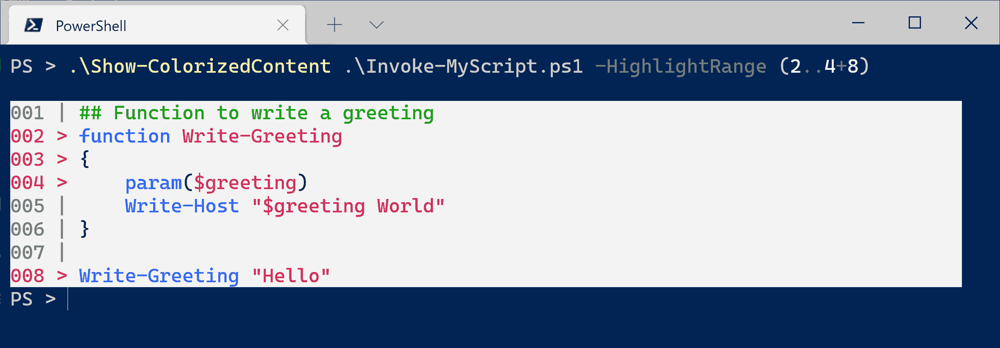

# 第 8 章. 实用任务

## 8.0 简介

当您编写脚本或仅使用交互式 Shell 时，会出现一些简单但有用的需求：度量命令、获取随机数等。

## 8.1 获取系统日期和时间

### 问题

您想要获取系统日期。

### 解决方案

要获取系统日期，请运行命令 `Get-Date`。

### 讨论

`Get-Date` 命令生成丰富的基于对象的输出，因此您可以将其结果用于许多与日期相关的任务。例如，要确定当前是星期几：

```
PS > $date = Get-Date
PS > $date.DayOfWeek
Sunday
```

如果您想要格式化日期以用于输出（例如，作为日志文件时间戳），请参阅 配方 5.13。

有关 `Get-Date` cmdlet 的更多信息，请输入 `Get-Help Get-Date`。

有关使用 .NET Framework 类的更多信息，请参阅 配方 3.8。

### 另请参阅

配方 3.8，“使用 .NET 对象”

配方 5.13，“格式化日期以用于输出”

## 8.2 测量命令的持续时间

### 问题

您想知道命令执行需要多长时间。

### 解决方案

要测量命令的持续时间，请使用 `Measure-Command` cmdlet：

```
PS > Measure-Command { Start-Sleep -Milliseconds 337 }

Days              : 0
Hours             : 0
Minutes           : 0
Seconds           : 0
Milliseconds      : 339
Ticks             : 3392297
TotalDays         : 3.92626967592593E-06
TotalHours        : 9.42304722222222E-05
TotalMinutes      : 0.00565382833333333
TotalSeconds      : 0.3392297
TotalMilliseconds : 339.2297
```

### 讨论

在交互式使用中，通常需要测量命令的持续时间。一个例子可能是对您开发的应用程序运行性能基准测试。`Measure-Command` cmdlet 使这变得容易。因为该命令生成丰富的基于对象的输出，您可以将其输出用于许多与日期相关的任务。有关更多信息，请参阅 配方 3.8。

如果命令测量的准确性很重要，一般的系统活动很容易影响结果的计时。提高准确性的常用技术是重复测量多次，忽略异常值（前 10% 和后 10%），然后计算剩余结果的平均值。示例 8-1 实现了此技术。

#### 示例 8-1. Measure-CommandPerformance.ps1

```
##############################################################################
##
## Measure-CommandPerformance
##
## From PowerShell Cookbook (O'Reilly)
## by Lee Holmes (http://www.leeholmes.com/guide)
##
##############################################################################

<#

.SYNOPSIS

Measures the average time of a command, accounting for natural variability by
automatically ignoring the top and bottom 10%.

.EXAMPLE

PS > Measure-CommandPerformance.ps1 { Start-Sleep -m 300 }

Count    : 30
Average  : 312.10155
(...)

#>

param(
    ## The command to measure
    [Scriptblock] $Scriptblock,

    ## The number of times to measure the command's performance
    [int] $Iterations = 30
)

Set-StrictMode -Version 3

## Figure out how many extra iterations we need to account for the outliers
$buffer = [int] ($iterations * 0.1)
$totalIterations = $iterations + (2 * $buffer)

## Get the results
$results = 1..$totalIterations |
    Foreach-Object { Measure-Command $scriptblock }

## Sort the results, and skip the outliers
$middleResults = $results | Sort TotalMilliseconds |
    Select -Skip $buffer -First $iterations

## Show the average
$middleResults | Measure-Object -Average TotalMilliseconds
```

有关 `Measure-Command` cmdlet 的更多信息，请输入 `Get-Help Measure-Command`。

### 另请参阅

配方 3.8，“使用 .NET 对象”

## 8.3 从剪贴板读取和写入

### 问题

您想要与 PowerShell 剪贴板交互。

### 解决方案

使用 PowerShell 的 `Get-Clipboard` 和 `Set-Clipboard` cmdlet：

```
PS > 1..5 | Set-Clipboard
PS > Get-Clipboard | Where-Object { ([int] $_) -lt 3 }
1
2
```

如果您想要一次性检索剪贴板的全部内容（不使用 PowerShell 默认的逐行行为），请使用 `-Raw` 参数：

```
PS > $allContent = Get-Clipboard -Raw
PS > $allContent.Replace("`r`n", ".")
1.2.3.4.5
```

### 讨论

虽然 Windows 包含一个命令行实用程序 (`clip.exe`) 可将文本放入 Windows 剪贴板，但它不支持直接输入（例如 `clip.exe "Hello World"`），并且没有相应的实用程序从 Windows 剪贴板检索内容。

`Set-Clipboard` 和 `Get-Clipboard` cmdlet 解决了这两个问题。


# 剪贴板命令

`Get-Clipboard` 和 `Set-Clipboard` 命令的一个优势是，它们会自动调整行为，以便与你运行 PowerShell 的操作系统平台集成。在 Linux 上，如果可用，PowerShell 会使用 `xclip`。在 macOS 上，PowerShell 使用 `pbcopy`。利用 `Get-Clipboard` 和 `Set-Clipboard` cmdlet 的一个好方法是帮助处理重复性的临时内容操作。例如，你可以将文档中的某些内容复制到剪贴板，然后运行一小段 PowerShell 来获取内容、修改它，并用新值替换剪贴板内容。然后，你只需将修改后的内容粘贴回文档即可。有关替换字符串中文本的更多信息，请参阅 食谱 5.8。

### 另请参阅

食谱 5.8，“替换字符串中的文本”

# 8.4 生成随机数或对象

## 问题

你想要生成一个随机数，或从一组对象中选取一个随机元素。

## 解决方案

调用 `Get-Random` cmdlet 以生成一个随机正整数：

```
Get-Random
```

使用 `-Minimum` 和 `-Maximum` 参数生成一个介于 `Minimum` 和 `Maximum` 之间（包含 `Minimum`，不包含 `Maximum`）的数字：

```
Get-Random -Minimum 1 -Maximum 21
```

使用简单的管道输入从列表中选取随机元素：

```
PS > $suits = "Hearts","Clubs","Spades","Diamonds"
PS > $faces = (2..10)+"A","J","Q","K"
PS > $cards = foreach($suit in $suits) {
     foreach($face in $faces) { "$face of $suit" } }
PS > $cards | Get-Random
A of Spades
PS > $cards | Get-Random
2 of Clubs
```

## 讨论

`Get-Random` cmdlet 解决了通常与选取随机数或从集合中选取随机元素相关的问题：`scaling`（缩放）和 `seeding`（种子）。

大多数随机数生成器只生成 0 到 1 之间的数字。如果你需要不同范围的数字，必须经过单独的缩放步骤，将这些数字映射到适当的范围。虽然这并不太难，但它是一个可用性障碍，需要不止基本的知识才能正确完成。

确保随机数生成器选取 `good`（良好）的随机数则是完全不同的问题。大多数通用随机数生成器使用数学方程来生成其值。这些被称为 `pseudo-random number generators`（伪随机数生成器），或 `PRNGs`。它们通过结合刚才生成的数字来生成新值——这是一个反馈过程，保证了数字序列的均匀分布。维护这种内部状态至关重要，因为从特定点重新开始将始终生成相同的数字，这根本不随机！

为了创建第一个值，这些生成器需要一个随机数 `seed`（种子），通常从系统时间获取。因此，除非你重用同一个随机数生成器，否则这一点通常会导致真正随机数的失效。当你快速生成它们时，你会创建新的随机数生成器，它们很可能拥有相同的种子。这往往会产生一系列重复的随机数：

```
PS > 1..10 | ForEach-Object { (New-Object System.Random).Next(1, 21) }
20
7
7
15
15
11
11
18
18
18
```

`Get-Random` cmdlet 以两种方式使你免受此问题困扰。PowerShell 的 `Get-Random` cmdlet 早期版本实现了一个 PRNG。它解决此问题的第一种方式是内部维护一个随机数生成器及其状态，从而大大提高随机性：

```
PS > 1..10 | ForEach-Object { Get-Random -Min 1 -Max 21 }
20
18
7
12
16
10
9
13
16
14
```

然而，即使这种 `pseudo`（伪）随机性很好，但未意识到它不是 `truly`（真正）随机的管理员也用此 cmdlet 生成密码和其他敏感内容。这很危险：如果生成密码的仅有两个因素是生成时间和随机数生成器使用的众所周知的公式，那么该密码就不太安全。尽管如此，假设你可以使用 `Get-Random` cmdlet 生成随机密码，这实际上是任何人都应该被允许做出的假设。因此，PowerShell 解决此问题的第二种方式是使用 `cryptographic`（加密）随机数生成器。`Get-Random` 生成的数字适合用于密码、加密密钥等。

对于需要可重现结果的场景，你可以使用 `Get-Random` cmdlet 的 `-SetSeed` 参数直接提供种子以用于测试目的。有关使用 .NET Framework 类的更多信息，请参阅 食谱 3.8。

## 另请参阅

食谱 3.8，“使用 .NET 对象”

# 8.5 在时区之间转换时间

## 问题

你想要确定某个时区的特定时间在另一个时区中的表示。

## 解决方案

使用 .NET Framework 中的 `TimeZoneInfo` 类：

```
$targetTime = [DateTime] "11/05/2022 9:00 AM"
$targetTimeZone = [TimeZoneInfo]::GetSystemTimeZones() |
    Where-Object Id -match Israel
[TimeZoneInfo]::ConvertTime($targetTime, $targetTimeZone)
```

```
Saturday, November 5, 2022 6:00:00 PM
```

如果你指定的时间不是你自己的时区：

```
$targetTime = [DateTime] "11/05/2022 9:00 AM"

$sourceTimeZone = [TimeZoneInfo]::GetSystemTimeZones() |
    Where-Object Id -match India
$targetTimeZone = [TimeZoneInfo]::GetSystemTimeZones() |
    Where-Object Id -match Israel
[TimeZoneInfo]::ConvertTime($targetTime, $sourceTimeZone, $targetTimeZone)
```

```
Saturday, November 5, 2022 5:30:00 AM
```

## 讨论

与世界各地的人合作时，跟踪时区差异可能会让人不知所措。夏令时的遵守情况在世界各地不一致，而涉及国际日期变更线时的心算足以让你在最好的时候也感到头疼。幸运的是，.NET Framework 的 `TimeZoneInfo` 类可以帮助解决这些挑战。它了解 140 种不同的时区表示、它们的协调世界时 (UTC) 偏移量、日历变更、时间调整等。

## 另请参阅

食谱 3.8，“使用 .NET 对象”

# 8.6 程序：搜索 Windows 开始菜单

在命令行工作时，你可能想要启动一个通常只在开始菜单中找到的程序。虽然你当然可以点击浏览开始菜单来查找它，但你也可以使用脚本搜索开始菜单，如 示例 8-2 所示。

## 示例 8-2. Search-StartMenu.ps1


## Search-StartMenu

### 说明

搜索开始菜单中与提供的文本匹配的项目。此脚本同时搜索名称（在开始菜单中显示的名称）和链接的目标。

### 示例

```powershell
PS > Search-StartMenu "Character Map" | Invoke-Item
# 搜索 "Character Map" 应用程序，然后运行它

PS > Search-StartMenu PowerShell | Select-FilteredObject | Invoke-Item
# 搜索应用程序名称中包含 "PowerShell" 的任何内容，让你选择要启动的项目，然后启动它
```

### 参数

```powershell
param(
    ## 要匹配的模式
    [Parameter(Mandatory = $true)]
    $Pattern
)
```

### 脚本内容

```powershell
Set-StrictMode -Version 3

## 获取开始菜单路径的位置
$myStartMenu = [Environment]::GetFolderPath("StartMenu")
$shell = New-Object -Com WScript.Shell
$allStartMenu = $shell.SpecialFolders.Item("AllUsersStartMenu")

## 转义搜索词，以免正则表达式字符影响搜索
$escapedMatch = [Regex]::Escape($pattern)

## 在 "my start menu" 中搜索链接名称或链接目标中的文本
dir $myStartMenu *.lnk -rec | Where-Object {
    ($_.Name -match "$escapedMatch") -or
    ($_ | Select-String "\\[^\\]*$escapedMatch\." -Quiet)
}

## 在 "all start menu" 中搜索链接名称或链接目标中的文本
dir $allStartMenu *.lnk -rec | Where-Object {
    ($_.Name -match "$escapedMatch") -or
    ($_ | Select-String "\\[^\\]*$escapedMatch\." -Quiet)
}
```

### 另请参阅

- 食谱 1.2，“运行程序、脚本和现有工具”

---

# 8.7 程序：显示着色脚本内容

## 讨论

查看或演示脚本时，语法高亮使信息更易于阅读。在 `Visual Studio Code` 中查看脚本是最自然（也是功能最强大）的选择，但你可能也想在控制台中查看它们。

除了基本的语法高亮，脚本审查时其他有用的功能包括行号和高亮显示行范围。在更大的上下文中讨论脚本的部分内容时，范围高亮特别有用。

示例 8-3 通过在控制台会话中提供脚本的语法高亮来实现所有这些场景。图 8-1 显示了着色内容的示例。



除了本身具有实用性外，`Show-ColorizedContent.ps1` 还演示了如何使用 PowerShell 的 Tokenizer API，该 API 在 食谱 10.10 中介绍。虽然此示例中的许多技术专用于 `PowerShell console` 中的语法高亮，但更多技术适用于所有形式的脚本操作。

### 示例 8-3. Show-ColorizedContent.ps1


# Show-ColorizedContent

> 来自 *PowerShell Cookbook* (O'Reilly)，作者 Lee Holmes (http://www.leeholmes.com/guide)

## 概要

为 PowerShell 脚本显示语法高亮、行号和范围高亮。

## 示例

**示例 1**

```powershell
PS > Show-ColorizedContent Invoke-MyScript.ps1

001 | function Write-Greeting
002 | {
003 |     param($greeting)
004 |     Write-Host "$greeting World"
005 | }
006 |
007 | Write-Greeting "Hello"
```

**示例 2**

```powershell
PS > Show-ColorizedContent Invoke-MyScript.ps1 -highlightRange (1..3+7)

001 > function Write-Greeting
002 > {
003 >     param($greeting)
004 |     Write-Host "$greeting World"
005 | }
006 |
007 > Write-Greeting "Hello"
```

## 参数

```powershell
param(
    ## 要着色的路径
    [Parameter(Mandatory = $true)]
    $Path,

    ## 要高亮的行范围
    $HighlightRange = @(),

    ## 排除行号的开关
    [Switch] $ExcludeLineNumbers
)
```

## 脚本主体

```powershell
Set-StrictMode -Version 3
```

### 标记颜色

用于不同脚本标记的颜色。要选择自己的颜色：

```powershell
[Enum]::GetValues($host.UI.RawUI.ForegroundColor.GetType()) |
    Foreach-Object { Write-Host -Fore $_ "$_" }
```

```powershell
$replacementColors = @{
    'Attribute' = 'DarkCyan'
    'Command' = 'Blue'
    'CommandArgument' = 'Magenta'
    'CommandParameter' = 'DarkBlue'
    'Comment' = 'DarkGreen'
    'GroupEnd' = 'Black'
    'GroupStart' = 'Black'
    'Keyword' = 'DarkBlue'
    'LineContinuation' = 'Black'
    'LoopLabel' = 'DarkBlue'
    'Member' = 'Black'
    'NewLine' = 'Black'
    'Number' = 'Magenta'
    'Operator' = 'DarkGray'
    'Position' = 'Black'
    'StatementSeparator' = 'Black'
    'String' = 'DarkRed'
    'Type' = 'DarkCyan'
    'Unknown' = 'Black'
    'Variable' = 'Red'
}
```

### 高亮设置

```powershell
$highlightColor = "Red"
$highlightCharacter = ">"
$highlightWidth = 6
if($excludeLineNumbers) { $highlightWidth = 0 }
```

### 读取并标记化文件

```powershell
## 读取文件文本，并对其进行标记化
$content = Get-Content $Path -Raw
$parsed = [System.Management.Automation.PsParser]::Tokenize(
    $content, [ref] $null) | Sort StartLine,StartColumn
```

## 函数

### WriteFormattedLine

写入格式化行 -- 格式为：
`<行号> <分隔符> <文本>`

```powershell
function WriteFormattedLine($formatString, [int] $line)
{
    if($excludeLineNumbers) { return }

    ## 默认以灰色写入行号，并使用简单的竖线作为分隔符
    $hColor = "DarkGray"
    $separator = "|"

    ## 如果需要高亮该行，则使用高亮颜色和高亮分隔符作为分隔符
    if($highlightRange -contains $line)
    {
        $hColor = $highlightColor
        $separator = $highlightCharacter
    }

    ## 写入格式化行
    $text = $formatString -f $line,$separator
    Write-Host -NoNewLine -Fore $hColor -Back White $text
}
```

### CompleteLine

用填充单元完成当前行。

```powershell
function CompleteLine($column)
{
    ## 计算剩余空间
    $lineRemaining = $host.UI.RawUI.WindowSize.Width -
        $column - $highlightWidth + 1

    ## 如果剩余小于 0，说明已换到下一行。再添加一个缓冲区宽度的填充
    if($lineRemaining -lt 0)
    {
        $lineRemaining += $host.UI.RawUI.WindowSize.Width
    }

    Write-Host -NoNewLine -Back White (" " * $lineRemaining)
}
```

## 主处理循环

```powershell
## 写入第一行上下文信息（行号、高亮字符。）
Write-Host
WriteFormattedLine "{0:D3} {1} " 1

## 现在，遍历输入脚本中的每个标记
$column = 1
foreach($token in $parsed)
{
    $color = "Gray"

    ## 通过查找将标记类型映射到其颜色的哈希表，确定该标记的高亮颜色
    $color = $replacementColors[[string]$token.Type]
    if(-not $color) { $color = "Gray" }

    ## 如果是换行标记，写入下一行的上下文信息
    if(($token.Type -eq "NewLine") -or ($token.Type -eq "LineContinuation"))
    {
        CompleteLine $column
        WriteFormattedLine "{0:D3} {1} " ($token.StartLine + 1)
        $column = 1
    }
    else
    {
        ## 处理缩进
        if($column -lt $token.StartColumn)
        {
            $text = " " * ($token.StartColumn - $column)
            Write-Host -Back White -NoNewLine $text
            $column = $token.StartColumn
        }

        ## 查看标记结束位置
        $tokenEnd = $token.Start + $token.Length - 1

        ## 处理多行字符串和注释的行号
        if(
            (($token.Type -eq "String") -or
            ($token.Type -eq "Comment")) -and
            ($token.EndLine -gt $token.StartLine))
        {
            ## 存储起始行
            $lineCounter = $token.StartLine

            ## 将此标记的内容拆分为多行
            ## 我们使用标记的开始和结束来确定内容位置，但使用内容本身（而非标记值）进行操作。
            $stringLines = $(
                -join $content[$token.Start..$tokenEnd] -split "`n")

            ## 遍历内容中的每一行
            foreach($stringLine in $stringLines)
            {
                $stringLine = $stringLine.Trim()

                ## 如果在新行上，用空格填充行右侧，并写入新行的标题
                if($lineCounter -gt $token.StartLine)
                {
                    CompleteLine $column
                    WriteFormattedLine "{0:D3} {1} " $lineCounter
                    $column = 1
                }

                ## 现在写入当前行的文本
                Write-Host -NoNewLine -Fore $color -Back White $stringLine
                $column += $stringLine.Length
                $lineCounter++
            }
        }
        ## 写出常规标记
        else
        {
            ## 我们使用标记的开始和结束来确定内容位置，但使用内容本身（而非标记值）进行操作。
            $text = (-join $content[$token.Start..$tokenEnd])
            Write-Host -NoNewLine -Fore $color -Back White $text
        }

        ## 更新我们在列中的位置
        $column = $token.EndColumn
    }
}

CompleteLine $column
Write-Host
```

## 另请参阅

- 食谱 1.2，“运行程序、脚本和现有工具”
- 食谱 10.10，“解析和解释 PowerShell 脚本”

---
