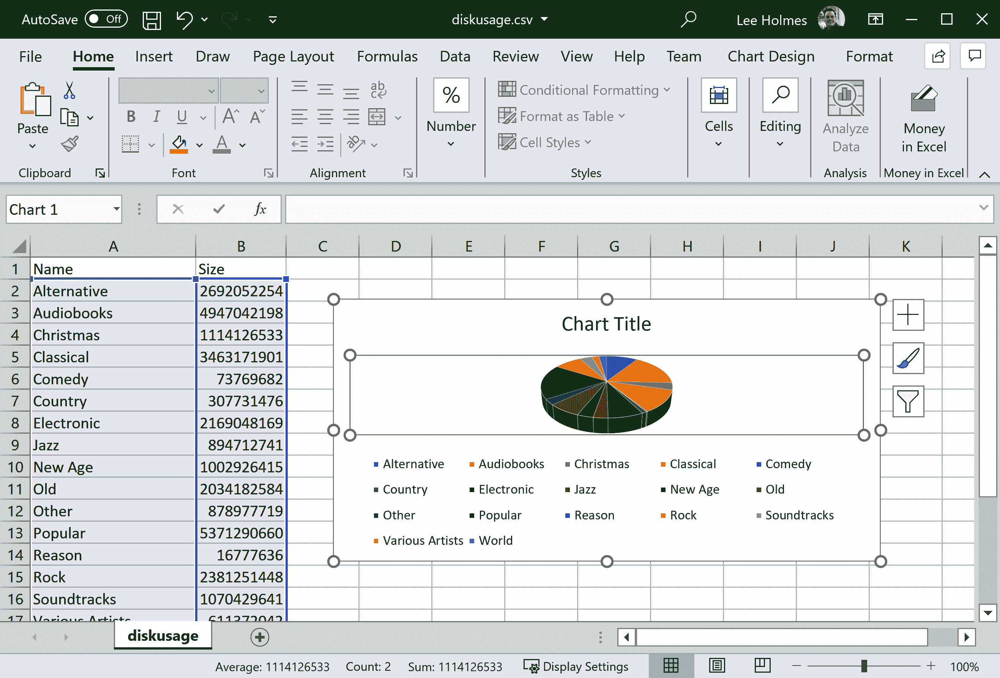
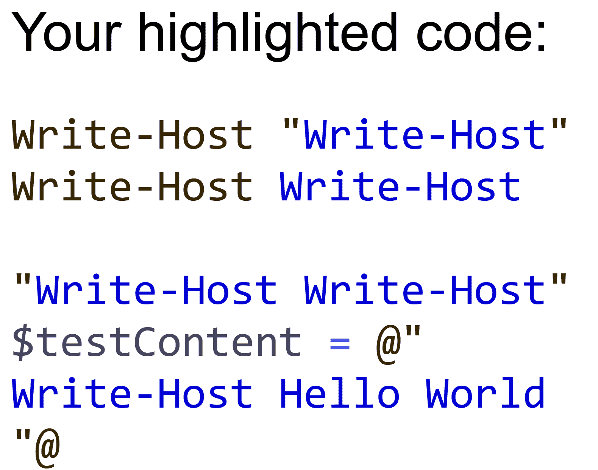

# 第 10 章 结构化文件

## 10.0 简介

在纯文本系统管理的世界中，管理结构化文件通常很麻烦。例如，处理（或编辑）XML 文件意味着要么将其加载到编辑器中手动修改，要么编写一个自定义工具来完成此任务。更糟的是，这可能意味着像修改纯文本一样修改文件，同时希望不破坏 XML 本身的结构。

在同一个世界中，处理逗号分隔值（CSV）格式的文件意味着你要自己遍历文件，按其中的逗号拆分每一行。这看似是个好方法，直到你发现自己面对的数据并非最简单的情况。

结构和结构化文件不仅来自其他程序。编写脚本时，一个常见目标是保存结构化数据以便稍后使用。在大多数脚本（和编程）语言中，这要求你设计一种数据结构来保存数据，设计一种方式将其存储到磁盘并从中检索，并在你想再次使用时将其恢复为可用形式。

幸运的是，有了 PowerShell，处理 XML、CSV 甚至你自己的结构化文件变得容易得多。

## 10.1 访问 XML 文件中的信息

### 问题

你想要处理并访问 XML 文件中的信息。

### 解决方案

使用 PowerShell 的 XML 强制转换将纯文本 XML 转换为更易于处理的形式。在本例中，我们使用从 PowerShell 博客下载的 RSS 源：

```
PS > $xml = [xml] (Get-Content powershell_blog.xml)
```

#### 注意

有关如何使用 PowerShell 下载此文件的更多详细信息，请参阅 Recipe 12.1：

```
Invoke-WebRequest https://devblogs.microsoft.com/powershell/feed/ `
    -OutFile powershell_blog.xml
```

与其他丰富对象一样，当你探索时，PowerShell 会显示 XML 的属性。这些属性是 XML 中的子节点和属性，如 示例 10-1 所示。

#### 示例 10-1. 访问 XML 文档的属性

```
PS > $xml
xml                     xml-stylesheet            rss
---                     --------------            ---
                                                  rss

PS > $xml.rss

version : 2.0
dc      : http://purl.org/dc/elements/1.1/
slash   : http://purl.org/rss/1.0/modules/slash/
wfw     : http://wellformedweb.org/CommentAPI/
channel : channel
```

如果多个节点共享同一名称（如 RSS 源中的 item 节点），则该属性名代表一个节点集合：

```
PS > ($xml.rss.channel.item).Count
15
```

你可以单独访问这些项，就像正常处理数组一样，如 示例 10-2 所示。

#### 示例 10-2. 访问 XML 文档中的单个项

```
PS > ($xml.rss.channel.item)[0]

title       : Windows Management Framework is here!
link        : http://blogs.msdn.com/powershell/archive/2009/10/27/windows-
              management-framework-is-here.aspx
pubDate     : Tue, 27 Oct 2009 18:25:13 GMT
guid        : guid
creator     : PowerShellTeam
comments    : {15, http://blogs.msdn.com/powershell/comments/9913618.aspx}
commentRss  : http://blogs.msdn.com/powershell/commentrss.aspx?PostID=9913
              618
comment     : http://blogs.msdn.com/powershell/rsscomments.aspx?PostID=991
              3618
description : <p>Windows Management Framework, which includes Windows Power
              Shell 2.0, WinRM 2.0, and BITS 4.0, was officially released
              to the world this morning.
(...)
```

你可以像正常处理对象一样访问这些元素的属性：

```
PS > ($xml.rss.channel.item)[0].title
Windows Management Framework is here!
```

由于这些是丰富的 PowerShell 对象，示例 10-3 演示了如何使用 PowerShell 的高级基于对象的 cmdlet 进行进一步工作，例如排序和筛选。

#### 示例 10-3. 对 XML 文档中的项进行排序和筛选

```
PS > $xml.rss.channel.item | Sort-Object title | Select-Object title

title
-----
Analyzing Weblog Data Using the Admin Development Model
Announcing: Open Source PowerShell Cmdlet and Help Designer
Help Us Improve Microsoft Windows Management Framework
Introducing the Windows 7 Resource Kit PowerShell Pack
New and Improved PowerShell Connect Site
PowerShell V2 Virtual Launch Party
Remoting for non-Admins
Select -ExpandProperty <PropertyName>
The Glory of Quick and Dirty Scripting
Tonight Is the Virtual Launch Party @ PowerScripting Podcast
Understanding the Feedback Process
What's New in PowerShell V2 -  By Joel "Jaykul" Bennett
What's Up With Command Prefixes?
Windows Management Framework is here!
XP and W2K3 Release Candidate Versions of PowerShell Are Now Available ...
```

### 讨论

PowerShell 原生的 XML 支持提供了一种轻松浏览和访问 XML 文件的绝佳方式。通过将 XML 层次结构作为属性公开，你可以执行大多数任务，而无需求助于纯文本处理或自定义工具。

事实上，PowerShell 对 XML 交互的支持不仅限于以对象友好的方式呈现数据。`[xml]` 强制转换创建的对象实际上代表了来自 .NET Framework 的功能齐全的 `System.Xml.XmlDocument` 对象。生成对象的每个属性也代表来自 .NET Framework 的 `System.Xml.XmlElement` 对象。底层对象提供了大量额外功能，可用于对 XML 文件执行常见和复杂的任务。

支持你的 XML 的底层 `System.Xml.XmlDocument` 和 `System.Xml.XmlElement` 对象本身也提供了有用的属性：`Attributes`、`Name`、`OuterXml` 等。

```
PS > $xml.rss.Attributes

#text
-----
2.0
http://purl.org/dc/elements/1.1/
http://purl.org/rss/1.0/modules/slash/
http://wellformedweb.org/CommentAPI/
```

有关使用底层 .NET 对象执行更高级任务的详细信息，请参阅 Recipe 10.2 和 Recipe 10.4。

有关在 PowerShell 中处理 XML 的详细信息，请参阅 附录 F 中的 表 F-11。

### 另请参阅


# 10.2 对 XML 执行 XPath 查询

## 问题

您想要使用 XML 的标准 `XPath 语法` 对 XML 文件执行高级查询。

## 解决方案

使用 PowerShell 的 `Select-Xml` cmdlet 对文件执行 XPath 查询。

例如，要在 RSS 源中查找所有长度小于 30 个字符的帖子标题：

```
PS > $query = "/rss/channel/item[string-length(title) < 30]/title"
PS > Select-Xml -XPath $query -Path .\powershell_blog.xml | Select -Expand Node

#text
-----
Remoting for non-Admins
```

## 讨论

尽管 XPath 查询语法是一门独立的语言，但它提供了一种强大的、以 XML 为中心的方式来为 XML 文件编写高级查询。`Select-Xml` cmdlet 允许您将这些概念应用于文件、XML 节点，甚至是纯文本。

### 注意

`Select-Xml` cmdlet 支持的 XPath 查询是一种流行的行业标准。但请注意。与 PowerShell 的其他部分不同，这些查询**区分大小写**！

`Select-Xml` cmdlet 生成一个 `SelectXmlInfo` 对象。这使您可以将单独的 XPath 查询链接在一起。要检索选择的实际结果，请访问 `Node` 属性：

```
PS > Get-Content page.html
<HTML>
    <HEAD>
        <TITLE>Welcome to my Website</TITLE>
    </HEAD>
    <BODY>
        <P>...</P>
    </BODY>
</HTML>
PS > $content = [xml] (Get-Content page.html)
PS > $result = $content | Select-Xml "/HTML/HEAD" | Select-Xml "TITLE"
PS > $result

Node                     Path                     Pattern
----                     ----                     -------
TITLE                    InputStream              TITLE


PS > $result.Node

#text
-----
Welcome to my Website
```

这甚至适用于通过 PowerShell 的 XML 支持访问的内容，如本例所示，它使用了从 PowerShell 博客下载的 RSS 源：

```
PS > $xml = [xml] (Get-Content powershell_blog.xml)
PS > $xml | Select-Xml $query | Select -Expand Node

#text
-----
Remoting for non-Admins
```

对于较简单的查询，您可能会发现 PowerShell 基于对象的 XML 导航概念更易于使用。有关通过 PowerShell 的 XML 类型处理 XML 的更多信息，请参阅 附录 F 中的 表 F-11。有关 XPath 语法的更多信息，请参阅 附录 C。

## 另请参阅

- 附录 C，*XPath 快速参考*
- 表 F-11

# 10.3 将对象转换为 XML

## 问题

您想要将命令输出转换为 XML，以便进一步处理或查看。

## 解决方案

使用 PowerShell 的 `ConvertTo-Xml` cmdlet 将命令的输出另存为 XML：

```
$xml = Get-Process | ConvertTo-Xml
```

然后，您可以使用 PowerShell 的 XML 支持（XML 导航、`Select-Xml` 等）来处理该内容。

## 讨论

尽管通常直接使用完整保真度的对象最为容易，但有时您可能希望将它们转换为 XML，以便由其他程序进一步处理。解决方案是 `ConvertTo-Xml` cmdlet。

### 注意

PowerShell 还包含一个听起来相似的 cmdlet，称为 `Export-CliXml`。与旨在为人类和程序生成有用输出的 `ConvertTo-Xml` cmdlet 不同，`Export-CliXml` cmdlet 专为以 PowerShell 为中心的数据交换而设计。有关更多信息，请参阅 配方 10.5。

`ConvertTo-Xml` cmdlet 为您提供了两种主要的转换目标。默认是 XML 文档，这是 PowerShell 中 `[xml]` 转换创建的同类型对象。这也是 `Select-Xml` cmdlet 支持的格式，因此您可以将 `ConvertTo-Xml` 的输出直接通过管道传递给它。

```
PS > $xml = Get-Process | ConvertTo-Xml
PS > $xml | Select-Xml '//Property[@Name = "Name"]' | Select -Expand Node

Name                     Type                     #text
----                     ----                     -----
Name                     System.String            audiodg
Name                     System.String            csrss
Name                     System.String            dwm
(...)
```

第二种格式是简单的字符串，适合重定向到文件中。要将 XML 保存到文件中，请使用 `-As` 参数并指定 `String` 作为参数，然后使用文件重定向操作符：

```
Get-Process | ConvertTo-Xml -As String > c:\temp\processes.xml
```

如果您已经从 `ConvertTo-Xml` 或 PowerShell 的 `[xml]` 转换获得了 XML 文档，仍可通过调用其 `Save()` 方法将其保存到文件中：

```
$xml = Get-Process | ConvertTo-Xml
$xml.Save("c:\temp\output.xml")
```

有关如何在 PowerShell 中处理 XML 数据的更多信息，请参阅 配方 10.1。

## 另请参阅

- 配方 10.1，“访问 XML 文件中的信息”
- 配方 10.5，“轻松导入和导出结构化数据”

# 10.4 修改 XML 文件中的数据

## 问题

您想要使用 PowerShell 修改 XML 文件中的数据。

## 解决方案

要修改 XML 文件中的数据，请将文件加载到 PowerShell 的 XML 数据类型中，更改您想要的内容，然后将文件保存回磁盘。示例 10-4 演示了这种方法。

### 示例 10-4. 从 PowerShell 修改 XML 文件

```
PS > ## Store the filename
PS > $filename = (Get-Item phone.xml).FullName
PS >
PS > ## Get the content of the file, and load it
PS > ## as XML
PS > Get-Content $filename
<AddressBook>
  <Person contactType="Personal">
    <Name>Lee</Name>
    <Phone type="home">555-1212</Phone>
    <Phone type="work">555-1213</Phone>
  </Person>
  <Person contactType="Business">
    <Name>Ariel</Name>
    <Phone>555-1234</Phone>
  </Person>
</AddressBook>
PS > $phoneBook = [xml] (Get-Content $filename)
PS >
PS > ## Get the part with data we want to change
PS > $person = $phoneBook.AddressBook.Person[0]
PS >
PS > ## Change the text part of the information,
PS > ## and the type (which was an attribute)
PS > $person.Phone[0]."#text" = "555-1214"
PS > $person.Phone[0].type = "mobile"
PS >
PS > ## Add a new phone entry
PS > $newNumber = [xml] '<Phone type="home">555-1215</Phone>'
PS > $newNode = $phoneBook.ImportNode($newNumber.Phone, $true)
PS > [void] $person.AppendChild($newNode)
PS >
PS > ## Save the file to disk
PS > $phoneBook.Save($filename)
PS > Get-Content $filename
<AddressBook>
  <Person contactType="Personal">
    <Name>Lee</Name>
    <Phone type="mobile">555-1214</Phone>
    <Phone type="work">555-1213</Phone>
    <Phone type="home">555-1215</Phone>
  </Person>
  <Person contactType="Business">
    <Name>Ariel</Name>
    <Phone>555-1234</Phone>
  </Person>
</AddressBook>
```

## 讨论

在前面的解决方案中，您将 `Lee` 的电话号码（即 XML 原始第一个 `Phone` 节点的“文本”部分）从 `555-1212` 更改为 `555-1214`。您还将电话号码的类型（即 `Phone` 节点的一个属性）从 `"home"` 更改为 `"mobile"`。

向 XML 添加新信息也几乎同样容易。要向 XML 文件添加信息，您需要将其作为另一个节点的*子节点*添加到文件中。获取该子节点的最简单方法是编写表示 XML 的字符串，然后从中创建一个临时的 PowerShell XML 文档。从该临时文档中，您可以使用主 XML 文档的 `ImportNode()` 函数导入您关心的节点——具体来说，就是本例中的 `Phone` 节点。

---

### 交叉引用

- 配方 10.2，“对 XML 执行 XPath 查询”
- 配方 10.4，“修改 XML 文件中的数据”
- 配方 12.1，“从 FTP 或 Internet 站点下载文件”
- 表 F-11


获得子节点后，你需要决定将其放在何处。既然我们想要让这个 `Phone` 节点成为 `Lee` 的 `Person` 节点的子节点，我们就将它放在那里。要将子节点（示例 10-4 中的 `$newNode`）添加到目标节点（示例中的 `$person`），请使用目标节点的 `AppendChild()` 方法。

### 注意

XML 文档上的 `Save()` 方法允许你保存到不仅仅是文件。要快速将 XML 转换为“美化”形式，请将其保存到控制台：

```
$phoneBook.Save([Console]::Out)
```

最后，我们将 XML 保存回其来源文件。

# 10.5 轻松导入和导出结构化数据

## 问题

你有一组数据（如哈希表或数组），想要将其保存到磁盘以便稍后使用。反之，你已将结构化数据保存到文件，想要导入它以便使用。

## 解决方案

使用 PowerShell 的 `Export-CliXml` cmdlet 将结构化数据保存到磁盘，并使用 `Import-CliXml` cmdlet 从磁盘再次导入。

例如，假设将你最喜欢的目录列表存储在哈希表中，以便你可以通过“收藏夹 CD”功能轻松浏览系统。示例 10-5 展示了此函数。

### 示例 10-5. 需要持久化结构化数据的函数

```
PS > $favorites = @{}
PS > $favorites["temp"] = "c:\temp"
PS > $favorites["music"] = "h:\lee\my music"
PS > function fcd {
   param([string] $location) Set-Location $favorites[$location]
}

PS > Get-Location

Path
----
HKLM:\software

PS > fcd temp
PS > Get-Location

Path
----
C:\temp
```

遗憾的是，每当你关闭 PowerShell 时，`$favorites` 变量就会消失。

为了解决这个问题，你可以在配置文件中重新创建 `$favorites` 变量，但另一种方法是将其直接导出到文件。此命令假设你已经创建了 `$profile`，并将文件放在与该配置文件相同的位置：

```
PS > $filename = Join-Path (Split-Path $profile) favorites.clixml
PS > $favorites | Export-CliXml $filename
PS > $favorites = $null
PS > $favorites
PS >
```

文件位于磁盘上后，你可以使用 `Import-CliXml` cmdlet 重新加载它，如 示例 10-6 所示。

### 示例 10-6. 从磁盘还原结构化数据

```
PS > $favorites = Import-CliXml $filename
PS > $favorites

Name                           Value
----                           -----
music                          h:\lee\my music
temp                           c:\temp

PS > fcd music
PS > Get-Location

Path
----
H:\lee\My Music
```

## 讨论

PowerShell 提供 `Export-CliXml` 和 `Import-CliXml` cmdlet，让你能轻松地将结构化数据移入和移出文件。这些 cmdlet 以一种非常以数据为中心且面向未来的方式实现这一点——仅存储该数据属性的名称、值和基本数据类型。

### 注意

默认情况下，PowerShell 存储一级数据：所有直接可访问的简单属性（如进程的 `WorkingSet`），但对于更深层的内容（如进程的 `Threads` 集合）则存储纯文本表示形式。有关如何控制此导出深度的信息，请输入 `Get-Help Export-CliXml` 并查看 `-Depth` 参数的说明。

导入由 `Export-CliXml` 保存的数据后，你再次可以访问原始数据的属性和值。PowerShell 会将某些对象转换回其功能完整的对象（如 `System.DateTime` 对象），但大部分情况下不会保留原始对象的功能（例如方法）。

# 10.6 将命令输出存储到 CSV 或分隔文件中

## 问题

你想要将命令的输出存储在 CSV 文件中以供后续处理。当你想要导出数据以便在 PowerShell 外部进行后续处理时，这很有帮助。

## 解决方案

使用 PowerShell 的 `Export-Csv` cmdlet 将命令的输出保存到 CSV 文件中。例如，要创建系统上运行进程的清单：

```
Get-Process | Export-Csv c:\temp\processes.csv
```

然后你可以在 Excel 等工具中查看此输出，将其发送给他人，或对 CSV 文件执行任何其他你想要的操作。

## 讨论

CSV 文件格式是程序和系统之间交换半结构化数据的最常用格式之一。

PowerShell 的 `Export-Csv` cmdlet 提供了一种从 PowerShell 环境导出数据的简便方法，同时仍允许你保留相当多的数据结构。当 PowerShell 将数据导出到 CSV 时，它会为你提供的每个对象创建一行。对于每一行，PowerShell 会在 CSV 中创建列，这些列代表对象属性的值。

### 注意

如果你想将 CSV 结构化数据用作支持直接 CSV 管道输入的其他工具的输入，可以使用 `ConvertTo-Csv` cmdlet 绕过将其存储在文件中的步骤。

### 注意

如果要使用*逗号以外*的字符分隔数据，请使用 `-Delimiter` 参数。如果要追加到 CSV 文件而不是创建新文件，请使用 `-Append` 参数。

### 注意

请记住，CSV 文件格式仅支持属性值为纯字符串。如果对象上的属性实际上不是字符串，PowerShell 会为你将其转换为字符串。但是，让 PowerShell 将丰富的属性值（如整数）转换为字符串，确实意味着一定量的信息不会被保留。如果你的最终目标是再次在 PowerShell 中加载这些未修改的数据，`Export-CliXml` cmdlet 提供了一个好得多的替代方案。有关 `Export-CliXml` cmdlet 的详细信息，请参阅 配方 10.5。

有关如何将数据从 CSV 文件导入 PowerShell 的详细信息，请参阅 配方 10.7。

## 另请参阅

配方 10.5，“轻松导入和导出结构化数据”

配方 10.7，“从文件导入 CSV 和分隔数据”

# 10.7 从文件导入 CSV 和分隔数据

## 问题

你想要导入存储在 CSV 文件中或使用其他字符作为分隔符的文件中的结构化数据。

## 解决方案

使用 PowerShell 的 `Import-Csv` cmdlet 从 CSV 文件导入结构化数据。如果字段由逗号以外的字符分隔，请使用 `-Delimiter` 参数。

例如，要加载（空格分隔的）IIS Web 服务器日志：

```
$header = "date","time","s-ip","cs-method","cs-uri-stem","cs-uri-query"
$log = Get-Content u_*.log  | Select-String -Notmatch '^(#|\-)' |
    ConvertFrom-Csv -Delimiter " " -Header $header
```

然后，像管理其他丰富的 PowerShell 输出一样管理日志：

```
$log | Group-Object cs-uri-stem
```

## 讨论

正如 配方 10.6 中所述，CSV 文件格式是程序和系统之间交换半结构化数据的最常用格式之一。

PowerShell 的 `Import-Csv` cmdlet 提供了一种从其他程序将此数据导入 PowerShell 环境的简便方法。当 PowerShell 从 CSV 导入数据时，它会为 CSV 中的每一行创建一个新对象。对于每个对象，PowerShell 会根据 CSV 中列的值在对象上创建属性。

### 注意

如果 CSV 列名与参数名匹配，许多命令允许你通过管道传递此输出以自动设置参数值。

有关此功能的详细信息，请参阅 配方 2.6。


# 10.8 管理 JSON 数据流

## 问题

您想要处理生成或使用 JSON 格式数据的源。

## 解决方案

分别使用 PowerShell 的 `ConvertTo-Json` 和 `ConvertFrom-Json` 命令将数据转换为 JSON 格式以及从 JSON 格式转换回来：

```
PS > $object = [PSCustomObject] @{
    Name = "Lee";
    Phone = "555-1212"
}

PS > $json = ConvertTo-Json $object
PS > $json
{
    "Name":  "Lee",
    "Phone":  "555-1212"
}

PS > $newObject = ConvertFrom-Json $json
PS > $newObject

Name       Phone
----       -----
Lee        555-1212
```

## 讨论

当您编写脚本与 Web API 和 Web 服务交互时，JSON 数据格式是您最常遇到的格式之一。JSON 代表 *JavaScript Object Notation*（JavaScript 对象表示法），随着 JavaScript 密集型网站和 Web API 的兴起而变得突出，它作为一种传输结构化数据的简便方式。

如果您使用 PowerShell 的 `Invoke-RestMethod` cmdlet 与这些 Web API 交互，PowerShell 会在需要时自动将对象转换为 JSON 或从 JSON 转换回来。如果您使用 `Invoke-WebRequest` cmdlet 从网页检索数据（或仅仅在其他场景中需要 JSON），这些 cmdlet 会非常有用。

> **注意**
>
> 由于 JSON 编码格式使用极少的标记，因此它是可视化复杂对象的绝佳方式——尤其是属性和嵌套属性：
>
> ```
> $s = Get-Service -Name winrm
> $s | ConvertTo-Json -Depth 2
> ```

编码 JSON 的一个常见原因是将其用于 Web 应用程序。在这种情况下，通常会压缩生成的 JSON 以移除不需要的空格和换行符。`ConvertTo-Json` cmdlet 通过其 `-Compress` 参数支持此功能：

```
PS > ConvertTo-Json $object -Compress
{"Name":"Lee","Phone":"555-1212"}
```

有关使用基于 JSON 的 Web API 的更多信息，请参阅 食谱 12.7。

## 另请参阅

食谱 12.7，“与基于 REST 的 Web API 交互”

# 10.9 使用 Excel 管理命令输出

## 问题

您想要使用 Excel 操作或可视化命令的输出。

## 解决方案

使用 PowerShell 的 `Export-Csv` cmdlet 将命令的输出保存到 CSV 文件中，然后在 Excel 中加载该 CSV 文件。如果您已将 Excel 与 `*.csv` 文件关联，则在将 `*.csv` 文件作为参数提供给 `Invoke-Item` cmdlet 时，它会启动 Excel。

示例 10-7 演示了如何生成一个包含当前目录子目录磁盘使用情况的 CSV 文件。

##### 示例 10-7. 使用 Excel 可视化系统上的磁盘使用情况

```
PS > $filename = "c:\temp\diskusage.csv"
PS >
PS > $output = Get-ChildItem -Attributes Directory |
    Select-Object Name,
        @{ Name="Size";
           Expression={ ($_ | Get-ChildItem -Recurse |
               Measure-Object -Sum Length).Sum + 0 } }

PS > $output | Export-Csv $filename
PS >
PS > Invoke-Item $filename
```

在 Excel 中，您可以随意操作或格式化数据。正如 图 10-1 所示，我们可以手动创建饼图。



## 讨论

尽管仅用作演示，示例 10-7 在短短几行中就包含了相当多的内容。

第一行 `Get-ChildItem` 使用 `-Directory` 参数列出当前目录中的所有目录。对于每个目录，您使用 `Select-Object` cmdlet 选取其 `Name` 和 `Size`。

然而，目录没有 `Size` 属性。为了获取它，我们使用 `Select-Object` 的哈希表语法来生成一个*计算属性*。此计算属性（由 `Expression` 脚本块定义）使用 `Get-ChildItem` 和 `Measure-Object` cmdlet 将给定目录中所有文件的 `Length` 相加。

有关创建和使用计算属性的更多信息，请参阅 食谱 3.14。

## 另请参阅

食谱 3.14，“向对象添加自定义方法和属性”

# 10.10 解析和解释 PowerShell 脚本

## 问题

您想要访问关于 PowerShell 脚本内容的详细结构和特定语言信息。

## 解决方案

对于脚本文本表示的简单分析，请使用 PowerShell 的 Tokenizer API 将脚本转换为 PowerShell 用于理解脚本元素的相同内部表示形式。

```
PS > $script = '$myVariable = 10'
PS > $errors = [System.Management.Automation.PSParseError[]] @()
PS > [Management.Automation.PsParser]::Tokenize($script, [ref] $errors) |
    Format-Table -Auto

Content        Type Start Length StartLine StartColumn EndLine EndColumn
-------        ---- ----- ------ --------- ----------- ------- ---------
myVariable Variable     0     11         1           1       1        12
=          Operator    12      1         1          13       1        14
10           Number    14      2         1          15       1        17
```

对于脚本结构的详细分析，请使用 PowerShell 的抽象语法树 (AST) API 将脚本转换为 PowerShell 用于理解脚本结构的相同内部表示形式。

```
PS > $script = { $myVariable = 10 }
PS > $script.Ast.EndBlock.Statements[0].GetType()
IsPublic IsSerial Name
-------- -------- ----
True     False    AssignmentStatementAst

PS > $script.Ast.EndBlock.Statements[0]

Left          : $myVariable
Operator      : Equals
Right         : 10
ErrorPosition : =
Extent        : $myVariable = 10
Parent        : $myVariable = 10
```

## 讨论

当 PowerShell 加载脚本时，它会经历两个主要步骤来解释它：标记化和 AST 生成。

### 标记化

当 PowerShell 加载脚本时，第一步是*标记化*该脚本。标记化基于脚本的文本表示，并确定脚本的哪些部分代表变量、数字、运算符、命令、参数、别名等。

虽然这是一个相当高级的概念，但 Tokenizer API 暴露了此步骤的结果。这使您能够以 PowerShell 引擎相同的方式处理 PowerShell 脚本丰富的可视结构。


## 标记器 API

如果没有标记器 API 的支持，工具作者通常需要构建复杂的正则表达式来尝试模拟 PowerShell 引擎。虽然这些正则表达式在许多情况下很有帮助，但在更复杂的脚本上往往会失效。

作为该问题的一个示例，请参考图 10-2 的第一行。`Write-Host` 是 `Write-Host` cmdlet 的参数，但被解析为字符串。第二行虽然仍然向 `Write-Host` cmdlet 提供参数，但处理方式不同。事实上，因为它匹配 cmdlet 名称，该参数被着色为对 `Write-Host` cmdlet 的另一次调用。在随后的 `here` 字符串中，`Write-Host` cmdlet 名称再次被高亮显示，尽管它实际上只是字符串的一部分。



因为标记器 API 遵循与 PowerShell 引擎相同的规则，它避免了基于正则表达式方法的陷阱，同时生成的输出更易于使用。在相同输入下运行时，它会生成示例 10-8 所示的输出。

### 示例 10-8. 成功标记化复杂脚本

```
PS > [Management.Automation.PsParser]::Tokenize($content, [ref] $errors) | ft -auto

Content                           Type StartLine StartColumn EndLine EndColumn
-------                           ---- --------- ----------- ------- ---------
Write-Host                     Command    1           1       1        11
Write-Host                      String    1          12       1        24
...                            NewLine    1          24       2         1
Write-Host                     Command    2           1       2        11
Write-Host             CommandArgument    2          12       2        22
...                            NewLine    2          22       3         1
...                            NewLine    3           1       4         1
Write-Host Write-Host           String    4           1       4        24
...                            NewLine    4          24       5         1
...                            NewLine    5           1       6         1
testContent                   Variable    6           1       6        13
=                             Operator    6          14       6        15
Write-Host Hello World          String    6          16       8         3
...                            NewLine    8           3       9         1
```

这为您与 PowerShell 脚本交互的方式增加了全新的维度。一些自然的结果包括：

*   语法高亮
*   自动化脚本编辑（例如，将别名命令替换为其展开的等效命令）
*   脚本样式和格式验证

如果脚本包含任何错误，PowerShell 会将它们捕获在您必须提供的 `$errors` 集合中。如果您不想跟踪错误，可以为该参数提供 `[ref] $null` 作为值。

有关标记器 API 实际应用的示例，请参阅食谱 8.7。

### AST 生成

PowerShell 解析脚本中的文本标记后，会生成一个树结构来表示脚本的实际结构。例如，脚本不仅仅包含松散的标记集合，它们还有 `Begin`、`Process` 和 `End` 块。这些块可能包含 `Statements`，后者又可以包含带有 `Commands` 的 `PipelineElements`。例如：

```
PS > $ast = { Get-Process -Id $pid }.Ast
PS > $ast.EndBlock.Statements[0].PipelineElements[0].CommandElements[0].Value
Get-Process
```

正如解决方案所示，检索命令 AST 的最简单方法是访问其脚本块上的 `AST` 属性。例如：

```
PS C:\Users\Lee> function prompt { "PS > " }
PS > $ast = (Get-Command prompt).ScriptBlock.Ast
PS > $ast

IsFilter   : False
IsWorkflow : False
Name       : prompt
Parameters :
Body       : { "PS > " }
Extent     : function prompt { "PS > " }
Parent     : function prompt { "PS > " }
```

如果要从文本内容创建 AST，请使用 `[ScriptBlock]::Create()` 方法：

```
PS > $scriptBlock = [ScriptBlock]::Create('Get-Process -ID $pid')
PS > $scriptBlock.Ast


ParamBlock         :
BeginBlock         :
ProcessBlock       :
EndBlock           : Get-Process -ID $pid
DynamicParamBlock  :
ScriptRequirements :
Extent             : Get-Process -ID $pid
Parent             :
```

有了 PowerShell AST，高级脚本分析变得前所未有的简单。下面是一个使用 `[Ast]::FindAll()` 方法查找脚本中具有完全相同文本 `$pid` 的节点的简单示例：

```
$scriptBlock.Ast.FindAll( {
    param($Ast)
    if($Ast.Extent.Text -eq '$pid')
    {
        return $true
    }
}, $true)
```

要了解有关 PowerShell AST 公开的方法和属性的更多信息，请参阅食谱 3.12。

## 另请参阅

食谱 3.12，“了解类型和对象”

食谱 8.7，“程序：显示着色脚本内容”
