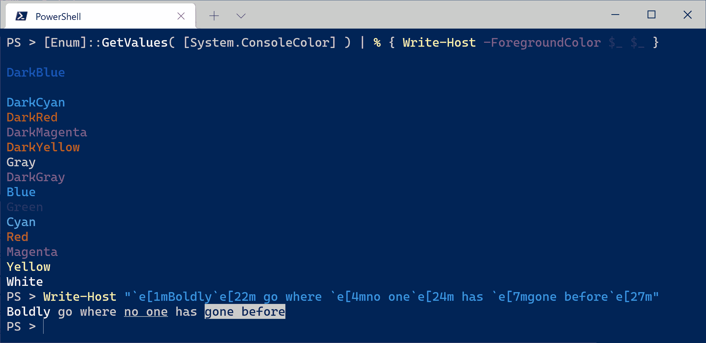
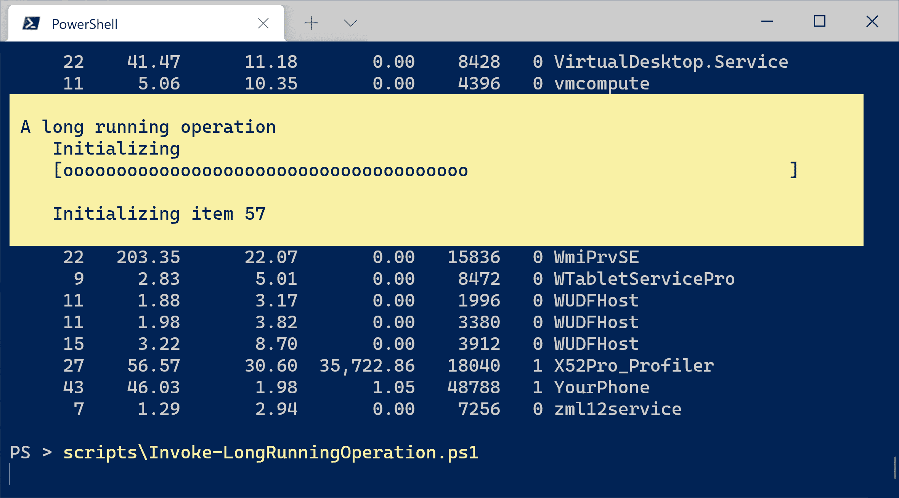
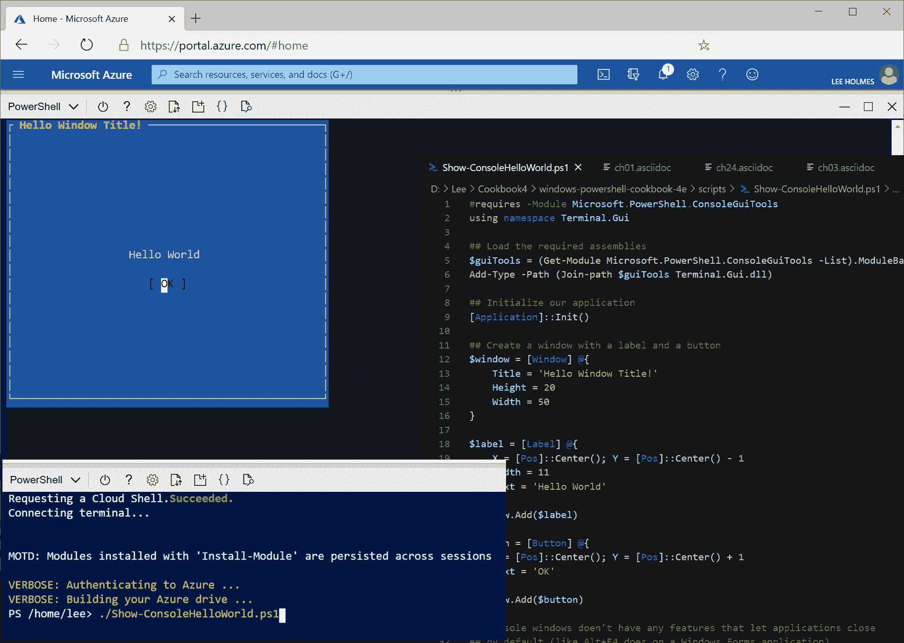

# 第 13 章. 用户交互

## 13.0 简介

虽然大多数脚本设计为自动运行，但您经常会发现让脚本与用户交互很有用。

> **注意**
>
> 从用户获取输入的最佳方式是通过脚本或函数的参数。这允许用户在脚本运行时无需亲自在场即可运行脚本！

如果您的脚本极大地受益于（或需要）交互式体验，PowerShell 提供了多种可能性。这可能只是等待按键、提示输入，或显示更丰富的基于选择的提示。

不过，用户输入并不是交互的唯一方面。除了输入功能外，PowerShell 还支持输出——从显示简单的文本字符串到更详细的进度报告和与 UI 框架的交互。

## 13.1 读取一行用户输入

### 问题

您希望在脚本中使用来自用户的输入。

### 解决方案

要获取用户输入，请使用 `Read-Host` cmdlet：

```powershell
PS > $directory = Read-Host "Enter a directory name"
Enter a directory name: C:\MyDirectory
PS > $directory
C:\MyDirectory
```

### 讨论

`Read-Host` cmdlet 从用户读取单行输入。如果输入包含敏感数据，该 cmdlet 支持 `-AsSecureString` 参数以将此输入作为 `SecureString` 读取。

如果用户输入表示日期、时间或数字，请注意大多数区域性对这些数据类型的表示方式不同。有关编写区分区域性脚本的更多信息，请参阅 Recipe 13.6。

有关 `Read-Host` cmdlet 的更多信息，请键入 `Get-Help Read-Host`。有关通过图形提示读取用户输入的示例，请参阅本书代码示例中包含的 `Read-InputBox` 脚本。有关获取这些示例的更多信息，请参阅 “使用代码示例”。

### 另请参阅


食谱 13.6，“编写区域感知脚本”

# 13.2 读取用户输入的按键

## 问题

你希望脚本从用户那里获取单个按键。

## 解决方案

对于大多数用途，请使用 `[Console]::ReadKey()` 方法来读取按键：

```
PS > $key = [Console]::ReadKey($true)
PS > $key

                 KeyChar                   Key              Modifiers
                 -------                   ---              ---------
                       h                     H                    Alt
```

对于高度交互式用途（例如，当你关心按键按下和释放时），请使用：

```
PS > $key = $host.UI.RawUI.ReadKey("NoEcho,IncludeKeyDown")
PS > $key

    VirtualKeyCode          Character    ControlKeyState      KeyDown
    --------------          ---------    ---------------      -------
                16                    ...ssed, NumLockOn         True

PS > $key.ControlKeyState
ShiftPressed, NumLockOn
```

## 讨论

对于大多数用途，`[Console]::ReadKey()` 是从用户获取按键的最佳方式，因为它接受简单的按键和可能包含 `Ctrl`、`Alt` 和 `Shift` 键的更复杂按键。我们传递 `$true` 参数告诉该方法不在屏幕上显示字符，而仅将其返回给我们。

### 注意

如果你想通过读取用户输入的按键来暂停脚本，可以使用 PowerShell 内置的 `pause` 命令。

如果你需要捕获单个按键按下和释放事件（包括 `Ctrl`、`Alt` 和 `Shift` 键的事件），请使用 `$host.UI.RawUI.ReadKey()` 方法。

# 13.3 程序：向用户显示菜单

通常从用户读取输入但将输入限制在你指定的选择列表中很有用。以下脚本让你以比 PowerShell 默认暴露的更友好的方式访问 PowerShell 的提示功能。它返回一个数字，表示用户从你提供的选项列表中选择的位置。

PowerShell 的提示要求你包含一个加速键（选项描述中字母前的 `&`）来定义代表该选项的按键。由于你并不总是控制选项列表（例如，可能的目录列表），示例 13-1 会为缺少加速键的描述自动生成合理的加速字符。

##### 示例 13-1. Read-HostWithPrompt.ps1

```
#############################################################################
##
## Read-HostWithPrompt
##
## From PowerShell Cookbook (O'Reilly)
## by Lee Holmes (http://www.leeholmes.com/guide)
##
##############################################################################

<#

.SYNOPSIS

读取用户输入，选择限制在你提供的选项列表中。

.EXAMPLE

PS > $caption = "Please specify a task"
PS > $message = "Specify a task to run"
PS > $option = "&Clean Temporary Files","&Defragment Hard Drive"
PS > $helptext = "Clean the temporary files from the computer",
>>              "Run the defragment task"
>>
PS > $default = 1
PS > Read-HostWithPrompt $caption $message $option $helptext $default

Please specify a task
Specify a task to run
[C] Clean Temporary Files  [D] Defragment Hard Drive  [?] Help
(default is "D"):?
C - Clean the temporary files from the computer
D - Run the defragment task
[C] Clean Temporary Files  [D] Defragment Hard Drive  [?] Help
(default is "D"):C
0

#>

param(
    ## 提示的标题
    $Caption = $null,

    ## 提示中显示的消息
    $Message = $null,

    ## 提供给提示的选项
    [Parameter(Mandatory = $true)]
    $Option,

    ## 要提供的任何帮助文本
    $HelpText = $null,

    ## 默认选择
    $Default = 0
)

Set-StrictMode -Version 3

## 创建选择列表
$choices = New-Object `
    Collections.ObjectModel.Collection[Management.Automation.Host.ChoiceDescription]

## 遍历每个选项，并将它们添加到选择集合中
for($counter = 0; $counter -lt $option.Length; $counter++)
{
    $choice = New-Object Management.Automation.Host.ChoiceDescription `
        $option[$counter]

    if($helpText -and $helpText[$counter])
    {
        $choice.HelpMessage = $helpText[$counter]
    }

    $choices.Add($choice)
}

## 提示选择，返回用户选择的项目
$host.UI.PromptForChoice($caption, $message, $choices, $default)
```

有关运行脚本的更多信息，请参阅食谱 1.2。

## 另请参阅

食谱 1.2，“运行程序、脚本和现有工具”

# 13.4 向用户显示消息和输出

## 问题

你想向用户显示消息和其他信息。

## 解决方案

只需让脚本输出字符串信息。如果你希望在脚本中更明确，请调用 `Write-Output` cmdlet：

```
PS > function Get-Information
{
    "Hello World"
    Write-Output (1 + 1)
}

PS > Get-Information
Hello World
2
PS > $result = Get-Information
PS > $result[1]
2
```

## 讨论

你编写的大多数脚本都应该输出结构丰富的数据，例如目录中的实际字节数（如果你正在编写目录信息脚本）。这样，其他脚本可以将该脚本的输出作为其功能的构建块。

当你确实想专门向用户提供输出时，请使用 `Write-Host`、`Write-Debug` 和 `Write-Verbose` cmdlet：

```
PS > function Get-DirectorySize
{
    $size = (Get-ChildItem | Measure-Object -Sum Length).Sum
    Write-Host ("Directory size: {0:N0} bytes" -f $size)
}

PS > Get-DirectorySize
Directory size: 46,581 bytes
PS > $size = Get-DirectorySize
Directory size: 46,581 bytes
```

除了纯文本，`Write-Host` cmdlet 还允许你通过其 `-ForegroundColor` 和 `-BackgroundColor` 参数设置输出颜色。为了完全控制，你甚至可以直接发出 ANSI 转义序列，如图 13-1 所示。



如果你想要一条消息来帮助你（或用户）诊断和调试脚本，请使用 `Write-Debug` cmdlet。如果你想要一条消息来提供详细的跟踪类型输出，请使用 `Write-Verbose` cmdlet，如示例 13-2 所示。

##### 示例 13-2. 提供调试和详细输出的函数

```
PS > function Get-DirectorySize
{
    Write-Debug "Current Directory: $(Get-Location)"

    Write-Verbose "Getting size"
    $size = (Get-ChildItem | Measure-Object -Sum Length).Sum
    Write-Verbose "Got size: $size"

    Write-Host ("Directory size: {0:N0} bytes" -f $size)
}

PS > $DebugPreference = "Continue"
PS > Get-DirectorySize
DEBUG: Current Directory: D:\lee\OReilly\Scripts\Programs
Directory size: 46,581 bytes
PS > $DebugPreference = "SilentlyContinue"
PS > $VerbosePreference = "Continue"
PS > Get-DirectorySize
VERBOSE: Getting size
VERBOSE: Got size: 46581
Directory size: 46,581 bytes
PS > $VerbosePreference = "SilentlyContinue"
```

但是，请注意，这种类型的输出会绕过正常的文件重定向，因此用户难以捕获。对于 `Write-Host` cmdlet，仅当你的脚本已经生成用户想要捕获到文件或变量中的其他结构化数据时才使用它。有关捕获 `Write-Host` 输出的更多信息，请参阅“捕获输出”。

大多数脚本作者最终都会遇到示例 13-3 所示的问题，当他们的脚本尝试向用户输出格式化数据时。

##### 示例 13-3. 由格式化语句引起的错误消息


## 使用 Format-* Cmdlet 格式化输出

```
PS > ## 获取目录中的项目列表，按长度排序
PS > function Get-ChildItemSortedByLength($path = (Get-Location))
{
    Get-ChildItem $path | Format-Table | Sort-Object Length
}

PS > Get-ChildItemSortedByLength
out-lineoutput : Object of type "Microsoft.PowerShell.Commands.Internal.
Format.FormatEntryData" is not legal or not in the correct sequence. This is
likely caused by a user-specified "format-*" command which is conflicting
with the default formatting.
```

之所以会发生这种情况，是因为 `Format-*` cmdlet 实际上会生成供 `Out-Host` cmdlet 使用的格式化信息。`Out-Host` cmdlet（PowerShell 会自动将其添加到管道末尾）随后使用这些信息生成格式化输出。要解决此问题，请始终确保格式化命令是管道中的最后一个命令，如示例 13-4 所示。

### 示例 13-4. 不生成格式化错误的函数

```
PS > ## 获取目录中的项目列表，按长度排序
PS > function Get-ChildItemSortedByLength($path = (Get-Location))
{
    ## 有问题的版本
    ## Get-ChildItem $path | Format-Table | Sort-Object Length

    ## 修复后的版本
    Get-ChildItem $path | Sort-Object Length | Format-Table
}

PS > Get-ChildItemSortedByLength

(...)
Mode                LastWriteTime     Length Name
----                -------------     ------ ----
-a---         3/11/2007   3:21 PM         59 LibraryProperties.ps1
-a---          3/6/2007  10:27 AM        150 Get-Tomorrow.ps1
-a---          3/4/2007   3:10 PM        194 ConvertFrom-FahrenheitWithout
                                             Function.ps1
-a---          3/4/2007   4:40 PM        257 LibraryTemperature.ps1
-a---          3/4/2007   4:57 PM        281 ConvertFrom-FahrenheitWithLib
                                             rary.ps1
-a---          3/4/2007   3:14 PM        337 ConvertFrom-FahrenheitWithFunc
                                             tion.ps1
(...)
```

这些示例以 `LibraryDirectory.ps1` 的形式包含在本书的代码示例中。有关获取这些示例的详细信息，请参阅“使用代码示例”。

在为用户生成输出时，常见的原因是提供进度消息。PowerShell 实际上通过其 `Write-Progress` cmdlet 以更丰富的方式支持此功能。有关 `Write-Progress` cmdlet 的详细信息，请参阅配方 13.5。

## 另请参阅

配方 13.5

# 13.5 在长时间运行的任务上提供进度更新

## 问题

您希望为长时间运行的任务向用户显示状态信息。

## 解决方案

要提供状态更新，请使用示例 13-5 中所示的 `Write-Progress` cmdlet。

### 示例 13-5. 使用 Write-Progress cmdlet 显示状态更新

```powershell
##############################################################################
##
## Invoke-LongRunningOperation
##
## From PowerShell Cookbook (O'Reilly)
## by Lee Holmes (http://www.leeholmes.com/guide)
##
##############################################################################

<#

.SYNOPSIS

演示 Write-Progress cmdlet 的功能

#>

Set-StrictMode -Version 3

$activity = "长时间运行的操作"
$status = "正在初始化"

## 初始化长时间运行的操作
for($counter = 0; $counter -lt 100; $counter++)
{
    $currentOperation = "正在初始化项目 $counter"
    Write-Progress $activity $status -PercentComplete $counter `
        -CurrentOperation $currentOperation
    Start-Sleep -m 20
}

$status = "正在运行"

## 初始化长时间运行的操作
for($counter = 0; $counter -lt 100; $counter++)
{
    $currentOperation = "正在运行任务 $counter"
    Write-Progress $activity $status -PercentComplete $counter `
        -CurrentOperation $currentOperation
    Start-Sleep -m 20
}
```

## 讨论

`Write-Progress` cmdlet 使您能够为长时间运行的操作向脚本用户提供结构化的状态信息（请参阅图 13-2）。



与其他详细信息通道（`Write-Debug`、`Write-Verbose` 和其他 `Write-*` cmdlet）一样，PowerShell 允许用户控制他们看到多少此类信息。

有关 `Write-Progress` cmdlet 的详细信息，请键入 `Get-Help Write-Progress`。

# 13.6 编写区域性感知脚本

## 问题

您希望确保脚本在世界各地的计算机上都能正常工作。

## 解决方案

要编写区域性感知脚本，请在开发脚本时记住以下准则：

*   使用 PowerShell 的语言基元创建日期、时间和数字。
*   使用 PowerShell 的内置运算符比较字符串。
*   避免将用户输入视为字符集合。
*   使用 `Parse()` 方法将用户输入转换为日期、时间和数字。

## 讨论

编写区域性感知程序长期以来一直局限于专业软件开发人员的领域。不过，这并不是说简单程序和脚本的用户无法从区域性感知中受益。只是对于非专业程序员来说，遵循最佳实践往往太困难了。然而，PowerShell 使这比传统编程语言容易得多。

当脚本在不同区域性之间移动时，有几个方面会发生变化。

### 日期、时间和数字格式

大多数区域性都有独特的日期、时间和数字格式。为确保脚本在所有区域性中都能工作，PowerShell 首先确保其语言基元无论在何处运行脚本都保持一致。即使脚本在法国的计算机上运行（法国使用逗号作为小数分隔符），您也始终可以依赖语句 `$myDouble = 3.5` 来创建一个介于 3 和 4 之间的数字。同样，您始终可以依赖语句 `$christmas = [DateTime]"12/25/2007"` 来创建一个表示 2007 年圣诞节的日期——即使在按日、月、年顺序书写日期的区域性中也是如此。

区域性感知程序始终使用该区域性的首选项来显示日期、时间和数字。这不会破坏脚本在区域性之间的移植，并且是编写区域性感知脚本的一个重要方面。PowerShell 会为您处理此问题，因为它在显示数据时始终使用当前区域性的首选项。

#### 注意

如果脚本要求用户输入日期、时间或数字，请确保在这样做时遵循用户区域性的格式。要将用户输入转换为特定类型的数据，请使用 `Get-Date` cmdlet：

```powershell
$userInput = Read-Host "请输入一个日期"
$enteredDate = Get-Date -Date $userInput
```

因此，为确保脚本在日期、时间和数字格式方面保持区域性感知，只需在脚本中定义它们时使用 PowerShell 的语言基元即可。当从用户处读取它们时，在将它们从字符串转换时使用 `Parse()` 方法。

### 用户输入和文件内容的复杂性

英语是一种罕见的语言，其字母表非常简单。这导致各种编程技巧将用户输入和文件内容视为字节数组或简单的纯文本（ASCII）字符。在大多数国际语言中，这些技巧都会失效。事实上，许多国际符号在包含它们的字符串中占用两个字符的数据量。

PowerShell 对所有基于字符串的操作使用标准 Unicode 字符集：从用户读取输入、向用户显示输出、通过管道发送数据以及处理文件。

#### 注意


虽然 PowerShell 完全支持 Unicode，但托管 `pwsh.exe` 的 Windows 控制台由于 Windows 控制台系统的限制，无法正确输出某些字符。然而，图形化 PowerShell 主机（如 Visual Studio Code 和许多第三方 PowerShell IDE）不受这些限制的影响。

如果在处理用户输入时使用 PowerShell 的标准功能，你不必担心其复杂性。但如果你想处理输入中的单个字符或单词，则需要采取特殊预防措施。`System.Globalization.StringInfo` 类允许你以区分区域性的方式执行此操作。有关使用 `StringInfo` 类的更多信息，请参阅 [Microsoft 文档](https://oreil.ly/jRnWp)。

因此，为了确保脚本在用户输入方面保持区分区域性，只需在可能的情况下使用 PowerShell 对字符串操作的支持即可。

## 大小写规则

脚本中的常见需求是将用户输入与某些预定义文本（如菜单选择）进行比较。通常你希望这种比较不区分大小写，这样 `"QUIT"` 和 `"qUiT"` 就表示相同的含义。

实现这一点的传统方法是将用户输入转换为大写或小写：

```
## $text comes from the user, and contains the value "quit"
if($text.ToUpper() -eq "QUIT") { ... }
```

不幸的是，在不同区域性中运行时，显式更改字符串的大小写会以微妙的方式失败，因为许多区域性有不同的大小写和比较规则。例如，土耳其语包含两种字母 `I`：一种带点，一种不带点。小写字母 `i` 的大写版本对应带点的大写 `I`，而不是 `QUIT` 中使用的大写 `I`。该示例会导致前面的字符串比较在土耳其系统上失败。

食谱 13.8 让我们非常清楚地看到这一点：

```
PS > Use-Culture tr-TR { "quit".ToUpper() -eq "QUIT" }
False
PS > Use-Culture tr-TR { "quIt".ToUpper() -eq "QUIT" }
True
PS > Use-Culture tr-TR { "quit".ToUpper() }
QUİT
```

要以不区分大小写的方式将某些输入与硬编码字符串进行比较，更好的解决方案是使用 PowerShell 的 `-eq` 运算符，而不必自己更改任何大小写。`-eq` 运算符默认不区分大小写且区域性中立：

```
PS > $text1 = "Hello"
PS > $text2 = "HELLO"
PS > $text1 -eq $text2
True
```

因此，为了确保脚本在大小写规则方面保持区分区域性，只需在可能的情况下使用 PowerShell 的不区分大小写的比较运算符即可。

## 排序规则

排序规则在不同区域性之间经常变化。例如，使用 食谱 13.8 中给出的脚本比较英语和丹麦语：

```
PS > Use-Culture en-US { "Apple","Æble" | Sort-Object }
Æble
Apple
PS > Use-Culture da-DK { "Apple","Æble" | Sort-Object }
Apple
Æble
```

为了确保脚本在排序规则方面保持区分区域性，假设排序后输出是正确排序的，但不要依赖排序输出的实际顺序。

## 其他指南

有关编写区分区域性程序的其他资源，请参阅 [关于全球化和本地化 .NET 应用程序的 Microsoft 文档](https://oreil.ly/Qxz6i)。

## 另请参阅

食谱 13.8，“程序：使用替代区域性设置调用脚本块”

# 13.7 在脚本输出中支持其他语言

## 问题

你正在向用户显示文本消息，并希望支持国际语言。

## 解决方案

使用 `Import-LocalizedData` cmdlet，如 示例 13-6 所示。

### 示例 13-6. 为脚本或模块导入特定区域性的字符串

```
## Create some default messages for English cultures, and
## when culture-specific messages are not available.
$messages = DATA {
    @{
        Greeting = "Hello, {0}"
        Goodbye = "So long."
    }
}

## Import localized messages for the current culture.
Import-LocalizedData messages -ErrorAction SilentlyContinue

## Output the localized messages
$messages.Greeting -f "World"
$messages.Goodbye
```

## 讨论

`Import-LocalizedData` cmdlet 让你轻松编写为不同语言显示不同消息的脚本。

这种本地化支持的核心来自 `消息表` 的概念：消息 ID（如 `Greeting` 或 `Goodbye` 消息）到其实际表示消息的简单映射。你不直接向用户输出字符串，而是从消息表中检索字符串并输出它。脚本的本地化来自于将消息表替换为包含适合当前语言的消息的表。

PowerShell 使用标准哈希表来定义消息表。哈希表中的键和值分别代表消息 ID 及其对应的字符串。

### 注意

解决方案在 `DATA` 部分中定义默认消息表。与从 `*.psd1` 文件加载消息一样，这会将 PowerShell 置于完整 PowerShell 语言的以数据为中心的子集中。虽然不是必需的，但这对于错误检测和一致性都是一种有用的做法。

在脚本中定义默认消息表后，下一步是创建本地化版本并将它们放在脚本旁边的特定语言目录中。`Import-LocalizedData` cmdlet 的真正魔力在于它在加载适当的消息文件时应用的智能。

作为背景，引用区域性（用于本地化目的）的标准方式是一个结合 `culture` 和 `region` 的标识符。例如，德国使用的德语由标识符 `de-DE` 定义。美国使用的英语由标识符 `en-US` 定义，而加拿大使用的英语由标识符 `en-CA` 定义。大多数语言在许多地区都有使用。

当你调用 `Import-LocalizedData` cmdlet 时，PowerShell 会转到与脚本相同的目录，并首先尝试从名称与当前区域性全名匹配的目录（例如 `en-CA` 或 `en-GB`）加载消息。如果失败，它会回退到区域中性目录（如 `en` 或 `de`），再回退到操作系统定义的其他备选语言。

为了让你的工作可用于尽可能广泛的语言，请将本地化消息放在最通用的适用目录中。例如，将法语消息（首先）放在 `fr` 目录中，以便所有法语区域都能受益。如果之后想针对特定区域自定义消息，请将它们放在特定区域的目录中。

与其在脚本文件（如主脚本）中定义这些消息表，不如将它们放在与脚本同名的 `*.psd1` 文件中。例如，示例 13-6 将其本地化消息放在 `Import-LocalizedData.psd1` 中。PowerShell 的 `psd1` 文件代表完整 PowerShell 语言的以数据为中心的子集，非常适合本地化。在 `*.psd1` 文件中定义一个哈希表（示例 13-7），但不要像默认消息表那样将其存储在变量中。

### 示例 13-7. 定义消息表的本地化 .psd1 文件

```
@{
    Greeting = "Guten Tag, {0}"
    Goodbye = "Auf Wiedersehen."
}
```

如果你已经使用一组工具来帮助管理软件本地化过程，它们可能不理解 PowerShell `*.psd1` 文件格式。另一种标准消息格式是简单的名称-值映射，因此 PowerShell 通过 `ConvertFrom-StringData` cmdlet 支持该格式：

```
ConvertFrom-StringData @'
Greeting = Guten Tag, {0}
Goodbye = Auf Wiedersehen
'@
```


请注意，示例 13-6 中的 `Greeting` 消息使用 `{0}` 样式的占位符（以及 PowerShell 的字符串格式化运算符）来输出包含可替换文本的字符串。使用此技术远比使用字符串拼接（例如，`$messages.GreetingBeforeName` + " World " + `$messages.GreetingAftername`）要好得多，因为它在本地化句子结构不同的语言时提供了额外的灵活性。

要在不同语言下测试脚本，可以使用 示例 13.8，如下例所示：

```
PS > Use-Culture de-DE { Invoke-LocalizedScript }
Guten Tag, World
Auf Wiedersehen.
```

有关脚本国际化的更多信息，请键入 `Get-Help` `about_Script_Internationalization`。

## 另请参阅

示例 13.8

# 13.8 程序：使用备选区域性设置调用脚本块

鉴于 PowerShell 多元化的用户社区，您共享的脚本通常会在设置为英语以外语言的系统上运行。为确保脚本在其他语言中正常运行，在该区域性下进行测试运行会很有帮助。示例 13-8 允许您在指定的区域性中运行所提供的脚本块。

### 示例 13-8. Use-Culture.ps1

```
#############################################################################
##
## Use-Culture
##
## From PowerShell Cookbook (O'Reilly)
## by Lee Holmes (http://www.leeholmes.com/guide)
##
#############################################################################

<#

.SYNOPSIS

在给定区域性下调用脚本块

.EXAMPLE

PS > Use-Culture fr-FR { Get-Date -Date "25/12/2007" }
mardi 25 decembre 2007 00:00:00

#>

param(
    ## 用于评估给定脚本块的区域性
    [Parameter(Mandatory = $true)]
    [System.Globalization.CultureInfo] $Culture,

    ## 要在给定区域性上下文中调用的代码
    [Parameter(Mandatory = $true)]
    [ScriptBlock] $ScriptBlock
)

Set-StrictMode -Version 3

## 用于设置当前区域性的辅助函数
function Set-Culture([System.Globalization.CultureInfo] $culture)
{
    [System.Threading.Thread]::CurrentThread.CurrentUICulture = $culture
    [System.Threading.Thread]::CurrentThread.CurrentCulture = $culture
}

## 记录原始区域性信息
$oldCulture = [System.Threading.Thread]::CurrentThread.CurrentUICulture

## 如果用户的脚本遇到错误，
## 则恢复原始区域性信息。
trap { Set-Culture $oldCulture }

## 将当前区域性设置为用户提供的
## 区域性。
Set-Culture $culture

## 调用用户的脚本块
& $ScriptBlock

## 恢复原始区域性信息。
Set-Culture $oldCulture
```

有关运行脚本的更多信息，请参阅 示例 1.2。

## 另请参阅

示例 1.2，“运行程序、脚本和现有工具”

# 13.9 访问宿主应用程序 UI 的功能

## 问题

您想要与宿主应用程序 UI 中的功能进行交互，但 PowerShell 没有直接为它们提供 cmdlet。

## 解决方案

要访问宿主 UI 的功能，请使用 `$host.UI.RawUI` 变量：

```
$host.UI.RawUI.WindowTitle = Get-Location
```

## 讨论

PowerShell 本身由两个主要组件组成。第一个是解释命令、执行管道并执行其他类似操作的引擎。第二个是宿主应用程序——用户与 PowerShell 引擎交互的方式。

默认 Shell `pwsh.exe` 是基于传统 Windows 控制台的 UI。图形化的 Visual Studio Code 在图形用户界面中承载 PowerShell。事实上，PowerShell 使开发人员能够相对简单地构建自己的宿主应用程序，甚至将 PowerShell 引擎功能嵌入到他们自己的应用程序中。

您（以及您的脚本）始终可以依赖通过 `$host.UI` 变量提供的功能，因为该功能对所有宿主都保持不变。示例 13-9 显示了在所有宿主中可用的功能。

### 示例 13-9. 通过 $host.UI 属性可用的功能

```
PS > $host.UI | Get-Member | Select Name,MemberType | Format-Table -Auto

Name                   MemberType
----                   ----------
(...)
Prompt                     Method
PromptForChoice            Method
PromptForCredential        Method
ReadLine                   Method
ReadLineAsSecureString     Method
Write                      Method
WriteDebugLine             Method
WriteErrorLine             Method
WriteLine                  Method
WriteProgress              Method
WriteVerboseLine           Method
WriteWarningLine           Method
RawUI                    Property
```

如果您（或您的脚本）想要与特定于当前宿主的 UI 部分进行交互，PowerShell 通过 `$host.UI.RawUI` 变量提供该访问权限。示例 13-10 显示了在 PowerShell 控制台宿主中可用的功能。

### 示例 13-10. 通过默认控制台宿主可用的功能

```
PS > $host.UI.RawUI | Get-Member |
    Select Name,MemberType | Format-Table -Auto

Name                      MemberType
----                      ----------
(...)
FlushInputBuffer              Method
GetBufferContents             Method
GetHashCode                   Method
GetType                       Method
LengthInBufferCells           Method
NewBufferCellArray            Method
ReadKey                       Method
ScrollBufferContents          Method
SetBufferContents             Method
BackgroundColor             Property
BufferSize                  Property
CursorPosition              Property
CursorSize                  Property
ForegroundColor             Property
KeyAvailable                Property
MaxPhysicalWindowSize       Property
MaxWindowSize               Property
WindowPosition              Property
WindowSize                  Property
WindowTitle                 Property
```

如果您依赖 `$host.UI.RawUI` 中的宿主特定功能，请注意，在该脚本能在其他宿主上正常运行之前，将需要进行修改（也许是重大修改）。

# 13.10 为脚本添加图形用户界面

## 问题

您想要创建一个脚本，为用户可视化复杂信息或支持高级用户交互。

## 解决方案

将 `System.Windows.Forms` 库添加到脚本中，然后使用其类型和对象创建图形界面：

```
Add-Type -Assembly System.Windows.Forms

$form = New-Object Windows.Forms.Form
$form.Size = New-Object Drawing.Size @(600,300)
$form.Text = "Hello Window Title!"

$label = New-Object Windows.Forms.Label
$label.Text = "Hello World!"
$label.Size = New-Object Drawing.Size @(550,200)
$label.TextAlign = "MiddleCenter"
$form.Controls.Add($label)

$form.ShowDialog()
```

## 讨论

尽管本章其余部分提供的技术通常已足够，但有时提供图形用户界面与用户交互会很有帮助。

由于 PowerShell 完全支持传统可执行文件，简单的编译应用程序通常可以满足此需求。如果在 Visual Studio 等环境中创建简单程序不方便，通常可以使用 PowerShell 直接创建这些应用程序。

示例 13-11 演示了仅使用 PowerShell 脚本开发 Windows 窗体应用程序的技术。该功能本身现在已由 PowerShell 中的 `Out-GridView` cmdlet 覆盖，但它演示了几种有用的技术。


# 示例 13-11: Select-GraphicalFilteredObject.ps1

有关直接使用 `Out-GridView` cmdlet 执行此操作的示例，请参阅 食谱 2.4。

## 代码

```powershell
##############################################################################
##
## Select-GraphicalFilteredObject
##
## From PowerShell Cookbook (O'Reilly)
## by Lee Holmes (http://www.leeholmes.com/guide)
##
##############################################################################

<#

.SYNOPSIS

显示一个 Windows 窗体，帮助用户选择通过管道传入的项目列表。
任何选定的项目都将沿管道传递。

.EXAMPLE

PS > dir | Select-GraphicalFilteredObject

  Directory: C:\

Mode                LastWriteTime     Length Name
----                -------------     ------ ----
d----         10/7/2006   4:30 PM            Documents and Settings
d----         3/18/2007   7:56 PM            Windows

#>

Set-StrictMode -Version 2

$objectArray = @($input)

## 确保他们已将信息通过管道传入脚本
if($objectArray.Count -eq 0)
{
    Write-Error "This script requires pipeline input."
    return
}

## 加载 Windows Forms 程序集
Add-Type -Assembly System.Windows.Forms

## 创建主窗体
$form = New-Object Windows.Forms.Form
$form.Size = New-Object Drawing.Size @(600,600)

## 创建列表框以保存来自管道的项目
$listbox = New-Object Windows.Forms.CheckedListBox
$listbox.CheckOnClick = $true
$listbox.Dock = "Fill"
$form.Text = "Select the list of objects you wish to pass down the pipeline"
$listBox.Items.AddRange($objectArray)

## 创建按钮面板以容纳“确定”和“取消”按钮
$buttonPanel = New-Object Windows.Forms.Panel
$buttonPanel.Size = New-Object Drawing.Size @(600,30)
$buttonPanel.Dock = "Bottom"

## 创建“取消”按钮，将其锚定在右下角
$cancelButton = New-Object Windows.Forms.Button
$cancelButton.Text = "Cancel"
$cancelButton.DialogResult = "Cancel"
$cancelButton.Top = $buttonPanel.Height - $cancelButton.Height - 5
$cancelButton.Left = $buttonPanel.Width - $cancelButton.Width - 10
$cancelButton.Anchor = "Right"

## 创建“确定”按钮，将其锚定在“取消”按钮左侧
$okButton = New-Object Windows.Forms.Button
$okButton.Text = "Ok"
$okButton.DialogResult = "Ok"
$okButton.Top = $cancelButton.Top
$okButton.Left = $cancelButton.Left - $okButton.Width - 5
$okButton.Anchor = "Right"

## 将按钮添加到按钮面板
$buttonPanel.Controls.Add($okButton)
$buttonPanel.Controls.Add($cancelButton)

## 将按钮面板和列表框添加到窗体，并设置按钮的操作
$form.Controls.Add($listBox)
$form.Controls.Add($buttonPanel)
$form.AcceptButton = $okButton
$form.CancelButton = $cancelButton
$form.Add_Shown( { $form.Activate() } )

## 显示窗体，并等待响应
$result = $form.ShowDialog()

## 如果他们按了“确定”（或回车），遍历所有
## 选中的项目并将相应对象发送到管道
if($result -eq "OK")
{
    foreach($index in $listBox.CheckedIndices)
    {
        $objectArray[$index]
    }
}
```

除了通过 PowerShell 脚本创建 Windows Forms 应用程序外，还可以使用类似技术通过 Windows Presentation Foundation (WPF) 框架创建 UI，甚至为需要在远程会话中显示高级 UI 的脚本创建基于控制台的 UI。有关向脚本添加基于控制台的 UI 的更多信息，请参阅 食谱 13.11。

有关运行脚本的更多信息，请参阅 食谱 1.2。

## 另请参阅

- 食谱 1.2，“运行程序、脚本和现有工具”
- 食谱 2.4，“交互式筛选对象列表”
- 食谱 13.11，“程序：向脚本添加控制台 UI”

# 13.11 程序：向脚本添加控制台 UI

当你想要创建一个为用户可视化复杂信息或支持高级用户交互的脚本时，有时需要该界面能在远程连接或像 Azure Cloud Shell 这样的 Web 界面上工作。

使用 `WinForms` 等图形库无法做到这一点，但正如 图 13-3 所示，控制台 UI 能很好地处理这种情况。此外，有时你只是需要一剂怀旧剂！

作为解决方案，你可以使用作为 `Microsoft.PowerShell.ConsoleGuiTools` 模块一部分的 `Terminal.Gui` 库。安装此模块后，你可以使用 `Terminal.Gui` 库中的类型和方法创建简单或复杂的 UI。示例 13-12 演示了这一点。



## 示例 13-12. Show-ConsoleHelloWorld.ps1

```powershell
#requires -Module Microsoft.PowerShell.ConsoleGuiTools
using namespace Terminal.Gui

## 加载所需程序集
$guiTools = (Get-Module Microsoft.PowerShell.ConsoleGuiTools -List).ModuleBase
Add-Type -Path (Join-path $guiTools Terminal.Gui.dll)

## 初始化应用程序
[Application]::Init()

## 创建一个包含标签和按钮的窗口
$window = [Window] @{
    Title = 'Hello Window Title!'
    Height = 20
    Width = 50
}

$label = [Label] @{
    X = [Pos]::Center(); Y = [Pos]::Center() - 1
    Width = 11
    Text = 'Hello World'
}
$window.Add($label)

$button = [Button] @{
    X = [Pos]::Center(); Y = [Pos]::Center() + 1
    Text = 'OK'
}
$window.Add($button)

## 控制台窗口默认没有让应用程序关闭的功能（就像 Alt+F4 可以关闭 Windows Forms 应用程序），
## 所以将此功能与“确定”按钮关联。
$button.add_Clicked({ [Application]::RequestStop() })

## 将窗口添加到应用程序并运行它。
[Application]::Top.Add($window)
[Application]::Run()

## 用户点击“确定”按钮后，脚本会继续执行到这里
[Application]::Shutdown()
```

有关运行脚本的更多信息，请参阅 食谱 1.2。有关安装模块的更多信息，请参阅 食谱 1.29。

## 另请参阅

- 食谱 1.2，“运行程序、脚本和现有工具”
- 食谱 1.29，“查找并安装其他 PowerShell 脚本和模块”

# 13.12 与 MTA 对象交互

## 问题

你想要与一个要求当前线程处于 `multithreaded apartment` (MTA) 模式的对象进行交互。

## 解决方案

使用 `-MTA` 开关启动 PowerShell。如果你在脚本或辅助命令中这样做，也可以使用 `-NoProfile` 开关以避免加载用户配置文件带来的性能影响和副作用：

```powershell
PS > $output = PowerShell -NoProfile -MTA -Command {
    $myObject = New-Object SomeObjectThatRequiresMTA
    $myObject.SomeMethod()
}
```

## 讨论

线程模式定义了应用程序与其如何与某些对象交互之间的约定。.NET Framework 中的大多数对象（因此包括 PowerShell 及其交互的几乎所有内容）都会忽略线程模式，不受其影响。

不过，某些对象确实需要特定的线程模式，称为 `multithreaded apartment`。PowerShell 默认使用称为 `single-threaded apartment` (STA) 的线程模式，因此在使用这些罕见对象时，它们会生成关于其线程要求的错误。

如果你经常发现需要使用 MTA 模式，可以直接修改开始菜单上的 PowerShell 链接，使其始终使用 `-MTA` 参数加载 PowerShell。

如果整个脚本都需要 MTA 模式，你有两个主要选择：检测当前线程模式，或在 STA 模式下重新启动自身。


要检测当前的线程模式，可以访问 `$host.Runspace.ApartmentState` 变量。如果其值不是 `STA`，则当前线程模式为 `MTA`。

如果你的脚本参数要求简单，你可能可以像示例 13-13 那样自动重新启动自身。

### 示例 13-13. 在 MTA 模式下重新启动自身的脚本

```powershell
###########################################################################
##
## Invoke-ScriptThatRequiresMta
##
## From PowerShell Cookbook (O'Reilly)
## by Lee Holmes (http://www.leeholmes.com/guide)
##
###########################################################################

<#

.SYNOPSIS

演示一种在需要 MTA 模式时重新启动脚本的技术。
这仅适用于可以按位置指定的简单参数定义。

#>

param(
    $Parameter1,
    $Parameter2
)

Set-StrictMode -Version 3

"Current threading mode: " + $host.Runspace.ApartmentState
"Parameter1 is: $parameter1"
"Parameter2 is: $parameter2"

if($host.Runspace.ApartmentState -eq "STA")
{
    "Relaunching"
    $file = $myInvocation.MyCommand.Path
    powershell -NoProfile -Mta -File $file $parameter1 $parameter2
    return
}

"After relaunch - current threading mode: " + $host.Runspace.ApartmentState
```

运行此脚本时，将获得以下输出：

```
PS > .\Invoke-ScriptThatRequiresMta.ps1 Test1 Test2
Current threading mode: STA
Parameter1 is: Test1
Parameter2 is: Test2
Relaunching
Current threading mode: Unknown
Parameter1 is: Test1
Parameter2 is: Test2
After relaunch - current threading mode: Unknown
```

有关 PowerShell 命令行参数的更多信息，请参阅食谱 1.17。有关运行脚本的更多信息，请参阅食谱 1.2。

## 另请参阅

食谱 1.2，“运行程序、脚本和现有工具”

食谱 1.17，“从 PowerShell 外部调用 PowerShell 命令或脚本”
