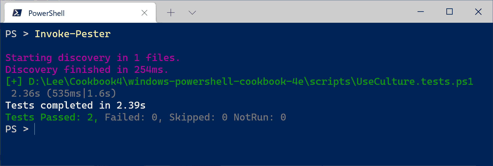
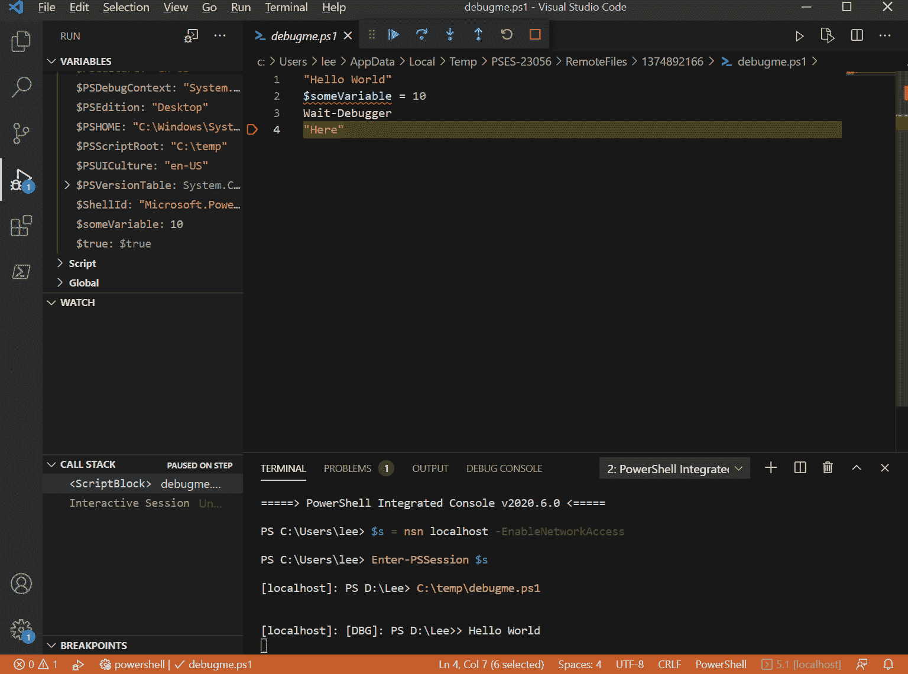

# 第 14 章 调试

## 14.0 简介

在开发脚本和函数时，你经常会遇到非预期的行为。这是软件开发的自然组成部分，诊断这些问题的途径就是被称为*调试*的精细艺术。

对于最简单的问题，在适当位置调用 `Write-Host` 就能回答许多疑问。脚本是否到达了你认为它应该到达的地方？变量是否被设置为你认为它们应该具有的值？

一旦问题变得复杂，打印式调试很快就会变得笨重且难以驾驭。与其不断修改脚本来诊断其行为，不如利用 PowerShell 更加完善的调试工具来帮助你找到问题的根源：

```
PS > Set-PsBreakPoint .\Invoke-ComplexDebuggerScript.ps1 -Line 14

  ID Script           Line Command         Variable        Action
  -- ------           ---- -------         --------        ------
   0 Invoke-Comple...   14

PS > .\Invoke-ComplexDebuggerScript.ps1
Calculating lots of complex information
1225
89
Entering debug mode. Use h or ? for help.

Hit Line breakpoint on
'Z:\Documents\CookbookV4\chapters\current\PowerShellCookbook\Invoke-Complex
DebuggerScript.ps1:14'

Invoke-ComplexDebuggerScript.ps1:14      $dirCount = 0

PS > ?

 s, stepInto         Single step (step into functions, scripts, etc.)
 v, stepOver         Step to next statement (step over functions, scripts,
                     etc.)
 o, stepOut          Step out of the current function, script, etc.

 c, continue         Continue execution
 q, quit             Stop execution and exit the debugger

 k, Get-PSCallStack  Display call stack

 l, list             List source code for the current script.
                     Use "list" to start from the current line, "list <m>"
                     to start from line <m>, and "list <m> <n>" to list <n>
                     lines starting from line <m>

 <enter>             Repeat last command if it was stepInto, stepOver, or
                     list

 ?, h                Displays this help message


For instructions about how to customize your debugger prompt, type "help
about_prompt".

PS > k

Command                  Arguments                Location
-------                  ---------                --------
HelperFunction           {}                       Invoke-ComplexDebugge...
Invoke-ComplexDebugge... {}                       Invoke-ComplexDebugge...
prompt                   {}                       prompt
```

通过利用严格模式，你通常可以从一开始就避免编写 Bug。一旦发现问题，脚本跟踪可以帮助你快速了解脚本的执行流程。对于交互式诊断，Visual Studio Code 提供了全功能的图形化调试支持。从命令行来看，`*-PsBreakPoint` cmdlet 可让你在脚本命中特定行、条件或错误时进行调查。

## 14.1 防止常见脚本错误

### 问题

你希望 PowerShell 在脚本包含可能导致 Bug 的错误时发出警告。

### 解决方案

使用 `Set-StrictMode` cmdlet 将 PowerShell 置于一种防止许多易引入 Bug 的脚本错误的模式中：

```powershell
PS > function BuggyFunction
{
    $testVariable = "Hello"
    if($testVariab1e -eq "Hello")
    {
        "Should get here"
    }
    else
    {
        "Should not get here"
    }
}

PS > BuggyFunction
Should not get here

PS > Set-StrictMode -Version Latest
PS > BuggyFunction
InvalidOperation:
Line |
   4 |      if($testVariab1e -eq "Hello")
     |         ~~~~~~~~~~~~~
     | The variable '$testVariab1e' cannot be retrieved because it has not been set.
```

### 讨论

默认情况下，PowerShell 允许你将数据赋值给尚未创建的变量（从而创建这些变量）。它还允许从不存在的变量中检索数据——这通常是意外发生的，且几乎总是导致 Bug。解决方案演示了这个陷阱，其中 *variable* 中的 *l* 被意外替换为数字 1。

为了帮助你避免被此问题及类似问题蜇伤，PowerShell 提供了一种*严格*模式，如果你尝试访问不存在的变量，将生成错误。示例 14-1 演示了此模式。

### 示例 14-1. PowerShell 在严格模式下运行

```powershell
PS > $testVariable = "Hello"
PS > $tsetVariable += " World"
PS > $testVariable
Hello
PS > Remove-Item Variable:\tsetvariable
PS > Set-StrictMode -Version Latest
PS > $testVariable = "Hello"
PS > $tsetVariable += " World"
InvalidOperation: The variable '$tsetVariable' cannot be retrieved because it
has not been set.
```

除了防止访问不存在的变量外，严格模式还会检测以下情况：

*   访问对象上不存在的属性
*   将函数当作方法调用

`Set-StrictMode` cmdlet 的一个独特功能是 `-Version` 参数。随着 PowerShell 发布 `Set-StrictMode` cmdlet 的新版本，该 cmdlet 将变得更强大并检测更多脚本错误。因此，适用于某个严格模式版本的脚本可能不适用于更高版本。如果你可以根据它可能发现的潜在 Bug 修改脚本，请使用 `-Version Latest`。如果你没有灵活性来修改脚本以适应新的严格模式规则，请使用 `-Version 3`（或你支持的任何 PowerShell 版本）作为 `-Version` 参数的值。

#### 注意


# 14.1 `Set-StrictMode` Cmdlet

`Set-StrictMode` cmdlet 是*有作用域的*，这意味着在一个脚本或函数中设置的严格模式不会影响调用它的脚本或函数。要暂时禁用脚本某个区域的严格模式，请在新的脚本块中执行：

```
& { Set-StrictMode -Off; $tsetVariable }
```

为了你的脚本调试健康和理智着想，严格模式应该是你添加到 PowerShell 配置文件中的首批内容之一。

## 参见

配方 1.9，“自定义 Shell、配置文件和提示符”

# 14.2 为脚本编写单元测试

## 问题

你想要编写测试，以自动验证脚本的行为。

## 解决方案

安装 `Pester` 模块：

```
Install-Module Pester -Scope CurrentUser
```

创建一个文件名中包含 `.tests.ps1` 的文件，其中包含一个 `Describe` 语句和至少一个 `It` 语句：

```
BeforeAll {
    Import-Module PowerShellCookbook
}

## Test the Use-Culture command
Describe 'Use Culture tests' {
    It 'Testing on English' {
        $result = Use-Culture en-US { "quit".ToUpper() }
        $result | Should -Be "QUIT"
    }

    It 'Testing on Turkish' {
        $result = Use-Culture tr-TR { "quit".ToUpper() }
        $result | Should -Be "QUİT"
    }
}
```

在该文件所在的目录中，运行 `Invoke-Pester`。

## 讨论

编写脚本时，最棒的感觉莫过于修复了一个 Bug。但最糟糕的感觉是，当你意识到你的“简单 Bug 修复”却引入了两个新 Bug。

作为脚本编写者，我们试图在发布新版本前手动验证主要场景来防止这种情况。对于特别复杂的更改，也许我们会花额外时间手动验证一些边缘情况。但由于手动测试耗时，我们倾向于避免它。

如果能让自动化为你完成所有这些手动测试呢？而且不仅是简单的测试——而是你曾经考虑过的所有困难和具有挑战性的边缘情况？事实证明，这完全可能——这被称为*单元测试*，也是任何主要软件开发项目保持高质量的关键。既然你的目标是 PowerShell 脚本（理想情况下本应是自动化的），那么单元测试比在大多数其他领域都容易得多。

PowerShell 的单元测试框架是一个令人惊叹的社区项目，称为 `Pester`。事实上，PowerShell 本身的大多数单元测试都是作为 `Pester` 测试编写的。虽然它在 Windows 上默认安装，但最好从 PowerShell 库获取最新版本。

当你运行 `Pester` 时，它会查找你在该目录中编写的所有脚本并运行它们。如果你引入了错误，你将看到类似如下的输出：

```
PS > Invoke-Pester

Starting discovery in 1 files.
Discovery finished in 171ms.
[-] Use Culture tests.Testing on Turkish 76ms (75ms|2ms)
 Expected strings to be the same, but they were different.
 String lengths are both 4.
 Strings differ at index 2.
 Expected: 'QUIT'
 But was:  'QUİT'
 at $result | Should -Be "QUIT", ...\UseCulture.tests.ps1:14
 at <ScriptBlock>, ...UseCulture.tests.ps1:14
Tests completed in 1.75s
Tests Passed: 1, Failed: 1, Skipped: 0 NotRun: 0
```

一旦你修复了根本问题，你将看到软件工程领域中最令人满意的 UI 之一（图 14-1）。



## 参见

配方 1.29，“查找并安装额外的 PowerShell 脚本和模块”

# 14.3 跟踪脚本执行

## 问题

你想要查看 PowerShell 运行脚本时所采取的执行流程。

## 解决方案

使用 `Set-PsDebug` cmdlet 的 `-Trace` 参数，让 PowerShell 在执行脚本时进行跟踪：

```
PS > function BuggyFunction
{
    $testVariable = "Hello"
    if($testVariab1e -eq "Hello")
    {
        "Should get here"
    }
    else
    {
        "Should not get here"
    }
}

PS > Set-PsDebug -Trace 1
PS > BuggyFunction
DEBUG:    1+  <<<< BuggyFunction
DEBUG:    3+     $testVariable = <<<<  "Hello"
DEBUG:    4+     if <<<< ($testVariab1e -eq "Hello")
DEBUG:   10+         "Should not get here" <<<<
Should not get here
```

## 讨论

就简单的交互式调试而言（与 Bug 预防相对），PowerShell 支持几个你可能习惯的最有用的调试功能。要获得完整体验，Visual Studio Code 提供了成熟的图形化调试器。有关在 Visual Studio Code 中调试的更多信息，请参阅配方 19.1。

不过，从命令行你仍然可以访问跟踪（通过 `Set-PsDebug -Trace` 语句）、单步执行（通过 `Set-PsDebug -Step` 语句）和环境检查（通过 `$host.EnterNestedPrompt()` 调用）。`*-PsBreakpoint` cmdlet 除了这些基本功能外还支持更多功能，但 `Set-PsDebug` cmdlet 对于一些简单问题很有用。

作为这些技术的演示，请参阅示例 14-2。

### 示例 14-2. 与 PowerShell 调试功能交互的复杂脚本

```
#############################################################################
##
## Invoke-ComplexScript
##
## From PowerShell Cookbook (O'Reilly)
## by Lee Holmes (http://www.leeholmes.com/guide)
##
##############################################################################

<#

.SYNOPSIS

演示 PowerShell 调试支持的功能。

#>

Set-StrictMode -Version 3

Write-Host "Calculating lots of complex information"

$runningTotal = 0
$runningTotal += [Math]::Pow(5 * 5 + 10, 2)

Write-Debug "Current value: $runningTotal"

Set-PsDebug -Trace 1
$dirCount = @(Get-ChildItem $env:WINDIR).Count

Set-PsDebug -Trace 2
$runningTotal -= 10
$runningTotal /= 2

Set-PsDebug -Step
$runningTotal *= 3
$runningTotal /= 2

$host.EnterNestedPrompt()

Set-PsDebug -off
```

当你试图弄清楚为什么脚本没有按预期工作时，调试会话可能如示例 14-3 所示。

### 示例 14-3. 调试复杂脚本

```
PS > $debugPreference = "Continue"
PS > Invoke-ComplexScript.ps1
Calculating lots of complex information
DEBUG: Current value: 1225
DEBUG:   17+ $dirCount = @(Get-ChildItem $env:WINDIR).Count
DEBUG:   17+ $dirCount = @(Get-ChildItem $env:WINDIR).Count
DEBUG:   19+ Set-PsDebug -Trace 2
DEBUG:   20+ $runningTotal -= 10
DEBUG:     ! SET $runningTotal = '1215'.
DEBUG:   21+ $runningTotal /= 2
DEBUG:     ! SET $runningTotal = '607.5'.
DEBUG:   23+ Set-PsDebug -Step

Continue with this operation?
  24+ $runningTotal *= 3
[Y] Yes  [A] Yes to All  [N] No  [L] No to All  [S] Suspend [?] Help
(default is "Y"):y
DEBUG:   24+ $runningTotal *= 3
DEBUG:    !  SET $runningTotal = '1822.5'.

Continue with this operation?
  25+ $runningTotal /= 2
[Y] Yes  [A] Yes to All  [N] No  [L] No to All  [S] Suspend [?] Help
(default is "Y"):y
DEBUG:   25+ $runningTotal /= 2
DEBUG:    !  SET $runningTotal = '911.25'.

Continue with this operation?
  27+ $host.EnterNestedPrompt()
[Y] Yes  [A] Yes to All  [N] No  [L] No to All  [S] Suspend [?] Help
(default is "Y"):y
DEBUG:   27+ $host.EnterNestedPrompt()
DEBUG:     ! CALL method 'System.Void EnterNestedPrompt()'
PS > $dirCount
296
PS > $dirCount + $runningTotal
1207.25
PS > exit

Continue with this operation?
  29+ Set-PsDebug -off
[Y] Yes  [A] Yes to All  [N] No  [L] No to All  [S] Suspend [?] Help
(default is "Y"):y
DEBUG:   29+ Set-PsDebug -off
```

总而言之，这些交互式调试功能一定能帮助你快速诊断并解决简单问题。对于更复杂的问题，PowerShell 的图形化调试器（在 Visual Studio Code 中）和 `*-PsBreakpoint` cmdlet 将提供帮助。


## 另请参阅

食谱 1.2，“运行程序、脚本和现有工具”

食谱 14.4，“设置脚本断点”

食谱 19.1，“调试脚本”

# 14.4 设置脚本断点

## 问题

您希望 PowerShell 在执行特定命令、执行脚本中的特定行或更新变量时进入调试模式。

## 解决方案

使用 `Set-PsBreakpoint` cmdlet 设置新断点：

```
Set-PsBreakPoint .\Invoke-ComplexDebuggerScript.ps1 -Line 21
Set-PSBreakpoint -Command Get-ChildItem
Set-PsBreakPoint -Variable dirCount
```

要让 PowerShell 在脚本的特定行中断，也可以暂时添加对 `Wait-Debugger` 命令的调用：

```
"Some script content"

Wait-Debugger
"The line PowerShell will next stop at"
```

要中断正在运行的脚本，请使用 `Ctrl+Break` 热键。

## 讨论

断点是导致 PowerShell 暂时暂停正在运行的脚本执行的位置（或条件）。当 PowerShell 到达此位置（或满足条件）时，它会进入调试模式。调试模式允许您检查脚本的状态，并对脚本的执行提供细粒度的控制。

有关与 PowerShell 调试模式交互的更多信息，请参阅食谱 14.7。

`Set-PsBreakpoint` cmdlet 支持三种主要类型的断点：

### 位置断点

位置断点（行和可选的列）会导致 PowerShell 在到达您指定的脚本中的指定位置时暂停执行。

```
PS > Set-PSBreakpoint -Script .\Invoke-ComplexDebuggerScript.ps1 -Line 21

ID Script                           Line Command Variable Action
-- ------                           ---- ------- -------- ------
 0 Invoke-ComplexDebuggerScript.ps1   21


PS > .\Invoke-ComplexDebuggerScript.ps1
Calculating lots of complex information
Entering debug mode. Use h or ? for help.

Hit Line breakpoint on
'(...)\Invoke-ComplexDebuggerScript.ps1:21'

Invoke-ComplexDebuggerScript.ps1:21  $runningTotal
```

从命令行运行调试器时，您可以使用食谱 8.7 来确定脚本行号。

### 命令断点

命令断点会导致 PowerShell 在调用指定命令之前暂停执行。这对于诊断内存中的函数或在脚本调用 cmdlet 之前暂停特别有帮助。如果您指定了 `-Script` 参数，PowerShell 仅在该命令由该脚本定义（如点源函数的情况）或由该脚本调用时暂停。虽然命令断点不支持 `-Line` 参数，但您可以通过在定义它们的脚本上设置位置断点来达到相同的效果。

```
PS > Show-ColorizedContent $profile.CurrentUserAllHosts

(...)
084 | function grep(
085 |    [string] $text = $(throw "Specify a search string"),
086 |    [string] $filter = "*",
087 |    [switch] $rec,
088 |    [switch] $edit
089 |    )
090 | {
091 |    $results = & {
092 |       if($rec) { gci . $filter -rec | select-string $text }
093 |       else {gci $filter | select-string $text }
094 |    }
095 |    $results
096 | }
(...)

PS > Set-PsBreakpoint $profile.CurrentUserAllHosts -Line 92 -Column 18

  ID Script                      Line Command Variable
  -- ------                      ---- ------- --------
   0 profile.ps1                   92

PS > grep "function grep" *.ps1 -rec
Entering debug mode. Use h or ? for help.

Hit Line breakpoint on 'E:\Lee\PowerShell\profile.ps1:92, 18'

profile.ps1:92        if($rec) { gci . $filter -rec | select-string $text }

(...)
```

### 变量断点

默认情况下，变量断点会导致 PowerShell 在更改变量值之前暂停执行。

```
PS > Set-PsBreakPoint -Variable dirCount

ID Script Line Command Variable Action
-- ------ ---- ------- -------- ------
 0                     dirCount

PS > .\Invoke-ComplexDebuggerScript.ps1
Calculating lots of complex information
1225
Entering debug mode. Use h or ? for help.

Hit Variable breakpoint on '$dirCount' (Write access)

Invoke-ComplexDebuggerScript.ps1:23
$dirCount = @(Get-ChildItem $env:WINDIR).Count
PS >
```

除了让您在变量值更改前中断外，PowerShell 还允许您在访问变量值前中断。

一旦定义了断点，您可以使用 `Disable-PsBreakpoint` 和 `Enable-PsBreakpoint` cmdlet 来控制 PowerShell 对这些断点的反应。如果禁用了断点，PowerShell 在到达该断点时不会暂停执行。要完全删除断点，请使用 `Remove-PsBreakpoint` cmdlet。

虽然 `Set-PSBreakpoint` 命令很有用，但您有时可能希望暂时让调试器停在脚本代码的特定位置。如果您移动了该代码，基于行的断点将变得不同步，并阻止调试器正常停止。如果遇到这种情况，可以使用 `Wait-Debugger` 命令。当 PowerShell 运行此命令时，它将强制调试器停在紧随其后的那一行。

**注意：** 完成调试后，请务必移除 `Wait-Debugger` 命令！如果不移除，您的脚本将似乎挂起。

除了交互式调试外，PowerShell 还允许您定义在到达断点时自动执行的操作。有关更多信息，请参阅食谱 14.6。

有关 PowerShell 调试支持的更多信息，请输入 `Get-Help about_Debuggers`。

## 另请参阅

食谱 14.6，“创建条件断点”

食谱 14.7，“调试时检查系统状态”

# 14.5 遇到错误时调试脚本

## 问题

您希望 PowerShell 在遇到错误时立即进入调试模式。

## 解决方案

运行 `Enable-BreakOnError` 脚本（如示例 14-4 所示），以便 PowerShell 在遇到错误时自动暂停脚本执行。

### 示例 14-4. Enable-BreakOnError.ps1

```
#############################################################################
##
## Enable-BreakOnError
##
## From PowerShell Cookbook (O'Reilly)
## by Lee Holmes (http://www.leeholmes.com/guide)
##
##############################################################################

<#

.SYNOPSIS

创建一个仅在 PowerShell 遇到错误时触发的断点

.EXAMPLE

PS > Enable-BreakOnError

ID Script           Line Command         Variable        Action
-- ------           ---- -------         --------        ------
 0                       Out-Default                     ...

PS > 1/0
Entering debug mode. Use h or ? for help.

Hit Command breakpoint on 'Out-Default'


PS > $error
Attempted to divide by zero.

#>

Set-StrictMode -Version 3

## 存储到目前为止会话中看到的当前错误数量
$GLOBAL:EnableBreakOnErrorLastErrorCount = $error.Count

Set-PSBreakpoint -Command Out-Default -Action {

    ## 如果我们正在生成输出，且错误计数已增加，
    ## 则进入调试器。
    if($error.Count -ne $EnableBreakOnErrorLastErrorCount)
    {
        $GLOBAL:EnableBreakOnErrorLastErrorCount = $error.Count
        break
    }
}
```

## 讨论


当 PowerShell 生成错误时，其最终操作是向你显示该错误。这通过 `Out-Default` cmdlet 进行，所有其他 PowerShell 输出也是如此。了解这一点后，示例 14-4 定义了一个条件断点。该断点仅在全局 `$error` 集合中的错误数量与上次检查时相比发生变化时才会触发。

如果你不想让 PowerShell 在所有错误上中断，你可能只想在遇到的最后一个错误上设置断点。为此，请运行 `Set-PsBreakpointLastError`（示例 14-5），然后再次运行你的脚本。

### 示例 14-5. Set-PsBreakpointLastError.ps1

```
Set-StrictMode -Version 3

$lastError = $error[0]
Set-PsBreakpoint $lastError.InvocationInfo.ScriptName `
    $lastError.InvocationInfo.ScriptLineNumber
```

有关通过 `Out-Default` cmdlet 拦截 PowerShell 管道阶段的更多信息，请参阅配方 2.7。有关条件断点的更多信息，请参阅配方 14.6。

有关 PowerShell 调试支持的更多信息，请输入 `Get-Help about_Debuggers`。

## 参见

配方 2.7，“拦截管道阶段”

配方 14.6，“创建条件断点”

# 14.6 创建条件断点

## 问题

你希望 PowerShell 在遇到断点时进入调试模式，但仅当其他特定条件也成立时才进入。

## 解决方案

使用 `-Action` 参数定义 PowerShell 在遇到断点时应执行的操作。如果该操作包含 `break` 语句，PowerShell 将暂停执行并进入调试模式。

```
PS > Get-Content .\looper.ps1
for($count = 0; $count -lt 10; $count++)
{
    "Count is: $count"
}

PS > Set-PsBreakpoint .\looper.ps1 -Line 3 -Action {
    if($count -eq 4) { break }
}

  ID Script           Line Command         Variable        Action
  -- ------           ---- -------         --------        ------
   0 looper.ps1          3                                 ...

PS > .\looper.ps1
Count is: 0
Count is: 1
Count is: 2
Count is: 3
Entering debug mode. Use h or ? for help.

Hit Line breakpoint on 'C:\temp\looper.ps1:3'

looper.ps1:3       "Count is: $count"
PS > $count
4
PS > c
Count is: 4
Count is: 5
Count is: 6
Count is: 7
Count is: 8
Count is: 9
```

## 讨论

条件断点是自动化重复性交互调试的绝佳方式。当你调试脚本中经常执行的部分时，有问题的行为通常要等到该部分执行了数百或数千次后才会出现。通过缩小断点应用的条件范围（例如某个感兴趣变量的值），你可以极大地简化调试体验。

该解决方案演示了一个仅在 `$count` 变量值为 4 时触发的条件断点。当 `-Action` 脚本块执行 `break` 语句时，PowerShell 进入调试模式。

在 `-Action` 脚本块内部，你可以访问当时存在的所有变量。你可以查看它们，甚至在需要时修改它们。

除了对条件断点有用外，`-Action` 脚本块对于通用日志记录或自动调试也很有帮助。例如，考虑以下操作，它会在脚本到达某一行时记录该行的文本：

```
PS > cd c:\temp
PS > Set-PsBreakpoint .\looper.ps1 -line 3 -Action {
    $debugPreference = "Continue"
    Write-Debug (Get-Content .\looper.ps1)[2]
}

  ID Script           Line Command         Variable        Action
  -- ------           ---- -------         --------        ------
   0 looper.ps1          3                                 ...

PS > .\looper.ps1
DEBUG:     "Count is: $count"
Count is: 0
DEBUG:     "Count is: $count"
Count is: 1
DEBUG:     "Count is: $count"
Count is: 2
DEBUG:     "Count is: $count"
(...)
```

创建断点时，我们知道它设置在哪一行。触发断点时，我们只需获取脚本内容并返回相应的行即可。

有关使用条件断点执行代码覆盖率分析的更完整示例，请参阅配方 14.11。

有关 PowerShell 调试支持的更多信息，请输入 `Get-Help about_Debuggers`。

## 参见

配方 14.11，“程序：获取脚本代码覆盖率”

# 14.7 调试时探究系统状态

## 问题

PowerShell 在命中断点后暂停了执行，你想要检查脚本的状态。

## 解决方案

检查 `$PSDebugContext` 变量以了解当前断点和脚本位置的信息。检查其他变量以了解脚本的内部状态。使用调试模式命令（`Get-PsCallstack`、`List` 等）获取有关如何到达当前断点以及当前位置对应的源代码的更多信息：

```
PS > Get-Content .\looper.ps1
param($userInput)

for($count = 0; $count -lt 10; $count++)
{
    "Count is: $count"
}

if($userInput -eq "One")
{
    "Got 'One'"
}

if($userInput -eq "Two")
{
    "Got 'Two'"
}

PS > Set-PsBreakpoint c:\temp\looper.ps1 -Line 5

  ID Script           Line Command         Variable        Action
  -- ------           ---- -------         --------        ------
   0 looper.ps1          5


PS > c:\temp\looper.ps1 -UserInput "Hello World"
Entering debug mode. Use h or ? for help.

Hit Line breakpoint on 'C:\temp\looper.ps1:5'

looper.ps1:5       "Count is: $count"
PS > $PSDebugContext.InvocationInfo.Line
    "Count is: $count"
PS > $PSDebugContext.InvocationInfo.ScriptLineNumber
5
PS > $count
0
PS > s
Count is: 0
looper.ps1:3   for($count = 0; $count -lt 10; $count++)
PS > s
looper.ps1:3   for($count = 0; $count -lt 10; $count++)
PS > s
Hit Line breakpoint on 'C:\temp\looper.ps1:5'

looper.ps1:5       "Count is: $count"
PS > s
Count is: 1
looper.ps1:3   for($count = 0; $count -lt 10; $count++)
PS > $count
1
PS > $userInput
Hello World
PS > Get-PsCallStack

Command                  Arguments                Location
-------                  ---------                --------
looper.ps1               {userInput=Hello World}  looper.ps1: Line 3
prompt                   {}                       prompt


PS > l 3 3

    3:* for($count = 0; $count -lt 10; $count++)
    4:  {
    5:      "Count is: $count"

PS >
```

## 讨论

当 PowerShell 在命中断点时暂停脚本，它会进入一种非常类似于你习惯的常规控制台会话的调试模式。你可以执行命令、获取和设置变量，并以其他方式探索系统状态。

然而，调试模式的独特之处在于其上下文。当你在 PowerShell 调试器中输入命令时，你是在检查脚本的实时状态。如果你在循环中间暂停，可以查看和修改控制该循环的计数器变量。从本质上讲，你输入的命令会成为脚本本身的临时部分。

除了可用的常规变量外，PowerShell 每当到达断点时都会创建一个新的 `$PSDebugContext` 自动变量。`$PSDebugContext.BreakPoints` 属性保存当前断点，而 `$PSDebugContext.InvocationInfo` 属性保存关于脚本中当前位置的信息：


```
PS > $PSDebugContext.InvocationInfo

MyCommand        :
BoundParameters  : {}
UnboundArguments : {}
ScriptLineNumber : 3
OffsetInLine     : 40
HistoryId        : -1
ScriptName       : C:\temp\looper.ps1
Line             : for($count = 0; $count -lt 10; $count++)
PositionMessage  :
                   At C:\temp\looper.ps1:3 char:40
                   + for($count = 0; $count -lt 10; $count++ <<<< )
InvocationName   : ++
PipelineLength   : 0
PipelinePosition : 0
ExpectingInput   : False
CommandOrigin    : Internal
```

有关到达此处所调用的函数和命令的嵌套信息（即 `call stack`），请输入 `Get-PsCallStack`。

如果您发现自己持续监视特定变量（或一组变量）的变化，示例 14.9 展示了一个脚本，可让您自动监视所选的表达式。

在调查脚本状态后，您可以通过三个单步执行命令分析其执行流程：`step into`、`step over` 和 `step out`。这些函数以三种不同的行为单步执行您的脚本：逐步进入函数和脚本、逐步跳过函数和脚本，或弹出当前函数或脚本（同时仍执行其剩余部分）。

有关 PowerShell 调试支持的更多信息，请输入 `Get-Help` `about_Debuggers`。

## 另请参阅

示例 14.9，“程序：监视表达式的变化”

# 14.8 在远程计算机上调试脚本

## 问题

您在远程计算机上有一个脚本，需要诊断其中的错误。

## 解决方案

使用 `Enter-PSSession` 命令通过 PowerShell 远程处理连接到该计算机。就像调试本地脚本一样，使用 `Set-PSBreakpoint` 命令在需要调查的脚本行上设置断点，然后运行脚本。即使脚本在远程运行，PowerShell 的本地调试体验也能让您调查远程脚本。

```
PS > Enter-PSSession localhost
[localhost]: PS D:\Lee> Set-PSBreakpoint C:\Invoke-ComplexDebuggerScript.ps1 -Line 41

  ID Script                      Line Command  Variable  Action
  -- ------                      ---- -------  --------  ------
   0 Invoke-ComplexDebuggerSc...   41


[localhost]: PS D:\Lee> C:\Invoke-ComplexDebuggerScript.ps1
Entering debug mode. Use h or ? for help.

Hit Line breakpoint on 'C:\Invoke-ComplexDebuggerScript.ps1:41'

At C:\Invoke-ComplexDebuggerScript.ps1:41 char:1
+ $runningTotal
+ ~~~~~~~~~~~~~

[localhost]: [DBG]: PS D:\Lee>> $runningTotal
607.5

[localhost]: [DBG]: PS D:\Lee>> c
Calculating lots of complex information
1225
(...)
```

## 讨论

PowerShell 中总是让人感觉像魔法一样的功能之一，是其对调试体验的惊人支持。由于 PowerShell 引擎为托管 PowerShell 引擎的应用程序（`pwsh.exe`、Visual Studio Code、PowerShell ISE）提供了丰富的功能，因此在所有这些工具中都能获得非常强大且一致的调试体验。

正如本章其余部分所充分演示的，这种体验让您能够获取和设置断点、检查变量、控制脚本执行等。

通常，当您需要在远程计算机上调试脚本时，这种级别的功能就会失效。当您使用标准 `SSH` 连接到远程计算机并运行 `gdb` 调试器时，体验相当受限。`SSH` 仅来回传输文本，仅此而已。

相比之下，图 14-2 是 PowerShell 引擎中丰富的调试功能如何使 PowerShell 会话的远程性几乎无缝化的绝佳示例。借助 `pwsh.exe` 和 Visual Studio Code 等应用程序为本地脚本调试已实现的调试支持，它们几乎免费获得了完整的远程调试功能。在 Visual Studio Code 和 PowerShell ISE 等图形化宿主中，这甚至包括远程文件的本地视图，您可以在该远程会话中查看、编辑和保存。



有关在远程 PowerShell 会话中管理和编辑文件的更多信息，请参阅示例 29.17。有关与远程系统交互的更多信息，请参阅第 29 章。

## 另请参阅

示例 29.17，“在远程计算机上管理和编辑文件”

第 29 章

# 14.9 程序：监视表达式的变化

调试脚本时（甚至只是日常使用 Shell 时），您可能会发现自己非常频繁地监视同一个表达式。手动输入会变得繁琐，因此示例 14-6 通过自动显示您感兴趣的表达式的值（作为提示符的一部分）来简化此任务。

### 示例 14-6. Watch-DebugExpression.ps1

```
#############################################################################
##
## Watch-DebugExpression
##
## From PowerShell Cookbook (O'Reilly)
## by Lee Holmes (http://www.leeholmes.com/guide)
##
##############################################################################

<#

.SYNOPSIS

更新您的提示符以显示您想要跟踪的信息的值。

.EXAMPLE

PS > Watch-DebugExpression { (Get-History).Count }

Expression          Value
----------          -----
(Get-History).Count     3

PS > Watch-DebugExpression { $count }

Expression          Value
----------          -----
(Get-History).Count     4
$count

PS > $count = 100

Expression          Value
----------          -----
(Get-History).Count     5
$count                100

PS > Watch-DebugExpression -Reset
PS >

#>

param(
    ## 要跟踪的表达式
    [ScriptBlock] $ScriptBlock,

    ## 不再监视表达式的开关
    [Switch] $Reset
)

Set-StrictMode -Version 3

if($Reset)
{
    Set-Item function:\prompt ([ScriptBlock]::Create($oldPrompt))

    Remove-Item variable:\expressionWatch
    Remove-Item variable:\oldPrompt

    return
}

## 如果 variableWatch 变量尚不存在，则创建它
if(-not (Test-Path variable:\expressionWatch))
{
    $GLOBAL:expressionWatch = @()
}

## 将当前变量名添加到监视列表
$GLOBAL:expressionWatch += $scriptBlock

## 如果需要，更新提示符以显示表达式值
if(-not (Test-Path variable:\oldPrompt))
{
    $GLOBAL:oldPrompt = Get-Content function:\prompt
}

if($oldPrompt -notlike '*$expressionWatch*')
{
    $newPrompt = @'
        $results = foreach($expression in $expressionWatch)
        {
            New-Object PSObject -Property @{
                Expression = $expression.ToString().Trim();
                Value = & $expression
            } | Select Expression,Value
        }
        Write-Host "`n"
        Write-Host ($results | Format-Table -Auto | Out-String).Trim()
        Write-Host "`n"

'@

    $newPrompt += $oldPrompt

    Set-Item function:\prompt ([ScriptBlock]::Create($newPrompt))
}
```

有关运行脚本的更多信息，请参阅示例 1.2。

## 另请参阅

示例 1.2，“运行程序、脚本和现有工具”

# 14.10 在另一个进程中调试脚本

## 问题

您有一个正在运行 PowerShell 脚本的应用程序或 Shell，需要调查该脚本的行为。

## 解决方案

使用 `Get-PSHostProcessInfo`、`Enter-PSHostProcess` 和 `Debug-Runspace` 命令来调试当前在另一个进程中运行的内容。


## PowerShell 会话记录

```powershell
PS > $command = '-Command "$counter = 0; while($true) {
    Get-Random; $counter++; Start-Sleep -m 400 }"'
PS > $process = Start-Process pwsh -ArgumentList $command -PassThru
PS > $process.Id
23800
PS > Get-PSHostProcessInfo

ProcessName    ProcessId AppDomainName    MainWindowTitle
-----------    --------- -------------    ---------------
MonitoringHost     20460 DefaultAppDomain
powershell         23076 DefaultAppDomain Windows PowerShell
powershell         27492 DefaultAppDomain Windows PowerShell
pwsh               19240 DefaultAppDomain
pwsh               16272 DefaultAppDomain
pwsh               27736 DefaultAppDomain
pwsh               23800 DefaultAppDomain C:\...\WindowsApps\Microsoft.PowerShell_...

PS > Enter-PSHostProcess -Id $process.Id
[Process:23800]: PS D:\Lee> Get-Runspace

 Id Name            ComputerName    Type          State         Availability
 -- ----            ------------    ----          -----         ------------
  1 Runspace1       localhost       Local         Opened        Available
  2 RemoteHost      localhost       Local         Opened        Busy

[Process:23800]: PS D:\Lee> Debug-Runspace -Id 1
Debugging Runspace: Runspace1
To end the debugging session type the 'Detach' command at the debugger prompt,
or type 'Ctrl+C' otherwise.

At line:1 char:21
+ ... nter = 0; while($true) { Get-Random; $counter++; Start-Sleep -m 400 }
+                   ~~~~~~~~~~~~~~~~~~~~~~~~~~~~~~~~~~~~~~~~~~~~~~~~~~~~~

[DBG]: [Process:23800]: [Runspace1]: PS D:\Lee>> $counter
126

[DBG]: [Process:23800]: [Runspace1]: PS D:\Lee>> detach
[Process:23800]: PS D:\Lee> exit
PS > Stop-Process -Id $process.Id
```

## 讨论（Runspace 调试）

开发一个健壮的监控或管理脚本可能是一种令人振奋的体验。你设置一些自动化将其作为计划任务或编排引擎的一部分运行，并看着它仿佛无声地、在后台维持着世界的运转。

然而，这种欣喜若狂的感觉有时会瞬间跌落谷底，当这个后台脚本开始表现异常时。如果你在本地 `PowerShell` 控制台、`PowerShell ISE` 或 `Visual Studio Code` 中运行它，你可以中断脚本并进行调试。但如果甚至没有一个窗口供你访问，该如何做呢？

这个问题的答案来自 `PowerShell` 的 `Runspace` 调试功能。`Runspace` 调试有点像 `PowerShell` 远程处理：你连接到一个进程，连接到其中运行你 `PowerShell` 代码的会话，然后像平常一样调试你的脚本。

### 注意

该解决方案中引入的一个新术语是 `Runspace` 的概念。`PowerShell Runspace` 就像进程内一个隔离的、独立的、微型的 `PowerShell` 会话。你可以在一个 `PowerShell` 进程中拥有多个同时运行各自命令的 `Runspace`。`PowerShell ISE` 中的选项卡利用了 `Runspace`，`PowerShell` 的轻量级 `ThreadJobs` 也是如此。

调试其他进程中的脚本有一个小挑战：你可能不知道哪个 `Runspace` 包含你想要调查的代码。正如解决方案所示，将始终至少有两个：`RemoteHost`（托管你用于调试的引擎部分的那个），以及至少一个实际运行感兴趣代码的 `Runspace`。在大多数情况下，只会有一个（`Id 1`，名为 `Runspace1`）。如果有多个，你需要依次尝试调试每一个，以找到运行你要找的代码的那个。

与其他 `Windows` 调试功能一样，你只能使用此 `Runspace` 调试功能附加到你自己的进程。但是，如果你是管理员，你可以连接到系统上的任何进程。出于安全考虑，这些连接会记录在 `PowerShell` 事件日志中，事件 ID 为 `53507`。

## 另请参阅

食谱 1.6，“调用长时间运行或后台命令”

# 14.11 程序：获取脚本代码覆盖率

当开发脚本时，测试它（无论是自动还是手动）是了解它完成你认为它要做的工作有多好的关键步骤。虽然你可以花费大量时间测试脚本中新的有趣变体，但你怎么知道何时测试完成？

代码覆盖率是回答这个问题的标准技术。你对脚本进行插桩，使系统知道执行了哪些部分，然后在最后查看报告，看哪些部分*未*被执行。如果某部分在测试期间未被执行，你就有未测试的代码，可以通过添加更多测试来提高对其行为的信心。

在 `PowerShell` 中，我们可以结合两种强大的技术来创建代码覆盖率分析工具：`Tokenizer API` 和条件断点。

首先，我们使用 `Tokenizer API` 发现脚本的所有唯一元素：其语句、变量、循环等。每个 `token` 告诉我们包含它的行和列，因此我们然后为所有那些行和列的组合创建断点。

当我们命中断点时，我们记录命中了它，然后继续。

一旦 示例 14-7 中的脚本完成，我们可以将整组 `token` 与我们实际命中的 `token` 进行比较。任何未被断点命中的 `token` 代表我们测试中的空白。

## 讨论（代码覆盖率）

### 示例 14-7. Get-ScriptCoverage.ps1


# Get-ScriptCoverage

源自 *PowerShell 食谱*（O'Reilly），作者 Lee Holmes (http://www.leeholmes.com/guide)

## 概要

使用条件断点来获取有关脚本运行时执行了哪些区域的信息。

## 示例

```powershell
PS > Get-Content c:\temp\looper.ps1

param($userInput)

for($count = 0; $count -lt 10; $count++)
{
    "Count is: $count"
}

if($userInput -eq "One")
{
    "Got 'One'"
}

if($userInput -eq "Two")
{
    "Got 'Two'"
}

PS > $action = { c:\temp\looper.ps1 -UserInput 'One' }
PS > $coverage = Get-ScriptCoverage c:\temp\looper.ps1 -Action $action
PS > $coverage | Select Content,StartLine,StartColumn | Format-Table -Auto

Content   StartLine StartColumn
-------   --------- -----------
userInput         1           7
Got 'Two'        15           5
```

此示例运行 'looper.ps1' 脚本，并提供一些用户输入。输出表明我们没有执行“Got 'Two'”语句。

## 参数

```powershell
param(
    ## 要监视的脚本路径
    $Path,

    ## 用于运行脚本的命令
    [ScriptBlock] $Action = { & $path }
)
```

## 脚本主体

```powershell
Set-StrictMode -Version 3

## 确定脚本中的所有标记
$scriptContent = Get-Content $path
$ignoreTokens = "Comment","NewLine","StatementSeparator","Keyword",
    "GroupStart","GroupEnd"
$tokens = [System.Management.Automation.PsParser]::Tokenize(
    $scriptContent, [ref] $null) |
    Where-Object { $ignoreTokens -notcontains $_.Type }
$tokens = $tokens | Sort-Object StartLine,StartColumn

## 创建一个变量来保存 PowerShell 实际命中的标记
$visited = New-Object System.Collections.ArrayList

## 遍历所有标记
$breakpoints = foreach($token in $tokens)
{
    ## 创建一个新的动作。此动作记录我们命中的标记。
    ## 我们调用 GetNewClosure()，以便 $token 变量获取 $token 变量的 _ 当前 _ 值，
    ## 而不是断点被命中时的值。
    $breakAction = { $null = $visited.Add($token) }.GetNewClosure()

    ## 在当前标记的行和列上设置断点。
    ## 我们使用上面的动作，它只是记录我们命中了该标记。
    Set-PsBreakpoint $path -Line `
        $token.StartLine -Column $token.StartColumn -Action $breakAction
}

## 调用运行脚本的动作
$null = . $action

## 移除我们设置的临时断点
$breakpoints | Remove-PsBreakpoint

## 对我们命中的标记进行排序，并将它们与脚本中的所有标记进行比较。
## 输出该比较的结果。
$visited = $visited | Sort-Object -Unique StartLine,StartColumn
Compare-Object $tokens $visited -Property StartLine,StartColumn -PassThru

## 清理我们的临时变量
Remove-Item variable:\visited
```

有关运行脚本的更多信息，请参阅 食谱 1.2。

## 另请参阅

- 食谱 1.2，“运行程序、脚本和现有工具”
- 食谱 10.10，“解析和解释 PowerShell 脚本”
- 食谱 14.6，“创建条件断点”
