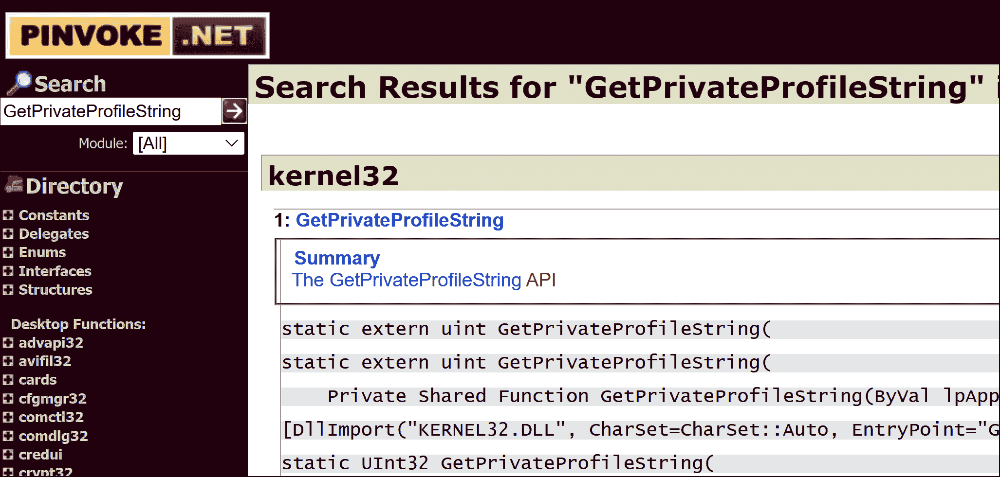
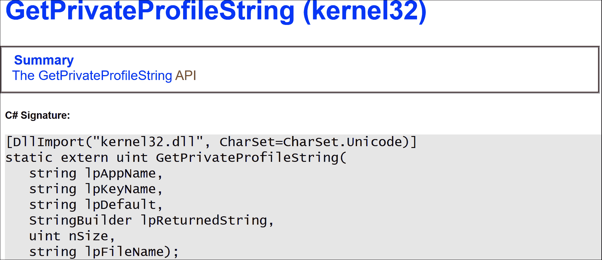

# 第 17 章 扩展 PowerShell 的触达范围

## 17.0 简介

PowerShell 环境极其全面。它提供了大量的 Cmdlet 来帮助你管理系统，提供了优秀的脚本语言让你自动化这些任务，并提供了对你已知的所有实用工具和工具的直接访问。

然而，Cmdlet、脚本语言和预先存在的工具只是让 PowerShell 如此全面的部分原因。除了这些功能，PowerShell 还提供了对少数技术的访问，这些技术能极大地增强其能力：.NET Framework、WMI、COM 自动化对象、原生 Windows API 调用等。

PowerShell 不仅让你能访问这些技术，还以一致的方式让你访问它们。你用来与 PowerShell 对象的属性和方法交互的技术，与你用来与 .NET 对象的属性和方法交互的技术相同。反过来，这些又是你用来处理 WMI 和 COM 对象的相同技术。

使用这些技术和技术提供了另一个巨大的好处——所获得的知识可以轻松迁移到使用 C# 等 .NET 编程语言进行开发中。

## 17.1 使用 COM 脚本接口自动化程序

### 问题

你想通过程序的 COM 自动化接口来自动化该程序或系统任务。

### 解决方案

要实例化和使用 COM 对象，请使用 `New-Object` Cmdlet 的 `-ComObject` 参数。

```
$shell = New-Object -ComObject "Shell.Application"
$shell.Windows() | Format-Table LocationName,LocationUrl
```

### 讨论

与 WMI 一样，COM 自动化接口长期以来一直是脚本编写和系统管理的标准工具。当应用程序公开管理或自动化任务时，COM 对象是最常见的接口（仅次于自定义命令行工具）。

PowerShell 像暴露系统中大多数其他管理对象一样暴露 COM 对象。一旦你获得了对 COM 对象的访问权限，你就可以用与处理 PowerShell 中其他对象的方法和属性相同的方式来处理其属性和方法。

#### 注意

某些 COM 对象需要一种称为*多线程单元*（MTA）的特殊交互模式才能正确工作。有关如何与需要 MTA 交互的组件进行交互的信息，请参阅食谱 13.12。

除了自动化任务，许多 COM 对象的存在完全是为了改善 VBScript 等语言的脚本编写体验。两个例子是处理文件和对数组进行排序。

在 PowerShell 中，这些 COM 对象大多已过时，因为 PowerShell 通常提供了比它们更好的替代方案！在许多情况下，PowerShell 的 Cmdlet、脚本语言或对 .NET Framework 的访问提供了与你习惯的 COM 对象相同或相似的功能。

有关使用 COM 对象的更多信息，请参阅食谱 3.11。有关最有用的 COM 对象列表，请参阅附录 H。

### 另请参阅

食谱 3.11，“使用 COM 对象”

附录 H，《精选 COM 对象及其用途*

## 17.2 程序：查询 SQL 数据源

对 SQL Server、Access 数据库甚至 Excel 电子表格等数据源执行临时查询和命令通常很有帮助。当你想将数据从一个系统移至另一个系统，或者想将数据引入 PowerShell 环境进行详细的交互式操作或处理时，这一点尤其正确。

虽然你可以直接在 PowerShell 中访问这些数据源（通过其对 .NET Framework 的支持），但每个数据源都需要独特且难以记忆的语法。示例 17-1 使得处理这些基于 SQL 的数据源既一致又强大。

### 示例 17-1. Invoke-SqlCommand.ps1


# Invoke-SqlCommand

```powershell
##############################################################################
##
## Invoke-SqlCommand
##
## From PowerShell Cookbook (O'Reilly)
## by Lee Holmes (http://www.leeholmes.com/guide)
##
##############################################################################

<#

.SYNOPSIS

Return the results of a SQL query or operation

.EXAMPLE

Invoke-SqlCommand.ps1 -Sql "SELECT TOP 10 * FROM Orders"
Invokes a command using Windows authentication

.EXAMPLE

PS > $cred = Get-Credential
PS > Invoke-SqlCommand.ps1 -Sql "SELECT TOP 10 * FROM Orders" -Cred $cred
Invokes a command using SQL Authentication

.EXAMPLE

PS > $server = "MYSERVER"
PS > $database = "Master"
PS > $sql = "UPDATE Orders SET EmployeeID = 6 WHERE OrderID = 10248"
PS > Invoke-SqlCommand $server $database $sql
Invokes a command that performs an update

.EXAMPLE

PS > $sql = "EXEC SalesByCategory 'Beverages'"
PS > Invoke-SqlCommand -Sql $sql
Invokes a stored procedure

.EXAMPLE

PS > Invoke-SqlCommand (Resolve-Path access_test.mdb) -Sql "SELECT * FROM Users"
Access an Access database

.EXAMPLE

PS > Invoke-SqlCommand (Resolve-Path xls_test.xls) -Sql 'SELECT * FROM [Sheet1$]'
Access an Excel file

#>

param(
    ## The data source to use in the connection
    [string] $DataSource = ".\SQLEXPRESS",

    ## The database within the data source
    [string] $Database = "Northwind",

    ## The SQL statement(s) to invoke against the database
    [Parameter(Mandatory = $true)]
    [string[]] $SqlCommand,

    ## The timeout, in seconds, to wait for the query to complete
    [int] $Timeout = 60,

    ## The credential to use in the connection, if any.
    $Credential
)


Set-StrictMode -Version 3

## Prepare the authentication information. By default, we pick
## Windows authentication
$authentication = "Integrated Security=SSPI;"

## If the user supplies a credential, then they want SQL
## authentication
if($credential)
{
    $credential = Get-Credential $credential
    $plainCred = $credential.GetNetworkCredential()
    $authentication =
        ("uid={0};pwd={1};" -f $plainCred.Username,$plainCred.Password)
}

## Prepare the connection string out of the information they
## provide
$connectionString = "Provider=sqloledb; " +
                    "Data Source=$dataSource; " +
                    "Initial Catalog=$database; " +
                    "$authentication; "

## If they specify an Access database or Excel file as the connection
## source, modify the connection string to connect to that data source
if($dataSource -match '\.xls$|\.mdb$')
{
    $connectionString = "Provider=Microsoft.Jet.OLEDB.4.0; " +
        "Data Source=$dataSource; "

    if($dataSource -match '\.xls$')
    {
        $connectionString += 'Extended Properties="Excel 8.0;"; '

        ## Generate an error if they didn't specify the sheet name properly
        if($sqlCommand -notmatch '\[.+\$\]')
        {
            $error = 'Sheet names should be surrounded by square brackets, ' +
                'and have a dollar sign at the end: [Sheet1$]'
            Write-Error $error
            return
        }
    }
}

## Connect to the data source and open it
$connection = New-Object System.Data.OleDb.OleDbConnection $connectionString
$connection.Open()

foreach($commandString in $sqlCommand)
{
    $command = New-Object Data.OleDb.OleDbCommand $commandString,$connection
    $command.CommandTimeout = $timeout

    ## Fetch the results, and close the connection
    $adapter = New-Object System.Data.OleDb.OleDbDataAdapter $command
    $dataset = New-Object System.Data.DataSet
    [void] $adapter.Fill($dataSet)

    ## Return all of the rows from their query
    $dataSet.Tables | Select-Object -Expand Rows
}

$connection.Close()
```

有关运行脚本的详细信息，请参阅食谱 1.2。

## 另请参阅

食谱 1.2，“运行程序、脚本和现有工具”

# 17.3 访问 Windows 性能计数器

## 问题

你想要从 PowerShell 访问系统性能计数器信息。

## 解决方案

若要检索特定性能计数器的信息，请使用 `Get-Counter` cmdlet，如示例 17-2 所示。

### 示例 17-2. 通过 Get-Counter cmdlet 访问性能计数器数据

```
PS > $counter = Get-Counter "\System\System Up Time"
PS > $uptime = $counter.CounterSamples[0].CookedValue
PS > New-TimeSpan -Seconds $uptime


Days              : 8
Hours             : 1
Minutes           : 38
Seconds           : 58
Milliseconds      : 0
Ticks             : 6971380000000
TotalDays         : 8.06872685185185
TotalHours        : 193.649444444444
TotalMinutes      : 11618.9666666667
TotalSeconds      : 697138
TotalMilliseconds : 697138000
```

或者，WMI 的 `Win32_Perf*` 类集支持许多最常见的性能计数器：

```
Get-CimInstance Win32_PerfFormattedData_Tcpip_NetworkInterface
```

## 讨论

`Get-Counter` cmdlet 为所有 Windows 性能计数器提供了便捷的访问。如果不带参数，它会汇总系统活动：

```
PS > Get-Counter -Continuous

Timestamp                 CounterSamples
---------                 --------------
1/9/2010 7:26:49 PM       \\...\network interface(ethernet
                          adapter)\bytes total/sec :
                          102739.3921377

                          \\...\processor(_total)\% processor
                          time :
                          35.6164383561644

                          \\...\memory\% committed bytes in use
                          :
                          29.4531607006855

                          \\...\memory\cache faults/sec :
                          98.1952324093294

                          \\...\physicaldisk(_total)\% disk time
                           :
                          144.227945205479

                          \\...\physicaldisk(_total)\current disk
                          queue length :
                          0
(...)
```

当你提供特定计数器的路径时，`Get-Counter` cmdlet 仅检索该路径的样本。如果需要，`-Computer` 参数允许你以特定远程计算机为目标：

```
PS > $computer = $ENV:Computername
PS > Get-Counter -Computer $computer "processor(_total)\% processor time"

Timestamp                 CounterSamples
---------                 --------------
1/9/2010 7:31:58 PM       \\...\processor(_total)\% processor time :
                          15.8710351576814
```

如果你不知道所需性能计数器的路径，可以使用 `-ListSet` 参数来搜索计数器或计数器集。要查看所有计数器集，请使用 `*` 作为参数值：

```
PS > Get-Counter -List * | Format-List CounterSetName,Description


CounterSetName : TBS counters
Description    : Performance counters for the TPM Base Services component.

CounterSetName : WSMan Quota Statistics
Description    : Displays quota usage and violation information for WS-
                 Management processes.

CounterSetName : Netlogon
Description    : Counters for measuring the performance of Netlogon.

(...)
```

如果你想查找特定计数器，请使用 `Where-Object` cmdlet 根据 `Description` 或 `Paths` 属性进行比较：


```powershell
Get-Counter -ListSet * | Where-Object { $_.Description -match "garbage" }
Get-Counter -ListSet * | Where-Object { $_.Paths -match "Gen 2 heap" }
```

```text
CounterSetName     : .NET CLR Memory
MachineName        : .
CounterSetType     : MultiInstance
Description        : Counters for CLR Garbage Collected heap.
Paths              : {\.NET CLR Memory(*)\# Gen 0 Collections, \.NET CLR
                     Memory(*)\# Gen 1 Collections, \.NET CLR Memory(*)\#
                     Gen 2 Collections, \.NET CLR Memory(*)\Promoted Memory
                     from Gen 0...}
PathsWithInstances : {\.NET CLR Memory(_Global_)\# Gen 0 Collections, \.NET
                     CLR Memory(powershell)\# Gen 0 Collections, \.NET CLR
                     Memory(powershell_ise)\# Gen 0 Collections, \.NET
                     CLR Memory(PresentationFontCache)\# Gen 0 Collections
                     ...}
Counter            : {\.NET CLR Memory(*)\# Gen 0 Collections, \.NET CLR
                     Memory(*)\# Gen 1 Collections, \.NET CLR Memory(*)\#
                     Gen 2 Collections, \.NET CLR Memory(*)\Promoted Memory
                     from Gen 0...}
```

检索到一组计数器后，你可以使用 `Export-Counter` cmdlet 将它们以其他工具支持的格式保存，例如 Windows 性能监视器应用程序支持的 `*.blg` 文件。

### 提示

解决方案中的示例使用性能计数器来检索系统运行时间。你可能更倾向于使用 PowerShell 的内置命令来执行此操作：`Get-Uptime`。

如果你已有一组性能计数器保存在从 Windows 性能监视器导出的 `*.blg` 文件或 `*.tsv` 文件中，则可以使用 `Import-Counter` cmdlet 在 PowerShell 中处理这些样本。

# 17.4 访问 Windows API 函数

## 问题

你想要访问 Windows API 函数，就像在 C# 等 .NET 语言中通过平台调用 (P/Invoke) 访问它们一样。

## 解决方案

如示例 17-3 所示，获取（或创建）Windows API 函数的签名，然后将其传递给 `Add-Type` cmdlet 的 `-MemberDefinition` 参数。将输出对象存储在变量中，然后使用该变量上的方法来调用 Windows API 函数。

### 示例 17-3. `Get-PrivateProfileString.ps1`

```powershell
#############################################################################
##
## Get-PrivateProfileString
##
## From PowerShell Cookbook (O'Reilly)
## by Lee Holmes (http://www.leeholmes.com/guide)
##
##############################################################################

<#

.SYNOPSIS

Retrieves an element from a standard .INI file

.EXAMPLE

PS > Get-PrivateProfileString c:\windows\system32\tcpmon.ini `
    "<Generic Network Card>" Name
Generic Network Card

#>

param(
    ## The INI file to retrieve
    $Path,

    ## The section to retrieve from
    $Category,

    ## The item to retrieve
    $Key
)

Set-StrictMode -Version 3

## The signature of the Windows API that retrieves INI
## settings
$signature = @'
[DllImport("kernel32.dll")]
public static extern uint GetPrivateProfileString(
    string lpAppName,
    string lpKeyName,
    string lpDefault,
    StringBuilder lpReturnedString,
    uint nSize,
    string lpFileName);
'@

## Create a new type that lets us access the Windows API function
$type = Add-Type -MemberDefinition $signature `
    -Name Win32Utils -Namespace GetPrivateProfileString `
    -Using System.Text -PassThru

## The GetPrivateProfileString function needs a StringBuilder to hold
## its output. Create one, and then invoke the method
$builder = New-Object System.Text.StringBuilder 1024
$null = $type::GetPrivateProfileString($category,
    $key, "", $builder, $builder.Capacity, $path)

## Return the output
$builder.ToString()
```

## 讨论

你可以使用配方 17.5 中提供的脚本来访问许多简单的 Windows API。然而，对于更复杂的 API，这种方法比较困难。

为了支持与 Windows API 交互，请使用 PowerShell 的 `Add-Type` cmdlet。

`Add-Type` 提供四种基本操作模式：

```powershell
PS > Get-Command Add-Type | Select -Expand ParameterSets | Select Name

Name
----
FromSource
FromMember
FromPath
FromLiteralPath
FromAssemblyName
```

这些操作模式包括：

- `FromSource`：编译完全定义类型的 C#（或其他语言）代码。当你想要定义整个类、其方法、命名空间等时，这很有用。你将实际代码作为值提供给 `-TypeDefinition` 参数，通常通过变量。有关此技术的更多信息，请参阅配方 17.6。

- `FromPath`：从磁盘上的文件编译，或从该位置的程序集加载类型。有关此技术的更多信息，请参阅配方 17.8。

- `FromAssemblyName`：通过其较短的名称从 .NET 全局程序集缓存 (GAC) 加载程序集。这与 `[Reflection.Assembly]::LoadWithPartialName` 方法不同，因为该方法会给你的脚本引入许多微妙的破坏性更改。相反，PowerShell 维护一个大型映射表，将你输入的较短名称转换为强名称程序集引用。有关此技术的更多信息，请参阅配方 17.8。

- `FromMember`：根据成员定义（或一组成员定义）生成类型。例如，如果你仅指定方法定义，PowerShell 会自动为你生成包装类。此参数集专门设计用于轻松支持 P/Invoke 调用。

现在，如何使用 `FromMember` 参数集来调用 Windows API？解决方案展示了此过程的最终结果，但让我们一步步来。首先，假设你想要访问 INI 配置文件的节。

PowerShell 没有管理 INI 文件的原生方式，.NET Framework 也没有。但是，Windows API 可以通过调用 `GetPrivateProfileString` 函数来实现。.NET Framework 允许你通过一种称为 `P/Invoke`（平台调用服务）的技术来访问 Windows 函数。大多数调用归结为一个简单的 `P/Invoke 定义`，这通常需要大量的尝试和错误。然而，围绕这些定义形成了一个庞大的社区，产生了一个名为 [P/Invoke .NET](http://www.pinvoke.net/) 的巨大资源。.NET Framework 团队还支持一个称为 P/Invoke Interop Assistant 的工具来生成这些定义，但我们暂不考虑它。

首先，我们将创建一个名为 `Get-PrivateProfileString.ps1` 的脚本。目前它只是一个模板：

```powershell
## Get-PrivateProfileString.ps1
param(
    $Path,
    $Category,
    $Key)

$null
```

为了开始充实它，我们访问 P/Invoke .NET 并搜索 `GetPrivateProfileString`，如图 17-1 所示。



点击进入定义，我们可以看到 C# 签名，如图 17-2 所示。



接下来，我们将该签名作为此处字符串复制到我们的脚本中。请注意，在下面的代码示例中，我们在声明中添加了 `public`。P/Invoke .NET 上的签名假设你将从定义它的 C# 类内部调用该方法。我们将从脚本中调用它（脚本位于定义它的 C# 类外部），因此我们需要通过添加“public”一词来更改其可见性：

```powershell
## Get-PrivateProfileString.ps1
param(
    $Path,
    $Category,
    $Key)

$signature = @'
[DllImport("kernel32.dll")]
public static extern uint GetPrivateProfileString(
    string lpAppName,
    string lpKeyName,
    string lpDefault,
    StringBuilder lpReturnedString,
    uint nSize,
    string lpFileName);
'@

$null
```


## 添加 `Add-Type` 调用

现在我们添加对 `Add-Type` 的调用。此签名将成为新类的构建基块，因此我们只需给它一个名称。为了防止其名称与其他同名类冲突，我们还将其放在一个命名空间中。我们脚本的名称是一个不错的选择：

```
## Get-PrivateProfileString.ps1
param(
    $Path,
    $Category,
    $Key)

$signature = @'
[DllImport("kernel32.dll")]
public static extern uint GetPrivateProfileString(
    string lpAppName,
    string lpKeyName,
    string lpDefault,
    StringBuilder lpReturnedString,
    uint nSize,
    string lpFileName);
'@

$type = Add-Type -MemberDefinition $signature `
    -Name Win32Utils -Namespace GetPrivateProfileString `
    -PassThru

$null
```

然而，当我们尝试运行此脚本时，会收到一个错误：

```
The type or namespace name 'StringBuilder' could not be found (are you missing a
using directive or an assembly reference?)
c:\Temp\obozeqo1.0.cs(12) :    string lpDefault,
c:\Temp\obozeqo1.0.cs(13) : >>>    StringBuilder lpReturnedString,
c:\Temp\obozeqo1.0.cs(14) :    uint nSize,
```

确实我们缺少了某些东西。`StringBuilder` 类定义在 `System.Text` 命名空间中，这需要在类定义处于程序顶部的位置放置一个 `using` 指令。既然我们让 PowerShell 为我们定义类型，我们可以将 `StringBuilder` 重命名为 `System.Text.StringBuilder`，或者添加一个 `-UsingNamespace` 参数，让 PowerShell 为我们添加 `using` 语句。

> **注意**
>
> PowerShell 默认添加对 `System` 和 `System.Runtime.InteropServices` 命名空间的引用。

我们采用后一种方法：

```
## Get-PrivateProfileString.ps1
param(
    $Path,
    $Category,
    $Key)

$signature = @'
[DllImport("kernel32.dll")]
public static extern uint GetPrivateProfileString(
    string lpAppName,
    string lpKeyName,
    string lpDefault,
    StringBuilder lpReturnedString,
    uint nSize,
    string lpFileName);
'@

$type = Add-Type -MemberDefinition $signature `
    -Name Win32Utils -Namespace GetPrivateProfileString `
    -Using System.Text -PassThru

$builder = New-Object System.Text.StringBuilder 1024
$null = $type::GetPrivateProfileString($category,
    $key, "", $builder, $builder.Capacity, $path)

$builder.ToString()
```

现在我们可以填入所有必要的参数。`GetPrivateProfileString` 函数将其输出放在一个 `StringBuilder` 中，因此我们必须提供一个并返回其内容。这给出了 示例 17-3 中所示的脚本。

```
PS > Get-PrivateProfileString c:\windows\system32\tcpmon.ini `
   "<Generic Network Card>" Name
Generic Network Card
```

现在我们完成了。只需几行代码，我们就定义并调用了一个 Win32 API 调用。

有关使用 .NET Framework 类的更多信息，请参阅 食谱 1.2。

## 另请参阅

- 食谱 1.2，“运行程序、脚本和现有工具”
- 食谱 17.5，“程序：调用简单的 Windows API”
- 食谱 17.6，“定义或扩展 .NET 类”
- 食谱 17.8，“访问 .NET SDK 库”

# 17.5 程序：调用简单的 Windows API

有时，PowerShell 的 cmdlet 或其脚本语言都不直接支持你需要的功能。在大多数这种情况下，PowerShell 对 .NET Framework 的直接支持提供了另一种途径来完成任务。但在某些情况下，即使 .NET Framework 也不支持解决问题所需的功能，唯一的解决方案就是访问核心 Windows API。

对于复杂的 API 调用（即涉及高度结构化数据的调用），解决方案是使用 `Add-Type` cmdlet（或编写 PowerShell cmdlet），它构建在 .NET Framework 的平台调用 (P/Invoke) 支持之上。.NET Framework 中的 P/Invoke 支持旨在让你直接访问核心 Windows API。

虽然可以自己确定这些 P/Invoke 定义，但通常利用他人的成果最为容易。如果你想知道如何从 .NET 语言调用特定的 Windows API，[P/Invoke .NET 网站](http://www.pinvoke.net) 是最佳起点。

然而，如果你需要访问的 API 很简单（仅接受和返回简单数据类型），示例 17-4 可以为你完成大部分工作。

### 示例 17-4. Invoke-WindowsApi.ps1


## Invoke-WindowsApi 示例

```powershell
##############################################################################
##
## Invoke-WindowsApi
##
## From PowerShell Cookbook (O'Reilly)
## by Lee Holmes (http://www.leeholmes.com/guide)
##
##############################################################################

<#

.SYNOPSIS

调用一个接受并返回简单数据类型的本机 Windows API。

.EXAMPLE

## 为 CreateHardLink 函数准备参数类型和参数
PS > $filename = "c:\temp\hardlinked.txt"
PS > $existingFilename = "c:\temp\link_target.txt"
PS > Set-Content $existingFilename "Hard Link target"
PS > $parameterTypes = [string], [string], [IntPtr]
PS > $parameters = [string] $filename, [string] $existingFilename,
    [IntPtr]::Zero

## 调用 Kernel32 DLL 中的 CreateHardLink 方法
PS > $result = Invoke-WindowsApi "kernel32" ([bool]) "CreateHardLink" `
    $parameterTypes $parameters
PS > Get-Content C:\temp\hardlinked.txt
Hard Link target

#>

param(
    ## 包含 Windows API 的 DLL 名称，例如 "kernel32"
    [string] $DllName,

    ## Windows API 期望的返回类型
    [Type] $ReturnType,

    ## Windows API 的名称
    [string] $MethodName,

    ## Windows API 期望的参数类型
    [Type[]] $ParameterTypes,

    ## 传递给 Windows API 的参数值
    [Object[]] $Parameters
)

Set-StrictMode -Version 3

## 开始构建动态程序集
$domain = [AppDomain]::CurrentDomain
$name = New-Object Reflection.AssemblyName 'PInvokeAssembly'
$assembly = $domain.DefineDynamicAssembly($name, 'Run')
$module = $assembly.DefineDynamicModule('PInvokeModule')
$type = $module.DefineType('PInvokeType', "Public,BeforeFieldInit")

## 遍历传递给我们的所有参数。在此过程中，
## 我们将用户的输入克隆到另一个数组中，该数组将用于
## P/Invoke 调用。
$inputParameters = @()
$refParameters = @()

for($counter = 1; $counter -le $parameterTypes.Length; $counter++)
{
    ## 如果某项是 PSReference，则表示用户
    ## 想要一个 [out] 参数。
    if($parameterTypes[$counter - 1] -eq [Ref])
    {
        ## 记录哪些参数用作 [Out] 参数
        $refParameters += $counter

        ## 在克隆的数组上，我们将 PSReference 类型替换为
        ## 表示 PSReference 值的 .NET 引用类型，
        ## 并将值替换为 PSReference 所持有的值。
        $parameterTypes[$counter - 1] =
            $parameters[$counter - 1].Value.GetType().MakeByRefType()
        $inputParameters += $parameters[$counter - 1].Value
    }
    else
    {
        ## 否则，只需将其实际参数添加到
        ## 输入数组中。
        $inputParameters += $parameters[$counter - 1]
    }
}

## 定义实际的 P/Invoke 方法，为最初为 [Ref]
## 的参数添加 [Out] 特性。
$method = $type.DefineMethod(
    $methodName, 'Public,HideBySig,Static,PinvokeImpl',
    $returnType, $parameterTypes)

foreach($refParameter in $refParameters)
{
    [void] $method.DefineParameter($refParameter, "Out", $null)
}

## 应用 P/Invoke 构造函数
$ctor = [Runtime.InteropServices.DllImportAttribute].GetConstructor([string])
$attr = New-Object Reflection.Emit.CustomAttributeBuilder $ctor, $dllName
$method.SetCustomAttribute($attr)

## 创建临时类型，并调用该方法。
$realType = $type.CreateType()

$realType.InvokeMember(
    $methodName, 'Public,Static,InvokeMethod', $null, $null,$inputParameters)

## 最后，遍历所有引用参数，并更新
## 用户传入的 PSReference 对象的值。
foreach($refParameter in $refParameters)
{
    $parameters[$refParameter - 1].Value = $inputParameters[$refParameter - 1]
}
```

有关运行脚本的详细信息，请参阅食谱 1.2。

## 另请参阅

食谱 1.2，“运行程序、脚本和现有工具”

# 17.6 定义或扩展 .NET 类

## 问题

你想要定义一个新的 .NET 类或扩展现有类。

## 解决方案

在大多数情况下，你可以直接在 PowerShell 中定义 .NET 类：

```powershell
class GreatnessComparer : System.Collections.IComparer
{
    [int] Compare([Object] $X, [Object] $Y)
    {
        if($X -eq "Powershell") { return -1 }
        elseif($Y -eq "Powershell") { return 1 }
        else { return [String]::Compare($X, $Y) }
    }
}
```

```powershell
PS > $languages = "Perl","Ruby","Python","PowerShell","VBScript"
PS > [Array]::Sort($languages, [GreatnessComparer]::New())
PS > $languages

PowerShell
Perl
Python
Ruby
VBScript
```

对于其他情况，请使用 `Add-Type` 类的 `-TypeDefinition` 参数，如示例 17-5 所示。

### 示例 17-5. Invoke-AddTypeTypeDefinition.ps1

```powershell
#############################################################################
##
## Invoke-AddTypeTypeDefinition
##
## From PowerShell Cookbook (O'Reilly)
## by Lee Holmes (http://www.leeholmes.com/guide)
##
##############################################################################

<#

.SYNOPSIS

演示 Add-Type cmdlet 的 -TypeDefinition 参数的用法。

#>

Set-StrictMode -Version 3

## 定义新的 C# 类
$newType = @'
using System;

namespace PowerShellCookbook
{
    public class AddTypeTypeDefinitionDemo
    {
        public string SayHello(string name)
        {
            string result = String.Format("Hello {0}", name);
            return result;
        }
    }
}

'@

## 将其添加到 PowerShell 会话
Add-Type -TypeDefinition $newType

## 显示我们可以像访问任何其他 .NET 类型一样访问它
$greeter = New-Object PowerShellCookbook.AddTypeTypeDefinitionDemo
$greeter.SayHello("World")
```

## 讨论

在大多数 PowerShell 场景中，如果你想要为数据添加结构或提供操作该数据的方法，可以使用 PowerShell 类来提供此功能。有关编写 PowerShell 类的详细信息，请参阅示例 3-8。有关使用 PowerShell 扩展 .NET 类的另一个示例，请参阅食谱 3.7。

对于其他场景，`Add-Type` cmdlet 是 PowerShell *胶水般* 特性的主要体现之一。它提供了几种与 .NET Framework 深度交互的独特方式。其主要操作模式之一源于 `-TypeDefinition` 参数，该参数允许你定义全新的 .NET 类。除了解决方案中给出的示例外，食谱 3.7 还演示了该技术的有效用法。

调用 `Add-Type` cmdlet 后，PowerShell 会将你提供的源代码编译成真正的 .NET 类。此操作等同于在传统开发环境（如 Visual Studio）中定义类，功能同样强大。

### 注意

在脚本执行过程中编译源代码的想法可能会让你担心性能影响。幸运的是，PowerShell 在编译时会保存这些对象。如果你在同一会话中使用相同的源代码第二次调用 `Add-Type` cmdlet，PowerShell 将重用第一次调用的结果。如果你想要更改已加载类型的行为，请退出会话并重新创建。

PowerShell 假定提供给 `-TypeDefinition` 参数的源代码默认语言为 C#。除了 C#，`Add-Type` cmdlet 还支持 C# 3.0 版本（LINQ、`var` 关键字等）、Visual Basic 和 JScript。它还支持实现 .NET 标准 CodeProvider 要求的语言（如 F#）。


如果要编译的代码已存在于文件中，则无需内联指定。相反，你可以将其路径提供给 `-Path` 参数。此参数会自动检测文件的扩展名，并根据需要使用适当的语言进行编译。

除了支持从文件输入外，你可能还想将输出存储到文件中——例如 cmdlet DLL 或控制台应用程序。`Add-Type` cmdlet 通过 `-OutputAssembly` 参数使这成为可能。例如，以下命令即时添加了一个 cmdlet：

```
PS > $cmdlet = @'
using System.Management.Automation;

namespace PowerShellCookbook
{
    [Cmdlet("Invoke", "NewCmdlet")]
    public class InvokeNewCmdletCommand : Cmdlet
    {
        [Parameter(Mandatory = true)]
        public string Name
        {
            get { return _name; }
            set { _name = value; }
        }
        private string _name;


        protected override void BeginProcessing()
        {
            WriteObject("Hello " + _name);
        }
    }
}

'@

PS > Add-Type -TypeDefinition $cmdlet -OutputAssembly MyNewModule.dll
PS > Import-Module .\MyNewModule.dll
PS > Invoke-NewCmdlet

cmdlet Invoke-NewCmdlet at command pipeline position 1
Supply values for the following parameters:
Name: World
Hello World
```

对于高级场景，你可能想要自定义 PowerShell 编译源代码的方式：嵌入资源、更改警告选项等。为此，请使用 `-CompilerParameters` 参数。

有关使用 `Add-Type` cmdlet 生成内联 C# 的示例，请参阅 Recipe 17.7。

## 另请参阅

示例 3-8

Recipe 1.2，“运行程序、脚本和现有工具”

Recipe 3.7，“程序：创建动态变量”

Recipe 17.5，“程序：调用简单的 Windows API”

Recipe 17.7，“向 PowerShell 脚本添加内联 C#”

Recipe 17.9，“创建你自己的 PowerShell Cmdlet”

## 17.7 向 PowerShell 脚本添加内联 C#

### 问题

你想用 C#（或其他 .NET 语言）编写脚本的一部分。

### 解决方案

使用 `Add-Type` 类的 `-MemberDefinition` 参数，如 示例 17-6 所示。

### 示例 17-6. Invoke-Inline.ps1

```
#############################################################################
##
## Invoke-Inline
##
## From PowerShell Cookbook (O'Reilly)
## by Lee Holmes (http://www.leeholmes.com/guide)
##
#############################################################################

<#

.SYNOPSIS

演示 Add-Type cmdlet 调用内联 C#

#>

Set-StrictMode -Version 3

$inlineType = Add-Type -Name InvokeInline_Inline -PassThru `
    -MemberDefinition @'
    public static int RightShift(int original, int places)
    {
        return original >> places;
    }
'@

$inlineType::RightShift(1024, 3)
```

### 讨论

学习 PowerShell 后，要探索的自然语言之一是 C#。它使用许多与 PowerShell 相同的编程技术，也使用 .NET Framework 中相同的类和方法。此外，C# 有时提供 PowerShell 中没有的语言特性或性能优势。

与其为了这些情况完全转向 C#，示例 17-6 演示了如何使用 `Add-Type` cmdlet 直接在脚本中编写和调用 C#。

调用 `Add-Type` cmdlet 后，PowerShell 会将你提供的源代码编译成一个真正的 .NET 类。此操作等同于在传统开发环境（如 Visual Studio）中定义该类，并提供同等功能。当你使用 `-MemberDefinition` 参数时，PowerShell 会添加创建完整 .NET 类所需的环绕源代码。

默认情况下，PowerShell 会将生成的类型放在 `Microsoft.PowerShell.Commands.AddType.AutoGeneratedTypes` 命名空间中。如果你使用 `-PassThru` 参数（并将方法定义为 `static`），则不必太关心生成类型的名称或命名空间。但是，如果你不将方法定义为 `static`，则需要使用 `New-Object` cmdlet 创建对象的新实例，然后才能使用它。在这种情况下，创建对象时需要使用生成类型的全名。例如：

```
New-Object Microsoft.PowerShell.Commands.AddType.AutoGeneratedTypes.InvokeInline_Inline
```

#### 注意

作为脚本执行的一部分编译源代码的想法可能会让你担心其性能影响。幸运的是，PowerShell 在编译时会保存这些对象。如果你在同一会话中使用相同的源代码第二次调用 `Add-Type` cmdlet，PowerShell 将重用第一次调用的结果。如果你想更改已加载类型的行为，请退出会话并重新创建它。

PowerShell 假定提供给 `-MemberDefinition` 参数的代码默认语言为 C#。它还支持 C# 3.0 版本（LINQ、`var` 关键字等）、Visual Basic 和 JScript。此外，它还支持实现 .NET 标准 `CodeProvider` 要求的语言（如 F#）。

有关在更大脚本中使用 `-MemberDefinition` 参数的示例，请参阅 Recipe 17.4。有关使用 `Add-Type` cmdlet 创建完整类型的示例，请参阅 Recipe 17.6。

### 另请参阅

Recipe 17.4，“访问 Windows API 函数”

Recipe 17.6，“定义或扩展 .NET 类”

## 17.8 访问 .NET SDK 库

### 问题

你想要访问 .NET DLL 暴露的功能，但该 DLL 作为面向开发人员的软件开发工具包 (SDK) 的一部分进行打包。

### 解决方案

要创建 DLL 中包含的对象，请使用 `Add-Type` cmdlet 的 `-Path` 参数加载 DLL，并使用 `New-Object` cmdlet 创建其中包含的对象。示例 17-7 演示了此技术。

### 示例 17-7. 与 SharpZipLib SDK DLL 中的类交互

```
Add-Type -Path d:\bin\ICSharpCode.SharpZipLib.dll
$namespace = "ICSharpCode.SharpZipLib.Zip.{0}"

$zipName = Join-Path (Get-Location) "PowerShell_Scripts.zip"
$zipFile = New-Object ($namespace -f "ZipOutputStream") ([IO.File]::Create($zipName))

foreach($file in dir *.ps1)
{
   ## 将文件添加到 ZIP 存档。
   $zipEntry = New-Object ($namespace -f "ZipEntry") $file.Name
   $zipFile.PutNextEntry($zipEntry)
}

$zipFile.Close()
```

### 讨论

虽然 C# 和 VB.NET 开发人员通常是为 .NET Framework 创建的 SDK 的使用者，但 PowerShell 让你同样轻松地访问 SDK 功能。为此，请使用 `Add-Type` cmdlet 的 `-Path` 参数加载 SDK 程序集，然后像使用 .NET Framework 中的其他类一样使用该程序集中的类。

#### 注意

虽然 PowerShell 让你轻松访问面向开发人员的 SDK，但无法改变这些 SDK 面向开发人员的事实。SDK 和编程接口很少考虑到管理员的需求，因此请准备好使用需要多个步骤才能完成任务的编程模型。

要加载 .NET Framework 中包含的任何典型程序集，请使用 `Add-Type` cmdlet 的 `-Assembly` 参数：

```
Add-Type -Assembly System.Web
```

与大多数 PowerShell cmdlet 一样，`Add-Type` cmdlet 支持通配符，以便更轻松地输入冗长的程序集名称：

```
Add-Type -Assembly system.win*.forms
```


如果通配符匹配到多个程序集，`Add-Type` 会生成错误。

.NET Framework 通过 `System.Reflection.Assembly` 类的 `LoadWithPartialName` 方法提供了类似的功能，如 示例 17-8 所示。

### 示例 17-8. 通过部分名称加载程序集

```
PS > [Reflection.Assembly]::LoadWithPartialName("System.Web")

GAC    Version        Location
---    -------        --------
True   v2.0.50727     C:\WINDOWS\assembly\GAC_32\(...)\System.Web.dll

PS > [Web.HttpUtility]::UrlEncode("http://www.bing.com")
http%3a%2f%2fwww.bing.com
```

两者的区别在于，`LoadWithPartialName` 方法不适用于您想要与他人共享或在生产环境中使用的脚本。它会加载程序集的最新版本，这可能与您开发脚本时使用的版本不同。如果该程序集在版本之间发生变化，您的脚本将不再工作。另一方面，`Add-Type` 命令在内部将短程序集名称映射到 .NET Framework 2.0 和 3.5 典型安装中包含的完全限定程序集名称。

使用 SDK 中的类时，您会注意到的一件事是，指定其完全限定类型名称很快会变得繁琐。例如，来自 SharpZipLib 的与 zip 相关的类都以 `ICSharpCode.SharpZipLib.Zip` 开头。这称为该类的*命名空间*。像大多数编程语言一样，PowerShell 通过 `using` 语句解决此问题，该语句允许您指定一个命名空间列表，以便在您输入纯类名（如 `HttpUtility`）时供 PowerShell 搜索：

```
using namespace System.Web
[HttpUtility]::UrlEncode("http://www.bing.com")
```

请注意，预打包的 SDK 并不是您可以通过这种方式加载的唯一 DLL。SDK 库只是某人编写、编译、打包并发布的 DLL。如果您熟悉任何 .NET 语言，也可以创建自己的 DLL，编译它，并以完全相同的方式使用它。要查看此方法的示例，请参阅 配方 17.6。

有关使用 .NET Framework 类的更多信息，请参阅 配方 3.9。

## 另请参阅

配方 3.9，“创建 .NET 对象的实例”

配方 17.6，“定义或扩展 .NET 类”

# 17.9 创建您自己的 PowerShell Cmdlet

## 问题

您想编写自己的 PowerShell cmdlet。

## 解决方案

要创建编译型 cmdlet，请在 .NET Standard 类库中使用 PowerShell Standard Library 的功能。

## 讨论

正如 “结构化命令” 中所述，PowerShell cmdlet 相比传统可执行程序提供了几个显著优势。从用户的角度来看，cmdlet 非常一致。它们对作为输入的强类型对象的支持也使它们非常强大。从 cmdlet 作者的角度来看，与它们提供的功能相比，cmdlet 非常容易编写。

在大多数情况下，编写基于脚本的 cmdlet（也称为高级函数）应该就是您所需要的一切。要了解如何创建基于脚本的 cmdlet，请参阅 配方 11.15。

不过，您也可以使用 `C#` 编程语言来创建 cmdlet。

就像创建高级函数一样容易，创建和公开新的命令行参数就像在类上创建新的公共属性一样简单。支持丰富的管道模型就像将实现逻辑放入三个标准方法重写之一一样简单。

虽然完整讨论如何实现 cmdlet 超出了本书的范围，但以下步骤说明了实现简单 cmdlet 背后的过程。虽然实现通常发生在功能齐全的开发环境中（如 Visual Studio），但 示例 17-9 演示了如何仅通过 `dotnet` 命令行工具链来编译 cmdlet。

有关如何编写 PowerShell cmdlet 的更多信息，请参阅 MSDN 主题“编写 PowerShell Cmdlet”，见 [PowerShell 开发人员文档](https://oreil.ly/tBzjc)。

### 步骤 1：下载 .NET SDK

.NET SDK 包含开发 PowerShell cmdlet 所需的编译器、引用程序集和其他信息。此示例将 .NET SDK 安装到临时工作目录中，但如果您愿意，也可以选择将 SDK 安装到系统范围：

```
Invoke-WebRequest https://dot.net/v1/dotnet-install.ps1 -Out ./dotnet-install.ps1
.\dotnet-install.ps1 -Channel Current
```

### 步骤 2：创建项目以保存 cmdlet 源代码和 PowerShell SDK

```
dotnet new classlib --name TemplateBinaryModule
cd TemplateBinaryModule
dotnet add package PowerShellStandard.Library
```

### 步骤 3：自定义 cmdlet 源代码

编辑名为 `Class1.cs` 的文件，使用 示例 17-9 的内容并保存。

### 示例 17-9. Invoke-TemplateCmdletImplementation

```
using System;
using System.Management.Automation;

/*
To build and install:

1) Invoke-WebRequest https://dot.net/v1/dotnet-install.ps1 -outfile ./dotnet-install.ps1
2) .\dotnet-install.ps1
3) dotnet new classlib --name TemplateBinaryModule
4) cd TemplateBinaryModule
5) dotnet add package PowerShellStandard.Library
6) notepad .\Class1.cs (use the content of this file)
7) dotnet build
8) Import-Module .\bin\Debug\netstandard2.0\TemplateBinaryModule.dll

To run:

PS > "Hello World" | Invoke-TemplateCmdlet
*/

namespace Template.Commands
{
    [Cmdlet("Invoke", "TemplateCmdlet")]
    public class InvokeTemplateCmdletCommand : Cmdlet
    {
        [Parameter(Mandatory=true, Position=0, ValueFromPipeline=true)]
        public string Text { get; set; }

        protected override void BeginProcessing()
        {
            WriteObject("Processing Started");
        }

        protected override void ProcessRecord()
        {
            WriteObject("Processing " + Text);
        }

        protected override void EndProcessing()
        {
            WriteObject("Processing Complete.");
        }
    }
}
```

### 步骤 4：编译项目

```
dotnet build
```

### 步骤 5：加载模块

PowerShell cmdlet 是一个简单的 .NET 类。包含一个或多个已编译 cmdlet 的 DLL 称为*二进制模块*。

编译模块后，最后一步是加载它：

```
Import-Module .\bin\Debug\net5.0\TemplateBinaryModule.dll
```

有关二进制模块的更多信息，请参阅 配方 1.28。

### 步骤 6：使用模块

将模块添加到会话后，您可以像调用任何其他 cmdlet 一样调用该模块中的命令。

```
PS > "Hello World" | Invoke-TemplateCmdlet
Processing Started
Processing Hello World
Processing Complete.
```

除了二进制模块外，PowerShell 还通过高级函数支持几乎所有 cmdlet 的功能。如果您想创建具有 cmdlet 功能且易于编写脚本的函数，请参阅 配方 11.15。

## 另请参阅

“结构化命令”

配方 1.28，“使用附加命令扩展您的 Shell”

配方 11.15，“提供 -WhatIf、-Confirm 和其他 Cmdlet 功能”

配方 17.6，“定义或扩展 .NET 类”

# 17.10 将 PowerShell 脚本添加到您自己的程序中

## 问题

您想为用户提供一种简单的方法来自动化您的程序，但不想自己编写脚本语言。

## 解决方案


# 要在自己的程序中构建 PowerShell 脚本功能，请使用 PowerShell 的 `System.Management.Automation` SDK

## 讨论

PowerShell 迷人之处之一在于它能多么轻松地让你将其许多功能添加到自己的程序中。这是因为 PowerShell 的核心是一个强大的引擎，任何应用程序都可以使用它。PowerShell 控制台应用程序实际上只是该引擎的一个基于文本的界面。

虽然完整讨论 PowerShell 托管模型超出了本书的范围，但以下示例演示了将应用程序功能暴露给用户以便编写脚本的技术。

为了构想 示例 17-10（稍后显示）的前提，想象一个电子邮件应用程序，它允许你在收到电子邮件时运行规则。虽然你需要设计一个标准界面让用户创建简单规则，但你也需要提供一种方式让用户编写极其复杂的规则。与其自己设计一种脚本语言，不如直接使用 PowerShell 的脚本语言。在下面的示例中，我们为用户编写的脚本提供了一个名为 `$message` 的变量，该变量代表当前邮件，然后运行命令。

```
PS > Get-Content VerifyCategoryRule.ps1
if($message.Body -match "book")
{
    [Console]::WriteLine("This is a message about the book.")
}
else
{
    [Console]::WriteLine("This is an unknown message.")
}
PS > .\RulesWizardExample.exe .\VerifyCategoryRule.ps1
This is a message about the book.
```

有关如何在自己的应用程序中托管 PowerShell 的更多信息，请参阅 MSDN 主题“Windows PowerShell Host Quickstart”，可在 [PowerShell 开发人员文档](https://oreil.ly/H1Y8M) 中找到。

### 步骤 1：下载 .NET SDK

.NET SDK 包含编译器、引用程序集和其他开发 PowerShell 托管应用程序所需的信息。此示例将 .NET SDK 安装到临时工作目录，但如果你愿意，也有系统范围安装 SDK 的选项：

```
Invoke-WebRequest https://dot.net/v1/dotnet-install.ps1 -OutFile ./dotnet-install.ps1
.\dotnet-install.ps1 -Channel Current
```

### 步骤 2：创建一个项目以保存 cmdlet 源代码和 PowerShell SDK

```
dotnet new console --name RulesWizardExample
cd RulesWizardExample
dotnet add package System.Management.Automation
```

### 步骤 3：自定义应用程序源代码

编辑名为 `Program.cs` 的文件，填入 示例 17-10 的内容，并将其保存到硬盘上。

#### 示例 17-10. Program.cs

```
using System;
using System.Management.Automation;
using System.Management.Automation.Runspaces;

namespace Template
{
    // 定义一个表示邮件的简单类
    public class MailMessage
    {
        public MailMessage(string to, string from, string body)
        {
            this.To = to;
            this.From = from;
            this.Body = body;
        }

        public String To;
        public String From;
        public String Body;
    }

    public class RulesWizardExample
    {
        public static void Main(string[] args)
        {
            // 确保他们提供了一些脚本文本
            if(args.Length == 0)
            {
                Console.WriteLine("Usage:");
                Console.WriteLine(" RulesWizardExample <script text>");
                return;
            }

            // 创建一个示例邮件以传递给我们的规则向导
            MailMessage mailMessage =
                        new MailMessage(
                            "guide_feedback@leeholmes.com",
                            "guide_reader@example.com",
                            "This is a message about your book.");

            // 在 Runspace 中创建一个名为 "$message" 的变量，并用我们应用程序中当前邮件的引用填充它。
            // PowerShell 实例中的脚本可以像操作任何其他 .NET 对象一样与此对象交互。
            InitialSessionState iss = InitialSessionState.CreateDefault2();
            iss.Variables.Add(
                new SessionStateVariableEntry(
                    "message", mailMessage, "The message to be processed."));

            // 基于该初始会话状态创建一个 PowerShell 实例（运行命令的环境）
            using(PowerShell psInstance = PowerShell.Create(iss))
            {
                // 将脚本（在第一个命令行参数中给出）添加到 PowerShell 实例
                psInstance.AddScript(args[0]);

                // 调用（执行）管道。
                psInstance.Invoke();
            }
        }
    }
}
```

### 步骤 4：编译项目

```
dotnet build
```

### 步骤 5：运行项目

虽然示例本身提供的功能很少，但它演示了将 PowerShell 脚本添加到自己程序的核心概念。

这里我们给规则向导一个简单的规则，仅输出示例邮件的发件人：

```
PS > bin\Debug\net5.0\RulesWizardExample.exe '[Console]::WriteLine($message.From)'
guide_reader@example.com
```

或者，我们可以让它根据之前看到的脚本运行更复杂的规则：

```
PS > bin\Debug\net5.0\RulesWizardExample.exe .\VerifyCategoryRule.ps1
This is a message about the book.
```

## 另请参阅

结构化命令 (Cmdlets)
