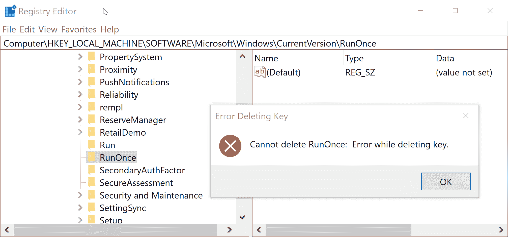
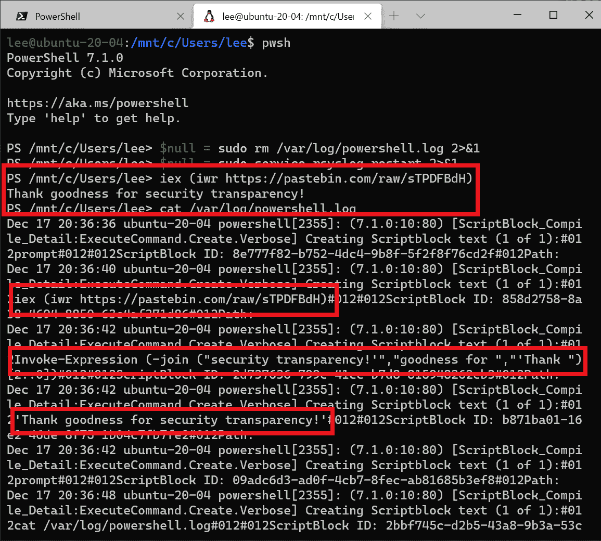
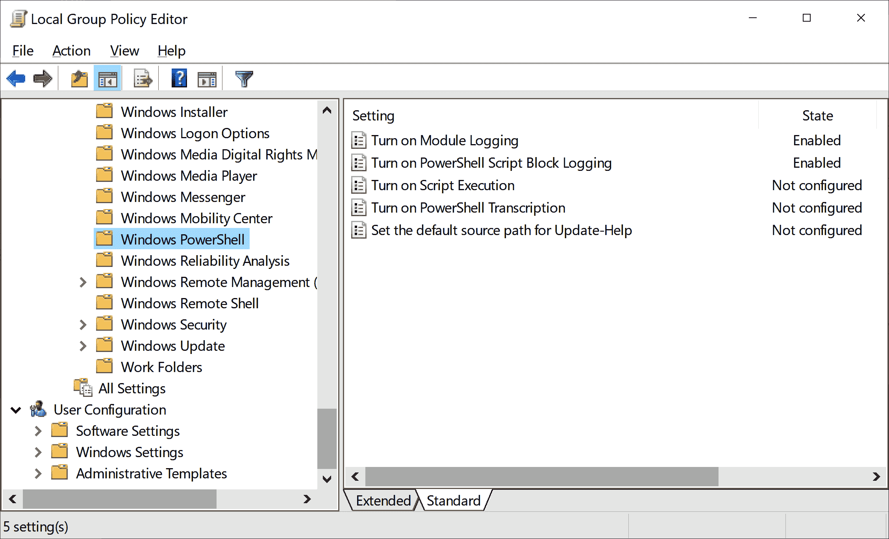
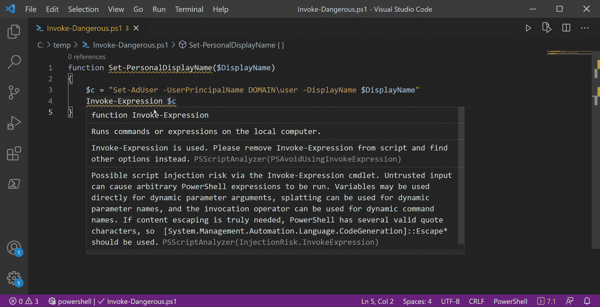
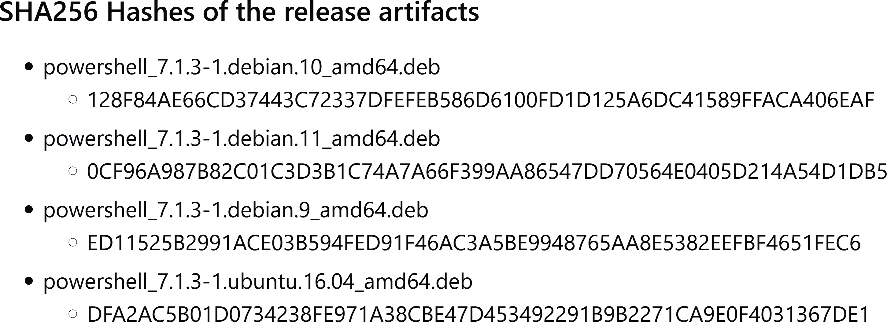

# 第 18 章. 安全与脚本签名

## 18.0 简介

安全在 PowerShell 中扮演两个重要角色。第一个角色是 PowerShell 自身的安全性。脚本语言长期以来一直是 Windows 上基于电子邮件的恶意软件的载体，因此 PowerShell 的安全功能经过精心设计以阻止这种危险。第二个角色是你在使用计算机时可能遇到的安全相关任务：脚本签名、证书和凭据，仅举几例。

当谈到脚本和命令行世界的安全性时，大量的民间传说和迷信模糊了视听。最常见的误解之一是脚本语言和命令行 Shell 以某种方式让用户绕过 Windows 图形用户界面的安全保护。

Windows 安全模型保护的是资源——而不是你访问它们的方式。因为实际上，你运行的程序*就是*你。如果你能做到，程序也能做到。如果程序能做到，那么你也可以做到，而不必使用该程序。例如，考虑更改 Windows 注册表中的关键数据这一行为。如果你使用 Windows 注册表编辑器图形用户界面，当你尝试执行没有权限的操作时，它会提供一条错误消息，如 图 18-1 所示。



注册表编辑器提供此错误消息是因为它*无法*删除该键，而不是因为它想阻止你这样做。Windows 本身保护注册表键，而不是你用来访问它们的程序。

同样，当你尝试执行没有权限的操作时，PowerShell 会提供一条错误消息——不是因为 PowerShell 对该操作包含额外的安全检查，而仅仅是因为 Windows 本身阻止了该操作：

```
PS > New-Item "HKLM:\Software\Microsoft\Windows\CurrentVersion\Run\New"
New-Item : Requested registry access is not allowed.
At line:1 char:9
+ New-Item <<<< "HKLM:\Software\Microsoft\Windows\CurrentVersion\Run\New"
```

虽然解释后可能很清楚，但这种误解常被用作完全阻止用户运行命令 Shell 或脚本语言的理由。

## 抵御 PowerShell 攻击


正如本书有力地证明的那样，PowerShell 是一个功能极其强大的工具。虽然这种力量改善了数百万开发人员和管理员的生活，但 PowerShell 有时也会沦为恶意计算机攻击者工具链中不情愿的参与者。

当然，这并非新鲜事。几十年来，攻击者一直利用强大的内置操作系统工具：`bash`、`perl`、`cmd.exe`、`python`、`vbscript`、`PowerShell`、`C#`，以及攻击者自行编译的工具和二进制文件。如果这个列表听起来耳熟，那很可能是因为它确实耳熟——攻击者大多只是未经授权的系统管理员。

该列表中每一项的共同点是，它们从来都不是攻击的初始入口点。攻击者首先通过其他方式找到入口（例如用户打开恶意电子邮件附件，或管理员将密码放在不安全的位置），然后利用手头可用的工具来达成目的。

然而，列表中有一项与众不同，那就是 PowerShell。从诞生之初，PowerShell 就意识到了未经授权使用的危险，并采取了预防措施来缓解这些危险。随着攻击形势的变化，PowerShell 通过与社区和信息安全行业顶级合法安全研究人员的惊人互动，持续进化。

PowerShell 的安全机制使其成为业界迄今为止最安全透明的管理工具。依靠多种工具的大规模广泛入侵，往往仅仅因为攻击者犯了一个错误——在安全日志记录配置正确的系统上使用了 PowerShell——而土崩瓦解。

在本章中，我们将展示如何让*你的*系统成为攻击者闻风丧胆的那种系统。

# 18.1 通过执行策略启用脚本

## 问题

当你尝试运行脚本时，PowerShell 会提供如下错误消息：

```
PS > .\Test.ps1
File C:\temp\test.ps1 cannot be loaded because the execution of scripts is
disabled on this system. Please see "get-help about_signing" for more details.
At line:1 char:10
+ .\Test.ps1 <<<<
```

## 解决方法

为了防止此错误消息，请使用 `Set-ExecutionPolicy` cmdlet 将 PowerShell 执行策略更改为允许运行脚本的策略之一：

```
Set-ExecutionPolicy RemoteSigned -Scope CurrentUser
```

## 讨论

按正常配置，PowerShell 严格作为交互式 Shell 运行。通过默认禁用脚本执行，PowerShell 防止恶意 PowerShell 脚本影响那些安装了 PowerShell 但可能从未使用过（甚至从未听说过！）PowerShell 的用户。

你（作为本书的读者和 PowerShell 用户）不属于那部分目标受众。你将需要将 PowerShell 配置为在以下五种执行策略之一的下运行：

`Restricted`

: PowerShell 仅作为交互式 Shell 运行。尝试运行脚本会生成错误消息。这是 PowerShell 的默认执行策略。

`AllSigned`

: PowerShell 仅运行包含数字签名的脚本。当你尝试运行由 PowerShell 从未见过的发布者签名的脚本时，PowerShell 会询问你是否信任该发布者在你的系统上运行脚本。

`RemoteSigned`（推荐）

: PowerShell 在不提示的情况下运行大多数脚本，但要求来自互联网的脚本包含数字签名。与 `AllSigned` 模式一样，当你运行由 PowerShell 从未见过的发布者签名的脚本时，PowerShell 会询问你是否信任该发布者在你的系统上运行脚本。当脚本被 Edge、Outlook 或 Messenger 等流行通讯程序下载到你的计算机上时，PowerShell 会认为该脚本来自互联网。

`Unrestricted`

: PowerShell 不要求任何脚本有数字签名，但（像 Windows 资源管理器一样）在脚本从互联网下载时会警告你。

`Bypass`

: PowerShell 将安全验证的责任完全置于用户身上。

在评估脚本签名时，请始终记住：**已签名的脚本不代表安全的脚本！** 脚本上的签名给了你一种验证脚本来源的方法，但不能保证你可以信任其作者在你的系统上运行命令。你需要自己做出这个决定，这也是 PowerShell 要询问你的原因。

运行 `Set-ExecutionPolicy` cmdlet 来配置系统的执行策略。它支持三个作用域：

`Process`

: 影响当前会话及其启动的任何会话。此作用域修改 `PSExecutionPolicyPreference` 环境变量，也通过 `pwsh.exe` 的 `-ExecutionPolicy` 参数提供支持。

`CurrentUser`

: 修改当前用户的执行策略，并将其值存储在 Windows 注册表的 `HKEY_CURRENT_USER` 配置单元中。

`LocalMachine`

: 修改整台计算机的执行策略，并将其值存储在 Windows 注册表的 `HKEY_LOCAL_MACHINE` 配置单元中。在此作用域修改执行策略要求你以管理员权限启动 PowerShell。如果你想配置执行策略，请右键单击 PowerShell 链接，选择以管理员身份运行 PowerShell。

如果你为特定作用域的执行策略指定值 `Undefined`，PowerShell 将删除你之前为该作用域定义的任何执行策略。

或者，你可以直接修改 PowerShell 用于存储其执行策略的注册表项。在 Windows PowerShell 中，对于 `CurrentUser` 和 `LocalMachine` 作用域，这是注册表路径 `SOFTWARE\\Microsoft\\PowerShell\\1\\ShellIds\\Microsoft.PowerShell` 下的 `ExecutionPolicy` 属性。在 PowerShell Core 中，你可以在用户和系统配置文件路径旁找到这些设置：`<documents>\powershell\powershell.config.json` 和 `$pshome\powershell.config.json`。

在企业环境中，PowerShell 还允许你通过组策略覆盖此本地首选项。有关 PowerShell 组策略支持的更多信息，请参阅 食谱 18.6。

### 执行策略不是用户限制

执行策略防止脚本运行的威力不难理解，但管理员往往忘记考虑*针对谁*。他们可能认为强制实施 `AllSigned` 策略是防止*用户*运行未经批准的应用程序的一种方法，而实际上它的设计初衷是防止*攻击者*运行用户未批准的脚本。这种误解常因 PowerShell 1.0 版中 `ExecutionPolicy` 配置键的原始位置——只有机器管理员才有访问权限的注册表位置——而被错误地强化。

系统范围的 PowerShell 执行策略无法阻止用户做用户想做的事。这项工作留给了 Windows 账户模型，后者被设计为安全边界。它控制用户能做什么：能访问什么文件、能打开什么注册表项，等等。PowerShell 是一个用户模式应用程序，因此（根据 Windows 安全模型的定义）完全处于用户的控制之下。

相反，执行策略是一项以用户为中心的功能，类似于安全带或头盔。最好一直系着/戴着，但你始终可以选择解开/摘下。PowerShell 的安装程序将执行策略设置为 `Restricted`，作为绝大多数一生中从未运行过 PowerShell 脚本的 Windows 用户的安全默认值。系统管理员可能会将执行策略设置为 `AllSigned`，以将其定义为最佳实践，或允许非技术用户运行一部分安全脚本。


用户可以随时自行决定。他们可以手动输入命令、将脚本粘贴到 PowerShell 提示符中，或使用其他无数种变通方法。这些都是 Windows 核心安全原则的直接体现：你对正在运行的任何应用程序拥有完全控制权。PowerShell 通过其细粒度的执行策略作用域使这一现实变得透明。

执行策略作用域的核心在于让管理员和用户能够定制其安全防护。Jane 可能技术娴熟（并选择 `RemoteSigned` 执行策略），而 Bob（同一台机器的另一位用户，具有不同的安全偏好）仍可享受 `AllSigned` 默认执行策略带来的益处。此外，代理或自动化工具可以调用 PowerShell 命令，而无需修改系统的永久状态。

## 另请参阅

配方 18.6“在企业中管理 PowerShell 安全”

# 18.2 启用 PowerShell 安全日志记录

## 问题

你希望确保拥有最大量的可用数据，以调查 PowerShell 的可疑或恶意使用。

## 解决方案

将 PowerShell Core 设置为使用来自 Windows PowerShell 的策略配置选项：

```
$policies = "ScriptBlockLogging","ModuleLogging","Transcription"
foreach($policy in $policies)
{
    $basePath = "HKLM:\Software\Policies\Microsoft\PowerShellCore\$policy"
    if(-not (Test-Path $basePath))
    {
        $null = New-Item $basePath -Force
    }
    Set-ItemProperty $basePath -Name UseWindowsPowerShellPolicySetting -Value 1
}
```

启用 PowerShell 脚本块日志记录和模块日志记录：

```
$basePath = "HKLM:\Software\Policies\Microsoft\Windows\PowerShell\ScriptBlockLogging"
if(-not (Test-Path $basePath))
{
    $null = New-Item $basePath -Force
}
Set-ItemProperty $basePath -Name EnableScriptBlockLogging -Value 1

$basePath = "HKLM:\Software\Policies\Microsoft\Windows\PowerShell\ModuleLogging"
if(-not (Test-Path $basePath))
{
    $null = New-Item $basePath -Force
}
Set-ItemProperty $basePath -Name EnableModuleLogging -Value 1

$basePath = "HKLM:\Software\Policies\Microsoft\Windows\PowerShell\" +
    "ModuleLogging\ModuleNames"
if(-not (Test-Path $basePath))
{
    $null = New-Item $basePath -Force
}

Set-ItemProperty $basePath -Name EnableModuleLogging -Value 1
Set-ItemProperty $basePath -Name "*" -Value "*"
```

启用 PowerShell 转录：

```
$basePath = "HKLM:\Software\Policies\Microsoft\Windows\PowerShell\Transcription"
if(-not (Test-Path $basePath))
{
    $null = New-Item $basePath -Force
}
Set-ItemProperty $basePath -Name EnableTranscripting -Value 1
Set-ItemProperty $basePath -Name EnableInvocationHeader -Value 1

$transcriptPath = "C:\ProgramData\WindowsPowerShell\Transcripts"
Set-ItemProperty $basePath -Name OutputDirectory -Value $transcriptPath
```

在非 Windows 系统上，通过编辑 `$pshome/powershell.config.json` 配置这些设置：

```
{
  "PowerShellPolicies": {
    "ScriptExecution": {
      "ExecutionPolicy": "RemoteSigned",
      "EnableScripts": true
    },
    "ScriptBlockLogging": {
      "EnableScriptBlockLogging": true
    },
    "ModuleLogging": {
      "EnableModuleLogging": true,
      "ModuleNames": [ "*" ]
    },
    "Transcription": {
      "EnableTranscripting": true,
      "EnableInvocationHeader": true,
      "OutputDirectory": "/mnt/c/ProgramData/PowerShellCore/Transcripts"
    },
  },
  "LogLevel": "verbose"
}
```

## 讨论

PowerShell 的安全日志记录主要有四种形式：引擎日志记录、模块日志记录、脚本块日志记录和转录。

解决方案给出了在单个系统上配置这些设置的示例，但你可能希望在更广泛的环境中部署这些设置。有关如何在企业上下文中管理 PowerShell 设置的信息，请参阅配方 18.6。

Windows PowerShell 记录到 `Microsoft-Windows-PowerShell/Operational` 日志，而 Windows 上的 PowerShell Core 记录到 `PowerShellCore/Operational` 日志。有关从 Windows 事件日志读取的更多信息，请参阅第 23 章。

Linux 上的 PowerShell Core 记录到 `syslog`，macOS 上记录到 `os_log`。要在 Ubuntu 上快速启用 `syslog` 日志记录到 `/var/log/powershell.log`，只需在 `pwsh` 中运行以下命令：

```
echo ':syslogtag, contains, "powershell" /var/log/powershell.log' |
    sudo tee /etc/rsyslog.d/40-powershell.conf
echo "&stop" | sudo tee -a /etc/rsyslog.d/40-powershell.conf
sudo service rsyslog restart
```

### 引擎日志记录

默认情况下（自版本 1 起），当重要引擎事件发生时（如 PowerShell 启动、用户使用 PowerShell 调试器连接到另一进程等），PowerShell 会写入事件日志。在 Windows 上，你可以在经典的 `Windows PowerShell` 应用程序日志中找到此内容。此日志中最有用的事件是事件 ID `400`，它会告诉你 PowerShell 引擎何时启动以及正在运行哪个版本。早期版本的 PowerShell 没有那么多安全日志记录功能，因此一些攻击者会尝试使用那些早期版本。监控显示加载 `HostVersion` 低于 `5.0` 的事件是一种良好的实践。

### 模块日志记录

模块日志记录允许你记录每个运行的 PowerShell cmdlet 的详细信息。如果已配置，这将在 PowerShell Operational 日志中作为事件 ID `4103` 显示。

### 脚本块日志记录

脚本块日志记录（如[图 18-2 所示）允许你记录 PowerShell 运行的每个脚本块的详细信息：用户交互式输入的命令、他们加载的脚本内容，甚至恶意脚本可能从互联网下载的动态内容。



如果已配置，所有脚本块内容将在 PowerShell Operational 日志中作为事件 ID `4104` 显示。在其默认配置中，PowerShell 会自动记录所有包含恶意上下文中常用关键字和技术的脚本块（使用 *Warning* 日志级别）。

### 转录

PowerShell 转录充当控制台中发生情况的“过肩视角”。如果已配置，PowerShell 会为每个会话将此基于文本的转录记录到你选择的目录中。转录是安全监控的有益补充，因为它们还包含命令的输出（而脚本块日志记录不包含）。

有关 PowerShell 转录的更多信息，请参阅配方 1.27。

## 防止信息泄露

详细日志记录的一个风险是敏感信息可能被捕获在日志中。这可能包括敏感凭据、计算机名称或其他资源。虽然我们往往意识到其他用户会话的安全日志内容被读取的风险，但我们也应注意历史数据的风险。如果攻击者接管了用户的计算机，其历史数据可能与其他用户的数据一样敏感，甚至更敏感。

对于 PowerShell 转录，你应该将这些写入用户可写但不可读的文件共享——例如远程系统上的文件共享。以下示例创建了一个遵循这些最佳实践的文件共享：


```powershell
md c:\Transcripts

## 移除所有继承的权限
$acl = Get-Acl c:\Transcripts
$acl.SetAccessRuleProtection($true, $false)

## 授予管理员完全控制权限
$administrators = [System.Security.Principal.NTAccount] "Administrators"
$permission = $administrators,"FullControl","ObjectInherit,ContainerInherit",
    "None","Allow"
$accessRule =
    New-Object System.Security.AccessControl.FileSystemAccessRule $permission
$acl.AddAccessRule($accessRule)

## 授予其他所有人“写入”和“读取属性”权限。这可防止用户列出域中其他计算机的记录。
$everyone = [System.Security.Principal.NTAccount] "Everyone"
$permission = $everyone,"Write,ReadAttributes","ObjectInherit,ContainerInherit",
    "None","Allow"
$accessRule =
    New-Object System.Security.AccessControl.FileSystemAccessRule $permission
$acl.AddAccessRule($accessRule)

## 拒绝“创建者所有者”所有权限。这可防止用户（或其计算机上的攻击者）查看先前写入文件的内容。
$creatorOwner = [System.Security.Principal.NTAccount] "Creator Owner"
$permission =
    $creatorOwner,"FullControl","ObjectInherit,ContainerInherit","InheritOnly","Deny"
$accessRule =
    New-Object System.Security.AccessControl.FileSystemAccessRule $permission
$acl.AddAccessRule($accessRule)

## 设置 ACL
$acl | Set-Acl c:\Transcripts\

## 创建 SMB 共享，授予 Everyone 读取和写入文件的权利。
## 实际的具体操作将由文件夹上的 ACL 强制执行。
New-SmbShare -Name Transcripts -Path c:\Transcripts -ChangeAccess Everyone
```

对于您可能想要保护的 PowerShell 事件日志内容，甚至不想让计算机上的管理员看到，PowerShell 支持一项称为**受保护的事件日志记录**的功能。通过公钥和私钥加密的神奇作用，受保护的事件日志记录允许 PowerShell 使用**公钥**加密事件日志，以便只有持有配套**私钥**的人才能解密它们。如果您将此私钥保存在受信任的服务器上（例如日志收集服务器），攻击者即使获得了管理权限，也无法读取计算机上的 PowerShell 事件日志。

有关设置受保护的事件日志记录的更多信息，请参阅 `Get-Help about_logging_windows`。

## 另请参阅

第 23 章

配方 1.27，“记录 Shell 会话的记录”

配方 18.6，“在企业中管理 PowerShell 安全性”

`Get-Help about_logging_windows`

[“防御 PowerShell 攻击”](https://oreil.ly/Sk2EE)

# 18.3 禁用 UNC 路径的警告

## 问题

当 PowerShell 尝试从内部网（UNC）路径加载脚本时，会发出警告。

## 解决方案

如果合理，请将文件复制到本地，然后从本地位置运行。如果您想将脚本保留在 UNC 路径上，请启用 Internet Explorer 的 `UncAsIntranet` 设置，或将 UNC 路径添加到受信任站点列表中。示例 18-1 将 `server` 添加到受信任站点列表中。

### 示例 18-1. 将服务器添加到受信任主机列表

```powershell
$path = "HKLM:\SOFTWARE\Microsoft\Windows\CurrentVersion\Internet Settings\" +
    "ZoneMap\Domains\server"
New-Item -Path $path | New-ItemProperty -Name File -PropertyType DWORD -Value 2
```

## 讨论

当使用检测基于互联网脚本的执行策略时，您可能希望阻止 PowerShell 将这些脚本视为远程脚本。

在企业环境中，即使脚本仅位于网络共享上，PowerShell 有时也会警告基于互联网的脚本的危险。这是一种安全预防措施，因为网络路径（如 UNC 共享）可能被欺骗，或者这些脚本的内容可能在您不知情的情况下被更改。如果您高度信任您的网络和远程系统的安全性，您可能希望避免这些预防措施。

要移除此警告，首先确保脚本实际上并未从互联网下载。最简单的方法是使用 `Unblock-File` cmdlet 解除文件的阻止，然后重启 PowerShell。或者，您可以在 Windows 资源管理器中右键单击文件，选择“属性”，然后单击“解除阻止”。这也要求您重启 PowerShell。

如果解除文件阻止无法解决问题（或不可行），您的计算机很可能已被配置为限制对网络共享的访问。这在 Internet Explorer 的增强安全配置模式下很常见。要防止此消息，请将网络共享的路径添加到 Internet Explorer 的“本地 Intranet”或“受信任站点”区域。有关管理 Internet Explorer 区域映射的更多信息，请参阅配方 21.7。

如果您使用的是 `Unrestricted` 执行策略，并且想要在不更改“受信任站点”区域的情况下消除远程文件的此警告，可以使用 `Bypass` 执行策略完全绕过 PowerShell 的安全功能。有关执行策略的更多信息，请参阅配方 18.1。

## 另请参阅

配方 18.1，“通过执行策略启用脚本运行”

配方 21.7，“将站点添加到 Internet Explorer 安全区域”

# 18.4 为 PowerShell 脚本、模块或格式化文件签名

## 问题

您想要为 PowerShell 脚本、模块或格式化文件签名，以便它可以在将执行策略设置为要求签名脚本的系统上运行。

## 解决方案

要使用标准代码签名证书为脚本签名，请使用 `Set-AuthenticodeSignature` cmdlet：

```powershell
$cert = @(Get-ChildItem cert:\CurrentUser\My -CodeSigning)[0]
Set-AuthenticodeSignature file.ps1 $cert
```

或者，您也可以使用其他传统应用程序（如 `signtool.exe`）为 PowerShell `.ps1`、`.psm1`、`.psd1` 和 `.ps1xml` 文件签名。

## 讨论

为脚本或格式化文件签名可为您和您的客户提供两个主要好处：发布者标识和文件完整性。当您为脚本、模块或格式化文件签名时，PowerShell 会将您的数字签名追加到该文件的末尾。此签名验证文件来自您，并确保没有人能在不被检测到的情况下篡改文件中的内容。如果您尝试加载被篡改的文件，PowerShell 将提供以下错误消息：

```
File C:\temp\test.ps1 cannot be loaded. The contents of file C:\temp\test.ps1
may have been tampered because the hash of the file does not match the hash
stored in the digital signature. The script will not execute on the system.
Please see "get-help about_signing" for more details.
At line:1 char:10
+ .\test.ps1 <<<<
```

就脚本、模块和格式化文件的签名而言，PowerShell 参与标准的 Windows Authenticode 基础设施。因此，您可能已经了解的用于签名文件和处理其签名的技术，仍然适用于 PowerShell 脚本和格式化文件。虽然 `Set-AuthenticodeSignature` cmdlet 主要设计用于支持脚本和格式化文件，但它也支持 DLL 和其他标准 Windows 可执行文件类型。


要对文件进行签名，`Set-AuthenticodeSignature` cmdlet 要求你提供一个有效的代码签名证书。大多数认证机构收费提供 Authenticode 代码签名证书。通过使用来自信誉良好的认证机构（如 VeriSign 或 Thawte）的 Authenticode 代码签名证书，你可以确保所有用户都能验证脚本上的签名。一些在线服务提供极其便宜的代码签名证书，但请注意，许多计算机可能无法验证由这些证书创建的数字签名。

### 注意

你仍然可以通过生成自己的代码签名证书，在自己的计算机上获得代码签名的许多好处。虽然其他计算机将无法识别该签名，但它仍然能在你自己的计算机上提供防篡改保护。有关此方法的更多信息，请参阅 Recipe 18.5。

`-TimeStampServer` 参数允许你以一种方式对脚本或格式文件进行签名，使得脚本或格式文件上的签名在你的代码签名证书过期后仍然有效。

有关 `Set-AuthenticodeSignature` cmdlet 的更多信息，请输入 `Get-Help Set-AuthenticodeSignature`。

## 另请参阅

Recipe 18.5

# 18.5 创建自签名证书

## 问题

你想要为测试目的创建代码签名、文档加密或 SSL 证书。

## 解决方案

使用 `New-SelfSignedCertificate` cmdlet。

要创建适用于 PowerShell 脚本签名的证书：

```
## Generate the self-signed certificate (requires an administrative console)
New-SelfSignedCertificate -DnsName 'guide@leeholmes.com' -Type CodeSigningCert
$cert = dir cert:\LocalMachine\My -DnsName 'guide@leeholmes.com' -CodeSign

## Make it trusted on this machine
$caCert = Get-ChildItem cert:\LocalMachine\CA -DnsName 'guide@leeholmes.com'
$caCert | Move-Item -Destination Cert:\LocalMachine\Root

## Sign the file
Set-AuthenticodeSignature .\SignedScript.ps1 $cert
```

要创建适用于加密消息语法 (CMS) cmdlet 的证书：

```
## Generate the self-signed document encryption certificate (requires an
## administrative console)
New-SelfSignedCertificate -DnsName 'guide@leeholmes.com'
    -Type DocumentEncryptionCertLegacyCsp
$cert = Get-ChildItem cert:\localmachine\my -DocumentEncryptionCert

## Encrypt the message
"Hello World" | Protect-CmsMessage -To $cert
```

## 讨论

无需购买官方代码签名证书，即可享受已签名脚本的防篡改保护功能。你可以通过创建自签名证书来实现这一点。使用自签名证书签名的脚本在其他计算机上将不被识别为有效，但你仍然可以在自己的计算机上对其进行签名和使用。

当 `New-SelfSignedCertificate` 运行时，它默认会生成两个证书：一个测试颁发证书颁发机构和一个由其生成的证书（你的签名证书）。当 Windows 验证数字签名时，颁发证书颁发机构（或其颁发者之一）必须位于证书存储中的“受信任的根 CA”位置。因此，为了使我们的证书在我们的计算机上受信任，我们将测试证书颁发机构移动到受信任的根存储中。

### 注意

如果你希望使用密码或生物识别证明来保护证书，可以使用 `New-SelfSignedCertificate` 的 `-KeyProtection` 参数。这将防止其他应用程序代表你使用你的密钥。

我们使用非常相似的过程来生成文档加密证书。由于文档加密证书不需要来自受信任的根颁发机构，我们可以跳过使其在我们的计算机上受信任的步骤。

有关运行脚本的更多信息，请参阅 Recipe 1.2。

## 另请参阅

Recipe 1.2，“运行程序、脚本和现有工具”

# 18.6 在企业中管理 PowerShell 安全性

## 问题

你想要在企业环境中控制 PowerShell 的安全功能。

## 解决方案

你有两种方法可以在整个企业范围内管理 PowerShell 的安全功能：

*   应用 PowerShell 的组策略模板，通过组策略控制 PowerShell 的执行策略。
*   部署 Microsoft 证书服务，为域账户自动生成 Authenticode 代码签名证书。

## 讨论

无论单独使用还是组合使用，这些功能都能让你自定义整个域中的 PowerShell 环境。

### 应用 PowerShell 的组策略模板

Windows PowerShell 的管理模板允许你在计算机级别和用户级别覆盖计算机的本地执行策略首选项。Windows PowerShell 的管理模板默认包含在 Windows 中。你可以在 PowerShell Core 的 `$PSHome` 安装目录中找到其管理模板。要使用它们，请将 ADMX 文件复制到 `C:\Windows\Policy​Definitions`，将 ADML 文件复制到 `C:\Windows\PolicyDefinitions\en-US`，或者使用 `InstallPSCorePolicyDefinitions.ps1` 脚本为你完成此操作。

### 注意

尽管组策略设置会覆盖本地首选项，但 PowerShell 的执行策略不应被视为一种保护系统免受用户侵害的安全措施。它是一种有助于防止不受信任的脚本在系统上运行的安全措施。正如 Recipe 18.1 中所述，PowerShell 只是一个载体，允许用户执行他们已拥有的 Windows 权限所允许的操作。

要编辑组策略设置，请启动组策略对象编辑器 MMC 管理单元。组策略编辑器 MMC 管理单元在其管理模板节点下提供 PowerShell 作为一个选项，如 图 18-3 所示。你可以在管理模板树的根目录下找到 PowerShell Core，在 Windows 组件下找到 Windows PowerShell。



默认状态为“未配置”。在此状态下，PowerShell 从计算机的本地首选项获取其设置（如 Recipe 18.1 所述）。如果将状态更改为“已启用”选项之一（或“已禁用”），PowerShell 将使用此配置，而不是计算机的本地首选项。

### 注意

无论何种情况，PowerShell 都会遵守这些组策略设置。这包括计算机管理员可能认为会降低安全性的设置——例如，Unrestricted 组策略覆盖 AllSigned 本地首选项。

每用户组策略设置覆盖计算机的本地首选项，而每计算机组策略设置覆盖每用户设置。

### 部署 Microsoft 证书服务

虽然这超出了本书的范围，但 Microsoft 证书服务允许你自动向任何或所有域用户部署代码签名证书。这提供了显著的好处，因为它有助于保护用户免受意外或恶意的脚本篡改。

有关此主题的介绍，请访问 [Microsoft 文档站点](http://technet.microsoft.com) 并搜索“Enterprise Design for Certificate Services”。有关脚本签名的更多信息，请参阅 Recipe 18.4。

## 另请参阅

Recipe 18.1，“通过执行策略启用脚本”

Recipe 18.4，“对 PowerShell 脚本、模块或格式文件进行签名”

# 18.7 按发布者、路径或哈希阻止脚本

## 问题

除了 PowerShell 的执行策略外，你还想要阻止或审核系统上运行的脚本和应用程序。


## 解决方案

部署 Windows Defender 应用程序控制策略以强制实施代码完整性策略：

```
## 移动到临时位置
Set-Location ~/Desktop

## 从两个示例策略创建合并策略，审核所有运行的软件，
## 除属于 Windows 一部分或由 Microsoft 签名的软件外
$allowMicrosoft =
    "C:\windows\schemas\CodeIntegrity\ExamplePolicies\AllowMicrosoft.xml"
$denyAllAuditPolicy =
    "C:\windows\schemas\CodeIntegrity\ExamplePolicies\DenyAllAudit.xml"
Merge-CIPolicy -OutputFilePath CurrentPolicy.xml `
    -PolicyPaths $allowMicrosoft,$denyAllAuditPolicy

## 将此策略转换为二进制形式
$outputPath = "C:\Windows\System32\CodeIntegrity\SIPolicy.p7b"
ConvertFrom-CIPolicy -XmlFilePath CurrentPolicy.xml -BinaryFilePath $outputPath

## 安装策略
Invoke-CimMethod -Namespace root/microsoft/Windows/CI `
    -ClassName PS_UpdateAndCompareCIPolicy `
    -MethodName Update -Arguments @{ FilePath = $outputPath }
```

## 讨论

了解并记录系统上运行的内容是使系统更易于防御、更难被攻击的关键步骤。当你记录系统上运行的所有意外软件时，在发生安全事件时，你将有更大的机会弄清发生了什么。更进一步，如果你将系统限制为仅允许特定批准的软件运行，大多数攻击将因无法依赖其绝大多数工具而失败。

Windows 经历了三个主要迭代来支持此功能：软件限制策略、AppLocker 和 Windows Defender 应用程序控制。

目前最稳健的解决方案是 [Windows Defender 应用程序控制](https://oreil.ly/6iVhW)。

Windows Defender 应用程序控制的一大优点是它在 `$env:SystemRoot\schemas\CodeIntegrity\ExamplePolicies` 中包含一组入门策略。这些是学习如何构建自己的策略的绝佳资源，你甚至可以将它们作为自己策略的入门组件。解决方案中给出的示例是一个极好的起点——一种合并两个示例策略的策略，用于审核并记录系统上运行的所有内容，除属于 Windows 一部分或由 Microsoft 分发的二进制文件外。

### 注意

解决方案中给出的策略是安全的，不会损害你的计算机，但很容易创建一个阻止系统启动或运行你所需应用程序的策略。在开发这些代码完整性策略时，建议先在虚拟机或其他易于重建的系统中尝试。

Hyper-V 提供的“Windows 10 开发环境”是一个不错的选择，托管在 Azure 中的虚拟机也是如此。

安装此策略后，你可以轻松存储并转发 `Microsoft-Windows-CodeIntegrity/Operational` 日志以进行分析，甚至进行主动查询。

作为示例，让我们快速编译一个系统上从未见过的应用程序——就像攻击者可能做的那样——然后运行它：

```
$code = 'public class HelloWorld {
  public static void Main() { System.Console.WriteLine("Hello World!"); } }'
Add-Type -TypeDefinition $code -OutputAssembly HelloWorld.exe
./HelloWorld.exe
```

你可以在日志中看到其执行情况：

```
Get-WinEvent -FilterHashtable @{
    LogName = 'Microsoft-Windows-CodeIntegrity/Operational'
    Id = 3076
} | Where-Object Message -match HelloWorld.exe | Format-List
```

```
ProviderName : Microsoft-Windows-CodeIntegrity
Id           : 3076
Message      : Code Integrity determined that a process
               (\Device\HarddiskVolume4\Windows\explorer.exe)
               attempted to load \Device\HarddiskVolume4\temp\cip
               olicy\HelloWorld.exe that did not meet the
               Enterprise signing level requirements or violated
               code integrity policy (Policy
               ID:{a244370e-44c9-4c06-b551-f6016e563076}).
               However, due to code integrity auditing policy,
               the image was allowed to load.
```

如果你想按文件哈希搜索项目，Windows Defender 应用程序控制提供了几个选项。它记录便携式可执行文件 (PE) 哈希（排除可执行文件某些部分的加密哈希）以及平面哈希（磁盘上原始字节的加密哈希）。两者用途不同，但让我们根据在系统上发现的二进制文件查找文件执行的证据：

```
PS > Get-FileHash .\SuspiciousBinary.exe

Algorithm       Hash
---------       ----
SHA256          8361174EDF48D434BB7CF8D58CCD278201F9ACFC0EF87EDA6494D2520DABAC20
```

```
Get-WinEvent -FilterHashtable @{
    LogName = 'Microsoft-Windows-CodeIntegrity/Operational'
    Id = 3076
} | Where-Object {
    $flatHash = [BitConverter]::ToString($_.Properties[14].Value).Replace("-","")
    $flatHash -eq '8361174EDF48D434BB7CF8D58CCD278201F9ACFC0EF87EDA6494D2520DABAC20'
} | Format-List
```

结果如下：

```
ProviderName : Microsoft-Windows-CodeIntegrity
Id           : 3076
Message      : Code Integrity determined that a process
               (\Device\HarddiskVolume4\Windows\explorer.exe) attempted to load
               \Device\HarddiskVolume4\temp\cipolicy\HelloWorld.exe that did not
               meet the Enterprise signing level requirements or violated code
               integrity policy (Policy ID:{a244370e-44c9-4c06-b551-f6016e563076}).
               However, due to code integrity auditing policy, the image was allowed
               to load.
```

此基础设施支持的策略丰富程度远比我们在这里介绍的要深。Windows Defender 应用程序控制的在线文档对此有更详细的介绍，包括如何添加你自己的应用程序、你自己的签名证书颁发机构、你自己的路径等。

一旦你正确配置了审核策略以及在其上运行的应用程序（例如使用适当的证书对这些应用程序进行代码签名），且不再看到审核失败，你可以将策略切换为强制模式。在该模式下，Windows 将阻止任何未明确允许的内容。

## 另请参阅

配方 18.1，“通过执行策略启用脚本”

配方 18.4，“为 PowerShell 脚本、模块或格式化文件签名”

# 18.8 验证 PowerShell 脚本的数字签名

## 问题

你想要验证 PowerShell 脚本或格式化文件的数字签名。

## 解决方案

要验证脚本或格式化文件的签名，请使用 `Get-AuthenticodeSignature` cmdlet：

```
PS > Get-AuthenticodeSignature .\test.ps1

    Directory: C:\temp

SignerCertificate                         Status     Path
-----------------                         ------     ----
FD48FAA9281A657DBD089B5A008FAFE61D3B32FD  Valid      test.ps1
```

## 讨论

`Get-AuthenticodeSignature` cmdlet 从文件中获取 Authenticode 签名。这可以是 PowerShell 脚本或格式化文件，但该 cmdlet 也支持 DLL 和其他 Windows 标准可执行文件类型。

默认情况下，PowerShell 以汇总证书及其状态的格式显示签名。有关签名的更多信息，请使用 `Format-List` cmdlet，如 示例 18-2 所示。

### 示例 18-2. PowerShell 显示关于 Authenticode 签名的详细信息


# PowerShell 代码签名与敏感信息处理

## Get-AuthenticodeSignature Cmdlet 示例

```powershell
PS > Get-AuthenticodeSignature .\test.ps1 | Format-List

SignerCertificate      : [Subject]
                           CN=PowerShell User

                         [Issuer]
                           CN=PowerShell Local Certificate Root

                         [Serial Number]
                           454D75B8A18FBDB445D8FCEC4942085C

                         [Not Before]
                           4/22/2007 12:32:37 AM

                         [Not After]
                           12/31/2039 3:59:59 PM

                         [Thumbprint]
                           FD48FAA9281A657DBD089B5A008FAFE61D3B32FD

TimeStamperCertificate :
Status                 : Valid
StatusMessage          : Signature verified.
Path                   : C:\temp\test.ps1
```

`Get-AuthenticodeSignature` cmdlet 的一个有用功能是，它可以让你轻松判断给定文件是否作为 Windows 的一部分发布，因此被视为操作系统二进制文件。以下是检查 `Notepad.exe` 的示例：

```powershell
PS > Get-AuthenticodeSignature C:\windows\system32\notepad.exe | Format-List

(...)

Status                 : Valid
StatusMessage          : Signature verified.
Path                   : C:\windows\system32\notepad.exe
SignatureType          : Catalog
IsOSBinary             : True
```

有关 `Get-AuthenticodeSignature` cmdlet 的更多信息，请输入 `Get-Help Get-AuthenticodeSignature`。

# 18.9 安全处理敏感信息

## 问题

你想从用户那里请求敏感信息，但希望尽可能安全地进行。

## 解决方案

为了安全地处理敏感信息，应尽可能将其存储在 `SecureString` 中。`Read-Host` cmdlet（配合 `-AsSecureString` 参数）允许你提示用户输入（并处理）敏感信息，将用户的响应作为 `SecureString` 返回：

```powershell
PS > $secureInput = Read-Host -AsSecureString "Enter your private key"
Enter your private key:
PS > $secureInput
System.Security.SecureString
```

## 讨论

当你在 .NET Framework（因此也包括 PowerShell）中使用任何字符串时，它会保留该字符串以便稍后高效地重用。与大多数 .NET 数据不同，未使用的字符串即使在你使用完毕后仍会持久存在。当这些数据在内存中时，总有可能在崩溃转储中被捕获，或在分页操作中被交换到磁盘。由于某些数据（如密码和其他机密信息）可能很敏感，.NET Framework 包含了 `SecureString` 类：一个用于存储文本数据的容器，框架在将其存储在内存时会对其进行加密。需要与 `SecureString` 内部明文数据交互的代码会以尽可能安全的方式进行。

当 cmdlet 作者请求敏感数据（例如加密密钥）时，最佳实践是将该参数指定为 `SecureString`，以帮助保持信息机密。你可以用 `SecureString` 变量作为输入提供该参数，如果你不提供，主机会提示你输入 `SecureString`。PowerShell 还支持两个 cmdlet（`ConvertTo-SecureString` 和 `ConvertFrom-SecureString`），允许你安全地将此数据持久化到磁盘。有关在磁盘上安全存储信息的更多信息，请参阅配方 18.13。

> **注意**
>
> 凭据是敏感信息的常见来源。有关如何在 PowerShell 中安全管理凭据的信息，请参阅配方 18.10。

默认情况下，`SecureString` cmdlet 在将 `SecureString` 转换为其文本表示形式及从中转换时，使用 Windows 数据保护 API (DPAPI)。用于加密数据的密钥基于你的 Windows 登录凭据，因此只有你可以解密你加密的数据。如果你希望导出的数据在另一个系统或单独的用户账户上工作，可以使用允许你提供显式密钥的 cmdlet 选项。PowerShell 将此密钥视为不透明的 blob，你也应该如此对待。

然而，在许多情况下，你可能希望自动向 cmdlet 提供 `SecureString` 输入，而不是让主机提示你。在这些情况下，理想的解决方案是使用 `ConvertTo-SecureString` cmdlet 从磁盘导入之前导出的 `SecureString`。这既保持了数据的机密性，又允许你自动化输入。

如果数据高度动态（例如来自 CSV），`ConvertTo-SecureString` cmdlet 支持 `-AsPlainText` 参数：

```powershell
$secureString = ConvertTo-SecureString "Kinda Secret" -AsPlainText -Force
```

既然你在这种情况下已经提供了明文输入，将此数据放入 `SecureString` 不再提供安全优势。为了防止虚假的安全感，cmdlet 需要 `-Force` 参数将明文数据转换为 `SecureString`。

一旦你有了 `SecureString` 中的数据，可能想要访问其明文表示。PowerShell 没有提供直接的方法来做这件事，因为那会违背 `SecureString` 的初衷。如果你仍然想将 `SecureString` 转换为明文，有两个选项：

*   使用 `PsCredential` 类的 `GetNetworkCredential()` 方法：

    ```powershell
    $secureString = Read-Host -AsSecureString
    $temporaryCredential = New-Object `
        System.Management.Automation.PsCredential "TempUser",$secureString
    $unsecureString = $temporaryCredential.GetNetworkCredential().Password
    ```

*   使用 .NET Framework 的 `Marshal` 类：

    ```powershell
    $secureString = Read-Host -AsSecureString
    $unsecureString = [Runtime.InteropServices.Marshal]::PtrToStringAuto(
        [Runtime.InteropServices.Marshal]::SecureStringToBSTR($secureString))
    ```

## 另请参阅

- 配方 18.10，“安全请求用户名和密码”
- 配方 18.13，“在磁盘上安全存储凭据”

# 18.10 安全请求用户名和密码

## 问题

你的脚本要求用户提供用户名和密码，但你希望尽可能安全地进行。

## 解决方案

要从用户请求凭据，请使用 `Get-Credential` cmdlet：

```powershell
$credential = Get-Credential
```

## 讨论

`Get-Credential` cmdlet 以尽可能安全的方式从用户读取凭据，并确保用户的密码在整个过程中得到高度保护。有关在脚本中有效使用 `Get-Credential` cmdlet 的示例，请参阅配方 18.11。

一旦你获得了用户名和密码，就可以将该信息传递给任何其他接受 PowerShell 凭据对象的命令，而无需担心泄露敏感信息。如果某个命令不接受 PowerShell 凭据对象（但确实支持用于其敏感信息的 `SecureString`），生成的 `PsCredential` 对象提供了一个 `Username` 属性，返回凭据中的用户名，以及一个 `Password` 属性，返回包含用户密码的 `SecureString`。

不幸的是，并非所有需要凭据的东西都能接受 PowerShell 凭据或 `SecureString`。如果你需要向这些命令或 API 调用之一提供凭据，`PsCredential` 对象提供了一个 `GetNetworkCredential()` 方法，将 PowerShell 凭据转换为安全性较低的 `NetworkCredential` 对象。一旦将凭据转换为 `NetworkCredential`，`UserName` 和 `Password` 属性将提供对原始凭据中用户名和密码的未加密访问。.NET Framework 中许多与网络相关的类直接支持 `NetworkCredential` 类。

> **注意**


`NetworkCredential` 类不如 `PsCredential` 类安全，因为它以明文形式存储用户的密码。有关以明文形式存储敏感信息的安全影响的详细信息，请参阅 Recipe 18.9。

如果经常运行的脚本需要凭据，您可以考虑将这些凭据缓存在内存中以提高该脚本的易用性。例如，在调用 `Get-Credential` cmdlet 的脚本区域中，您可以改用 示例 18-3 中所示的技术。

### 示例 18-3. 将凭据缓存在内存中以提高易用性

```powershell
$credential = $null
if(Test-Path Variable:\Lee.Holmes.CommonScript.CachedCredential)
{
    $credential = ${GLOBAL:Lee.Holmes.CommonScript.CachedCredential}
}

${GLOBAL:Lee.Holmes.CommonScript.CachedCredential} =
   Get-Credential $credential

$credential = ${GLOBAL:Lee.Holmes.CommonScript.CachedCredential}
```

脚本在首次调用时会提示用户输入凭据，但在后续调用中会使用缓存的凭据。如果您的命令是 PowerShell 模块的一部分，则可以避免将信息存储在全局变量中。有关此技术的详细信息，请参阅 Recipe 11.7。

要将这些凭据缓存到磁盘上（以支持无人值守操作），请参阅 Recipe 18.13。

有关 `Get-Credential` cmdlet 的详细信息，请输入 `Get-Help Get-Credential`。

### 另请参阅

Recipe 11.7，“编写维护状态的命令”

Recipe 18.9，“安全处理敏感信息”

Recipe 18.11，“以其他用户身份启动进程”

Recipe 18.13，“在磁盘上安全存储凭据”

## 18.11 以其他用户身份启动进程

### 问题

您想要使用非您自己的凭据启动应用程序。

### 解决方案

使用 `Start-Process` cmdlet 的 `-Credential` 参数。

```powershell
$path = (Get-Command powershell.exe).Path
Start-Process -Path $path -Credential (Get-Credential) -WorkingDirectory c:\
```

### 讨论

在 PowerShell 的早期版本中，以其他用户身份启动进程曾经是一项复杂的任务。幸运的是，PowerShell 现在通过 `Start-Process` cmdlet 默认包含此功能。

`Start-Process` 的 `-Path` 参数要求您指定可执行文件的完整路径，而不仅仅是其名称。正如解决方案所示，您可以使用 `Get-Command` cmdlet 快速确定要启动的命令的完整路径。

以其他用户身份启动进程时需要注意的一个细节是，PowerShell 默认会尝试使用您的当前工作目录作为新进程的活动工作目录来启动它。如果您的当前工作目录是您的个人文档目录，则其他用户帐户将无法访问此目录，PowerShell 将生成错误。为避免此问题，请使用 `-WorkingDirectory` 参数指定新用户*确实*有权访问的工作目录（例如 `C:\`）。

有关一个巧妙的技巧，该技巧允许您在提升的会话中调用 PowerShell 命令并轻松与结果交互，请参阅 Recipe 18.12。

### 另请参阅

Recipe 18.12

## 18.12 程序：运行临时提升的命令

许多类 Unix 操作系统的一个流行功能是 `sudo` 命令：一项允许您在不切换上下文的情况下以其他用户身份调用命令的功能。

这在 Windows 中也是一个常见的需求，其中用户账户控制 (UAC) 意味着大多数交互会话未启用管理员权限。启用这些权限通常是一项笨拙的任务，需要您启用“以管理员身份运行”选项来启动 PowerShell 的新实例。

示例 18-4 通过为您启动一个管理员 Shell 并让它参与常规（非提升）PowerShell 管道，解决了许多此类问题。

为此，它首先将您的所有输入流式传输到磁盘上一个结构丰富的 `CliXml` 文件中。它调用提升的命令并将其结果存储到磁盘上的另一个结构丰富的 `CliXml` 文件中。最后，它从磁盘导入结构化数据并删除临时文件。

### 示例 18-4. Invoke-ElevatedCommand.ps1

```powershell
##############################################################################
##
## Invoke-ElevatedCommand
##
## From PowerShell Cookbook (O'Reilly)
## by Lee Holmes (http://www.leeholmes.com/guide)
##
##############################################################################

<#

.SYNOPSIS

Runs the provided script block under an elevated instance of PowerShell as
through it were a member of a regular pipeline.

.EXAMPLE

PS > Get-Process | Invoke-ElevatedCommand.ps1 {
    $input | Where-Object { $_.Handles -gt 500 } } | Sort Handles

#>

param(
    ## The script block to invoke elevated
    [Parameter(Mandatory = $true)]
    [ScriptBlock] $Scriptblock,

    ## Any input to give the elevated process
    [Parameter(ValueFromPipeline = $true)]
    $InputObject,

    ## Switch to enable the user profile
    [switch] $EnableProfile
)

begin
{
    Set-StrictMode -Version 3
    $inputItems = New-Object System.Collections.ArrayList
}

process
{
    $null = $inputItems.Add($inputObject)
}

end
{
    ## Create some temporary files for streaming input and output
    $outputFile = [IO.Path]::GetTempFileName()
    $inputFile = [IO.Path]::GetTempFileName()

    ## Stream the input into the input file
    $inputItems.ToArray() | Export-CliXml -Depth 1 $inputFile

    ## Start creating the command line for the elevated PowerShell session
    $commandLine = ""
    if(-not $EnableProfile) { $commandLine += "-NoProfile " }

    ## Convert the command into an encoded command for PowerShell
    $commandString = "Set-Location '$($pwd.Path)'; " +
        "`$output = Import-CliXml '$inputFile' | " +
        "& {" + $scriptblock.ToString() + "} 2>&1; " +
        "`$output | Export-CliXml -Depth 1 '$outputFile'"

    $commandBytes = [System.Text.Encoding]::Unicode.GetBytes($commandString)
    $encodedCommand = [Convert]::ToBase64String($commandBytes)
    $commandLine += "-EncodedCommand $encodedCommand"

    ## Start the new PowerShell process
    $process = Start-Process -FilePath (Get-Command powershell).Definition `
        -ArgumentList $commandLine -Verb RunAs `
        -WindowStyle Hidden `
        -Passthru
    $process.WaitForExit()

    ## Return the output to the user
    if((Get-Item $outputFile).Length -gt 0)
    {
        Import-CliXml $outputFile
    }

    ## Clean up
    Remove-Item $outputFile
    Remove-Item $inputFile
}
```

有关 `Export-CliXml` 和 `Import-CliXml` 命令的详细信息，请参阅 Recipe 10.5。有关运行脚本的详细信息，请参阅 Recipe 1.2。

### 另请参阅

Recipe 1.2，“运行程序、脚本和现有工具”

Recipe 10.5，“轻松导入和导出结构化数据”

## 18.13 在磁盘上安全存储凭据

### 问题

您的脚本执行一项需要凭据的操作，但您不希望它在运行时需要用户交互。

### 解决方案

使用 `Export-CliXml` 和 `Import-CliXml` cmdlet 导入和导出凭据。

#### 将凭据的密码保存到磁盘


# 18.13 在磁盘上存储密码

在磁盘上存储密码的第一步通常是手动操作。文件名没有强制要求，但我们将遵循一种约定，将文件命名为 `CurrentScript.ps1.credential`。给定一个存储在 `$credential` 变量中的凭据，你可以安全地使用 `Export-CliXml` cmdlet 将凭据保存到磁盘。将 `CurrentScript` 替换为将要加载它的脚本的名称：

```
PS > $credPath = Join-Path (Split-Path $profile) CurrentScript.ps1.credential
PS > $credential | Export-CliXml $credPath
```

## 从磁盘上存储的密码重新创建凭据

在你想要自动运行的脚本中，添加以下命令：

```
$credPath = Join-Path (Split-Path $profile) CurrentScript.ps1.credential
$credential = Import-CliXml $credPath
```

这些命令创建一个新的凭据对象（针对 `CachedUser` 用户），并将该对象存储在 `$credential` 变量中。

## 讨论

阅读解决方案时，你可能最初会对在磁盘上存储密码感到担忧。虽然对在硬盘上散布敏感信息保持谨慎是自然（且明智）的，但 `Export-CliXml` cmdlet 使用 Windows 标准数据保护 API (DPAPI) 对凭据对象进行加密。这确保只有你的用户帐户能正确解密其内容。同样，`ConvertFrom-SecureString` cmdlet 也会加密你提供的密码。

虽然保护密码安全是一项重要的安全功能，但有时你可能希望将密码（或其他敏感信息）存储在磁盘上，以便其他帐户可以访问它。这在由服务帐户运行的脚本或设计为在计算机之间传输的脚本中经常发生。`ConvertFrom-SecureString` 和 `ConvertTo-SecureString` cmdlet 通过允许你指定加密密钥来支持此功能。

### 注意

当使用硬编码的加密密钥时，此技术不再起安全措施的作用。如果用户可以访问你的自动化脚本的内容，该用户就能访问加密密钥。如果用户有权访问加密密钥，该用户就能访问你试图保护的数据。

虽然解决方案将密码存储在包含你配置文件的目录中，但你也可以从与脚本相同的位置加载它。要了解如何从与脚本相同的位置加载它，请参阅 Recipe 16.6。

有关 `ConvertTo-SecureString` 和 `ConvertFrom-SecureString` cmdlet 的详细信息，请键入 `Get-Help ConvertTo-SecureString` 或 `Get-Help` `ConvertFrom-SecureString`。

## 另请参阅

Recipe 16.6, “查找脚本的位置”

# 18.14 访问用户和计算机证书

## 问题

你想要检索当前用户或本地计算机的证书信息。

## 解决方案

若要浏览和检索本地计算机上的证书，请使用 PowerShell 的证书驱动器。此驱动器由证书提供程序创建，如 示例 18-5 所示。

### 示例 18-5. 在证书提供程序中探索证书

```
PS > Set-Location cert:\CurrentUser\
PS > $cert = Get-ChildItem -Rec -CodeSign
PS > $cert | Format-List

Subject      : CN=PowerShell User
Issuer       : CN=PowerShell Local Certificate Root
Thumbprint   : FD48FAA9281A657DBD089B5A008FAFE61D3B32FD
FriendlyName :
NotBefore    : 4/22/2007 12:32:37 AM
NotAfter     : 12/31/2039 3:59:59 PM
Extensions   : {System.Security.Cryptography.Oid, System.Security.
               Cryptography.Oid}
```

## 讨论

证书驱动器提供了一种浏览和查看当前用户或本地计算机证书的有用方法。例如，如果你的执行策略要求使用数字签名，以下命令将告诉你哪些发行者受信任可以在你的系统上运行脚本：

```
Get-ChildItem cert:\CurrentUser\TrustedPublisher
```

证书提供程序最常用于为 `Set-AuthenticodeSignature` cmdlet 选择代码签名证书。以下命令选择“最佳”代码签名证书（即过期时间最晚的那个）：

```
$certificates = Get-ChildItem Cert:\CurrentUser\My -CodeSign
$signingCert = @($certificates | Sort-Object -Desc NotAfter)[0]
```

`-CodeSign` 参数允许你搜索证书存储中支持代码签名的证书。若要搜索用于其他目的的证书，请参阅 Recipe 18.15。

虽然证书提供程序可用于浏览和检索计算机证书存储中的信息，但它不允许你向这些位置添加项目。如果你想管理证书存储中的证书，.NET Framework 中的 `System.Security.Cryptography.X509Certificates.X509Store` 类（以及来自 `System.Security.Cryptography.X509Certificates` 命名空间的其他相关类）支持该功能。有关此方法的示例，请参阅 Recipe 18.16。

有关证书提供程序的详细信息，请键入 `Get-Help Certificate`。

## 另请参阅

Recipe 18.15, “程序：搜索证书存储”

Recipe 18.16, “添加和删除证书”

# 18.15 程序：搜索证书存储

证书提供程序的一个有用功能是它支持 `-CodeSign` 参数，该参数允许你搜索证书存储中支持代码签名的证书。

此参数称为*动态参数*：由提供程序添加到核心 PowerShell cmdlet 的参数。你可以通过导航到该提供程序，然后查看 `Get-Command -Syntax` 的输出来发现提供程序的动态参数。例如：

```
PS > Set-Location cert:\
PS > Get-Command Get-ChildItem -Syntax
Get-ChildItem [[-Path] <String[]>] [[-Filter] <String>] (...) [-CodeSigningCert]
```

除了 `Get-Command` 的输出外，提供程序的帮助主题通常还描述了它支持的动态参数。若要获取提供程序帮助主题的列表，请键入 `Get-Help -Category Provider`。

然而，代码签名证书并不是唯一的证书类型；其他常用的证书类型包括加密文件系统、客户端身份验证等。

示例 18-6 允许你搜索证书提供程序，以查找支持给定增强密钥用法 (EKU) 的证书。

### 示例 18-6. Search-CertificateStore.ps1

```
##############################################################################
##
## Search-CertificateStore
##
## From PowerShell Cookbook (O'Reilly)
## by Lee Holmes (http://www.leeholmes.com/guide)
##
##############################################################################

<#

.SYNOPSIS

Search the certificate provider for certificates that match the specified
Enhanced Key Usage (EKU).

.EXAMPLE

PS > Search-CertificateStore "Encrypting File System"
Searches the certificate store for Encrypting File System certificates

#>

param(
    ## The friendly name of an Enhanced Key Usage
    ## (such as 'Code Signing')
    [Parameter(Mandatory = $true)]
    $EkuName
)

Set-StrictMode -Off

## Go through every certificate in the current user's "My" store
foreach($cert in Get-ChildItem cert:\CurrentUser\My)
{
    ## For each of those, go through its extensions
    foreach($extension in $cert.Extensions)
    {
        ## For each extension, go through its Enhanced Key Usages
        foreach($certEku in $extension.EnhancedKeyUsages)
        {
            ## If the friendly name matches, output that certificate
            if($certEku.FriendlyName -eq $ekuName)
            {
                $cert
            }
        }
    }
}
```


有关运行脚本的详细信息，请参阅 食谱 1.2。

## 另请参阅

食谱 1.2，“运行程序、脚本和现有工具”

## 18.16 添加和删除证书

### 问题

你想要在证书存储中添加和删除证书。

### 解决方案

要删除证书，请使用 `Remove-Item` cmdlet。例如，要删除在使用 Fiddler HTTP 调试代理调试 SSL 网站时创建的临时证书：

```
PS Cert:\CurrentUser\My > dir |
    Where Subject -like "*OU=Created by http://www.fiddler2.com" | Remove-Item
```

要添加证书，请使用 .NET Framework 的证书存储 API，如 示例 18-7 所示。

### 示例 18-7. 添加证书

```
## 从磁盘添加证书
$cert = Get-PfxCertificate <path_to_certificate>
$store = New-Object System.Security.Cryptography.X509Certificates.X509Store `
    "TrustedPublisher","CurrentUser"
$store.Open("ReadWrite")
$store.Add($cert)
$store.Close()
```

### 讨论

证书驱动器提供了一种浏览和查看当前用户或本地计算机证书的有用方法。例如，如果你的执行策略要求使用数字签名，以下命令将告诉你哪些发行者受信任可以在你的系统上运行脚本：

```
Get-ChildItem cert:\CurrentUser\TrustedPublisher
```

如果你想从此存储中删除受信任的发行者，只需使用 `Remove-Item` cmdlet 即可。

虽然删除证书很容易，但添加证书并不那么容易。例如，`Get-PfxCertificate` cmdlet 允许你查看包含证书的文件中的证书，但它不允许你将其永久安装到证书存储中。.NET API 提供了永久导入证书的方法。

有关从证书提供程序检索证书的详细信息，请参阅 食谱 18.14。有关使用 .NET Framework 类的详细信息，请参阅 食谱 3.8。

### 另请参阅

食谱 3.8，“使用 .NET 对象”

食谱 18.14，“访问用户和计算机证书”

## 18.17 以 SDDL 形式管理安全描述符

### 问题

你想要以安全描述符定义语言 (SDDL) 形式处理安全标识符。

### 解决方案

使用 `ConvertFrom-SddlString` cmdlet 查看 SDDL 字符串的人类可读版本：

```
PS > ConvertFrom-SddlString (Get-Acl C:\).Sddl

Owner            : NT SERVICE\TrustedInstaller
Group            : NT SERVICE\TrustedInstaller
DiscretionaryAcl : {NT AUTHORITY\Authenticated Users: AccessAllowed
                   (CreateDirectories), NT
                   AUTHORITY\SYSTEM: AccessAllowed (ChangePermissions,
                   CreateDirectories, Delete, DeleteSubdirectoriesAndFiles,
                   ExecuteKey, FullControl, FullControl, FullControl, FullControl,
                   GenericAll, GenericExecute, GenericRead, GenericWrite,
                   ListDirectory, Modify, Read, ReadAndExecute, ReadAttributes,
                   ReadExtendedAttributes, ReadPermissions, Synchronize,
                   TakeOwnership, Traverse, Write, WriteAttributes, WriteData,
                   WriteExtendedAttributes, WriteKey),
                   BUILTIN\Administrators: AccessAllowed (ChangePermissions,
                   CreateDirectories, Delete, DeleteSubdirectoriesAndFiles,
                   ExecuteKey, FullControl, FullControl, FullControl, FullControl,
                   GenericAll, GenericExecute, GenericRead, GenericWrite,
                   ListDirectory, Modify, Read, ReadAndExecute, ReadAttributes,
                   ReadExtendedAttributes, ReadPermissions, Synchronize,
                   TakeOwnership, Traverse, Write, WriteAttributes, WriteData,
                   WriteExtendedAttributes, WriteKey),
                   BUILTIN\Users: AccessAllowed (GenericWrite, ListDirectory, Read,
                   ReadAndExecute, ReadAttributes, ReadExtendedAttributes,
                   ReadPermissions, Synchronize, Traverse)}
SystemAcl        : {}
RawDescriptor    : System.Security.AccessControl.CommonSecurityDescriptor
```

使用来自 .NET Framework 的 `System.Security.AccessControl.CommonSecurityDescriptor` 类，如 示例 18-8 所示。

### 示例 18-8. 自动化 PowerShell 远程用户组的安全配置

```
## 获取“PowerShell 远程用户”组的 SID
$account = New-Object Security.Principal.NTAccount "PowerShell Remoting Users"
$sid = $account.Translate([Security.Principal.SecurityIdentifier]).Value

## 获取现有配置的安全描述符
$config = Get-PSSessionConfiguration Microsoft.PowerShell
$existingSddl = $config.SecurityDescriptorSddl

## 根据现有 SDDL 创建 CommonSecurityDescriptor 对象
## 这样我们就不需要手动管理字符串
$arguments = $false,$false,$existingSddl
$mapper = New-Object Security.AccessControl.CommonSecurityDescriptor $arguments

## 创建一个新的访问规则，添加“PowerShell 远程用户”组
$mapper.DiscretionaryAcl.AddAccess("Allow",$sid,268435456,"None","None")

## 获取该配置的新 SDDL
$newSddl = $mapper.GetSddlForm("All")

## 更新端点配置
Set-PSSessionConfiguration Microsoft.PowerShell -SecurityDescriptorSddl $newSddl
```

### 讨论

安全描述符通常以 SDDL 形式显示（或请求）。安全描述符的 SDDL 形式晦涩难懂、高度特定且为纯文本。所有这些方面使得这种格式难以可靠地处理，因此你可以使用来自 .NET Framework 的 `System.Security.AccessControl.CommonSecurityDescriptor` 类来为你完成大部分繁琐的工作。

有关 SDDL 格式的详细信息，请参阅 [Microsoft 文档](https://oreil.ly/WlRkX)。有关实际操作的示例，请参阅 食谱 29.12。

### 另请参阅

食谱 29.12，“配置远程用户权限”

## 18.18 创建特定任务的远程处理端点

### 问题

你想要创建一个 PowerShell 远程处理端点，允许授权用户在计算机上完成有限的管理任务，而无需他们成为该计算机的完全管理员。

### 解决方案

使用 `New-PSSessionConfigurationFile` 命令创建会话配置，然后使用 `Register-PSSessionConfiguration` cmdlet 基于该配置创建端点。


## Discussion

除了提供功能完整且丰富的远程终结点这一主要特性外，PowerShell 还允许你将会话配置为另一种极端模式。这是通过一项称为 `Just Enough Administration` (JEA) 的功能实现的。JEA 允许你控制向用户公开哪些命令，创建代理函数以用更安全的版本封装命令，并完全移除对 PowerShell 语言的访问权限。

在 PowerShell 的早期版本中，实现特定任务的终结点是一项繁重的工作，需要一个开发团队才能完成：创建自定义程序集、构建 `initial session state`、将所有这些托管在 Web 服务器内，等等。然而，这非常强大，并构成了 Exchange Online 和 SharePoint Online 等极其成功的远程管理系统的基础。

但通过 JEA 的功能，创建这些特定任务的终结点以限制环境中高度特权管理员的蔓延，变得非常容易。事实上，JEA 已被用于限制对核反应堆的访问、限制梅赛德斯一级方程式车队 IT 部门的管理权限蔓延等。在某个案例中，一家公司成功将其域管理员总数从近 300 人减少到仅 3 人！

JEA 的基础在于 PowerShell 理解两种类型的命令概念：`public` 和 `private`。主要区别在于用户只能调用公共命令，而公共命令可以在内部调用公共和私有命令。这使你可以编写一个公共函数，例如，在内部调用许多私有 PowerShell cmdlet 来完成其任务。

开始使用 JEA 的第一步是创建会话配置文件。解决方案演示了一个 `Inventory` 终结点的框架，该终结点仅公开 `Get-Inventory` 命令。该 cmdlet 最关键的三个参数是 `-SessionType` `RestrictedRemoteServer`（设置安全默认值，使其适合 JEA 终结点）、`-RunAsVirtualAccount`（允许非管理员用户完成需要管理凭据的任务）和 `-RoleDefinitions`（告诉 PowerShell 你的终结点应允许的实际命令）。

会话配置文件允许你调整 JEA 终结点的许多其他方面：用于安全记录的目录、为文件传输挂载临时用户驱动器的能力，等等。

### Warning

创建 JEA 配置时，请勿更改 `SessionType` 或 `LanguageMode` 参数。这会引入安全漏洞（例如允许用户定义自己的函数），从而让他们攻破托管你的 JEA 终结点的服务器。

当用户连接到你的 JEA 终结点时，PowerShell 会呈现你为该用户允许的任何命令。最简单的方法是通过特定于每个可能角色的脚本模块来实现——例如我们在示例中创建的 `InventoryReader` 模块。你可以充实此模块以实现任何你认为合适的功能，然后使用 `Export-ModuleMember` cmdlet 选择 PowerShell 应向连接用户提供的命令。一旦你为每个角色实现了一个模块，`-RoleDefinitions` 参数就允许你告诉 PowerShell 哪些安全组应被允许访问哪些角色。虽然解决方案给出了一个安全组被授予访问一个角色的示例，但 PowerShell 也支持更丰富的行为。

在为各种角色创建模块时，请注意某些编码错误——主要是围绕代码注入的错误——很容易成为安全漏洞。例如，如果你有一个委托对 `Set-AdUser` cmdlet 访问权限的系统，并且你不安全地调用该命令，恶意输入很容易攻破你的域：

```powershell
function Set-PersonalDisplayName($DisplayName)
{
    $c = "Set-AdUser -UserPrincipalName " +
        "$($PSSenderInfo.UserInfo.Identity.Name) -DisplayName $DisplayName"
    Invoke-Expression $c
}
```

因为 `Invoke-Expression` 会运行你给它的所有代码（包括分号和其他代码），以下恶意输入将允许用户将自己添加到域管理员：

```powershell
Set-PersonalDisplayName 'Attacker; Add-GroupMember "Domain Admins" DOMAIN\Attacker'
```

该函数的安全实现如下：

```powershell
function Set-PersonalDisplayName($DisplayName)
{
    Set-AdUser -UserPrincipalName $PSSenderInfo.UserInfo.Identity.Name `
        -DisplayName $DisplayName
}
```

有关如何审核和保护自己免受代码注入风险的信息，请参阅 配方 18.20。

有关 PowerShell 远程处理的更多信息，请参阅 第 29 章。

## See Also

配方 18.20，“检测和防止代码注入漏洞”

第 29 章

# 18.19 限制 PowerShell 的交互式使用

## Problem

你有一台跳板机、自助终端或其他安全主机，并希望允许通过 PowerShell 进行有限度的管理。

## Solution

设置 `ConsoleSessionConfiguration` 注册表策略，强制所有本地 PowerShell 实例透明地连接到指定的 Just Enough Administration (JEA) 终结点。以下是一个强制所有交互式 Shell 连接到 `Jumpbox` 终结点的示例：


```powershell
$path = "HKLM:\Software\Policies\Microsoft\Windows\" +
    "PowerShell\ConsoleSessionConfiguration"
if(-not (Test-Path $path)) { New-Item $path -Force }
Set-ItemProperty $path ConsoleSessionConfigurationName Jumpbox
Set-ItemProperty $path EnableConsoleSessionConfiguration 1
```

## 讨论

当你试图配置一个高度安全的系统（如跳板机或自助终端）时，有时可能需要向交互用户公开额外的高级功能。虽然严格锁定系统的传统方法是阻止所有命令行访问，但这要求你为每个需要公开的额外任务编写自定义的一次性应用程序。编写自定义脚本和 PowerShell 函数当然更容易，但你可能不愿意直接暴露 `cmd` 或 PowerShell。

更重要的是，如果你想向非管理员用户公开任何需要管理员访问权限的功能，传统应用程序就完全派不上用场了。要让应用程序以管理员权限运行，用户要么必须是管理员，要么你必须以某种方式让他们成为临时管理员，并严格控制他们在此期间能做什么。

虽然这看似是一个难以逾越的挑战，但 PowerShell 已经拥有一项主要功能，能让你在很大程度上解决这个问题：*刚好足够的管理* (JEA)。JEA 主要面向远程场景，即你希望让用户在服务器上执行管理任务，而不必将他们设为服务器上的管理员。有关创建任务特定远程终结点的详细信息，请参阅食谱 18.18。使用 JEA，你可以创建任务特定的终结点，以实现你想向用户公开的所有功能。

将其应用于交互式使用的最后阶段是通过 PowerShell 的 `ConsoleSessionConfiguration` 策略。当你将其设置为 PowerShell JEA 配置名称时，所有 PowerShell 控制台实例都将连接到该终结点，而不是加载本地交互式 Shell——这类似于用户直接运行 `Enter-PSSession` 连接到该会话。

创建此策略后，它将应用于该计算机上的所有用户。借助 JEA 中动态角色定义的强大功能，你可以轻松设置此终结点，使其根据连接的用户调整其行为。下面是一个为终结点创建“Unrestricted”（无限制）用途角色功能的示例——你可能希望将其公开给预期为无限制管理员的本地用户：

```powershell
$modulePath = Join-Path $env:ProgramFiles "WindowsPowerShell\Modules\Unrestricted"
$null = New-Item -ItemType Directory -Path $modulePath
New-ModuleManifest -Path (Join-Path $modulePath Unrestricted.psd1)

## Create an initialization script for the Unrestricted role that
## re-enables Full Language mode
Set-Content -Path (Join-Path $modulePath init.ps1) -Value @"
`$null = [PowerShell]::Create().AddScript(@'
    param(`$rs)
    while(`$rs.RunspaceAvailability -ne `"Available`") {
        Start-Sleep -Milliseconds 500 }
    `$rs.LanguageMode = `"FullLanguage`"
'@).AddArgument([Runspace]::DefaultRunspace).BeginInvoke()
"@

# Create the RoleCapabilities folder and copy in the PSRC file
$rcFolder = Join-Path $modulePath RoleCapabilities
$null = New-Item -ItemType Directory $rcFolder

New-PSRoleCapabilityFile -Path Unrestricted.psrc  -VisibleAliases * `
    -VisibleCmdlets * -VisibleFunctions * -VisibleExternalCommands * `
    -VisibleProviders * -ScriptsToProcess (Join-Path $modulePath init.ps1)

Copy-Item -Path .\Unrestricted.psrc -Destination $rcFolder
```

有了此角色功能，你可以将其与受限角色功能结合使用（例如，来自食谱 18.18 的 `InventoryReader` 功能）：

```powershell
New-PSSessionConfigurationFile -Path c:\temp\jumpbox.pssc `
    -RoleDefinitions @{
        'Users' = @{ RoleCapabilities = 'InventoryReader' }
        'Administrators' = @{ RoleCapabilities = 'Unrestricted' }
     } -SessionType RestrictedRemoteServer -RunAsVirtualAccount
Register-PSSessionConfiguration -Name Jumpbox `
    -Path c:\temp\jumpbox.pssc -Force
```

与所有 JEA 终结点一样，请注意，某些编码错误——主要是与代码注入相关的错误——很容易成为安全漏洞。有关如何审核和防范代码注入风险的信息，请参阅食谱 18.20。

有关 PowerShell 远程处理的详细信息，请参阅第 29 章。

## 另请参阅

食谱 18.18，“创建任务特定的远程终结点”

食谱 18.20，“检测和防止代码注入漏洞”

第 29 章

# 18.20 检测和防止代码注入漏洞

## 问题

你有一个跨安全边界公开的脚本或函数（例如 JEA 终结点），并希望确保它不易受代码注入攻击。

## 解决方案

从 PowerShell 库安装并运行 `InjectionHunter` 模块。

```powershell
Install-Module -Name PSScriptAnalyzer -Scope CurrentUser -Force
Install-Module -Name InjectionHunter -Scope CurrentUser -Force

@'
function Set-PersonalDisplayName($DisplayName)
{
    $c = "Set-AdUser -UserPrincipalName DOMAIN\user -DisplayName $DisplayName"
    Invoke-Expression $c
}
'@ > $env:TEMP\injectable.ps1

Invoke-ScriptAnalyzer -Path $env:TEMP\injectable.ps1 `
    -CustomRulePath (Get-Module InjectionHunter -List).Path
```

```
RuleName                       ScriptName     Line Message
--------                       ----------     ---- -------
InjectionRisk.InvokeExpression injectable.ps1    4 Possible script injection risk
                                                   via the Invoke-Expression
                                                   cmdlet. Untrusted input can
                                                   cause arbitrary PowerShell
                                                   expressions to be run.
                                                   (...)
```

## 讨论

JEA 和相关功能中令人难以置信的强大之处之一在于，它们让你能够有效地减少组织中拥有广泛特权的管理员数量。当你有员工只需要帮助用户重置遗忘的密码时，将他们全部设为域管理员会极大地增加操作风险。

JEA 通过实现*受信任子系统*让你能极大地改善这一状况——经过批准的低权限用户可以连接到该终结点，但操作本身（作为你编写的脚本或函数公开）是在高度特权的上下文中执行的。这种低信任与高信任之间的转换称为*信任边界*，而你向等式低信任一侧公开的任何代码称为*攻击面*，并成为潜在的安全风险。

PowerShell 脚本可能成为攻击面一部分的情况有多种：

*   你在 JEA 终结点中公开的函数或脚本
*   作为对管理 Web UI 响应而运行的辅助脚本
*   部署了 Windows Defender 应用程序控制的系统上的签名脚本

作为信任边界一部分的 PowerShell 脚本中，导致安全漏洞的最常见原因称为*脚本注入*：即你编写的代码以不安全的方式合并了用户输入。这随后允许不受信任的用户代码在攻击面的“高信任”侧运行。这类问题以各种方式出现在涉及信任边界的每项技术中：SQL 注入、跨站脚本和缓冲区溢出只是其他几个例子。


# 18.20 避免 Invoke-Expression 注入

## 讨论

解决方案中给出了一个非常简单的示例，其中用户输入通过变量扩展被不安全地混入到 `Invoke-Expression` 命令中：

```
function Set-PersonalDisplayName($DisplayName)
{
    $c = "Set-AdUser -User DOMAIN\user -DisplayName $DisplayName"
    Invoke-Expression $c
}
```

`Invoke-Expression` 是 PowerShell 的 cmdlet，它接受你给它的任何输入，将其视为 PowerShell 代码并运行。管理员在将其与用户输入结合使用时，脚本能正常工作往往只是运气好而已。让我们看一个简单的例子：

```
Set-PersonalDisplayName -DisplayName "James O'Neil"
```

此脚本运行：

```
Invoke-Expression "Set-AdUser -User DOMAIN\user -DisplayName James O'Neil"
```

这相当于在命令行运行以下命令：

```
Set-AdUser -User DOMAIN\user -DisplayName James O'Neil
```

然后你会开始接到服务台的电话，用户倒霉地姓氏中只包含一个左引号而没有相应的右引号：

```
Invoke-Expression:
Line |
   4 |      Invoke-Expression $c
     |      ~~~~~~~~~~~~~~~~~~~~
     | 字符串缺少终止符: '。
```

如果攻击者在特殊 PowerShell 字符的放置上更具选择性，他们可能会尝试类似这样的操作：

```
PS > Set-PersonalDisplayName -DisplayName "James'' Revenge; calc"
```

有关 `Invoke-Expression` 的风险以及更易用、更安全的替代方法的详细信息，请参阅 食谱 1.2。

PowerShell Gallery 中的 Injection Hunter 模块可让你检测此类问题，并提供关于如何编写更安全代码的建议。你甚至可以将其集成到 Visual Studio Code 中，以便在编写脚本时运行它，如 图 18-4 所示。



要执行此操作，请通过输入 `Ctrl+Comma` 打开 PowerShell 脚本分析器设置，然后输入 `analyzer`。在“Script Analyzer Settings Path”下，输入这些设置的路径——例如与你的配置文件放在一起：`d:\lee\PowerShell\PSScriptAnalyzer​Settings.psd1`。在其中放置以下内容：

```
@{
 IncludeDefaultRules = $true
 CustomRulePath =
     "D:\Lee\WindowsPowerShell\Modules\InjectionHunter\1.0.0\InjectionHunter.psd1"
}
```

对于 `CustomRulePath` 设置，你可以通过输入以下命令获取 Injection Hunter 的路径：

```
Get-Module InjectionHunter -List | ForEach-Object Path
```

Injection Hunter 可检测来自 Invoke Expression、危险 API 用法、命令注入、方法和属性篡改以及不安全输入转义的安全问题。

要了解如何自己编写分析规则，请参阅 食谱 10.10 以开始入门。掌握了这一点后，Injection Hunter 是作为脚本模块编写的。你可以阅读 `InjectionHunter.psm1` 的内容，了解它是如何实现现有规则的。

## 另请参阅

食谱 1.2，“运行程序、脚本和现有工具”

食谱 10.10，“解析和解释 PowerShell 脚本”

食谱 18.18，“创建特定任务的远程终结点”

# 18.21 获取文件的加密哈希值

## 问题

你想要验证文件的加密（MD5、SHA1、SHA2）哈希值。

## 解决方案

使用 `Get-FileHash` cmdlet：

```
$url = "https://github.com/PowerShell/PowerShell/releases/download/" +
    "v7.1.3/powershell-7.1.3-linux-arm64.tar.gz"
Invoke-WebRequest $url -OutFile powershell-7.1.3-linux-arm64.tar.gz
```

```
PS > Get-FileHash .\powershell-7.1.3-linux-arm64.tar.gz | Format-List

Algorithm : SHA256
Hash      : B4ECB166EBBD7232CDF2ED3CC84D90FF1A01E62F5307EB58868697CA6CB3B4A2
Path      : C:\temp\powershell-7.1.3-linux-arm64.tar.gz
```

要获取字符串或其他原始二进制内容的加密哈希值，请使用 `-InputStream` 参数：

```
$bytes = [Text.Encoding]::Unicode.GetBytes("My future prediction")
Get-FileHash -InputStream ([IO.MemoryStream] $bytes)
```

## 讨论

文件哈希提供了一种检查文件损坏或修改的有用方法。数字哈希就像文件的指纹，能检测到即使是微小的修改。如果文件内容发生变化，其哈希值也会随之改变。许多在线下载服务在该文件的下载页面上提供文件的哈希值，以便你确定传输是否以某种方式损坏了文件（请参阅 图 18-5）。



生成文件哈希有三种常见方式：MD5、SHA1 和 SHA256。最常用的是 MD5，其次是 SHA1。虽然流行，但这些哈希类型只能受信任用于检测意外的文件修改。如果有人想在不改变文件哈希的情况下篡改文件，它们可能会被欺骗。SHA256 算法可用于防范甚至是有意的文件篡改。

`Get-FileHash` cmdlet 允许你确定文件的哈希值（如果通过管道提供多个文件，则可确定多个文件的哈希值）。

要高效地记录和比对大量文件集的文件哈希值，请参阅 食谱 18.22。

## 另请参阅

食谱 18.22

# 18.22 捕获并验证文件集的完整性

## 问题

你想要检测目录或已发布文件目录中的任何文件是否发生更改。

## 解决方案

使用 `New-FileCatalog` 和 `Test-FileCatalog` cmdlet：

```
## 为我们的目录创建一些文件
"Hello World 1" > unchanged.txt
"Hello World 2" > tamper_target.txt
"Hello World 3" > delete_target.txt

## 创建目录
New-FileCatalog catalog.cat

## 更改一个文件，删除一个文件，并创建一个新文件
"Hello World Tampered" > tamper_target.txt
Remove-item delete_target.txt
"Hello World 5" > newfile.txt
```

```
## 测试文件目录
PS > Test-FileCatalog catalog.cat -Detailed

Status        : ValidationFailed
HashAlgorithm : SHA256
CatalogItems  : {[delete_target.txt,
                FD36E8BD105A56796600C6CE8697685FE520F3AA154497AFA6B849C8A3E73B14],
                [tamper_target.txt,
                678DF656B70CC98AD0D00AC5B7C8FE3A96B9C1B7040EFCC7610C3FE4987A45DA],
                [unchanged.txt,
                216A9860C6B4E0149B27C127DB443A11199375DADC388BD3401A00D191E037B5]}
PathItems     : {[newfile.txt,
                F720B1FD7899F6AE3FED8C6640A36D61AB95BD794CA530CACA70D5D1603CA9E7],
                [tamper_target.txt,
                1713559C3BDEBAC97A5B073B72F59F1AC2A9082DFDC64048A64C86B7A835E434],
                [unchanged.txt,
                216A9860C6B4E0149B27C127DB443A11199375DADC388BD3401A00D191E037B5]}
Signature     : System.Management.Automation.Signature
```

## 讨论

文件目录是 Windows 中的一种机制，允许你验证文件列表的完整性。当你使用 `New-FileCatalog` cmdlet 创建文件目录时，PowerShell 会从当前目录树中捕获文件名和文件哈希值，并将它们包含在文件目录中。

当你稍后想要验证文件目录时，`Test-FileCatalog` cmdlet 允许你比对所有文件及其文件哈希值，以确定是否有任何内容发生更改，以及是否有文件被添加或删除。

你可以使用 `Get-AuthenticodeSignature` 和 `Set-AuthenticodeSignature` cmdlet 来保护文件目录本身的完整性。

虽然 `Test-FileCatalog` cmdlet 会告诉你是否有任何内容发生了更改，但还需要一个额外的步骤来查看确切发生了什么更改。你可以使用 `Compare-Object` cmdlet 来查看目录中的内容与给定路径中的内容之间的差异：

```
$catalog = Test-FileCatalog catalog.cat -Detailed
$catalogItems = @($catalog.CatalogItems.GetEnumerator())
$pathItems = @($catalog.PathItems.GetEnumerator())
```


## 另请参阅

食谱 18.4，“为 PowerShell 脚本、模块或格式文件签名”

食谱 18.8，“验证 PowerShell 脚本的数字签名”
