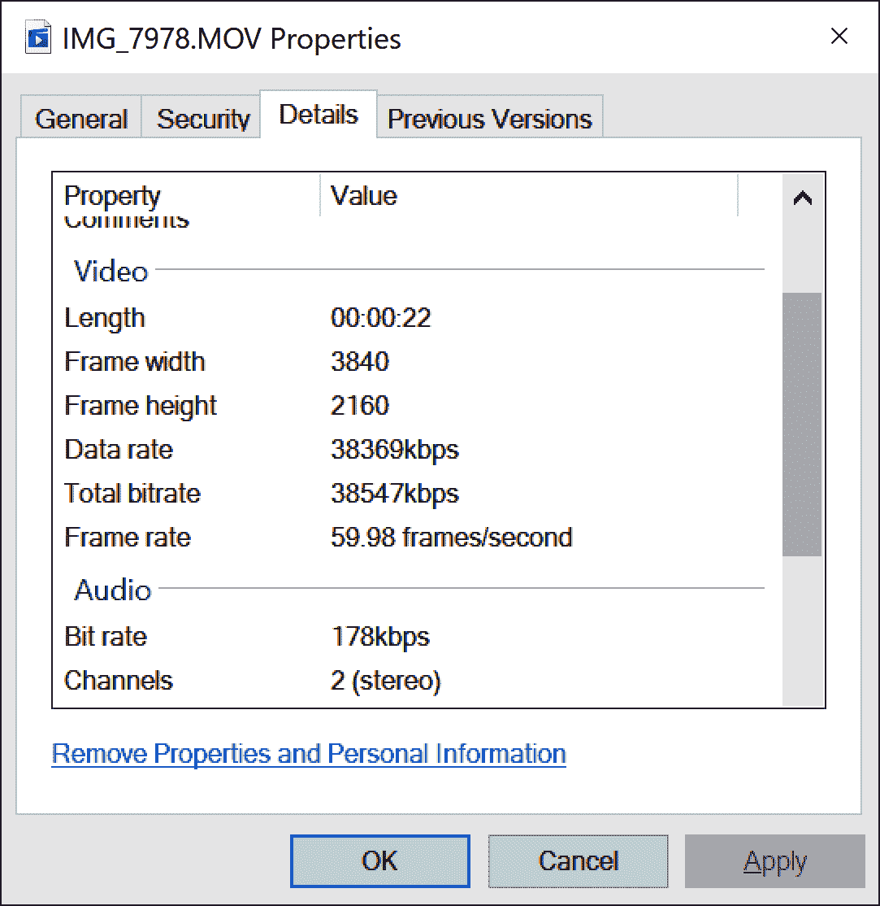

# 第 20 章：文件和目录

## 20.0 简介

管理系统时最常见的任务之一是处理其文件和目录。无论您是在命令行下管理计算机，还是编写脚本来自动管理它，都是如此。


幸运的是，PowerShell 让脚本处理文件和目录变得像在命令行下操作一样简单——这是许多经验丰富的程序员和脚本编写者常常忽视的一点。当你面对有限的磁盘空间，需要找出占用空间最大的文件时，这就是一个完美的例子。

典型的程序员可能会通过编写函数来扫描系统的特定目录来处理此任务。对于每个文件，他们检查该文件是否足够大以值得关注。如果是，则将其添加到列表中。对于原始目录中的每个子目录，程序员重复此过程（直到没有更多目录需要处理）。

俗话说，“你可以用任何编程语言写出 C 代码。”你带入一门语言的习惯和先入为主的观念，往往会直接影响你对该语言新特性的接受程度。

作为一个管理用的 Shell，PowerShell 直接支持诸如访问子目录中的所有文件，或将文件从一个目录移动到另一个目录等任务。那个复杂的面向程序员的脚本变成了一个单行命令：

```
Get-ChildItem -Recurse | Sort-Object -Descending Length | Select -First 10
```

在深入你最喜欢的程序员工具箱之前，先看看 PowerShell 在该领域支持什么。在许多情况下，它无需你的程序员技巧包就能处理任务。

# 20.1 确定并更改当前位置

## 问题

你想从脚本或命令中确定当前位置，或更改到不同的目录。

## 解决方案

要检索当前位置，请使用 `Get-Location` cmdlet。`Get-Location` cmdlet 提供驱动器和路径作为两个常用属性：

```
$currentLocation = (Get-Location).Path
```

作为 `(Get-Location).Path` 的简写形式，请使用 `$pwd` 自动变量。

要更改当前位置，请使用 `Set-Location` cmdlet。例如，要更改到你的主目录：

```
Set-Location ~
```

## 讨论

### 获取当前位置

`Get-Location` cmdlet 返回关于当前位置的信息。从它返回的信息中，你可以访问当前驱动器、提供程序和路径。

此当前位置会影响 PowerShell 命令以及从 PowerShell 启动的程序。但是，这不适用于与 .NET Framework 交互时。如果你需要调用与文件系统交互的 .NET 方法，请始终确保提供完全限定的路径：

```
[System.IO.File]::ReadAllText("c:\temp\file.txt")
```

如果你确定文件存在，`Resolve-Path` cmdlet 允许你将相对路径转换为绝对路径：

```
$filePath = (Resolve-Path file.txt).Path
[System.IO.File]::ReadAllText($filePath)
```

或者，

```
[System.IO.File]::ReadAllText("$pwd\file.txt")
```

如果文件不存在，请结合使用 `Join-Path` cmdlet 和 `Get-Location` cmdlet 来指定文件：

```
$filePath = Join-Path (Get-Location) file.txt
```

另一种结合了上述两种方法功能的替代方案稍微高级一些，但也允许你指定相对位置。它来自 PowerShell `$executionContext` 变量中的方法，该变量提供了通常由 cmdlet 和提供程序作者使用的功能：

```
$executionContext.SessionState.Path.`
    GetUnresolvedProviderPathFromPSPath("..\file.txt")
```

有关 `Get-Location` cmdlet 的更多信息，请输入 `Get-Help Get-Location`。

### 设置当前位置

更改当前位置的 PowerShell 命令是 `Set-Location`，别名为 `cd`。它支持三种主要操作模式：

*   `Set-Location <path>`：将当前目录更改为指定的路径。这可以是绝对路径（如 `c:\users`）或相对路径（如 `..` 或 `..\..\system32`）。请参阅 配方 1.11 以了解添加对父目录更多层级支持的方法，例如 `Set-Location ....`。`<path>` 参数支持多种快捷方式：`~`（代表你的主目录），`$pshome` 代表 PowerShell 的安装目录，甚至复杂的通配符。例如，如果你不知道某软件安装在哪个 `Program Files` 目录下，你仍然可以通过以下命令快速导航到它：`cd c:\progra*\*steam*`。

*   `Set-Location -`：将当前目录更改为你上一次访问的目录，类似于 Web 浏览器中的 Alt+Back（后退）。

*   `Set-Location +`：将当前目录更改为目录历史记录中的下一个目录，类似于 Web 浏览器中的 Alt+Forward（前进）。

要添加热键支持以在目录历史记录中前后导航，请参阅 配方 1.10。

## 另请参阅

配方 1.11，“自定义 PowerShell 的命令解析行为”

配方 1.10，“自定义 PowerShell 的用户输入行为”

# 20.2 获取目录中的文件

## 问题

你想获取或列出目录中的文件。

## 解决方案

要检索目录中的文件列表，请使用 `Get-ChildItem` cmdlet。要获取特定项目，请使用 `Get-Item` cmdlet：

*   要列出当前目录中的所有项目，请使用 `Get-ChildItem` cmdlet：

    ```
    Get-ChildItem
    ```

*   要列出所有匹配通配符的项目，请向 `Get-ChildItem` cmdlet 提供通配符：

    ```
    Get-ChildItem *.txt
    ```

*   要列出当前目录（及其所有子目录）中匹配通配符的所有文件，请使用 `Get-ChildItem` cmdlet 的 `-Recurse` 参数：

    ```
    Get-ChildItem *.txt -Recurse
    ```

*   要列出当前目录中的所有目录，请使用 `-Attributes` 参数：

    ```
    Get-ChildItem -Attributes Directory
    dir -ad
    ```

*   要获取特定项目的信息，请使用 `Get-Item` cmdlet：

    ```
    Get-Item test.txt
    ```

## 讨论

虽然最常用于文件系统，但 `Get-ChildItem` 和 `Get-Item` cmdlet 实际上适用于所有 PowerShell 驱动器上的任何项目。除了 `A:` 到 `Z:`（标准文件系统驱动器）外，它们还适用于 `Alias:`、`Cert:`、`Env:`、`Function:`、`HKLM:`、`HKCU:` 和 `Variable:`。

虽然解决方案演示了 `Get-ChildItem` cmdlet 支持的一些简单通配符场景，但 PowerShell 实际上支持更多高级场景。有关这些场景的更多信息，请参阅 配方 20.6。一个特别值得注意的点是，解决方案中的第三个示例列出了目录及其所有子目录中匹配通配符的文件。该示例适用于任何 PowerShell 提供程序。但是，如果你使用特定于提供程序的筛选器，PowerShell 可以更快地检索结果，如 配方 20.6 所述。

当你在文件系统中工作时，`Get-ChildItem` cmdlet 暴露了几个参数（`-Directory`、`-File`、`-ReadOnly`、`-Hidden` 和 `-System`），使筛选变得尽可能简单。这些参数也有别名（例如 `-ad`), 使大多数常见任务变得轻而易举：

```
Get-ChildItem -Directory
dir -ad
```

对于不太常见的属性，`-Attributes` 参数支持针对所有其他文件和目录属性的强大筛选。在最基本的层面上，你可以提供任何标准文件属性。PowerShell 仅返回设置了该属性的文件：

```
Get-ChildItem -Attributes Compressed
```

要返回未设置某属性的项目（“非”场景），请使用感叹号：

```
Get-ChildItem -Attributes !Archive
```

要返回设置了*任意*多个属性的项目（“或”场景），请使用逗号：

```
Get-ChildItem -Attributes "Hidden, ReadOnly"
```

要返回设置了*所有*指定属性的项目（“与”场景），请使用加号：

```
Get-ChildItem -Attributes "ReadOnly + Hidden"
```


您可以随意组合这些筛选器。例如，要查找所有为 `ReadOnly` 或 `Hidden` 但非 `System` 的项目：

```
Get-ChildItem c:\ -Attributes "ReadOnly, Hidden + !System"
```

在文件系统中，这些 cmdlet 返回来自 .NET Framework 的对象，这些对象分别代表文件和目录——即 `System.IO.FileInfo` 和 `System.IO.DirectoryInfo` 类的实例。每个对象都提供大量有用信息：属性、修改时间、全名等。虽然默认目录列表显示了大量信息，但 PowerShell 提供的信息更多。有关使用 .NET Framework 类的详细信息，请参阅 食谱 3.8。

## 另请参阅

食谱 3.8，“使用 .NET 对象”

食谱 20.6，“查找匹配模式的文件”

# 20.3 查找在特定日期之前修改的所有文件

## 问题

您想要查找在特定日期之前最后修改的所有文件。

## 解决方案

要查找在特定日期之前修改的所有文件，请使用 `Get-ChildItem` cmdlet 列出目录中的文件，然后使用 `Where-Object` cmdlet 将 `LastWriteTime` 属性与您感兴趣的日期进行比较。例如，要查找 2007 年之前创建的所有文件：

```
Get-ChildItem -Recurse | Where-Object { $_.LastWriteTime -lt "01/01/2007" }
```

## 讨论

将文件与特定日期进行比较的常见原因是查找最近修改过（或未最近修改过）的文件。此处的代码与解决方案中给出的示例几乎相同，不同之处在于您的脚本无法知道要比较的确切日期。

在这种情况下，.NET Framework 的 `DateTime` 类中的 `AddDays()` 方法为您提供了一种执行简单日历运算的方法。如果您有一个 `DateTime` 对象，可以对其添加或减去时间以表示完全不同的日期。例如，要查找过去 30 天内修改的所有文件：

```
$compareDate = (Get-Date).AddDays(-30)
Get-ChildItem -Recurse | Where-Object { $_.LastWriteTime -ge $compareDate }
```

同样，要查找超过 30 天的所有文件：

```
$compareDate = (Get-Date).AddDays(-30)
Get-ChildItem -Recurse | Where-Object { $_.LastWriteTime -lt $compareDate }
```

在本示例中，`Get-Date` cmdlet 返回一个表示当前日期和时间的对象。您调用 `AddDays()` 方法从该时间中减去 30 天，将代表“30 天前”的日期存储在 `$compareDate` 变量中。接下来，您将该日期与 `Get-ChildItem` cmdlet 返回的每个文件的 `LastWriteTime` 属性进行比较。

### 注意

`DateTime` 类是管理员最喜爱的日历！

```
PS > [DateTime]::IsLeapYear(2008)
True
PS > $daysTillChristmas = [DateTime] "December 25" - (Get-Date)
PS > $daysTillChristmas.Days
327
```

有关 `Get-ChildItem` cmdlet 的详细信息，请输入 `Get-Help Get-ChildItem`。有关 `Where-Object` cmdlet 的详细信息，请参阅 食谱 2.2。

## 另请参阅

食谱 2.2，“筛选列表或命令输出中的项目”

# 20.4 清除文件内容

## 问题

您想要清除文件的内容。

## 解决方案

要清除文件的内容，请使用 `Clear-Content` cmdlet，如 示例 20-1 所示。

### 示例 20-1. 从文件中清除内容

```
PS > Get-Content test.txt
Hello World
PS > Clear-Content test.txt
PS > Get-Content test.txt
PS > Get-Item test.txt

    Directory: C:\temp

Mode   LastWriteTime        Length  Name
----   -------------        ------  ----
-a---  4/23/2007   8:05 PM  0       test.txt
```

## 讨论

（名副其实的）`Clear-Content` cmdlet 会清除项目的内容。虽然解决方案仅演示了文件系统中的文件，但它实际上适用于支持“内容”概念的任何 PowerShell 提供程序。支持这些内容概念的其他驱动器示例包括 `Function:`、`Alias:` 和 `Variable:`。

有关如何完全删除项目的信息，请参阅 食谱 20.12。

有关 `Remove-Item` 或 `Clear-Content` cmdlet 的详细信息，请输入 `Get-Help Remove-Item` 或 `Get-Help Clear-Content`。

## 另请参阅

食谱 20.12，“删除文件或目录”

# 20.5 管理和更改文件属性

## 问题

您想要更新文件的 `ReadOnly`、`Hidden` 或 `System` 属性。

## 解决方案

大多数情况下，您会想要使用熟悉的 `attrib.exe` 程序来更改文件的属性：

```
attrib +r test.txt
attrib -s test.txt
```

要仅设置 `ReadOnly` 属性，您可以选择在文件上设置 `IsReadOnly` 属性：

```
$file = Get-Item test.txt
$file.IsReadOnly = $true
```

要应用一组特定的属性，请使用文件上的 `Attributes` 属性：

```
$file = Get-Item test.txt
$file.Attributes = "ReadOnly,NotContentIndexed"
```

目录列表显示文件的属性，但您也可以直接访问 `Mode` 或 `Attributes` 属性：

```
PS > $file.Attributes = "ReadOnly","System","NotContentIndexed"
PS > $file.Mode
--r-s
PS > $file.Attributes
ReadOnly, System, NotContentIndexed
```

## 讨论

当 `Get-Item` 或 `Get-ChildItem` cmdlet 检索文件时，生成的输出具有 `Attributes` 属性。除了常规的 `attrib.exe` 程序外，此属性并没有提供太多额外功能，尽管它确实使将属性设置为特定状态变得更加容易。

### 注意

请注意，在文件上设置 `Hidden` 属性会使其从大多数默认视图中移除。如果您想在隐藏它后检索它，大多数命令都需要 `-Force` 参数。同样，在文件上设置 `ReadOnly` 属性会导致对该文件的大多数写入操作失败，除非您使用 `-Force` 参数调用该命令。

如果您想使用 `Attributes` 属性（出于某种原因而非 `attrib.exe`）向文件添加属性，操作方法如下：

```
$file = Get-Item test.txt
$readOnly = [IO.FileAttributes] "ReadOnly"
$file.Attributes = $file.Attributes -bor $readOnly
```

有关使用 .NET Framework 类的详细信息，请参阅 食谱 3.8。

## 另请参阅

食谱 3.8，“使用 .NET 对象”

# 20.6 查找匹配模式的文件

## 问题

您想要获取匹配特定模式的文件列表。

## 解决方案

使用 `Get-ChildItem` cmdlet 以获得简单和高级通配符支持：

*   要查找当前目录中与 PowerShell 通配符匹配的所有项目，请将该通配符提供给 `Get-ChildItem` cmdlet：

    ```
    Get-ChildItem *.txt
    ```

*   要查找当前目录中与*提供程序特定*筛选器匹配的所有项目，请将该筛选器提供给 `-Filter` 参数：

    ```
    Get-ChildItem -Filter *~2*
    ```

*   要查找当前目录中与 PowerShell 通配符**不**匹配的所有项目，请将该通配符提供给 `-Exclude` 参数：

    ```
    Get-ChildItem -Exclude *.txt
    ```

*   要查找子目录中与 PowerShell 通配符匹配的所有项目，请使用 `-Include` 和 `-Recurse` 参数，或将通配符作为 `-Path` 参数的一部分：

    ```
    Get-ChildItem -Include *.txt -Recurse
    Get-ChildItem *.txt -Recurse
    Get-ChildItem -Path c:\temp\*.txt -Recurse
    ```

*   要查找子目录中与*提供程序特定*筛选器匹配的所有项目，请使用 `-Filter` 和 `-Recurse` 参数：

    ```
    Get-ChildItem -Filter *.txt -Recurse
    ```

*   要查找子目录中与 PowerShell 通配符**不**匹配的所有项目，请使用 `-Exclude` 和 `-Recurse` 参数：


## 讨论

```
Get-ChildItem -Exclude *.txt -Recurse
```

使用 `Where-Object` cmdlet 以获得高级正则表达式支持：

*   要查找文件名与正则表达式匹配的所有项，请使用 `Where-Object` cmdlet 将 `Name` 属性与正则表达式进行比较：

    ```
    Get-ChildItem | Where-Object { $_.Name -match '^KB[0-9]+\.log$' }
    ```

*   要查找目录名与正则表达式匹配的所有项，请使用 `Where-Object` cmdlet 将 `DirectoryName` 属性与正则表达式进行比较：

    ```
    Get-ChildItem -Recurse | Where-Object { $_.DirectoryName -match 'Release' }
    ```

*   要查找目录名或文件名与正则表达式匹配的所有项，请使用 `Where-Object` cmdlet 将 `FullName` 属性与正则表达式进行比较：

    ```
    Get-ChildItem -Recurse | Where-Object { $_.FullName -match 'temp' }
    ```

`Get-ChildItem` cmdlet 通过三个参数支持通配符：

`Path`

: `-Path` 参数是第一个（也是默认）参数。虽然你可以输入简单的路径，如 `.`、`C:\` 或 `D:\Documents`，但也可以提供包含通配符的路径——例如 `*`、`*.txt`、`[a-z]???.log`，甚至 `C:\win*\*.N[a-f]?\F*\v2*\csc.exe`。

`Include`/`Exclude`

: `-Include` 和 `-Exclude` 参数充当 `-Path` 参数上发生的通配符筛选器。如果指定了 `-Recurse` 参数，则 `-Include` 和 `-Exclude` 通配符将应用于返回的所有项。

### 注意

使用 `-Include` 参数时最常见的错误是将其用于不包含通配符的路径。例如，这似乎不会产生预期的结果：

```
Get-ChildItem $env:WINDIR -Include *.log
```

该命令不会产生任何结果，因为你没有为路径提供项目通配符。相反，正确的命令是：

```
Get-ChildItem $env:WINDIR\* -Include *.log
```

或者简单地：

```
Get-ChildItem $env:WINDIR\*.log
```

`Filter`

: `-Filter` 参数允许你根据提供项的提供程序的 *provider-specific* 筛选语言来筛选结果。由于 PowerShell 的通配符支持紧密模仿文件系统通配符，且大多数人仅在文件系统上使用 `-Filter` 参数，这似乎是一个多余（且等效）的参数。然而，SQL 提供程序会在其 `-Filter` 参数中使用 SQL 语法。同样，Active Directory 提供程序会在其 `-Filter` 参数中使用 LDAP 路径。

这可能不明显，但文件系统提供程序的筛选语言并不完全等同于 PowerShell 通配符语法。例如，`-Filter` 参数不支持字符范围：

```
PS > Get-ChildItem | Select-Object Name

Name
----
A Long File Name With Spaces Also.txt
A Long File Name With Spaces.txt

PS > Get-ChildItem -Filter "[a-z]*"
PS > Get-ChildItem "[a-z]*" | Select-Object Name

Name
----
A Long File Name With Spaces Also.txt
A Long File Name With Spaces.txt
```

### 提示

提供程序特定的筛选通常比功能更丰富的 PowerShell 通配符返回结果快得多。因此，PowerShell 在内部将通配符重写为通配符和提供程序特定筛选的组合，以兼得两者之长！

有关 PowerShell 通配符语法的更多信息，请输入 `Get-Help about_WildCards`。

当你想要执行比 PowerShell 通配符语法所提供的更高级的筛选时，`Where-Object` cmdlet 提供了无限可能。例如，要从搜索中排除某些目录，请使用以下命令：

```
Get-ChildItem -Rec | Where-Object { $_.DirectoryName -notmatch "Debug" }
```

或者，以更简单的形式：

```
Get-ChildItem -Rec | ? DirectoryName -notmatch Debug
```

对于难以（或无法）以编程方式指定的筛选器，请使用 `Out-GridView` cmdlet，如 Recipe 2.4，“交互式筛选对象列表” 所示，以交互方式筛选输出。

由于 PowerShell 的管道模型，由 `Get-ChildItem` 生成的高级文件集会自动转变为其他 cmdlet 可操作的高级文件集：

```
PS > Get-ChildItem -Rec | Where-Object { $_.Length -gt 20mb } |
     Sort-Object -Descending Length | Select-FilteredObject |
     Remove-Item -WhatIf

What if: Performing operation "Remove File" on Target "C:\temp\backup092.zip".
What if: Performing operation "Remove File" on Target "C:\temp\slime.mov".
What if: Performing operation "Remove File" on Target "C:\temp\hello.mov".
```

有关 `Get-ChildItem` cmdlet 的更多信息，请输入 `Get-Help Get-ChildItem`。

有关 `Where-Object` cmdlet 的更多信息，请输入 `Get-Help Where-Object`。

## 另请参阅

Recipe 2.4，“交互式筛选对象列表”

# 20.7 管理包含特殊字符的文件

## 问题

你想要使用支持通配符的 cmdlet，但提供的文件名包含通配符字符。

## 解决方案

为了防止 PowerShell 将这些字符视为通配符字符，如果 cmdlet 定义了 `-LiteralPath`（或类似名称）参数，请使用它：

```
Get-ChildItem -LiteralPath '[My File].txt'
```

## 讨论

PowerShell 高级通配符支持的一个后果是，用于指定字符范围的方括号有时会与实际文件名冲突。请看以下示例：

```
PS > Get-ChildItem | Select-Object Name

Name
----
[My File].txt

PS > Get-ChildItem '[My File].txt' | Select-Object Name
PS > Get-ChildItem -LiteralPath '[My File].txt' | Select-Object Name

Name
----
[My File].txt
```

第一个命令清楚地演示了我们有一个名为 `[My File].txt` 的文件。当我们尝试检索它（将其名称传递给 `Get-ChildItem` cmdlet）时，没有看到任何结果。由于方括号在 PowerShell 中是通配符字符（`*` 和 `?` 也是），我们提供的文本变成了搜索表达式，而不是文件名。

`-LiteralPath` 参数（或其他 cmdlet 中类似命名的参数）告诉 PowerShell 文件名完全匹配——不是通配符搜索词。

除了通配符匹配，文件名有时还会触犯 PowerShell 转义序列。例如，PowerShell 中的反引号字符 (`` ` ``) 表示转义序列的开始，如 `` `t `` (制表符)、`` `n `` (换行符) 或 `` `a `` (警报)。为了防止 PowerShell 将反引号解释为转义序列，请用单引号而不是双引号括起该字符串。

有关 `Get-ChildItem` cmdlet 的更多信息，请输入 `Get-Help Get-ChildItem`。有关 PowerShell 特殊字符的更多信息，请输入 `Get-Help About_Special_Characters`。

# 20.8 程序：获取磁盘使用信息

当磁盘空间开始不足时，你自然会想知道该将清理工作集中在何处。有时你可以通过查找大型目录（包括其中的子目录）来解决此问题，但有时你可以通过查找仅因其包含的文件而庞大的目录来解决。

### 注意

要查看整个驱动器的磁盘使用统计信息，请使用 `Get-PSDrive` cmdlet。

示例 20-2 收集这两种类型的数据。它还演示了 *计算属性* 的有效用法。与 `Add-Member` cmdlet 一样，计算属性允许你通过指定生成其数据的表达式，向输出对象添加属性。

有关计算属性和 `Add-Member` cmdlet 的更多信息，请参阅 Recipe 3.14。

### 示例 20-2. Get-DiskUsage.ps1


# Get-DiskUsage

## 概要

检索当前目录及所有子目录的磁盘使用信息。如果指定 `-IncludeSubdirectories` 标志，此脚本会将子目录的大小计入目录的大小中。

## 示例

`PS > Get-DiskUsage`
获取当前目录的磁盘使用情况。

## 示例

`PS > Get-DiskUsage -IncludeSubdirectories`
获取当前目录及其下级目录的磁盘使用情况，将子目录的大小添加到包含它们的目录中。

## 参数

```powershell
param(
    ## 用于在每个目录的大小中包含子目录的开关
    [switch] $IncludeSubdirectories
)
```

## 脚本

```powershell
Set-StrictMode -Version 3

## 如果指定 -IncludeSubdirectories 标志，则我们要将
## 所有子目录计入每个目录的大小中
if($IncludeSubdirectories)
{
    Get-ChildItem -Directory |
        Select-Object Name,
            @{ Name="Size";
            Expression={ ($_ | Get-ChildItem -Recurse |
                Measure-Object -Sum Length).Sum + 0 } }
}
## 否则，我们只查找当前目录下的所有目录，
## 并确定它们的大小
else
{
    Get-ChildItem -Recurse -Directory |
        Select-Object FullName,
            @{ Name="Size";
            Expression={ ($_ | Get-ChildItem |
                Measure-Object -Sum Length).Sum + 0 } }
}
```

有关运行脚本的更多信息，请参阅 食谱 1.2。

## 另请参阅

- 食谱 1.2，“运行程序、脚本和现有工具”
- 食谱 3.14，“向对象添加自定义方法和属性”

# 20.9 监视文件的更改

## 问题

您想要监视文件末尾的新内容。

## 解决方案

要监视文件末尾的新内容，请使用 `Get-Content` cmdlet 的 `-Wait` 参数：

```powershell
Get-Content log.txt -Wait
```

## 讨论

`Get-Content` cmdlet 的 `-Wait` 参数的作用非常类似于带有 `--follow` 参数的传统 Unix `tail` 命令。如果您提供 `-Wait` 参数，`Get-Content` cmdlet 会读取文件内容但不会退出。当程序向文件末尾追加新内容时，`Get-Content` cmdlet 会返回该内容并继续等待。

如果您想要监视大型文件，`-Wait` 参数 `Get-Content` 显示的初始输出可能会刷屏或花费很长时间才能完成。要从文件末尾读取，请使用 `-Tail` 参数。例如，从最后 10 行开始：

```powershell
Get-Content log.txt -Tail 10 -Wait
```

有关 `Get-Content` cmdlet 的更多信息，请输入 `Get-Help Get-Content`。有关 `-Wait` 参数的更多信息，请输入 `Get-Help about_File​System_Provider`。

# 20.10 获取 DLL 或可执行文件的版本

## 问题

您想要检查文件的版本信息。

## 解决方案

使用 `Get-Item` cmdlet 检索文件，然后访问 `VersionInfo` 属性以检索其版本信息：

```powershell
PS > $file = Get-Item $pshome\pwsh.exe
PS > $file.VersionInfo

ProductVersion     FileVersion      FileName
--------------     -----------      --------
7.1.0 SHA: cbb7... 7.1.0.0          C:\Program Files\Windows...\pwsh.exe
```

## 讨论

系统管理中的一项常见任务是识别已安装软件的文件和版本信息。PowerShell 通过 `VersionInfo` 属性使这变得简单，该属性会自动附加到通过 `Get-Item` cmdlet 检索到的文件上。要为目录生成报告，只需将 `Get-ChildItem` 的输出传递给 `Select-Object` cmdlet，并使用 `-ExpandProperty` 参数展开 `VersionInfo` 属性。

```powershell
PS > Get-ChildItem $env:WINDIR |
     Select -Expand VersionInfo -ErrorAction SilentlyContinue

ProductVersion   FileVersion      FileName
--------------   -----------      --------
                                  C:\Windows\autologon.log
6.0.6000.16386   6.0.6000.1638... C:\Windows\bfsvc.exe
                                  C:\Windows\bootstat.dat
                                  C:\Windows\DtcInstall.log
6.0.6000.16386   6.0.6000.1638... C:\Windows\explorer.exe
6.0.6000.16386   6.0.6000.1638... C:\Windows\fveupdate.exe
6.0.6000.16386   6.0.6000.1638... C:\Windows\HelpPane.exe
6.0.6000.16386   6.0.6000.1638... C:\Windows\hh.exe
(...)
```

有关 `Get-ChildItem` cmdlet 的更多信息，请参阅 食谱 20.2。

## 另请参阅

- 食谱 20.2，“获取目录中的文件”

# 20.11 创建目录

## 问题

您想要创建一个目录或文件夹。

## 解决方案

要创建目录，请使用 `md` 或 `mkdir` 函数：

```powershell
PS > md NewDirectory


    Directory: C:\temp


Mode                LastWriteTime     Length Name
----                -------------     -----------
d----        4/29/2007   7:31  PM            NewDirectory
```

## 讨论

`md` 和 `mkdir` 函数是更复杂的 `New-Item` cmdlet 的简单包装器。正如您可能猜到的，`New-Item` cmdlet 会在您提供的位置创建一个项目。要直接使用 `New-Item` cmdlet 创建目录，请向 `-Type` 参数提供 `Directory`。

```powershell
New-Item -Path C:\Temp\NewDirectory -Type Directory
```

然而，`New-Item` cmdlet 不仅适用于文件系统。支持项目概念的任何提供程序都会自动支持此 cmdlet。

当您使用 FileSystem 提供程序时，`New-Item` cmdlet 还支持符号链接、联接点和硬链接。

有关 `New-Item` cmdlet 的更多信息，请输入 `Get-Help New-Item`。

# 20.12 删除文件或目录

## 问题

您想要删除文件或目录。

## 解决方案

要删除文件或目录，请使用 `Remove-Item` cmdlet：

```powershell
PS > Test-Path NewDirectory
True
PS > Remove-Item NewDirectory
PS > Test-Path NewDirectory
False
```

## 讨论

`Remove-Item` cmdlet 会从您提供的位置移除项目。然而，`Remove-Item` cmdlet 不仅适用于文件系统。支持项目概念的任何提供程序都会自动支持此 cmdlet。

**注意**

`Remove-Item` cmdlet 允许您通过其 `Path`、`Include`、`Exclude` 和 `Filter` 参数指定多个文件。有关如何有效使用这些参数的信息，请参阅 食谱 20.6。

如果项目是容器（例如目录），PowerShell 会警告您，您的操作也将移除该容器内的所有内容。如果您想防止此消息，可以提供 `-Recurse` 标志。

有关 `Remove-Item` cmdlet 的更多信息，请输入 `Get-Help Remove-Item`。

## 另请参阅

- 食谱 20.6，“查找匹配模式的文件”

# 20.13 重命名文件或目录

## 问题

您想要重命名文件或目录。

## 解决方案

要重命名提供程序中的项目，请使用 `Rename-Item` cmdlet：

```powershell
Rename-Item example.txt example2.txt
```

## 讨论

`Rename-Item` cmdlet 会更改项目的名称。

某些 Shell 允许您同时重命名多个文件。在这些 Shell 中，命令如下所示：

```cmd
ren *.gif *.jpg
```

PowerShell 不支持此语法，但通过其 `-replace` 运算符提供了更强大的功能。作为一个简单的示例，我们可以模拟前面的命令：

```powershell
Get-ChildItem *.gif | Rename-Item -NewName { $_.Name -replace '.gif$','.jpg' }
```


这种语法提供了巨大的功能。请考虑从文件名中删除下划线并用空格替换它们：

```
Get-ChildItem *_* | Rename-Item -NewName { $_.Name -replace '_',' ' }
```

或者重命名目录中遵循 *<Report_Project_ Quarter>.txt* 命名约定的文件：

```
PS > Get-ChildItem | Select Name

Name
----
Report_Project1_Q3.txt
Report_Project1_Q4.txt
Report_Project2_Q1.txt
```

您可能希望使用高级替换模式将其更改为 *<Quarter_Project>.txt*：

```
PS > Get-ChildItem |
    Rename-Item -NewName { $_.Name -replace '.*_(.*)_(.*)\.txt','$2_$1.txt' }

PS > Get-ChildItem | Select Name

Name
----
Q1_Project2.txt
Q3_Project1.txt
Q4_Project1.txt
```

有关 `-replace` 运算符的更多信息，请参阅 食谱 5.8。

与其他 `*-Item` cmdlet 一样，`Rename-Item` 不仅适用于文件系统。任何支持项概念的提供程序都会自动支持此 cmdlet。有关 `Rename-Item` cmdlet 的更多信息，请输入 `Get-Help Rename-Item`。

## 另请参阅

食谱 5.8，“替换字符串中的文本”

# 20.14 移动文件或目录

## 问题

您想要移动文件或目录。

## 解决方案

要移动文件或目录，请使用 `Move-Item` cmdlet：

```
Move-Item example.txt c:\temp\example2.txt
```

## 讨论

`Move-Item` cmdlet 将项从一个位置移动到另一个位置。与其他 `*-Item` cmdlet 一样，`Move-Item` 不仅适用于文件系统。任何支持项概念的提供程序都会自动支持此 cmdlet。

###### 注意

`Move-Item` cmdlet 允许您通过其 `Path`、`Include`、`Exclude` 和 `Filter` 参数指定多个文件。有关如何有效使用这些参数的信息，请参阅 食谱 20.6。

虽然 `Move-Item` cmdlet 在每个提供程序中都有效，但您不能在提供程序之间移动项。有关 `Move-Item` cmdlet 的更多信息，请输入 `Get-Help Move-Item`。

## 另请参阅

食谱 20.6，“查找匹配模式的文件”

# 20.15 创建和映射 PowerShell 驱动器

## 问题

您想要创建一个自定义驱动器号以在 PowerShell 中使用。

## 解决方案

要创建自定义驱动器，请使用 `New-PSDrive` cmdlet：

```
PS > $myDocs = [Environment]::GetFolderPath("MyDocuments")
PS > New-PSDrive -Name MyDocs -Root $myDocs -PSProvider FileSystem

Name           Used (GB)     Free (GB) Provider      Root
----           ---------     --------- --------      ----
MyDocs                         1718.98 FileSystem    G:\Lee

PS > dir MyDocs:\Cookbook

    Directory: G:\Lee\Cookbook

Mode                LastWriteTime     Length Name
----                -------------     ------ ----
d----         7/10/2012   1:12 PM            Admin
d----         2/15/2010  10:39 AM            chapters
(...)
```

要创建一个在整个 Windows 中都可用的自定义驱动器，请使用 `-Persist` 标志：

```
PS > $serverDocs = "\\server\shared\documents"
PS > New-PSDrive -Name Z -Root $serverDocs -PSProvider FileSystem -Persist
```

## 讨论

除了您习惯的标准驱动器号（`A:` 到 `Z:`）之外，PowerShell 还允许您使用完全自定义的名称定义驱动器。使用 `New-PSDrive` cmdlet，您可以为所有最常用的路径创建友好的驱动器名称。

当您使用 `New-PSDrive` cmdlet 创建自定义驱动器映射时，PowerShell 会自动使用您指定的名称和根位置创建一个新的虚拟驱动器。此映射仅存在于当前 PowerShell 会话中，因此如果您希望它在每个会话中都可用，请务必将其放入 PowerShell 配置文件中。

要查看会话中的可用驱动器，请输入 `Get-PSDrive`。

虽然这种方式创建的自定义驱动器极其灵活且强大，但也有一些限制。PowerShell 的核心命令（`Get-Item`、`Get-Content` 等）都了解如何处理这些虚拟驱动器，但系统的大部分其他部分不了解：

```
PS > more.com MyDocs:\blogMonitor.csv
Cannot access file G:\lee\MyDocs:\blogMonitor.csv
```

要解决此问题，请使用 `Get-Item` cmdlet 将这些虚拟文件名转换为其真实文件名：

```
more.com (Get-Item MyDocs:\blogMonitor.csv)
```

虽然创建自定义驱动器可以更轻松地访问本地文件，但 `New-PSDrive` cmdlet 的一个常见场景是映射驱动器以提供对网络资源的访问。为此，只需将 UNC 路径提供给 `New-PSDrive` 的 `-Root` 参数即可。

当您向 `-Root` 参数提供 UNC 路径时，PowerShell 还支持 `-Persist` 标志。当您指定 `-Persist` 时，您的驱动器将成为持久 PowerShell 驱动器，并跨 PowerShell 会话保留。与本地映射驱动器不同，此驱动器中的项目将以所有应用程序都能理解的方式在整个 Windows 中可用。对于大多数用途，此 `-Persist` 参数可以替代您最熟悉的 `net use` 命令。

###### 注意

`-Persist` 标志的主要限制是，您只能使用传统的单字母驱动器名称（`A:` 到 `Z:`）作为您创建的驱动器的名称。

要删除持久映射驱动器，请使用 `Remove-PSDrive` cmdlet：

```
Remove-PSDrive -Name Z
```

使用 `-Persist` 标志创建的驱动器的一个额外好处是，它们支持使用备用凭据。如果在映射网络驱动器时提供 `-Credential` 参数，PowerShell 将在每次使用该驱动器访问网络位置上的文件时使用该凭据。

# 20.16 访问长文件和目录名

## 问题

您想要访问深层嵌套目录中的文件。

## 解决方案

使用 `New-PSDrive` cmdlet 的 `-Persist` 参数创建一个新驱动器，将路径的长部分作为根目录：

```
PS > $root = "\\server\share\some_long_directory_name"
PS > New-PSDrive -Name L -Root $root -PSProvider FileSystem -Persist
PS > Get-Item L:\some_long_file_name.txt
```

## 讨论

在处理某些复杂的目录结构时，您可能会收到以下错误消息：

```
Get-ChildItem : The specified path, file name, or both are too long. The fully
qualified file name must be less than 260 characters, and the directory name
must be less than 248 characters.
```

这是由内置于大多数 Windows 版本中的 `MAX_PATH` 限制引起的。此限制强制规定了路径的最大长度——这并不令人惊讶。如果您尝试在 Windows 资源管理器中创建长度超过 260 个字符的文件或目录结构，您会收到错误。如果您尝试在 Windows 中与长度超过 260 个字符的文件或目录结构进行交互，您会收到错误。

那么，是什么设法创建了这个有问题的文件？这是因为 Windows 实际上有 *32,000* 个字符的限制。如果您小心操作，Windows 中有一些函数允许您创建和处理长度超过 260 个字符的文件。

不幸的是，对巨大文件名的支持直到 Windows XP 发布才成为主流。在此之前，绝大多数 Windows 组件只能理解少于 260 个字符的路径。因为大多数 Windows 组件无法处理长文件名，所以系统会阻止通过 Windows 资源管理器、.NET Framework 等进行临时交互。

如果您发现自己必须处理长文件名，可以通过访问 Microsoft 关于[启用长路径支持](https://oreil.ly/U2qYw)的文档在 Windows 中启用对此的支持。PowerShell 将随后自动支持这些长路径。


如果无法修改系统配置，解决方案是映射一个新驱动器（使用 `-Persist` 参数），将尽可能多的长路径放入驱动器的 `-Root` 参数中。此映射发生在 Windows 内部深处，因此无法理解长文件名的应用程序甚至不会察觉。它们看到的不是 `\\server\share\some_long_directory_name\some_long_file_name.txt`，而只是 `L:\some_long_file_name.txt`。

有关 `New-PSDrive` cmdlet 的更多信息，请参阅 食谱 20.15。

## 另请参阅

食谱 20.15，“创建和映射 PowerShell 驱动器”

## 20.17 取消阻止文件

### 问题

您希望防止 Windows 资源管理器或 PowerShell 警告某文件是从互联网下载的。

### 解决方案

使用 `Unblock-File` cmdlet 清除文件上的“Downloaded from the Internet”标志：

```
Unblock-File c:\downloads\file.zip
```

要取消阻止多个文件（例如，解压后的 ZIP 存档），将 `Get-ChildItem` cmdlet 的结果通过管道传递给 `Unblock-File` cmdlet：

```
Get-ChildItem -Recurse | Unblock-File
```

### 讨论

当您从互联网下载文件时，许多 Web 浏览器、电子邮件客户端和聊天程序会向文件添加一个标记，标识其来自互联网。此标记包含在 `Zone.Identifier` 备用数据流中：

```
PS > Get-Item .\Download.zip -Stream *

   FileName: C:\Users\Lee\Downloads\Download.zip

Stream                   Length
------                   ------
:$DATA                  1010884
Zone.Identifier              26


PS > Get-Content .\Download.zip -Stream Zone.Identifier
[ZoneTransfer]
ZoneId=3
```

当您尝试使用 Windows 资源管理器启动带有此区域标识符的应用程序时，Windows 会警告您该程序是从互联网下载的。同样，当您尝试运行从互联网下载的脚本时，PowerShell 也会发出警告。

为防止此警告，只需运行 `Unblock-File` cmdlet。此 cmdlet 会移除 `Zone.Identifier` 备用数据流。

如果您在收到从互联网下载的警告后取消阻止脚本，则必须重启 PowerShell 才能看到效果。

有关备用数据流的更多信息，请参阅 食谱 20.18。

### 另请参阅

食谱 20.18

## 20.18 处理备用数据流

### 问题

您想要访问和管理与文件关联的备用数据流。

### 解决方案

使用 `Get-Item`、`Get-Content`、`Remove-Item`、`Set-Content`、`Clear-Content` 和 `Add-Content` cmdlet 的 `-Stream` 参数：

```
PS C:\Downloads > Get-Item * -Stream Zone.Identifier -ErrorAction Ignore |
    Select Filename, Length | Format-Table -Auto

FileName                           Length
--------                           ------
C:\Downloads\a.zip                 26
C:\Downloads\b.exe                 26
C:\Downloads\c.txt                 26

PS > Get-Content .\a.zip -Stream Zone.Identifier
[ZoneTransfer]
ZoneId=3
```

此外，使用冒号语法在文件名中指定特定流：

```
PS C:\Downloads > Get-Content .\a.zip:Zone.Identifier
[ZoneTransfer]
ZoneId=3
```

### 讨论

除了存储文件的基本内容外，Windows 还支持一种称为*备用数据流*的机制，用于存储关于这些文件的额外元数据。

```
PS > Get-Item .\a.zip -Stream *

   FileName: C:\Downloads\a.zip

Stream                   Length
------                   ------
:$DATA                  6878348
Zone.Identifier              26
```

`$DATA` 流表示您正常打开文件时看到的内容。

在此示例中，该文件有一个名为 `Zone.Identifier` 的额外备用数据流。当您从互联网下载文件时，许多 Web 浏览器、电子邮件客户端和聊天程序会向文件添加一个标记，标识其来自互联网。它们将此标记放在 `Zone.Identifier` 备用数据流中。

要将您自己的内容放入流中，可以使用 `Set-Content` cmdlet：

```
PS > Set-Content .\a.zip:MyCustomStream -Value "Hello World"
PS > Get-Item .\a.zip -Stream *

   FileName: C:\Downloads\a.zip

Stream                   Length
------                   ------
:$DATA                  6878348
MyCustomStream               13
Zone.Identifier              26


PS > Get-Content .\a.zip:MyCustomStream
Hello World
```

虽然在备用数据流中存储额外数据是一个有吸引力的想法，但您应该谨慎使用它们。许多程序不知道备用数据流的存在，在复制或修改文件时会无意中删除它们。例如，通过远程桌面或 FTP 传输文件不会保留备用数据流。此外，当您将文件复制到基于 FAT32 格式的文件系统时（USB 密钥是最常见的示例），它们也不会被保留。

我们最常遇到备用数据流的情况是，当文件从互联网下载时，Windows 和 PowerShell 生成的警告。要了解如何移除此警告，请参阅 食谱 20.17。

### 另请参阅

食谱 20.17，“取消阻止文件”

## 20.19 程序：移动或删除锁定的文件

偶尔，您会遇到被操作系统锁定的文件，并且想要移动或删除它。

这是补丁、安装程序和热修复常遇到的问题，因此 Windows 有一种特殊机制，允许在任何进程有机会锁定文件之前移动文件。如果安装程序需要更改的文件被锁定，它会使用此特殊机制来完成其安装任务。Windows 只能在重启期间执行此操作，这就是为什么您有时会收到安装程序关于锁定文件需要重启的警告。

底层机制是 `MoveFileEx` Windows API。使用 `MOVEFILE_DELAY_UNTIL_REBOOT` 标志调用此 API 告诉 Windows 在下次启动时移动（或删除）您的文件。如果您指定源路径和目标路径，Windows 会移动文件。如果您将目标路径指定为 `$null`，Windows 会删除文件。

示例 20-3 使用 `Add-Type` cmdlet 通过 PowerShell 公开此功能。虽然它仅公开移动锁定文件的功能，但您可以轻松重命名并修改它以删除锁定文件。

### 示例 20-3. Move-LockedFile.ps1

```
##############################################################################
##
## Move-LockedFile
##
## From PowerShell Cookbook (O'Reilly)
## by Lee Holmes (http://www.leeholmes.com/guide)
##
##############################################################################

<#

.SYNOPSIS

Registers a locked file to be moved at the next system restart.

.EXAMPLE

PS > Move-LockedFile c:\temp\locked.txt c:\temp\locked.txt.bak

#>

param(
    ## The current location of the file to move
    $Path,

    ## The target location of the file
    $Destination
)

Set-StrictMode -Version 3

## Convert the the path and destination to fully qualified paths
$path = (Resolve-Path $path).Path
$destination = $executionContext.SessionState.`
    Path.GetUnresolvedProviderPathFromPSPath($destination)

## Define a new .NET type that calls into the Windows API to
## move a locked file.
$MOVEFILE_DELAY_UNTIL_REBOOT = 0x00000004
$memberDefinition = @'
[DllImport("kernel32.dll", SetLastError=true, CharSet=CharSet.Auto)]
public static extern bool MoveFileEx(
    string lpExistingFileName, string lpNewFileName, int dwFlags);
'@
$type = Add-Type -Name MoveFileUtils `
    -MemberDefinition $memberDefinition -PassThru

## Move the file
$type::MoveFileEx($path, $destination, $MOVEFILE_DELAY_UNTIL_REBOOT)
```


有关与 Windows API 交互的详细信息，请参阅 食谱 17.4。有关运行脚本的详细信息，请参阅 食谱 1.2。

## 另请参阅

食谱 1.2，“运行程序、脚本和现有工具”

食谱 17.4，“访问 Windows API 函数”

# 20.20 获取文件或目录的 ACL

## 问题

你想要检索文件或目录的 ACL。

## 解决方案

要检索文件的 ACL，请使用 `Get-Acl` cmdlet：

```
PS > Get-Acl example.txt

      Directory: C:\temp

Path                       Owner                     Access
----                       -----                     ------
example.txt                LEE-DESK\Lee              BUILTIN\Administrator...
```

## 讨论

`Get-Acl` cmdlet 检索项目的安全描述符。然而，此 cmdlet 不仅适用于文件系统。任何支持安全描述符概念的提供程序（例如注册表提供程序）也支持 `Get-Acl` cmdlet。

`Get-Acl` cmdlet 返回一个表示项目安全描述符的对象，该对象特定于包含该项目的提供程序。在文件系统中，这将返回一个 .NET `System.Security.AccessControl.FileSecurity` 对象，你可以通过探索它来获取更多信息。例如，示例 20-4 通过确保每个文件都包含一个“管理员，完全控制” ACL，来搜索目录中可能的 ACL 错误配置。

### 示例 20-4. Get-AclMisconfiguration.ps1

```
##############################################################################
##
## Get-AclMisconfiguration
##
## From PowerShell Cookbook (O'Reilly)
## by Lee Holmes (http://www.leeholmes.com/guide)
##
##############################################################################

<#

.SYNOPSIS

Demonstration of functionality exposed by the Get-Acl cmdlet. This script
goes through all access rules in all files in the current directory, and
ensures that the Administrator group has full control of that file.

#>

Set-StrictMode -Version 3

## Get all files in the current directory
foreach($file in Get-ChildItem)
{
    ## Retrieve the ACL from the current file
    $acl = Get-Acl $file
    if(-not $acl)
    {
        continue
    }

    $foundAdministratorAcl = $false

    ## Go through each access rule in that ACL
    foreach($accessRule in $acl.Access)
    {
        ## If we find the Administrator, Full Control access rule,
        ## then set the $foundAdministratorAcl variable
        if(($accessRule.IdentityReference -like "*Administrator*") -and
            ($accessRule.FileSystemRights -eq "FullControl"))
        {
            $foundAdministratorAcl = $true
        }
    }

    ## If we didn't find the administrator ACL, output a message
    if(-not $foundAdministratorAcl)
    {
        "Found possible ACL Misconfiguration: $file"
    }
}
```

有关 `Get-Acl` 命令的详细信息，请输入 `Get-Help Get-Acl`。有关使用 .NET Framework 类的详细信息，请参阅 食谱 3.8。有关运行脚本的详细信息，请参阅 食谱 1.2。

## 另请参阅

食谱 1.2，“运行程序、脚本和现有工具”

食谱 3.8，“使用 .NET 对象”

# 20.21 设置文件或目录的 ACL

## 问题

你想要更改文件或目录的 ACL。

## 解决方案

要更改文件的 ACL，请使用 `Set-Acl` cmdlet。此示例阻止 `Guest` 帐户访问文件：

```
$acl = Get-Acl example.txt
$arguments = "LEE-DESK\Guest","FullControl","Deny"
$accessRule =
    New-Object System.Security.AccessControl.FileSystemAccessRule $arguments
$acl.SetAccessRule($accessRule)
$acl | Set-Acl example.txt
```

## 讨论

`Set-Acl` cmdlet 设置项目的安全描述符。然而，此 cmdlet 不仅适用于文件系统。任何支持安全描述符概念的提供程序（例如注册表提供程序）也支持 `Set-Acl` cmdlet。

`Set-Acl` cmdlet 要求你提供一个要应用于项目的 ACL。虽然可以从头构建 ACL，但通常最简单的方法是预先从项目中检索它（如解决方案中所示）。要检索 ACL，请使用 `Get-Acl` cmdlet。一旦你修改了 ACL 上的访问控制规则，只需将它们通过管道传递给 `Set-Acl` cmdlet 即可使其永久生效。

在解决方案中，我们提供给 `FileSystemAccessRule` 构造函数的 `$arguments` 列表在 `LEE-DESK` 计算机的 `Guest` 帐户上为 `FullControl` 权限显式设置了一条 `Deny` 规则。有关使用 .NET Framework 类（如 `FileSystemAccessRule` 类）的详细信息，请参阅 食谱 3.8。

虽然 `Set-Acl` 命令功能强大，但你可能已经熟悉提供类似功能的命令行工具（如 `cacls.exe`）。虽然这些工具通常不适用于注册表（或其他支持 PowerShell 安全描述符的提供程序），但你当然可以继续在 PowerShell 中使用这些工具。

有关 `Set-Acl` cmdlet 的详细信息，请输入 `Get-Help Set-Acl`。有关 `Get-Acl` cmdlet 的详细信息，请参阅 食谱 20.20。

## 另请参阅

食谱 3.8，“使用 .NET 对象”

食谱 20.20，“获取文件或目录的 ACL”

# 20.22 程序：向文件添加扩展文件属性

当你单击文件的“属性”对话框时，资源管理器 Shell 会提供关于该文件的有用信息。它包括创作信息、图像信息、音乐信息等（请参阅 图 20-1）。

PowerShell 默认不公开此信息，但可以从 `Shell.Application` COM 对象获取这些属性。示例 20-5 正是执行此操作——并将此扩展信息作为属性添加到 `Get-ChildItem` cmdlet 返回的文件中。



### 示例 20-5. Add-ExtendedFileProperties.ps1


## Add-ExtendedFileProperties 脚本

```powershell
##############################################################################
##
## Add-ExtendedFileProperties
##
## From PowerShell Cookbook (O'Reilly)
## by Lee Holmes (http://www.leeholmes.com/guide)
##
##############################################################################

<#

.SYNOPSIS

Add the extended file properties normally shown in Explorer's
"File Properties" tab.

.EXAMPLE

PS > Get-ChildItem | Add-ExtendedFileProperties.ps1 | Format-Table Name,"Bit Rate"

#>

begin
{
    Set-StrictMode -Version 3

    ## Create the Shell.Application COM object that provides this
    ## functionality
    $shellObject = New-Object -Com Shell.Application

    ## Remember the column property mappings
    $columnMappings = @{}
}

process
{
    ## Store the property names and identifiers for all of the shell
    ## properties
    $itemProperties = @{}

    ## Get the file from the input pipeline. If it is just a filename
    ## rather than a real file,) piping it to the Get-Item cmdlet will
    ## get the file it represents.
    $fileItem = $_ | Get-Item

    ## Don't process directories
    if($fileItem.PsIsContainer)
    {
        $fileItem
        return
    }

    ## Extract the file name and directory name
    $directoryName = $fileItem.DirectoryName
    $filename = $fileItem.Name

    ## Create the folder object and shell item from the COM object
    $folderObject = $shellObject.NameSpace($directoryName)
    $item = $folderObject.ParseName($filename)

    ## Populate the item properties
    $counter = 0
    $columnName = ""
    do
    {
        if(-not $columnMappings[$counter])
        {
            $columnMappings[$counter] = $folderObject.GetDetailsOf(
                $folderObject.Items, $counter)
        }

        $columnName = $columnMappings[$counter]
        if($columnName)
        {
            $itemProperties[$columnName] =
                $folderObject.GetDetailsOf($item, $counter)
        }

        $counter++
    } while($columnName)

    ## Process extended properties
    foreach($name in
        $item.ExtendedProperty('System.PropList.FullDetails').Split(';'))
    {
        $name = $name.Replace("*","")
        $itemProperties[$name] = $item.ExtendedProperty($name)
    }

    ## Now, go through each property and add its information as a
    ## property to the file we are about to return
    foreach($itemProperty in $itemProperties.Keys)
    {
        $value = $itemProperties[$itemProperty]
        if($value)
        {
            $fileItem | Add-Member NoteProperty $itemProperty `
                $value -ErrorAction `
                SilentlyContinue
        }
    }

    ## Finally, return the file with the extra shell information
    $fileItem
}
```

有关运行脚本的详细信息，请参阅食谱 1.2。

## 另请参阅

食谱 1.2，“运行程序、脚本和现有工具”

## 20.23 管理 ZIP 压缩包

### 问题

您想要创建、管理和提取文件及 ZIP 压缩包。

### 解决方案

使用 `Compress-Archive` cmdlet 创建压缩包：

```powershell
dir *.asciidoc | Compress-Archive -DestinationPath backup.zip
```

使用 `Expand-Archive` cmdlet 从压缩包中提取文件：

```powershell
Expand-Archive backup.zip -DestinationPath c:\temp\restored
```

### 讨论

在传输或归档文件时，将这些文件存储在压缩包中非常有用。ZIP 压缩包是最常见的压缩包类型，拥有 cmdlet 来帮助管理它们非常有用。这些 PowerShell cmdlet 的行为正如您所预期的那样。

当您展开压缩包时，`DestinationPath` 不必存在。如果存在，PowerShell 会将文件展开到该目录中。如果不存在，PowerShell 会创建一个新目录来包含这些文件。如果您完全省略该参数，PowerShell 会创建一个与压缩包名称匹配的新目录，并将文件展开到其中。

`Expand-Archive` cmdlet 不允许您在不展开压缩包的情况下查看其中的文件。如果您想查看压缩包中的文件，可以使用 .NET Framework 中的 `System.IO.Compression.ZipFile` 类：

```powershell
PS > $archive = [System.IO.Compression.ZipFile]::OpenRead("$pwd\backup.zip")
PS > $archive.Entries | Measure-Object CompressedLength -Sum | ForEach-Object Sum
486755

PS > $archive.Entries | Measure-Object Length -Sum | ForEach-Object Sum
1676380

PS > $archive.Dispose()
```

有关使用 .NET Framework 类的详细信息，请参阅食谱 3.8。

### 另请参阅

食谱 3.8，“使用 .NET 对象”
