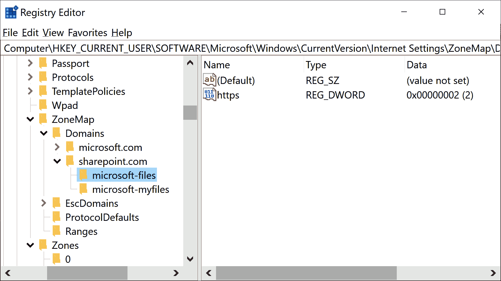
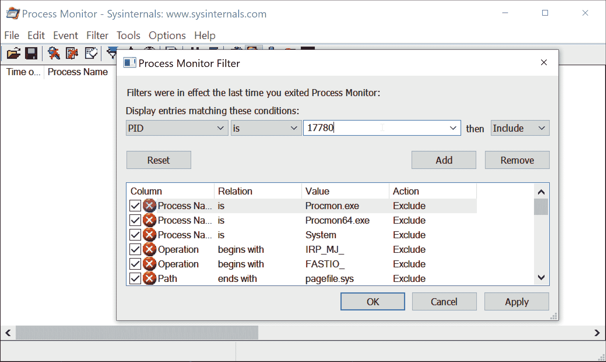
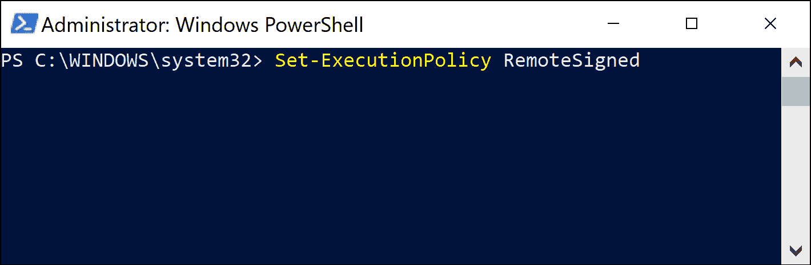
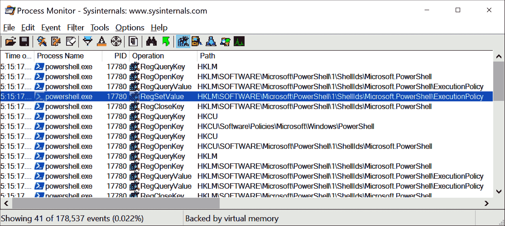

# 第 21 章 Windows 注册表

## 21.0 简介

作为绝大多数应用程序的配置存储，注册表在系统管理中起着核心作用。它也通常难以管理。

虽然存在命令行工具（如 `reg.exe`）来帮助您处理注册表，但它们的界面通常不一致且令人困惑。注册表编辑器图形用户界面易于使用，但不支持脚本化管理。

PowerShell 通过将 Windows 注册表作为导航提供程序来解决此问题：一种您可以以与文件系统完全相同的方式导航和管理的数据源。

## 21.1 导航注册表

### 问题

您想要导航和浏览 Windows 注册表。

### 解决方案

使用 `Set-Location` cmdlet 导航注册表，就像您导航文件系统一样：

```powershell
PS > Set-Location HKCU:
PS > Set-Location \Software\Microsoft\Windows\CurrentVersion\Run
PS > Get-Location

Path
----
HKCU:\Software\Microsoft\Windows\CurrentVersion\Run
```

### 讨论

PowerShell 允许您以与导航文件系统、证书驱动器和其他基于导航的提供程序完全相同的方式导航 Windows 注册表。与这些其他提供程序一样，注册表提供程序支持 `Set-Location` cmdlet（具有标准别名 `sl`、`cd` 和 `chdir`）、`Push-Location`（标准别名 `pushd`）、`Pop-Location`（标准别名 `popd`）等。

有关到达注册表位置后如何更改注册表键的信息，请参阅食谱 21.3。有关注册表提供程序的详细信息，请键入 `Get-Help about_Registry_Provider`。

### 另请参阅

食谱 21.3，“修改或删除注册表键值”

## 21.2 查看注册表键

### 问题

您想要查看特定注册表键的值。

### 解决方案

要检索注册表键的值，请使用 `Get-ItemProperty` cmdlet，如示例 21-1 所示。

##### 示例 21-1. 检索注册表键的属性

```powershell
PS > Set-Location HKCU:
PS > Set-Location \Software\Microsoft\Windows\CurrentVersion\Run
PS > Get-ItemProperty .

PSPath                : Microsoft.PowerShell.Core\Registry::HKEY_CURRENT_U
                        SER\Software\Microsoft\Windows\CurrentVersion\Run
PSParentPath          : Microsoft.PowerShell.Core\Registry::HKEY_CURRENT_U
                        SER\Software\Microsoft\Windows\CurrentVersion
PSChildName           : Run
PSDrive               : HKCU
PSProvider            : Microsoft.PowerShell.Core\Registry
FolderShare           : "C:\Program Files\FolderShare\FolderShare.exe" /
                        background
TaskSwitchXP          : d:\lee\tools\TaskSwitchXP.exe
ctfmon.exe            : C:\WINDOWS\system32\ctfmon.exe
Ditto                 : C:\Program Files\Ditto\Ditto.exe
QuickTime Task        : "C:\Program Files\QuickTime Alternative\qttask.exe
                        " -atboottime
H/PC Connection Agent : "C:\Program Files\Microsoft ActiveSync\wcescomm.exe"
```

### 讨论


在注册表提供程序中，PowerShell 将注册表键视为项，将键值视为这些项的属性。要获取项的属性，请使用 `Get-ItemProperty` cmdlet。`Get-ItemProperty` cmdlet 具有标准别名 `gp`。

示例 21-1 列出了与该特定键关联的所有属性值。要检索特定项的值，请使用 `Get-ItemPropertyValue` cmdlet：

```
PS > Get-ItemPropertyValue . -Name OneDrive
"C:\Users\lee\AppData\Local\Microsoft\OneDrive\OneDrive.exe" /background
```

或者，您可以像访问 .NET 对象上的属性或在 PowerShell 中的任何其他位置一样访问项属性：

```
PS > $item = Get-ItemProperty .
PS > $item.OneDrive
"C:\Users\lee\AppData\Local\Microsoft\OneDrive\OneDrive.exe" /background
```

有关 `Get-ItemProperty` cmdlet 的详细信息，请输入 `Get-Help` `Get-ItemProperty`。有关注册表提供程序的详细信息，请输入 `Get-Help about_Registry_Provider`。

# 21.3 修改或删除注册表键值

## 问题

您想要修改或删除特定注册表键的属性。

## 解决方案

要设置注册表键的值，请使用 `Set-ItemProperty` cmdlet：

```
PS > (Get-ItemProperty .).MyProgram
c:\temp\MyProgram.exe
PS > Set-ItemProperty . MyProgram d:\Lee\tools\MyProgram.exe
PS > (Get-ItemProperty .).MyProgram
d:\Lee\tools\MyProgram.exe
```

要删除注册表键的值，请使用 `Remove-ItemProperty` cmdlet：

```
PS > Remove-ItemProperty . MyProgram
PS > (Get-ItemProperty .).MyProgram
```

## 讨论

在注册表提供程序中，PowerShell 将注册表键视为项，将键值视为这些项的属性。要更改键属性的值，请使用 `Set-ItemProperty` cmdlet。`Set-ItemProperty` cmdlet 具有标准别名 `sp`。要完全删除键属性，请使用 `Remove-ItemProperty` cmdlet。

### 警告

一如既往，在更改注册表信息时请务必小心。删除或更改错误的项很容易导致系统无法启动。

有关 `Get-ItemProperty` cmdlet 的详细信息，请输入 `Get-Help Get-ItemProperty`。有关 `Set-ItemProperty` 和 `Remove-ItemProperty` cmdlet 的信息，请分别输入 `Get-Help Set-ItemProperty` 或 `Get-Help Remove-ItemProperty`。有关注册表提供程序的详细信息，请输入 `Get-Help about_Registry_Provider`。

# 21.4 创建注册表键值

## 问题

您想要向现有注册表键添加新的键值。

## 解决方案

要向注册表键添加值，请使用 `New-ItemProperty` cmdlet。示例 21-2 将 `MyProgram.exe` 添加到当前用户登录时启动的程序列表中。

### 示例 21-2. 在注册表键上创建新属性

```
PS > Set-Location HKCU:\Software\Microsoft\Windows\CurrentVersion\Run
PS > New-ItemProperty . -Name MyProgram -Value c:\temp\MyProgram.exe

PSPath       : Microsoft.PowerShell.Core\Registry::HKEY_CURRENT_USER
               \Software\Microsoft\Windows\CurrentVersion\Run
PSParentPath : Microsoft.PowerShell.Core\Registry::HKEY_CURRENT_USER
               \Software\Microsoft\Windows\CurrentVersion
PSChildName  : Run
PSDrive      : HKCU
PSProvider   : Microsoft.PowerShell.Core\Registry
MyProgram    : c:\temp\MyProgram.exe

PS > Get-ItemProperty .

PSPath                : Microsoft.PowerShell.Core\Registry::HKEY_CURRENT_
                        USER\Software\Microsoft\Windows\CurrentVersion\Run

PSParentPath          : Microsoft.PowerShell.Core\Registry::HKEY_CURRENT_
                        USER\Software\Microsoft\Windows\CurrentVersion
PSChildName           : Run
PSDrive               : HKCU
PSProvider            : Microsoft.PowerShell.Core\Registry
FolderShare           : "C:\Program Files\FolderShare\FolderShare.exe"
                        /background
TaskSwitchXP          : d:\lee\tools\TaskSwitchXP.exe
ctfmon.exe            : C:\WINDOWS\system32\ctfmon.exe
Ditto                 : C:\Program Files\Ditto\Ditto.exe
QuickTime Task        : "C:\Program Files\QuickTime Alternative\qttask.exe"
                        -atboottime
H/PC Connection Agent : "C:\Program Files\Microsoft ActiveSync\wcescomm.exe"
MyProgram             : c:\temp\MyProgram.exe
```

## 讨论

在注册表提供程序中，PowerShell 将注册表键视为项，将键值视为这些项的属性。要创建键属性，请使用 `New-ItemProperty` cmdlet。

有关 `New-ItemProperty` cmdlet 的详细信息，请输入 `Get-Help New-ItemProperty`。有关注册表提供程序的详细信息，请输入 `Get-Help about_Registry_Provider`。

# 21.5 删除注册表键

## 问题

您想要删除注册表键及其所有属性。

## 解决方案

要删除注册表键，请使用 `Remove-Item` cmdlet：

```
PS > dir

   Hive: HKEY_CURRENT_USER\Software\Microsoft\Windows\CurrentVersion\Run

SKC  VC Name                            Property
---  -- ----                            --------
  0   0 Spyware                         {}

PS > Remove-Item Spyware
```

## 讨论

正如配方 21.4 中所述，注册表提供程序允许您使用 `Remove-Item` cmdlet 删除项和容器。`Remove-Item` cmdlet 具有标准别名 `rm`、`rmdir`、`del`、`erase` 和 `rd`。

### 警告

一如既往，在更改注册表信息时请务必小心。删除或更改错误的项很容易导致系统无法启动。

与文件系统中一样，`Remove-Item` cmdlet 允许您通过其 `Path`、`Include`、`Exclude` 和 `Filter` 参数指定多个文件。有关如何有效使用这些参数的信息，请参阅配方 20.6。

有关 `Remove-Item` cmdlet 的详细信息，请输入 `Get-Help Remove-Item`。有关注册表提供程序的详细信息，请输入 `Get-Help about_Registry_Provider`。

## 另请参阅

配方 20.6，“查找匹配模式的文件”

配方 21.4，“创建注册表键值”

# 21.6 安全地合并相关的注册表修改

## 问题

您有几个相关的注册表修改，并且想要将它们分组，以便要么全部应用，要么全不应用。

## 解决方案

使用 `Start-Transaction` cmdlet 启动事务，并在其中进行注册表修改。使用 `Complete-Transaction` cmdlet 使注册表修改永久生效：

```
PS > Set-Location HKCU:
PS > Start-Transaction

Suggestion [1,Transactions]: Once a transaction is started, only commands
that get called with the -UseTransaction flag become part of that transaction.
PS > mkdir TempKey -UseTransaction

    Hive: HKEY_CURRENT_USER

SKC  VC Name                           Property
---  -- ----                           --------
  0   0 TempKey                        {}


PS > Set-Location TempKey -UseTransaction
PS > New-Item TempKey2 -UseTransaction

    Hive: HKEY_CURRENT_USER\TempKey

SKC  VC Name                           Property
---  -- ----                           --------
  0   0 TempKey2                       {}

PS > Set-Location \
PS > Get-ChildItem TempKey
Get-ChildItem : Cannot find path 'HKEY_CURRENT_USER\TempKey' because it
does not exist.

PS > Complete-Transaction
PS > Get-ChildItem TempKey

    Hive: HKEY_CURRENT_USER\TempKey

SKC  VC Name                           Property
---  -- ----                           --------
  0   0 TempKey2                       {}
```

## 讨论


## 事务支持

在注册表中工作时，有时可能希望将一组相关更改串联起来，并确保它们作为一个整体单元应用。这些目标称为*原子性*和*一致性*：即希望避免在操作的任何步骤中发生错误，如果其他操作也不成功，可能导致系统状态不一致。

为了支持此类管理任务，PowerShell 支持一种称为*事务*的更改管理策略。PowerShell 的注册表提供程序完全支持事务。

启动事务时，该事务中的任何命令都是虚拟的，直到完成事务才会真正应用到系统。在事务上下文中，每个参与的命令看到的系统状态就好像真的已经更改了一样。完成事务后，更改将作为一个整体单元应用。

某些支持事务的系统（如数据库）会对事务正在更改的任何资源加锁。如果另一个用户尝试修改被锁定的资源，会收到错误消息。Windows 注册表不支持此功能。如果某事物更改了事务所依赖的资源，事务中包含的更改将被放弃，尝试完成该事务时会收到错误消息。有关事务的详细信息，请参阅第 30 章。

## 另请参阅

第 30 章

# 21.7 将站点添加到 Internet Explorer 安全区域

## 问题

你想将站点添加到特定的 Internet Explorer 安全区域。

## 解决方案

要创建将站点添加到特定安全区域所需的注册表项和属性，请使用 `New-Item` 和 `New-ItemProperty` cmdlet。示例 21-3 将 *www.example.com* 添加到 Internet Explorer 信任的站点列表中。

### 示例 21-3. 将 www.example.com 添加到 Internet Explorer 的受信任站点列表

```
Set-Location "HKCU:\Software\Microsoft\Windows\CurrentVersion\Internet Settings"
Set-Location ZoneMap\Domains
New-Item example.com
Set-Location example.com
New-Item www
Set-Location www
New-ItemProperty . -Name http -Value 2 -Type DWORD
```

## 讨论

需要修改注册表中的数据的任务之一是使用 Internet Explorer 从其不同的安全区域添加和删除站点。

Internet Explorer 将其区域映射信息存储在注册表的 `HKCU:\Software\Microsoft\Windows\CurrentVersion\InternetSettings\ZoneMap\Domains` 中。在该键下，资源管理器存储域名（如 `leeholmes.com`），主机名（如 `www`）作为其子键（参见图 21-1）。在主机键中，资源管理器存储一个属性（如 `http`），其 `DWORD` 值对应于区域标识符。

Internet Explorer 区域标识符如下：

- 我的电脑
- 本地 Intranet
- 受信任的站点
- Internet
- 受限制的站点



当 Internet Explorer 配置为增强安全配置模式时，还必须更新 `EscDomains` 键下的条目。

> **注意**
>
> 一旦计算机启用了 Internet Explorer 的增强安全配置，即使移除增强安全配置，这些设置仍会保留。以下命令可让计算机再次信任 UNC 路径：
>
> ```
> Set-Location "HKCU:\Software\Microsoft\Windows\"
> Set-Location "CurrentVersion"
> Set-Location "Internet Settings"
> Set-ItemProperty ZoneMap UNCAsIntranet -Type DWORD 1
> Set-ItemProperty ZoneMap IntranetName -Type DWORD 1
> ```

要删除特定域的区域映射，请使用 `Remove-Item` cmdlet：

```
PS > Get-ChildItem

   Hive: HKEY_CURRENT_USER\Software\...\Internet Settings\ZoneMap\Domains

SKC VC Name                            Property
--- -- ----                            --------
  1  0 example.com                     {}

PS > Remove-Item -Recurse example.com
PS > Get-ChildItem
PS >
```

有关使用 Internet Explorer 注册表条目配置安全区域的详细信息，请参阅 Microsoft KB 文章[“Internet Explorer Security Zones Registry Entries for Advanced Users”](http://support.microsoft.com/kb/182569)。有关管理 Internet Explorer 增强安全配置的详细信息，请在[Microsoft 官方文档站点](http://technet.microsoft.com)上搜索。

有关修改注册表中数据的详细信息，请参阅配方 21.3。

## 另请参阅

配方 21.3“修改或删除注册表键值”

# 21.8 修改 Internet Explorer 设置

## 问题

你想修改 Internet Explorer 的配置选项。

## 解决方案

要修改 Internet Explorer 配置注册表键，请使用 `Set-ItemProperty` cmdlet。例如，要更新代理：

```
Set-Location "HKCU:\Software\Microsoft\Windows\CurrentVersion\Internet Settings"
Set-ItemProperty . -Name ProxyServer -Value http://proxy.example.com
Set-ItemProperty . -Name ProxyEnable -Value 1
```

## 讨论

Internet Explorer 将其主要配置信息存储为注册表键 `HKCU:\Software\Microsoft\Windows\CurrentVersion\Internet Settings` 上的属性。要更改这些属性，请使用 `Set-ItemProperty` cmdlet，如解决方案中所示。

另一组常见的要调整的属性是定义安全区域的配置参数。一个例子是在受限站点区域中阻止脚本运行。对于每个区域，Internet Explorer 将此信息存储为注册表键 `HKCU:\Software\Microsoft\Windows\CurrentVersion\Internet Settings\Zones\<Zone>` 的属性，其中 `<Zone>` 表示要管理的区域标识符（0、1、2、3 或 4）。

Internet Explorer 区域标识符如下：

- 我的电脑
- 本地 Intranet
- 受信任的站点
- Internet
- 受限制的站点

此键中的属性名称并非为人类设计，因为它们带有诸如 `1A04` 和 `1809` 这样的启发性标题。虽然命名不佳，但仍可对其进行脚本编写。

有关使用 Internet Explorer 注册表设置配置安全区域的详细信息，请参阅 Microsoft KB 文章[“Internet Explorer Security Zones Registry Entries for Advanced Users”](http://support.microsoft.com/kb/182569)。

有关修改注册表中数据的详细信息，请参阅配方 21.3。

## 另请参阅

配方 21.3“修改或删除注册表键值”

# 21.9 程序：搜索 Windows 注册表

虽然 Windows 注册表编辑器可用于搜索注册表，但有时它可能无法提供所需的功能。例如，注册表编辑器不支持使用通配符或正则表达式进行搜索。

在文件系统中，我们有 `Select-String` cmdlet 来搜索文件内容。PowerShell 不为其他存储提供此功能，但我们可以编写脚本来实现。关键在于将注册表键值视为文件中的内容：

- 目录有项；项有内容。
- 注册表键有属性；属性有值。

示例 21-4 遍历所有注册表键（及其值）以查找搜索词，并返回匹配信息。

### 示例 21-4. Search-Registry.ps1


# Search-Registry

源自 *PowerShell Cookbook* (O'Reilly) 作者 Lee Holmes (http://www.leeholmes.com/guide)

## 概要

在注册表中搜索与特定值匹配的键或属性。

## 示例

```powershell
PS > Set-Location HKCU:\Software\Microsoft\
PS > Search-Registry Run
```

## 参数

- **Pattern** (必需): 要搜索的文本

## 脚本

```powershell
param(
    ## 要搜索的文本
    [Parameter(Mandatory = $true)]
    [string] $Pattern
)

Set-StrictMode -Off

## 用于创建表示此脚本注册表匹配项的新对象的辅助函数
function New-RegistryMatch
{
    param( $matchType, $keyName, $propertyName, $line )

    $registryMatch = New-Object PsObject -Property @{
        MatchType = $matchType;
        KeyName = $keyName;
        PropertyName = $propertyName;
        Line = $line
    }

    $registryMatch
}

## 遍历注册表中的每个项目
foreach($item in Get-ChildItem -Recurse -ErrorAction SilentlyContinue)
{
    ## 检查键名是否匹配
    if($item.Name -match $pattern)
    {
        New-RegistryMatch "Key" $item.Name $null $item.Name
    }

    ## 检查键属性是否匹配
    foreach($property in (Get-ItemProperty $item.PsPath).PsObject.Properties)
    {
        ## 如果是 PowerShell 添加的属性则跳过
        if(($property.Name -eq "PSPath") -or
            ($property.Name -eq "PSChildName"))
        {
            continue
        }

        ## 搜索属性的文本
        $propertyText = "$($property.Name)=$($property.Value)"
        if($propertyText -match $pattern)
        {
            New-RegistryMatch "Property" $item.Name `
                $property.Name $propertyText
        }
    }
}
```

有关运行脚本的更多信息，请参阅 Recipe 1.2。

## 另请参阅

- Recipe 1.2, "Run Programs, Scripts, and Existing Tools"

---

# 21.10 获取注册表键的 ACL

## 问题

您想要检索注册表键的 ACL。

## 解决方案

要检索注册表键的 ACL，请使用 `Get-Acl` cmdlet：

```powershell
PS > Get-Acl HKLM:\Software

Path                     Owner                   Access
----                     -----                   ------
Microsoft.PowerShell.... BUILTIN\Administrators  CREATOR OWNER Allow ....
```

## 讨论

正如 Recipe 20.20 中所述，`Get-Acl` cmdlet 检索项目的安全描述符。然而，此 cmdlet 不仅适用于注册表。任何支持安全描述符概念的提供程序（例如文件系统提供程序）也支持 `Get-Acl` cmdlet。

`Get-Acl` cmdlet 返回一个表示项目安全描述符的对象，该对象特定于包含该项目的提供程序。在注册表提供程序中，这将返回一个 .NET `System.Security.AccessControl.RegistrySecurity` 对象，您可以进一步探索它以获取更多信息。有关使用此结果更改注册表键 ACL 的示例，请参阅 Recipe 21.11。有关使用 ACL 的脚本示例，请参阅 Recipe 20.20。

有关 `Get-Acl` 命令的更多信息，请输入 `Get-Help Get-Acl`。有关使用 .NET Framework 类的更多信息，请参阅 Recipe 3.8。

## 另请参阅

- Recipe 3.8, "Work with .NET Objects"
- Recipe 20.20, "Get the ACL of a File or Directory"
- Recipe 21.11, "Set the ACL of a Registry Key"

---

# 21.11 设置注册表键的 ACL

## 问题

您想要更改注册表键的 ACL。

## 解决方案

要在注册表键上设置 ACL，请使用 `Set-Acl` cmdlet。此示例授予帐户对 `HKLM:\Software` 下注册表键的写入访问权限。这对于将数据写入注册表仅限管理员区域的程序特别有用，这会阻止它们在非管理员帐户下运行：

```powershell
##############################################################################
##
## Grant-RegistryAccessFullControl
##
## From PowerShell Cookbook (O'Reilly)
## by Lee Holmes (http://www.leeholmes.com/guide)
##
##############################################################################

<#

.SYNOPSIS

为指定的注册表键授予用户完全控制访问权限。

.EXAMPLE

PS > $registryPath = "HKLM:\Software\MyProgram"
PS > Grant-RegistryAccessFullControl "LEE-DESK\LEE" $registryPath

#>

param(
    ## 要授予完全控制权限的用户
    [Parameter(Mandatory = $true)]
    $User,

    ## 应修改权限的注册表路径
    [Parameter(Mandatory = $true)]
    $RegistryPath
)

Set-StrictMode -Version 3

Push-Location
Set-Location -LiteralPath $registryPath

## 从注册表键检索 ACL
$acl = Get-Acl .

## 准备访问规则，并设置访问规则
$arguments = $user,"FullControl","Allow"
$accessRule = New-Object Security.AccessControl.RegistryAccessRule $arguments
$acl.SetAccessRule($accessRule)

## 将修改后的 ACL 应用到注册表键
$acl | Set-Acl  .

Pop-Location
```

## 讨论

正如 Recipe 20.21 中所述，`Set-Acl` cmdlet 设置项目的安全描述符。然而，此 cmdlet 不仅适用于注册表。任何支持安全描述符概念的提供程序（例如文件系统提供程序）也支持 `Set-Acl` cmdlet。

`Set-Acl` cmdlet 要求您提供要应用于项目的 ACL。虽然可以从头构建 ACL，但通常最简单的方法是预先从项目检索它（如解决方案中所示）。要检索 ACL，请使用 `Get-Acl` cmdlet。一旦您修改了 ACL 上的访问控制规则，只需将它们通过管道传递给 `Set-Acl` cmdlet 即可使其永久生效。

在解决方案中，我们提供给 `RegistryAccessRule` 构造函数的 `$arguments` 列表显式在 `LEE-DESK` 计算机的 `Lee` 帐户上设置了一个 `FullControl` 权限的 `Allow` 规则。有关使用 .NET Framework 类（如 `RegistryAccessRule` 类）的更多信息，请参阅 Recipe 3.8。

虽然 `Set-Acl` 命令功能强大，但您可能已经熟悉提供类似功能的命令行工具（如 `SubInAcl.exe`）。当然，您可以继续在 PowerShell 中使用这些工具。

有关 `Set-Acl` cmdlet 的更多信息，请输入 `Get-Help Set-Acl`。有关 `Get-Acl` cmdlet 的更多信息，请参阅 Recipe 21.10。

## 另请参阅

- Recipe 3.8, "Work with .NET Objects"
- Recipe 20.20, "Get the ACL of a File or Directory"
- Recipe 21.11, "Set the ACL of a Registry Key"

---

# 21.12 处理远程计算机的注册表

## 问题

您想要处理远程计算机的注册表键和值。

## 解决方案


# 使用远程注册表

要处理远程计算机的注册表，请使用本章提供的脚本：`Get-RemoteRegistryChildItem`（食谱 21.13）、`Get-RemoteRegistryKeyProperty`（食谱 21.14）和 `Set-RemoteRegistryKeyProperty`（食谱 21.15）。这些脚本要求远程计算机已启用并正在运行远程注册表服务。示例 21-5 更新远程计算机的 PowerShell 执行策略。

## 示例 21-5：设置远程计算机的 PowerShell 执行策略

```
PS > $registryPath = "HKLM:\Software\Microsoft\PowerShell\1"
PS > Get-RemoteRegistryChildItem LEE-DESK $registryPath

SKC  VC Name                           Property
---  -- ----                           --------
  0   1 1033                           {Install}
  0   5 PowerShellEngine               {ApplicationBase, ConsoleHost...
  2   0 PowerShellSnapIns              {}
  1   0 ShellIds                       {}

PS > Get-RemoteRegistryChildItem LEE-DESK $registryPath\ShellIds

SKC  VC Name                           Property
---  -- ----                           --------
  0   2 Microsoft.PowerShell           {Path, ExecutionPolicy}

PS > $registryPath = "HKLM:\Software\Microsoft\PowerShell\1\" +
    "ShellIds\Microsoft.PowerShell"

PS > Get-RemoteRegistryKeyProperty LEE-DESK $registryPath ExecutionPolicy

ExecutionPolicy
---------------
Unrestricted

PS > Set-RemoteRegistryKeyProperty LEE-DESK $registryPath `
    "ExecutionPolicy" "RemoteSigned"

PS > Get-RemoteRegistryKeyProperty LEE-DESK $registryPath ExecutionPolicy

ExecutionPolicy
---------------
RemoteSigned
```

## 讨论

尽管此特定任务可能通过 PowerShell 的组策略支持能更好地解决，但它演示了一个包含远程注册表探索和修改的有用场景。

如果远程计算机未运行远程注册表服务（但已启用 WMI），你也可以使用 WMI 的 `StdRegProv` 类来处理注册表。以下示例演示如何获取和设置控制远程桌面的注册表项：

```
$HKEY_CLASSES_ROOT = [Convert]::ToUInt32(80000000, 16)
$HKEY_CURRENT_USER = [Convert]::ToUInt32(80000001, 16)
$HKEY_LOCAL_MACHINE = [Convert]::ToUInt32(80000002, 16)
$HKEY_USERS = [Convert]::ToUInt32(80000003, 16)
$HKEY_CURRENT_CONFIG = [Convert]::ToUInt32(80000005, 16)

## Connect to the registry via WMI
$reg = Get-CimClass -ComputerName LEE-DESK `
    -Namespace root\default StdRegProv

## Get and set DWORD values on the remote machine
$reg | Invoke-CimMethod -Name GetDWORDValue -Arguments @{
    hDefKey = $HKEY_LOCAL_MACHINE;
    sSubKeyName = "SYSTEM\CurrentControlSet\Control\Terminal Server";
    sValueName = "fDenyTSConnections"
}

$reg | Invoke-CimMethod -Name SetDWORDValue -Arguments @{
    hDefKey = $HKEY_LOCAL_MACHINE;
    sSubKeyName = "SYSTEM\CurrentControlSet\Control\Terminal Server";
    sValueName = "fDenyTSConnections";
    uValue = 0
}
```

有关 `Get-RemoteRegistryChildItem`、`Get-RemoteRegistryKeyProperty` 和 `Set-RemoteRegistryKeyProperty` 脚本的更多信息，请参阅食谱 21.13、21.14 和 21.15。

## 另请参阅

- 食谱 21.13：“程序：从远程计算机获取注册表项”
- 食谱 21.14：“程序：获取远程注册表项的属性”
- 食谱 21.15：“程序：设置远程注册表项的属性”

# 21.13 程序：从远程计算机获取注册表项

虽然 PowerShell 不直接允许你访问和操作远程计算机的注册表，但它通过使用 .NET Framework 仍然支持此功能。.NET Framework 暴露的功能比我们想要的更偏向开发人员，因此我们可以改用脚本使其更易于使用。

示例 21-6 允许你列出远程注册表项中的子项，就像在本地计算机上一样。要使此脚本成功，目标计算机必须启用并正在运行远程注册表服务。

## 示例 21-6：Get-RemoteRegistryChildItem.ps1

```
##############################################################################
##
## Get-RemoteRegistryChildItem
##
## From PowerShell Cookbook (O'Reilly)
## by Lee Holmes (http://www.leeholmes.com/guide)
##
##############################################################################

<#

.SYNOPSIS

Get the list of subkeys below a given key on a remote computer.

.EXAMPLE

Get-RemoteRegistryChildItem LEE-DESK HKLM:\Software

#>

param(
    ## The computer that you wish to connect to
    [Parameter(Mandatory = $true)]
    $ComputerName,

    ## The path to the registry items to retrieve
    [Parameter(Mandatory = $true)]
    $Path
)

Set-StrictMode -Version 3

## Validate and extract out the registry key
if($path -match "^HKLM:\\(.*)")
{
    $baseKey = [Microsoft.Win32.RegistryKey]::OpenRemoteBaseKey(
        "LocalMachine", $computername)
}
elseif($path -match "^HKCU:\\(.*)")
{
    $baseKey = [Microsoft.Win32.RegistryKey]::OpenRemoteBaseKey(
        "CurrentUser", $computername)
}
else
{
    Write-Error ("Please specify a fully-qualified registry path " +
        "(i.e.: HKLM:\Software) of the registry key to open.")
    return
}

## Open the key
$key = $baseKey.OpenSubKey($matches[1])

## Retrieve all of its children
foreach($subkeyName in $key.GetSubKeyNames())
{
    ## Open the subkey
    $subkey = $key.OpenSubKey($subkeyName)

    ## Add information so that PowerShell displays this key like regular
    ## registry key
    $returnObject = [PsObject] $subKey
    $returnObject | Add-Member NoteProperty PsChildName $subkeyName
    $returnObject | Add-Member NoteProperty Property $subkey.GetValueNames()

    ## Output the key
    $returnObject

    ## Close the child key
    $subkey.Close()
}

## Close the key and base keys
$key.Close()
$baseKey.Close()
```

有关运行脚本的更多信息，请参阅食谱 1.2。

## 另请参阅

- 食谱 1.2：“运行程序、脚本和现有工具”

# 21.14 程序：获取远程注册表项的属性

虽然 PowerShell 不直接允许你访问和操作远程计算机的注册表，但它通过使用 .NET Framework 仍然支持此功能。.NET Framework 暴露的功能比我们想要的更偏向开发人员，因此我们可以改用脚本使其更易于使用。

示例 21-7 允许你从给定的远程注册表项获取属性（或特定属性）。要使此脚本成功，目标计算机必须启用并正在运行远程注册表服务。

## 示例 21-7：Get-RemoteRegistryKeyProperty.ps1


# Get-RemoteRegistryKeyProperty.ps1

```powershell
##############################################################################
##
## Get-RemoteRegistryKeyProperty
##
## 源自 PowerShell 实战指南 (O'Reilly)
## 作者 Lee Holmes (http://www.leeholmes.com/guide)
##
##############################################################################

<#

.SYNOPSIS

获取远程注册表键属性的值

.EXAMPLE

PS > $registryPath =
     "HKLM:\software\Microsoft\PowerShell\1\ShellIds\Microsoft.PowerShell"
PS > Get-RemoteRegistryKeyProperty LEE-DESK $registryPath ExecutionPolicy

#>

param(
    ## 要连接的计算机
    [Parameter(Mandatory = $true)]
    $ComputerName,

    ## 要检索的注册表项路径
    [Parameter(Mandatory = $true)]
    $Path,

    ## 要检索的特定属性
    $Property = "*"
)

Set-StrictMode -Version 3

## 验证并提取注册表键
if($path -match "^HKLM:\\(.*)")
{
    $baseKey = [Microsoft.Win32.RegistryKey]::OpenRemoteBaseKey(
        "LocalMachine", $computername)
}
elseif($path -match "^HKCU:\\(.*)")
{
    $baseKey = [Microsoft.Win32.RegistryKey]::OpenRemoteBaseKey(
        "CurrentUser", $computername)
}
else
{
    Write-Error ("请指定要打开的注册表键的完整注册表路径 " +
        "(即：HKLM:\Software)。")
    return
}

## 打开键
$key = $baseKey.OpenSubKey($matches[1])
$returnObject = New-Object PsObject

## 遍历键中的每个属性
foreach($keyProperty in $key.GetValueNames())
{
    ## 如果属性与搜索词匹配，将其作为属性添加到输出中
    if($keyProperty -like $property)
    {
        $returnObject |
            Add-Member NoteProperty $keyProperty $key.GetValue($keyProperty)
    }
}

## 返回结果对象
$returnObject

## 关闭键和基键
$key.Close()
$baseKey.Close()
```

有关运行脚本的更多信息，请参阅 食谱 1.2。

## 另请参阅

食谱 1.2，“运行程序、脚本和现有工具”

# 21.15 程序：设置远程注册表键的属性

虽然 PowerShell 不直接允许你访问和操作远程计算机的注册表，但它仍通过使用 .NET Framework 来支持此功能。.NET Framework 暴露的功能比我们期望的更偏向开发人员，因此我们可以改用脚本使其更易于使用。

示例 21-8 允许你设置给定远程注册表键上某个属性的值。要使此脚本成功，目标计算机必须启用并运行远程注册表服务。

## 示例 21-8. Set-RemoteRegistryKeyProperty.ps1

```powershell
##############################################################################
##
## Set-RemoteRegistryKeyProperty
##
## 源自 PowerShell 实战指南 (O'Reilly)
## 作者 Lee Holmes (http://www.leeholmes.com/guide)
##
##############################################################################

<#

.SYNOPSIS

设置远程注册表键属性的值

.EXAMPLE

PS >$registryPath =
    "HKLM:\software\Microsoft\PowerShell\1\ShellIds\Microsoft.PowerShell"
PS >Set-RemoteRegistryKeyProperty LEE-DESK $registryPath `
      "ExecutionPolicy" "RemoteSigned"

#>

param(
    ## 要连接的计算机
    [Parameter(Mandatory = $true)]
    $ComputerName,

    ## 要修改的注册表路径
    [Parameter(Mandatory = $true)]
    $Path,

    ## 要修改的属性
    [Parameter(Mandatory = $true)]
    $PropertyName,

    ## 要在属性上设置的值
    [Parameter(Mandatory = $true)]
    $PropertyValue
)

Set-StrictMode -Version 3

## 验证并提取注册表键
if($path -match "^HKLM:\\(.*)")
{
    $baseKey = [Microsoft.Win32.RegistryKey]::OpenRemoteBaseKey(
        "LocalMachine", $computername)
}
elseif($path -match "^HKCU:\\(.*)")
{
    $baseKey = [Microsoft.Win32.RegistryKey]::OpenRemoteBaseKey(
        "CurrentUser", $computername)
}
else
{
    Write-Error ("请指定要打开的注册表键的完整注册表路径 " +
        "(即：HKLM:\Software)。")
    return
}

## 打开键并设置其值
$key = $baseKey.OpenSubKey($matches[1], $true)
$key.SetValue($propertyName, $propertyValue)

## 关闭键和基键
$key.Close()
$baseKey.Close()
```

有关运行脚本的更多信息，请参阅 食谱 1.2。

## 另请参阅

食谱 1.2，“运行程序、脚本和现有工具”

# 21.16 发现程序的注册表设置

## 问题

你想自动化程序的配置，但该程序未记录其注册表配置设置。

## 解决方案

要发现程序的注册表设置，请使用 Sysinternals Process Monitor 观察该程序的注册表访问。Process Monitor 可在 [Sysinternals 下载站点](https://oreil.ly/KGiqe) 获取。

## 讨论

在理想世界中，所有程序都将完全支持通过 PowerShell cmdlet 进行命令行管理和配置。然而，许多程序并不支持，因此解决方法是查阅其文档，希望它们列出了控制其设置的注册表键和属性。虽然许多程序记录了其注册表配置设置，但仍有许多程序没有。

尽管这些程序可能没有记录其注册表设置，但通常可以通过观察其注册表访问活动来确定它们使用的注册表路径。为了演示这一点，我们将使用 Sysinternals Process Monitor 来发现 Windows PowerShell 的执行策略配置键。虽然 Windows PowerShell 记录了这些键，*且*使其自动配置变得轻而易举，但此例说明了通用技术。

#### 注意

PowerShell（相对于 Windows PowerShell）使用配置文件（`powershell.config.json`）来存储这些设置，而不是注册表。如果你想跟随操作，请务必使用 Windows PowerShell！

### 启动并配置 Process Monitor

下载 Process Monitor 后，第一步是筛选其输出，使其仅包含你感兴趣的程序。默认情况下，Process Monitor 会记录系统上几乎所有的注册表和文件活动。

首先，启动 Process Monitor，然后按 Ctrl+E（或单击放大镜图标）暂时阻止其捕获任何数据（请参阅图 21-2）。接下来，按 Ctrl+X（或单击带有橡皮擦图标的白纸图标）以清除其自动捕获的额外信息。最后，将目标图标拖放到相关应用程序上。你可以按 Ctrl+L（或单击漏斗图标）查看 Process Monitor 当前应用于其输出的筛选器。



### 准备手动设置配置选项

接下来，准备手动设置程序的配置选项。通常这意味着输入并单击所有属性设置，但暂不单击“确定”或“应用”。对于此 PowerShell 示例，请键入 `Set-ExecutionPolicy` 命令行，但不要按 Enter 键（请参阅图 21-3）。



### 让 Process Monitor 开始捕获信息

切换到 Process Monitor 窗口，然后按 Ctrl+E（或单击放大镜图标）。Process Monitor 现在会捕获相关程序的所有注册表访问。

### 手动设置配置选项

单击“确定”、“应用”或执行任何完成程序配置所需的操作。对于 PowerShell 示例，这意味着按 Enter 键。

### 让 Process Monitor 停止捕获信息


再次切换到进程监视器窗口，然后按 `Ctrl+E`（或点击放大镜图标）。进程监视器现在不再捕获应用程序的活动。

### 查看捕获日志中的注册表修改

进程监视器窗口现在显示应用程序在应用其配置设置时交互过的所有注册表键。

按 `Ctrl+F`（或点击双筒望远镜图标），然后搜索 `RegSetValue`。进程监视器会高亮显示对注册表键的首次修改，如图 21-4 所示。



按 `Enter`（或双击高亮行）查看此特定注册表修改的详细信息。在本例中，我们可以看到 PowerShell 将 `ExecutionPolicy` 属性（位于 `HKLM:\Software\Microsoft\PowerShell\1\ShellIds\Microsoft.PowerShell` 下）的值更改为了 `RemoteSigned`。按 `F3` 查看对应注册表修改的下一条目。

### 自动化这些注册表写入

现在您已知晓应用程序在更新设置时执行的所有注册表写入操作，判断和实验将帮助您确定哪些修改实际代表了该设置。由于 PowerShell 仅执行了一次注册表写入（写入一个从名称上看似乎代表执行策略的键），因此在本例中选择非常明确。

一旦您发现了应用程序用于存储配置数据的注册表键、属性和值，就可以使用配方 21.3 中讨论的技术来自动化这些配置设置，如下例所示：

```
PS > $key = "HKLM:\Software\Microsoft\PowerShell\1\" +
    "ShellIds\Microsoft.PowerShell"

PS > Set-ItemProperty $key ExecutionPolicy AllSigned
PS > Get-ExecutionPolicy
AllSigned
PS > Set-ItemProperty $key ExecutionPolicy RemoteSigned
PS > Get-ExecutionPolicy
RemoteSigned
```

## 另请参阅

配方 21.3，“修改或删除注册表键值”
