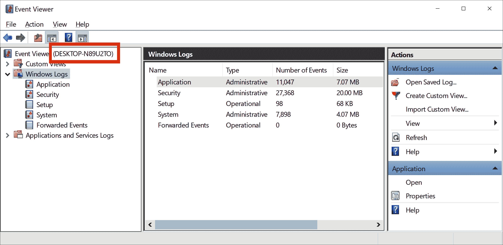

# 第 23 章 事件日志

## 23.0 简介

事件日志构成了 Windows 上大多数监视和诊断活动的核心。为了支持此活动，PowerShell 提供了 `Get-WinEvent` cmdlet，允许您查询和处理系统上的事件日志数据。除了简单的事件日志检索外，PowerShell 还包含许多其他 cmdlet，用于创建、删除、自定义事件日志以及与之交互。

## 23.1 列出所有事件日志

### 问题

您想要确定系统上存在哪些事件日志。

### 解决方案


# 23.1 列出所有事件日志

使用 `Get-WinEvent` cmdlet。除了经典事件日志外，`Get-WinEvent` cmdlet 还支持应用程序和服务事件日志：

```
PS > Get-WinEvent -ListLog * | Select LogName,RecordCount

LogName                                                        RecordCount
-------                                                        -----------
Application                                                           1933
DFS Replication                                                          0
HardwareEvents                                                           0
Internet Explorer                                                        0
Key Management Service                                                   0
Media Center                                                             0
OAlerts                                                                  2
ScriptEvents                                                           424
Security                                                             39005
System                                                               55957
Windows PowerShell                                                    2865
ForwardedEvents
Microsoft-Windows-Backup                                                 0
Microsoft-Windows-Bits-Client/Ana ...
Microsoft-Windows-Bits-Client/Oper...                                 2232
Microsoft-Windows-Bluetooth-MTPEnu...                                    0
Microsoft-Windows-CAPI2/Operational
(...)
```

若要使用 Windows 事件查看器图形用户界面浏览事件日志，请使用 `Show-EventLog` cmdlet。

## 讨论

`Get-WinEvent` cmdlet 的 `-List` 参数会生成系统上已注册事件日志的列表。除了支持当前系统上的事件日志外，它还允许你提供 `-ComputerName` 参数以与远程系统上的事件日志进行交互。

一旦确定了你感兴趣的事件日志，即可使用 `Get-WinEvent` cmdlet 在这些日志中搜索、筛选和检索特定条目。有关如何检索事件日志条目的信息，请参阅配方 23.2、23.3 和 23.4。

有关 `Get-WinEvent` cmdlet 的详细信息，请输入 `Get-Help Get-WinEvent`。

## 另请参阅

- 配方 23.2，“从事件日志获取最旧条目”
- 配方 23.3，“查找包含特定文本的事件日志条目”
- 配方 23.4，“检索和筛选事件日志条目”

# 23.2 从事件日志获取最旧条目

## 问题

你想按事件写入的顺序检索事件日志中的事件。

## 解决方案

要按事件写入的顺序检索事件日志中的条目，请使用 `Get-WinEvent` cmdlet 的 `-Oldest` 参数，如 示例 23-1 所示。

### 示例 23-1. 从 System 事件日志检索 10 个最旧条目

```
PS > Get-WinEvent System -Oldest | Select -First 10 | Format-Table Index,Source,Message

   ProviderName: Microsoft-Windows-DistributedCOM

TimeCreated              Id LevelDisplayName Message
-----------              -- ---------------- -------
11/24/2020 5:56:14 AM 10016 Warning          The mach...
11/24/2020 5:56:14 AM 10016 Warning          The appl...
11/24/2020 5:56:14 AM 10016 Warning          The mach...
11/24/2020 5:56:53 AM 10016 Warning          The appl...


   ProviderName: Service Control Manager

TimeCreated             Id LevelDisplayName Message
-----------             -- ---------------- -------
11/24/2020 5:58:03 AM 7040 Information      The start...
```

## 讨论

默认情况下，`Get-WinEvent` cmdlet 返回事件日志中最近的条目，这通常是你想要的。

如果你需要按日期从最旧到最新对事件日志条目进行排序（而不使用 `Sort-Object` cmdlet），可以使用 `Get-WinEvent` cmdlet 的 `-Oldest` 参数。要列出系统上可用的事件日志，请参阅 配方 23.1。

有关 `Get-WinEvent` cmdlet 的详细信息，请输入 `Get-Help Get-WinEvent`。

## 另请参阅

- 配方 23.1，“列出所有事件日志”

# 23.3 查找包含特定文本的事件日志条目

## 问题

你想检索包含给定术语的所有事件日志条目。

## 解决方案

要查找特定的事件日志条目，请使用 `Get-WinEvent` cmdlet 检索项目，然后通过管道传递给 `Where-Object` cmdlet 进行筛选，如 示例 23-2 所示。

### 示例 23-2. 搜索提及术语“disk”的事件日志条目

```
PS > Get-WinEvent System | Where-Object { $_.Message -match "disk" }

Index Time          Type Source                EventID Message
----- ----          ---- ------                ------- -------
 2920 May 06 09:18  Info Service Control M...     7036 The Logical Disk...
 2919 May 06 09:17  Info Service Control M...     7036 The Logical Disk...
 2918 May 06 09:17  Info Service Control M...     7035 The Logical Disk...
 2884 May 06 00:28  Erro sr                          1 The System Resto...
 2333 Apr 03 00:16  Erro Disk                       11 The driver detec...
 2332 Apr 03 00:16  Erro Disk                       11 The driver detec...
 2131 Mar 27 13:59  Info Service Control M...     7036 The Logical Disk...
 2127 Mar 27 12:48  Info Service Control M...     7036 The Logical Disk...
 2126 Mar 27 12:48  Info Service Control M...     7035 The Logical Disk...
 2123 Mar 27 12:31  Info Service Control M...     7036 The Logical Disk...
 2122 Mar 27 12:29  Info Service Control M...     7036 The Logical Disk...
 2121 Mar 27 12:29  Info Service Control M...     7035 The Logical Disk...
```

## 讨论

由于 `Get-WinEvent` cmdlet 检索代表事件日志条目的丰富对象，你可以将它们通过管道传递给 `Where-Object` cmdlet 以进行同样丰富的筛选。

### 注意

`Get-WinEvent` cmdlet 支持一个名为 `-FilterXPath` 的有前途的事件日志高级筛选参数。虽然功能强大，但其筛选语言遗憾的是不支持通配符字符串搜索。

默认情况下，PowerShell 的表格式显示事件日志条目的摘要。然而，如果你在搜索事件日志消息，你可能有兴趣查看有关消息本身的更多详细信息。在这种情况下，请使用 `Format-List` cmdlet 以更详细的列表视图格式化这些条目。示例 23-3 显示了此视图。

### 示例 23-3. 事件日志条目的详细列表视图

```
PS > Get-WinEvent System | Where-Object Message -match "disk" | Format-List *

Message              : Disk 7 has been surprise removed.
Id                   : 157
Version              : 0
Qualifiers           : 32772
Level                : 3
Task                 : 0
Opcode               : 0
Keywords             : 36028797018963968
RecordId             : 184407
ProviderName         : disk
ThreadId             : 30988
TimeCreated          : 12/18/2020 2:39:50 PM
ContainerLog         : System
MatchedQueryIds      : {}
Bookmark             : System.Diagnostics.Eventing.Reader.EventBookmark
LevelDisplayName     : Warning
KeywordsDisplayNames : {Classic}
Properties           : {System.Diagnostics.Eventing.Reader.EventProperty,
                       System.Diagnostics.Eventing.Reader.EventProperty,
                       System.Diagnostics.Eventing.Reader.EventProperty}
(...)
```


有关 `Get-WinEvent` cmdlet 的详细信息，请输入 `Get-Help Get-WinEvent`。有关筛选命令输出的详细信息，请参阅食谱 2.2。

## 另请参阅

食谱 2.2，“筛选列表或命令输出中的项目”

# 23.4 检索并筛选事件日志条目

## 问题

您想要检索特定的事件日志条目，或按高级搜索条件进行筛选。

## 解决方案

要检索特定的事件日志条目，请使用 `Get-WinEvent` cmdlet 检索事件日志中的条目，然后将它们通过管道传递给 `Where-Object` cmdlet，以筛选出您要查找的条目：

```
PS > Get-WinEvent Microsoft-Windows-PowerShell/Operational |
    Where-Object { $_.Properties[2].Value -match "Invoke-WebRequest" }

   ProviderName: Microsoft-Windows-PowerShell

TimeCreated                      Id LevelDisplayName Message
-----------                      -- ---------------- -------
12/18/2020 3:14:17 PM          4104 Warning          Creating Scriptblo...
12/18/2020 3:14:17 PM          4104 Warning          Creating Scriptblo...
12/18/2020 3:14:05 PM          4104 Warning          Creating Scriptblo...
12/18/2020 3:14:05 PM          4104 Warning          Creating Scriptblo...
```

对于更高级（或对性能敏感）的查询，请使用 `Get-WinEvent` cmdlet 的 `-FilterXml`、`-FilterHashtable` 或 `-FilterXPath` 参数：

```
Get-WinEvent -LogName "System" -FilterXPath "*[System[EventRecordID = 2920]]"
```

## 讨论

如果您已列出事件日志中的项目，或搜索了包含特定文本消息的条目，通常希望获取有关特定事件日志条目的更多详细信息。

由于 `Get-WinEvent` cmdlet 检索代表事件日志条目的丰富对象，您可以将它们通过管道传递给 `Where-Object` cmdlet 进行同样丰富的筛选。

默认情况下，PowerShell 的默认表格式显示事件日志条目的摘要。然而，如果您正在检索特定条目，则可能有兴趣查看有关该条目的更多详细信息。在这种情况下，请使用 `Format-List` cmdlet 以更详细的列表视图格式化这些条目。

虽然 `Where-Object` cmdlet 非常适合简单（或一次性）任务，但 `Get-WinEvent` cmdlet 提供了三个参数，可以使您的事件日志搜索更强大、更高效。

### 高效处理简单查询

如果您有简单的事件日志查询，可以使用 `Get-WinEvent` cmdlet 的 `-FilterHashtable` 参数非常高效地筛选事件日志。

您提供给此参数的哈希表允许您按 `LogName`、`ProviderName`、`Path`、`Keywords`、`ID`、`Level`、`StartTime`、`EndTime` 和 `UserID` 进行筛选。这可以替代许多 `Where-Object` 风格的筛选操作。此示例检索系统事件日志中的所有严重和错误事件：

```
Get-WinEvent -FilterHashtable @{ LogName = "System"; Level = 1,2 }
```

### 自动化 GUI 生成的搜索

当您查看事件日志时，Windows 事件查看器在右侧提供“筛选当前日志”操作。此界面允许您选择数据范围、事件严重性、关键字、任务类别等。自定义筛选器后，您可以单击“XML”选项卡查看查询的 XML 表示形式。您可以将该 XML 直接复制并粘贴到脚本中的此处字符串（here string）中，然后将其传递给 `Get-WinEvent` cmdlet 的 `-FilterXml` 参数：

```
## 获取过去 24 小时内的所有严重和错误事件
$xml = @'
<QueryList>
  <Query Id="0" Path="System">
    <Select Path="System">
        *[System[(Level=1  or Level=2) and
            TimeCreated[timediff(@SystemTime) &lt;= 86400000]]]
    </Select>
  </Query>
</QueryList>
'@

Get-WinEvent -FilterXml $xml
```

### 执行复杂的事件分析和关联

在内部，事件日志以 XML 格式存储其事件信息。除了 `-FilterHashtable` 和 `-FilterXml` 参数外，`Get-WinEvent` cmdlet 还允许您使用标准 XPath XML 查询语言的子集来筛选事件日志。XPath 允许您的筛选器描述复杂的层次查询、值范围等。

#### 注意

像正则表达式一样，XPath 查询语言绝非简单或易于理解。如果您已经具备一定程度的 XPath 知识或熟悉度，此参数会有所帮助，但不要让它吓倒或挫伤您。总不止一种方法可以完成任务。

虽然 XPath 查询语言功能强大，但您可以表达的规则类型最终取决于实际事件的 XML 中包含的内容。要查看事件的 XML 中可以包含什么内容，请在 MSDN 中搜索“Windows ‘event schema’”。在线参考很有用，但实际事件往往只包含受支持 XML 节点的极小子集。因此，您可能通过查看您感兴趣的事件的 XML 并基于这些 XML 形成 XPath 查询会更成功。以下是一些基于 `-FilterXPath` 参数的示例查询：

```
## 按事件 ID 搜索
Get-WinEvent -LogName "System" -FilterXPath "*[System[(EventID=1)]]"

## 搜索与给定进程 ID 关联的事件
Get-WinEvent -LogName "System" -FilterXPath "*[System/Execution[@ProcessID=428]]"

## 搜索将 'Volume Shadow Copy' 作为替换字符串之一的事件
Get-WinEvent -LogName "System" -FilterXPath `
    "*[EventData[Data = 'Volume Shadow Copy']]"

## 搜索与给定 KB 关联的 Windows Installer 事件
$query = "*[UserData/CbsPackageInitiateChanges[PackageIdentifier = 'KB936330']]"
Get-WinEvent -LogName "System" -FilterXPath $query
```

虽然 XPath 筛选语言的丰富性非常强大，但一个令人痛苦的缺陷是无法使用通配符在字符串内搜索。如果您需要在字符串内搜索，则需要使用 `Where-Object` cmdlet，如食谱 23.3 所示。

## 另请参阅

食谱 2.2，“筛选列表或命令输出中的项目”

食谱 23.3，“查找包含特定文本的事件日志条目”

附录 C，*XPath 快速参考*

# 23.5 按频率查找事件日志条目

## 问题

您想要找出发生频率最高的事件日志条目。

## 解决方案

要按频率查找事件日志条目，请使用 `Get-WinEvent` cmdlet 检索事件日志中的条目，然后将它们通过管道传递给 `Group-Object` cmdlet，按其消息进行分组。

```
PS > Get-WinEvent System | Group-Object Message | Sort-Object -Desc Count

Count Name                      Group
----- ----                      -----
  161 Driver Microsoft XPS D... {LEE-DESK, LEE-DESK, LEE-DESK, LEE-DESK...
   23 The Background Intelli... {LEE-DESK, LEE-DESK, LEE-DESK, LEE-DESK...
   23 The Background Intelli... {LEE-DESK, LEE-DESK, LEE-DESK, LEE-DESK...
    3 The Logical Disk Manag... {LEE-DESK, LEE-DESK, LEE-DESK}
    3 The Logical Disk Manag... {LEE-DESK, LEE-DESK, LEE-DESK}
    3 The Logical Disk Manag... {LEE-DESK, LEE-DESK, LEE-DESK}
(...)
```

## 讨论

`Group-Object` cmdlet 是确定系统上哪些事件发生最频繁的有用方法。它还提供了一种汇总事件日志信息的有用方式。

如果您想了解特定组中项目的更多信息，请使用 `Where-Object` cmdlet。由于我们在 `Group-Object` cmdlet 中使用了 `Message` 属性，因此我们需要在 `Where-Object` cmdlet 中按 `Message` 进行筛选。例如，要了解更多关于与 Microsoft XPS 驱动程序相关的条目（来自解决方案中的场景）：


```
PS > Get-WinEvent System |
   Where-Object { $_.Message -like "Driver Microsoft XPS*" }

Index Time          Type Source                EventID Message
----- ----          ---- ------                ------- -------
 2917 May 06 09:13  Erro TermServDevices          1111 Driver Microsoft...
 2883 May 05 10:40  Erro TermServDevices          1111 Driver Microsoft...
 2877 May 05 08:10  Erro TermServDevices          1111 Driver Microsoft...
(...)
```

如果按消息分组不能提供有用信息，你可以按任何其他属性分组——例如提供程序名称：

```
PS > Get-WinEvent Application | Group ProviderName

Count Name                      Group
----- ----                      -----
   42 .NET Runtime              {System.Diagnostics.Even...
    2 .NET Runtime Optimizatio… {System.Diagnostics.Even...
   17 ADMConnector              {System.Diagnostics.Even...
   15 AGMService                {System.Diagnostics.Even...
   15 AGSService                {System.Diagnostics.Even...
   94 Application Error         {System.Diagnostics.Even...
    2 Application Hang          {System.Diagnostics.Even...
   47 Bonjour Service           {System.Diagnostics.Even...
(...)
```

如果你已列出事件日志中的项目，或搜索了包含特定文本消息的条目，通常想获取特定事件日志条目的更多详细信息。

默认情况下，PowerShell 的表格式显示事件日志条目的摘要。但是，如果你在搜索事件日志消息，可能对消息本身的更多详细信息感兴趣。在这种情况下，请使用 `Format-List` cmdlet 以更详细的列表视图格式化这些条目。示例 23-4 显示了此视图。

### 示例 23-4. 事件日志条目的详细列表视图

```
PS > Get-WinEvent System | Where-Object Message -match "disk" | Format-List *

Message              : Disk 7 has been surprise removed.
Id                   : 157
Version              : 0
Qualifiers           : 32772
Level                : 3
Task                 : 0
Opcode               : 0
Keywords             : 36028797018963968
RecordId             : 184407
ProviderName         : disk
ThreadId             : 30988
TimeCreated          : 12/18/2020 2:39:50 PM
ContainerLog         : System
MatchedQueryIds      : {}
Bookmark             : System.Diagnostics.Eventing.Reader.EventBookmark
LevelDisplayName     : Warning
KeywordsDisplayNames : {Classic}
Properties           : {System.Diagnostics.Eventing.Reader.EventProperty,
                       System.Diagnostics.Eventing.Reader.EventProperty,
                       System.Diagnostics.Eventing.Reader.EventProperty}
(...)
```

有关 `Get-WinEvent` cmdlet 的详细信息，请输入 `Get-Help Get-WinEvent`。有关筛选命令输出的详细信息，请参阅 食谱 2.2。有关 `Group-Object` cmdlet 的详细信息，请输入 `Get-Help Group-Object`。

## 另请参阅

食谱 2.2，“筛选列表或命令输出中的项目”

# 23.6 备份事件日志

## 问题

你想将事件日志中的信息存储在文件中，以便存储或稍后查看。

## 解决方案

要将事件日志条目存储在文件中，请使用 `wevtutil.exe` 应用程序：

```
PS > wevtutil epl System c:\temp\system.bak.evtx
```

导出事件日志后，使用 `Get-WinEvent` cmdlet 查询导出的日志，就像它是实时的一样：

```
PS > Get-WinEvent -FilterHashtable @{
     LogName="System"; Level=1,2 } -MaxEvents 2 | Format-Table -Auto

TimeCreated           ProviderName Id Message
-----------           ------------ -- -------
2/15/2021 11:49:31 AM Ntfs         55 The file system structure on the disk is...
2/15/2021 11:49:31 AM Ntfs         55 The file system structure on the disk is...

PS > Get-WinEvent -FilterHashtable @{
    Path="c:\temp\system.bak.evtx"; Level=1,2 } -MaxEvents 2 |
    Format-Table -Auto

TimeCreated           ProviderName Id Message
-----------           ------------ -- -------
2/15/2010 11:49:31 AM Ntfs         55 The file system structure on the disk is...
2/15/2010 11:49:31 AM Ntfs         55 The file system structure on the disk is...
```

如果需要在没有 `Get-WinEvent` cmdlet 的系统上处理事件日志，请使用 `Get-EventLog` cmdlet 检索事件日志中的条目，然后通过管道传递给 `Export-CliXml` cmdlet 将其存储在文件中。

```
Get-EventLog System | Export-CliXml c:\temp\SystemLogBackup.clixml
```

## 讨论

虽然没有用于导出事件日志的 PowerShell cmdlet，但 `wevtutil.exe` 应用程序提供了一种简单的方法，可将事件日志以完整保真度保存到磁盘。导出事件日志后，你可以再次导入它，甚至可以直接使用 `Get-WinEvent` cmdlet 对其进行查询。

如果你想在没有 `Get-WinEvent` cmdlet 的计算机上分析事件日志，可以使用 `Export-CliXml` cmdlet 将事件日志保存到磁盘——就像 PowerShell 允许你将任何其他结构化数据保存到磁盘一样。导出事件日志中的事件后，你可以将其归档，或使用 `Import-CliXml` cmdlet 在安装了 PowerShell 的任何计算机上查看它们：

```
PS > $archivedLogs = Import-CliXml c:\temp\SystemLogBackup.clixml
PS > $archivedLogs | Group Source

Count Name                      Group
----- ----                      -----
  856 Service Control Manager   {LEE-DESK, LEE-DESK, LEE-DESK, LEE-DESK...
  640 TermServDevices           {LEE-DESK, LEE-DESK, LEE-DESK, LEE-DESK...
   91 Print                     {LEE-DESK, LEE-DESK, LEE-DESK, LEE-DESK...
  100 WMPNetworkSvc             {LEE-DESK, LEE-DESK, LEE-DESK, LEE-DESK...
  123 Tcpip                     {LEE-DESK, LEE-DESK, LEE-DESK, LEE-DESK...
(...)
```

除了 `Export-CliXml` cmdlet，还可以使用 WMI 的 `Win32_NTEventLogFile` 类来备份经典事件日志：

```
$log = Get-CimInstance Win32_NTEventLogFile -Filter "LogFileName = 'Application'"
$log | Invoke-CimMethod -Name BackupEventLog -Arguments @{
    ArchiveFileName = "c:\temp\application_backup.log" }
```

保存日志后，可以使用 Windows 事件查看器中的“打开已保存的日志”功能来查看它。

有关 `Get-EventLog` cmdlet 的详细信息，请输入 `Get-Help Get-EventLog`。有关 `Export-CliXml` 和 `Import-CliXml` cmdlet 的详细信息，请分别输入 `Get-Help Export-CliXml` 和 `Get-Help Import-CliXml`。

# 23.7 创建或删除事件日志

## 问题

你想创建或删除事件日志。

## 解决方案

使用 `New-EventLog` 和 `Remove-EventLog` cmdlet 来创建和删除事件日志：

```
PS > New-EventLog -Logname ScriptEvents -Source PowerShellCookbook
PS > Get-EventLog -List

  Max(K) Retain OverflowAction        Entries Log
  ------ ------ --------------        ------- ---
  20,480      0 OverwriteAsNeeded       1,930 Application
(...)
     512      7 OverwriteOlder              0 ScriptEvents
(...)
  15,360      0 OverwriteAsNeeded       2,847 Windows PowerShell

PS > Remove-EventLog ScriptEvents
```

这两个 cmdlet 都支持通过 `-ComputerName` 参数进行远程管理。

## 讨论

虽然 Windows 提供了标准的 Application 事件日志，但有时你可能想创建单独的事件日志来保存特定关注的事件。为此，PowerShell 包含 `New-EventLog` cmdlet。它接受两个参数：事件日志名称和事件的源标识符。如果事件日志不存在，PowerShell 将创建它。如果事件日志和事件日志源都已存在，`New-EventLog` cmdlet 将生成错误。

创建事件日志后，`Limit-EventLog` cmdlet 允许你管理其保留策略。有关 `Limit-EventLog` cmdlet 的详细信息，请参阅 食谱 23.10。


## 23.7 创建或删除事件日志

`Remove-EventLog` cmdlet 允许你同时删除事件日志和事件日志源。

### 警告

删除事件日志时请务必小心，因为如果你不小心删错了日志，要重新创建所有事件源是非常困难的。如果你删除了标准事件日志，几乎没有恢复的希望。

若要仅删除事件日志源，请使用 `-Source` 参数：

```
Remove-EventLog -Source PowerShellCookbook
```

若要彻底删除事件日志，请在 `-LogName` 参数中指定日志名称：

```
Remove-EventLog -LogName ScriptEvents
```

创建事件日志后，你可以使用 `Write-EventLog` cmdlet 来操作它。有关写入事件日志的详细信息，请参阅 配方 23.8。

## 另请参阅

配方 23.8

# 23.8 写入事件日志

## 问题

你想向事件日志添加一个条目。

## 解决方案

使用 `Write-EventLog` cmdlet 将事件写入事件日志：

```
PS > Write-EventLog -LogName ScriptEvents -Source PowerShellCookbook `
    -EventId 1234 -Message "Hello World"

PS > Get-EventLog ScriptEvents | Select EntryType,Source,InstanceId,Message

         EntryType Source                     InstanceId Message
         --------- ------                     ---------- -------
       Information PowerShellCookbook               1234 Hello World
```

## 讨论

`Write-EventLog` cmdlet 允许你将事件日志消息写入指定的事件日志。要写入事件日志消息，你必须提供有效的日志名称和已注册的事件日志源。如果你需要创建新的事件日志或注册新的事件源，请参阅 配方 23.7。

除了日志名称和源之外，`Write-EventLog` cmdlet 还需要事件 ID 和消息。在一个事件日志和事件源中，每个事件 ID 应唯一标识正在记录的情况：例如，*登录失败* 或 *磁盘已满*。这使得脚本和其他管理任务能够轻松自动响应系统事件。事件消息应详细说明正在记录的情况（例如，用户名或驱动器号），但不应被用作识别其原因的必要条件。

虽然 PowerShell 还包含 `Write-WinEvent` cmdlet（`WinEvent` cmdlet 几乎是你唯一需要使用的事件日志 cmdlet），但 `Write-WinEvent` cmdlet 仅适用于你已定义并通过复杂的自定义清单注册的事件日志源——对于临时事件来说，这复杂得多，不值得使用。

## 另请参阅

配方 23.7，“创建或删除事件日志”

# 23.9 为 Windows 事件日志条目运行 PowerShell 脚本

## 问题

当系统生成特定的事件日志条目时，你想运行一个 PowerShell 脚本。

## 解决方案

使用 `schtasks.exe` 工具定义一个对事件日志条目做出反应的新任务。作为其操作，使用禁用配置文件、自定义执行策略、隐藏窗口以及启动脚本的参数来调用 `powershell.exe`：

```
$cred = Get-Credential
$password = $cred.GetNetworkCredential().Password

## 定义任务计划程序在事件发生时应运行的命令
$command = "PowerShell -NoProfile -ExecutionPolicy RemoteSigned " +
    "-WindowStyle Hidden -File 'C:\Program Files\TaskScripts\ScriptEvents.ps1'"

## 创建一个新的计划任务
SCHTASKS /Create /TN "ScriptEvents Monitor" /TR $command /SC ONEVENT `
         /RL Highest /RU $cred.Username /RP $password `
         /EC ScriptEvents /MO *[System/EventID=1010]
```

## 讨论

Windows 事件日志允许你定义在生成事件时启动的自定义操作。虽然你可以使用 UI 来创建这些任务和筛选器，但 `schtasks.exe` 工具让你能从自动化友好的命令行创建所有这些内容。

作为实际操作的一个示例，想象一下试图在发生问题事件时捕获系统上正在运行的进程。该脚本可能如下所示：

```
$logTag = "{0:yyyyMMdd_HHmm}" -f (Get-Date)
$logPath = 'C:\Program Files\TaskScripts\ScriptEvents-{0}.txt' -f $logTag

Start-Transcript -Path $logPath

Get-CimInstance Win32_OperatingSystem | Format-List | Out-String
Get-Process | Format-Table | Out-String

Stop-Transcript
```

生成事件后，我们可以看到日志刚刚创建片刻后就出现了：

```
PS > dir

    Directory: C:\Program Files\TaskScripts

Mode                LastWriteTime     Length Name
----                -------------     ------ ----
-a---         2/21/2020   8:38 PM        278 ScriptEvents.ps1

PS > Write-EventLog -LogName ScriptEvents -Source PowerShellCookbook `
    -EventId 1010 -Message "Hello World"

PS > dir

    Directory: C:\Program Files\TaskScripts

Mode                LastWriteTime     Length Name
----                -------------     ------ ----
-a---         2/21/2020   9:50 PM      12766 ScriptEvents-20200221_2150.txt
-a---         2/21/2020   8:38 PM        278 ScriptEvents.ps1
```

定义任务时，我们使用 `/TN` 参数为任务定义名称。作为命令（由 `/TR` 参数指定），我们告诉 Windows 启动 `powershell.exe` 并使用多个参数来自定义其环境。我们使用 `/RL` 参数确保任务以提升的权限运行（因为它写入 `Program Files` 目录）。要定义实际的事件日志筛选器，我们使用 `/EC` 参数定义事件通道——在本例中为 `ScriptEvents` 日志。在 `/MO`（“修饰符”）参数中，我们指定匹配我们关心的事件所需的 XPath 筛选器。在本例中，我们搜索 EventId 1010。`System/` 前缀并不告诉 Windows 搜索 `System` 事件日志；它告诉 Windows 查看标准系统属性：`EventID`、`Level`、`Task`、`Keywords`、`Computer` 等。

有关事件查看器 XPath 语法的详细信息，请参阅 配方 23.4。

## 另请参阅

配方 1.17，“从 PowerShell 外部调用 PowerShell 命令或脚本”

配方 23.4，“检索和筛选事件日志条目”

# 23.10 清除或维护事件日志

## 问题

你想清除事件日志或管理其保留策略。

## 解决方案

要清除事件日志，请使用 `wevtutil.exe` 应用程序。例如，要清除 Microsoft Office 警报日志：

```
wevtutil cl 'OAlerts'
```

同样，要配置日志属性（例如增加保留限制）：

```
wevtutil sl Microsoft-Windows-PowerShell/Operational /ms:$(200mb)
```

## 讨论

大多数事件日志的默认策略在很大程度上是合理的。但是，你可能想要修改的事件日志是你的安全事件日志：操作系统默认的几十兆字节在发生安全事件时不太可能对你有帮助。

PowerShell 包含用于管理较旧的经典事件日志（应用程序、安全性等）的 cmdlet，但你需要对现代事件日志使用 `wevtutil.exe`。

要永久更改经典事件日志的策略，请使用 `Limit-EventLog` cmdlet。此 cmdlet 允许你限制应用它的事件日志的日志大小、最大事件期限和覆盖行为。虽然大小和期限限制是相当不言自明的参数，但配置溢出行为则更微妙。

`-OverflowAction` 参数支持三个选项之一。每个选项描述了 Windows 在写入已满的事件日志时采取的不同策略：

`DoNotOverwrite`

: 丢弃新条目。

`OverwriteAsNeeded`

: 覆盖最旧的条目。

`OverwriteOlder`

: 覆盖早于为事件日志指定的期限限制的条目（通过 `RetentionDays` 参数）。如果没有旧条目可供覆盖，Windows 将丢弃新条目。


要完全清除经典事件日志，请使用 `Clear-EventLog` cmdlet。对于现代事件日志，请使用 `wevtutil.exe` 的 `cl` 参数。如果要在清除之前保存事件日志的内容，请参阅 配方 23.6。

如果要完全删除事件日志，请参阅 配方 23.7。

## 另请参阅

- 配方 3.8，“使用 .NET 对象”
- 配方 23.6，“备份事件日志”
- 配方 23.7，“创建或删除事件日志”

## 23.11 访问远程计算机的事件日志

### 问题

您想要从远程计算机访问事件日志条目。

### 解决方案

要访问远程计算机上的事件日志，请使用任意 `EventLog` cmdlet 的 `-ComputerName` 参数：

```
PS > Get-WinEvent System -ComputerName LEE-DESK | Group-Object Source

Count Name                      Group
----- ----                      -----
   91 Print                     {LEE-DESK, LEE-DESK, LEE-DESK, LEE-DESK...
  640 TermServDevices           {LEE-DESK, LEE-DESK, LEE-DESK, LEE-DESK...
  148 W32Time                   {LEE-DESK, LEE-DESK, LEE-DESK, LEE-DESK...
  100 WMPNetworkSvc             {LEE-DESK, LEE-DESK, LEE-DESK, LEE-DESK...
  856 Service Control Manager   {LEE-DESK, LEE-DESK, LEE-DESK, LEE-DESK...
  123 Tcpip                     {LEE-DESK, LEE-DESK, LEE-DESK, LEE-DESK...
(...)
```

要使用图形事件日志查看器浏览远程计算机上的事件日志，请使用 `Show-EventLog` cmdlet：

```
Show-EventLog Computername
```

### 讨论

`*-EventLog` cmdlet 的 `-ComputerName` 参数使管理远程计算机的事件日志变得容易。使用这些 cmdlet，您可以创建事件日志、删除事件日志、写入事件日志条目等。

如果您想以更临时的方式使用图形用户界面处理远程计算机上的事件日志，请使用 `Show-EventLog` cmdlet。如果远程计算机上启用了“远程事件日志管理”防火墙规则（并且您拥有适当的权限），PowerShell 将启动针对该计算机的 Windows 事件查看器（请参阅 图 23-1）。

默认情况下，Windows 事件查看器会尝试使用您当前帐户的凭据连接到远程计算机。如果您需要以另一个帐户连接，请单击打开的事件查看器窗口右侧的“连接到另一台计算机”操作。在该窗口中，指定远程计算机名称和新用户信息。



有关如何获取事件日志的信息，请参阅 配方 23.1。有关如何创建或删除事件日志的更多信息，请参阅 配方 23.7。有关如何写入事件日志条目的更多信息，请参阅 配方 23.8。

### 另请参阅

- 配方 23.1，“列出所有事件日志”
- 配方 23.7，“创建或删除事件日志”
- 配方 23.8，“写入事件日志”
