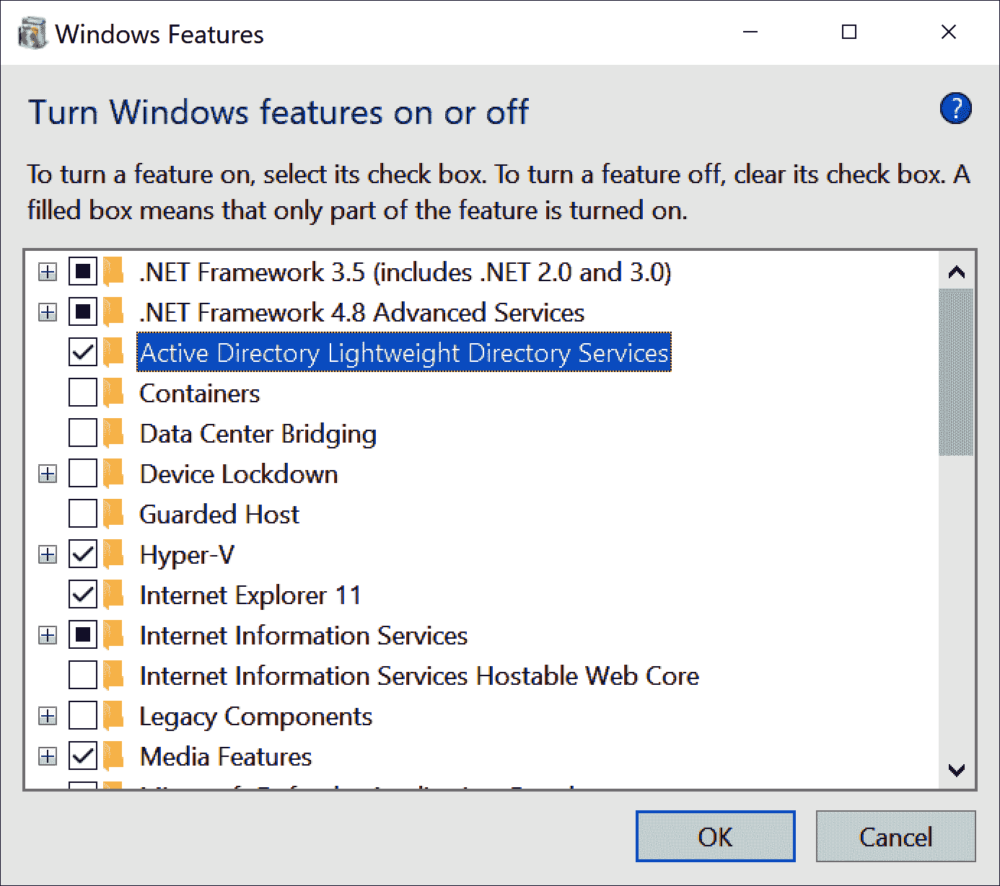

# 第 26 章 Active Directory

# 26.0 简介

可以说，Windows 平台上系统管理的独特之处在于它与 Active Directory 的交互。作为 Windows 网络的集中授权、身份验证和信息存储，Active Directory 自动化构成了许多企业管理任务的核心。

在核心 PowerShell 语言中，与 Active Directory 交互的主要方式是通过其对 Active Directory Service Interface (ADSI) 类型快捷方式的支持。

此外，Active Directory 团队创建了一个功能极其丰富的 PowerShell 模块来管理 Active Directory 域。Active Directory 模块包括一个 PowerShell 提供程序 (`Set-Location AD:\`) 和近 100 个特定任务的 PowerShell cmdlet。

使用 Active Directory 模块有两个要求：

**服务器支持**

: 此模块适用于已启用 Active Directory Web Services 功能的任何域。Windows Server 2008 R2 默认在 Active Directory 实例上启用此功能，您也可以在从 Windows Server 2003 开始的任何较新服务器操作系统上安装它。

**客户端支持**

: 该模块本身包含在 Windows 7 远程服务器管理工具 (RSAT) 包中。下载并安装该包后，您可以通过控制面板中的“启用或关闭 Windows 功能”对话框来启用它。

如果可以使用 Active Directory 模块，请导入它并使用其命令。`Get-Command` 和 `Get-Help` 命令应该是您入门所需的两个关键步骤。除了内置在命令中的帮助外，MSDN 还提供了 [Active Directory 模块的优秀任务型介绍](https://oreil.ly/JiH6q)。

如果无法使用 Active Directory 模块，PowerShell 通过其内置的 `[adsi]` 和 `[adsisearcher]` 类型快捷方式提供了与 Active Directory 的无缝集成。本章介绍它们在最常见的 Active Directory 任务中的用法。

# 26.1 在本地安装上测试 Active Directory 脚本

## 问题

您想要针对本地安装测试 Active Directory 脚本。

## 解决方案

要针对本地系统测试脚本，请安装 Active Directory 轻型目录服务 (AD LDS) 及其示例配置。

## 讨论

对于大多数用途，Active Directory 轻型服务可作为 Active Directory 的轻量级版本工作。尽管它不支持 Active Directory 的任何基础设施功能，但其编程模型足够接近，您可以轻松地使用它来试验 Active Directory 脚本。在早期，Active Directory 轻型目录服务被称为 Active Directory 应用程序模式 (ADAM)，因此在学习使用它时，您可能会发现对 ADAM 的引用。要针对本地安装测试脚本，您需要启用 AD LDS 可选 Windows 功能（如 图 26-1 所示），然后创建一个测试实例。



### 创建测试实例

从“开始”菜单中，找到并启动 Active Directory 轻型目录服务安装向导。


在接下来出现的“设置选项”页面上，选择“一个唯一实例”。在“实例名称”页面上，键入 `Test` 作为实例名称。在“端口”页面上，接受默认端口，然后在“应用程序目录分区”页面上，选择“是，创建一个应用程序目录分区”。作为分区名称，键入 `DC=Fabrikam,DC=COM`。

在后续页面中，接受默认的文件位置、服务账户和管理员。

当安装向导提供导入 LDIF 文件的选项时，导入除 `MS-AZMan.LDF` 之外的所有可用文件。单击此页面和确认页面上的“下一步”以完成实例设置。

打开一个 PowerShell 窗口，并测试你的新实例：

```
PS > [adsi] "LDAP://localhost:389/dc=Fabrikam,dc=COM"

distinguishedName
-----------------
{DC=Fabrikam,DC=COM}
```

`[adsi]` 标记是一个 `type shortcut`（类型快捷方式），就像 PowerShell 中的其他几个类型快捷方式一样。`[adsi]` 类型快捷方式提供了一种通过 Active Directory 服务接口创建和处理目录项的快速方法。

### 注意

当你第一次尝试此快捷方式时，可能会收到这个无用的错误消息：

```
format-default : The following exception occurred while retrieving
member "PSComputerName": "Unknown error (0x80005000)"
```

如果收到此错误，请确保 `LDAP://localhost` 中的 `LDAP` 已大写。

尽管针对 AD LDS 测试环境的脚本与直接针对 Active Directory 运行的脚本几乎相同，但仍存在一些细微差别。AD LDS 脚本在其绑定字符串中指定主机和端口（即 `localhost:389/`），而 Active Directory 脚本则不需要。

有关 PowerShell 中类型快捷方式的详细信息，请参阅 “使用 .NET Framework”。

## 另请参阅

“使用 .NET Framework”

# 26.2 创建组织单位

## 问题

你想要在 Active Directory 中创建一个组织单位 (OU)。

## 解决方案

要在容器中创建 OU，请使用 `[adsi]` 类型快捷方式绑定到 Active Directory 的一部分，然后调用 `Create()` 方法。

```
$domain = [adsi] "LDAP://localhost:389/dc=Fabrikam,dc=COM"
$salesOrg = $domain.Create("OrganizationalUnit", "OU=Sales")
$salesOrg.Put("Description", "Sales Headquarters, SF")
$salesOrg.Put("wwwHomePage", "http://fabrikam.com/sales")
$salesOrg.SetInfo()
```

## 讨论

解决方案展示了一个在组织根目录下创建 `Sales` OU 的示例。你可以使用相同的语法在其他 OU 下创建 OU。示例 26-1 演示了如何创建更多销售部门。

### 示例 26-1. 创建北区、东区和西区销售部门

```
$sales = [adsi] "LDAP://localhost:389/ou=Sales,dc=Fabrikam,dc=COM"

$east = $sales.Create("OrganizationalUnit", "OU=East")
$east.Put("wwwHomePage", "http://fabrikam.com/sales/east")
$east.SetInfo()

$west = $sales.Create("OrganizationalUnit", "OU=West")
$west.Put("wwwHomePage", "http://fabrikam.com/sales/west")
$west.SetInfo()

$north = $sales.Create("OrganizationalUnit", "OU=North")
$north.Put("wwwHomePage", "http://fabrikam.com/sales/north")
$north.SetInfo()
```

当你最初创建项目时，请注意你需要使用 `Put()` 方法在新项目上设置属性。创建项目后，你可以改用简单的属性访问来更改这些属性。有关更改 OU 属性的详细信息，请参阅 配方 26.4。

要检查这些 OU 是否已创建，请参阅 配方 26.6。

使用 Active Directory 模块，创建 OU 的 cmdlet 是 `New-ADOrganizationalUnit`。有关如何通过 Active Directory 模块完成这些任务的详细信息，请参阅 [该模块的在线帮助文档](https://oreil.ly/JiH6q)。

## 另请参阅

配方 26.4，“修改组织单位的属性”

配方 26.6，“获取 Active Directory 容器的子项”

# 26.3 获取组织单位的属性

## 问题

你想要获取并列出特定 OU 的属性。

## 解决方案

要列出 OU 的属性，请使用 `[adsi]` 类型快捷方式绑定到 Active Directory 中的 OU，然后将 OU 传递给 `Format-List` cmdlet：

```
$organizationalUnit =
  [adsi] "LDAP://localhost:389/ou=West,ou=Sales,dc=Fabrikam,dc=COM"

$organizationalUnit | Format-List *
```

## 讨论

解决方案检索 `Sales West` OU。默认情况下，`Format-List` cmdlet 仅显示组的可分辨名称，因此我们输入 `Format-List *` 以显示所有属性。

如果你知道想要获取值的属性，可以按名称指定它：

```
PS > $organizationalUnit.wWWHomePage
http://fabrikam.com/sales/west
```

如果你在获取已知存在的属性时遇到麻烦，也可以使用容器上的 `Get()` 方法来检索该属性。虽然 `name` 属性可以使用常规属性语法访问，但以下示例演示了替代方法：

```
PS > $organizationalUnit.Get("name")
West
```

使用 Active Directory 模块，获取组织单位属性的 cmdlet 是 `Get-ADOrganizationalUnit`。有关如何通过 Active Directory 模块完成这些任务的详细信息，请参阅 [该模块的在线帮助文档](https://oreil.ly/JiH6q)。

# 26.4 修改组织单位的属性

## 问题

你想要修改特定 OU 的属性。

## 解决方案

要修改 OU 的属性，请使用 `[adsi]` 类型快捷方式绑定到 Active Directory 中的 OU。如果该属性已设置，你可以像更改任何其他 PowerShell 对象的属性值一样更改它。如果你是首次设置属性，请使用 `Put()` 方法。最后，调用 `SetInfo()` 方法以应用更改。

```
$organizationalUnit =
  [adsi] "LDAP://localhost:389/ou=West,ou=Sales,dc=Fabrikam,dc=COM"

$organizationalUnit.Put("Description", "Sales West Organization")
$organizationalUnit.wwwHomePage = "http://fabrikam.com/sales/west/fy2012"
$organizationalUnit.SetInfo()
```

## 讨论

解决方案检索 `Sales West` OU。然后将说明设置为 `Sales West Organization`，更新主页，并将这些更改应用到 Active Directory。

使用 Active Directory 模块，修改 OU 属性的 cmdlet 是 `Set-ADOrganizationalUnit`。有关如何通过 Active Directory 模块完成这些任务的详细信息，请参阅 [该模块的在线帮助文档](https://oreil.ly/JiH6q)。

# 26.5 删除组织单位

## 问题

你想要删除特定的 OU。

## 解决方案

要删除 OU，请使用 `[adsi]` 类型快捷方式绑定到 Active Directory 中的 OU。最后，调用其 `DeleteTree()` 方法以应用更改。

```
$organizationalUnit =
  [adsi] "LDAP://localhost:389/ou=North,ou=Sales,dc=Fabrikam,dc=COM"
$organizationalUnit.DeleteTree()
```

## 讨论

解决方案检索 `Sales North` OU。然后调用 `DeleteTree()` 方法永久删除该 OU 及其所有子项。

使用 Active Directory 模块，删除 OU 的 cmdlet 是 `Remove-ADOrganizationalUnit`。有关如何通过 Active Directory 模块完成这些任务的详细信息，请参阅 [该模块的在线帮助文档](https://oreil.ly/JiH6q)。

# 26.6 获取 Active Directory 容器的子项

## 问题

你想要列出 Active Directory 容器的所有子项。

## 解决方案

要列出容器中的项目，请使用 `[adsi]` 类型快捷方式绑定到 Active Directory 中的 OU，然后访问该容器的 `Children` 属性：


## 讨论

该解决方案列出了 `Sales` OU 的所有子对象。这是您在 `ADSIEdit` MMC 管理单元中选择节点时通常获得的信息级别。如果要筛选此信息以仅包含用户、其他 OU 或更复杂的查询，请参阅 食谱 26.9。

使用 Active Directory 模块，Active Directory 提供程序允许您获取 OU 的子对象。例如：

```powershell
PS > Set-Location 'AD:\ou=Sales,dc=Fabrikam,dc=COM'
PS > dir
```

有关如何通过 Active Directory 模块完成这些任务的详细信息，请参阅 [该模块的在线帮助文档](https://oreil.ly/JiH6q)。

## 另请参阅

食谱 26.9，“搜索用户账户”

## 26.7 创建用户账户

### 问题

您想要在特定的 OU 中创建一个用户账户。

### 解决方案

要在容器中创建用户，请使用 `[adsi]` 类型快捷方式绑定到 Active Directory 中的 OU，然后调用 `Create()` 方法：

```powershell
$salesWest =
  [adsi] "LDAP://localhost:389/ou=West,ou=Sales,dc=Fabrikam,dc=COM"

$user = $salesWest.Create("User", "CN=MyerKen")
$user.Put("userPrincipalName", "Ken.Myer@fabrikam.com")
$user.Put("displayName", "Ken Myer")
$user.SetInfo()
```

### 讨论

该解决方案在 `Sales West` OU 下创建了一个用户。它设置了 `userPrincipalName`（用户的唯一标识符）以及用户的显示名称。

#### 注意

如果此步骤生成错误，提示“指定的目录服务属性或值不存在”，请验证您是否在 AD LDS 安装步骤开始时正确导入了 LDIF 文件。导入这些 LDIF 文件将创建许多此类步骤所需的 Active Directory 架构。

当您针对真实的 Active Directory 部署（而不是 AD LDS 实例）运行此脚本时，请务必更新 `sAMAccountName` 属性，否则您将获得一个自动生成的默认值。

要检查这些用户是否已创建，请参阅 食谱 26.6。如果您需要批量创建用户，请参阅 食谱 26.8。

使用 Active Directory 模块，创建用户账户的 cmdlet 是 `New-ADUser`。有关如何通过 Active Directory 模块完成这些任务的详细信息，请参阅 [该模块的在线帮助文档](https://oreil.ly/JiH6q)。

### 另请参阅

食谱 26.6，“获取 Active Directory 容器的子对象”

食谱 26.8，“程序：批量导入用户到 Active Directory”

## 26.8 程序：批量导入用户到 Active Directory

当将多个用户导入 Active Directory 时，手动操作（甚至逐个编写脚本添加用户）很快就会变得繁琐。为了解决这个问题，我们可以将所有数据放入 CSV 文件中，然后根据 CSV 中的信息进行批量导入。

示例 26-2 以灵活的方式支持此功能。您提供一个用于容纳用户账户的容器和一个包含账户信息的 CSV 文件。对于 CSV 中的每一行，脚本都会根据该行中的数据创建一个用户。唯一强制性的列是 `CN` 列，用于定义用户的通用名称。如果存在其他列，则表示您想要为该用户定义的其他 Active Directory 属性。

### 示例 26-2. Import-ADUser.ps1

```powershell
#############################################################################
##
## Import-AdUser
##
## From PowerShell Cookbook (O'Reilly)
## by Lee Holmes (http://www.leeholmes.com/guide)
##
#############################################################################

<#

.SYNOPSIS

Create users in Active Directory from the content of a CSV.

.DESCRIPTION

In the user CSV, One column must be named "CN" for the user name.
All other columns represent properties in Active Directory for that user.

For example:
CN,userPrincipalName,displayName,manager
MyerKen,Ken.Myer@fabrikam.com,Ken Myer,
DoeJane,Jane.Doe@fabrikam.com,Jane Doe,"CN=MyerKen,OU=West,OU=Sales,DC=..."
SmithRobin,Robin.Smith@fabrikam.com,Robin Smith,"CN=MyerKen,OU=West,OU=..."

.EXAMPLE

PS > $container = "LDAP://localhost:389/ou=West,ou=Sales,dc=Fabrikam,dc=COM"
PS > Import-ADUser.ps1 $container .\users.csv

#>

param(
    ## The container in which to import users
    ## For example:
    ## "LDAP://localhost:389/ou=West,ou=Sales,dc=Fabrikam,dc=COM")
    [Parameter(Mandatory = $true)]
    $Container,

    ## The path to the CSV that contains the user records
    [Parameter(Mandatory = $true)]
    $Path
)

Set-StrictMode -Off

## Bind to the container
$userContainer = [adsi] $container

## Ensure that the container was valid
if(-not $userContainer.Name)
{
    Write-Error "Could not connect to $container"
    return
}

## Load the CSV
$users = @(Import-Csv $Path)
if($users.Count -eq 0)
{
    return
}

## Go through each user from the CSV
foreach($user in $users)
{
    ## Pull out the name, and create that user
    $username = $user.CN
    $newUser = $userContainer.Create("User", "CN=$username")

    ## Go through each of the properties from the CSV, and set its value
    ## on the user
    foreach($property in $user.PsObject.Properties)
    {
        ## Skip the property if it was the CN property that sets the
        ## user name
        if($property.Name -eq "CN")
        {
            continue
        }

        ## Ensure they specified a value for the property
        if(-not $property.Value)
        {
            continue
        }

        ## Set the value of the property
        $newUser.Put($property.Name, $property.Value)
    }

    ## Finalize the information in Active Directory
    $newUser.SetInfo()
}
```

有关运行脚本的详细信息，请参阅 食谱 1.2。

### 另请参阅

食谱 1.2，“运行程序、脚本和现有工具”

## 26.9 搜索用户账户

### 问题

您想要搜索特定的用户账户，但不知道用户的可分辨名称。

### 解决方案

要在 Active Directory 中搜索用户，请使用 `[adsi]` 类型快捷方式绑定到包含用户账户的容器，然后使用 `[adsisearcher]` 类型快捷方式搜索用户：

```powershell
$domain = [adsi] "LDAP://localhost:389/dc=Fabrikam,dc=COM"
$searcher = [adsisearcher] $domain
$searcher.Filter = '(&(objectClass=User)(displayName=Ken Myer))'
$userResult = $searcher.FindOne()
$user = $userResult.GetDirectoryEntry()
$user
```

### 讨论

当您不知道用户账户的完整可分辨名称时，`[adsisearcher]` 类型快捷方式允许您搜索它。

您提供一个 LDAP 筛选器（在本例中，搜索显示名称为 `Ken Myer` 的用户），然后调用 `FindOne()` 方法。`FindOne()` 方法返回与筛选器匹配的第一个搜索结果，因此我们检索其实际的 Active Directory 条目。如果您预期查询会返回多个结果，请改用 `FindAll()` 方法。虽然该解决方案按用户的显示名称搜索，但您可以搜索 Active Directory 中的任何字段——`userPrincipalName` 和 `sAMAccountName` 是另外两个不错的选择。

执行此搜索时，请始终尝试将其限制在尽可能低的域级别。如果我们知道 Ken Myer 在 `Sales` OU 中，最好改为绑定到该 OU：

```powershell
$domain = [adsi] "LDAP://localhost:389/ou=Sales,dc=Fabrikam,dc=COM"
```

有关 LDAP 搜索筛选器语法的详细信息，请在 [Microsoft 文档站点](http://msdn.microsoft.com) 搜索“LDAP Search Filter Syntax”。


使用 Active Directory 模块，搜索用户账户的 cmdlet 是 `Get-ADUser`。虽然你可以使用 LDAP 筛选器来搜索用户，但 `Get-ADUser` cmdlet 还允许你提供 PowerShell 表达式：

```
Get-ADUser -Filter { Name -like "*Ken*" }
```

有关如何通过 Active Directory 模块完成这些任务的详细信息，请参阅[该模块的在线帮助文档](https://oreil.ly/JiH6q)。

# 26.10 获取并列出用户账户的属性

## 问题

你想要获取并列出特定用户账户的属性。

## 解决方案

要列出用户账户的属性，请使用 `[adsi]` 类型快捷方式绑定到 Active Directory 中的用户，然后将用户传递给 `Format-List` cmdlet：

```
$user =
  [adsi] "LDAP://localhost:389/cn=MyerKen,ou=West,ou=Sales,dc=Fabrikam,dc=COM"

$user | Format-List *
```

## 讨论

该解决方案从 `Sales West` OU 中检索 `MyerKen` 用户。默认情况下，`Format-List` cmdlet 仅显示用户的可分辨名称，因此我们输入 `Format-List *` 以显示所有属性。

如果你知道想要获取值的属性，请按名称指定它：

```
PS > $user.DirectReports
CN=SmithRobin,OU=West,OU=Sales,DC=Fabrikam,DC=COM
CN=DoeJane,OU=West,OU=Sales,DC=Fabrikam,DC=COM
```

如果你在获取已知存在的属性时遇到困难，也可以使用容器上的 `Get()` 方法来检索该属性。虽然 `userPrincipalName` 属性可以使用常规属性语法访问，但以下示例演示了替代方法：

```
PS > $user.Get("userPrincipalName")
Ken.Myer@fabrikam.com
```

使用 Active Directory 模块，检索用户账户的 cmdlet 是 `Get-ADUser`。有关如何通过 Active Directory 模块完成这些任务的详细信息，请参阅[该模块的在线帮助文档](https://oreil.ly/JiH6q)。

# 26.11 修改用户账户的属性

## 问题

你想要修改特定用户账户的属性。

## 解决方案

要修改用户账户，请使用 `[adsi]` 类型快捷方式绑定到 Active Directory 中的用户。如果该属性已设置，你可以像更改任何其他 PowerShell 对象的属性值一样更改它。如果你是首次设置某个属性，请使用 `Put()` 方法。最后，调用 `SetInfo()` 方法以应用更改。

```
$user =
  [adsi] "LDAP://localhost:389/cn=MyerKen,ou=West,ou=Sales,dc=Fabrikam,dc=COM"

$user.Put("Title", "Sr. Exec. Overlord")
$user.SetInfo()
```

## 讨论

该解决方案从 `Sales West` OU 中检索 `MyerKen` 用户。然后将用户的标题设置为 `Sr. Exec. Overlord` 并将这些更改应用到 Active Directory。

使用 Active Directory 模块修改用户账户的 cmdlet 是 `Set-ADUser`。有关如何通过 Active Directory 模块完成这些任务的详细信息，请参阅[该模块的在线帮助文档](https://oreil.ly/JiH6q)。

# 26.12 更改用户密码

## 问题

你想要更改用户的密码。

## 解决方案

要更改用户的密码，请使用 `[adsi]` 类型快捷方式绑定到 Active Directory 中的用户，然后调用 `SetPassword()` 方法：

```
$user =
  [adsi] "LDAP://localhost:389/cn=MyerKen,ou=West,ou=Sales,dc=Fabrikam,dc=COM"
$user.SetPassword("newpassword")
```

## 讨论

在 Active Directory 中更改用户密码是一个相对简单的操作，只需调用 `SetPassword()` 方法即可。

###### 注意

遗憾的是，将本地实验性 AD LDS 实例配置为支持密码更改非常复杂，超出了本书的范围。

值得注意的是，`SetPassword()` 方法接受明文密码作为输入。Active Directory 在通过网络发送时会保护此密码，但在需要之前安全地存储密码是安全最佳实践。配方 18.9 讨论了如何处理敏感字符串，并展示了在需要时如何将其转换回明文。

使用 Active Directory 模块更改用户密码的 cmdlet 是 `Set-ADAccountPassword`。有关如何通过 Active Directory 模块完成这些任务的详细信息，请参阅[该模块的在线帮助文档](https://oreil.ly/JiH6q)。

## 另请参阅

配方 18.9，“安全处理敏感信息”

# 26.13 创建安全组或通讯组

## 问题

你想要创建一个安全组或通讯组。

## 解决方案

要创建安全组或通讯组，请使用 `[adsi]` 类型快捷方式绑定到 Active Directory 中的容器，然后调用 `Create()` 方法：

```
$salesWest =
  [adsi] "LDAP://localhost:389/ou=West,ou=Sales,dc=Fabrikam,dc=COM"
$management = $salesWest.Create("Group", "CN=Management")
$management.SetInfo()
```

## 讨论

该解决方案在 `Sales West` OU 中创建了一个名为 `Management` 的组。

###### 注意

当你针对真实的 Active Directory 部署（而不是 AD LDS 实例）运行此脚本时，请务必更新 `sAMAccountName` 属性，否则你将获得一个自动生成的默认值。

在 Active Directory 中创建组时，通常还会通过定义该组的 `groupType` 属性来设置组类型。要指定组类型，请使用 `-bor` 运算符组合组标志，并将结果值用作 `groupType` 属性。示例 26-3 将该组定义为全局、安全启用的组。

##### 示例 26-3. 使用自定义 groupType 创建 Active Directory 安全组

```
$ADS_GROUP_TYPE_GLOBAL_GROUP = 0x00000002
$ADS_GROUP_TYPE_DOMAIN_LOCAL_GROUP = 0x00000004
$ADS_GROUP_TYPE_LOCAL_GROUP = 0x00000004
$ADS_GROUP_TYPE_UNIVERSAL_GROUP = 0x00000008
$ADS_GROUP_TYPE_SECURITY_ENABLED = 0x80000000

$salesWest =
  [adsi] "LDAP://localhost:389/ou=West,ou=Sales,dc=Fabrikam,dc=COM"

$groupType = $ADS_GROUP_TYPE_SECURITY_ENABLED -bor
    $ADS_GROUP_TYPE_GLOBAL_GROUP

$management = $salesWest.Create("Group", "CN=Management")
$management.Put("groupType", $groupType)
$management.SetInfo()
```

如果你需要根据 CSV 数据批量创建组，配方 26.8 中提供的 `Import-ADUser` 脚本提供了一个极好的起点。要让脚本创建组而不是用户，请更改此行：

```
$newUser = $userContainer.Create("User", "CN=$username")
```

更改为：

```
$newUser = $userContainer.Create("Group", "CN=$username")
```

如果你更改脚本以批量创建组，将变量名（`$user`、`$users`、`$username` 和 `$newUser`）更改为对应的组相关名称也会很有帮助：`$group`、`$groups`、`$groupname` 和 `$newgroup`。

使用 Active Directory 模块创建组的 cmdlet 是 `New-ADGroup`。有关如何通过 Active Directory 模块完成这些任务的详细信息，请参阅[该模块的在线帮助文档](https://oreil.ly/JiH6q)。

## 另请参阅

配方 26.8，“程序：批量将用户导入 Active Directory”

# 26.14 搜索安全组或通讯组

## 问题

你想要搜索特定的组，但不知道其可分辨名称。

## 解决方案

要搜索安全组或通讯组，请使用 `[adsi]` 类型快捷方式绑定到包含该组的容器，然后使用 `[adsisearcher]` 类型快捷方式搜索该组：

```
$domain = [adsi] "LDAP://localhost:389/dc=Fabrikam,dc=COM"
$searcher = [adsisearcher] $domain
$searcher.Filter = '(&(objectClass=Group)(name=Management))'
$groupResult = $searcher.FindOne()
$group = $groupResult.GetDirectoryEntry()
$group
```

## 讨论

当你不知道组的完整可分辨名称时，`[adsisearcher]` 类型快捷方式允许你搜索它。


您提供一个 LDAP 筛选器（在本例中，搜索名称为 `Management` 的组），然后调用 `FindOne()` 方法。`FindOne()` 方法返回与筛选器匹配的第一个搜索结果，因此我们检索其实际的 Active Directory 条目。如果您预期查询会返回多个结果，请改用 `FindAll()` 方法。虽然该解决方案按组名搜索，但您可以搜索 Active Directory 中的任何字段——`mailNickname` 和 `sAMAccountName` 是另外两个不错的选择。

执行此搜索时，请始终尝试将其限制在域的最低层级。如果我们知道 `Management` 组位于 `Sales` OU 中，最好绑定到该 OU：

```
$domain = [adsi] "LDAP://localhost:389/ou=Sales,dc=Fabrikam,dc=COM"
```

有关 LDAP 搜索筛选器语法的更多信息，请在 [Microsoft 文档站点](http://msdn.microsoft.com) 搜索“LDAP Search Filter Syntax”。

使用 Active Directory 模块搜索安全组或通讯组的 cmdlet 是 `Get-ADGroup`。虽然您可以使用 LDAP 筛选器搜索组，但 `Get-ADGroup` cmdlet 还允许您提供 PowerShell 表达式：

```
Get-ADGroup -Filter { Name -like "*Management*" }
```

有关如何通过 Active Directory 模块完成这些任务的更多信息，请参阅 [该模块的在线帮助文档](https://oreil.ly/JiH6q)。

# 26.15 获取组的属性

## 问题

您想要获取并列出特定安全组或通讯组的属性。

## 解决方案

要列出组的属性，请使用 `[adsi]` 类型快捷方式绑定到 Active Directory 中的组，然后将该组传递给 `Format-List` cmdlet：

```
$group =
  [adsi] "LDAP://localhost:389/cn=Management,ou=West,ou=Sales,dc=Fabrikam,dc=COM"

$group | Format-List *
```

## 讨论

该解决方案从 `Sales West` OU 中检索 `Management` 组。默认情况下，`Format-List` cmdlet 仅显示组的可分辨名称，因此我们输入 `Format-List *` 以显示所有属性。

如果您知道想要获取值的属性，请按名称指定它：

```
PS > $group.Member
CN=SmithRobin,OU=West,OU=Sales,DC=Fabrikam,DC=COM
CN=MyerKen,OU=West,OU=Sales,DC=Fabrikam,DC=COM
```

如果您在获取已知存在的属性时遇到麻烦，也可以使用容器上的 `Get()` 方法检索该属性。虽然 `name` 属性可以使用常规属性语法访问，但以下示例演示了替代方法：

```
PS > $group.Get("name")
Management
```

使用 Active Directory 模块获取组属性的 cmdlet 是 `Get-ADGroup`。有关如何通过 Active Directory 模块完成这些任务的更多信息，请参阅 [该模块的在线帮助文档](https://oreil.ly/JiH6q)。

# 26.16 查找组的所有者

## 问题

您想要获取安全组或通讯组的所有者。

## 解决方案

要确定组的所有者，请使用 `[adsi]` 类型快捷方式绑定到 Active Directory 中的组，然后检索 `ManagedBy` 属性：

```
$group =
  [adsi] "LDAP://localhost:389/cn=Management,ou=West,ou=Sales,dc=Fabrikam,dc=COM"

$group.ManagedBy
```

## 讨论

该解决方案检索 `Sales West` OU 中 `Management` 组的所有者。为此，它访问该组的 `ManagedBy` 属性。仅当组管理员填充了此属性时它才存在，但它相当可靠：Active Directory 管理员认为创建并填充此属性是最佳实践。

使用 Active Directory 模块查找组所有者的 cmdlet 是 `Get-ADGroup`。此 cmdlet 默认不检索 `ManagedBy` 属性，因此您还需要将 `ManagedBy` 指定为 `-Property` 参数的值。有关如何通过 Active Directory 模块完成这些任务的更多信息，请参阅 [该模块的在线帮助文档](https://oreil.ly/JiH6q)。

# 26.17 修改安全组或通讯组的属性

## 问题

您想要修改特定安全组或通讯组的属性。

## 解决方案

要修改安全组或通讯组，请使用 `[adsi]` 类型快捷方式绑定到 Active Directory 中的组。如果该属性已设置，您可以像更改任何其他 PowerShell 对象一样更改属性的值。如果您是首次设置属性，请使用 `Put()` 方法。最后，调用 `SetInfo()` 方法以应用更改。

```
$group =
  [adsi] "LDAP://localhost:389/cn=Management,ou=West,ou=Sales,dc=Fabrikam,dc=COM"

PS > $group.Put("Description", "Managers in the Sales West Organization")
PS > $group.SetInfo()
PS > $group.Description
```

## 讨论

该解决方案从 `Sales West` OU 中检索 `Management` 组。然后将说明设置为“Managers in the Sales West Organization”，并将这些更改应用到 Active Directory。

使用 Active Directory 模块修改安全组或通讯组属性的 cmdlet 是 `Set-ADGroup`。有关如何通过 Active Directory 模块完成这些任务的更多信息，请参阅 [该模块的在线帮助文档](https://oreil.ly/JiH6q)。

# 26.18 将用户添加到安全组或通讯组

## 问题

您想要将用户添加到安全组或通讯组。

## 解决方案

要将用户添加到安全组或通讯组，请使用 `[adsi]` 类型快捷方式绑定到 Active Directory 中的组，然后调用 `Add()` 方法：

```
$management =
  [adsi] "LDAP://localhost:389/cn=Management,ou=West,ou=Sales,dc=Fabrikam,dc=COM"

$user = "LDAP://localhost:389/cn=MyerKen,ou=West,ou=Sales,dc=Fabrikam,dc=COM"
$management.Add($user)
```

## 讨论

该解决方案将 `MyerKen` 用户添加到 `Sales West` OU 中名为 `Management` 的组。要检查是否成功添加了用户，请参阅 食谱 26.20。

使用 Active Directory 模块将用户添加到安全组或通讯组的 cmdlet 是 `Add-ADGroupMember`。有关如何通过 Active Directory 模块完成这些任务的更多信息，请参阅 [该模块的在线帮助文档](https://oreil.ly/JiH6q)。

## 另请参阅

食谱 26.20，“列出用户的组成员身份”

# 26.19 从安全组或通讯组中移除用户

## 问题

您想要从安全组或通讯组中移除用户。

## 解决方案

要从安全组或通讯组中移除用户，请使用 `[adsi]` 类型快捷方式绑定到 Active Directory 中的组，然后调用 `Remove()` 方法：

```
$management =
  [adsi] "LDAP://localhost:389/cn=Management,ou=West,ou=Sales,dc=Fabrikam,dc=COM"

$user = "LDAP://localhost:389/cn=MyerKen,ou=West,ou=Sales,dc=Fabrikam,dc=COM"
$management.Remove($user)
```

## 讨论

该解决方案将 `MyerKen` 用户从 `Sales West` OU 中名为 `Management` 的组中移除。要检查是否成功移除了用户，请参阅 食谱 26.20。

使用 Active Directory 模块从安全组或通讯组中移除用户的 cmdlet 是 `Remove-ADGroupMember`。有关如何通过 Active Directory 模块完成这些任务的更多信息，请参阅 [该模块的在线帮助文档](https://oreil.ly/JiH6q)。

## 另请参阅

食谱 26.20

# 26.20 列出用户的组成员身份

## 问题

您想要列出用户所属的组。

## 解决方案

要列出用户的组成员身份，请使用 `[adsi]` 类型快捷方式绑定到 Active Directory 中的用户，然后访问 `MemberOf` 属性：

```
$user =
  [adsi] "LDAP://localhost:389/cn=MyerKen,ou=West,ou=Sales,dc=Fabrikam,dc=COM"
$user.MemberOf
```

## 讨论


该解决方案列出了 `MyerKen` 用户所属的所有组。由于 Active Directory 将此信息存储为用户属性，这只是检索用户信息的一个特定情况。有关检索用户信息的更多信息，请参阅 Recipe 26.10。

使用 Active Directory 模块检索用户组成员身份的 cmdlet 是 `Get-ADUser`。默认情况下，此 cmdlet 不会检索 `MemberOf` 属性，因此您还需要将 `MemberOf` 指定为 `-Property` 参数的值。有关如何通过 Active Directory 模块完成这些任务的更多信息，请参阅 [该模块的在线帮助文档](https://oreil.ly/JiH6q)。

## 另请参阅

Recipe 26.10，“获取并列出用户帐户的属性”

# 26.21 列出组的成员

## 问题

您想要列出组中的所有成员。

## 解决方案

要列出组的成员，请使用 `[adsi]` 类型快捷方式绑定到 Active Directory 中的组，然后访问 `Member` 属性：

```
$group =
  [adsi] "LDAP://localhost:389/cn=Management,ou=West,ou=Sales,dc=Fabrikam,dc=COM"
$group.Member
```

## 讨论

该解决方案列出了 `Sales West` OU 中 `Management` 组的所有成员。由于 Active Directory 将此信息存储为组的属性，这只是检索组信息的一个特定情况。有关检索组信息的更多信息，请参阅 Recipe 26.15。

使用 Active Directory 模块列出安全组或通讯组成员的 cmdlet 是 `Get-ADGroupMember`。有关如何通过 Active Directory 模块完成这些任务的更多信息，请参阅 [该模块的在线帮助文档](https://oreil.ly/JiH6q)。

## 另请参阅

Recipe 26.15，“获取组的属性”

# 26.22 列出组织单元中的用户

## 问题

您想要列出 OU 中的所有用户。

## 解决方案

要列出 OU 中的用户，请使用 `[adsi]` 类型快捷方式绑定到 Active Directory 中的 OU。使用 `[adsisearcher]` 类型快捷方式为该 OU 创建搜索器，然后将其 `Filter` 属性设置为 `(objectClass=User)`。最后，调用搜索器的 `FindAll()` 方法执行搜索。

```
$sales =
  [adsi] "LDAP://localhost:389/ou=Sales,dc=Fabrikam,dc=COM"

$searcher = [adsisearcher] $sales
$searcher.Filter = '(objectClass=User)'
$searcher.FindAll()
```

## 讨论

该解决方案列出了 `Sales` OU 中的所有用户。它通过 `[adsisearcher]` 类型快捷方式实现，该快捷方式允许您搜索和查询 Active Directory。`Filter` 属性指定 LDAP 筛选器字符串。

#### 注意

默认情况下，`[adsisearcher]` 会搜索给定容器及其下方的所有容器。设置 `SearchScope` 属性可更改此行为。值 `Base` 仅搜索当前容器，而值 `OneLevel` 仅搜索直接子级。

有关使用 .NET Framework 类的更多信息，请参阅 Recipe 3.8。

使用 Active Directory 模块列出组织单元中用户的 cmdlet 是 `Get-ADUser`。要将结果限制在特定 OU，请将该 OU 指定为 `-SearchBase` 参数。或者，在 Active Directory 提供程序中导航到该路径，然后调用 `Get-ADUser` cmdlet。有关如何通过 Active Directory 模块完成这些任务的更多信息，请参阅 [该模块的在线帮助文档](https://oreil.ly/JiH6q)。

## 另请参阅

Recipe 3.8，“使用 .NET 对象”

# 26.23 搜索计算机帐户

## 问题

您想要搜索特定的计算机帐户，但不知道其可分辨名称。

## 解决方案

要搜索计算机帐户，请使用 `[adsi]` 类型快捷方式绑定到包含该帐户的容器，然后使用 `[adsisearcher]` 类型快捷方式搜索该帐户：

```
$domain = [adsi] "LDAP://localhost:389/dc=Fabrikam,dc=COM"
$searcher = [adsisearcher] $domain
$searcher.Filter = '(&(objectClass=Computer)(name=kenmyer_laptop))'
$computerResult = $searcher.FindOne()
$computer = $computerResult.GetDirectoryEntry()
```

## 讨论

当您不知道计算机帐户的完整可分辨名称时，`[adsisearcher]` 类型快捷方式可让您搜索它。

#### 注意

此配方需要完整的 Active Directory 实例，因为 AD LDS 不支持计算机对象。

您提供一个 LDAP 筛选器（在本例中，搜索名称为 `kenmyer_laptop` 的计算机），然后调用 `FindOne()` 方法。`FindOne()` 方法返回与筛选器匹配的第一个搜索结果，因此我们检索其实际的 Active Directory 条目。如果您预期查询会返回多个结果，请改用 `FindAll()` 方法。虽然该解决方案按计算机名称搜索，但您可以搜索 Active Directory 中的任何字段。`sAMAccountName` 和操作系统特征（`operatingSystem`、`operatingSystemVersion`、`operating​SystemServicePack`）也是不错的选择。

执行此搜索时，请始终尝试将其限制在尽可能低的域级别。如果您知道计算机位于 `Sales` OU 中，最好改为绑定到该 OU：

```
$domain = [adsi] "LDAP://localhost:389/ou=Sales,dc=Fabrikam,dc=COM"
```

有关 LDAP 搜索筛选器语法的更多信息，请在 [Microsoft 文档](http://msdn.microsoft.com) 中搜索“LDAP Search Filter Syntax”。

使用 Active Directory 模块搜索计算机帐户的 cmdlet 是 `Get-ADComputer`。虽然您可以使用 LDAP 筛选器搜索计算机，但 `Get-ADComputer` cmdlet 还允许您提供 PowerShell 表达式：

```
Get-ADComputer -Filter { Name -like "*kenmyer*" }
```

有关如何通过 Active Directory 模块完成这些任务的更多信息，请参阅 [该模块的在线帮助文档](https://oreil.ly/JiH6q)。

# 26.24 获取并列出计算机帐户的属性

## 问题

您想要获取并列出特定计算机帐户的属性。

## 解决方案

要列出计算机帐户的属性，请使用 `[adsi]` 类型快捷方式绑定到 Active Directory 中的计算机，然后将计算机传递给 `Format-List` cmdlet：

```
$computer =
  [adsi] "LDAP://localhost:389/cn=laptop_212,ou=West,ou=Sales,dc=Fabrikam,dc=COM"

$computer | Format-List *
```

## 讨论

该解决方案从 `Sales West` OU 中检索 `kenmyer_laptop` 计算机。默认情况下，`Format-List` cmdlet 仅显示计算机的可分辨名称，因此我们输入 `Format-List *` 以显示所有属性。

#### 注意

此配方需要完整的 Active Directory 实例，因为 AD LDS 不支持计算机对象。

如果您知道想要获取值的属性，请按名称指定它：

```
PS > $computer.OperatingSystem
Windows Server 2003
```

如果您在获取已知存在的属性时遇到困难，也可以使用容器上的 `Get()` 方法检索该属性。虽然 `operatingSystem` 属性可以使用常规属性语法访问，但以下示例演示了替代方法：

```
PS > $computer.Get("operatingSystem")
Windows Server 2003
```

使用 Active Directory 模块，列出计算机帐户属性的 cmdlet 是 `Get-ADComputer`。有关如何通过 Active Directory 模块完成这些任务的更多信息，请参阅 [该模块的在线帮助文档](https://oreil.ly/JiH6q)。
