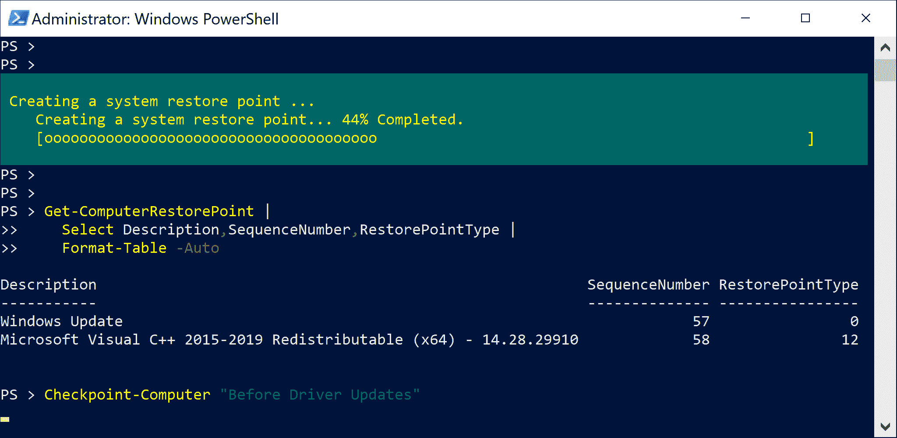

# 第 27 章 企业计算机管理

# 27.0 简介


当在企业中跨 Windows 系统工作时，经常会出现这个问题：“如何在 PowerShell 中执行<某任务>？”在管理员的理想世界里，任何设计具有管理意义功能的人也会支持（通过 PowerShell cmdlet）管理该功能的任务。不过，许多管理任务存在的时间比 PowerShell 还长，所以答案有时会是：“和 PowerShell 出现之前一样的方式。”

这并不是说 PowerShell 的引入不会改善你作为管理员的生活。PowerShell 出现之前的管理任务通常属于以下几种模型之一：命令行实用程序、Windows Management Instrumentation (WMI) 交互、注册表操作、文件操作、与 COM 对象交互，或与 .NET 对象交互。

PowerShell 使与所有这些任务模型的交互变得更加容易，因此也使管理依赖于它们的功能变得更加容易。

# 27.1 将计算机加入域或工作组

## 问题

你想要将计算机加入域或工作组。

## 解决方案

使用 `Add-Computer` cmdlet 的 `-DomainName` 参数将计算机加入域。使用 `-WorkGroupName` 参数将其加入工作组：

```powershell
PS > Add-Computer -DomainName MyDomain -Credential MyDomain\MyUser
PS > Restart-Computer
```

## 讨论

`Add-Computer` cmdlet 的名称相当直观：它允许你将计算机加入域或工作组。由于域加入只有在重启计算机后才生效，因此在加入域后始终调用 `Restart-Computer` cmdlet。

除了支持本地计算机外，`Add-Computer` cmdlet 还允许你将远程计算机加入域。将远程计算机加入域要求其已启用 WMI，并且你在远程计算机上拥有管理权限。

`Add-Computer` cmdlet 或许最复杂的参数是 `-Unsecure` 参数。当你将计算机加入域时，通常会创建一个具有唯一密码的机器账户。非安全加入（由 `-Unsecure` 参数启用）则改用默认密码：计算机名称的前 14 个字符，全部小写。域加入完成后，系统会自动更改密码。此参数主要用于无人值守安装。

要将计算机从域中移除，请参阅配方 27.2。

## 另请参阅

配方 27.2

# 27.2 将计算机从域中移除

## 问题

你想要将计算机从域中移除。

## 解决方案

使用 `Remove-Computer` cmdlet 离开域。

```powershell
PS > Remove-Computer
PS > Restart-Computer
```

## 讨论

`Remove-Computer` cmdlet 允许你将计算机从域中移除。除了支持本地计算机外，`Remove-Computer` cmdlet 还允许你移除远程计算机。将远程计算机从域中移除要求其已启用 WMI，并且你在远程计算机上拥有管理权限。

一旦你将计算机从域中移除，它将恢复到其默认工作组。由于域更改只有在重启计算机后才生效，因此在离开域后始终调用 `Restart-Computer` cmdlet。

一旦你将计算机从域中移除，你将无法再使用域凭据来管理该计算机。在离开域之前，请确保你知道（或创建）该计算机的本地管理员账户。

要重新加入域，请参阅配方 27.1。

## 另请参阅

配方 27.1

# 27.3 重命名计算机

## 问题

你想要重命名工作组或域中的计算机。

## 解决方案

使用 `Rename-Computer` cmdlet 重命名计算机。

```powershell
PS > Rename-Computer -NewName <NewName>
PS > Restart-Computer
```

## 讨论

`Rename-Computer` 允许你重命名计算机。除了支持本地计算机外，`Rename-Computer` cmdlet 还允许你重命名远程计算机。从域中重命名远程计算机要求其已启用 WMI，并且你在远程计算机上拥有管理权限。

由于名称更改只有在重启计算机后才生效，因此在重命名计算机后始终调用 `Restart-Computer` cmdlet。

# 27.4 程序：列出用户的登录或注销脚本

Windows 中的组策略系统将登录和注销脚本存储在两个注册表键下：`HKLM:\SOFTWARE\Microsoft\Windows\CurrentVersion\Group Policy\State\<UserSID>\Scripts\Logon` 和 `HKLM:\SOFTWARE\Microsoft\Windows\CurrentVersion\Group Policy\State\<UserSID>\Scripts\Logoff`。每个键都有一个子键，对应每个应用的组策略对象。这些子键中的每一个都有另一层键，对应应用于用户的单个脚本。

当你不知道相关用户的安全标识符 (SID) 时，这可能很难调查，因此示例 27-1 自动完成用户名到 SID 的映射，以及访问此信息所需的所有注册表操作任务。

### 示例 27-1. Get-UserLogonLogoffScript.ps1

```powershell
##############################################################################
##
## Get-UserLogonLogoffScript
##
## From PowerShell Cookbook (O'Reilly)
## by Lee Holmes (http://www.leeholmes.com/guide)
##
##############################################################################

<#

.SYNOPSIS

Get the logon or logoff scripts assigned to a specific user

.EXAMPLE

Get-UserLogonLogoffScript LEE-DESK\LEE Logon
Gets all logon scripts for the user 'LEE-DESK\Lee'

#>

param(
    ## The username to examine
    [Parameter(Mandatory = $true)]
    $Username,

    [Parameter(Mandatory = $true)]
    [ValidateSet("Logon","Logoff")]
    $ScriptType
)

Set-StrictMode -Version 3

## Find the SID for the username
$account = New-Object System.Security.Principal.NTAccount $username
$sid =
    $account.Translate([System.Security.Principal.SecurityIdentifier]).Value

## Map that to their group policy scripts
$registryKey = "HKLM:\SOFTWARE\Microsoft\Windows\CurrentVersion\" +
    "Group Policy\State\$sid\Scripts"

if(-not (Test-Path $registryKey))
{
    return
}

## Go through each of the policies in the specified key
foreach($policy in Get-ChildItem $registryKey\$scriptType)
{
    ## For each of the scripts in that policy, get its script name
    ## and parameters
    foreach($script in Get-ChildItem $policy.PsPath)
    {
        Get-ItemProperty $script.PsPath | Select Script,Parameters
    }
}
```

有关在 PowerShell 中使用 Windows 注册表的更多信息，请参阅第 21 章。有关运行脚本的更多信息，请参阅配方 1.2。

## 另请参阅

配方 1.2，“运行程序、脚本和现有工具”

第 21 章

# 27.5 程序：列出计算机的启动或关机脚本

Windows 中的组策略系统将启动和关机脚本存储在注册表键 `HKLM:\SOFTWARE\Policies\Microsoft\Windows\System\Scripts\Startup` 和 `HKLM:\SOFTWARE\Policies\Microsoft\Windows\System\Scripts\Shutdown` 下。每个键都有一个子键，对应每个应用的组策略对象。这些子键中的每一个都有另一层键，对应应用于计算机的单个脚本。

示例 27-2 允许你轻松检索和访问计算机的启动和关机脚本。

### 示例 27-2. Get-MachineStartupShutdownScript.ps1


# Get-MachineStartupShutdownScript

出自 *PowerShell Cookbook* (O'Reilly) 作者 Lee Holmes (http://www.leeholmes.com/guide)

## 概要

获取分配给计算机的启动或关机脚本。

## 示例

```powershell
PS > Get-MachineStartupShutdownScript -ScriptType Startup
```
获取计算机的启动脚本。

## 参数

```powershell
param(
    ## 要搜索的脚本类型：Startup 或 Shutdown。
    [Parameter(Mandatory = $true)]
    [ValidateSet("Startup","Shutdown")]
    $ScriptType
)
```

## 脚本

```powershell
Set-StrictMode -Version 3

## 存储计算机组策略脚本的位置
$registryKey = "HKLM:\SOFTWARE\Policies\Microsoft\Windows\System\Scripts"

## 可能未定义任何脚本
if(-not (Test-Path $registryKey))
{
    return
}

## 遍历指定项中的每个策略
foreach($policy in Get-ChildItem $registryKey\$scriptType)
{
    ## 对于该策略中的每个脚本，获取其脚本名称
    ## 和参数
    foreach($script in Get-ChildItem $policy.PsPath)
    {
        Get-ItemProperty $script.PsPath | Select-Object Script,Parameters
    }
}
```

有关在 PowerShell 中使用 Windows 注册表的更多信息，请参阅 第 21 章。有关运行脚本的更多信息，请参阅 食谱 1.2。

## 另请参阅

- 食谱 1.2，“运行程序、脚本和现有工具”
- 第 21 章

# 27.6 部署基于 PowerShell 的登录脚本

## 问题

你想在登录、注销、启动或关机脚本中使用 PowerShell 脚本。

## 解决方案

只需在“PowerShell 脚本”选项卡中添加一个新脚本。

## 讨论

在 PowerShell 的第一个版本中，将 PowerShell 脚本作为组策略脚本启动是一项困难的任务。虽然你可以使用 `powershell.exe` 的 `-Command` 参数来调用命令，但引用规则使得难以正确指定脚本。在搞清楚引用规则后，你仍然必须应对客户端计算机的执行策略。

幸运的是，情况有了显著改善。组策略现在支持 PowerShell 脚本作为四种不同用户和计算机脚本的*第一类公民*。

当组策略的原生支持不可用时，`powershell.exe` 包含两个参数，使控制执行环境更加容易：`-ExecutionPolicy` 和 `-File`。有关这些参数（以及 PowerShell 的其他参数）的更多信息，请参阅 食谱 1.17。

## 另请参阅

- 食谱 1.17，“从 PowerShell 外部调用 PowerShell 命令或脚本”

# 27.7 启用或禁用 Windows 防火墙

## 问题

你想启用或禁用 Windows 防火墙。

## 解决方案

要管理 Windows 防火墙，请使用 `HNetCfg.FwMgr` COM 对象的 `LocalPolicy.CurrentProfile.FirewallEnabled` 属性：

```powershell
PS > $firewall = New-Object -com HNetCfg.FwMgr
PS > $firewall.LocalPolicy.CurrentProfile.FirewallEnabled = $true
PS > $firewall.LocalPolicy.CurrentProfile.FirewallEnabled
True
```

## 讨论

`HNetCfg.FwMgr` COM 对象提供了对 Windows XP SP2 及更高版本中 Windows 防火墙的编程访问。`LocalPolicy.CurrentProfile` 属性提供了其大部分功能。

有关通过其 COM API 管理 Windows 防火墙的更多信息，请访问 [Microsoft 文档站点](http://msdn.microsoft.com) 并搜索“Using Windows Firewall API”。该文档提供了 VBScript 示例，但给出了可用功能的有用概述。

有关在 PowerShell 中使用 COM 对象的更多信息，请参阅 食谱 17.1。

## 另请参阅

- 食谱 17.1，“使用 COM 脚本接口自动化程序”

# 27.8 在 Windows 防火墙中打开或关闭端口

## 问题

你想在 Windows 防火墙中打开或关闭端口。

## 解决方案

要在 Windows 防火墙中打开或关闭端口，请使用 `HNetCfg.FwMgr` COM 对象的 `LocalPolicy.CurrentProfile.GloballyOpenPorts` 集合。

要打开端口，请创建一个 `HNetCfg.FWOpenPort` COM 对象来表示该端口，然后将其添加到 `GloballyOpenPorts` 集合中：

```powershell
$PROTOCOL_TCP = 6
$firewall = New-Object -com HNetCfg.FwMgr
$port = New-Object -com HNetCfg.FWOpenPort

$port.Name = "Webserver at 8080"
$port.Port = 8080
$port.Protocol = $PROTOCOL_TCP

$firewall.LocalPolicy.CurrentProfile.GloballyOpenPorts.Add($port)
```

要关闭端口，请从 `GloballyOpenPorts` 集合中移除它：

```powershell
$PROTOCOL_TCP = 6
$firewall.LocalPolicy.CurrentProfile.GloballyOpenPorts.Remove(8080, $PROTOCOL_TCP)
```

## 讨论

`HNetCfg.FwMgr` COM 对象提供了对 Windows XP SP2 及更高版本中 Windows 防火墙的编程访问。`LocalPolicy.CurrentProfile` 属性提供了其大部分功能。

有关通过其 COM API 管理 Windows 防火墙的更多信息，请访问 [Microsoft 文档站点](http://msdn.microsoft.com) 并搜索“Using Windows Firewall API”。该文档提供了 VBScript 示例，但给出了可用功能的有用概述。

有关在 PowerShell 中使用 COM 对象的更多信息，请参阅 食谱 17.1。

## 另请参阅

- 食谱 17.1，“使用 COM 脚本接口自动化程序”

# 27.9 程序：列出所有已安装的软件

查找当前已安装软件信息的最佳位置，实际上是存储卸载信息的位置：`HKLM:\SOFTWARE\Microsoft\Windows\CurrentVersion\Uninstall` 注册表项。

该注册表项的每个子项代表一款可卸载的软件——传统上通过控制面板中的“添加/删除程序”条目。除了应用程序的 `DisplayName`，通常还存在其他有用的属性（取决于应用程序）。示例包括 `Publisher`、`UninstallString` 和 `HelpLink`。

要查看系统上已安装软件提供的所有属性，请键入以下内容：

```powershell
$properties = Get-InstalledSoftware |
    ForEach-Object { $_.PsObject.Properties }

$properties | Select-Object Name | Sort-Object -Unique Name
```

这将列出至少由一个已安装应用程序提及的所有属性（尽管很少有属性被所有已安装应用程序共享）。

不过，要处理这些数据，你首先需要检索它。示例 27-3 提供了一个脚本，用于列出当前系统上所有已安装的软件，将所有信息作为 PowerShell 对象的属性返回。

## 示例 27-3. Get-InstalledSoftware.ps1


# Get-InstalledSoftware 脚本

出自 *PowerShell Cookbook*（O'Reilly），作者 Lee Holmes（http://www.leeholmes.com/guide）

## 概要

列出当前计算机上安装的软件。

## 示例

```powershell
PS > Get-InstalledSoftware *Frame* | Select DisplayName

DisplayName
-----------
Microsoft .NET Framework 3.5 SP1
Microsoft .NET Framework 3.5 SP1
Hotfix for Microsoft .NET Framework 3.5 SP1 (KB953595)
Hotfix for Microsoft .NET Framework 3.5 SP1 (KB958484)
Update for Microsoft .NET Framework 3.5 SP1 (KB963707)
```

## 参数

```powershell
param(
    ## 要搜索的软件名称
    $DisplayName = "*"
)
```

## 脚本主体

```powershell
Set-StrictMode -Off

## 获取 Uninstall 键中列出的所有软件
$keys =
    Get-ChildItem HKLM:\SOFTWARE\Microsoft\Windows\CurrentVersion\Uninstall

## 获取这些项的所有属性
$items = $keys | Foreach-Object { Get-ItemProperty $_.PsPath }

## 对于每个项，显示 DisplayName 和 Publisher
foreach($item in $items)
{
    if(($item.DisplayName) -and ($item.DisplayName -like $displayName))
    {
        $item
    }
}
```

有关在 PowerShell 中使用 Windows 注册表的详细信息，请参阅第 21 章。有关运行脚本的详细信息，请参阅食谱 1.2。

## 另请参阅

- 食谱 1.2，“运行程序、脚本和现有工具”
- 第 21 章

# 27.10 卸载应用程序

## 问题

你想要卸载特定的软件应用程序。

## 解决方案

要卸载应用程序，请使用食谱 27.9 中提供的 `Get-InstalledSoftware` 脚本来检索卸载软件的命令。由于 `UninstallString` 使用批处理文件语法，请使用 `cmd.exe` 启动卸载程序：

```powershell
PS > $software = Get-InstalledSoftware UnwantedProgram
PS > cmd /c $software.UninstallString
```

或者，使用 `Win32_Product` WMI 类进行无人值守安装：

```powershell
$application = Get-CimInstance Win32_Product -filter "Name='UnwantedProgram'"
$application | Invoke-CimMethod -Name Uninstall
```

## 讨论

应用程序提供的 `UninstallString` 会启动交互式体验，这与你通过控制面板中的“添加/删除程序”项卸载应用程序时看到的一样。如果你需要以无人值守的方式删除软件，有两个选项：使用应用程序卸载程序的“静默模式”（例如，`msiexec.exe` 的 `/quiet` 开关），或使用解决方案中演示的 `Win32_Product` WMI 类的软件移除功能。

有关在 PowerShell 中使用 WMI 的详细信息，请参阅食谱 28.1。

## 另请参阅

- 食谱 27.9，“程序：列出所有已安装软件”
- 食谱 28.1，“访问 Windows 管理规范和 CIM 数据”

# 27.11 管理计算机还原点

## 问题

你想要创建计算机还原点、将计算机还原到之前的还原点，或管理自动还原点的计划。

## 解决方案

使用 `Enable-ComputerRestore` 和 `Disable-ComputerRestore` cmdlet 启用和禁用自动计算机检查点。使用 `Get-ComputerRestorePoint` 和 `Restore-Computer` cmdlet 分别列出所有还原点并将计算机还原到其中之一。使用 `Checkpoint-Computer` cmdlet 创建新的系统还原点。

```powershell
PS > Get-ComputerRestorePoint |
    Select Description,SequenceNumber,RestorePointType |
    Format-Table -Auto

Description           SequenceNumber RestorePointType
-----------           -------------- ----------------
Windows Update                   122                0
Windows Update                   123                0
Scheduled Checkpoint             124                7
Scheduled Checkpoint             125                7
Windows Update                   126                0
Scheduled Checkpoint             127                7
Scheduled Checkpoint             128                7
Windows Update                   129                0
Scheduled Checkpoint             130                7
Windows Update                   131                0
Scheduled Checkpoint             132                7
Windows Update                   133                0
Manual Checkpoint                134                0
Before driver updates            135                0

PS > Checkpoint-Computer "Before driver updates"
```

## 讨论

计算机还原点 cmdlet 为你提供了一种管理 Windows 系统还原点的简便方法。你可以使用 `Checkpoint-Computer` 在可能造成破坏的安装或系统更改之前创建新的还原点。图 27-1 显示了正在进行的 `Checkpoint-Computer` cmdlet。如果你需要将计算机还原到以前的状态，可以使用 `Get-ComputerRestorePoint` cmdlet 列出现有的还原点，然后使用 `Restore-Computer` cmdlet 将计算机还原到其先前保存的状态。



系统还原点经过精细调整，旨在管理操作系统的状态，并非设计用于保护用户数据。系统还原点主要保护 Windows 注册表、核心操作系统文件、本地用户配置文件以及 COM 和 WMI 注册数据库。

为了节省磁盘空间，Windows 限制还原点占用的空间量，并根据需要删除最旧的还原点。如果你计划比 Windows 自动安排的频率更频繁地创建手动检查点，请考虑增加专用于系统还原点的空间量。如果不这样做，你就有无法从那些你花费很长时间才检测到的系统错误中恢复的风险。

默认情况下，Windows 为主系统卷安排自动还原点。要为此卷（或任何卷）启用或禁用这些自动检查点，请使用 `Enable-ComputerRestore` 和 `Disable-ComputerRestore` cmdlet。

控制面板允许你配置 Windows 为还原点保留多少空间。为此，请在控制面板中打开“系统”组，然后打开“系统保护”。

# 27.12 重启或关闭计算机

## 问题

你想要重启或关闭本地或远程计算机。

## 解决方案

使用 `Restart-Computer` cmdlet 重启计算机：

```powershell
PS > Restart-Computer -ComputerName Computer
```

使用 `Stop-Computer` cmdlet 将其完全关闭：

```powershell
PS > Stop-Computer -ComputerName Computer
```

如果你想要在许多计算机上执行相同的操作，请使用 cmdlet 的限流支持：

```powershell
PS > $computers = Get-Content computers.txt
PS > Restart-Computer -ComputerName $computers -ThrottleLimit
```

## 讨论

`Restart-Computer` 和 `Stop-Computer` cmdlet 都允许你管理本地或远程计算机的重启和关闭过程。因为它们建立在 PowerShell 的 WMI 支持之上，所以它们还提供 `-ThrottleLimit` 参数，让你控制同时控制多少台计算机。

默认情况下，如果有用户登录到计算机，这些 cmdlet 会拒绝重启或关闭。要仍然重启计算机，请使用 `-Force` 参数覆盖此行为。

> **注意**
>
> 重启计算机时，你有时可能希望计算机在重新联机后执行某些操作。为此，请创建一个带有 `-AtStartup` 触发器的新计划任务。有关详细信息，请参阅食谱 27.14。


如果您希望在继续执行脚本之前等待计算机重启，请使用 `-Wait` 参数。这将等待直到能够成功建立到目标计算机的 PowerShell 远程连接。如果您仅需要 WSMan 或 WMI 连接，请使用 `-For` 参数：

```
PS > Restart-Computer -ComputerName Computer -Wait -For Wmi
```

与其关闭或重启计算机，您可能想要将其挂起或休眠。虽然 `Restart-Computer` 和 `Stop-Computer` cmdlet 均不支持此功能，但您可以使用 .NET Framework 中的 `System.Windows.Forms.Application` 类来实现：

```
Add-Type -Assembly System.Windows.Forms
[System.Windows.Forms.Application]::SetSuspendState("Suspend", $false, $false)

Add-Type -Assembly System.Windows.Forms
[System.Windows.Forms.Application]::SetSuspendState("Hibernate", $false, $false)
```

此技术不允许您挂起或休眠远程计算机，但您可以使用 PowerShell 远程处理在远程系统上调用这些命令。

有关 PowerShell 远程处理的更多信息，请参阅 第 29 章。

## 另请参阅

配方 27.14，“在计算机上管理计划任务”

第 29 章

# 27.13 确定是否安装了修补程序

## 问题

您想要确定特定修补程序是否安装在系统上。

## 解决方案

要检索应用于系统的修补程序列表，请使用 `Get-Hotfix` cmdlet：

```
PS > Get-HotFix KB968930 | Format-List

Description         : Windows Management Framework Core
FixComments         : Update
HotFixID            : KB968930
InstallDate         :
InstalledBy         : XPMUser
InstalledOn         :
Name                :
ServicePackInEffect : SP10
Status              :
```

要按说明搜索，请使用 `-Description` 参数：

```
PS > Get-HotFix -Description *Framework* | Format-List

Description         : Windows Management Framework Core
FixComments         : Update
HotFixID            : KB968930
InstallDate         :
InstalledBy         : XPMUser
InstalledOn         :
Name                :
ServicePackInEffect : SP10
Status              :
```

## 讨论

`Get-Hotfix` cmdlet 可让您确定特定系统上是否安装了修补程序。默认情况下，它从本地系统检索修补程序，但您可以使用 `-ComputerName` 参数从远程系统检索修补程序信息。

# 27.14 在计算机上管理计划任务

## 问题

您想要在计算机上计划任务。

## 解决方案

要计划任务，请使用 `Register-ScheduledJob` cmdlet。

```
$trigger = New-ScheduledTaskTrigger -Once -At (Get-Date) `
    -RepetitionInterval (New-TimeSpan -Hours 1) `
    -RepetitionDuration ([TimeSpan]::MaxValue)

Register-ScheduledJob -Name blogMonitor -Trigger $trigger -ScriptBlock {
    $myDocs = [Environment]::GetFolderPath("MyDocuments")
    $outputPath = Join-Path $myDocs blogMonitor.csv
    Test-Uri http://www.leeholmes.com/blog | Export-Csv -Append $outputPath
}
```

要查看计划作业列表：

```
PS > Get-ScheduledJob

Id         Name            JobTriggers     Command
--         ----            -----------     -------
1          blogMonitor     1               ...
```

要删除计划作业，请使用 `Unregister-ScheduledJob` cmdlet：

```
PS > Register-ScheduledJob -Name UnwantedScheduledJob -ScriptBlock { "Oops" }

Id         Name            JobTriggers     Command
--         ----            -----------     -------
2          UnwantedSche... 0                "Oops"

PS > Unregister-ScheduledJob -Name UnwantedScheduledJob
```

## 讨论

PowerShell 计划作业提供了一种极其简便的方法来自动执行系统操作，无论是基于 PowerShell 还是其他方式。

与计划*任务*（由任务计划程序和 `*-ScheduledTask` cmdlet 公开）不同，计划作业为您提供了常规 PowerShell 作业所习惯的完整体验：后台执行、状态监视、丰富的基于对象的输出和一组标准的 cmdlet。主要区别在于 `Register-ScheduledJob` cmdlet 会在将来运行您提供的脚本块。

### 注意

有关 PowerShell 作业的更多信息，请参阅 配方 1.6。

计划作业基于两个概念：作业（在后台运行的命令行或脚本块，这是熟悉的 PowerShell 概念）和触发它的事物。

在最简单的形式中，计划作业可以在没有任何触发器的情况下注册。在这种情况下，`Start-Job` cmdlet 的 `-DefinitionName` 参数将启动实际作业：

```
PS > Register-ScheduledJob -Name DateChecker -ScriptBlock { Get-Date }

Id Name        JobTriggers Command    Enabled
-- ----        ----------- -------    -------
4  DateChecker 0            Get-Date  True


PS > Start-Job -DefinitionName DateChecker

Id Name        PSJobTypeName  State   HasMoreData Location  Command
-- ----        -------------  -----   ----------- --------  -------
2  DateChecker PSScheduledJob Running True        localhost  Get-Date


PS > Receive-Job  -Id 2

Saturday, September 1, 2012 9:27:30 PM
```

然而，以这种方式运行作用不大。要使其有用，您需要附加一个触发器。例如，要重置导致问题的开发 Web 服务器：

```
$trigger = New-ScheduledTaskTrigger -Daily -At "3:00 AM"
Register-ScheduledJob -Name WebsiteFix -ScriptBlock { iisreset }
```

对于大多数计划任务，`-Daily`、`-Weekly`、`-AtStartup` 和 `-AtLogOn` 参数将是您所需的一切。使用 `-At` 参数指定此重复的开始时间。`-At` 参数是一个 `DateTime` 对象，因此大多数自然形式的日期和时间（如 `3:00 AM`）都将有效。如果您想更具体，可以使用 `Get-Date` cmdlet：

```
$date = Get-Date -Hour 15 -Minute 59
$trigger = New-ScheduledTaskTrigger -Daily -At $date
```

如果内置的每日或每周模式不起作用，您可以使用 `-Once` 参数。默认情况下，这会计划任务在将来仅运行一次：

```
$trigger = New-ScheduledTaskTrigger -Once -At "9/2/2012 10:00 AM"
```

但是，您也可以使用 `-Once` 参数来计划在您提供的时间*开始*运行，但随后以比每日或每周更细粒度的间隔重复的任务。`-RepetitionInterval` 参数定义任务计划程序在两次调用之间应等待多长时间，而 `-RepetitionDuration` 定义作业将被允许运行多远的将来。

例如，要创建一个每五分钟终止特定失控进程的计划任务，并永远运行：

```
PS > $t = New-ScheduledTaskTrigger -Once -At (Get-Date) `
    -RepetitionInterval (New-TimeSpan -Minutes 5) `
    -RepetitionDuration ([TimeSpan]::MaxValue)
PS > Register-ScheduledJob -ScriptBlock { Stop-Process -Name RunawayProcess } `
    -Trigger $t -Name Zombie

Id         Name            JobTriggers     Command
--         ----            -----------     -------
31         Zombie          1               Stop-Process -Name RunawayProcess
```

注册计划作业时，您还可以为 `-ScheduledJobOption` 参数提供选项。要创建用于此参数的选项，请使用 `New-ScheduledJobOption` cmdlet。您很少需要其中大多数，但 `-RequireNetwork` 参数值得特别关注。

与 PowerShell 远程连接一样，计划任务不允许您自动连接到网络资源，如 UNC 路径和 Active Directory。执行此操作需要计划任务存储您的凭据，每当系统要求您更改密码时，保持凭据最新就会变得很麻烦。


# 计划任务网络访问

如果计划任务在尝试访问网络位置时失败，可以指定 `-RequireNetwork` 参数来解决此问题。如果使用此参数，在注册计划作业时还必须提供凭据。如果更改了密码，请务必使用 `Set-ScheduledJob` cmdlet 更新凭据。

除了在系统上计划新命令外，您可能还想与其他程序或应用程序计划的任务进行交互。其他程序计划的任务没有 PowerShell 那样丰富的作业模型，但经常用于简单的任务调用。如果您有权访问 Windows 8 计算机，请使用 `ScheduledTask` cmdlet：

```
PS > Get-Command -Noun ScheduledTask
(...)

PS > Get-Help -Command Register-ScheduledTask
(...)

PS > Get-ScheduledTask -TaskName ProactiveScan | Format-List

Actions            : {MSFT_TaskComHandlerAction}
Author             : Microsoft Corporation
Date               :
Description        : NTFS Volume Health Scan
Documentation      :
Principal          : MSFT_TaskPrincipal2
SecurityDescriptor : D:AI(A;;FA;;;BA)(A;;FA;;;SY)(A;;FRFX;;;LS)(A;;FR;;;AU)
Settings           : MSFT_TaskSettings3
Source             : Microsoft Corporation
State              : Ready
TaskName           : ProactiveScan
TaskPath           : \Microsoft\Windows\Chkdsk\
Triggers           :
URI                : \Microsoft\Windows\Chkdsk\ProactiveScan
Version            :
PSComputerName     :
```

有关从其他应用程序自动运行 PowerShell 的详细信息，请参阅 食谱 1.17。

## 另请参阅

食谱 1.6，“调用长时间运行或后台命令”

食谱 1.17，“从 PowerShell 外部调用 PowerShell 命令或脚本”

# 27.15 检索打印机信息

## 问题

您想要获取当前系统上打印机的信息。

## 解决方案

要检索连接到系统的打印机的信息，请使用 `Win32_Printer` WMI 类：

```
PS > Get-CimInstance Win32_Printer | Select-Object Name,PrinterStatus

Name                                                         PrinterStatus
----                                                         -------------
Microsoft Office Document Image Wr...                                    3
Microsoft Office Document Image Wr...                                    3
CutePDF Writer                                                           3
Brother DCP-1000                                                         3
```

要检索特定打印机的信息，请根据其名称应用筛选器：

```
PS > $device = Get-CimInstance Win32_Printer -Filter "Name='Brother DCP-1000'"
PS > $device | Format-List *
Status                      : Unknown
Name                        : Brother DCP-1000
Attributes                  : 588
Availability                :
AvailableJobSheets          :
AveragePagesPerMinute       : 0
Capabilities                : {4, 2, 5}
CapabilityDescriptions      : {Copies, Color, Collate}
Caption                     : Brother DCP-1000
(...)
```

要检索特定属性，请像访问其他 PowerShell 对象的属性一样访问它们：

```
PS > $device.VerticalResolution
600
PS > $device.HorizontalResolution
600
```

## 讨论

解决方案中的示例使用 `Win32_Printer` WMI 类来检索计算机上已安装打印机的信息。虽然 `Win32_Printer` 类提供了对最常用信息的访问，但 WMI 还支持其他几个与打印机相关的类：`Win32_TCPIPPrinterPort`、`Win32_PrinterDriver`、`CIM_Printer`、`Win32_PrinterConfiguration`、`Win32_PrinterSetting`、`Win32_PrinterController`、`Win32_PrinterShare` 和 `Win32_PrinterDriverDll`。有关在 PowerShell 中使用 WMI 的详细信息，请参阅 食谱 28.1。

## 另请参阅

食谱 28.1，“访问 Windows 管理规范和 CIM 数据”

# 27.16 检索打印机队列统计信息

## 问题

您想要获取当前系统上打印机的打印队列信息。

## 解决方案

要检索连接到系统的打印机的信息，请使用 `Win32_PerfFormattedData_Spooler_PrintQueue` WMI 类：

```
PS > Get-CimInstance Win32_PerfFormattedData_Spooler_PrintQueue |
     Select Name,TotalJobsPrinted

Name                                                      TotalJobsPrinted
----                                                      ----------------
Microsoft Office Document Image Wr...                                    0
Microsoft Office Document Image Wr...                                    0
CutePDF Writer                                                           0
Brother DCP-1000                                                         2
_Total                                                                   2
```

要检索特定打印机的信息，请根据其名称应用筛选器，如 示例 27-4 所示。

### 示例 27-4. 检索特定打印机的信息

```
PS > $queueClass = "Win32_PerfFormattedData_Spooler_PrintQueue"
PS > $filter = "Name='Brother DCP-1000'"
PS > $stats = Get-CimInstance $queueClass -Filter $filter
PS > $stats | Format-List *

AddNetworkPrinterCalls       : 129
BytesPrintedPersec           : 0
Caption                      :
Description                  :
EnumerateNetworkPrinterCalls : 0
Frequency_Object             :
Frequency_PerfTime           :
Frequency_Sys100NS           :
JobErrors                    : 0
Jobs                         : 0
JobsSpooling                 : 0
MaxJobsSpooling              : 1
MaxReferences                : 3
Name                         : Brother DCP-1000
NotReadyErrors               : 0
OutofPaperErrors             : 0
References                   : 2
Timestamp_Object             :
Timestamp_PerfTime           :
Timestamp_Sys100NS           :
TotalJobsPrinted             : 2
TotalPagesPrinted            : 0
```

要检索特定属性，请像访问其他 PowerShell 对象的属性一样访问它们：

```
PS > $stats.TotalJobsPrinted
2
```

## 讨论

`Win32_PerfFormattedData_Spooler_PrintQueue` WMI 类提供了对与打印队列相关的各种 Windows 性能计数器的访问。因此，您也可以通过 .NET Framework 访问它们，如 食谱 17.3 所述：

```
PS > Get-Counter "\Print Queue($printer)\Jobs" | Select -Expand CounterSamples |
    Select InstanceName,CookedValue | Format-Table -Auto

InstanceName         CookedValue
------------         -----------
brother dcp-1000 usb           1
```

有关在 PowerShell 中使用 WMI 的详细信息，请参阅 食谱 28.1。

## 另请参阅

食谱 17.3，“访问 Windows 性能计数器”

食谱 28.1，“访问 Windows 管理规范和 CIM 数据”

# 27.17 管理打印机和打印队列

## 问题

您想要清除打印机上的待处理打印作业。

## 解决方案

要管理连接到系统的打印机，请使用 `Win32_Printer` WMI 类。默认情况下，WMI 类列出所有打印机：


PS > Get-CimInstance Win32_Printer | Select-Object Name,PrinterStatus

名称                                                     打印机状态
----                                                     -------------
Microsoft Office Document Image Wr...                                3
Microsoft Office Document Image Wr...                                3
CutePDF Writer                                                       3
Brother DCP-1000                                                     3

要清除特定打印机的打印队列，请根据其名称应用筛选器并调用 `CancelAllJobs()` 方法：

```
PS > $device = Get-CimInstance Win32_Printer -Filter "Name='Brother DCP-1000'"
PS > $device | Invoke-CimMethod -Name CancelAllJobs

__GENUS          : 2
__CLASS          : __PARAMETERS
__SUPERCLASS     :
__DYNASTY        : __PARAMETERS
__RELPATH        :
__PROPERTY_COUNT : 1
__DERIVATION     : {}
__SERVER         :
__NAMESPACE      :
__PATH           :
ReturnValue      : 5
```

## 讨论

解决方案中的示例使用 `Win32_Printer` WMI 类来取消打印机的所有作业。除了取消所有打印作业外，`Win32_Printer` 类还支持其他任务：

```
PS > Get-CimClass Win32_Printer | ForEach-Object CimClassMethods

Name                  ReturnType Parameters
----                  ---------- ----------
SetPowerState             UInt32 {PowerState, Time}
Reset                     UInt32 {}
Pause                     UInt32 {}
Resume                    UInt32 {}
CancelAllJobs             UInt32 {}
AddPrinterConnection      UInt32 {Name}
RenamePrinter             UInt32 {NewPrinterName}
PrintTestPage             UInt32 {}
SetDefaultPrinter         UInt32 {}
GetSecurityDescriptor     UInt32 {Descriptor}
SetSecurityDescriptor     UInt32 {Descriptor}
```

有关在 PowerShell 中使用 WMI 的详细信息，请参阅 食谱 28.1。

## 另请参阅

食谱 28.1，“访问 Windows 管理规范和 CIM 数据”

# 27.18 程序：汇总系统信息

WMI 提供了关于当前系统或远程系统的大量信息。事实上，传统上用于收集系统信息的 `msinfo32.exe` 应用程序在很大程度上基于 WMI。

对于大多数用途，你可以使用 `Get-ComputerInfo` cmdlet 检索详细的系统信息摘要。如果你想创建自己的系统配置报告，可以使用 示例 27-5 作为起点。示例 27-5 中所示的脚本汇总了最常见的信息，但 WMI 提供的远不止这些。有关其他常用 WMI 类的列表，请参阅 附录 G。有关在 PowerShell 中使用 WMI 的详细信息，请参阅 食谱 28.1。

### 示例 27-5. Get-DetailedSystemInformation.ps1

```
##############################################################################
##
## Get-DetailedSystemInformation
##
## From PowerShell Cookbook (O'Reilly)
## by Lee Holmes (http://www.leeholmes.com/guide)
##
##############################################################################

<#

.SYNOPSIS

获取有关系统的详细信息。

.EXAMPLE

PS > Get-DetailedSystemInformation LEE-DESK > output.txt
获取 LEE-DESK 的详细信息并将输出存储到 output.txt 中

#>

param(
    ## 要分析的计算机
    $Computer = "."
)

Set-StrictMode -Version 3

"#"*80
"系统信息摘要"
"生成于 $(Get-Date)"
"#"*80
""
""

"#"*80
"计算机系统信息"
"#"*80
Get-CimInstance Win32_ComputerSystem -Computer $computer | Format-List *

"#"*80
"操作系统信息"
"#"*80
Get-CimInstance Win32_OperatingSystem -Computer $computer | Format-List *

"#"*80
"BIOS 信息"
"#"*80
Get-CimInstance Win32_Bios -Computer $computer | Format-List *

"#"*80
"内存信息"
"#"*80
Get-CimInstance Win32_PhysicalMemory -Computer $computer | Format-List *

"#"*80
"物理磁盘信息"
"#"*80
Get-CimInstance Win32_DiskDrive -Computer $computer | Format-List *

"#"*80
"逻辑磁盘信息"
"#"*80
Get-CimInstance Win32_LogicalDisk -Computer $computer | Format-List *
```

有关运行脚本的详细信息，请参阅 食谱 1.2。

## 另请参阅

食谱 1.2，“运行程序、脚本和现有工具”

食谱 28.1，“访问 Windows 管理规范和 CIM 数据”

附录 G，*WMI 参考*

# 27.19 续订 DHCP 租约

## 问题

你想要续订计算机上某个连接的动态主机配置协议 (DHCP) 租约。

## 解决方案

要续订 DHCP 租约，请使用 `ipconfig` 应用程序。要续订所有连接的租约：

```
ipconfig /renew
```

要续订特定连接的租约：

```
ipconfig /renew "Wireless Network Connection 4"
```

## 讨论

标准 `ipconfig` 应用程序非常适合管理本地计算机上的网络配置选项。要在远程计算机上续订 DHCP 租约，你有两个选项。

### 使用 Win32_NetworkAdapterConfiguration WMI 类

要在远程计算机上续订租约，可以使用 `Win32_NetworkAdapterConfiguration` WMI 类。该 WMI 类要求你知道网络适配器的描述，因此首先通过查看 `Get-CimInstance Win32_NetworkAdapterConfiguration -Computer` *计算机名* 的输出来获取它：

```
PS > Get-CimInstance Win32_NetworkAdapterConfiguration -Computer LEE-DESK

(...)
DHCPEnabled      : True
IPAddress        : {192.168.1.100}
DefaultIPGateway : {192.168.1.1}
DNSDomain        : hsd1.wa.comcast.net.
ServiceName      : USB_RNDIS
Description      : Linksys Wireless-G USB Network Adapter with (...)
Index            : 13
(...)
```

知道要续订哪个适配器后，调用其 `RenewDHCPLease()` 方法：

```
$description = "Linksys Wireless-G USB"
$adapter = Get-CimInstance Win32_NetworkAdapterConfiguration -Computer LEE-DESK |
    Where-Object { $_.Description -match $description}
$adapter | Invoke-CimMethod -Name RenewDHCPLease
```

### 在远程计算机上运行 ipconfig

在远程计算机上续订 DHCP 租约的另一种方法是使用 PowerShell 远程处理或 食谱 29.8 提供的解决方案：

```
PS > Invoke-Command LEE-DESK { ipconfig /renew }
PS > Invoke-RemoteExpression \\LEE-DESK { ipconfig /renew }
```

有关在 PowerShell 中使用 WMI 的详细信息，请参阅 食谱 28.1。

## 另请参阅

食谱 28.1，“访问 Windows 管理规范和 CIM 数据”

食谱 29.8，“程序：在远程计算机上调用 PowerShell 表达式”

# 27.20 分配静态 IP 地址

## 问题

你想要为计算机分配一个静态 IP 地址。

## 解决方案

使用 `Win32_NetworkAdapterConfiguration` WMI 类来管理计算机的网络设置：

```
$description = "Linksys Wireless-G USB"
$staticIp = "192.168.1.100"
$subnetMask = "255.255.255.0"
$gateway = "192.168.1.1"

$adapter = Get-CimInstance Win32_NetworkAdapterConfiguration -Computer LEE-DESK |
    Where-Object { $_.Description -match $description}
$adapter | Invoke-CimMethod -Name EnableStatic -Arguments @{
    IPAddress = $staticIp; SubnetMask = $subnetMask }
$adapter | Invoke-CimMethod -Name SetGateways -Arguments @{
    DefaultIPGateway = $gateway; GatewayCostMetric = [UInt16] 1 }
```

## 讨论


当你管理计算机的网络设置时，`Win32_NetworkAdapterConfiguration` WMI 类要求你知道网络适配器的描述。通过查看 `Get-CimInstance` `Win32_NetworkAdapterConfiguration` `-Computer` `ComputerName` 的输出来获取它：

```
PS > Get-CimInstance Win32_NetworkAdapterConfiguration -Computer LEE-DESK

(...)
DHCPEnabled      : True
IPAddress        : {192.168.1.100}
DefaultIPGateway : {192.168.1.1}
DNSDomain        : hsd1.wa.comcast.net.
ServiceName      : USB_RNDIS
Description      : Linksys Wireless-G USB Network Adapter with (...)
Index            : 13
(...)
```

知道要续订哪个适配器后，你现在可以像解决方案中所示那样调用该对象上的方法。要再次在适配器上启用 DHCP，请使用 `EnableDHCP()` 方法：

```
PS > $adapter | Invoke-CimMethod -Name EnableDHCP
```

有关在 PowerShell 中使用 WMI 的更多信息，请参阅 Recipe 28.1。

## 另请参阅

Recipe 28.1，“访问 Windows 管理规范和 CIM 数据”

# 27.21 列出计算机的所有 IP 地址

## 问题

你想列出计算机的所有 IP 地址。

## 解决方案

要列出分配给计算机的 IP 地址，请使用 `ipconfig` 应用程序：

```
ipconfig
```

## 讨论

标准的 `ipconfig` 应用程序非常适合管理本地计算机上的网络配置选项。要查看远程计算机上的 IP 地址，你有两个选项。

### 使用 Win32_NetworkAdapterConfiguration WMI 类

要查看远程计算机的 IP 地址，请使用 `Win32_NetworkAdapterConfiguration` WMI 类。由于它列出所有网络适配器，请使用 `Where-Object` cmdlet 将结果限制为已分配 IP 地址的适配器：

```
PS > Get-CimInstance Win32_NetworkAdapterConfiguration -Computer LEE-DESK |
    Where-Object { $_.IpEnabled }


DHCPEnabled      : True
IPAddress        : {192.168.1.100}
DefaultIPGateway : {192.168.1.1}
DNSDomain        : hsd1.wa.comcast.net.
ServiceName      : USB_RNDIS
Description      : Linksys Wireless-G USB Network Adapter with SpeedBooste
                   r v2 - Packet Scheduler Miniport
Index            : 13
```

### 在远程计算机上运行 ipconfig

查看远程计算机 IP 地址的另一种方法是使用 PowerShell 远程处理或 Recipe 29.8 提供的解决方案：

```
PS > Invoke-Command LEE-DESK { ipconfig }
PS > Invoke-RemoteExpression \\LEE-DESK { ipconfig }
```

有关在 PowerShell 中使用 WMI 的更多信息，请参阅 Recipe 28.1。

## 另请参阅

Recipe 28.1，“访问 Windows 管理规范和 CIM 数据”

Recipe 29.8，“程序：在远程计算机上调用 PowerShell 表达式”

# 27.22 列出网络适配器属性

## 问题

你想检索计算机上网络适配器的信息。

## 解决方案

要检索计算机上网络适配器的信息，请使用 `Win32_NetworkAdapterConfiguration` WMI 类：

```
Get-CimInstance Win32_NetworkAdapterConfiguration -Computer <ComputerName>
```

要仅列出已分配 IP 地址的适配器，请使用 `Where-Object` cmdlet 按 `IpEnabled` 属性进行筛选：

```
PS > Get-CimInstance Win32_NetworkAdapterConfiguration -Computer LEE-DESK |
    Where-Object { $_.IpEnabled }


DHCPEnabled      : True
IPAddress        : {192.168.1.100}
DefaultIPGateway : {192.168.1.1}
DNSDomain        : hsd1.wa.comcast.net.
ServiceName      : USB_RNDIS
Description      : Linksys Wireless-G USB Network Adapter with SpeedBooster
                   v2 - Packet Scheduler Miniport
Index            : 13
```

## 讨论

该解决方案使用 `Win32_NetworkAdapterConfiguration` WMI 类来检索给定系统上网络适配器的信息。默认情况下，PowerShell 仅显示关于网络适配器的最重要信息，但它提供了访问更多信息的途径。

要查看所有可用信息，请使用 `Format-List` cmdlet，如 示例 27-6 所示。

### 示例 27-6. 使用 Format-List cmdlet 查看网络适配器的详细信息

```
PS > $adapter = Get-CimInstance Win32_NetworkAdapterConfiguration |
    Where-Object { $_.IpEnabled }

PS > $adapter
DHCPEnabled      : True
IPAddress        : {192.168.1.100}
DefaultIPGateway : {192.168.1.1}
DNSDomain        : hsd1.wa.comcast.net.
ServiceName      : USB_RNDIS
Description      : Linksys Wireless-G USB Network Adapter with SpeedBooster
                   v2 - Packet Scheduler Miniport
Index            : 13

PS > $adapter | Format-List *

DHCPLeaseExpires             : 20070521221927.000000-420
Index                        : 13
Description                  : Linksys Wireless-G USB Network Adapter with
                                SpeedBooster v2 - Packet Scheduler Miniport
DHCPEnabled                  : True
DHCPLeaseObtained            : 20070520221927.000000-420
DHCPServer                   : 192.168.1.1
DNSDomain                    : hsd1.wa.comcast.net.
DNSDomainSuffixSearchOrder   :
DNSEnabledForWINSResolution  : False
DNSHostName                  : Lee-Desk
DNSServerSearchOrder         : {68.87.69.146, 68.87.85.98}
DomainDNSRegistrationEnabled : False
FullDNSRegistrationEnabled   : True
IPAddress                    : {192.168.1.100}
IPConnectionMetric           : 25
IPEnabled                    : True
IPFilterSecurityEnabled      : False
WINSEnableLMHostsLookup      : True
(...)
```

要检索特定属性，像访问其他 PowerShell 对象的属性一样访问它们：

```
PS > $adapter.MacAddress
00:12:17:77:B4:EB
```

有关在 PowerShell 中使用 WMI 的更多信息，请参阅 Recipe 28.1。

## 另请参阅

Recipe 28.1，“访问 Windows 管理规范和 CIM 数据”
