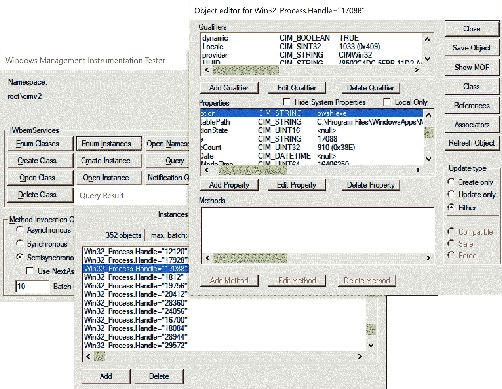

# 第 28 章. CIM 和 Windows 管理规范

## 28.0 简介

Windows 管理规范 (WMI) 长期以来一直是 Windows 的核心管理功能。它提供了惊人的广度、广泛的覆盖范围和无处不在的远程管理。

然而，WMI 过去缺乏一种好的访问方式。从图形界面来看，`wbemtest.exe` 实用程序允许你试验 WMI、其命名空间和类。但它确实是一个测试工具，因为其复杂的 UI 使其在大多数场景中不切实际（请参阅 图 28-1）。

一个更用户友好的替代方案是 `wmic.exe` 命令行工具。`WMIC` 工具允许你交互式地查询 WMI——但更重要的是，自动化其行为。与 PowerShell 一样，`WMIC` 中的结果保留了大量结构化信息，并允许你编写相当详细的查询：

```
PS > WMIC logicaldisk WHERE drivetype=3 `
    GET "name,freespace,SystemName,FileSystem,Size"

FileSystem  FreeSpace    Name  Size         SystemName
NTFS        10587656192  C:    34357637120  LEEHOLMES1C23
```

然而，该语言功能有限，一旦 `WMIC` 将输出转换为文本，所有数据的结构都会丢失。

到目前为止，WMI 最流行的 UI 是 `VBScript`，即管理员的传统脚本语言。`VBScript` 提供了比 `WMIC` 丰富得多的语言功能，并在脚本的整个运行期间保留 WMI 的结构化数据。



然而，VBScript 有其自身的一类易用性困难。例如，生成计算机上运行进程的报告通常最终看起来像这样：


# PowerShell 和 WMI/CIM

```
strComputer = "atl-dc-01"
Set objWMIService = GetObject("winmgmts:" _
    & "{impersonationLevel=impersonate}!\\" _
    & strComputer & "\root\cimv2")
Set colProcessList = objWMIService.ExecQuery _
    ("Select * from Win32_Process")
For Each objProcess in colProcessList
    Wscript.Echo "Process: " & objProcess.Name
    Wscript.Echo "Process ID: " & objProcess.ProcessID
    Wscript.Echo "Thread Count: " & objProcess.ThreadCount
    Wscript.Echo "Page File Size: " _
        & objProcess.PageFileUsage
    Wscript.Echo "Page Faults: " _
        & objProcess.PageFaults
    Wscript.Echo "Working Set Size: " _
        & objProcess.WorkingSetSize
Next
```

这还要求你编写完整的脚本，且不提供轻量级的交互体验。Microsoft Scripting Guys 的 Scriptomatic 工具有助于更轻松地创建许多此类繁琐的脚本，但它仍然无法解决临时查询的问题。

PowerShell 登场了。

PowerShell 将 WMI 提升为**临时**查询和结构化查询的**一等公民**。由于用于处理 WMI 实例的大部分 VBScript 模板最终都用于显示结果，PowerShell 彻底省去了这一步骤。上述 VBScript 的 PowerShell 等效命令仅为：

```powershell
Get-CimInstance Win32_Process -ComputerName atl-dc-01
```

或者，如果你想要一部分属性：

```powershell
Get-CimInstance Win32_Process | Select-Object Name,ProcessId,ThreadCount
```

通过提供与 WMI 的深度且用户友好的集成，PowerShell 将大量功能置于每位管理员的指尖。

## 向 CIM 的转变

虽然你可能最熟悉 Windows 上的 WMI，但你所熟悉的概念实际上是分布式管理任务组（DMTF）标准的一种实现。然而，自 WMI 推出以来，DMTF 标准已显著进步，而在此期间对 WMI 的改进造成了一组差异——无论是技术上还是理念上——这些差异难以调和。

为了解决这些差异，PowerShell 通过 `CimCmdlets` 模块支持基于标准的 CIM cmdlet。该模块中的命令完全符合 CIM 标准。它们使用标准的 CIM 命名空间和模式，使用标准的 WS-MAN 通信协议，并以标准方式表示对象。

这种转变的益处是巨大的。使用 WMI cmdlet 获得的专业知识本质上仅适用于与 Windows 系统的交互。而通过 CIM cmdlet，你获得的专业知识适用于广泛的供应商和设备。

### 28.1 访问 Windows Management Instrumentation 和 CIM 数据

#### 问题

你想要处理 Windows 中 WMI 和 CIM 设施提供的数据和功能。

#### 解决方案

要检索 WMI 或 CIM 类的所有实例，请使用 `Get-CimInstance` cmdlet：

```powershell
Get-CimInstance -ComputerName Computer -Class Win32_Bios
```

要使用筛选器检索 WMI 或 CIM 类的特定实例，请向 `Get-CimInstance` cmdlet 的 `-Filter` 参数提供参数。这是 WQL（WMI 查询语言）语句的 `WHERE` 子句，但不带 `WHERE` 关键字：

```powershell
Get-CimInstance Win32_Service -Filter "StartMode = 'Auto'"
```

对于 WMI 实例，你可以使用 `[Wmi]` 类型快捷方式：

```powershell
[Wmi] 'Win32_Service.Name="winmgmt"'
```

要使用 WMI 的 WQL 语言检索类的实例，请使用 `Get-CimInstance` 的 `-Query` 参数：

```powershell
Get-CimInstance -Query "SELECT * FROM Win32_Service WHERE StartMode = 'Auto'"
```

对于 WMI 实例，请使用 `[WmiSearcher]` 类型快捷方式：

```powershell
$query = [WmiSearcher] "SELECT * FROM Win32_Service WHERE StartMode = 'Auto'"
$query.Get()
```

要检索 WMI 或 CIM 实例的属性，像访问 .NET 属性一样访问该属性：

```powershell
$service = [Wmi] 'Win32_Service.Name="winmgmt"'
$service.StartMode
```

要在 CIM 实例上调用方法，请使用 `Invoke-CimMethod` cmdlet：

```powershell
$service = Get-CimInstance Win32_Service -Filter "Name = 'winmgmt'"
$service | Invoke-CimMethod -Name ChangeStartMode -Arguments @{
    StartMode = "Manual" }
```

或者，专门针对 WMI 实例，像调用 .NET 方法一样调用该方法：

```powershell
$service = [Wmi] 'Win32_Service.Name="winmgmt"'
$service.ChangeStartMode("Manual")
$service.ChangeStartMode("Automatic")
```

要在 WMI 类上调用方法，请使用 `Invoke-CimMethod` cmdlet。你也可以使用 `[WmiClass]` 类型快捷方式访问该 WMI 类。然后，像调用 .NET 方法一样调用该方法：

```powershell
Invoke-CimMethod -Class Win32_Process -Name Create -Arguments @{
    CommandLine = "notepad" }

$class = [WmiClass] "Win32_Process"
$class.Create("Notepad")
```

要从特定命名空间检索 WMI 类，请结合 `[WmiClass]` 类型快捷方式使用其完全限定名：

```powershell
[WmiClass] "\\COMPUTER\Root\Cimv2:Win32_Process"
```

#### 讨论

长期以来，使用 WMI 一直是管理 Windows 系统的主流方法——尤其是属于企业域一部分的系统。WMI 支持大量的 Windows 管理任务，尽管方式不太用户友好。

传统上，管理员需要 VBScript 或 WMIC 命令行工具才能通过 WMI 访问和管理这些系统。虽然功能强大且实用，但这些技术仍有大量改进空间。VBScript 缺乏对临时调查方法的支持，而 WMIC 无法提供（或利用）适用于 WMIC 之外任何事物的知识。

相比之下，PowerShell 让你像使用 Shell 的其他部分一样使用 WMI 和 CIM。WMI 和 CIM 实例提供方法和属性，你可以像处理 PowerShell 中其他对象的方法和属性一样处理它们。

PowerShell 不仅让你在获得 WMI 实例和类后能轻松地处理它们，还提供了一种简洁的方式来首先访问它们。对于大多数任务，你只需使用解决方案中所示的简单 `[Wmi]`、`[WmiClass]` 或 `[WmiSearcher]` 语法即可。

除了 WMI 的巨大范围外，还有一个相关问题：找到能完成你任务的 WMI 类。为了帮助你了解有哪些可用的 WMI 或 CIM 类，**附录 G** 提供了最常用类的有用列表。有关按名称、描述、属性名称或属性描述搜索 WMI 和 CIM 类的脚本，请参阅**食谱 28.5**。

当你想使用 `[Wmi]` 加速器访问特定的 WMI 实例时，起初可能难以确定 WMI 允许你按哪些属性搜索。这些属性称为该类上的**关键属性**。有关列出这些关键属性的脚本，请参阅**食谱 28.4**。

有关 `Get-CimInstance` cmdlet 的详细信息，请输入 `Get-Help Get-CimInstance`。

#### 另请参阅

- 食谱 28.4，“程序：确定可用于 WMI 和 CIM 筛选器的属性”
- 食谱 28.5，“搜索用于完成任务的 WMI 或 CIM 类”
- 附录 G，《WMI 参考》

### 28.2 修改 WMI 或 CIM 实例的属性

#### 问题

你想要修改 WMI 或 CIM 实例的属性。

#### 解决方案

使用 `Set-CimInstance` cmdlet：

```powershell
PS > $bootVolume = Get-CimInstance Win32_LogicalDisk |
    Where-Object { $_.DeviceID -eq 'C:' }

PS > $bootVolume

DeviceID     : C:
DriveType    : 3
ProviderName :
FreeSpace    : 10587656192
Size         : 34357637120
VolumeName   : Boot Volume

PS > $bootVolume | Set-CimInstance -Arguments @{
     VolumeName = 'Operating System' }

DeviceID     : C:
DriveType    : 3
ProviderName :
FreeSpace    : 10587656192
Size         : 34357637120
VolumeName   : Operating System
```

#### 讨论


虽然你可以为 `Get-CimInstance` 输出的对象分配新的属性值，但你所做的更改最终不会反映在永久系统状态中，如以下示例所示：

```
PS > $bootVolume = Get-CimInstance Win32_LogicalDisk |
    Where-Object { $_.DeviceID -eq 'C:' }

PS > $bootVolume

DeviceID     : C:
DriveType    : 3
ProviderName :
FreeSpace    : 10587656192
Size         : 34357637120
VolumeName   : OS

PS > $bootVolume.VolumeName = "Boot Volume"

PS > Get-CimInstance Win32_LogicalDisk |
    Where-Object { $_.DeviceID -eq 'C:' }


DeviceID     : C:
DriveType    : 3
ProviderName :
FreeSpace    : 10587652096
Size         : 34357637120
VolumeName   : OS
```

相反，`Set-CimInstance` cmdlet 允许你永久修改 WMI 和 CIM 实例的值。虽然 `Set-CimInstance` cmdlet 支持将 WMI 实例作为管道输入，但你也可以使用 `-Query` 参数来选择要修改的实例：

```
Set-CimInstance -Query "SELECT * FROM Win32_LogicalDisk WHERE DeviceID='C:'" `
    -Property @{ VolumeName="OS" }
```

要确定实例上的哪些属性可以被修改，你需要检查定义它的 CIM 类。每个 CIM 类都有一个 `CimClassProperties` 集合，每个属性都有一个 `Qualifiers` 集合。如果 `Write` 是其中一个限定符，则该属性可写：

```
PS > Get-CimClass Win32_LogicalDisk | ForEach-Object CimClassProperties

(...)
Name               : VolumeName
Value              :
CimType            : String
Flags              : Property, NullValue
Qualifiers         : {MappingStrings, read, write}
ReferenceClassName :

Name               : VolumeSerialNumber
Value              :
CimType            : String
Flags              : Property, ReadOnly, NullValue
Qualifiers         : {MappingStrings, read}
ReferenceClassName :
(...)
```

要自动查看 `ROOT\CIMV2` 命名空间中所有可写的类，只需运行这段 PowerShell 脚本片段：

```
Get-CimClass Win32_LogicalDisk | ForEach-Object {
    $_.CimClassName; $_.CimClassProperties |
    Where-Object { $_.Qualifiers["Write"] } | ForEach-Object Name
}
```

## 另请参阅

配方 28.1，“访问 Windows 管理规范和 CIM 数据”

附录 G，*WMI 参考*

# 28.3 在 WMI 实例或类上调用方法

## 问题

你想要调用 WMI 实例或类支持的方法。

## 解决方案

使用 `Invoke-CimMethod` cmdlet：

```
PS > Invoke-CimMethod -Class Win32_Process -Name Create -Arguments @{
    CommandLine = "notepad" }
(notepad starts)

ProcessId                                ReturnValue PSComputerName
---------                                ----------- --------------
     5976                                          0 leeholmes1c23
```

## 讨论

与 .NET 类型一样，WMI 类描述了一组相关项目的功能和特性。例如，`Win32_Process` 类描述了一个称为 *operating system process*（操作系统进程）的实体的特性和行为。当 WMI 或 CIM 返回关于特定 *operating system process*（操作系统进程）的信息时，这被称为一个 *instance*（实例）。

与 .NET 类型上的静态方法一样，许多 WMI 和 CIM 类提供与其试图表示的实体广泛相关的方法。例如，`Win32_Process` 类定义了启动进程、停止进程等方法。要调用这些方法中的任何一个，请调用 `Invoke-CimMethod` cmdlet。

虽然你可能已经知道要调用的方法，但 PowerShell 还提供了一种查看系统上 WMI 和 CIM 类公开的方法的方式。每个 WMI 类都有一个 `CimClassMethods` 集合，查看该集合会列出该类支持的所有方法。以下片段列出了 `Win32_Process` 类支持的所有方法：

```
Get-CimClass Win32_Process | ForEach-Object CimClassMethods
```

一旦找到要调用的方法，你可以访问 `Parameters` 属性来查看如何调用该方法：

```
PS > $methods = Get-CimClass Win32_Process | ForEach-Object CimClassMethods
PS > $methods | Where-Object Name -eq Create | ForEach-Object Parameters

Name                       CimType Qualifiers
----                       ------- ----------
CommandLine                 String {ID, In, MappingStrings}
CurrentDirectory            String {ID, In, MappingStrings}
ProcessStartupInformation Instance {EmbeddedInstance, ID, In, MappingStrings}
ProcessId                   UInt32 {ID, MappingStrings, Out}
```

除了 `Invoke-CimMethod` cmdlet，`[WmiClass]` 类型快捷方式也允许你引用 WMI 类并调用其方法：

```
$processClass = [WmiClass] "Win32_Process"
$processClass.Create("notepad.exe")
```

然而，这种方法不容易支持模拟、身份验证或权限限制的自定义。

有关使用 WMI 类的更多信息，请参阅配方 28.1。

## 另请参阅

配方 28.1，“访问 Windows 管理规范和 CIM 数据”

附录 G，*WMI 参考*

# 28.4 程序：确定可用于 WMI 和 CIM 筛选器的属性

当你想要使用 PowerShell 访问特定的 WMI 或 CIM 实例时，最初可能难以确定 WMI 或 CIM 允许你搜索哪些属性。这些属性被称为类上的 *key properties*（关键属性）。示例 28-1 获取给定类可用于 WMI 筛选器的所有属性。

### 示例 28-1. Get-WmiClassKeyProperty.ps1

```
##############################################################################
##
## Get-WmiClassKeyProperty
##
## From PowerShell Cookbook (O'Reilly)
## by Lee Holmes (http://www.leeholmes.com/guide)
##
##############################################################################

<#

.SYNOPSIS

Get all of the properties that you may use in a WMI filter for a given class.

.EXAMPLE

PS > Get-WmiClassKeyProperty Win32_Process
Handle

#>

param(
    ## The WMI class to examine
    [WmiClass] $WmiClass
)

Set-StrictMode -Version 3

## WMI classes have properties
foreach($currentProperty in $wmiClass.Properties)
{
    ## WMI properties have qualifiers to explain more about them
    foreach($qualifier in $currentProperty.Qualifiers)
    {
        ## If it has a 'Key' qualifier, then you may use it in a filter
        if($qualifier.Name -eq "Key")
        {
            $currentProperty.Name
        }
    }
}
```

有关运行脚本的更多信息，请参阅配方 1.2。

## 另请参阅

配方 1.2，“运行程序、脚本和现有工具”

# 28.5 搜索用于完成任务的 WMI 或 CIM 类

## 问题

你想要找到可以帮助你完成任务的 WMI 或 CIM 类。

## 解决方案

使用 `Get-CimClass` cmdlet，使用通配符筛选感兴趣的关键字：

```
PS > Get-CimClass *restore* -namespace root/default

   NameSpace: ROOT/default

CimClassName           CimClassMethods      CimClassProperties
------------           ---------------      ------------------
SystemRestoreConfig    {}                   {DiskPercent, MyKey, RPGlobalInte...
SystemRestore          CreateRestorePoint…  {CreationTime, Description, Event...
```

## 讨论

随着 WMI 巨大的范围而来的是一个相关问题：找到完成任务的 WMI 或 CIM 类。为了帮助你了解有哪些可用的 WMI 类，附录 G 提供了最常用类的有用列表。


大部分情况下，你可以使用 `Get-CimClass` cmdlet 来搜索有助于完成任务的类。`Get-CimClass` cmdlet 会在特定命名空间中搜索与你提供的通配符匹配的类，如果你不指定命名空间，则默认为 `ROOT\CIMV2`。

```
PS > Get-CimClass *printer*

   NameSpace: ROOT/cimv2

CimClassName                  CimClassMethods      CimClassProperties
------------                  ---------------      ------------------
CIM_Printer                   {SetPowerState, Res… {Caption, Description, InstallD…
Win32_Printer                 {SetPowerState, Res… {Caption, Description, InstallD…
Win32_PrinterDriver           {StartService, Stop… {Caption, Description, InstallD…
Win32_TCPIPPrinterPort        {}                   {Caption, Description, InstallD…
Win32_PrinterController       {}                   {Antecedent, Dependent, Negotia…
Win32_PrinterDriverDll        {}                   {Antecedent, Dependent}
Win32_PrinterShare            {}                   {Antecedent, Dependent}
Win32_PrinterSetting          {}                   {Element, Setting}
Win32_PrinterConfiguration    {}                   {Caption, Description, SettingI…
```

Windows 拥有许多包含有用类的 WMI 命名空间，以下是示例：

```
Count Name
----- ----
 1814 ROOT\WMI
 1337 ROOT\CIMV2
  495 ROOT\virtualization\v2
  408 ROOT\CIMV2\mdm\dmmap
  359 ROOT\StandardCimv2
  273 ROOT\HyperVCluster\v2
  269 ROOT\Microsoft\Windows\Storage\Providers_v2
  205 ROOT\Microsoft\Windows\Storage
  150 ROOT\ServiceModel
  104 ROOT\CIMV2\TerminalServices
  100 ROOT\PEH
   99 ROOT\Microsoft\Windows\DesiredStateConfiguration
   98 ROOT\Hardware
   98 ROOT\CIMV2\power
   95 ROOT\Microsoft\Windows\TaskScheduler
   93 ROOT\CIMV2\mdm
   90 ROOT\Microsoft\Windows\RemoteAccess\Client
   89 ROOT\Intel_ME
   85 ROOT\msdtc
   82 ROOT\Microsoft\Windows\SMB
   80 ROOT\aspnet
   79 ROOT\DEFAULT
   (...)
```

要查找其他命名空间，可以在 Windows PowerShell（而非 PowerShell Core）中使用 `Get-WmiObject` cmdlet。例如，生成上述列表的命令：

```
$allClasses = Get-WmiObject -List -Recurse -Namespace "ROOT"
$results = $allClasses | Group-Object { $_.Path.NamespacePath }
$results | Sort-Object -Descending count | Select-Object Count,Name
```

如果想深入探索，示例 28-2 允许你按名称、描述、属性名或属性描述搜索 WMI 类。它依赖 `Get-WmiObject`，因此必须在 Windows PowerShell 中运行。

### 示例 28-2. Search-WmiNamespace.ps1

```
##############################################################################
##
## Search-WmiNamespace
##
## From PowerShell Cookbook (O'Reilly)
## by Lee Holmes (http://www.leeholmes.com/guide)
##
##############################################################################

<#

.SYNOPSIS

Search the WMI classes installed on the system for the provided match text.

.EXAMPLE

PS > Search-WmiNamespace Registry
Searches WMI for any classes or descriptions that mention "Registry"

.EXAMPLE

Search-WmiNamespace Process ClassName,PropertyName
Searchs WMI for any classes or properties that mention "Process"

.EXAMPLE

Search-WmiNamespace CPU -Detailed
Searches WMI for any class names, descriptions, or properties that mention
"CPU"

#>

param(
    ## The pattern to search for
    [Parameter(Mandatory = $true)]
    [string] $Pattern,

    ## Switch parameter to look for class names, descriptions, or properties
    [switch] $Detailed,

    ## Switch parameter to look for class names, descriptions, properties, and
    ## property description.
    [switch] $Full,

    ## Custom match options.
    ## Supports any or all of the following match options:
    ## ClassName, ClassDescription, PropertyName, PropertyDescription
    [string[]] $MatchOptions = ("ClassName","ClassDescription")
)

Set-StrictMode -Off

## Helper function to create a new object that represents
## a Wmi match from this script
function New-WmiMatch
{
    param( $matchType, $className, $propertyName, $line )

    $wmiMatch = New-Object PsObject -Property @{
        MatchType = $matchType;
        ClassName = $className;
        PropertyName = $propertyName;
        Line = $line
    }

    $wmiMatch
}

## If they've specified the -detailed or -full options, update
## the match options to provide them an appropriate amount of detail
if($detailed)
{
    $matchOptions = "ClassName","ClassDescription","PropertyName"
}

if($full)
{
    $matchOptions =
        "ClassName","ClassDescription","PropertyName","PropertyDescription"
}

## Verify that they specified only valid match options
foreach($matchOption in $matchOptions)
{
    $fullMatchOptions =
        "ClassName","ClassDescription","PropertyName","PropertyDescription"

    if($fullMatchOptions -notcontains $matchOption)
    {
        $error = "Cannot convert value {0} to a match option. " +
            "Specify one of the following values and try again. " +
            "The possible values are ""{1}""."
        $ofs = ", "
        throw ($error -f $matchOption, ([string] $fullMatchOptions))
    }
}

## Go through all of the available classes on the computer
foreach($class in Get-WmiObject -List -Rec)
{
    ## Provide explicit get options, so that we get back descriptions
    ## as well
    $managementOptions = New-Object System.Management.ObjectGetOptions
    $managementOptions.UseAmendedQualifiers = $true
    $managementClass =
        New-Object Management.ManagementClass $class.Name,$managementOptions

    ## If they want us to match on class names, check if their text
    ## matches the class name
    if($matchOptions -contains "ClassName")
    {
        if($managementClass.Name -match $pattern)
        {
            New-WmiMatch "ClassName" `
                $managementClass.Name $null $managementClass.__PATH
        }
    }

    ## If they want us to match on class descriptions, check if their text
    ## matches the class description
    if($matchOptions -contains "ClassDescription")
    {
        $description =
            $managementClass.Qualifiers |
                foreach { if($_.Name -eq "Description") { $_.Value } }
        if($description -match $pattern)
        {
            New-WmiMatch "ClassDescription" `
                $managementClass.Name $null $description
        }
    }

    ## Go through the properties of the class
    foreach($property in $managementClass.Properties)
    {
        ## If they want us to match on property names, check if their text
        ## matches the property name
        if($matchOptions -contains "PropertyName")
        {
            if($property.Name -match $pattern)
            {
                New-WmiMatch "PropertyName" `
                    $managementClass.Name $property.Name $property.Name
            }
        }

        ## If they want us to match on property descriptions, check if
        ## their text matches the property name
        if($matchOptions -contains "PropertyDescription")
        {
            $propertyDescription =
                $property.Qualifiers |
                    foreach { if($_.Name -eq "Description") { $_.Value } }
            if($propertyDescription -match $pattern)
            {
                New-WmiMatch "PropertyDescription" `
                    $managementClass.Name $property.Name $propertyDescription
            }
        }
    }
}
```

有关运行脚本的更多信息，请参阅 配方 1.2。

## 另请参阅

- 配方 1.2，“运行程序、脚本和现有工具”
- 附录 G，《WMI 参考》

# 28.6 使用 .NET 执行高级 WMI 任务

## 问题

你想使用 WMI 的高级功能，但 PowerShell 的访问方式（通过 `[Wmi]`、`[WmiClass]` 和 `[WmiSearcher]` 加速器）并不直接支持这些功能。


## 解决方案

要与 WMI 对象的高级功能交互，请访问其方法和属性。

### 高级实例功能

要获取与给定实例相关的 CIM 实例（即其*关联器*），请使用 `Get-CimAssociatedInstance` cmdlet：

```
Get-CimInstance Win32_Service -Filter "Name='winmgmt'" |
    Get-CimAssociatedInstance
```

处理 WMI 时，请使用 `GetRelated()` 方法：

```
$instance = [Wmi] 'Win32_Service.Name="winmgmt"'
$instance.GetRelated()
```

在处理 WMI 时（与 CIM cmdlet 相反），连接选项在某些场景中起着重要作用。要更改高级作用域选项，请访问 `Scope.Options` 属性：

```
$system = [WmiClass] 'Win32_OperatingSystem'
$system.Scope.Options.EnablePrivileges = $true
$system.SetDateTime($system.ConvertFromDateTime("01/01/2007"))
```

### 高级类功能

要检索类的属性和限定符，请访问 `CimClassProperties` 属性：

```
$class = Get-CimClass Win32_Process
$class.CimClassProperties
```

### 高级查询功能

在处理 WMI 时，高级查询选项在某些场景中起着重要作用。要在查询上配置连接选项（如数据包隐私和身份验证），请在 `Scope` 属性上设置选项：

```
$credential = Get-Credential
$query = [WmiSearcher] "SELECT * FROM IISWebServerSetting"
$query.Scope.Path = "\\REMOTE_COMPUTER\Root\MicrosoftIISV2"
$query.Scope.Options.Username = $credential.Username
$query.Scope.Options.Password = $credential.GetNetworkCredential().Password
$query.Scope.Options.Authentication = "PacketPrivacy"
$query.get() | Select-Object AnonymousUserName
```

## 讨论

`[Wmi]`、`[WmiClass]` 和 `[WmiSearcher]` 类型快捷方式分别返回 .NET `System.Management.ManagementObject`、`System.Management.ManagementClass` 和 `System.Management.ManagementObjectSearcher` 类的实例。

正如预期的那样，.NET Framework 为 WMI 查询提供了全面的支持，而 PowerShell 为该支持提供了更易用的接口。如果您需要超出 PowerShell 直接提供的支持范围，.NET Framework 中的这些类提供了一个高级出口。

有关使用 .NET Framework 类的更多信息，请参阅 配方 3.8。

## 另请参阅

配方 3.8，“使用 .NET 对象”

# 28.7 将 VBScript WMI 脚本转换为 PowerShell

## 问题

您想在 PowerShell 中执行 WMI 或 CIM 任务，但只能找到演示该问题解决方案的 VBScript 示例。

## 解决方案

要完成从计算机检索数据的脚本任务，请使用 `Get-CimInstance` cmdlet：

```
foreach($printer in Get-CimInstance -Computer COMPUTER Win32_Printer)
{
    ## Work with the properties
    $printer.Name
}
```

要完成在实例上调用方法的脚本任务，请使用 `[Wmi]` 或 `[WmiSearcher]` 加速器来检索实例，然后像调用任何其他 PowerShell 方法一样在实例上调用方法。

```
$service = [WMI] 'Win32_Service.Name="winmgmt"'
$service.ChangeStartMode("Manual")
$service.ChangeStartMode("Automatic")
```

此外，您可以使用 `Get-CimInstance` 和 `Invoke-CimMethod` cmdlet 执行相同操作：

```
$service = Get-CimInstance Win32_Service -Filter "Name = 'winmgmt'"
$service | Invoke-CimMethod -Name ChangeStartMode -Arguments @{
    StartMode = "Manual" }
$service | Invoke-CimMethod -Name ChangeStartMode -Arguments @{
    StartMode = "Automatic" }
```

要完成在类上调用方法的脚本任务，请使用 `Invoke-CimMethod` cmdlet，或使用 `[WmiClass]` 加速器检索类，然后像调用任何其他 PowerShell 方法一样在类上调用方法：

```
Invoke-CimMethod -Class Win32_Process -Name Create -Arguments @{
    CommandLine = "notepad" }

$class = [WmiClass] "Win32_Process"
$class.Create("Notepad")
```

## 讨论

多年来，VBScript 一直是管理员用来访问 WMI 数据的首选语言。因此，书籍和互联网上可用的绝大多数脚本都是用 VBScript 编写的。

这些脚本通常采用三种形式之一：检索数据和访问属性、调用实例的方法以及调用类的方法。

### 注意

尽管互联网上的大多数 WMI 脚本都完成独特的任务，但 PowerShell 原生支持许多传统的 WMI 任务。如果您想将 WMI 示例转换为 PowerShell，请先检查是否有任何 PowerShell cmdlet 可能直接完成该任务。

### 检索数据

WMI 最常见的用途之一是数据收集和系统清单任务。典型的检索数据的 VBScript 如 示例 28-3 所示。

#### 示例 28-3. 使用 VBScript 从 WMI 检索打印机信息

```
strComputer = "."
Set objWMIService = GetObject("winmgmts:" _
    & "{impersonationLevel=impersonate}!\\" & strComputer & "\root\cimv2")

Set colInstalledPrinters = objWMIService.ExecQuery _
    ("Select * from Win32_Printer")

For Each objPrinter in colInstalledPrinters
    Wscript.Echo "Name: " & objPrinter.Name
    Wscript.Echo "Location: " & objPrinter.Location
    Wscript.Echo "Default: " & objPrinter.Default
Next
```

前三行准备与给定计算机和命名空间的 WMI 连接。接下来两行代码准备一个 WMI 查询，请求类的所有实例。`For Each` 代码块遍历所有实例，`objPrinter.Property` 语句与这些实例上的属性交互。

在 PowerShell 中，`Get-CimInstance` cmdlet 通过从您指定的计算机和命名空间检索类的所有实例来处理大部分工作。前五行代码因此变为：

```
$installedPrinters = Get-CimInstance Win32_Printer -ComputerName computer
```

如果您需要指定不同的计算机、命名空间或查询限制，`Get-CimInstance` cmdlet 通过可选参数支持这些功能。

在 PowerShell 中，`For Each` 代码块变为：

```
foreach($printer in $installedPrinters)
{
    $printer.Name
    $printer.Location
    $printer.Default
}
```

请注意，我们在该脚本的 PowerShell 转换中花费大量篇幅展示如何访问属性。如果您实际上不需要处理属性（只想为报告目的显示它们），PowerShell 的格式化命令可以进一步简化此操作：

```
Get-CimInstance Win32_Printer -ComputerName computer |
    Format-List Name,Location,Default
```

有关使用 `Get-CimInstance` cmdlet 的更多信息，请参阅 配方 28.1。

### 在实例上调用方法

虽然数据检索脚本构成了 WMI 管理示例的大部分，但另一个常见任务是调用实例的方法以执行操作。

例如，示例 28-4 更改服务的启动类型。

#### 示例 28-4. 使用 VBScript 通过 WMI 更改服务的启动类型

```
strComputer = "."
Set objWMIService = GetObject("winmgmts:" _
    & "{impersonationLevel=impersonate}!\\" & strComputer & "\root\cimv2")

Set colServiceList = objWMIService.ExecQuery _
    ("Select * from Win32_Service where StartMode = 'Manual'")

For Each objService in colServiceList
    errReturnCode = objService.ChangeStartMode("Disabled")
Next
```

前三行准备与给定计算机和命名空间的 WMI 连接。接下来两行代码准备一个 WMI 查询，请求类的所有实例，并向查询添加额外的筛选器（`StartMode = 'Manual'`）。`For Each` 代码块遍历所有实例，`objService.ChangeStartMode(...)` 语句在服务上调用 `ChangeStartMode()` 方法。


## 在类上调用方法

虽然在实例上调用方法更常见，但有时在 WMI 类上调用方法也很有帮助。PowerShell 让这项工作的方式几乎与在实例上调用方法完全相同。

例如，在远程计算机上创建进程的脚本如下所示：

```
strComputer = "COMPUTER"
Set objWMIService = GetObject _
    ("winmgmts:\\" & strComputer & "\root\cimv2:Win32_Process")

objWMIService.Create("notepad.exe")
```

前三行准备到给定计算机和命名空间的 WMI 连接。最后一行在类上调用 `Create()` 方法。

在 PowerShell 中，`Invoke-CimMethod` cmdlet 让你能轻松处理类上的方法。整个代码段变为：

```
Invoke-CimMethod -Computername COMPUTER -Class Win32_Process -Name Create `
    -Arguments @{ CommandLine = "notepad" }
```

有关在 WMI 类上调用方法的更多信息，请参阅 食谱 28.3。

## 另请参阅

食谱 28.1，“访问 Windows 管理规范和 CIM 数据”

食谱 28.3，“在 WMI 实例或类上调用方法”
