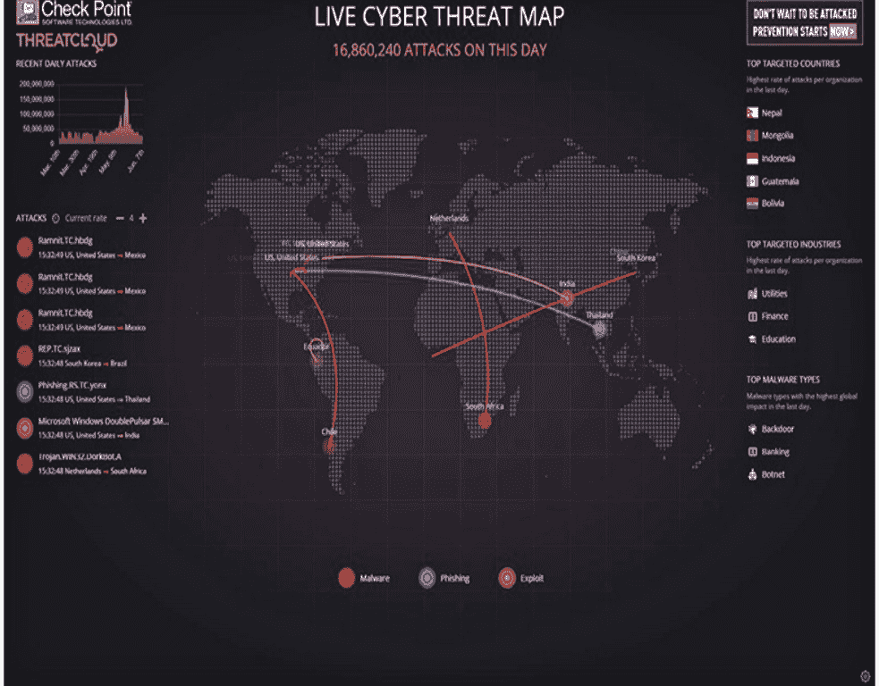
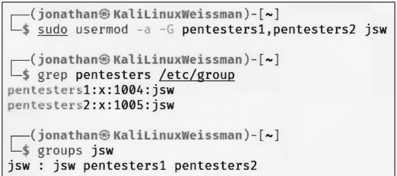

## 第 1 章：引言与安全趋势

### 实验练习

- 1.01 紧跟行业动态
- 1.02 网络威胁地图
- 1.03 网络安全调查
- 1.04 构建虚拟实验室

### 实验分析

### 关键术语测验

欢迎上船！你决定追求备受尊敬的 CompTIA Security+ 认证，这是一个巨大的决定！你即将开始网络安全这个神奇世界中的一次惊人旅程。除了帮助你准备考试外，本书中的实验旨在让你获得雇主所寻找的动手、真实世界的技能。

在古代中国军事著作《孙子兵法》中，孙子写道：“知己知彼，百战不殆。知己不知彼，一胜一负。知彼不知己，每战必殆。” 虽然该著作写于公元前 5 世纪左右，用来阐述军事战略和技术技能，但这一理念在今天的网络安全中依然成立。识别漏洞、理解风险并紧跟新威胁都是网络安全不可或缺的要素。

网络安全不是一份工作。它是一份职业。它是一种生活方式。它是你需要充满热情的事情。它是你经常会思考的事情。你将做出改变，成为系统、网络和人们的救世主。你将被视为巫师、魔术师、专家和绝地武士。

关于网络安全还有一件更重要的事情需要理解：它在不断变化！你需要每天跟上该领域的每一个新动态。你需要经常重塑自我，并明白你在某一时刻所学习和掌握的东西在不久的将来可能完全过时、无用且无效。这正是我所驱动的，我喜欢它！网络安全中没有两天是相同的！

那么，你还在等什么？系好安全带，加入我。

60 分钟

### 实验练习 1.01：紧跟行业动态

大家好！我叫 Jonathan S. Weissman，我将在这段通往 CompTIA Security+ 认证的旅程中担任你的教授！

在我们开始之前，我想邀请你关注我的社交媒体：

- LinkedIn https://linkedin.com/in/jonathan-s-weissman-058b649b
- Twitter https://twitter.com/CSCPROF
- Instagram https://instagram.com/cscprof/

我会回复每一则消息，所以请随时就这本书、网络安全或任何其他事情联系我。

在我看来，创建和维护 LinkedIn 个人资料是你能做出的最佳决定之一，因为它将为你的职业生涯带来诸多益处。

### 学习目标

在本实验练习中，你将探索创建 LinkedIn 个人资料并成为该平台活跃成员的原因。在本实验练习结束时，你将能够


- 了解 LinkedIn 对所有专业人士的重要性，尤其是网络安全专业人士
- 在 LinkedIn 上发布你自己的专业个人资料
- 积极使用 LinkedIn 既获取也提供专业收益

### Lab Materials and Setup

本实验所需的材料有

- *Principles of Computer Security: CompTIA Security+ and Beyond* 教材
- 具有 Internet 连接的网络浏览器

### Let’s Do This!

在 LinkedIn 上，你可以

- 与任何行业、领域或领域的专业人士会面并建立人脉。
- 找到导师并成为导师。
- 被招聘经理和招聘人员发现。
- 与其他专业人士保持联系并分享职业里程碑。
- 通过个人资料为专业人士查看来打造和推广自己。
- 由专业人士在知识和专业技能方面得到认可。
- 分享和查看创意内容并作为与他人建立联系的方式。
- 了解公司、追踪公司以获取未来工作机会，并与公司互动。

在我看来，加入 LinkedIn 最大的原因是……

- 了解你所在行业、领域或领域的最新事件和动态。


**Step 1** 我每天发布数十篇文章，内容涉及技术、网络、系统管理、网络安全、黑客、渗透测试、取证、恶意软件、密码学、编程等。阅读、发布并在 LinkedIn 上与业内同行和学生（我有超过 27,000 个联系人）讨论这些文章，是我保持最新动态的众多方式之一。

- a. 在 LinkedIn 上关注我（见图 1-1），一起加入乐趣！
  - https://linkedin.com/in/jonathan-s-weissman-058b649b
- b. 阅读我在 LinkedIn 上发布的最新文章。
- c. 对我的帖子回复你对该文章的想法。

想想看。如果有人对你的帖子做出反应、评论或分享，他们的联系人（双向关系）和关注者（会看到你的帖子、文章和分享的人）都会看到它——也会看到你！当你对我的帖子做出反应或评论时，我的联系人和关注者会看到你！这些都是扩展你自己人脉的绝佳方式。

### Note

当你在 LinkedIn 上与某人建立联系时，你默认会关注他们，他们也会关注你。


Figure 1-1 Jonathan S. Weissman on LinkedIn

认证是保持我与时俱进的另一种方式。我向我的学生强调行业认证的重要性。在此基础上，我以身作则。我已获得 44 项高级行业认证，我从未停止为认证考试学习。我获得新认证后做的第一件事就是选择下一个目标。这向我的学生表明学习过程永无止境，尤其是在这个行业，如果你在知识或技能方面停滞不前哪怕很短的时间，你可能会迅速变得过时且不受欢迎。通过学习 CompTIA Security+ 认证，你也在沿着我的道路前行！

### Note

我保持与时俱进的其他方式包括咨询、作为网络安全专家出现在电视新闻中、在演讲活动中激励思想、撰写文章/博客、被他人文章/博客引用、对行业书籍进行技术编辑，以及撰写像这本一样的行业书籍。其中一些或全部都可能是你未来的良好目标！

**Step 2** 一个不错的链接是 https://university.linkedin.com/linkedin-for-students，其中包含大量资源，说明为什么所有学生都绝对应该拥有 LinkedIn 个人资料。

- a. 截取你在 LinkedIn for Students 页面找到的最有价值资源的屏幕截图。
- b. 解释你为什么认为它是最有价值的资源。

30 MINUTES

## Lab Exercise 1.02: Cyber Threat Maps

网络攻击每时每刻都在发生。没有任何组织、行业或世界任何地区能够免疫。

可视化这些持续攻击的一种方式是通过网络威胁地图，也称为网络攻击地图。这些地图使你能够“观看”攻击穿越国家和大陆。大多数看起来像电子游戏或《星球大战》中的东西，五彩缤纷的光束代表从世界一个地方到另一个地方的攻击。

传感器网络，在某些情况下来自网络安全公司的数百万个传感器，遍布全球并收集有关网络威胁的信息。在大多数情况下，这些传感器连接到蜜罐，即模拟应用程序、服务、数据和设备的系统，这些系统不代表真实实体。网络罪犯并不知情，当他们攻击这些蜜罐时，有关网络罪犯的信息，包括他们的 IP 地址和使用的工具，会被记录下来并随后添加到地图中。IP 地址在大多数情况下是伪造的或代表受感染的。

Internet 的动态特性，这些链接中的一些在你看到时可能已不活跃。然而，在撰写时，这些是我的“十大”网络威胁地图。

**Step 1** 查看以下网络威胁地图：

- **FireEye Cyber Threat Map**
  http://www.fireeye.com/cyber-map/threat-map.html
- **Threatbutt Internet Hacking Attribution Map**
  https://threatbutt.com/map
- **Check Point ThreatCloud Live Cyber Threat Map**
  https://threatmap.checkpoint.com/ThreatPortal/livemap.html（见图 1-2）



Figure 1-2 Check Point’s ThreatCloud threat map

- Deteque Botnet Threat Map
  https://www.deteque.com/live-threat-map/
- Kaspersky Cyberthreat Real-Time Map
  https://cybermap.kaspersky.com/
- Digital Attack Map
  http://www.digitalattackmap.com
- Akamai Real-Time Web Attack Monitor
  https://www.akamai.com/us/en/resources/visualizing-akamai/enterprise-threat-monitor.jsp

- e. 你在点击收到的未知链接之前有多频繁地检查它们？
- f. 你有多频繁地点击收到的未知链接？
- g. 你在下载收到的未知文件之前有多频繁地检查它们？
- h. 你有多频繁地下载收到的未知文件？
- i. 你有多频繁地在没有 VPN（虚拟专用网络）的情况下使用公共 Wi-Fi？
- j. 你有多频繁地认为自己在网络安全方面放松了警惕？

从网络安全卫生最佳实践的角度来看，你希望在调查中得到以下回复：

- a. 总是
- b. 经常
- c. 经常
- d. 总是
- e. 总是
- f. 从不
- g. 总是
- h. 从不
- i. 从不
- j. 很少

**Step 2** 将你的调查发送给尽可能多的朋友和亲戚。尝试至少获得 30 人的回复。

**Step 3** 阅读 How To Use Google Slides at https://support.google.com/docs/answer/2763168。然后在 https://docs.google.com/presentation/ 创建一个演示文稿，分析和批评结果。

120 MINUTES

## Lab Exercise 1.04: Building the Virtual Lab

你将需要其他机器来完成本书中的动手实验。何不用虚拟机（VM）代替每个所需的物理机器呢？你将下载 Offensive Security 的 Kali Linux，即最常用的渗透测试/道德黑客 Linux 发行版。从 Microsoft Evaluation Center，你将下载 Windows 10 和 Windows Server 2019 的 90 天试用版。本实验包含有关延长试用的信息。要运行虚拟机，你将下载、安装并运行 VMware Workstation Player，这是 VMware 的众多超visor 之一。

### Learning Objectives

在本实验中，你将下载和安装一个超visor 并为多个客户操作系统创建虚拟机。在本实验结束时，你将能够

- 使用多个虚拟机在未来章节中进行动手实验

### Lab Materials and Setup

本实验所需的材料有

- *Principles of Computer Security: CompTIA Security+ and Beyond* 教材
- 具有 Internet 连接的网络浏览器
- 你拥有管理员权限的 Windows 10 机器（台式机或笔记本电脑）

### Let’s Do This!

你将在未来实验室中安装和使用 VMware Workstation Player、Kali Linux、Windows 10 Enterprise 和 Windows Server 2019


book. 是时候搭建基础设施了！

## Step 1 Download and install VMware Workstation Player.
- a. VMware 的网站一直在变化，所以在 Google 上搜索 **Download VMware Workstation Player**。Google 顶部结果应该会带你到 www.vmware.com 上的相应页面。
- b. 在你的 Windows 10 机器上下载并安装 Windows 版本。
- c. 接受条款，并可自行接受或更改默认选择。

## Step 2 Download Kali Linux and prepare it to be installed in VMware Workstation Player.
- a. Kali Linux 网站一直在变化，所以在 Google 上搜索 **Download Kali Linux**。Google 顶部结果应该会带你到 www.kali.org 上的相应页面。
- b. 下载并安装 Kali Linux 64 位安装程序 ISO 文件（不是 torrent）。在出版时，它位于 Bare Metal 类别中。保留该 ISO，因为你在第 5 章的一个涉及哈希的实验练习中会用到它。
- c. 运行 VMware Workstation Player。
- d. 点击 Create A New Virtual Machine。
- e. 浏览并选择 Kali ISO 文件，它将在你的 Downloads 文件夹中，然后点击 Next。
- f. 点击 Linux 单选按钮，并在 Version 下拉菜单中选择 Debian 10.x 64-Bit。然后点击 Next。
- g. 在文本框中，将 Debian 10.x 64-Bit 的名称更改为 Kali（或其它名称）。然后点击 Next。
- h. 保留默认的最大磁盘大小，但选择 Store Virtual Disk As A Single File 单选按钮而不是默认选择。然后点击 Next。
- i. 点击 Customize Hardware。然后在左侧选择 Network Adapter。选择 Bridged: Connected Directly To The Physical Network 单选按钮并选中 Replicate Physical Network Connection State 复选框。
- j. 可通过点击 Memory 并增加分配的内存来增加 VM 的 RAM。
- k. 点击 Close 然后点击 Finish。

## Step 3 Install and log in to the Kali Linux operating system.
- a. 在上一步点击 Finish 后，活动屏幕应已在 VMware Workstation Player 窗口中自动选中 VM。现在你已准备好安装 Kali Linux 操作系统。在右下角点击 Play Virtual Machine。选择 Graphical Install 然后按 ENTER。
- b. 接受或更改默认选择 Language（English）、Location（United States）和 Keyboard（American English），每次选择后点击 Continue。
- c. 在 Configure The Network 屏幕中，保留或更改默认 Hostname（kali）然后点击 Continue。
- d. 在下一屏幕中，将 Domain Name: 字段留空并点击 Continue。
- e. 输入你的 Full Name 和账户的 Username，输入后点击 Continue。
- f. 输入密码，验证它，然后点击 Continue。
- g. 选择时区并点击 Continue。
- h. 在 Partition Disks 屏幕中，保留默认的 Guided – Use Entire Disk 选择并点击 Continue。
- i. 在下一屏幕中保留磁盘分区的默认选择并点击 Continue。
- j. 在下一屏幕中保留默认的 All Files In One Partition（推荐给新用户）选择并点击 Continue。
- k. 保留 Finish Partitioning And Write Changes To Disk 选择并点击 Continue。

- f. 浏览并选择 Windows 10 Enterprise Edition ISO 文件然后点击 Next。
- g. 将 Windows Product Key 字段留空，输入你的 Full Name 和 Password，确认密码，然后点击 Next。
- h. 当你看到关于未输入产品密钥的警告时，点击 Yes。保留或更改 Virtual Machine Name 然后点击 Next。
- i. 保留默认的 Maximum Disk Size，但选择 Store Virtual Disk As A Single File 单选按钮而不是默认选择。然后点击 Next。
- j. 点击 Customize Hardware。然后在左侧选择 Network Adapter 并选择 Bridged: Connected Directly To The Physical Network 单选按钮和 Replicate Physical Network Connection State 复选框。
- k. 可通过点击 Memory 并增加分配的内存来增加 VM 的 RAM。点击 Close 然后点击 Finish。

## Step 5 Install and sign in to the Windows 10 operating system.
- a. 在上一步点击 Finish 后，Windows 10 操作系统的安装会立即开始。一旦开始，选择 Player | Removable Devices | Floppy | Disconnect（见 Figure 1-3）以断开虚拟软盘驱动器，该驱动器过去曾导致问题。如果不这样做，你可能会看到消息：“Microsoft cannot find the Microsoft Software License Terms. Make sure the installation sources are valid and restart the installation。”

you may see a message: “Microsoft cannot find the Microsoft Software License Terms. Make sure the installation sources are valid and restart the installation.”

- b. 保留默认值或更改 Language To Install、Time And Currency Format 和 Keyboard Or Input Method。然后点击 Next。
- c. 点击 Install Now。然后选择 Windows Server 2019 Standard Evaluation (Desktop Experience) 并点击 Next。
- d. 选中 I Accept The License Terms 复选框并点击 Next。
- e. 选择 Custom: Install Windows Only (Advanced)，选择 Drive 0 Unallocated Space，然后点击 Next。Windows Server 2019 现在正在安装。
- f. 在 Customize Settings 屏幕中，输入内置管理员账户的 Password 然后重新输入。
- g. 在自动重启后，按 CONTROL-ALT-INSERT（此序列用于向 VM 发送 CONTROL-ALT-DELETE），然后使用你刚刚为 Administrator 账户配置的密码登录。或者，点击 VMware Workstation Player 中的 Player 菜单项（左上角）并选择 Send CTRL+ALT+DEL。
- h. 你将看到 Windows Server 2019 桌面。Server Manager 工具将默认打开。如果提示，请对 Networks 问题做出选择。
- i. 在任务栏中，点击 Windows Start 按钮或点击 Windows 搜索框，输入 cmd，然后点击 Command Prompt。在提示符下，输入 slmgr -dlv 然后按 ENTER。接下来你将看到 Windows Script Host 窗口，其中包含大量信息，包括有关试用许可期的信息。非常重要的是 Remaining Windows Rearm Count 值，即许可期可以延长次数。

本书撰写时，Remaining Windows Rearm Count 为 6，因此 90 天试用期可延长至总共 630 天（90 + 540）！

- j. 如果你想延长试用许可期，在任务栏中点击 Windows Start 按钮或点击 Windows

virtual machine (VM)

virtual private network (VPN)

- 1. Networks of ___________ 来自网络安全公司的信息收集用于网络威胁地图的网络威胁信息。
- 2. LinkedIn 是一个面向 ___________ 的社交媒体网络，涵盖各种行业和领域。
- 3. 你绝不应在不使用 __________ 的情况下使用公共 Wi-Fi。
- 4. VMware Workstation Player 是一个 ___________，它使你能够同时运行一个或多个 ___________。

Verizon DBIR 为我在许多课程的讲座和演示中提供了大量有用的信息。它经常被媒体引用，被认为是一个官方且可靠的来源。

### Note
本书付印时，第 1 步中给出的链接指向 2020 DBIR，该链接未来应指向每年的 DBIR。如果链接在你尝试访问时无效，只需前往 https://enterprise.verizon.com 并搜索 “DBIR”。搜索结果中将列出各种版本和部分，点击后将导向许多链接，其中包括下载完整报告的链接。谷歌搜索 “Verizon DBIR” 也同样有效。


Step 1 Head on over to https://enterprise.verizon.com/resources/reports/dbir/ (Figure 2-1)。


**FIGURE 2-1** Verizon’s DBIR page

On this web page (as of 2020), you can view the DBIR online, download the report, read the executive summary, and view industry reports. Navigating around, you’ll even be able to find and read DBIRs from previous years.

**Step 2** Read through the report. Then share your three largest takeaways on the current threats, your thoughts on the impact to businesses and individuals, and how you think cybersecurity professionals, as well as all technology users, might respond in the coming year.

If you are currently working in one of the industries that the report focuses on, discuss whether your experience matches what is presented in the report and what, if any, actions your company or organization has taken to address cybersecurity in the past year.

**Step 3** Find and discuss at least one mention of a breach of confidentiality, integrity, and availability.

**60 MINUTES**

## Lab Exercise 2.02: Linux File System Management

Whether you’re securing an infrastructure or pentesting, the fundamental set of commands in this lab exercise provides a great foundation for performing security-related tasks, and even writing scripts for automation.

A shell is a command interpreter that encloses the operating system (hence, the name) and passes commands typed from the fingertips of humans to the operating system’s kernel, which manages hardware and resources, including the central processing unit (CPU), random access memory (RAM), file system, and devices (through device drivers) like the network interface card (NIC). The instructions typed on a command line need to be syntactically correct and entered in the correct context.

Users interface with a program, called a terminal, that runs a shell. A terminal takes user input, sends it to a shell (which, in turn, sends it to the kernel), and displays output from the shell (which comes from the kernel). It’s like how a subway terminal or airport terminal is where people enter and exit.

A graphical user interface (GUI) is more user-friendly than a command-line interface (CLI). In a GUI, users interact with an operating system through windows, menus, icons, scrollbars, dropdowns, buttons, wizards, and other graphical elements. However, using a CLI with a terminal and shell provides significant advantages over a GUI. These advantages include enhanced control over how a system works, advanced administrative capabilities, and the ability to automate tasks efficiently through scripts. Furthermore, there are some commands that have no GUI counterparts, so you’d definitely need to use a CLI for those specific tasks. If you haven’t yet seen, Linux is everywhere. I always say, “The only time you should be in a Linux GUI is when you’re launching a terminal.”

### Learning Objectives

In this lab exercise, you’ll learn how to manipulate a Linux file system through a Linux shell. After this lab exercise, you’ll be able to

- Understand the various components of what’s entered on a command line
- Locate where you are working in the Linux file system
- List the contents of directories
- Move from one directory to another with relative and absolute references
- Create, rename, and delete files and directories
- Copy files
- Redirect text to a file
- Append text to a file
- Display the contents of files in multiple ways

### Lab Materials and Setup

The materials you need for this lab are

- The *Principles of Computer Security: CompTIA Security+ and Beyond* textbook
- A web browser with an Internet connection
- The Kali Linux VM you installed in Chapter 1

### Let’s Do This!

Start your hypervisor, VMware Workstation Player. In the menu on the left, select the Kali Linux VM. Then click Play Virtual Machine in the lower right. Enter the username and password combination you configured in Chapter 1.

**Step 1** At the top of the screen, click the black box with white border icon (if you mouse over it, you’ll see Terminal Emulator (Use the command line)) to launch the Terminal Emulator.

**Note**

Up until November 2020, Bash (Bourne-again shell) was the default shell in Kali Linux. With November 2020’s Kali Linux 2020.4 release, Kali Linux changed its default shell to Z shell (Zsh) and gave Bash a makeover to look like Zsh. Details about the change can be found at the following link (which formats Zsh as ZSH, unlike the way it appears in the Zsh manual, which is the way I format it): www.kali.org/blog/kali-linux-2020-4-release/. This chapter was written before the shell change, but the shell change was before the publication of the book. As such, I had just enough time to retool the explanations and make new screenshots for this chapter. However, other chapters that involve Kali Linux will have screenshots from the old look of Bash (no big deal).

Let’s start interacting with Zsh. The command line (also known as prompt) begins with, in parentheses, your username (mine is jonathan), the @ symbol, and the name of your host (mine is KaliLinuxWeissman). Then there is a hyphen, followed by square brackets containing the tilde symbol (~), which represents your home directory (more on this coming up shortly). On the next line, which has a C-shaped connector to the first line, there is a dollar sign symbol ($), representing the fact that you’re not the root user (more on this coming up shortly); the root command prompt ends with the pound sign/hash sign (#) instead.

Let’s go over some very important terms that you’re going to need to know.

later commands, and the TAB key to autocomplete commands and filenames. Zsh will even autocomplete in a predictive fashion from previously typed commands. If Zsh is correct, hit the END key to go to the end of the line and press ENTER. If the prediction is incorrect, just keep typing.

After typing a command, press the ENTER key to execute it. For more information about a command, invoke the man (manual) page for the utility used in the command by typing **man** followed by the name of the utility—for example, for information about the pwd utility, you’d type **man pwd**. When the man page opens, you can scroll with the UP ARROW and DOWN ARROW keys and quit by pressing the Q key.

For more information about shell builtins that have no man page entry, type **run-help** followed by the name of the shell builtin for the General Commands Manual entry. For example, for help on the cd command, type **run-help cd**, as **man cd** would produce the message “No manual entry for cd.” Just like with the man pages, you can scroll with the UP ARROW and DOWN ARROW keys and quit by pressing the Q key.

**2a–2j**

**Step 2** In this sequence of commands, you’ll be on the move—in the filesystem hierarchy, that is. Figure 2-2 shows the commands and output.

```text
(jonathan@KaliLinuxWeissman)-[~]
$ pwd
/home/jonathan

(jonathan@KaliLinuxWeissman)-[~]
$ mkdir weissman

(jonathan@KaliLinuxWeissman)-[~]
$ ls
Desktop  Documents  Downloads  Music  Pictures  Public  Templates  Videos  weissman

(jonathan@KaliLinuxWeissman)-[~]
$ cd weissman

(jonathan@KaliLinuxWeissman)-[~/weissman]
$ cd ..

(jonathan@KaliLinuxWeissman)-[~]
$ cd /home/jonathan/weissman

(jonathan@KaliLinuxWeissman)-[~/weissman]
$ mkdir jonathan scott

(jonathan@KaliLinuxWeissman)-[~/weissman]
$ cd jonathan

(jonathan@KaliLinuxWeissman)-[~/weissman/jonathan]
$ cd ../scott

(jonathan@KaliLinuxWeissman)-[~/weissman/scott]
$ cd ../..

(jonathan@KaliLinuxWeissman)-[~]
$
```

**FIGURE 2-2** Moving around the file system

- **a.** Print the name of the current/working directory:

- **e.** Move up one directory level from the current location with a relative reference using the `..` characters:

    ```
    cd ..
    ```

    The pair of dots represents the parent directory of where you currently are. In the command prompt, notice that the `~/weissman` at the end of the prompt is now just `~` because you’re back in your home directory, not in the weissman directory that is in your home directory.

- **f.** Go to a specific directory, regardless of the current location, with an absolute reference (the full path to the directory from the root of the file system is specified):

    ```
    cd /home/[your username]/weissman
    ```

    In this case, it would have been easier to use a relative reference as before, but sometimes an absolute reference makes more sense.

    For example, if you wanted to go to the /etc directory, from `/home/[your username]`, a relative reference would be `cd ../../etc`. The first pair of dots gets you to /home, and the second pair of dots gets you to / (the root of the file system). From there, you instruct the system to go down to the etc directory. An absolute reference would have been simply `cd /etc`.

- **g.** Create multiple directories at the same time with a single command:

    ```
    mkdir jonathan scott
    ```

    This creates two directories, jonathan and scott, inside the weissman directory. Some commands allow multiple arguments that represent multiple items.

- **h.** Change the current directory with a relative reference:

    ```
    cd jonathan
    ```

    This changes the current location to the jonathan directory.

- **i.** Change the current directory with a relative reference using the `..` characters:

    ```
    cd ../scott
    ```

    This changes the current location to the scott directory.


这对点号将你向上移动到 weissman 目录，而 /scott 则从那里向下移动到 scott 目录。请注意，jonathan 和 scott 目录都处于同一层级，即 weissman 目录的下一级。

j. 使用相对引用和 .. 字符从当前位置向上移动两个目录层级：

```
cd ../..
```

k. 你可以在 cd 命令中包含许多 ../.. 组合。顺便说一下，在任何位置单独输入 cd 或 cd ~ 都会回到你的主目录。

3a–3f

## 第3步 在这一系列命令中，你将以各种方式复制文件。

图 2-3 显示了这些命令及其输出。

```
(jonathan@KaliLinuxWeissman)-[~]
$ cd ~/weissman/jonathan

(jonathan@KaliLinuxWeissman)-[~/weissman/jonathan]
$ touch cscprof

(jonathan@KaliLinuxWeissman)-[~/weissman/jonathan]
$ ls
cscprof

(jonathan@KaliLinuxWeissman)-[~/weissman/jonathan]
$ cp cscprof ../scott

(jonathan@KaliLinuxWeissman)-[~/weissman/jonathan]
$ ls ../scott
cscprof

(jonathan@KaliLinuxWeissman)-[~/weissman/jonathan]
$ cp cscprof ../scott/cscprof2

(jonathan@KaliLinuxWeissman)-[~/weissman/jonathan]
$ ls ../scott
cscprof  cscprof2

(jonathan@KaliLinuxWeissman)-[~/weissman/jonathan]
$ cp ../scott/cscprof ./professor

(jonathan@KaliLinuxWeissman)-[~/weissman/jonathan]
$ ls
cscprof  professor

(jonathan@KaliLinuxWeissman)-[~/weissman/jonathan]
$
```

图 2-3 复制文件

- a. 从 `/home/[你的用户名]/weissman/jonathan` 目录开始。
- cd ~/weissman/jonathan
- ~/ 指你的主目录，如果你当前就在那里，则不需要它。
- b. 创建一个空文件：

```
touch cscprof
```

**touch** 命令要么更改文件时间戳（如果文件存在），要么创建空文件（如果文件不存在）。在此例中，我们创建一个名为 cscprof 的空文件。要同时创建多个空文件，你可以输入 **touch**，然后输入多个文件名，每个文件名之间用空白分隔。

c. 列出目录内容：

```
ls
```

这会通过列出当前目录的内容来验证 cscprof 文件是否已创建。

d. 使用相对引用复制文件：

```
cp cscprof ../scott
ls ../scott
```

这会将 cscprof 文件复制到 scott 目录（这对点号将你向上移动到 weissman，然后你就可以向下进入 scott 目录）。你可以放置多个 ../ 组合来向上移动任意层级。这种技术适用于许多工具，包括 **cp**、**mv** 和 **cd**。在 **cp** 命令（可复制文件和目录）之后，第一个参数是源文件，第二个参数是目标目录。源和目标本可以使用绝对引用，但在此示例中，相对引用对两者都更合适。使用 **ls ../scott** 验证。

e. 同时复制并重命名文件（从当前目录到另一目录）：

```
cp cscprof ../scott/cscprof2
ls ../scott
```

按上箭头键获取上一条命令，并在该命令末尾添加 **/cscprof2**。和之前一样，这会将 cscprof 文件复制到 scott 目录（这对点号将你向上移动到 weissman；然后你就可以向下进入 scott 目录），同时它还会将文件 cscprof 重命名为 cscprof2。使用 **ls ../scott** 验证。

f. 同时复制并重命名文件（从另一目录到当前目录）：

```
cp ../scott/cscprof ./professor
ls
```

这会将 cscprof 文件从 scott 目录复制到当前目录（单个点代表当前目录），并将文件 cscprof 重命名为 professor。如果你不想重命名文件，则该参数使用一个点即可。

与这个 **复制** 命令类似的命令可以从任何目录发出，并不要求你位于源目录或目标目录中，只要为源和目标包含绝对或相对引用即可。使用 **ls** 验证。

4a–4e

## 第4步 在这一系列命令中，你将重命名和删除文件与目录。图 2-4 显示了这些命令及其输出。

```
(jonathan@KaliLinuxWeissman)-[~/weissman/jonathan]
$ cd

(jonathan@KaliLinuxWeissman)-[~]
$ mv weissman profweissman

(jonathan@KaliLinuxWeissman)-[~]
$ ls
Desktop      Downloads    Pictures     Public       Videos
Documents    Music        profweissman Templates

(jonathan@KaliLinuxWeissman)-[~]
$ touch oldname

(jonathan@KaliLinuxWeissman)-[~]
$ mv oldname newname

(jonathan@KaliLinuxWeissman)-[~]
$ ls
Desktop      Downloads    newname      profweissman Templates
Documents    Music        Pictures     Public       Videos

(jonathan@KaliLinuxWeissman)-[~]
$ rm newname

(jonathan@KaliLinuxWeissman)-[~]
$ ls
Desktop      Downloads    Pictures     Public       Videos
Documents    Music        profweissman Templates

(jonathan@KaliLinuxWeissman)-[~]
$ mkdir hellogoodbye

(jonathan@KaliLinuxWeissman)-[~]
$ rmdir hellogoodbye

(jonathan@KaliLinuxWeissman)-[~]
$ rmdir profweissman/scott
rmdir: failed to remove 'profweissman/scott': Directory not empty

(jonathan@KaliLinuxWeissman)-[~]
$ rm profweissman/scott
rm: cannot remove 'profweissman/scott': Is a directory

(jonathan@KaliLinuxWeissman)-[~]
$ rm -r profweissman/scott

(jonathan@KaliLinuxWeissman)-[~]
$
```

```
(jonathan@KaliLinuxWeissman)-[~]
$ echo Jonathan Scott Weissman
Jonathan Scott Weissman

(jonathan@KaliLinuxWeissman)-[~]
$ echo Jonathan Scott Weissman > rochester

(jonathan@KaliLinuxWeissman)-[~]
$ cat rochester
Jonathan Scott Weissman

(jonathan@KaliLinuxWeissman)-[~]
$ echo RIT > rochester

(jonathan@KaliLinuxWeissman)-[~]
$ cat rochester
RIT

(jonathan@KaliLinuxWeissman)-[~]
$ echo FLCC >> rochester

(jonathan@KaliLinuxWeissman)-[~]
$ echo SU >> rochester

(jonathan@KaliLinuxWeissman)-[~]
$ cat rochester
RIT
FLCC
SU

(jonathan@KaliLinuxWeissman)-[~]
$ tac rochester
SU
FLCC
RIT

(jonathan@KaliLinuxWeissman)-[~]
$ sort rochester
FLCC
RIT
SU

(jonathan@KaliLinuxWeissman)-[~]
$
```

## 图 2-6 一个新用户

- a. 以超级用户（**sudo**）身份执行命令并创建新用户（**adduser**）：

```
sudo adduser jsw
```

Linux 安装过程中创建的初始用户会被添加到 sudo 组，而 sudo 组通过 /etc/sudoers 配置文件（将在实验练习 2.04 中介绍）使组成员只需在命令前加上 **sudo** 一词，就能以 root 权限运行实用程序和程序。你将在本步骤以及本章其余部分看到这一操作。

通过 **sudo**（最初代表 superuser do），用户除了可以以超级用户身份外，还可以以其他用户身份执行命令（这使其缩写后来被解释为 substitute user do），尽管这种做法并不常见。

在 Linux 中，超级用户指的是 root 账户。在某些 Linux 发行版中，root 账户默认是锁定的，因为它最初没有密码（并且应该保持这种状态，如本章后面所示）。因此，此时执行特权管理任务的唯一方式是使用 **sudo** 来运行它们。

**adduser** 是一个管理实用程序，所以你需要“sudo 它”。

在 sudo 提示符下，输入你的密码，然后为新账户选择并确认密码。对于 adduser 的所有提示（包括最后一个问题，按 ENTER 时默认为 Y），都请按 ENTER，以将元数据留空并接受所有默认值。

**adduser** 实际上是一个 Perl 脚本，它在后端使用原生的 **useradd** 二进制程序，并且比 **useradd** 更友好、更具交互性。

然而，在某些 Linux 发行版上，**adduser** 只是指向 **useradd** 的符号链接（快捷方式）。

- b. 更改用户密码：


```
sudo passwd jsw
```

你将被提示输入密码两次。 出于安全目的，屏幕上不会显示任何字符。

+   c. 使用替代用户和组 ID 运行一个 shell：

```
su jsw
```

此命令使你能够切换到 jsw 账户。与需要提供你自己密码的 **sudo** 命令不同，**su** 命令需要你切换到的账户的密码。

在命令中 **su** 后面加一个连字符 (**su - jsw**) 将使你能够使用其他用户的环境（使用变量和登录脚本，就像实际登录一样，而不是在现有会话中接管），并且默认会将你移动到该用户的主目录。

你会注意到提示符上 @ 前的用户名已从你的用户名更改为 jsw。

+   d. 显示当前用户的用户名。

```
whoami
```

如果你曾经有身份危机，快速命令 **whoami** 将指定你正在以哪个用户身份操作。输出显示 jsw。

+   e. 退出回到你的常规用户账户：

```
exit
```

+   f. 再次显示当前用户的用户名：

```
whoami
```

现在输出显示你的原始用户名。


**Step 2** 在这一系列命令中，你将创建一个文件，该文件将作为 shell 脚本执行。图 2-7 显示了命令和输出。继续在你的主目录中工作。

```
(jonathan@KaliLinuxWeissman)-[~]
$ mkdir monroe

(jonathan@KaliLinuxWeissman)-[~]
$ ls -l | grep monroe
drwxr-xr-x 2 jonathan jonathan 4096 Jan 18 15:42 monroe

(jonathan@KaliLinuxWeissman)-[~]
$ chmod 754 monroe

(jonathan@KaliLinuxWeissman)-[~]
$ ls -l | grep monroe
drwxr-xr-- 2 jonathan jonathan 4096 Jan 18 15:42 monroe

(jonathan@KaliLinuxWeissman)-[~]
$ cd monroe

(jonathan@KaliLinuxWeissman)-[~/monroe]
$ echo meadowbrook > brighton

(jonathan@KaliLinuxWeissman)-[~/monroe]
$ cat brighton
meadowbrook

(jonathan@KaliLinuxWeissman)-[~/monroe]
$ ls -l brighton
-rw-r--r-- 1 jonathan jonathan 12 Jan 18 15:43 brighton

(jonathan@KaliLinuxWeissman)-[~/monroe]
$ su jsw
Password:
(jsw@KaliLinuxWeissman)-[/home/jonathan/monroe]
$ ls -l
ls: cannot open directory '.': Permission denied
(jsw@KaliLinuxWeissman)-[/home/jonathan/monroe]
$ exit
exit

(jonathan@KaliLinuxWeissman)-[~/monroe]
$
```

## 智能体研究与人工智能安全

智能体（Agent）是当前人工智能领域最受关注的方向之一，具身智能与语言智能体成为两个重要分支。智能体不仅需要理解环境，还需要能够规划、决策并采取行动。随着大模型的发展，智能体的感知与推理能力持续增强，已在机器人控制、自动驾驶、科学实验等场景中展现出广阔前景。

## 主要研究方向

-   - 具身智能体的感知与决策
-   - 多模态交互与因果推理
-   - 基于大模型的自主规划与工具使用
-   - 多智能体协作与博弈
-   - 智能体安全与可控性

| 研究方向 | 核心问题 | 应用场景 |
|---------|---------|----------|
| 具身智能 | 环境感知与物理交互 | 机器人、自动驾驶 |
| 语言智能体 | 任务规划与工具调用 | 办公自动化、智能客服 |
| 多智能体 | 协作与竞争策略 | 博弈、分布式系统 |
| 安全与对齐 | 行为可控与价值对齐 | 通用人工智能 |

> > “智能体安全是人工智能安全的核心问题之一，必须在能力提升的同时加以解决。”


```
```python
def agent_decision(observation):
    # 基于大模型的推理与规划
    plan = model.plan(observation)
    action = execute(plan)
    return action
```
```

+   a. 创建一个名为 monroe 的目录：
+   `mkdir monroe`

+   b. 检查 monroe 的权限：
+   `ls -l | grep monroe`

管道符号 (|) 将左侧的输出（**ls -l** 返回所有文件和目录的长列表）作为输入传递给右侧（传递到 **grep** 命令）。 **grep**（通用正则表达式）命令通过其后的字符串过滤输出。这将输出限制为仅与 monroe 匹配的 **ls -l** 行。

+   c. 将目录权限更改为允许 U 类别拥有所有权限，G 类别拥有读和执行权限，O 类别仅拥有读权限：
+   `chmod 754 monroe`

+   d. 检查 monroe 目录的新权限：
+   `ls -l | grep monroe`

请注意 O 类别丢失了 x 权限。

+   e. 更改到 monroe 目录：
+   `cd monroe`

+   f. 将文本 meadowbrook 重定向到名为 brighton 的文件：
+   `echo meadowbrook > brighton`

+   g. 显示 brighton 文件的内容：
+   `cat brighton`

+   h. 检查 brighton 文件的权限：
+   `ls -l brighton`

请注意 U 类别具有 rw，G 类别具有 r，O 类别具有 r。

+   i. 切换到 jsw 账户：
+   `su jsw`

提示时提供 jsw 密码。

```
(jonathan@KaliLinuxWeissman)-[~/monroe]
$ cd ..

(jonathan@KaliLinuxWeissman)-[~]
$ chmod 777 monroe

(jonathan@KaliLinuxWeissman)-[~]
$ ls -l | grep monroe
drwxrwxrwx 2 jonathan jonathan 4096 Jan 18 15:43 monroe

(jonathan@KaliLinuxWeissman)-[~/monroe]
$ chmod 777 brighton

(jonathan@KaliLinuxWeissman)-[~/monroe]
$ ls -l brighton
-rwxrwxrwx 1 jonathan jonathan 12 Jan 18 15:43 brighton

(jonathan@KaliLinuxWeissman)-[~/monroe]
$ su jsw
Password:
(jsw@KaliLinuxWeissman)-[/home/jonathan/monroe]
$ echo upstate > newyork
(jsw@KaliLinuxWeissman)-[/home/jonathan/monroe]
$ echo hi >> brighton
(jsw@KaliLinuxWeissman)-[/home/jonathan/monroe]
$ cat newyork
upstate
(jsw@KaliLinuxWeissman)-[/home/jonathan/monroe]
$ cat brighton
meadowbrook
hi
(jsw@KaliLinuxWeissman)-[/home/jonathan/monroe]
$ exit
exit

(jonathan@KaliLinuxWeissman)-[~/monroe]
$ cd ..

(jonathan@KaliLinuxWeissman)-[~]
$
```

每个人都有所有权限。

g. 更改到 jsw 账户：

```
su jsw
```

提示时提供 jsw 密码。

h. 尝试在当前目录中创建文件：

```
echo upstate > newyork
```

现在它可以工作了。

i. 尝试修改目录中的文件：

```
echo hi >> brighton
```

现在它可以工作了。

j. 检查两个文件的内容：

```
cat newyork
cat brighton
```

k. 退出回到你的常规用户账户：

```
exit
```

l. 移动到父目录：

```
cd ..
```

5a–5y

## Step 5 在这一系列命令中，你将看到目录和文件上的特殊权限是如何工作的。继续在你的主目录中工作。

有三种特殊权限：SUID（设置用户 ID）、SGID（设置组 ID）和 sticky bit。

SUID 并非用于目录，仅用于二进制文件。应用于文件时，SUID 使执行文件的人成为该文件的临时所有者。passwd 命令是此的绝佳示例。该文件的所有者是 root，现在当用户运行该命令时，该用户暂时充当 root 用户，这允许该用户更改自己的密码，但不能更改其他人的密码。

```
(jonathan@KaliLinuxWeissman)-[~]
$ mkdir sgid

(jonathan@KaliLinuxWeissman)-[~]
$ chmod 2767 sgid

(jonathan@KaliLinuxWeissman)-[~]
$ ls -l | grep sgid
drwxrwsrwx 2 jonathan jonathan 4096 Jan 18 17:13 sgid

(jonathan@KaliLinuxWeissman)-[~]
$ chmod 2777 sgid

(jonathan@KaliLinuxWeissman)-[~]
$ ls -l | grep sgid
drwxrwsrwx 2 jonathan jonathan 4096 Jan 18 17:13 sgid

(jonathan@KaliLinuxWeissman)-[~]
$ su jsw
Password:
(jsw@KaliLinuxWeissman)-[/home/jonathan]
$ cd sgid
(jsw@KaliLinuxWeissman)-[/home/jonathan/sgid]
$ touch anemptyfile
(jsw@KaliLinuxWeissman)-[/home/jonathan/sgid]
$ ls -l
total 0
-rw-r--r-- 1 jsw jonathan 0 Jan 18 17:14 anemptyfile
(jsw@KaliLinuxWeissman)-[/home/jonathan/sgid]
$ exit
exit

(jonathan@KaliLinuxWeissman)-[~]
$
```

## FIGURE 2-12 SGID

```
mkdir sgid
```

```
(jonathan@KaliLinuxWeissman)-[~]
$ mkdir stickybit

(jonathan@KaliLinuxWeissman)-[~]
$ chmod 1777 stickybit

(jonathan@KaliLinuxWeissman)-[~]
$ ls -l | grep stickybit
drwxrwxrwt 2 jonathan jonathan 4096 Jan 18 17:35 stickybit

(jonathan@KaliLinuxWeissman)-[~/stickybit]
$ echo hi > file1

(jonathan@KaliLinuxWeissman)-[~/stickybit]
$ su jsw
Password:
(jsw@KaliLinuxWeissman)-[/home/jonathan/stickybit]
$ echo hello > file2
(jsw@KaliLinuxWeissman)-[/home/jonathan/stickybit]
$ cat file2
hello
(jsw@KaliLinuxWeissman)-[/home/jonathan/stickybit]
$ cat file1
hi
(jsw@KaliLinuxWeissman)-[/home/jonathan/stickybit]
$ echo more >> file2
(jsw@KaliLinuxWeissman)-[/home/jonathan/stickybit]
$ cat file2
hello
more
(jsw@KaliLinuxWeissman)-[/home/jonathan/stickybit]
$ echo more >> file1
bash: file1: Permission denied
(jsw@KaliLinuxWeissman)-[/home/jonathan/stickybit]
$ rm file2
(jsw@KaliLinuxWeissman)-[/home/jonathan/stickybit]
$ rm file1
rm: remove write-protected regular file 'file1'? y
rm: cannot remove 'file1': Operation not permitted
(jsw@KaliLinuxWeissman)-[/home/jonathan/stickybit]
$ exit
exit

(jonathan@KaliLinuxWeissman)-[~/stickybit]
$ cd ..

(jonathan@KaliLinuxWeissman)-[~]
$
```


```text
(jonathan@KaliLinuxWeissman)-[~]
$ echo date > pizza

(jonathan@KaliLinuxWeissman)-[~]
$ ls -l pizza
-rw-r--r-- 1 jonathan jonathan 5 Jan 18 18:00 pizza

(jonathan@KaliLinuxWeissman)-[~]
$ chmod 744 pizza

(jonathan@KaliLinuxWeissman)-[~]
$ ls -l pizza
-rwxr--r-- 1 jonathan jonathan 5 Jan 18 18:00 pizza

(jonathan@KaliLinuxWeissman)-[~]
$ sudo chown jsw pizza

(jonathan@KaliLinuxWeissman)-[~]
$ ls -l pizza
-rwxr--r-- 1 jsw jonathan 5 Jan 18 18:00 pizza

(jonathan@KaliLinuxWeissman)-[~]
$ sudo chgrp jsw pizza

(jonathan@KaliLinuxWeissman)-[~]
$ ls -l pizza
-rwxr--r-- 1 jsw jsw 5 Jan 18 18:00 pizza

(jonathan@KaliLinuxWeissman)-[~]
$ su jsw
Password:
(jsw@KaliLinuxWeissman)-[/home/jonathan]
$ ./pizza
Mon 18 Jan 2021 06:05:24 PM EST
(jsw@KaliLinuxWeissman)-[/home/jonathan]
$ exit
exit

(jonathan@KaliLinuxWeissman)-[~]
$ sudo chown jonathan:jonathan pizza

(jonathan@KaliLinuxWeissman)-[~]
$ ls -l pizza
-rwxr--r-- 1 jonathan jonathan 5 Jan 18 18:00 pizza

(jonathan@KaliLinuxWeissman)-[~]
$ su jsw
Password:
(jsw@KaliLinuxWeissman)-[/home/jonathan]
$ ./pizza
bash: ./pizza: Permission denied
(jsw@KaliLinuxWeissman)-[/home/jonathan]
$ exit
exit

(jonathan@KaliLinuxWeissman)-[~]
$
```

### 图 2-14：chown 和 chgrp

a. 创建一个新文件：

```bash
echo date > pizza
```

b. 查看 pizza 文件的权限：

```bash
ls -l pizza
```

c. 更改 pizza 文件的权限，使 U 类别具有 x 权限：

```bash
chmod 744 pizza
```

d. 查看 pizza 文件的新权限：

```bash
ls -l pizza
```

e. 更改文件所有者和组：

```bash
sudo chown jsw pizza
ls -l pizza
```

请注意，在权限更改之后，你的名字不会出现两次（分别代表文件所有者和与用户名同名的所有者主组），而是 jsw 出现在第一个位置。这意味着 jsw 用户现在是文件的所有者，并获得第一组 rwx 权限。使用 **ls -l** 进行验证。

f. 更改组所有权：

```bash
sudo chgrp jsw pizza
ls -l pizza
```

类似地，**chgrp** 会更改第二个位置的名称，即此文件第二组权限所代表的组。使用 **ls -l** 进行验证。

g. 切换到 jsw 账户：

```bash
su jsw
```

在提示时提供 jsw 的密码。

h. 执行一个文件：

```bash
./pizza
```

这将以 jsw 身份执行 pizza。

```text
(jonathan@KaliLinuxWeissman)-[~]
$ sudo addgroup pentesters1
[sudo] password for jonathan:
Adding group `pentesters1' (GID 1004) ...
Done.

(jonathan@KaliLinuxWeissman)-[~]
$ sudo addgroup pentesters2
Adding group `pentesters2' (GID 1005) ...
Done.
```

### 图 2-15：组

a. 创建两个新组：

```bash
sudo addgroup pentesters1
sudo addgroup pentesters2
```

**addgroup** 在后台使用 **groupadd** 创建组，就像 **adduser** 在后台使用 **useradd** 创建用户一样。

每个用户账户总会有一个主组（之前在看 UGO 权限中的 G 时已经看到过），默认情况下，该主组与用户账户同名。例如，bob 用户账户的主组将是 bob 组。

要更改用户的主组，请使用带有小写 **-g** 选项的 **usermod** 命令：

```bash
usermod -g [new primary group name] [username]
```

不过，这种情况很少使用。

b. 图 2-16 显示了步骤 7b–7d 的命令和输出。



### 图 2-16：将用户添加到组中

通过将用户账户添加到多个辅助组来修改它：

```bash
sudo usermod -a -G pentesters1,pentesters2 jsw
```

这会将 jsw 添加到 pentesters1 和 pentesters2 组中。

格式如下：

```bash
usermod -a -G [group1],[group2],[group3] [username]
```

要将用户添加到辅助组，请使用带有大写 **-G** 选项的 **usermod** 命令。

你可以一次指定多个组，用逗号分隔。不要在逗号两侧包含空白，否则会产生错误。如果没有 **-a** 选项，用户的辅助组将只是命令中列出的那些组，任何现有的辅助组成员身份都将被移除。

在大多数命令中，你可以将多个选项放在单个短横线后，且顺序任意。在本例中，**-aG** 也可以达到同样效果，但由于组名跟在 **-G** 选项之后，因此顺序必须是 **-aG** 而不是 **-Ga**。

c. 在组文件中查找包含字符串 pentesters 的条目：

```bash
grep pentesters /etc/group
```

grep 后跟一个字符串，只返回 /etc/group 文件中包含该字符串的行。/etc/group 文件包含组列表以及每个组的成员。由于字符串是 pentesters，我们只看到 pentesters 组的行。

d. 显示特定用户所在的组：

```bash
groups jsw
```

**groups** 命令后面可以跟一个用户名，在这种情况下，它将显示指定用户名的所有组成员身份。单独的 **groups** 命令显示当前用户所在的所有组。

e. 查看所有组和成员：

```bash
cat /etc/group
```

图 2-17 显示了步骤 7f 和 7g 的命令和输出。

```text
(jonathan@KaliLinuxWeissman)-[~]
$ sudo usermod -G pentesters1 jsw

(jonathan@KaliLinuxWeissman)-[~]
$ groups jsw
jsw : jsw pentesters1

(jonathan@KaliLinuxWeissman)-[~]
$ sudo usermod -a -G pentesters1,pentesters2 jsw

(jonathan@KaliLinuxWeissman)-[~]
$ groups jsw
jsw : jsw pentesters1 pentesters2

(jonathan@KaliLinuxWeissman)-[~]
$ sudo gpasswd -d jsw pentesters2
Removing user jsw from group pentesters2

(jonathan@KaliLinuxWeissman)-[~]
$ groups jsw
jsw : jsw pentesters1

(jonathan@KaliLinuxWeissman)-[~]
$
```

### 图 2-17：从组中移除用户

f. 从组中移除用户：

```bash
sudo usermod -G pentesters1 jsw
groups jsw
```

要将用户从组中移除，你可以省略 **-a** 选项，并列出该用户应继续作为成员的组：这将从 pentesters2 组中移除 jsw。

使用 **groups jsw** 进行验证。

g. 还有另一种从组中移除用户的方法。我们先将 jsw 重新添加到 pentesters2 组：

```bash
sudo usermod -a -G pentesters1,pentesters2 jsw
```

现在，要使用另一种方法将 jsw 从 pentesters2 组中移除，请使用带有 **-d**（删除）选项的 **gpasswd** 工具（该工具管理 /etc/group 和 /etc/gshadow 文件）：

```bash
sudo gpasswd -d jsw pentesters2
groups jsw
```

h. 添加一个用户，然后删除该用户（见图 2-18）：

```text
(jonathan@KaliLinuxWeissman)-[~]
$ sudo adduser alice
[sudo] password for jonathan:
Adding user `alice' ...
Adding new group `alice' (1006) ...
Adding new user `alice' (1004) with group `alice' ...
Creating home directory `/home/alice' ...
Copying files from `/etc/skel' ...
New password:
Retype new password:
passwd: password updated successfully
Changing the user information for alice
Enter the new value, or press ENTER for the default
    Full Name []:
    Room Number []:
    Work Phone []:
    Home Phone []:
    Other []:
Is the information correct? [Y/n] y

(jonathan@KaliLinuxWeissman)-[~]
$ sudo deluser alice
Removing user `alice' ...
Warning: group `alice' has no more members.
Done.

(jonathan@KaliLinuxWeissman)-[~]
$
```

### 图 2-18：添加和移除 alice

```bash
sudo adduser alice
sudo deluser alice
```

添加一个组，然后删除该组（见图 2-19）：

- 你在第 1 章中安装的 Kali Linux 虚拟机

## 开始动手！

启动你的虚拟机管理程序 VMware Workstation Player。在左侧菜单中，选择你的 Kali Linux 虚拟机。然后点击右下角的“播放虚拟机”。输入你在第 1 章中配置的用户名/密码组合。打开终端并开始执行命令，方式与你在前两个实验练习中相同。

### 1a–1c

**步骤 1.** 在某些 Linux 发行版中，root 账户默认被锁定，因为没有为其配置密码。默认锁定 root 账户可以大大减少攻击面。当用户以 root 身份登录时，所有应用程序都以 root 权限运行，因此应用程序中的漏洞或缺陷可能会对你的系统造成损害。如果恶意软件以 root 账户的上下文运行，它可能比以普通用户的上下文运行造成更大的损害。以 root 身份登录的人也可能意外或恶意地造成损害。此外，如果以 root 身份登录的人让机器无人看管，另一个人可能意外或恶意地损害系统。

a. 为 root 账户设置一个密码并进行验证（在 sudo 提示符下输入你的密码之后），这将解锁该账户：

```bash
sudo passwd root
```

b. 重新锁定 root 账户，但保留密码：

```bash
sudo passwd -l root
```

c. 解锁 root 账户：

```bash
sudo passwd -u root
```

如果已配置密码，你现在可以登录 root 账户。保持 root 账户现状，即配置了密码且处于解锁状态。

### 2a–2f

**步骤 2.** 有多种方式可以 su 到 root，它们会导致不同的


环境、权限和风险级别。你会注意到，当以 root 身份登录时，提示符会以井号（#）而不是美元符号（$）结尾。

- a. 使用 **su** 命令获取 root 权限：
  `su`
  如果在 **su** 后面不指定用户账户，则默认为 root。这比直接使用 root 账户登录更好。你可以 root 身份完成所需操作，然后退出回到自己的普通用户账户。如果执行 **pwd** 命令，你会注意到你仍然位于执行 **su** 命令时的目录中。环境（包括变量和脚本）仍然是普通用户账户的环境。
  返回原始用户的上下文：
  `exit`

- b. 使用 **su -** 命令获取 root 权限和 root 环境：
  `su -`
  如果执行 **pwd** 命令，你会看到你现在位于 /root，即 root 的主目录。环境（包括变量和启动脚本）现在也是 root 的。
  返回原始用户的上下文：
  `exit`

- c. 以 root 身份执行单个命令：
  `cat /etc/shadow`
  `su -c 'cat /etc/shadow'`
  这更加安全，因为你无需记得退出并返回普通用户账户。
  比较运行这两个命令的结果：一个没有 root 权限，一个有 root 权限：
  /etc/shadow 文件包含密码哈希等信息，将在第 11 章详细介绍。现在你只需明白，只有拥有 root 权限的用户才能看到密码哈希。-c 后面的命令必须用单引号或双引号括起来，因为它是传递给 -c 的一个参数。

- d. 再次锁定 root 账户，同时保留密码：
  sudo passwd -l root

- e. 现在这个命令应该会失败：
  su -c 'cat/etc/shadow'

- f. 这个技巧使你可以 su 到 root，即使 root 密码未配置和/或 root 账户已锁定：
  sudo su

使用 sudo 和你自己的密码，你将权限提升为 root，因此针对 root 账户的 su 命令可以生效。在 sudo 提示符中输入密码后，你的权限已提升，并且当执行 su 时权限已经就位。因此，系统不会提示你输入 root 密码（该密码可能存在也可能不存在）。

返回原始用户的上下文：
    exit

3a–3d

## 第 3 步 由于很多原因，sudo 命令比直接使用 root 账户要好得多。

su 命令（包括 su、su -、su root 和 su - root）让多个知道 root 密码的人可以共享 root 密码。在此过程中，你不会知道执行任何命令时是谁在以 root 身份操作。你甚至可能无法追踪谁掌握了 root 密码，这对安全极为不利。

使用 sudo 时，你用自己密码进行身份验证，系统会根据你的账户记录日志，并在需要时追究你的责任。每个运行过 sudo 的用户及其使用 sudo 执行的命令的日志，甚至可以帮你回忆起过去输入的命令。sudo 支持细粒度控制，允许特定用户执行特定命令，而不是像 su root 那样执行所有命令。此外，即使 sudo 组成员账户落到不当之人手中，整个系统也不会陷入危险，而只是该用户能够通过 sudo 执行的范围受影响。

如前所述，Linux 安装时创建的第一个用户会自动加入 sudo 组，这就是为什么你一直能够执行 sudo。在第一次 sudo 提示符中输入密码后，该密码默认会保存 15 分钟，之后你再次使用 sudo 时会被要求输入密码。

sudo 工具的配置文件是 /etc/sudoers，可以通过编辑该文件来为特定用户授予可以以 root 权限运行的特定命令。

/etc/sudoers 文件应始终使用 visudo 工具编辑，该工具会在你做出修改后对文件进行语法检查。在没有这一安全保障的情况下编辑该文件，可能会导致你因语法错误而自行失去 sudo 权限。

现在让我们来探索 /etc/sudoers 文件。

- a. 是的，你实际上必须使用 sudo 才能使用 visudo 编辑 /etc/sudoers 文件：

```
sudo visudo
```

以井号（#）开头的行（最后一行除外，稍后会解释）都是注释，这意味着该行从 # 之后的内容都是说明文字，不遵循必需的语法。

在第四行，你会看到这样的建议：“请考虑在 /etc/sudoers.d/ 中添加本地内容，而不是直接修改此文件。”

我们稍后会这样做，但首先，让我们检查一下这个文件。

以下两行

```
root ALL=(ALL:ALL) ALL
```

以及

```
%sudo ALL=(ALL:ALL) ALL
```

使用以下格式：

```
user_list host_list = [(runasuser_list:runasgroup_list)]
command_list
```

- user_list 中填入的是用户名或组名

```
alias_type alias_name = alias_list
```

以下是每类别名的一些示例。

REDTEAM 别名包含 oscar、eve 以及 hackers 组中除 tom 之外的所有成员：

```
User_Alias      REDTEAM = oscar, eve, %hackers, !tom
```

BEATLES 别名将允许用户以 john、paul、george 或 ringo 的身份执行 sudo -u：

```
Runas_Alias     BEATLES = john, paul, george, ringo
```

SERVERS 别名可以代替前述主机名：

```
Host_Alias       SERVERS = www, ftp, ns1, ns2, mail
```

CHANGE 是用于从管理层面更改或修改的命令的别名：

```
Cmnd_Alias       CHANGE = /usr/bin/chown, /usr/bin/chgrp, usr/sbin/usermod
```

让我们看一些示例。

- b. 采纳 /etc/sudoers 文件中的建议：“请考虑在 /etc/sudoers.d/ 中添加本地内容，而不是直接修改此文件”，此命令使用 -f 选项指定备用的 sudoers 文件位置及名称 /etc/sudoers.d/alice：
  
  sudo visudo -f /etc/sudoers.d/alice

- c. 在空文件中添加这一行：
  
  alice ALL=(ALL:ALL) /usr/bin/passwd, /usr/bin/cat /etc/shadow
  
  这使 alice 能够更改任何人的密码，并查看 /etc/shadow 文件的内容。

- d. 由于 /etc/sudoers 中的最后一行，这个文件将被 /etc/sudoers 读取：
  
  #includedir /etc/sudoers.d
  
  请记住，这不是注释，而是一条指令，它告诉 /etc/sudoers 读取 /etc/sudoers.d 目录中的任何文件，alice 文件正是在该目录中创建的。

在该目录中创建文件比直接修改 /etc/sudoers 更安全；发行版更新可能会覆盖 /etc/sudoers，但绝不会触碰 /etc/sudoers.d 中的文件。如果你为每个获得 sudo 权限的用户创建一个文件（就像刚才对 alice 所做的那样），这种方法也更容易管理和维护 sudo 权限。

- e. 要保存并退出，请按空格键、空格键，然后按回车。如果存在语法问题，你会看到以下菜单，它会在识别出语法错误的行和类型后出现（在 What Now? 提示符下按回车）：

```
>>> /etc/sudoers.d/alice: syntax error near line 1 <<<
What now?
Options are:
(e)dit sudoers file again
e(x)it without saving changes to sudoers file
(Q)uit and save changes to sudoers file (DANGER!)
```

Q 永远不应是你考虑的选项。此时应始终选择 e 或 x。

4a–4f

## 第 4 步 可以按细粒度平衡 sudo 权限与安全性。

某些配置选项的默认值可以通过一行或多行以 Defaults 开头的行来更改。这些值是标志：包含它们会开启对应选项，而当它们位于 ! 符号之后时，包含它们则会关闭对应选项。

- a. 创建名为 alice、bob、eve 和 oscar 的用户。然后 su 到 alice 账户，并尝试查看 /etc/shadow 文件。这应该会成功。尝试查看 /etc/sudoers 文件。这应该会失败。尝试更改 bob、eve 和 oscar 的密码。所有这些尝试都应该成功。

- b. 回到该文件：

```
sudo visudo -f /etc/sudoers.d/alice
```


**c.** 将该行修改为以下内容：

```
alice ALL=(ALL:ALL) /usr/bin/passwd, !/usr/bin/passwd bob, /usr/bin/cat /etc/shadow
```

现在，alice 仍然可以查看 /etc/shadow 文件并更改密码，但 alice 将无法再更改 bob 的密码。

像之前一样保存并退出，su 到 alice，然后尝试更改 bob 的密码。通过失败……你会成功！

**d.** 可以更改 /etc/sudoers 的某些默认配置值。

这会使得 /etc/sudoers 读取 /etc/sudoers.d 目录中的另一个文件：

```
sudo visudo -f /etc/sudoers.d/defaults
```

文件名不一定要取为 defaults，但在本例中，将其命名为 defaults 是合理的。

**e.** 现在让我们添加以下默认设置：

```
Defaults insults, !lecture, passwd_timeout=1, passwd_tries=5, timestamp_timeout=10
```

这些默认设置必须跟在关键字 Defaults 之后（注意大写字母 D）。

你可以在同一行中用逗号分隔多个默认设置，也可以使用多行，每行都以 Defaults 开头。

- **insults** 会让你想在 sudo 提示符下输入错误的密码，因为每次输入错误密码后都会出现非常有趣的嘲讽。
- **lecture** 后面跟着 =，然后是以下单词之一：never、once、always。在该文件中，!lecture 是指定 never 的另一种方式，因为 ! 符号也可以用来以同样的方式关闭任何其他默认设置。这个警告信息用于警告被授予该特权的用户 **sudo** 有多么强大。打开它，看看效果如何。
- **passwd_timeout** 后面跟着 =，然后是一个数字，表示 sudo 密码提示超时前的分钟数。其值为

## 关键术语测验

使用列表中的术语完成下列句子。

- breach（入侵）
- command（命令）
- execute（执行）
- visudo

1. 对目录进行任何操作都需要_____________权限。
2. _____________是指网络犯罪分子未经授权访问计算机系统和网络，破坏机密性、完整性和可用性。
3. 应始终使用_____________工具来编辑授予用户和组特殊权限的文件。
4. _____________可以是实用程序、程序或 shell 内建命令。
