## 第4章 人在安全中的作用

### 实验室练习

-   4.01 社会工程学工具包
-   4.02 钓鱼测试
-   4.03 通过开源情报进行侦察

### 实验室分析

### 关键术语测验

在任何安全实现中，人类一直是、现在是、将来也永远是最薄弱的环节。任何硬件或软件安全实现都可能被一个轻信或天真的人极其迅速地轻松破坏。

社会工程学是一门艺术和科学，网络犯罪分子利用它来说服人们满足攻击者的要求——通常是他们通常不会也不应该做的事情。社会工程学网络犯罪分子使用心理技巧来诱使人们泄露犯罪分子所需的有关系统、网络和基础设施的信息。向别人索要密码比侵入系统获取密码要容易得多。

你可以给计算机打补丁，但无法给人打补丁。你可以教他们保持警惕，但他们会忘记并犯错。随着计算机漏洞越来越难以被犯罪分子利用，人成为他们最明显的目标。熟练的社会工程学家通过肢体语言、身体姿态、手势、面部表情、眼部动作、语音、语调、体型、措辞、语境和框架来愚弄受害者。

社会工程学的数字形式是*网络钓鱼*。网络钓鱼涉及发送“诱饵”，主要通过电子邮件，也通过短信进行*短信钓鱼*

（短消息服务）短信、实时电话通话以及录音消息；或通过语音信箱中的语音钓鱼发送给大量人群，希望某些用户会上钩，泄露用户名、密码以及其他信息，如信用卡信息。例如，当用户点击钓鱼电子邮件中的链接时，会打开一个网页，其外观和感觉与真实的银行网站、真实的 PayPal 网站、真实的 eBay 网站、真实的 Facebook 网站、真实的 LinkedIn 网站等一模一样。因此，用户会放心地输入敏感信息，而这些信息会直接发送给攻击者。

此外，仅仅访问这些网站就可能在被攻击者的机器上安装恶意软件。用户点击链接打开网站后，该页面可能会利用“路过式下载”漏洞利用工具包，从受害者机器上收集信息；查找操作系统、浏览器以及其他软件（如视频播放器）中的漏洞；确定合适的漏洞利用程序；交付漏洞利用代码；并执行恶意软件。所有这些都自动发生，仅凭受害者访问攻击者的网站即可触发。

此外，如果你没有应用操作系统或软件安全更新，就很容易受到漏洞利用工具包的攻击。这些工具包通常托管在被黑客入侵的合法网站上，或通过合法网站的第三方广告进行传播。

在另一种场景中，用户可能会被要求点击链接查看内容或安装一个程序，以便查看内容。然而，点击这些链接实际上会安装恶意软件。这可能包括恐吓软件，即访问的网站弹出窗口要求用户点击以删除病毒或扫描病毒。点击这些链接实际上会安装恶意软件。弹出窗口还可能包含电话号码，让用户拨打电话以继续电话上的社会工程攻击。受害者随后会向攻击者提供信用卡号码，并允许攻击者远程控制他们的机器以“修复”所谓的“问题”。

网络钓鱼还涉及要求用户打开的电子邮件附件，例如 ZIP 文件。这给攻击者带来了三个优势：将多个文件捆绑到一个文件中、压缩文件，并可以绕过恶意软件扫描器。或者，电子邮件附件可能是带有宏的 Microsoft Word 文档或 Excel 电子表格。用户被说服相信该文件是安全的，并且只有启用宏才能查看。当然，当用户...

电子邮件的格式和外观（包括图像质量）是另一个破绽。用户应注意拼写错误和语法问题。钓鱼电子邮件通常包含没有联系方式的通用签名。附件和提及脚本更是雪上加霜。


**45 分钟**

## 实验室练习 4.01：社会工程工具包

以下信息来自社会工程工具包（SET）网站 [www.trustedsec.com/tools/the-social-engineer-toolkit-set/](https://www.trustedsec.com/tools/the-social-engineer-toolkit-set/)：

社会工程工具包（SET）由 TrustedSec 创始人戴夫·肯尼迪创建并编写。它是一个开源的、由 Python 驱动的工具，旨在围绕社会工程进行渗透测试。

它已在 Blackhat、DerbyCon、Defcon 和 ShmooCon 等大型会议上展示。拥有超过两百万次下载，它是社会工程渗透测试的标准，并受到安全社区的大力支持。

它拥有超过 200 万次下载，旨在社会工程类型的环境中利用先进的技术攻击。TrustedSec 认为社会工程是最难防御的攻击之一，也是目前最普遍的攻击之一。该工具包已在多本书中被介绍，包括自发布以来连续 12 个月位居安全类书籍畅销榜第一的《Metasploit：渗透测试人员指南》，该书由 TrustedSec 创始人以及 Devon Kearns、Jim O'Gorman 和 Mati Aharoni 共同撰写。

### 学习目标

在本实验室练习中，你将使用一个专为社会工程设计的开源渗透测试框架。完成本实验室练习后，你将能够

-   使用多种自定义攻击向量，使你能够创建

```
jonathan@kali-weissman:~

文件 操作 编辑 查看 帮助

社会工程工具包 (SET)
创建者：David Kennedy (Re1K)
版本：8.0.3
代号：'Maverick'
在 Twitter 上关注我们：@TrustedSec
在 Twitter 上关注我：@HackingDave
主页：https://www.trustedsec.com
欢迎使用社会工程工具包 (SET)，
满足你所有社会工程需求的一站式商店。

社会工程工具包是 TrustedSec 的产品。

访问：https://www.trustedsec.com

使用 PenTesters 框架！(PTF) 即可轻松更新
访问 https://github.com/trustedsec/ptf 更新所有工具！

从菜单中选择：

+   1) 社会工程攻击
+   2) 渗透测试（快速通道）
+   3) 第三方模块
+   4) 更新社会工程工具包
+   5) 更新 SET 配置
+   6) 帮助、致谢和关于
+   
+   99) 退出社会工程工具包

set>
```

**图 4-1 SET 屏幕和菜单**

-   b. 对于群发邮件攻击，输入 **5** 并按回车。
-   c. 对于电子邮件攻击单个电子邮件地址，输入 **1** 并按回车。
-   d. 在“发送电子邮件至”提示符处，输入一个用于发送钓鱼尝试的电子邮件地址（这应该是你的另一个账户，这样你也可以扮演受害者角色）。然后按回车。
-   e. 对于“使用 Gmail 账户进行电子邮件攻击”，输入 **1** 并按回车。
-   f. 输入你的 Gmail 地址并按回车。
-   g. 在“用户将看到的发件人姓名”提示符处，输入一个化名。
-   h. 如果你没有启用两步验证，请输入你在步骤 2f 中使用的 Gmail 密码。如果你启用了两步验证，请输入你在前面的“让我们开始”部分配置的 16 字符应用密码。
-   i. 在“将此消息标记为高优先级？”提示符处，输入 **yes**。
-   j. 在“是否要附加文件”提示符处，输入 **n** 并按回车。
-   k. 在“是否要附加内联文件”提示符处，输入 **n** 并按回车。
-   l. 提供电子邮件主题并按回车。
-   m. 要以 HTML 格式发送电子邮件，输入 **h** 然后按回车。
-   n. 输入以下电子邮件正文内容，包括 HTML 标签。完成后按回车：
  
  **我叫 Bob Smith，我有一些<strong>秘密</strong>信息你需要知道。点击<a href="https://www.flcc.edu">此处</a>获取劲爆信息！**
-   o. 输入 END，使用大写字母，然后按回车。
-   p. 检查你的电子邮件。点击钓鱼链接。

3a–3g

### 步骤 3 克隆一个网站，并构造一封带有指向该假网站的“恶意”链接的电子邮件。

-   a. 从图 4-1 所示的初始 SET 菜单中，选择选项 1）社会工程攻击并按回车。
-   b. 对于网站攻击向量，输入 2 并按回车。
-   c. 对于凭据收割攻击方法，输入 3 并按回车。
-   d. 对于网站克隆器，输入 2 并按回车。
-   e. 按回车接受 POST 回传的默认 IP 地址，即你的 Kali Linux 虚拟机的 IP 地址。
-   f. 在“输入要克隆的 URL”提示符处，输入 https://www.facebook.com（完全按所示输入）。
  
  ```
  你将看到以下内容：
  [*] 正在克隆网站：
  https://login.facebook.com/login.php
  [*] 这可能需要一点时间...
  然后你会看到：
  使用此攻击的最佳方式是用户名和密码表单字段可用。无论如何，这都会捕获网站上的所有 POST 请求。
  [*] 社会工程工具包凭据收割攻击
  [*] 凭据收割器正在端口 80 上运行
  [*] 信息到达时会显示在下方：
  ```
-   g. 保持此终端窗口原样打开。通过从顶部菜单中选择“文件”来打开一个新的终端选项卡。然后选择“新建选项卡”（或按 CTRL-SHIFT-T）。然后在新选项卡中运行另一个 SET 实例。

使用你在步骤 2 中学到的知识，构造一封“可信的”电子邮件，将你的 Kali Linux 机器的 IP 地址超链接到 https://www.facebook.com。

例如，电子邮件正文可以是（使用你的 Kali Linux 虚拟机的地址，而不是此处显示的地址）：你的 Facebook 账户已被<strong>暂停</strong>！前往<a href="http://192.168.1.129">https://www.facebook.com</a>登录


登录并恢复访问权限！

### 4a–4h

**步骤4 现在再次扮演受害者的角色，看看点击电子邮件中的链接并在虚假网站上提供信息会导致什么后果。**

- a. 从你发送此钓鱼邮件的那个电子邮件账户中，点击该钓鱼链接。
- b. 在 Kali Linux 中你原来的终端标签页里，你会立即看到输出，包括以下内容：

  ```
  [*] WE GOT A HIT! Printing the output:
  ```

- c. 提供虚假凭据并登录这个假冒的 Facebook 网站。

  在 Kali Linux 中，你会看到以下红色文字：

  ```
  POSSIBLE USERNAME FIELD FOUND: email=
  POSSIBLE PASSWORD FIELD FOUND: pass=
  ```

  这将包含你提供的用户名和密码。其中会有一些误报，但请继续查找，直到找到你输入的凭据为止。然后截取你输入的已被捕获的凭据的截图。

- d. 在浏览器中，你会发现自己被自动重定向到合法的 Facebook 网站，并被再次要求输入凭据。你认为点击了钓鱼链接的人此时会三思吗？他们会不会觉得“刚才好像发生了什么”，而当他们现在成功登录时，却意识不到损害已经造成，攻击者已经窃取了他们的凭据？

- e. 为了以后参考，请遵循以下建议：

  ```
  [*] WHEN YOU'RE FINISHED, HIT CONTROL-C TO GENERATE A REPORT.
  ```

  按 CTRL-C，你会看到类似下面的消息（这是在我机器上于指定日期/时间生成的）：

  ```
  ^C[*] File in XML format exported to /root/.set/reports/2020-07-05 14:58:12.124254.xml for your reading pleasure...
  ```

## 实验室材料与设置

完成本实验所需的材料有：

- *《计算机安全原理：CompTIA Security+ 及进阶》*教材
- 一个可连接互联网的网页浏览器

## 让我们开始吧！

你是否曾经上过钓鱼攻击的当？你是否曾经一眼识破过钓鱼攻击？现在有机会看看你目前的水平如何。

### 1a–1d

**步骤1** 完成以下钓鱼测试，并提交显示每项测试结果的截图。

- a. www.greathorn.com/to-catch-a-phish/ （最后，你只需点击 Done 按钮，无需提交任何信息。）
- b. www.sonicwall.com/phishing-iq-test/
- c. www.opendns.com/phishing-quiz/
- d. www.komando.com/tips/361345/can-you-spot-a-fake-email-take-our-phishing-iq-test

**步骤2** 写一份报告，详细说明你的表现。你做得比你预期的更好还是更差？是什么迷惑了你？你一眼识破了什么？

**60分钟**

## 实验练习 4.03：通过开源情报进行侦察

在任何社会工程攻击之前，*侦察*是第一步，即攻击者收集潜在目标的情报。凭借这些情报，攻击者可以向目标灌输信心，使目标信任攻击者。你从多个开放、公开可用的来源收集的数据统称为*开源情报（OSINT）*。

信息收集可以像使用 Google 了解公司或个人信息一样简单。在公司网站上，搜索员工目录通常是一个很好的起点。然后你可以用 Google 搜索个人，了解更多关于他们的信息。每次搜索，你都会了解到兴趣爱好和关键词，这些可以用于后续搜索。从不同来源获取的零散信息可以汇聚起来，形成对潜在目标的完整画像。

开放、公开可用且合法的来源，如 Google，通常是起步的最佳资料库。LinkedIn、Twitter 和 Facebook 等社交媒体网站也可能成为关于个人或公司的信息宝库。借助 https://archive.org/ 上的 Wayback Machine（互联网档案馆），你甚至可以“回到过去”，了解前员工、公司结构以及可用于社会工程攻击的变化。招聘网站甚至可以用来查看公司当前使用的硬件和软件，以及更多信息。攻击者可以利用从 OSINT 获得的知识，让某人相信他们的请求是合法的。

也许攻击者还会继续使用非传统来源，例如翻找垃圾。*垃圾箱潜水*是指潜在攻击者翻找被丢弃的垃圾。它可以带来丰厚的回报，包括公司备忘录、通讯录、显示与其他公司关系的发票等等，有助于策划社会工程攻击。恶意软件、盗窃和冒充是收集社会工程攻击信息的非法手段的一些例子。

### 学习目标

在本实验练习中，你将使用 OSINT 收集目标的相关信息。完成本实验练习后，你将能够：

- 在开放、公开可用且合法的来源中搜索大量信息
- 理解面向公众的信息看似无辜，但能够

```
Product Selection

Product Selection

Please select how you want to use Maltego...

Please choose how you want to use Maltego:

Compare Products

Activate without Internet

# Maltego XL

Activate with key

Purchase

Maltego eXtra Large is Paterva's premium solution to visualise large data sets and allows for more than 10 000 entities in a single graph.

# Maltego Classic

Activate with key

Purchase

Maltego Classic is a commercial version of Maltego which allows users to visualize up to 10 000 entities in a graph.

# Maltego CE (Free)

Run

In Maltego CE (Community Edition) the community transforms will be installed and can be run to generate graphs, but the features are limited and the resulting graphs may not be used for commercial purposes.

# Maltego CaseFile (Free)

Run

In Maltego CaseFile graphs can only be created manually, no transforms may be run. More types of entities will be installed and the resulting graphs may be used for commercial purposes.

Exit
```

图 4-2 在 Maltego 产品选择界面上点击栗色的 Run 按钮。

- c. 选中“接受条款与条件”复选框，然后点击 Next。
- d. 在下一个屏幕上，点击 Register Here。
- e. 填写信息，证明你不是机器人，然后点击 REGISTER 按钮。你可以随意使用临时账户，包括本章前面可能创建的那个。
- f. 检查你的电子邮件，找到确认账户的链接，然后点击该链接。

（是的，我知道，在了解了本章迄今所学的内容后，你内心有些不愿意点击它。）

- g. 回到 Kali Linux 中的 Maltego，输入你的电子邮件地址和密码，完成 CAPTCHA 验证，然后点击 Next。
- h. 你会看到一条欢迎消息，其中包含你的姓名、电子邮件地址和 API 密钥的有效期。注意：账户激活后可能需要几分钟才能被识别。点击 Next 三次——这将依次经过此屏幕、Install Transforms 屏幕和 Help Improve Maltego 屏幕。
- i. 选择 Normal Privacy Mode，然后点击 Next。
- j. 选中 Open A Blank Graph And Let Me Play Around 单选按钮，然后点击 Finish。
- k. 在 Privacy Policy Change Notice 屏幕底部，点击 Acknowledge 按钮。此时会打开一个新的图，如图 4-3 所示。

```
# Maltego Community Edition 4.2.3

# Investigate

# View

# Entities

# Collections

# Transforms

# Machines

# Collaboration

# Import | Export

# Windows

Transform Hub

Transform Manager

New Local Transform...

Certificate Manager

Manage Services

Run View

# Entity P...

Search:

# Groups

Company
A business c

Organization
A social grou

# Infrastruc...

AS
An internet A

Banner
Banner

DNS Name
Domain Nam

Domain
An internet c

IPv4 Addre
An IP version

# Run View

<No Selection>

# Home

# New Graph (1)

# Overview

# Detail View

<No Selection>

# Property ...

<No Hub Item Global Transf...

Layout

Freeze

View

En...

All

Find

Properties

Notes

Display info
```


# FIGURE 4-3 Maltego new graph

3a–3h

Step 3 现在是行动的时候了。让我们看看使用电子邮件地址可以利用什么来为 Maltego 空白图填充公开信息，这些信息可用于社会工程攻击。

+   a. 在 Maltego 屏幕左侧滚动，直到看到 Email Address。拖放标题到 New Graph 选项卡，你会看到一个带有 @ 符号的圆圈以及电子邮件地址 info@paterva.com。
+   b. 通过双击 paterva 地址并点击 OK 将该电子邮件地址更改为你的地址。
+   c. 右键单击电子邮件项（带有 @ 符号的圆圈）上的任意位置以打开 Run Transform(s) 窗口。
+   d. 点击绿色 All Transforms 行上的任意位置以查看转换列表，然后点击左侧窗格中的橙色返回箭头。
+   e. 点击灰色 Related Email Addresses 行上的任意位置以查看该列表，然后点击左侧窗格中的橙色返回箭头。
+   f. 在绿色行上，点击右侧的 Run All Arrows，然后点击下一个窗口底部的 Run! 按钮。保持默认选择的 FL。如果出现 Twitter OAuth 弹出窗口，点击 No。
+   g. 如果你没有看到树形图形成，输入另一个电子邮件地址，不必是你的。当你看到树形图形成时，开始右键单击这些项目中的每一个并为每个运行所有转换。
+   h. 你可以使用屏幕顶部的工具栏创建新图、保存图并执行其他管理任务。Investigate 选项卡上的 Clear Graph 图标也很实用。

4a–4e

exercise, you’ll be able to

- Encrypt and decrypt with the XOR cipher
- Understand how symmetric key encryption works

## Lab Materials and Setup

The materials you need for this lab are

- The *Principles of Computer Security: CompTIA Security+ and Beyond* textbook
- A web browser with an Internet connection

## Let’s Do This!

Let’s say I wanted to transmit the character J securely. The ASCII (American Standard Code for Information Interchange)/Unicode character J is 4A in base 16 (hexadecimal), which is 01001010 in base 2 (binary). (See www.asciitable.com for a complete ASCII table and www.rapidtables.com/convert/number/hex-to-binary.html for a hexadecimal to binary conversion table.)

In this case, 01001010 would be considered the plaintext, one of the inputs to an encryption algorithm. However, I don’t want to transmit this original bitstream. I want to encrypt it and transmit the ciphertext instead. The key that I’ve randomly generated is 01100010. I now feed both the plaintext and the key into the encryption algorithm. The algorithm I’ve chosen is the XOR cipher.

Remember your Boolean logic and truth tables? If there are two inputs, and either the first or the second bit is a 1, a 1 is produced on the output, as shown in Table 5-1.

| First Input | Second Input | Logical OR |
|---|---|---|
| 0 | 0 | 0 |
| 0 | 1 | 1 |
| 1 | 0 | 1 |
| 1 | 1 | 1 |

TABLE 5-1 Logical OR

Cryptography commonly uses a derivation of the Logical OR—the Logical XOR (exclusive OR, the second letter in the word exclusive is where the X in XOR comes from). Using XOR, a 1 is produced as the output if the first or the second bit is a 1, but not both, as shown in Table 5-2.

| First Input | Second Input | Logical XOR |
|---|---|---|
| 0 | 0 | 0 |
| 0 | 1 | 1 |
| 1 | 0 | 1 |
| 1 | 1 | 0 |

TABLE 5-2 Logical XOR

From this, we can see a pattern (as shown in Table 5-2):

- When the two input bits are the same (0, 0 or 1, 1), the result is a 0.
- When the two input bits are different (0, 1 or 1, 0), the result is a 1.

Another pattern, relating to bit flips, can be seen in Table 5-2:

- When you XOR with a 0 bit as the second bit, the first bit is unchanged.
- When you XOR with a 1 bit as the second bit, the first bit flips (0 to 1 or 1 to 0).

These patterns yield great odds. The XOR cipher presents a 50/50 chance of a 0 bit turning into a 0 or 1, and a 50/50 chance of a 1 bit turning into a 0 or 1.

When I apply the algorithm to the plaintext and key, the result produced is called ciphertext, the jumbled gobbledygook output that an MITM would see, but not be able to understand. Converting the J to ciphertext looks like this:

|  |  |  |  |  |  |  |  | |
|---|---|---|---|---|---|---|---|---|
| 0 | 1 | 0 | 0 | 1 | 0 | 1 | 0 | plaintext (original bitstream) |
| 0 | 1 | 1 | 0 | 0 | 0 | 1 | 0 | key |
|  |  |  |  |  |  |  |  | algorithm (XOR cipher) |
| 0 | 0 | 1 | 0 | 1 | 0 | 0 | 0 | ciphertext |

If I send someone both the ciphertext and key, they can apply the same algorithm to decrypt:

|  |  |  |  |  |  |  |  | |
|---|---|---|---|---|---|---|---|---|
| 0 | 0 | 1 | 0 | 1 | 0 | 0 | 0 | ciphertext |
| 0 | 1 | 1 | 0 | 0 | 0 | 1 | 0 | key |
|  |  |  |  |  |  |  |  | algorithm (XOR cipher) |
| 0 | 1 | 0 | 0 | 1 | 0 | 1 | 0 | plaintext (original bitstream) |

The result produced is the original bitstream, the plaintext.

# 1a, 1b

Step 1 Now it’s your turn to practice decrypting ciphertext! Imagine someone just sent you these 9 bytes:

00111111 00001001 00001111 00011001 00011110 00000101 00011000

30 MINUTES

# Lab Exercise 5.02: Asymmetric Key Encryption

Asymmetric key encryption, also known as asymmetric key cryptography and public key encryption, is used for confidentiality, like symmetric key encryption. Unlike symmetric key encryption, however, asymmetric encryption uses two different keys: a public key, which can (and should) be seen by anyone, and a private key, which should never be seen by anyone but the user or organization to whom the key belongs.

When a public key/private key pair is created, the keys are mathematically linked to each other. When you encrypt using one of them (doesn’t matter which one), the ciphertext can only be decrypted by the other. In Chapter 6, you’ll see that when you want to sign a message, you’ll encrypt a hash with your private key, and the user on the other side will verify your signature by decrypting with your public key. For now, though, we’ll focus on encryption and decryption for confidentiality.

If you want to encrypt a message to someone, you need that user’s public key. The plaintext and the other user’s public key are fed into the asymmetric key encryption algorithm to produce the ciphertext. To decrypt, the other user would put their private key and the ciphertext into the asymmetric key encryption algorithm to produce the plaintext. See Figure 5-2 for an illustration of this process.

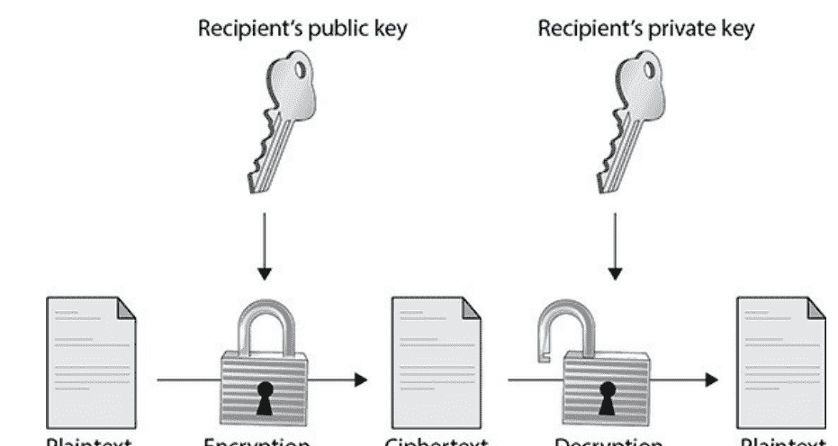

# FIGURE 5-2 Asymmetric key encryption

When the public key is transmitted over an insecure medium, anyone can see it. It’s not a secret. That’s why it’s called a public key. There’s no key distribution problem because the key that was transmitted is used only to encrypt, not to decrypt. Think of a mailbox: Anyone who knows the street address of the mailbox can drop a letter through the slot. That’s like a public key. However, only a postal employee with the physical key can open up the mailbox and take the letters out. That’s like a private key.

Asymmetric key encryption is very slow, and it’s not used for bulk data encryption. Asymmetric key encryption provides for key establishment, nonrepudiation, and identification, and is therefore really just used to encrypt

- Symmetric keys, which in turn encrypt bulk data, which is how PGP (Pretty Good Privacy) works for e-mail (coming up in Chapter 6)
- Shared secrets, like the premaster secret, used by TLS (Transport Layer Security) in the past, to generate master secrets, which generate session keys (coming up in Chapter 7)
- Hashes (coming up later in this chapter), which allow for integrity and nonrepudiation

Today’s standard asymmetric key encryption algorithm is RSA, named


actually-practical-and-a-looming-danger/

- https://sha-mbles.github.io/

# 学习目标

在本活动中，你将了解哈希函数如何实现完整性和不可否认性。完成本实验练习后，你将能够：

- 将明文哈希为消息摘要
- 了解哈希的工作原理及其用途
- 了解哈希与加密的区别

# 实验材料和设置

本实验所需的材料有：

- 《计算机安全原理：CompTIA Security+ 及进阶》教科书
- 一个可上网的网页浏览器
- 你在第1章中安装的 Kali Linux 虚拟机

# 让我们开始吧！

加密是一个双向函数。将明文和密钥放入加密算法，就会产生密文输出。将密文和密钥放入算法，就会产生明文输出。哈希不是加密，其工作方式也与加密不同。哈希是一个单向函数。将输入放入哈希函数，产生的输出称为消息摘要，也称为哈希。你无法通过将哈希放回哈希函数来逆转哈希，从而产生原始输入。


**步骤 1** 本实验练习开头列出的前两个哈希函数特征包括：可变长度输入产生固定长度输出，以及输入的细微变化产生完全不同的输出。让我们看看这两个特征的实际表现！

- **$2y$** Blowfish
- **$5$** SHA-256
- **$6$** SHA-512
- **$y$** yescrypt

- **上次密码更改：** 自1970年1月1日（称为 Unix 时间和 Epoch 时间）以来，密码上次更改的天数
- **密码更改之间的最小天数**
- **密码有效的最大天数**
- **在密码必须更改之前用户将被警告的天数**
- **密码过期后，账户被禁用之前的天数**
- **从 Unix 时间起账户将被禁用的天数**

通常，账户的最后几个字段为空白。

e. 找到你的账户和密码哈希。在 Kali Linux 上，$y$ 表示 yescrypt 是用于密码的哈希函数。

我们将在第11章中看到 Windows 密码哈希。

30分钟

# 实验练习 5.04：Diffie-Hellman 密钥交换

1976年，Whitfield Diffie 和 Martin Hellman 设计了非对称加密的首次使用。它不是一种非对称加密算法，而是一种密钥交换协议。

假设两个从未见过面的双方想要在它们之间使用对称/秘密密钥进行加密和解密。然而，在不安全的通信介质上就这个秘密密钥达成一致，会破坏密钥的完整性（密钥分发问题）。Diffie-Hellman 密钥交换（DHKE）应用了离散

Alice 和 Bob 都推导出的密钥，现在成为用于加密和解密的共享秘密/对称密钥。

# 步骤 3 为什么这能成立？

- Bob 计算了 3¹² ≡ 16 mod 29。他从 Alice 那里得到的 3 是由 3 ≡ 2⁵ mod 29 计算得出的。所以 Bob 实际上做了 2⁵⁽¹²⁾ mod 29。

# ⇒ 注意

同余符号（≡）用于代替等号与模运算一起使用，因为有许多数除以模数后会产生相同的余数。

- Alice 计算了 7⁵ ≡ 16 mod 29。她从 Bob 那里得到的 7 是由 7 ≡ 2¹² mod 29 计算得出的。所以 Alice 实际上做了 2⁽¹²⁾⁵ mod 29。

- 你可以看到，2 的 5 次幂再取 12 次幂，与 2 的 12 次幂再取 5 次幂是相同的。在这两种情况下，你将 12 乘以 5，得到 2 的 60 次幂，当它被 29 除时，产生余数 16。

# 4

# 步骤 4 现在轮到你了！如果双方约定质数为 13，生成元为 6，一方私密数为 5，另一方私密数为 4，那么共享秘密是什么？你可以使用任何工具，包括 Google，进行计算。

# 5

# 步骤 5 再试一个！如果双方约定质数为 11，生成元为 7，一方私密数为 3，另一方私密数为 6，那么共享秘密是什么？你可以使用任何工具，包括 Google，进行计算。

# 实验分析

1. 为什么恶意软件作者更喜欢简单的对称密钥加密算法（如 XOR），而不是更复杂的算法（如 AES）？
2. 非对称密钥加密具体用于什么？
3. 为什么哈希被认为是单向函数？
4. 如果中间人（MITM）能获得公共值和双方的混合值，为什么攻击者不能得出与通信双方相同的共享秘密？

# 关键术语测验

使用此列表中的术语完成下面的句子。

- data（数据）
- digest（摘要）
- prime（质数）
- secret（秘密）

1. 对称密钥加密用于加密批量 __________。
2. 非对称密钥加密用于加密共享 __________。
3. 哈希也称为消息 __________。
4. 使用 __________ 数作为 DHKE 的模数。

欢迎进一步研究这个案例，超出步骤1中的两个链接。以开放的心态进入，在你学习和理解更多关于这个案例的过程中，让你的直觉涌现出来。

# 步骤 1 阅读以下页面上的信息。无需输入完整 URL，你可以使用以下部分或全部内容在 Google 中搜索页面：网站名称、标题和作者。

- a. “苹果与FBI：你需要知道的一切”，Arjun Kharpal，CNBC，2016年3月29日
  http://www.cnbc.com/2016/03/29/apple-vs-fbi-all-you-need-to-know.html

- b. “FBI-苹果加密纠纷”，维基百科
  https://en.wikipedia.org/wiki/FBI-Apple_encryption_dispute

# 步骤 2 你对苹果与FBI之间的这个里程碑式案件有何看法？你同意哪一方？

写一篇一页纸的文章，阐述你的想法和理由。

30分钟

# 实验练习 6.02：澳大利亚的《援助与访问法案》

在之前的实验练习中，你看到一家科技公司（苹果）被迫削弱其所有用户的安全性。两年后，在更广泛的范围内，一个国家命令科技公司削弱其所有用户的安全性。

同样的问题仍然适用。

科技公司是否应该被要求创建加密的后门，并削弱数据隐私，以帮助执法部门破案和阻止恐怖袭击？能否只为好人的利益创建后门？帮助执法部门是否会使社会在

# 步骤 1 观看罗德·塞林的《阴阳魔界》中经典的一集“服务人类”：

https://vimeo.com/374158564

在此阅读相关内容：

https://en.wikipedia.org/wiki/To_Serve_Man_(The_Twilight_Zone)

观看《辛普森一家》中对《阴阳魔界》“服务人类”这一集的恶搞：

https://youtu.be/2ukozdxgg8Q

2

# 步骤 2 你对这一集有何看法？它与你学到的密码学知识有何关联？

写一篇一页纸的文章，解释你的想法和理由。

60分钟

# 实验练习 6.04：电子邮件密码学

发送电子邮件就像寄一张用铅笔写的明信片。发送者和接收者之间的任何人都可以看到它，这代表保密性被破坏。发送者和接收者之间的任何人都可以更改它，这代表完整性被破坏。无论是保密性被破坏还是完整性被破坏，都肯定会导致可用性受损。

菲尔·齐默尔曼（Phil Zimmerman）于1991年创建了 PGP（Pretty Good Privacy，良好隐私）用于电子邮件密码学，使电子邮件能够被加密、解密和数字签名。在 www.philzimmermann.com/EN/essays/WhyIWrotePGP.html 阅读更多关于 PGP 历史的信息。PGP 最终成为专有软件，目前由 NortonLifeLock Inc.（原赛门铁克）控制。要了解在第5章中讨论的 PGP 如何工作，请查看此页面：https://users.ece.cmu.edu/~adrian/630-f04/PGP-intro.html。

1993年，齐默尔曼被美国政府以“未经许可出口军用物资”为由进行调查，因为具有加密技术


密钥大于 40 位的被禁止出口（PGP 被发现违反规定）。在案件于 1996 年被撤销前一年，Zimmerman 将 PGP 的源代码出版在一本精装书中，让其他人可以用光学字符识别（OCR）扫描源代码。第一修正案保护书籍，因此政府无法阻止它。

在 Zimmerman 的敦促下，互联网工程任务组（IETF）成立了 OpenPGP 工作组，因此不再需要许可 PGP 或受过时的美国法律限制。

GPG（GNU Privacy Guard，也称为 GnuPG）是符合 OpenPGP 标准规范的 PGP 免费替代品。GPG 与 PGP 之间存在细微差异，包括支持的算法、技术支持和用户界面。Mozilla Thunderbird 过去通过 GPG 和 Enigmail 插件支持电子邮件加密，但在 2020 年 Thunderbird 78 版本中切换为内置 OpenPGP 支持。

## 学习目标

在本实验中，你将安装、配置和使用 OpenPGP。完成本实验后，你将能够

- 加密电子邮件
- 解密电子邮件
- 签名电子邮件
- 验证电子邮件签名

## 实验材料和设置

本实验练习所需的材料是

- 《计算机安全原理：CompTIA Security+ 及更远》教科书
- 一台具有互联网访问权限的 Windows 10 机器
- 一位可以发送和接收电子邮件的搭档

## 开始吧！

### 3a, 3b

步骤 3 你现在准备好向你的搭档发送一封带有你的公钥的电子邮件。一旦你的搭档收到你的公钥，他们将能够加密一个对称密钥并发送给你，以及验证你的数字签名。

a. 进入你的电子邮件并点击顶部工具栏上的撰写按钮来撰写电子邮件。在电子邮件窗口中，点击安全旁边的下拉箭头，注意到 Do Not Encrypt 是唯一被选中的项目。选择附加我的公钥选项。然后再次返回以选择数字签名此消息。为确保无误，再次返回并确保数字签名此消息和附加我的公钥旁边都有勾选，如图 6-1 所示。

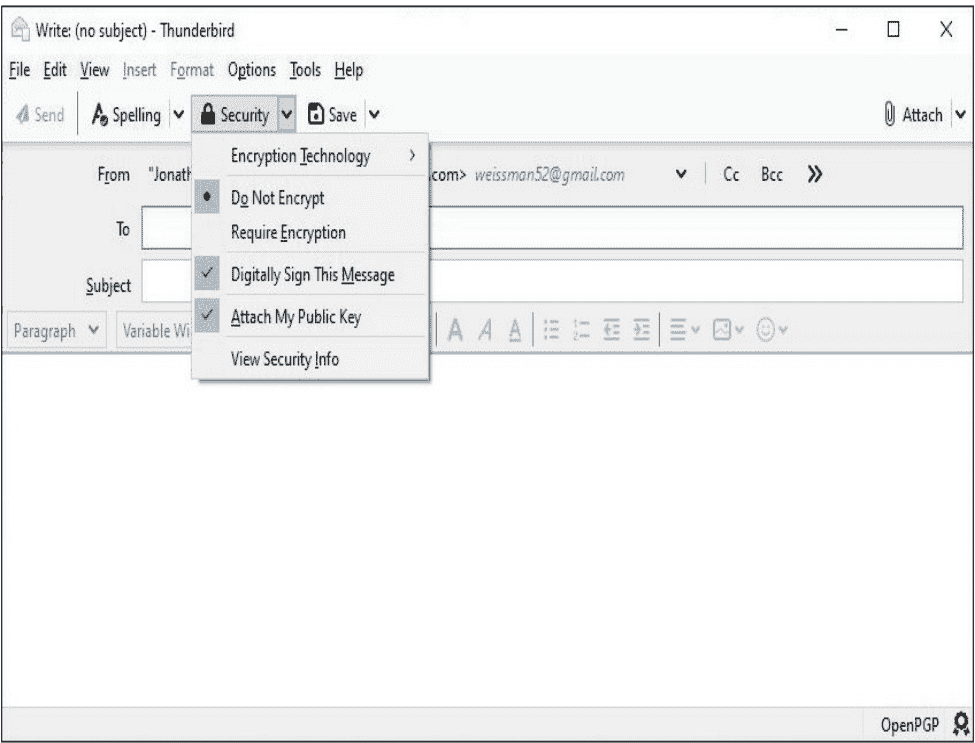

图 6-1 已附加公钥。

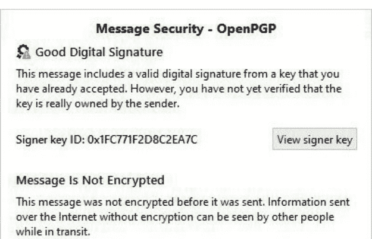

# 图 6-3 数字签名良好，消息未加密

5a–5c

步骤 5 现在你有了搭档的公钥，你将能够用搭档的公钥加密一个会话密钥，该密钥将作为对称密钥。对称密钥将加密你发送的电子邮件，而搭档的公钥将加密对称密钥。对称密钥的生成以及随后的用该对称密钥进行的电子邮件加密都是通过 Thunderbird 的 OpenPGP 自动且透明地完成的。加密的对称密钥将自动发送在你的电子邮件中。搭档的 Thunderbird 将用他们的私钥解密加密的对称密钥，然后用解密后的对称密钥解密电子邮件。请记住，搭档在发送给你的电子邮件中也在其端执行相同的操作。

a. 向你的搭档撰写一封全新的电子邮件（不是回复之前的邮件）。
b. 此单封电子邮件的安全设置应包括要求加密和数字签名此消息选项，如图 6-4 所示。

有关密钥的信息），如图 6-6 所示。

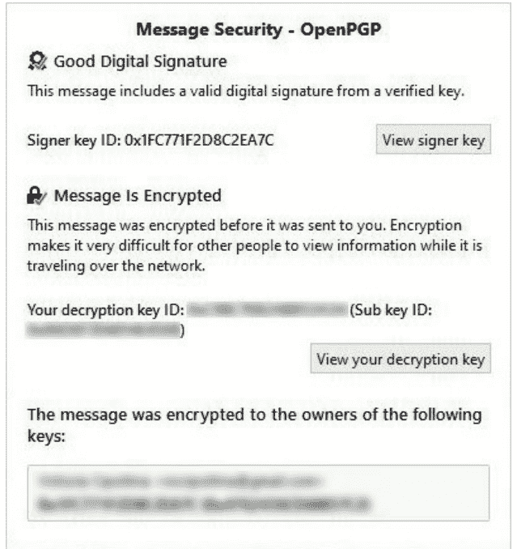

# 图 6-6 数字签名良好有效，消息已加密

# → 注意

要进入 Thunderbird 中 OpenPGP 的设置，请按 ALT 激活菜单栏，点击工具，然后点击 OpenPGP 密钥管理器。

c. 进入 www.google.com/gmail 并登录你的账户。打开搭档发送给你的第二封电子邮件。你应该会看到两个附件，如图 6-7 所示。

服务器会做繁重的工作。

一旦答案到达 RIT DNS 服务器、我的 ISP 的 DNS 服务器或公共 DNS 服务器之一（图 7-1 的步骤 7），这些服务器会缓存答案，这样它们就不需要为后续查询做繁重的工作；然后它们将答案返回给 DNS 客户端（图 7-1 的步骤 8）。该答案也会缓存在客户端机器上，因此 DNS 客户端在不久的将来无需为此地址查询 DNS 服务器。

TTL（生存时间）字段在 DNS 消息中，封装在 UDP 数据报中，指定资源记录应被缓存多长时间。这不应与 IP 头中的 TTL 字段混淆，后者甚至不是时间的度量，而是一个跳数计数。DNS TTL 由被查询的二级域名（如 flcc.edu）的系统管理员设置。

在 DNS 缓存中毒，也称为 DNS 欺骗中，攻击者向缓存 DNS 服务器发送未经请求的 DNS 答案。例如，如果 RIT DNS 服务器上的缓存被更改，将 www.flcc.edu 与除合法 IP 地址之外的 IP 地址关联（例如恶意网站），任何下游的 RIT 客户端在请求时都会被提供该错误 IP 地址，并被引导至攻击者控制的站点。

该站点可能是一个钓鱼站点或包含即点即下式攻击利用工具包。如果这种情况发生在 ISP 的 DNS 服务器缓存中，所有 ISP 客户都会受到影响。如果这种情况发生在根服务器或权威顶级域名 DNS 服务器上，天哪！所有下游的 ISP 和客户都会受到影响。

虚假的 DNS 资源记录甚至会进入用户机器上的 DNS 缓存。此外，网络犯罪分子可以更改 TTL 为非常高的值，以使这些虚假条目在缓存中保留很长时间。

## 学习目标

在本实验练习中，我们将使用 dig DNS 工具来模拟 DNSSEC 的工作原理，并了解 DNSSEC 如何由 PKI 驱动。在本实验练习结束时，你将能够

- 使用 dig DNS 工具
- 理解 DNSSEC 的工作原理
- 理解 DNSSEC 如何使用 PKI

## 实验材料和设置

本实验所需的材料是

- 《计算机安全原理：CompTIA Security+ 及更远》教科书
- 你在第 1 章安装的 Kali Linux 虚拟机

## 开始吧！

中国的防火长城在 DNS 层进行封锁。例如，在中国被封锁的网站，如 www.twitter.com，在中国 DNS 服务器上会有错误的 IP 地址关联。这是故意进行的、自我造成的 DNS 缓存中毒攻击。

2010 年，一家非中国的 ISP 错误配置其 DNS 服务器以从中国 DNS 服务器获取信息并在本地缓存。其他 ISP 从该 ISP 获取 DNS 信息并在他们的 DNS 服务器上使用。被污染的 DNS 条目迅速传播，美国人民无法访问包括 Twitter、Facebook 和 YouTube 在内的网站。

减轻此类攻击的最佳方法是确保 DNS 响应确实来自权威 DNS 服务器。这是通过 DNSSEC 实现的，DNSSEC 是一种旨在保护 DNS 免受 DNS 缓存中毒攻击的协议。

在本实验练习中，你将在 Kali Linux 中打开一个终端并输入命令。确保在每个命令后按 ENTER。在所有 dig 命令中，确保在 FQDN 末尾添加一个点（.）。该点代表根区域，DNS 层次结构的最高级别。在 FQDN 末尾加上点可确保不会在其后附加任何内容，这在某些情况下会导致 FQDN 无效。此外，在大多数情况下，命令的各个部分输入的顺序并不重要。

在 Kali Linux 中打开一个终端。输入每个命令，并在每个命令后按 ENTER。


可能返回不同的 IP 地址或多个地址。如果是这样，请相应调整。

## 注意

ARIN（美国互联网号码注册管理机构）是五个区域互联网注册管理机构（RIR）之一，也是负责北美 IP 地址的组织。你可以在我 2016 年为 ARIN 撰写的文章中阅读相关内容，网址为 https://teamarin.net/author/jweissman/。

你如何知道这是 ARIN 网页服务器的合法 IP 地址，而不是某个带有恶意软件的站点？本实验练习的其余步骤将带你达到这种确定性水平。

Step 2 接下来让我们使用 +dnssec 开关进行查询。响应中仍包含 A 资源记录，如前所述，但现在还多了一个资源记录签名（RRSIG）资源记录。RRSIG 资源记录是对返回的 www.arin.net 的所有 A 资源记录的哈希值，用 arin.net 的私钥加密。在本例中，只有一个 A 资源记录，但如果有多个，它们都会一起哈希。

```
dig +dnssec a www.arin.net.
```

参见图 7-3。

```
jonathan@kali-weissman:~$ dig +dnssec a www.arin.net.

; <<>> DiG 9.16.3-Debian <<>> +dnssec a www.arin.net.
;; global options: +cmd
;; Got answer:
;; ->>HEADER<<- opcode: QUERY, status: NOERROR, id: 62525
;; flags: qr rd ra ad; QUERY: 1, ANSWER: 2, AUTHORITY: 0, ADDITIONAL: 1

;; OPT PSEUDOSECTION:
; EDNS: version: 0, flags: do; udp: 512
;; QUESTION SECTION:
;www.arin.net.              IN      A

;; ANSWER SECTION:
www.arin.net.           59      IN      A       199.43.0.47
www.arin.net.           59      IN      RRSIG   A 5 3 60 20200727120008 20200713110008 44725 arin.net. Clm1VSaFGLghSQ68Wn0+SspqkmkqZL WbtT4NL29/4mys3C+ZbKgplrn/ stj8MhqCkuxhHPeaGJN mDe02/Xi9EfG5xn3p0Gr106EQdr3efLxVzwr4 Ek/tDZ/24aeK+1Dfsic5bW/yl09NHdv5B2++B4xlPG9SfC2W/FgEXGKF gS4=

;; Query time: 36 msec
;; SERVER: 8.8.8.8#53(8.8.8.8)
;; WHEN: Mon Jul 13 23:21:04 EDT 2020
;; MSG SIZE  rcvd: 225
```

图 7-3 验证 A 资源记录的 RRSIG 资源记录

Step 3 要解密此加密哈希，RIT DNS 服务器此时会代表 DNS 客户端请求 arin.net 的公钥。为手动执行此操作，请输入以下命令：

```
dig +dnssec dnskey arin.net.
```

参见图 7-4。

```
jonathan@kali-weissman:~$ dig +dnssec dnskey arin.net.

; <<>> DiG 9.16.3-Debian <<>> +dnssec dnskey arin.net.
;; global options: +cmd
;; Got answer:
;; ->>HEADER<<- opcode: QUERY, status: NOERROR, id: 20772
;; flags: qr rd ra ad; QUERY: 1, ANSWER: 7, AUTHORITY: 0, ADDITIONAL: 1

;; OPT PSEUDOSECTION:
; EDNS: version: 0, flags: do; udp: 512
;; QUESTION SECTION:
;arin.net.                     IN      DNSKEY

;; ANSWER SECTION:
arin.net.               14152   IN      DNSKEY  257 3 5 AwEAAW9Sgm2URWJBKxE8x
sRfkeh5otGqCddApW3kRxj6QgU4RRGbeu9X nxhi0b7ygmZXJP8YdIFZkH0kQb8ynQnJp4UtBW iBE
cTG6T9BNYLL/jIy DhHyV80nRRHw0Wcq0dkz4ge5YtLXH+DmG8G5qShZa2xeA1anhasQvnuP 2BSc
5euj
arin.net.               14152   IN      DNSKEY  256 3 5 AwEAAYit/s7Jb8bKwujGa
rGcNkyCy0VKuvBSE6AHnMGYY68sHhZv5D6G 10m9NmlC2k74K7w/uwJL5rKTOCdRphKFdDrGpEw4x
0xKpqvqhKWVDSwY YsieU0joILOP7i4sxrJbgdiFw97BZ8mT1TlI5ormC20QpPOs0QrTFrhsG WMZU
cc2N
arin.net.               14152   IN      DNSKEY  256 3 5 AwEAAXeyUCtH3sEmbHfsx
gWvgNFqDKjnpe0gRJ2Y8Rg1Qlw2p63Rgd0W myDBYEs8w0EfRPuGD RQ0z9k61MIyKbHrBIg5Q+TmB
fq/Q5PHjpJMvskl XKkRf2uCBfcb3e7bSuwBuVDdUhEuRMm2sLumqNbxQ0n8a3DPpZpkA6pU ujYx
2yIJ
arin.net.               14152   IN      DNSKEY  257 3 5 AwEAAYxI6vybBogG3wBef
E5VFyk9FXdHM76xwNv2VM4rV1DoyMPgEw9M Z7NGTPudY3FiKZcvH2bkJgPQ5shFuPSm+Pr4FcmcZ
kAtemorVtDtdPwm W3sUFqhb8S9sUakgVihMrkSjgQ+OnIwbDhXe6sXQz5GHPeaLQB97VL9w cUKK
1AG/
arin.net.               14152   IN      RRSIG   DNSKEY 5 2 43200 202007271200
08 20200713110008 5612 arin.net. ceud197iWRwdQfmyIVcXZA JG7Bay3AHWuUwvTXs4l32g
gJ258y8Nb9ui mnMp0rbPRfrTt097QZGM+h renLj3/Tj+6aWvVmAZHoPy1ZkSRv1TOE7N LpPd/rt
AH5XANALDZ1r8NUMQEXfSLQSpr9lebh06dS/XefCThN7s8R0h f68=
arin.net.               14152   IN      RRSIG   DNSKEY 5 2 43200 202007271200
08 20200713110008 44725 arin.net. K7tB8I oqsVMEGU7IE l3QQ8Wvgy6e1ZUGa4uFawnteTC
zu18h/FEizKdk l3XoYyIsS1SHbJ1knADP6SMqZCCnoKRVysCehZ+4F5zWVQRIHkzDs/4y ImPRbL
D2EdK914mM+20vEfMGeGnLLNQLad7uRRCbbcVc5kffalslSp/y q2c=
arin.net.               14152   IN      RRSIG   DNSKEY 5 2 43200 202007271200
08 20200713110008 49918 arin.net. QdmsgUgC3A4lURN6+uxPnLjcWPNRumU83KOGmmKSeXB
00NiK7oY+7ugV s2FBTwq5dCE2ZTqiHP5KKy1urXzvsn8uVmn/8R33XgPpamu i1MBeMN/x sU1Ykd
opQN bK31nR80iciUsbGoZSs3Bm8jNgmSQL05N9rZ4HPN ykr41u hXg=

;; Query time: 24 msec
;; SERVER: 8.8.8.8#53(8.8.8.8)
;; WHEN: Mon Jul 13 23:25:20 EDT 2020
;; MSG SIZE  rcvd: 1133
```

# 图 7-4 验证 RRSIG 资源记录的 arin.net 的 DNSKEY 资源记录

每个区域都有两个密钥对：区域签名密钥（ZSK）和密钥签名密钥（KSK）。ZSK 对区域中的每个资源记录进行签名（为每组创建 RRSIG 资源记录），除 DNSKEY 资源记录外，DNSKEY 资源记录由 KSK 签名（为 DNSKEY 组创建 RRSIG 资源记录）。用于签名的密钥是私钥。DNSKEY 资源记录包含相应的公钥。

ZSK 和 KSK 实际上是公钥/私钥对。ZSK 对的私钥对区域中除 DNSKEY 之外的所有资源记录进行签名。该 ZSK 私钥对应的公钥存储在 DNSKEY 资源记录中。KSK 对的私钥对 DNSKEY 资源记录进行签名。该 KSK 私钥对应的公钥存储在另一个 DNSKEY 资源记录中。

很难替换旧的或被攻破的 KSK。更改 ZSK 要容易得多。可以使用较小的 ZSK，而不影响服务器的安全性，最小化服务器每次响应需要发送的数据量。可以使用较大的 KSK 并单独保存，这样父区域就不必频繁更新 DS 资源记录（稍后讨论）。此外，DNSKEY 资源记录集和相应的 RRSIG 资源记录可以缓存以供将来使用。

具有值 256 的 DNSKEY 资源记录包含 ZSK（公钥），而具有值 257 的 DNSKEY 资源记录包含 KSK（同样是公钥）。在图 7-4 中，你可以看到 arin.net 发送了两种类型的密钥各两个。

RFC 和专家建议在数年内更换 KSK，在数月内更换 ZSK。在此短暂的轮换期间，新旧密钥都应存在于区域中（并进行“双重签名”），这使得旧密钥可以超时并从缓存中移除。

在其他情况下，区域可以预先发布用于轮换的未来密钥（一个未来的 ZSK 和一个未来的 KSK），这些密钥尚未用于签名。

在当前故事中，如果 RIT DNS 服务器解密的哈希值与计算的哈希值匹配，则 DNSKEY 资源记录验证 RRSIG 资源记录，而 RRSIG 资源记录验证 A 资源记录。一切正常。

## Step 4

等等！如果有人入侵了 arin.net DNS 服务器并生成了自己的公钥/私钥对呢？即使很难找到不使用 ZSK 对和 KSK 对的区域，DNSSEC RFC 并未要求两个密钥对，使用一个密钥对签名所有区域数据也是可能的。

现在攻击者可以修改 DNS 资源记录，指向错误的 IP 地址，并用攻击者密钥对资源记录进行签名。

为了确保这种情况不会发生，arin.net 的 KSK 公钥由更高层级机构认证。arin.net 之前已将其 KSK 公钥发送给 .net 区域管理员，并在 arin.net 通过验证后，.net 区域同意为 arin.net 作证，通过对 arin.net 的 KSK 公钥进行哈希处理。这以另一种新的 DNS 资源记录的形式存在——委派签名者（DS）资源记录。arin.net 的 DS 资源记录存储在 .net DNS 服务器上。

DS 资源记录用于验证子区域的 KSK，与子区域的 ZSK 无关。在图 7-5 中你会注意到返回了 2 条 DS 资源记录，每条对应图 7-4 中返回的 ZSK 之一。


RIT DNS 服务器随后对 arin.net 的 KSK 公钥进行哈希处理，并将结果与从 .net 区域发送来的 DS 资源记录进行比较。如果哈希值匹配，我们就知道 arin.net 的公钥确实是 arin.net 的公钥，并且发送的资源记录是合法的。

我们如何信任 DS 资源记录本身？DS 资源记录随后会被 .net 的 ZSK 私钥哈希并加密，以 RRSIG 资源记录的形式呈现。

如果 DNS 客户端的 DNS 服务器（本例中为 RIT DNS 服务器）支持 DNSSEC，它会在向根服务器（图 7-1 的步骤 2）、权威 TLD DNS 服务器（图 7-1 的步骤 4）以及所涉二级域的权威 DNS 服务器（图 7-1 的步骤 6）发起的 DNS 查询中设置 **DO**（DNSSEC OK）标志。相应地，根服务器和权威 TLD DNS 服务器会返回额外的 DNS 资源记录（图 7-1 的步骤 3 和 5），这些记录会告诉 DNS 客户端的 DNS 服务器子区域已启用 DNSSEC，具体形式为 DS 资源记录以及针对 DS 资源记录的 RRSIG 资源记录，如前所述。二级域的权威 DNS 服务器没有 DS 资源记录可发送，但在常规 DNS 响应之外，它还会为每个资源记录组返回 RRSIG 资源记录（图 7-1 的步骤 7）。

要手动查询 arin.net 的 DS 记录，请输入以下命令：

```
dig +dnssec ds arin.net.
```

请参阅图 7-5。

**步骤 5** 现在 RIT DNS 服务器将请求 .net 区域发送其 DNSKEY 资源记录。为此手动输入以下命令：

```
dig +dnssec dnskey net.
```

你会注意到 .net 发送了两个 ZSK（以 256 标识）和一个 KSK（以 257 标识），如图 7-6 所示。另请注意，三个 DNSKEY 资源记录共有一个 RRSIG。

```
jonathan@kali-weissman:~$ dig +dnssec ds net.

; <<>> DiG 9.16.3-Debian <<>> +dnssec ds net.
;; global options: +cmd
;; Got answer:
;; ->>HEADER<<- opcode: QUERY, status: NOERROR, id: 54684
;; flags: qr rd ra ad; QUERY: 1, ANSWER: 2, AUTHORITY: 0, ADDITIONAL: 1

;; OPT PSEUDOSECTION:
; EDNS: version: 0, flags: do; udp: 512
;; QUESTION SECTION:
;net.                     IN      DS

;; ANSWER SECTION:
net.                    37034   IN      DS      35886 8 2 7862B27F5F516EBE1968044 4D4CE5E762981931842C465F00236401D 8BD973EE
net.                    37034   IN      RRSIG   DS 8 1 86400 20200726050000 20200713040000 46594 . x3VQM QziY0gcEx7eWW5XIkS wu8k5Cp+Fxcwdtzvoe9pWxTrty9DcqSJG Twipf2 fEP8iFvsCRwO+UHQ1BSy4qa75hhhWYzl97E5WAi4tP/OSrC7Uv J8PBuEB463e3Qwmac0r28uyKuwqx7e YtgAlb3Mwptu/gym/UNdebhC4/ wgNq6Er7qvJFMFY7Nkn0EzzxudQnze1hbklOQtJz0fbbaExxHXZP1N TA KpaMdj dAuA35ZLSD o++OXnT08bgpAJjUb0jb3XPWLoKoT9cQmvc7U81o qzKB10798RKRZBz36nS+d grukn+1fhux8Y3Ss9YTTBzGBBaevXEuRz0Y j+40vA=

;; Query time: 24 msec
;; SERVER: 8.8.8.8#53(8.8.8.8)
;; WHEN: Mon Jul 13 23:40:56 EDT 2020
;; MSG SIZE  rcvd: 367
```

图 7-7 用于验证 .net 的 DNSKEY 资源记录的 DS 资源记录

步骤 7 现在，RIT DNS 服务器将请求根区域发送其 DNSKEY 资源记录。为此手动输入

```
dig +dnssec dnskey .
```

在图 7-8 中，你会注意到根区域发送了一个 ZSK（以 256 标识）和一个 KSK（以 257 标识）。另请注意，两个 DNSKEY 资源记录共有一个 RRSIG。

## 图 7-8 用于验证 RRSIG 资源记录的根区域的 DNSKEY 资源记录

根区域的 ZSK 公钥，在 DNSKEY 资源记录中，可解密 RRSIG 以验证 DS 资源记录。

根区域的 KSK 公钥，在 DNSKEY 资源记录中，可解密 DNSKEY 资源记录组的 RRSIG。

RIT DNS 服务器取根区域的 KSK 公钥，解密 RRSIG 加密的哈希值，并计算自己的哈希值。如果两者匹配，则根区域已证明它确实是根区域。这也意味着 .net 已证明它是 .net，arin.net 已证明它是 arin.net，并且 A 资源记录包含 arin.net Web 服务器的合法 IP 地址。

现在我知道你正在使用 Kali Linux，模拟 DNS 服务器会做什么。你会注意到在图 7-9 和图 7-10 中，所有 NS 资源记录（分别针对根区域、.net 区域和 arin.net）都一起显示。

```
jonathan@kali-weissman:~$ dig +trace www.arin.net

; <<>> DiG 9.16.3-Debian <<>> +trace www.arin.net
;; global options: +cmd
.                       53200   IN      NS      e.root-servers.net.
.                       53200   IN      NS      h.root-servers.net.
.                       53200   IN      NS      l.root-servers.net.
.                       53200   IN      NS      i.root-servers.net.
.                       53200   IN      NS      a.root-servers.net.
.                       53200   IN      NS      d.root-servers.net.
.                       53200   IN      NS      c.root-servers.net.
.                       53200   IN      NS      b.root-servers.net.
.                       53200   IN      NS      j.root-servers.net.
.                       53200   IN      NS      k.root-servers.net.
.                       53200   IN      NS      g.root-servers.net.
.                       53200   IN      NS      m.root-servers.net.
.                       53200   IN      NS      f.root-servers.net.
.                       53200   IN      RRSIG   NS 8 0 518400 20200726170000 2020
0713160000 46594 R2IpTWAJ5sMgC/q0Qx7aUBQm dAY3B7/1/ILS+rGT/ fNWbTTe4wXR XH3Or +sRTR
meHN7VvVeustrG6Z1NjAlSJOvnhcMPIT3PrTQjM9Yq9BbgZrTH kFI9nq8ZRfv d2aXHakJfg16dHVsYr
dW3w5lpFixdlbPbCK8eGnCyWJul 0RdQuPJRE109hv51XLzXebbRYLdRrUKCyUPjM17+IIG5gfL9ALhNG
E3+ 9b6PBsgXQ0C4ZfAUzKgAPaHhayAQdlLeAlhs2bjojUWf4Tk93hcCVQos vpntS1iX09dTZu49j2bi
CBwvF UfHw0GVKT0cql0wYZh+joZLMOCarGwn mRRV3Q==
;; Received 525 bytes from 8.8.8.8#53(8.8.8.8) in 24 ms

net.                    172800  IN      NS      c.gtld-servers.net.
net.                    172800  IN      NS      k.gtld-servers.net.
net.                    172800  IN      NS      d.gtld-servers.net.
net.                    172800  IN      NS      a.gtld-servers.net.
net.                    172800  IN      NS      g.gtld-servers.net.
net.                    172800  IN      NS      b.gtld-servers.net.
net.                    172800  IN      NS      m.gtld-servers.net.
net.                    172800  IN      NS      h.gtld-servers.net.
net.                    172800  IN      NS      j.gtld-servers.net.
net.                    172800  IN      NS      i.gtld-servers.net.
net.                    172800  IN      NS      l.gtld-servers.net.
net.                    172800  IN      NS      f.gtld-servers.net.
net.                    172800  IN      NS      e.gtld-servers.net.
net.                    86400   IN      DS      35886 8 2 7862B27F5F516EBE1968044
4D4CE5E762981931842C465F00236401D 8BD973EE
net.                    86400   IN      RRSIG   DS 8 1 86400 20200726170000 2020
0713160000 46594 . 09lbs0MKSX22Y72ZVQfqEVE6MoO7vmGRVvDU9wHORDQn+kfxk40f Gmubcx
381F/WtMj9jMjZtekNqgK hxyflVB4rmfUi0sdCN/yj/VSupfdB b8NxjHPb7yEm+eHBQX2M5Kx7+uVzHz
m0ndmP+GXwR9CRrtpYj7Wh7kKk 1pB11JXrq ufnB6sMhpOl g5a19Mq8lFf43cBaaL9X0U374y0HUuuhY
Js 5gUfTh4WU91QWTYAj/2T4WQ04aRa4KkRjeLotMMqo9y1IKzpIIGv1gEz AZaLztqXwG8GgRNod/8/0
aUO4Qbr78vE8+e/9QNF MvNLKbciPLM4w3Zf P+Ry5Q==
;; Received 1169 bytes from 192.36.148.17#53(i.root-servers.net) in 36 ms
```

## 图 7-9 根服务器和 .net 权威 TLD DNS 服务器

```
arin.net.              172800  IN      NS      ns1.arin.net.
arin.net.              172800  IN      NS      ns2.arin.net.
arin.net.              172800  IN      NS      u.arin.net.
arin.net.              172800  IN      NS      ns3.arin.net.
arin.net.              86400   IN      DS      49918 5 1 F11B03C6DB17180A55F950A7B2B23E8DF341F662
arin.net.              86400   IN      DS      49918 5 2 4F5176F7134B40FF4AC18A976D5AFBAECF14F2068CEF6DD9EF51164E 144CB160
arin.net.              86400   IN      RRSIG   DS 8 2 86400 20200718063646 20200711052646 36059 net. FTRQWdIp5H+pAtkz9cdvgSLX108DCVraie/6njQ0vvy/JKE4G8prUV06 hp5eo+h9FPQ66lbf3358ytdf95J/gp/VtqJsUmWePssAwaCRJFlHtg0a n2CD01L8U+8XFBZi0ax3M9xEU/r5cp/aA9jGVd3q4D8MWgoq5ojWWNEp m3cVKMPqGMYVvxNNkvk+82r01FJ5r1KoT1L4B9+wLuezQg=;; Received 566 bytes from 192.52.178.30#53(k.gtld-servers.net) in 48 ms

www.arin.net.          60      IN      A       199.43.0.47
www.arin.net.          60      IN      RRSIG   A 5 3 60 20200727120008 20200713100008 44725 arin.net. Clm1VSaFG LghSQ68Wn0+SspqkmkqZL WbtT4NL29/4mys3C+ZbKgplrn/ stj8MhQcKuxhHpeaG3NmDe02/Yi9EF6Sxn3p0Gr106EQdr3efLxVzwr4 Ek/tDZ/24aeK+1Dfsic5bW/yl09NHdv5B2++B4xlPG9SfC2W/FgEXGKF gS4=
;; Received 253 bytes from 199.212.0.108#53(ns1.arin.net) in 44 ms
```

## 图 7-10 arin.net 的权威 DNS 服务器和 www.arin.net 的 A 资源记录

```
dig +trace www.arin.net.
```

请参阅图 7-9 和图 7-10。

45 MINUTES

# 实验练习 7.02：用于利用的 DNSSEC


当辅助（也称为从属）DNS服务器向主（也称为主控）DNS服务器请求完整区域（权威传送，AXFR）或部分区域（增量传送，IXFR）更新时，就会发生内部DNS区域传送。主DNS服务器和辅助DNS服务器都是权威服务器，这意味着它们不使用DNS缓存，而是使用区域文件来响应查询。主DNS服务器和辅助DNS服务器之间的区别在于，区域文件的更改只能在主DNS服务器上进行。区域传送在OSI（开放系统互连）模型的第4层使用TCP，不同于常规大小的DNS查询和响应（它们使用UDP，任何大于512字节的响应都会以TCP段而非UDP数据报的形式发送），这使辅助DNS服务器能够与主服务器同步，因此辅助DNS服务器可以像主DNS服务器一样以权威方式响应DNS查询。

如果网络罪犯能够执行外部区域传送，他们就可以获取大量关于你基础设施的重要信息，包括主机名和IP地址。这种未经授权的外部传送还可能产生其他信息，包括服务器隐藏功能的信息——例如，哪些服务器用于域身份验证。通过查看主机名，攻击者还可以推测这些机器的功能——例如，在一所大学里，名为admissions、bursar、registrar、captive-portal、facilities、ftp（文件传输协议）、gradprograms、intranet、library、ras（远程访问服务器）、vpn（虚拟专用网络）等的机器可以为侦察提供极好的情报。子域甚至可以隐藏某些内容，例如公司登录页面。系统管理员可能不想让你知道hiddenbackdoorintothedomain.example.com。这些信息都不会通过Google搜索显示出来。

外部区域传送的一个实例发生在2017年6月，当时负责俄罗斯顶级域名的注册机构意外允许外部区域传送通过，结果导致560万条资源记录暴露。你可以在 https://securitytrails.com/blog/russian-tlds 上阅读更多相关信息。

无论你使用的是Windows DNS服务器、用于Linux的伯克利互联网名称域（BIND）DNS服务器，还是其他产品，只允许授权的辅助DNS服务器（而不是任何外部系统）向主DNS服务器请求区域信息完全是合情合理的。

```
dig axfr @ns1.arin.net arin.net.
```

当然，arin.net只允许其DNS服务器进行经过授权的内部区域传送，因此你会看到消息“传送失败”，如图7-12所示。

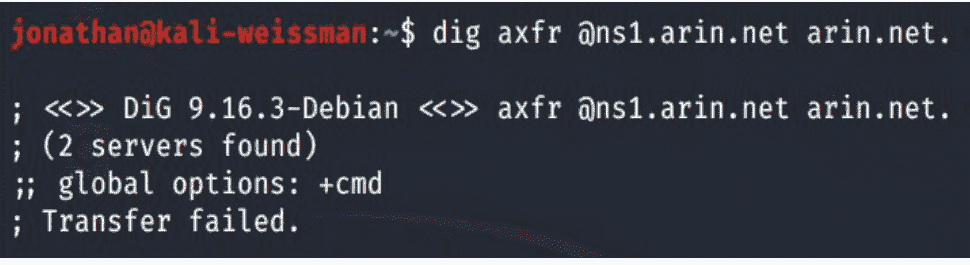

*图7-12 一次失败的区域传送*

### 步骤 3

让我们尝试使用一个不存在的主机名来运行dig。输入以下命令：

```
dig rit.arin.net.
```

在没有DNSSEC选项的情况下，响应中会存在不存在的域（NXDOMAIN）状态。当未指定资源记录类型时，dig默认使用A资源记录类型，如图7-13所示。

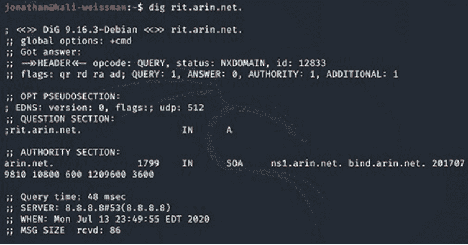

*图7-13 不存在rit.arin.net。*

### 步骤 4

现在，重新加上DNSSEC选项，让我们尝试一个不存在的资源记录。输入以下命令：

```
dig +dnssec rit.arin.net.
```

再次出现了NXDOMAIN状态，但现在你会注意到一个“下一安全”（NSEC）资源记录，其左边是ripe.arin.net.，右边是rpki.arin.net.。实际上，按字母顺序，字符串rit正好落在ripe和rpki中间，如图7-14所示。

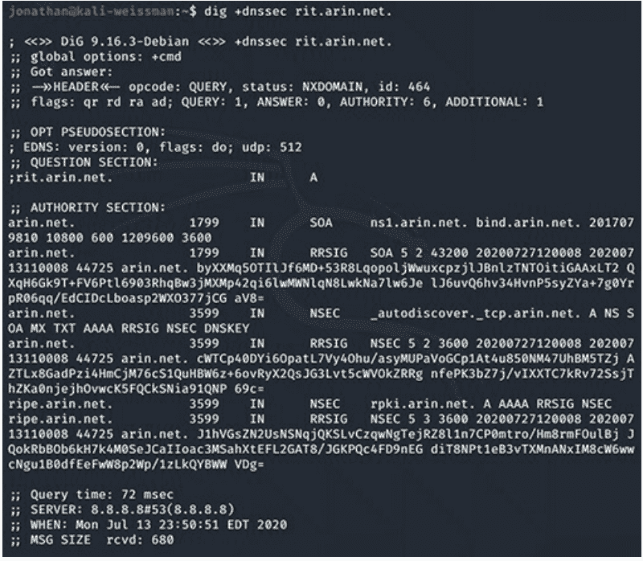

*图7-14 不存在rit.arin.net（附证明）。*

### 步骤 5

当我们尝试另一个名称时，再次得到确认该资源记录不存在，并且也再次被告知它按字母顺序位于哪些合法资源记录之间。输入以下命令：

```
dig +dnssec jonathan.arin.net.
```

我们被告知jonathan.arin.net.不存在，并且它位于jamf.arin.net.和kim-can.arin.net.之间（如图7-15所示）。

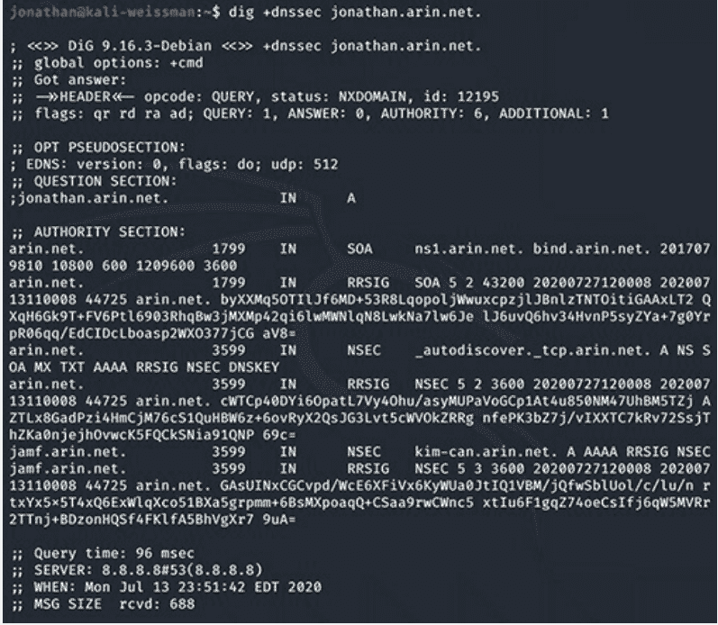

*图7-15 不存在jonathan.arin.net（附证明）。*

如果NXDOMAIN响应未经DNSSEC认证和签名，那么网络罪犯将很容易实施这种攻击。对于每个发往支持DNSSEC的域的查询，攻击者可以在合法DNS服务器返回真实答案之前，先发回一个NXDOMAIN响应，从而使某些客户端完全看不到这些域。

如果NXDOMAIN响应被签名了……嗯，首先，响应代码究竟该如何被签名？DNS的签名部分从来都不包含头部。对整个消息进行签名会使其难以缓存。此外，如果攻击者向某个必然会返回NXDOMAIN的域发起查询，并且该响应被签名，攻击者就可以保存该响应，并在合法DNS服务器返回真实答案之前，将其发送给合法查询，就像前面未签名的NXDOMAIN示例一样。在这种情况下，攻击者不需要该域的私钥。私钥将用于对所有NXDOMAIN消息进行签名，无论不存在的名称是什么，都会产生相同的签名。对这样一个通用答案进行签名证明不了任何东西。

因此，最终确定的解决方案是引入一种新的DNS资源记录NSEC，它通过返回按字母顺序排列在不存在的名称之前的资源记录和之后的资源记录，来使每个响应变得唯一。我们已经在当前步骤和上一步中看到了这一点。

现在，我们能利用这一点做什么呢？

### 步骤 6

让我们取按字母顺序位于 *jonathan.arin.net.* 之后的资源记录，并添加一个字符（实际上可以是任意字符）。由于 *jonathan.arin.net.* 按字母顺序位于 *jamf.arin.net.* 和 *kim-can.arin.net.* 之间，请输入以下命令：

```
dig +dnssec kim-can1.arin.net.
```

见图7-16。

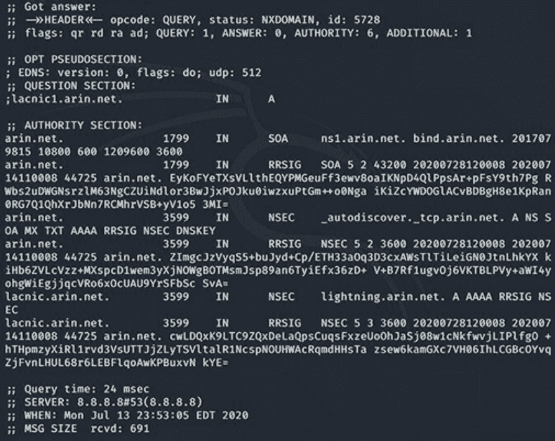

*图7-17 更多区域遍历*

紧跟在 lightning.arin.net. 之后的下一个资源记录会是什么？

### 步骤 8

为了应对这种区域遍历能力，引入了NSEC3资源记录。有些域被设置为返回NSEC3资源记录而不是NSEC记录。互联网名称与数字地址分配机构（ICANN）就是这样一个例子，该组织处于互联网名称和数字层级结构的顶端。

输入以下命令：

```
dig +dnssec rit.icann.org.
```

NSEC3并不会取代NSEC——事实上，两者如今都在使用。使用NSEC3时，不存在的名称会被哈希处理，并与区域中名称的哈希值进行比较。如图7-18所示，NSEC3返回的不是实际的前后名称，而是不存在名称的哈希值前面是什么哈希，以及不存在名称的哈希值后面是什么哈希。

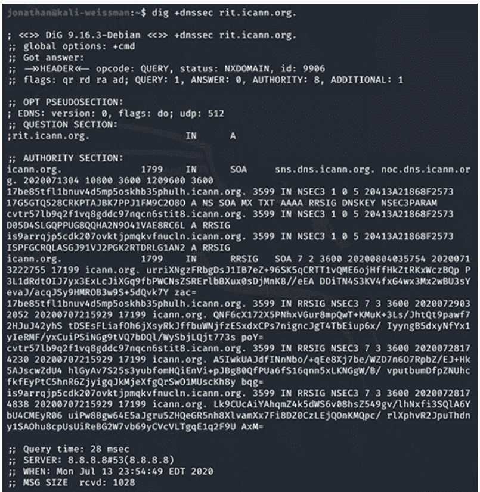

*图7-18 对前后资源记录进行哈希处理*

现在，攻击者要获取实际名称，只需进行离线字典攻击或暴力破解攻击（这两种攻击你将在第11章中执行）。子域/主机名并不算长。如果攻击者预先计算好所有10位及以下子域/主机名的单词表，每个名称对应的哈希值就会被存储起来。然后攻击者只需将NSEC3资源记录中的两个哈希值与存储的哈希值进行比较，就能找出每个名称对应的子域/主机名。有趣的是，实际上会返回三条NSEC3资源记录，其原因在RFC 7129的第5.5和5.6节中有解释。


## 学习目标

在本实验练习中，你将把许多密码学概念联系起来。完成本实验练习后，你将能够

- 理解 TLS 的工作原理
- 理解 TLS 为何对保护在 Web 浏览器和 Web 服务器之间传输的信息如此重要

## 实验材料和设置

本实验所需的材料有

- 《计算机安全原理：CompTIA Security+ 及进阶》教科书
- 运行 Google Chrome 和 Mozilla Firefox 的、具有 Internet 连接的 Web 浏览器

## 开始吧！

关于 TLS 及其工作原理存在许多误解。事实上，许多人仍然说 SSL（Secure Sockets Layer），而他们实际指的是 TLS，后者已取代 SSL。SSL 2.0 已于 2011 年被弃用，SSL 3.0 已于 2015 年被弃用，但你仍会在各处看到大量 SSL 参考，并每天听到人们这么说。TLS 的最新版本是 TLS 1.3，但截至本文撰写时，最新的部署版本是 TLS 1.2。让我们深入了解 TLS。

1a–1r

### 第 1 步

TLS 可以以两种方式实现，每种方式各有两种变体。前往 Cloudflare 的 TLS 页面 www.cloudflare.com/learning/ssl/keyless-ssl/。

阅读“什么是无密钥 SSL？”，“无密钥 SSL 如何工作？”，“什么是会话密钥？”和“生成会话密钥的步骤是什么？”部分。尽管 SSL（Secure Sockets Layer）这一已弃用的协议在整个页面中随处可见（正如前面提到的，许多地方都是这种情况），但网站在第二段中承认该术语被错误使用，其中写道“SSL，更准确地称为 TLS”。

现在看看 TLS 可以如何实现：两种方式，每种各有两种变体。阅读“RSA 密钥交换”部分，并查看“无无密钥 SSL 的 SSL 握手（RSA）”图。回答以下问题：

- a. 客户端发送给服务器的加密项是什么？
- b. 客户端用什么对该项进行加密？
- c. 服务器用什么解密此加密项？
- d. 双方接下来各自独立做什么？
- e. 私钥仅在何时使用？

阅读关于无密钥 SSL 的下一段，并查看“Cloudflare 无密钥 SSL（RSA）”图。回答以下问题：

- f. 这个版本与“无无密钥 SSL 的 SSL 握手（RSA）”版本有何不同？
- g. 哪些公司可能对使用“无无密钥”版本感兴趣，哪些公司可能对使用“无密钥”版本感兴趣？

阅读“临时 Diffie-Hellman 密钥交换”部分并分析“无无密钥 SSL 的 SSL 握手（Diffie-Hellman）”图。回答以下问题：

- h. 服务器发送给客户端的加密项是什么？
- i. 服务器用什么对这些项进行加密？
- j. 客户端用什么解密这些加密项？
- k. 双方接下来各自独立做什么？
- l. 私钥仅在何时使用？

阅读关于无密钥 SSL 的下一段，并查看“Cloudflare 无密钥 SSL（Diffie-Hellman）”图。回答以下问题：

- m. 这个版本与“无无密钥 SSL 的 SSL 握手（Diffie-Hellman）”版本有何不同？
- n. 哪些公司可能对使用“无无密钥”版本感兴趣，哪些公司可能对使用“无密钥”版本感兴趣？

阅读随后出现的段落和章节“什么是前向保密？什么是完美前向保密？”。回答以下问题：

- o. 你认为今天哪种握手更常见，RSA 握手还是 Diffie-Hellman 握手？
- p. 你认为这是为什么？

为了更好地理解多个会话密钥，请访问此网站：www.cloudflare.com/learning/ssl/what-is-a-session-key/。

- q. 回答这个问题：四个会话密钥是什么，为什么都需要这四个？
- r. 查看页面上的其他精彩链接，包括以下这些：

  - https://www.cloudflare.com/learning/performance/why-site-speed-matters/
  - https://blog.cloudflare.com/keyless-ssl-the-nitty-gritty-technical-details/
  - https://www.cloudflare.com/learning/ssl/what-is-ssl/
  - https://www.cloudflare.com/learning/ssl/transport-layer-security-tls/
  - https://www.cloudflare.com/learning/ssl/what-is-https/
  - https://www.cloudflare.com/learning/ssl/why-use-https/

  用你自己的话简要总结你在每个链接中学到的内容。

### 第 2 步

当浏览器从服务器获取数字证书时，浏览器如何知道证书上的密钥就是该服务器的实际公钥？在阅读以下解释时请使用图 7-20。

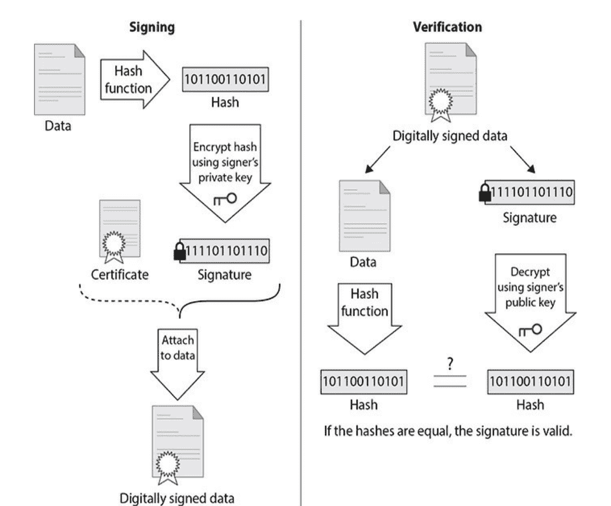

签名

验证

**图 7-20** 签名和验证数字证书（来源：“File:Digital Signature diagram.svg”，https://commons.wikimedia.org/w/index.php?title=File:Digital_Signature_diagram.svg&oldid=514368002，遵循 CC BY-SA 3.0）

证书颁发机构（CA）对证书上的所有字段进行了哈希处理，除了哈希算法和签名，并用 CA 的私钥加密了该哈希值。这就是数字证书上的一个字段，被称为数字签名。

浏览器从本地机器上存储的受信任根证书存储中检索 CA 的数字证书，并用 CA 的数字证书上找到的 CA 的公钥解密加密的哈希值（数字签名）。

浏览器还对 CA 所哈希的相同字段进行哈希处理，并将计算出的哈希值与解密后的哈希值进行比较。如果两个哈希值匹配，则被哈希的证书字段（最重要的是服务器的公钥）只能由 CA 进行哈希并加密。

如果哈希值能用 CA 的公钥解密，则它只能用 CA 的私钥加密。这证明了 CA 确实是 CA，服务器的公钥确实是服务器的公钥，并且网站是合法且安全的。

3a–3h

### 第 3 步

眼见为实。让我们通过 Google Chrome 的视角来看这些实际的数字证书和受信任的根证书存储是什么样的。

- a. 在 Google Chrome 中，访问 www.citibank.com。
- b. 点击 URL 栏最左侧的锁。
- c. 点击证书（有效）。

一个带标签的窗口将会打开。在“常规”标签中，注意证书信息。在“详细信息”标签中，注意数字证书的所有字段和值。在“认证路径”标签中，注意 CA 的层级结构。

网站给予浏览器的证书被称为叶证书，因为它位于层级结构的末端，并且由中间 CA 的证书签名。中间 CA 的证书由根证书签名。根证书是自签名的，并且被浏览器信任。

使用这种层级结构，浏览器不必管理大量的根证书。它使根 CA 能够将签名委托给中间 CA，而无需共享根主签名私钥。它还使根 CA 能够在出现错误或恶意行为时撤销中间 CA 的证书，而不是撤销根 CA 的证书，

- b. 立即按下键盘上的 E（编辑）键，这将启动图 8-2 所示的配置屏幕。

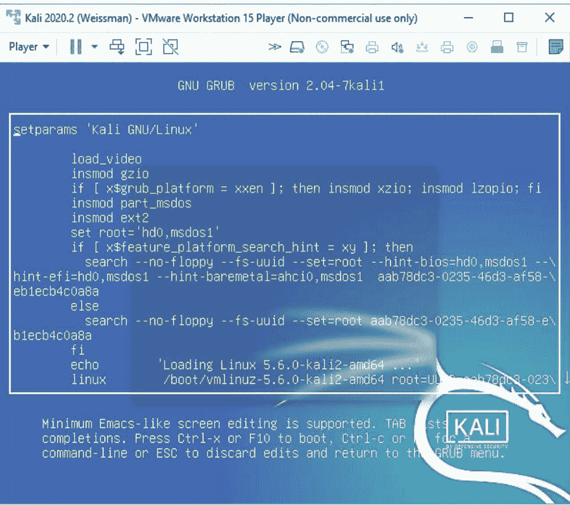

**图 8-2** GRUB 配置屏幕

- c. 查找以 linux 开头并包含 vmlinuz（Linux 内核）的行（该行在图 8-2 的框底部显示，并添加了箭头以强调）。转到该行的末尾；为此，将光标放在该行上，然后按 END 键。然后在该行末尾输入 init=/bin/bash。此条目将在屏幕上换行到下一行。这指示 Linux 内核启动 /bin/bash 而不是运行 init。在大多数 Linux 发行版中，现在 init 是指向 systemd 的符号链接，该守护进程


如果你没有将路由器（以及交换机，你将在实验8.03中看到）锁在房间里，任何能够物理接触设备的人都可以按照本实验的步骤对其造成严重破坏。“Cisco路由器密码恢复”是对本实验的一种“友好”描述，但另一种（同样准确）说法是“入侵Cisco路由器”。同样，与许多网络安全概念一样，这些步骤既可以用于正当目的（密码恢复），也可以用于恶意目的（恶意入侵）。

## 学习目标

在本实验中，你将无需通过凭据认证即可获得Cisco路由器的最高权限。完成本实验后，你将能够：

- 进入Cisco路由器的特权执行模式
- 理解这样做带来的好处和可能造成的损害

## 实验材料与准备

本实验所需的材料包括：

- 《计算机安全原理：CompTIA Security+ 及进阶》教科书
- 一个可联网的Web浏览器
- 一台Cisco路由器（几乎任何型号均可；此过程在几乎所有型号上都是相同的）
- 一根rollover/console线缆
- 一个USB转串口转换器（如果你的rollover/console线缆是8P8C转串口）

## 开始操作！

在开始本实验之前，你需要完成相关硬件和软件的设置。将路由器连接到PC后，你需要下载并安装软件，以便通过键盘向路由器发送按键操作，并在显示器上接收路由器的输出。

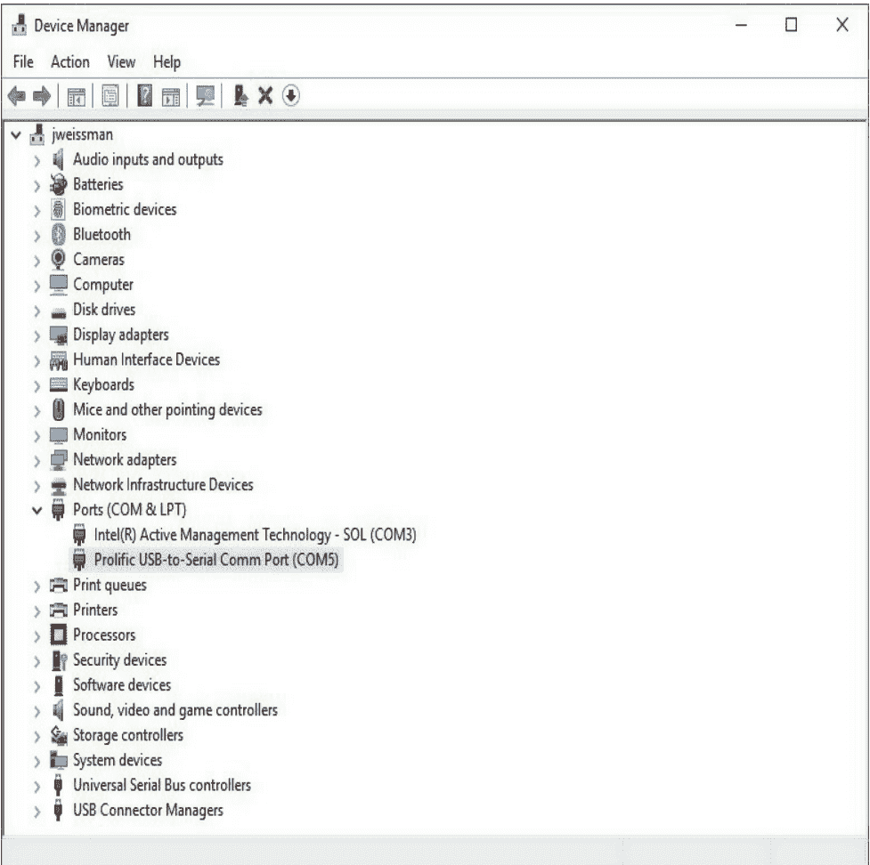

**图8-5 设备管理器**

回到PuTTY中，将串行行端口更改为设备管理器中标识的端口。

在左侧的“类别”窗格中，单击“Serial”。

在“控制本地串行线的选项”下，确认以下设置（最后一个应为唯一的非默认值）：

要连接的串行行：COMx（其中x代表端口号）

```text
Router(config)#enable secret ccna
```

d. 输入 **exit** 返回特权执行模式：

```text
Router(config)#exit
```

e. 输入 **show running-config** 查看路由器RAM中的运行配置（通过running-config文件）：

```text
Router#show running-config
```

你应该会看到一行以 *enable secret* 开头的内容，后面跟着一个数字（表示所使用的具体哈希函数）以及启用密码的哈希值。

f. 输入 **copy running-config startup-config** 将此RAM中的配置文件复制到NVRAM，并存储为startup-config文件：

```text
Router#copy running-config startup-config
```

下次路由器启动时，startup-config文件将被加载到RAM中，成为新的running-config文件。

g. 输入 **reload** 重新启动路由器：

```text
Router#reload
```

h. 在提示符处输入 **enable**：

```text
Router>enable
```

i. 在“Password”提示符处，输入你的名字：

```text
Password: <你的名字>
```

j. 再输入两个错误的密码。输入完这三个错误密码后，你将再次看到用户执行模式提示符。

```text
Password: <你的名字>
Password: <错误密码>
Password: <错误密码>
% Bad secrets
Router>
```

2a–2i

### 步骤 2

此时，你需要恢复密码以重新获得对路由器的访问权限。你将再通过另一种模式来完成这一操作。

running-config文件：

```text
Router#copy startup-config running-config
```

等等！我们不是刚刚通过ROMMON运行配置绕过了这一步吗？是的，确实如此！如果没有该配置，我们就需要为特权执行模式提供密码。现在我们已经“进入”，就可以恢复配置了。我们可以将其与富有创造力的银行劫匪作比较。他们不是抢劫银行后带着钱逃走，而是在深夜无人时把整个银行抬起来，放到自己所在的位置，这样当建筑落下来时，他们就已经和所有钱一起站在金库里面了！

h. 输入 **configure terminal** 进入全局配置模式：

```text
Router#configure terminal
```

i. 在Router(config)#提示符处，输入 **config-register 0x2102** 将配置寄存器恢复为先前的值（在ROMMON模式中修改之前的值），这会使路由器下次启动时从NVRAM加载startup-config作为running-config到RAM中：

```text
Router(config)#config-register 0x2102
```


### 步骤 3

此时，你已经完全控制了路由器，并且它已设置为正常启动。请想一想网络攻击者在这里能做的所有恶意操作。现在是时候重置密码了，因为如果不这样做，你将发现自己再次陷入需要执行密码恢复的境地！

- a. 配置一个新的启用密码。
- b. 将运行配置保存到启动配置中。
- c. 重新加载路由器，并使用刚配置的新密码进入特权执行模式。


## 实验8.03：Cisco交换机密码恢复

在本实验中，你将对交换机而不是路由器执行密码恢复（或者说入侵）操作。

### 学习目标

在本实验中，你将无需有效凭据认证即可获得Cisco交换机的最高权限。完成本实验后，你将能够：

- 进入Cisco交换机的特权执行模式
- 理解这样做带来的好处和可能造成的损害

### 实验材料与准备

本实验所需的材料包括：

- 《计算机安全原理：CompTIA Security+ 及进阶》教科书
- 上一个实验中的PuTTY
- 一台Cisco交换机（几乎任何型号均可；此过程在几乎所有型号上都是相同的）
- 一根rollover/console线缆
- 一个USB转串口转换器（如果你的rollover/console线缆是8P8C转串口）

### 开始操作！

首先按照实验8.02“开始操作！”部分中的相同设置进行操作（通过console连接到交换机并运行PuTTY），然后完成该实验的所有“步骤1”（设置启用密码并在提示时无法提供正确密码）。本实验的步骤1假定你已经在上一个实验中按上述步骤操作过。如果你是第一次使用该设备且设备已恢复出厂设置，请本实验的步骤2f开始，然后再返回步骤1。

### 步骤 1

拔掉交换机的电源线。有趣的是，Cisco交换机不像Cisco路由器那样有电源按钮。

这可能看起来有点奇怪，但要让Cisco交换机密码恢复顺利进行，你需要在将电源线重新插回交换机的同时，按住交换机前面板最左侧的“Mode”按钮。和上一个实验一样，每条命令后按回车键。

2a–2h

### 步骤 2

正如你刚刚完成的硬件步骤一样，你现在要进行的软件过程（在交换机上执行密码恢复）与你在上一个实验中对路由器执行的密码恢复过程有很大不同。

a. 此时，交换机应启动进入switch:模式。在switch:提示符处输入 `flash_init` 以初始化闪存文件系统：

```text
switch: flash_init
```

b. 在switch:提示符处，输入 `load_helper` 以加载并初始化引导帮助程序镜像，这些镜像可以扩展或修补引导加载程序的功能：

```text
switch: load_helper
```

c. 要查看闪存内容，在switch:提示符处输入 `dir flash:`：

```text
switch: dir flash:
```

d. 在switch:提示符处，输入 `rename flash:config.text flash:config.old` 以在交换机启动期间隐藏其配置：

```text
switch: rename flash:config.text flash:config.old
```

Cisco交换机将配置保存在两个内容相同的文件中。NVRAM中的startup-config文件在启动过程中由交换机使用，就像路由器一样。然而，交换机在闪存中还有另一个文件config.text，本实验正是利用该文件进行密码恢复。startup-config文件与config.text文件相关联，所以这一步是必需的。当你将config.text重命名为config.old时，交换机就无法将startup-config文件映射到config.text（因为它已不存在）。作为


2. 为什么需要物理访问才能对 Cisco 路由器进行密码恢复？

3. 为什么需要物理访问才能对 Cisco 交换机进行密码恢复？

## 关键术语测验

使用下面的词表完成后面的句子。

- booting
- configuration
- recovery

1. 对 Cisco 路由器或交换机进行黑客入侵的过程也可以描述为密码 ________。

2. 获取 Linux 系统的完全控制权需要物理访问，该过程涉及中断 ________ 过程。

3. 通过重命名 ________ 文件，可以使入侵交换机成为可能。
