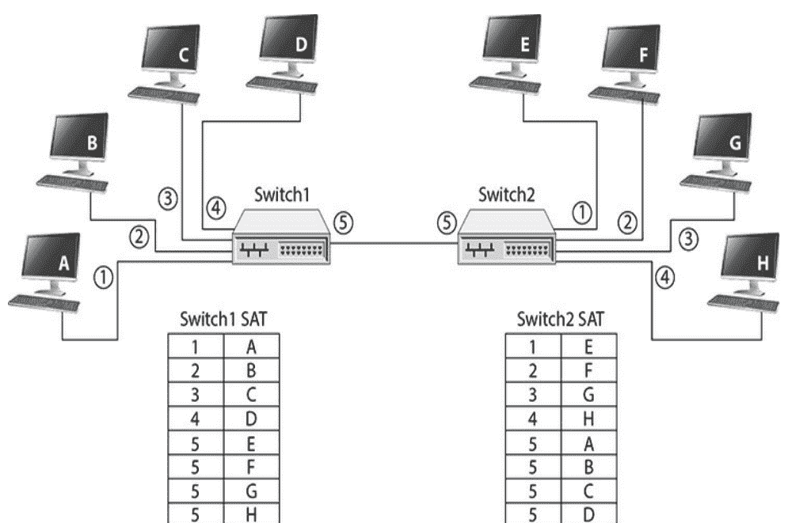
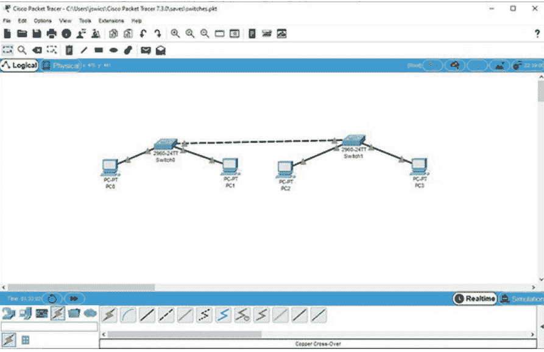
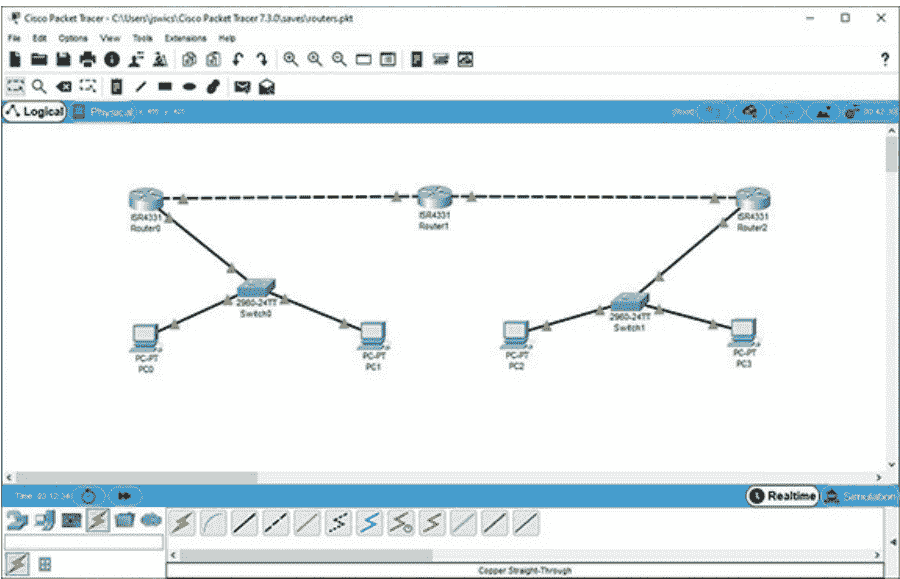
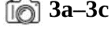
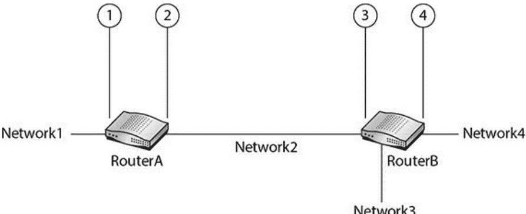
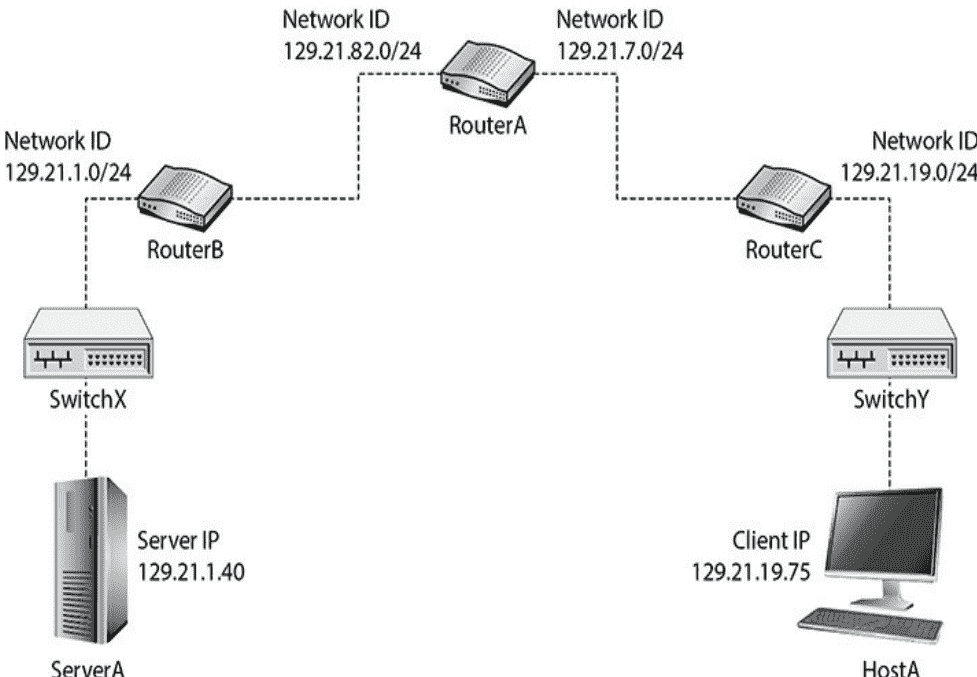

## 第 9 章
网络基础

## 实验练习

- 9.01 交换机配置
- 9.02 路由器配置
- 9.03 密码和 SSH

实验分析

关键术语测验

把交换机想象成城市的本地街道，连接同一区域内的实体（如住宅、建筑物、银行、咖啡馆和超市）。这些实体就像网络上的终端设备。终端设备是流量的源或目的地，具有 IP 地址。终端设备由交换机连接，包括台式机、笔记本电脑、打印机、摄像头、移动设备等。就像城市的街道让你可以轻松地从银行走到咖啡馆，交换机允许网络流量（例如一份文档）从你的计算机传输到网络打印机。就像一条街道网络可以通往城市的另一部分一样，交换机连接到其他交换机，扩展网络的覆盖范围。当然，网络必须有一个连接到路由器的交换机，以便将发往其他网络的流量从网络中取出，并将来自其他网络的流量带入该网络。

把路由器想象成连接不同城市和州的高速公路。与交换机不同，路由器不连接设备。路由器连接网络。路由器还连接到其他路由器，而这些路由器又连接到其他路由器，依此类推。这允许从一个网络发出的流量通过任意数量的路由器发送到任何互联网络，并允许返回流量返回到发起流量的原始网络上的设备。就像高速公路让你可以从罗切斯特前往斯塔滕岛一样，路由器允许你的网络流量到达可能位于同一建筑物、另一个州、另一个国家或另一个大陆的其他网络上的设备。

60 分钟

## 实验练习 9.01：交换机配置

当 PC 将以太网帧发送到交换机时，交换机会检查帧中的目标 MAC 地址，然后检查是否知道具有该目标 MAC 地址的设备连接到哪个端口。如果交换机知道具有该 MAC 地址的设备的位置，交换机会仅从该对应端口发送帧。如果交换机不知道目标 MAC 地址的位置，交换机会将帧从除帧源端口外的所有端口泛洪出去。

### 注意

在提到路由器和交换机时，术语端口和接口经常可以互换使用。严格来说，端口是连接器插入的物理单元，而接口是该端口的逻辑表示，其名称例如为 GigabitEthernet0/0/0。

那么显而易见的问题是，交换机最初是如何学习 MAC 地址所在位置的？交换机起初一无所知，但随着帧被发送到交换机，交换机开始学习。请参阅图 9-1。



## 图 9-1 两个交换机

Switch1 SAT

|  |  |
|---|---|
| 1 | A |
| 2 | B |
| 3 | C |
| 4 | D |
| 5 | E |
| 5 | F |
| 5 | G |
| 5 | H |

Switch2 SAT

|  |  |
|---|---|
| 1 | E |
| 2 | F |
| 3 | G |
| 4 | H |
| 5 | A |
| 5 | B |
| 5 | C |
| 5 | D |

在此图中，如果 HostA 将发往 HostB 的帧发送到 Switch1 的 Port1，交换机将通过内存中的一个表将 HostA 的 MAC 地址与听到它的端口关联起来，该表有各种名称，包括源地址表（SAT）、内容可寻址内存（CAM）表和 MAC 地址表。

由于交换机不知道 HostB 在哪里，它会将帧从除源端口外的所有端口泛洪出去。当 HostB 回复时，帧进入交换机，交换机学习到 HostB 可以在 Port2 找到。交换机随后将 HostB 的 MAC 地址和听到它的端口也添加到其源地址表中。

对于直接连接的交换机，逻辑也是一样的。每个交换机维护自己的源地址表。你会注意到 Hosts E、F、G 和 H 对 Switch2 来说分别在端口 1、2、3 和 4 上已知。然而，就 Switch1 而言，Hosts E、F、G 和 H 都可以通过连接到 Switch2 的 Port5 访问。

本实验练习将向你介绍 Cisco 的 Packet Tracer，这是一款对所有网络进行免费模拟的工具！不过，如果你有执行本实验所需的硬件（请参阅所列的可选实验材料），以及本章中所有其他相关实验，那么使用真实设备会更好。如果你使用实际的交换机和 PC，请忽略 Packet Tracer 特定的说明。所有命令都将相同。

如果你想休息一下或重新访问实验练习的某个部分，可以通过点击 File | Save 保存你的工作，然后为文件命名。然后，当你准备继续时，只需从你的 Cisco Packet Tracer 目录中重新打开 .pkt 文件，该目录以版本号命名，位于以你的用户名命名的目录内，位于 C:\Users 中。出版时，Cisco Packet Tracer 7.3.0 是当前版本。

### 注意

在每个命令后按 ENTER。


步骤 1 设置 Packet Tracers 的这组说明会不时发生变化。如果看到的内容与这些说明完全不符，请做出适当的修改。

- a. 前往 https://www.netacad.com/courses/packet-tracer。
- b. 点击写着“Simply enroll into Introduction to Packet Tracer course to download the latest version of Packet Tracer.” 的链接。
- c. 点击“Sign up today!” 并选择 English。
- d. 在页面右侧的 Enroll Now 部分填写所需信息（包括用于获取激活链接的电子邮件地址），然后点击 Submit。
- e. 填写所需详细信息并点击 Register。
- f. 按照提示使用你的凭据登录，然后输入发送到你电子邮件的验证码。
- g. 在下一个屏幕上输入所需信息并点击 Create Account。
- h. 点击 Launch Course 并输入你的凭据。
- i. 点击 Next 或 End tour 即可。
- j. 随意完成课程的全部、部分或不完成部分。
- k. 点击顶部菜单中的 Resources 并选择 Download Cisco Packet Tracer。
- l. 在 My NetAcad 页面底部点击 Packet Tracer。
- m. 选择适合你系统的正确版本。
- n. 下载完成后，安装 Packet Tracer。保留所有默认设置并相应地响应任何安全提示。
- o. 启动 Packet Tracer 并提供你的 Cisco Network Academy 凭据。你现在应该看到 Cisco Packet Tracer 应用程序。


步骤 2 在本步骤中，使用交换机、PC 和电缆构建拓扑时，请参考图 9-2。



## 图 9-2 本实验练习的拓扑

- a. 点击 Network Devices 图标（位于左下角的时间计数器下方）。在它下方的一行中，点击 Switches 图标（从左数第二个）。
- b. 将两个 2960 交换机（底中部窗格左侧第一个图标）拖到空白主窗口。
- c. 点击 End Devices 图标（位于 Network Devices 右侧）。从右侧窗格拖动四个 PC（第一个图标）到拓扑中，每个交换机下方放置两个。
- d. 点击 Connections 图标（位于 End Devices 右侧两个）。使用铜质直通电缆（底中部窗格从左数第三个）将两个 PC 连接到每个交换机。在点击电缆图标进行选择后，点击拓扑中的 PC 和交换机。使用每个 PC 上的 FastEthernet0，并使用每个交换机上的 FastEthernet0/1 和 FastEthernet0/2。几秒钟后，你会在每个 PC 到交换机的连接两侧看到一个绿色的向上三角形（交换机侧会先显示橙色圆圈），表示每个 PC 与其交换机之间存在实时连接。


- e. 通过选择铜交叉线（底部中间窗格中从左数第四个）、点击每个交换机并为每个交换机选择 GigabitEthernet0/2 来连接交换机。每个交换机旁边的橙色圆圈不久后会变成绿色三角形，表示连接良好。

3e–3f

### Step 3 配置 PC 如下：

- a. 点击最左边的第一台 PC（Packet Tracer 标记为 PC0 的那台）。

- b. 点击打开的 PC0 窗口顶部的 Config 选项卡。

- c. 在左侧窗格中，在 INTERFACE 下，点击 FastEthernet0。

- d. 在 IP Configuration 部分，为 PC0 分配 IP 地址 10.1.0.100，子网掩码为 255.255.0.0。在下一个实验练习中，你将为 PC 以及此拓扑中的路由器添加默认网关 IP 地址。

  在 IPv4 地址中，所有主机位不能全为 0（因为它表示网络 ID），也不能全为 1（因为它表示网络广播地址）。由于在此网络寻址方案中，最后 8 个主机位中的第四个八位组不能为 0，这本可以很好地与名称 PC0 匹配，因此选择了 100 作为替代。

- e. 点击 Desktop 选项卡，然后点击 Command Prompt 图标。输入 ipconfig 并按 ENTER 以验证你是否已正确分配 IP 地址和子网掩码。

- f. 在其他三台 PC 上重复这些步骤，为 PC1 分配 IP 地址 10.1.0.1，为 PC2 分配 10.1.0.2，为 PC3 分配 10.1.0.3。每台 PC 的子网掩码同样为 255.255.0.0。

4b–4c, 4e–4h

### Step 4 配置交换机，从 PC 发送流量通过交换机，并检查交换机学习到的内容，如下：

- a. 点击标记为 Switch0 的第一个交换机。

- b. 点击 Switch0 窗口顶部的 CLI 选项卡。如有必要，按 ENTER 直到看到 Switch> 提示符，表示你处于用户 EXEC 模式。在用户 EXEC 模式下，你可以查看某些状态信息，但不能做太多其他操作。在提示符下输入 enable 并按 ENTER，从用户 EXEC 模式进入特权 EXEC 模式（也称为“enable 模式”，因为使用该命令进入）。你会注意到提示符变为 Switch#。在特权 EXEC 模式下，你可以复制、擦除、配置和显示设置。输入 configure terminal 并按 ENTER 进入全局配置模式。你会注意到提示符变为 Switch(config)#。在全局配置模式下，你可以配置许多项目，包括时钟、主机名和密码。

  在 Cisco IOS（Internetworking Operating System）中，你只需输入足够多的命令字符以在同一模式下与其他命令区分即可；因此 en 与 ena、enab、enabl 和 enable 相同。此外，你可以输入一个或多个字符并按 TAB 查看命令自动补全。此外，如果你输入几个字符并输入 ?，Cisco IOS 会显示完成命令的方法。如果你先按空格键再按 ? 符号，Cisco IOS 会显示在当前提示符输入之后它期望的内容。

- c. 通过输入 hostname 后跟主机名来为交换机指定主机名，该主机名将出现在提示符上。在本例中，使用主机名 S0（代表 Switch0）。

- d. 输入 END 并按 ENTER 返回特权 EXEC 模式。如果控制台中有输出，再按一次 ENTER 以获取提示符。要逐级向下，输入 exit 并按 ENTER。要从更高模式直接返回特权 EXEC 模式，输入 END 并按 ENTER 或直接按 CTRL-Z。

- e. 使用上述步骤，为第二个交换机指定主机名 S1（代表 Switch1）。

- f. 通过点击它、选择 Desktop 选项卡，然后选择 Command Prompt，在一台 PC 上打开命令提示符。

- g. 从每台 PC ping 其他三台。

条目中接下来出现的内容；例如，show i? 显示以 i 开头的 show 之后出现的条目。在空白后按 ? 会显示可以在之前条目之后出现的内容；例如，show ? 显示 show 之后出现的条目。在结果之后，在这两种情况下，你的原始输入都会放在提示符上，因此你可以在输入 ? 符号之前继续输入。

- i. 如有必要，选择 File | Save 然后命名你的文件，以便稍后开始下一个实验练习或返回到 Lab Exercise 9.01 的已完成版本的此点。

60 MINUTES

## Lab Exercise 9.02: Router Configuration

要将不同的网络连接在一起，路由器维护一个称为路由表的表，其中包含目标网络和路由器的方向，例如将流量发送到下一个位置。 如果路由器的 RAM 中的表不知道数据包需要去往的目标网络，路由表可能有一个默认路由，这意味着将所有具有未知目标网络的流量发送到不同路由器上的特定路由器接口。 该其他路由器将更好地了解如何到达目的地。 如果没有目标网络的知识或默认路由，路由器将丢弃数据包并向源发送 ICMP（Internet Control Message Protocol）错误消息。

你永远不会看到 PC 直接连接到路由器。 连接到路由器的是交换机或另一个路由器。 我们在家中称之为“路由器”的那个小盒子实际上内置了交换机功能。 就像那个盒子里有一个交换机和一个路由器相互连接一样。 如果你曾经将台式机连接到该路由器的端口上，你实际上是将电缆插入交换机端口，即使我们称那个小盒子为路由器。

**Note**

我们称之为路由器的那个盒子还包含 DHCP 服务器、DNS 服务器、NAT 网关、防火墙、接入点等等。

今天的互联网骨干路由器路由表中有大约 800,000 条路由。 在自治系统的内部路由器上，当然要少得多。 自治系统代表在单一管理控制下的一组网络，向互联网展示统一的路由策略，如 ISP 或像罗切斯特理工学院（RIT）这样的大型实体。 RIT 拥有一组内部网络。 为什么多个网络比单个网络更受欢迎？

好吧，首先，考虑 ARP。 ARP 请求（以及所有其他广播流量）将始终到达并被网络上的每个设备处理。 相比一个庞大的扁平网络，将多个网络通过路由器互连有助于减小广播域的大小。 这样，广播占用网络带宽和处理能力的数量，以及能够听到它们的设备数量将大大减少。 路由器永远不会转发广播。

这就是为什么在 RIT 每个班级都在单独的房间授课的原因。 如果我们增加一个巨大的礼堂并让所有班级同时在那里上课，我的学生就必须听并试图理解其他教授和班级。 这会分散他们对我和我课程的注意力。

另一个原因是因为安全目的。 路由器级别的安全性形式为访问控制列表（ACL），可用于按源 IP 地址、目标 IP 地址、协议和端口（此处端口指的是逻辑端口，即程序之间的连接端点；例如，SSH 服务器通过端口 22 发送和接收）过滤流量。 这使你能够比如果所有内容都在同一网络上更好地控制对某些设备和资源的访问。

拥有多个网络也是分层设计整个网络的一种方式，并且甚至使故障排除过程更容易，通过将流量隔离到特定网络。 像 RIT 这样的实体注册并获得自己的自治系统号（ASN）。 因此，它们成为自治


在高速公路上行驶更多里程，比在车道更少、交通灯更多、限速更低的地方道路上行驶更少里程，能更快到达目的地。

EGP（外部网关协议）是一种路由协议，允许来自不同自治系统的路由器相互通信并交换路由信息。当今唯一在使用的EGP，应用于整个互联网基础设施，是BGP（边界网关协议）。

### 学习目标

在本实验练习中，你将熟悉路由器。完成本实验练习后，你将能够

- 通过路由器发送IP数据包
- 配置静态路由
- 配置路由协议
- 分析路由器的路由表
- 分析数据包从源到目的地的路径

### 实验材料和设置

本实验所需的材料如下

- *《计算机安全原理：CompTIA Security+及超越》*教科书
- 一个可连接互联网的网页浏览器
- 一台或多台Cisco以太网交换机，至少配备两台PC（可选）

### 开始吧！

本实验练习需要完成上一个实验练习。本说明紧接着上一个实验练习的结束处开始。

➔ 注意

每输入一条命令后按回车键。

1f

步骤1 在修改拓扑时请参考图9-3。你将添加路由器和电缆，并修改现有的电缆连接和PC配置。



**图9-3 本实验练习的修改后拓扑**

- a. 单击“网络设备”图标（位于左下角时间计数器下方）。在其下方一行中，单击“路由器”图标（左起第一个）。
- b. 将三台4331路由器（底部中间窗格左侧第一个图标）拖到拓扑中。将它们放在顶部，从左到右排列，Router0位于Switch0上方，Router1位于中间，Router2位于Switch1上方。
- c. 使用两条交叉电缆连接三台路由器。对于第一条交叉电缆，在Router0上选择GigabitEthernet0/0/0，电缆另一端接入Router1，选择GigabitEthernet0/0/1。对于第二条交叉电缆，在Router1上选择GigabitEthernet0/0/0，电缆另一端接入Router2，选择GigabitEthernet0/0/1。

| Router0 | Router1 | Router2 |
|---|---|---|
| C 10.1.0.0/16 | C 10.2.0.0/16 | C 10.3.0.0/16 |
| C 10.2.0.0/16 | C 10.3.0.0/16 | C 10.4.0.0/16 |
| S 10.3.0.0/16 [1/0] via 10.2.0.99 |  |  |
| S 10.4.0.0/16 [1/0] via 10.2.0.99 |  |  |

**表9-2 路由表，版本2**

如果到达目标网络的路由可以通过多种方式学习（例如，像OSPF这样的路由协议和静态配置），将使用哪一种？思科的管理距离（括号内的第一个数字）对来源进行排序：0表示直连（但不显示在路由表中），1表示静态配置，其他值表示各种路由协议。数字越低，该路由来源越受优先。

在方括号中，斜杠前的1是静态路由的管理距离，这使得它比通过路由协议学到的路由更受优先，因为工程师花了时间配置它。斜杠后的0代表度量值，对于静态路由来说始终为0。你将在下一个实验练习中，结合动态路由协议进一步探讨这个值。

- g. 尝试从PC0（10.1.0.100）ping PC3（10.4.0.3）。现在它将在Router1上失败，因为Router1既不知道目标网络（10.4.0.0/16），也不知道源网络（10.1.0.0/16）。

在R1的全局配置模式下，输入以下命令：

```
ip route 10.1.0.0 255.255.0.0 10.2.0.98
ip route 10.4.0.0 255.255.0.0 10.3.0.99
```

然后，进入特权EXEC模式，并使用show ip route命令显示路由表。你将看到两条新条目：

```
S 10.1.0.0/16 [1/0] via 10.2.0.98
```

追踪路由，包括到达目的地PC3的所有路由器接口。

4a–4h

**步骤4** 静态路由非常适合末梢网络，即只有一个入口和一个出口的网络。无需配置动态路由协议，那会消耗带宽和处理能力，并且不会带来额外的好处。

如果到达目标网络有多条路径，配置静态路由会限制你。动态路由协议支持负载均衡，可以以负载均衡方式使用两条或更多度量值相等的路径。动态路由协议还允许像我们的GPS不时告诉我们的那样“重新计算”，以避开交通拥堵或施工，在链路发生故障时提供容错能力。此外，如果拓扑中有许多路由器，手动配置许多静态路由既繁琐又容易出错。

你将继续使用已建立的拓扑，并配置OSPF（开放最短路径优先）路由协议来替代静态路由，尽管这仍然是一个由末梢网络组成的线性拓扑。

- a. 在Router0上，从全局配置模式中，使用以下命令删除静态路由：

```
no ip route 10.3.0.0 255.255.0.0
no ip route 10.4.0.0 255.255.0.0
```

- b. 在Router1上，从全局配置模式中，使用以下命令删除静态路由：

```
no ip route 10.1.0.0 255.255.0.0
no ip route 10.4.0.0 255.255.0.0
```

- c. 在Router2上，从全局配置模式中，使用以下命令删除默认静态路由：

```
no ip route 0.0.0.0 0.0.0.0
```

➔ 注意

**在所有路由器上执行以下步骤。**

## 实验练习9.03：密码和SSH

本章中你配置的路由器和交换机都有多个密码，可用于提供一定程度的安全性。SSH（安全外壳）可用于远程配置路由器和交换机，同时保持机密性，因为加密保护了通过SSH通信的机密性。

### 学习目标

在本实验练习中，你将实现一定级别的路由器与交换机安全性。完成本实验练习后，你将能够

- 配置并使用多个路由器和交换机密码
- 配置并使用SSH远程访问路由器和交换机

### 实验材料和设置

本实验所需的材料如下

- 《计算机安全原理：CompTIA Security+及超越》教科书
- 一个可连接互联网的网页浏览器
- 一台或多台Cisco以太网交换机，至少配备两台PC（可选）

### 开始吧！

默认情况下，路由器和交换机上没有密码。当然，在将这些设备部署到生产网络之前，需要纠正这一点。路由器和交换机可以设置所有用户共享的密码，也可以设置与各个用户名绑定的密码。密码可以设置在控制台线路、SSH线路以及特权EXEC模式上。现在，你将探索所有这些选项。选择当前拓扑中的任意设备，因为以下命令和说明在路由器和交换机上的操作方式相同。

➔ 注意

模式。键入**configure terminal**进入全局配置模式。输入以下命令。第一条切换到Vlan 1接口配置模式。第二条为Vlan 1接口分配IP地址10.1.0.52和子网掩码255.255.0.0。交换机上可以启用多个Vlan接口，但默认情况下所有端口都分配到Vlan 1。你必须启用一个Vlan接口，并且有设备连接到它，SVI才能启动并可用。第三条将该接口的默认关闭状态更改为不关闭，即开启。第四条退出到全局配置模式。第五条为该交换机分配默认网关，用于远程通信。

```
interface vlan 1
ip address 10.1.0.52 255.255.0.0
no shutdown
exit
ip default-gateway 10.1.0.99
```

- b. 远程访问绝不应使用名为Telnet的过时旧协议，因为它会以明文方式双向传递所有信息，包括密码。另一方面，SSH会双向加密流量，这正是你接下来要设置的。

从全局配置模式中，输入以下命令。为了创建加密密钥（公钥和私钥），需要使用交换机的完全限定域名（FQDN）。FQDN包括主机名（先前已配置，但此处为了完整性而重复），以及现在配置的域名。第三条命令使用2048的模数生成密钥。第四条命令将SSH版本限制为2，禁止较弱的版本1。

第五条命令将你移入line vty（虚拟终端，用于SSH连接）模式。第六条命令指定对于16（0-15）条并发SSH线路，用户名/密码对应来自本地交换机的数据库。第七条命令指定在此交换机上的vty线路上只能使用SSH，而不能使用Telnet。

```
hostname S0
ip domain-name weissman.edu
crypto key generate rsa
```


当提示“How many bits in the modulus [512]:”时，输入**2048**并按回车。

```
ip ssh version 2
line vty 0 15
login local
transport input ssh
```

c. 在拓扑中单击任意PC。选择“桌面”选项卡，并单击“Telnet / SSH客户端”图标（靠近底部）。确认“连接类型”设置为SSH。在“主机名或（IP地址）”框中，输入**10.1.0.52**（即你启用了SSH的交换机的IP地址）。在“用户名”框中，输入**jonathan**。单击“连接”按钮。

d. 当提示输入密码时，输入**weissman**。

e. 输入**enable**，并在“Password:”提示符下输入启用加密口令。

瞧！你已经通过SSH远程连接成功登录到交换机了。

还记得第5章中TLS如何使用Diffie-Hellman密钥交换吗？SSH也以同样的方式使用它。
PC上的SSH客户端和交换机上的SSH服务器通过Diffie-Hellman密钥交换协商出一个共享机密。这个共享机密就是对称密钥，用于加密双向通信，包括客户端发送给服务器进行认证的用户名和密码。SSH服务器（这里交换机是SSH服务器）的公钥会在客户端首次连接到该服务器时传输给客户端。与TLS一样，在DHKE期间，SSH服务器对值进行哈希运算，并用其私钥加密该哈希值，从而形成数字签名。客户端用服务器的公钥解密加密后的哈希值，并自行计算哈希值。如果计算出的哈希值与解密后的哈希值匹配，则客户端可以相信服务器确实是该服务器，并且对称密钥（共享机密）是合法的。

除了密码之外，一种更安全的客户端认证方法是使用公钥/私钥对。客户端可以生成一对公钥/私钥，并将其公钥放在服务器上。然后服务器用该公钥加密一个随机数，并将密文发送给客户端。如果客户端拥有相应的私钥，它就能解密该消息。解密后的消息与会话密钥（在此阶段之前通过DHKE建立的共享对称密钥）将被哈希，然后作为响应发送给服务器。服务器使用原始数字和相同的会话密钥自行计算哈希值。如果计算出的哈希值与收到的哈希值匹配，则客户端通过认证。这比简单的用户名/密码对提供了更高的安全性，因为后者可能被攻击者窃取并利用。此外，SSH密钥可以长达数千位，与由大约12个字符组成的密码相比，破解难度要大得多。其他优点还包括：私钥不会像密码那样发送到服务器；SSH连接只能从拥有私钥的机器发起；你甚至可以在SSH密钥认证中附加密码以进一步提高安全性。密码的便利性不应超过密钥的安全性。然而，当SSH用于路由器时，通常可以看到密码认证方法的使用。

f. 输入**show running-config**查看运行配置文件。找到你配置的所有项目。按回车键逐行前进，按空格键逐页前进。CTRL+C可中断输出。

g. 输入**copy running-config startup-config**，将RAM中的运行配置文件保存为NVRAM中的启动配置文件。在“Destination filename [startup-config]?”提示符下，按回车接受方括号中显示的默认且正确的文件名。你会看到[OK]，表示命令执行成功。

下次交换机启动时，NVRAM中的启动配置文件将被复制到RAM中作为运行配置文件。此命令和过程在路由器上也以相同方式工作。

h. 输入**show ip ssh**查看交换机SSH设置的状态信息。

i. 输入**show ssh**查看当前SSH会话的信息，也就是你当前正在使用的会话。

j. 现在，在其中一台路由器上启用SSH（同样必须设置启用加密口令才能生效），并使用一台PC通过SSH连接到它。你可以SSH到已配置的某个接口IP地址。

## 实验分析

+   1. 交换机接口有MAC地址吗？
+   2. 交换机接口有IP地址吗？
+   3. 为什么选择静态路由而不是动态路由？
+   4. 为什么选择动态路由而不是静态路由？
+   5. 在路由器和交换机上可以配置多少种密码？

## 关键术语测验

使用列表中的术语完成下列句子：

+   哈希的（hashed）
+   下一跳（next hop）
+   路由表（routing table）
+   SAT
+   SSH

+   1. 交换机使用其___________来决定从哪些接口发送流量。
+   2. 配置静态路由时，你需要指定___________地址，即数据包下一步应发送到的位置。
+   3. 可以通过___________远程连接到路由器或交换机，而不必使用控制台连接。
+   4. 启用加密口令以___________格式存储。
+   5. 像C和S这样的字母出现在___________中。

地址表（SAT），或MAC地址表。

交换机可以在该表中保存特定数量的MAC地址。表的大小和条目数量因交换机而异。如果攻击者将设备连接到端口，并运行一个工具或脚本，向该端口发送数千个具有不同随机生成MAC地址的以太网帧，会发生什么？在这种情况下，交换机会愉快地将每个MAC地址输入CAM表，并将每个MAC地址关联到攻击者的同一物理端口。最终，CAM表将耗尽空间。此时，交换机无法再学习任何新的MAC地址，并会开始简单地将来自所有主机的所有流量从交换机的所有端口（源端口除外）泛洪出去。

这种CAM溢出攻击，也称为MAC泛洪攻击，本质上将交换机变成一种过时的旧网络设备——集线器，而集线器总是将流量从除消息源端口之外的所有端口泛洪出去。正是交换机及其CAM表让集线器退出了历史舞台。

通过这种攻击，攻击者现在能够嗅探发送到交换机的每一个帧。攻击者可能是内部人员，物理上位于现场，也可能是能够远程访问组织某台机器的外部人员。机密性面临巨大风险。macof是dsniff工具套件的一部分，它可以生成数十万个随机MAC地址并将其泛洪到交换机中。从网络安全的角度来看，这可以测试你的交换机对此类攻击的抵抗能力。为缓解此攻击，你可以使用称为端口安全（port security）的交换机功能。

首先，你需要识别允许的MAC地址，以便它们能够访问端口。这可以通过静态或动态方式完成，具体取决于帧进入端口的方式。下一步涉及指定可以访问该端口的MAC地址最大数量。默认情况下，只有一个MAC地址可以访问。在交换环境中，单个端口上听到多个MAC地址的主要原因是该端口连接到相邻端口。例如，从SwitchB中的主机进入SwitchA的所有流量，都会通过SwitchA上连接到SwitchB的端口被听到。单个端口上学习到多个MAC地址的第二个例子涉及虚拟机（VM）的使用，VM发送的帧的源MAC地址是其虚拟NIC的地址，这不同于主机的物理NIC的MAC地址。第三

此外，端口安全还可以防止用户将未经授权的交换机插入端口，从而允许他们的多个设备连接到网络。在这种情况下，交换机可以仅进行限制而不会完全关闭，以允许用户继续工作，同时未经授权的设备将无法向交换机发送流量。在这种情况下，管理员也会收到警报。

最后，假设有一部VoIP电话或一台信息亭机器可供员工甚至访客使用。当交换机只允许在端口上学习到的初始MAC地址向该端口发送帧时，端口安全将防止有人拔掉其中一台设备并插入个人设备。

## 学习目标

在本实验练习中，你将限制进入第2层交换机的流量。在本实验练习结束时，你将能够

+   - 配置端口安全
+   - 测试端口安全
+   - 分析端口安全结果

## 实验材料和设置

本实验所需的材料有

+   - 《计算机安全原理：CompTIA Security+ 及超越》教科书
+   - 一个可连接互联网的网页浏览器
+   - 上一章中在Cisco Packet Tracer中完成的实验练习
+   - 一台或多台Cisco以太网交换机，至少两台PC（可选，作为Packet Tracer的替代方案）

## 开始操作！

本实验练习继续使用上一章建立好的拓扑结构。如果你尚未完成上一章，你必须返回并


```
show port-security interface FastEthernet0/1
show running-config
```

第一个命令显示端口安全概要信息。第二个命令显示接口 FastEthernet0/1 的端口安全信息。第三个命令显示运行配置。查找这些命令输出中相关的端口安全命令、配置信息，以及 PC0（10.1.0.100）的粘性学习 MAC 地址。

- c. 从特权模式输入以下命令：

```
copy running-config startup-config
reload
```

第一个命令将运行配置文件从动态 RAM 复制到 NVRAM，其中它被称为启动配置文件，并在设备下次启动或重新加载时读取并加载。第二个命令重新加载（重启）交换机。

- d. 再次从特权模式输入以下命令。你会注意到端口安全信息，特别是 PC0（10.1.0.100）的粘性学习 MAC 地址，在重新加载后仍然存在。

```
show port-security
show port-security interface FastEthernet0/1
show running-config
```



## Step 3 Change PC0’s MAC address and then send traffic from PC0 into the switch. This will trigger port security into action.

- a. 在 PC0（10.1.0.100）上，单击 Config 选项卡。在左侧选择 FastEthernet0，并在右侧将 MAC Address 字段中的值替换为 BAD1.BAD2.BAD3。

- b. 从 PC0（10.1.0.100）再次 ping PC3（10.4.0.3）。与上次不同，你会在命令行提示符中看到“Request timed out.”消息。你还会注意到，表示 PC0（10.1.0.100）接口和 Switch0 的 FastEthernet0/1 接口的绿色箭头已从绿色变为红色。

- c. 再次从 Switch0 的特权模式输入以下命令。你会从这些命令中注意到端口状态为 Secure-shutdown，未授权的 MAC 地址（BAD1.BAD2.BAD3）已被记录，并且接口 FastEthernet0/1 的线路协议处于关闭（err-disabled）状态。

```
show port-security
show port-security interface FastEthernet0/1
show interface FastEthernet0/1
```

4a–4c

## Step 4 Allow the port that was shut down by port security to come back up and return to the way it was before it entered the err-disabled state.

- a. 要从此状态恢复，管理员必须手动使用 **shutdown** 接口命令禁用（是的，禁用）接口，然后使用 **no shutdown** 命令启用接口。因此，现在是执行以下接口配置模式下针对接口 FastEthernet0/1 的命令的好时机：
  
  shutdown
  no shutdown

- b. 再次查看这些命令的输出可知，端口状态现已返回 Secure-up，接口上最后一次听到的 MAC 地址仍是未授权的那个，并且接口 FastEthernet0/1 的线路协议已恢复为 up（connected）：
  
  show port-security
  show port-security interface FastEthernet0/1
  show interface FastEthernet0/1

- c. 现在要让一切完全恢复正常。如果查看运行配置，你会注意到以下行（你的 MAC 地址可能有所不同）：
  
  switchport port-security mac-address sticky 0060.2FE3.20C0
  
  那是你在更改它之前 PC0 的 MAC 地址。现在将该 MAC 地址恢复到 PC0。
  
  如果你想从配置中删除粘性地址（现在不需要也不应这样做），你将使用此命令：

matter, unlike a shopping list. When my wife gives me a shopping list, the order in which I get the items doesn’t matter. I could get the milk, bread, eggs, cereal, ice cream, taco kit, and pancake mix in any order I want. However, the order of instructions in an ACL is crucial. Ordering the instructions incorrectly could actually do the opposite of what you intended to do. Certain packets that should be denied will be permitted. Certain packets that should be permitted will be denied. In the world of cybersecurity, that sets you up to be breached or to be the victim of a possible denial-of-service (DoS) attack.

An ACL is a list of multiple instructions or statements. Some instructions permit traffic, while others deny traffic. As soon as a packet is matched to a statement based on source IP address, destination IP address, protocol, or port, the packet is either permitted or denied, regardless of what comes later in the ACL.

ACLs are processed from the first line, and then all the subsequent lines sequentially down, until a match is found. If a general statement in one of the first few lines of an ACL denies a specific packet, it’s denied, even if there’s a more specific statement later in the ACL that would permit the packet. The packet will never reach the later line because as soon as a match is made, the packet is dealt with at the earlier line. There’s no branching or looping. There’s no comparing general statements to more specific ones.

If no statements in the configured ACL match a packet, the packet will meet an explicit deny any statement at the end of every ACL that just discards the packet. After all, if we have no instruction that deals with the packet in our configured statements, from a cybersecurity perspective, it makes sense to just drop the packet instead of letting it into or out of a network.

ACLs come in two types: standard and extended. Standard ACLs can only permit or deny by the source IP address in a packet header. Extended ACLs permit or deny by source IP address as well, but they can also use two or three other criteria: destination IP address, protocol, and port. Interestingly enough, if you’re using an extended ACL, you must use the source IP address, the destination IP address, and the protocol. The only optional parameter is the port.

Source IP address or destination IP address can actually mean three

- Test standard ACLs
- Modify standard ACLs

## Lab Materials and Setup

The materials you need for this lab are

- *The Principles of Computer Security: CompTIA Security+ and Beyond* textbook
- A web browser with an Internet connection
- Completed lab exercises on Cisco Packet Tracer from the previous chapter
- One or more Cisco Ethernet switches with at least two PCs (optional, as an alternative to Packet Tracer)

## Let’s Do This!

Let’s see what a standard ACL looks like. It starts with the keyword **access-list** followed by a number. Standard ACLs are uniquely identified by a number in the 1 to 99 range. Then comes either the word **permit** or **deny**, based on what you’re trying to do with the packet. Following that is the source IP address, which, as mentioned earlier, could be a device’s actual IPv4 address, a major classful network designation, or a specific subnet.

The last part of a standard ACL is something called a wildcard mask. Wildcard mask sounds like a lot like subnet mask. Like a subnet mask, the wildcard mask is a 32-bit value written in dotted decimal notation, but that’s where the similarities end. The purpose of a subnet mask is to identify which bits in an IP address are network bits and which are host bits. The purpose of a wildcard mask is to tell the stateless packet filter which bits to check in an ACL statement.

Let’s start off simple using the following IP address and wildcard mask combination in an ACL statement:

```
access-list 1 deny 129.21.0.0 0.0.255.255
```

In binary, the first row is 129.21.0.0 and the second row is 0.0.255.255:

```
10000001.00010101.00000000.00000000
```

```
00000000.00000000.11111111.11111111
```

A 0 bit in the wildcard mask tells the router to check the corresponding bit in the IP address. A 1 bit in the wildcard mask tells the router to ignore the corresponding bit in the IP address. The 1 is referred to as the “don’t care bit” for this very reason. In subnet masks, though, the 1 bit is the important bit, indicating that the corresponding bit in the IP address is a network bit, shared by all devices on the network, while the 0 bit means the corresponding bit in the IP address is simply a host bit.

The IP address–wildcard mask combination of 129.21.0.0 0.0.255.255 tells the router implementing the ACL; if the first 16 bits follow the preceding pattern, it’s a match, and to ignore the last 16 bits. Therefore, any packet with a source IP address starting with 129.21 will match this ACL statement, whether it’s a permit or deny statement.

If the statement is a permit statement, packets with a source IP address starting with 129.21 will be let through. If it’s a deny statement, packets with a source IP address starting with 129.21 will be denied, which means the router will filter/crop these packets.

What about this one?

```
129.21.1.0 0.0.0.255.
```

Now the first 24 bits of the source IP address have to match for this ACL statement to match. This is an example of a subnet that RIT can make from the original classful network of 129.21.0.0/16.

To permit or deny a specific host, the wildcard mask will have all 0s:

```
129.21.1.40 0.0.0.0
```

A wildcard mask of all 0s means “check all 32 bits in the IP address.” They all must match for the statement to match. Alternatively, in a standard ACL, a wildcard mask of 0.0.0.0 can simply be left off, like so:

```
access-list 1 deny 129.21.1.40
```

In yet another variation, the keyword host can precede the IP address, as shown here:

```
access-list 1 deny host 129.21.1.40
```

Remember that there’s an implicit deny any at the end of every ACL. If you have an ACL with a single permit or deny statement, any traffic that


与该语句不匹配的数据包将被拒绝。

请看下面的语句：

```
access-list 1 deny 129.21.0.0 0.0.255.255
```

所有源地址为 129.21.0.0/16 的数据包都会匹配此语句并被阻断。然而，任何源地址不在 129.21.0.0/16 范围内的数据包都不会匹配该语句。由于此 ACL 中没有其他语句，所有不匹配该语句的数据包都会命中每条 ACL 末尾的隐式 **deny any** 语句。就好像该 ACL 是这样子的：

```
access-list 1 deny 129.21.0.0 0.0.255.255
access-list 1 deny any
```

在这种情况下，我们需要在 ACL 中再添加一行，如下所示：

```
access-list 1 permit 0.0.0.0 255.255.255.255
```

不过，通常更倾向于使用以下格式：

```
access-list 1 permit any
```

通配符掩码 255.255.255.255 表示“不检查 IP 地址中的 32 位中的任何一位。”尽管从技术上讲，源 IP 地址的各个八位组可以使用任意值，但标准做法是在每个八位组中填入 0。另外，这条语句也可以直接写成 **permit any**。关键字 **any** 代替了 0.0.0.0 255.255.255.255，输入和查看都更加方便。

## 注意

**实际上，如果你在那里填入任何值，由于该八位组的通配符掩码是 255，Cisco IOS 会自动将其改为 0。**

现在，当流量源地址为 129.21.0.0/16 时，仍然会被我们 ACL 中的第一条语句拒绝；但来自任何其他地址的流量都会匹配第二条语句，因而不会被过滤。在这种情况下，隐式 **deny any** 永远不会被命中，因为现在所有数据包都保证会匹配我们显式配置的语句之一。

ACL 本身不会执行任何操作。它需要知道在路由器的哪个接口上检查数据包，以及检查哪个方向（入站到路由器或出站离开路由器）。请考虑图 10-1 所示的拓扑。



## 图 10-1 标准 ACL 拓扑示例

如果我们想阻止从 Network1 到 Network4 的流量，从技术上讲，ACL 可以应用在四个位置：RouterA 的左侧接口（由图 10-1 中的线 1 指示）、RouterA 的右侧接口（由图 10-1 中的线 2 指示）、RouterB 的左侧接口（由图 10-1 中的线 3 指示）以及 RouterB 的右侧接口（由图 10-1 中的线 4 指示）。如果流量从 Network1 发出，它被视为 RouterA 左侧接口的入站流量，同时是 RouterA 右侧接口的出站流量。它也被视为 RouterB 左侧接口的入站流量，以及 RouterB 右侧接口的出站流量。

如果我们将标准 ACL 入站应用到 RouterA 的左侧接口，这将阻止来自 Network1 的所有流量，无论其目的地是否为 Network4，因此这不是一个好主意。如果我们将 ACL 出站应用到 RouterA 的右侧接口，这将阻止来自 Network1 且去往该方向任何网络的所有流量。如果 RouterA 还有其他开放的接口（图 10-1 中未显示），Network1 的流量仍然可以从这些接口离开。我们不应将 ACL 入站应用到 RouterB 的左侧接口，因为这样也会阻止从 Network1 到 Network3 的流量。此外，如果将来 RouterB 上还有另一个接口连接到某个网络，来自 Network1 的流量也会被其阻止。建议是尽可能将标准 ACL 放置在靠近目的地（不仅是路由器，还包括接口）的位置，这样流量就不会被不必要地过滤。在本例中，就是 RouterB 右侧接口上的出站 ACL。

方向非常重要。例如，如果将一个阻止来自 Network1 流量的 ACL 作为入站列表应用到 RouterB 的右侧接口，就会产生逻辑错误。该 ACL 将毫无用处，因为来自 Network1 的流量永远不会进入 RouterB 的右侧接口，而只会从该接口出站。

我们说无状态数据包过滤器允许或拒绝数据包进入或离开网络。然而，当我们配置 ACL 并将其应用到接口时，方向（入站或出站）始终是相对于路由器而言的，而对网络来说则始终是相反的方向。从网络出站的流量，对路由器来说就是入站流量；进入网络的流量，对路由器来说就是出站流量。此外，每个接口的每个方向只能应用一个 ACL。换句话说，一个接口只能有一个入站 ACL 和一个出站 ACL。这意味着每个接口最多可以配置两个 ACL。

本实验练习延续上一章建立的拓扑。如果你尚未完成上一章，则必须先返回去完成它，然后再进行本章的实验练习。此外，部分操作说明假定你已经学会了如何在路由器的各种模式之间切换，以及如何在上一章的 Packet Tracer 拓扑中导航设备。

## 注意

每条命令后按 ENTER 键。

## 1a–1n

### 步骤 1 配置、应用并测试一个拒绝整个子网的标准 ACL。

- a. 从 PC0（10.1.0.100）和 PC1（10.1.0.1）ping PC2（10.4.0.2）和 PC3（10.4.0.3）。四次 ping 均应成功。
- b. 在 Router2 上，进入全局配置模式。
- c. 输入 **access-list 1 deny 10.1.0.0 0.0.255.255** 以拒绝所有源自 10.1.0.0/16 子网的流量。
- d. 输入 **access-list 1 permit any** 以允许不匹配上述语句的任何其他流量。
- e. 输入 **interface GigabitEthernet0/0/0** 进入该接口的接口配置模式。
- f. 输入 **ip access-group 1 out** 将 ACL 作为出站列表应用到接口 GigabitEthernet0/0/0 上。标准 ACL 应尽可能靠近目的地放置，以防止不必要的过滤。这不仅意味着要放在离目的地最近的路由器上，还要放在相应的接口上。
- g. 输入 END 返回特权模式。
- h. 输入 **show access-lists** 查看 ACL。
- i. 输入 **show ip interface GigabitEthernet0/0/0** 查看该列表是否作为出站 ACL 应用到 GigabitEthernet0/0/0 接口上。你会注意到靠近顶部有一行写着“Outgoing access list is 1.”（出站访问列表为 1）。按 ENTER 逐行查看，或按 SPACEBAR 逐页查看。按 SPACEBAR 退出。
- j. 输入 **show running-config** 查看该路由器的运行配置，其中包含 ACL 语句。
- k. 从 PC0（10.1.0.100）和 PC1（10.1.0.1）ping PC2（10.4.0.2）和 PC3（10.4.0.3）。现在四次 ping 均应失败。
- l. 回到 Router2。在特权模式下，像之前一样输入 **show access-lists**。

这次，你会注意到输出显示第一条 ACL 语句有 16 次匹配，并且这些数据包被阻止了。当然，这些是 PC0（10.1.0.100）和 PC1（10.1.0.1）发送的四组（每组四个）ICMP 回显请求。

- m. 从 Router1 上，在用户 EXEC 或特权模式下，执行 ping 10.4.0.2 和 ping 10.4.0.3。两次 ping 均应成功。
- n. 回到 Router2，在特权模式下，像之前一样输入 **show access-lists**。

这次，你会注意到输出显示第二条 ACL 语句有 10 次匹配，并且这些数据包被放行进入网络。当然，这些是 Router1 发送的两组（每组五个）ICMP 回显请求。路由器默认发送五个 ICMP 回显请求，而不像 Windows PC 那样发送四个。

由 Router1 的 GigabitEthernet 0/0/0 接口（10.3.0.98）发出的数据包，不匹配第一条阻止源自 10.1.0.0/16 网络流量的 ACL 语句。因此，这些数据包匹配第二条 permit any 语句并被放行。

如果你想重置 ACL 计数器并重试，请在特权模式下输入以下命令：

```
clear access-list counters
```

## 2a–2j

### 步骤 2 删除上一步中的标准 ACL。然后配置、应用并测试一个拒绝单个主机的新标准 ACL。

- a. 在 Router2 的全局配置模式下，输入 no access-list 1 以删除当前的 ACL。
- b. 输入 access-list 1 deny 10.1.0.1 以仅阻止 PC1 访问 10.4.0.0/16。
- c. 输入 access-list 1 permit any 以允许不匹配上述语句的任何其他流量。
- d. 输入 END 返回特权模式。由于我们从未移除之前 access-list 1 的应用，新的 access-list 1 会自动作为出站 ACL 应用到接口 GigabitEthernet0/0/0 上。
- e. 从 PC0（10.1.0.100）向 PC2（10.4.0.2）和 PC3（10.4.0.3）发送 ping。由于现在只阻止 PC1（10.1.0.1），而不是整个 10.1.0.0/16 子网，ping 应该成功。
- f. 从 PC1（10.1.0.1）向 PC2（10.4.0.2）和 PC3（10.4.0.3）发送 ping。由于现在阻止的是 PC1，而不是整个 10.1.0.0/16 子网，ping 应该失败。
- g. 回到 Router2，输入 show access-lists。你会注意到


每个语句都有八根火柴。第一个语句是从 PC1（10.1.0.1）发送的两组四条 ICMP Echo 请求中匹配的，而第二个语句是从 PC0（10.1.0.100）发送的两组四条 ICMP Echo 请求中匹配的。

+   h. 在 Router2 上，进入全局配置模式，输入 **no access-list 1** 以删除 ACL。

+   i. 在 GigabitEthernet0/0/0 接口配置模式下，输入 **no ip access-group 1 out** 以删除 ACL 对接口 g0/0/0 的应用。

60 MINUTES

## Lab Exercise 10.03: 路由器上的扩展 ACL

## 学习目标

在本实验练习中，你将进一步探索过滤数据包。完成本实验练习后，你将能够

+   配置扩展 ACL
+   测试扩展 ACL
+   修改扩展 ACL

## 实验材料和设置

本实验所需的材料有

+   《计算机安全原理：CompTIA Security+ 及以上》教科书
+   具有 Internet 连接的网络浏览器
+   上一章 Cisco Packet Tracer 中的已完成实验练习
+   一个或多个 Cisco 以太网交换机，至少有两个 PC（可选，作为 Packet Tracer 的替代方案）

## 开始吧！

扩展 ACL 可以按三个或四个条件进行过滤：源 IP、目标 IP、协议和端口，其中端口是唯一可选参数。这使你能够更精细地控制规则。

假设我们想阻止 HostA 访问 ServerA 上的 Apache Web 服务器，但不阻止其访问 ServerA 上的其他服务，如图 10-2 所示。



图 10-2 扩展 ACL 拓扑示例

在这种情况下我们需要一个扩展 ACL。让我们逐步了解一个扩展的 ACL。扩展 ACL 语句的开始方式与标准 ACL 语句相同，以 access-list 开头。

对于扩展 ACL，ACL 的编号范围在 100 到 199 之间。在本例中，我们使用 100。接下来我们有，就像在标准 ACL 中一样，根据我们想要实现的目标，使用关键字 permit 或 deny：

```
access-list 100 deny
```

相似之处到此为止。在扩展 ACL 语句的这一点上，我们需要指定一个协议。常见条目有 TCP、UDP、ICMP 和 IP。在我们的语句中，我们选择了 TCP，这将仅匹配封装在 TCP 头中的流量，在第 4 层：

```
access-list 100 deny tcp
```

之后，有两个前面带有关键字 host 的 IP 地址，如下所示。第一个代表源；第二个代表目标。当然，每个地址都可以用 IP 地址后跟通配符掩码 0.0.0.0 的形式编写，如前所述。扩展 ACL 语句不能省略主机的通配符掩码，即使标准 ACL 语句可以。

```
access-list 100 deny tcp host 129.21.19.75 host
129.21.1.40
```

此时，此 ACL 语句实际上会阻止所有从源 129.21.19.75 到目标 129.21.1.40 的面向连接的基于 TCP 的流量。这不是我们想要的。我们只想阻止源访问 Web 服务器，但不阻止其访问该机器上运行的任何其他服务。也许那里有一个 FTP 服务器或一个 SSH 服务器（FTP 和 SSH 都在第 4 层使用 TCP）。源应该能够访问这些服务。

现在我们将添加运算符 eq（等于），在本例中以实现我们期望的结果。eq 后面跟着 80，如下所示。这意味着只有当 TCP 段的目标端口为 80 时，才过滤从源 129.21.19.75 到目标 129.21.1.40 的流量，即流量目标为 129.21.1.40 上的 Web 服务器。

```
access-list 100 deny tcp host 129.21.19.75 host
129.21.1.40 eq 80
```

这可能是一个配置完美的语句，但此时我们的 ACL 阻止了一切。请记住，如果数据包与任何 ACL 语句都不匹配，它们将被拒绝，这意味着路由器将过滤/丢弃这些数据包。我们必须覆盖每个 ACL 末尾的隐含语句，该语句用于不满足任何显式配置语句的数据包。

使用扩展 ACL 的方法如下：语法以 access-list 100 开始，如前所述，后跟 permit，如前所述。现在，然而，与标准 ACL 中看到的 **any** 一样，我们输入 **ip any any**，如下所示：

```
access-list 100 deny tcp host 129.21.19.75 host
129.21.1.40 eq 80
access-list 100 permit ip any any
```

请记住，扩展 ACL 的唯一可选参数是 **port**，其中第一个语句由 **eq 80** 表示。我们需要在每个扩展 ACL 语句中包含一个协议。要包含 TCP/IP 套件中的所有协议，只需输入 **ip**。任何封装在 IP 头中的内容都与 **ip** 匹配。

那两个 **any** 实例呢？第一个代表任何源，第二个代表任何目标。现在，未满足第一个语句的数据包将匹配此第二个语句并将被过滤。

扩展 ACL 应尽可能靠近源应用。在我们之前的示例中，这意味着 ACL 将作为 RouterC 的右侧接口上的入站 ACL 应用。为什么要占用从 RouterC 到 RouterB 的所有带宽和处理能力，如果来自 HostA 的流量无论如何都会被阻止呢？逻辑是尽早过滤它。这无法使用标准 ACL 实现，因为指定的唯一标准是源 IP 地址。然而，如果我们将入站 ACL 应用于 RouterC 的右侧接口，阻止来自 HostA 到我们 Web 服务器的目标端口为 80 的流量，来自 HostA 的所有其他流量都将未被过滤。

本实验练习继续使用上一章建立的拓扑。如果您尚未完成该章节，您必须在尝试本章的实验练习之前返回并完成它。此外，一些说明假定您已学会如何在路由器的不同模式之间移动，以及如何从上一章的 Packet Tracer 拓扑中导航设备。

### Note

**在每个命令后按 ENTER。**

1a–1e

## 第 1 步 配置并应用一个阻止特定流量的扩展 ACL

目标端口不是 80。

## 实验分析

+   1. 配置端口安全的原因是什么？
+   2. 端口安全在违规发生时可以采取哪些操作？
+   3. 标准 ACL 按什么进行过滤？
+   4. 扩展 ACL 按什么进行过滤？
+   5. 标准 ACL 应放置在哪里？
+   6. 扩展 ACL 应放置在哪里？
+   7. 通配符掩码的目的与子网掩码有何不同？
+   8. 从 ACL 角度来看，入站和出站的含义是什么，它们与正常用法有何不同？

## 关键术语测验

使用下面的术语列表来完成以下句子。

interface

MAC address

port

source IP address

+   1. 交换机上的端口安全可以防止 CAM 溢出攻击，确保在交换机端口上只能听到一个 ___________。
+   2. 标准 ACL 按 __________ 进行过滤。
+   3. 扩展 ACL 可以，但不必，按 __________ 进行过滤。
+   4. 每个 __________ 可以有一个入站 ACL 和一个出站 ACL。
